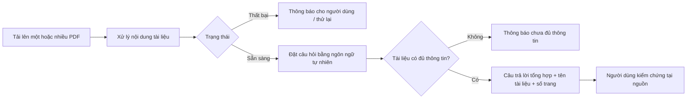

# Business Requirements Document (BRD)
# MVP – Ứng dụng AI Chat với tài liệu PDF

> **Chuẩn áp dụng:** IEEE 29148-2018 – Requirements engineering
> **Giai đoạn SDLC:** 5.2 Requirements and discovery
> **Đầu vào:** `doc/01-intake/*` (xem mục 2.2 – Nguồn bằng chứng)
> **Đầu ra kế tiếp:** PRD / SRS (truy vết theo mục 4.11)

---

## 0. Tóm tắt kiểm tra đầu vào (Validation summary)

**Đầu vào đã nhận**

| Tệp | Nội dung chính | Mức sử dụng |
|---|---|---|
| `01-intake/BRD_MVP_AI_Chat_PDF.md` | Bối cảnh, mục tiêu, 6 tính năng FR-01…FR-06, NFR định tính, 7 kịch bản nghiệm thu, đề xuất BA, câu hỏi mở | Nguồn chính (SRC-001) |
| `01-intake/intent.md` | Vấn đề, kết quả mong muốn, ràng buộc, thước đo thành công, out-of-scope, 7 câu hỏi mở | SRC-008 |
| `01-intake/stakeholders.md` | 6 nhóm stakeholder (giả định ban đầu) | SRC-009 |
| `01-intake/approval.md` | AC cấp MVP, risk tier đề xuất Medium, owner, quyết định cần có | SRC-010 |
| `01-intake/glossary.md` | 15 thuật ngữ | SRC-011 |
| `01-intake/sources.md` | Danh mục nguồn SRC-01…SRC-07 (phần lớn chưa thu thập) | SRC-002…SRC-007 |
| `templates/BRD_Prompt_IEEE_standard.md` §2.1 | Brief của quản lý (bối cảnh giả sử) | SRC-012 |

**Thông tin còn thiếu**

- Không có số liệu nền (baseline) nào: thời gian tìm kiếm hiện tại, số lượng tài liệu, số người dùng → mọi mục tiêu định lượng đang ở trạng thái `[TBD]`.
- Chưa có tên người cho PO, Sponsor, người phê duyệt; chưa có timeline và ngân sách.
- Chưa phỏng vấn PO / người dùng (SRC-002, SRC-003), chưa có PDF mẫu (SRC-004), chưa chọn nhà cung cấp AI (SRC-005), chưa có chính sách bảo mật/lưu trữ (SRC-006).

**Ba rủi ro lớn nhất đối với chất lượng yêu cầu**

1. **Không kiểm chứng được lợi ích** – thiếu baseline cho MET-001…MET-005 (OQ-008, OQ-009).
2. **Phạm vi người dùng và quyền truy cập chưa chốt** – ảnh hưởng trực tiếp BR-022, BR-023 và kiến trúc (OQ-001, OQ-002).
3. **Chưa có ngưỡng định lượng** (dung lượng file, số file, thời gian phản hồi, độ chính xác) – các BR Must liên quan chưa thể nghiệm thu khách quan (OQ-003, OQ-006, OQ-009).

---

## 4.1 Kiểm soát tài liệu (Document control)

| Trường | Giá trị |
|---|---|
| Tiêu đề | BRD – MVP Ứng dụng AI Chat với tài liệu PDF |
| Mã tài liệu | BRD-AICHAT-001 |
| Phiên bản | 0.2 |
| Trạng thái | **Draft** |
| Tác giả | Business Analyst – `[TBD: OQ-007]` |
| Người đóng góp | Product Owner, Tech Lead, QA, IT/Security – `[TBD: OQ-007]` |
| Người review | Product Owner, Tech Lead, QA, IT/Security |
| Người phê duyệt | Executive sponsor / Product Owner – `[TBD: OQ-007]` |
| Phân loại bảo mật | Nội bộ (Internal) |

**Lịch sử phiên bản**

| Phiên bản | Ngày | Tác giả | Tóm tắt thay đổi |
|---|---|---|---|
| 0.1 | 2026-10-23 | BA | Bản nháp đầu tiên theo IEEE 29148, tổng hợp từ `doc/01-intake/` |
| 0.2 | 2026-10-23 | BA | Sửa theo review checklist IEEE 29148 (`BRD_IEEE_29148_Checklist.xlsx`): thêm tầm nhìn (DEF-011), thêm BO-006/MET-007 và ánh xạ SN → BO (DEF-012), tách nghĩa vụ BR-022 (DEF-005), sửa AC-015 (DEF-004), viết lại lý do BR-005/006/010/012/014 (DEF-008), thêm OQ-019 |

**Danh sách phân phối:** Executive sponsor, Product Owner, BA, Tech Lead/Developer, QA/Tester, IT/Security.

---

## 4.2 Tóm tắt điều hành (Executive summary)

**Tầm nhìn.** Mọi thành viên đội phát triển kinh doanh có thể hỏi và nhận ngay câu trả lời có dẫn nguồn từ toàn bộ tài liệu PDF của dự án, thay vì tự đọc và tổng hợp thủ công. Mục tiêu chiến lược của tổ chức mà sáng kiến này hỗ trợ: `[TBD: OQ-019]`.

**Vấn đề.** Đội phát triển kinh doanh làm việc với nhiều tài liệu PDF (sản phẩm, dịch vụ, thị trường, chính sách). Mỗi lần cần một thông tin, họ phải đọc và tổng hợp thủ công từ nhiều file, tốn thời gian và dễ bỏ sót (SRC-001, SRC-008, SRC-012). Mức độ thiệt hại định lượng (giờ công/tuần, số lần tra cứu) **chưa được đo** `[TBD: OQ-008]`.

**Thay đổi đề xuất.** Xây dựng một ứng dụng web MVP cho phép người dùng tải lên PDF, đặt câu hỏi bằng ngôn ngữ tự nhiên và nhận câu trả lời tổng hợp từ một hoặc nhiều tài liệu, kèm tên tài liệu và số trang tham chiếu; khi tài liệu không chứa thông tin, ứng dụng nói rõ là chưa đủ thông tin thay vì suy diễn (SRC-001).

**Lợi ích kỳ vọng.** Giảm thời gian tìm kiếm/tổng hợp thông tin (MET-001), câu trả lời có căn cứ và kiểm chứng được (MET-002, MET-004, MET-005), hỗ trợ tổng hợp đa tài liệu (MET-003), không lộ tài liệu cho người không có quyền (MET-007). Giá trị mục tiêu `[TBD: OQ-009]`.

**Đầu tư, thời gian, rủi ro chính.** Ngân sách và timeline `[TBD: OQ-015]`. Risk tier đề xuất **Medium** (SRC-010). Rủi ro chính: AI trả lời sai/không căn cứ (RSK-001), lộ tài liệu nội bộ, bao gồm qua nhà cung cấp AI bên ngoài (RSK-002), PDF không trích xuất được văn bản (RSK-003).

**Quyết định cần từ người phê duyệt.**
1. Xác nhận vấn đề, mục tiêu và phạm vi MVP tại mục 4.3–4.5.
2. Chốt các câu hỏi mở chặn baseline: OQ-001, OQ-002, OQ-003, OQ-005, OQ-006, OQ-007.
3. Chỉ định PO và phê duyệt chuyển sang giai đoạn PRD/SRS khi các điều kiện tại mục 4.14 được đáp ứng.

---

## 4.3 Bối cảnh nghiệp vụ và phát biểu vấn đề

### 4.3.1 Quy trình hiện tại (current state)

Theo SRC-001 và SRC-008, khi cần một thông tin, người dùng phải tự xác định tài liệu liên quan, mở và đọc từng file, rồi tự đối chiếu và tổng hợp.

### 4.3.2 Quy trình đề xuất (proposed state)

### 4.3.3 Ai bị ảnh hưởng và như thế nào

| Nhóm | Ảnh hưởng hiện tại | Bằng chứng |
|---|---|---|
| Đội phát triển kinh doanh (người dùng cuối) | Mất thời gian đọc, tìm, đối chiếu nhiều PDF; dễ bỏ sót thông tin | SRC-001 §1, SRC-008 §1, SRC-012 |
| Quản lý / Sponsor | Hiệu suất đội giảm; khó khai thác thông tin phục vụ công việc | SRC-001 §1, SRC-012 |
| Nhóm phát triển và vận hành | Cần xây dựng và vận hành công cụ mới | SRC-008 §3 |

### 4.3.4 Chi phí của việc không hành động

- Thời gian tra cứu thủ công tiếp tục lặp lại mỗi lần cần thông tin – mức giờ công `[TBD: OQ-008]`.
- Rủi ro bỏ sót hoặc dùng thông tin không đầy đủ khi ra quyết định kinh doanh (SRC-008 §1) – chưa có số liệu `[Unverified]`.
- Chưa có tác động tuân thủ/pháp lý nào được ghi nhận trong đầu vào.

### 4.3.5 Nguyên nhân gốc và triệu chứng

| Triệu chứng | Nguyên nhân gốc | Nguồn |
|---|---|---|
| Mất nhiều thời gian tìm một thông tin | Không có cách tra cứu theo nội dung xuyên suốt nhiều tài liệu; phải đọc tuần tự | SRC-001, SRC-008 |
| Dễ bỏ sót thông tin | Thông tin phân tán trên nhiều file; tổng hợp phụ thuộc trí nhớ và thao tác thủ công | SRC-008 |
| Khó kiểm chứng thông tin đã tổng hợp | Kết quả tổng hợp thủ công không ghi lại nguồn (tài liệu, trang) | SRC-001 §8 `[Unverified]` – suy luận từ đề xuất BA |

### 4.3.6 Vì sao làm ngay

Quản lý đã yêu cầu xây dựng MVP (SRC-012) với ưu tiên "ra mắt nhanh" (SRC-001 §2). Hạn chót cụ thể và tác nhân kích hoạt kinh doanh `[TBD: OQ-015]`.

---

## 4.4 Động lực và mục tiêu kinh doanh

| ID | Động lực | Mục tiêu (kết quả) | Metric | Baseline | Target | Thời hạn | Nguồn |
|---|---|---|---|---|---|---|---|
| BO-001 | Tra cứu thủ công tốn thời gian | Giảm thời gian tìm kiếm và tổng hợp thông tin từ nhiều PDF | MET-001 | `[TBD: OQ-008]` | `[TBD: OQ-009]` | `[TBD: OQ-015]` | SRC-001 §2, SRC-008 |
| BO-002 | Người dùng phải đọc từng file | Người dùng truy xuất được thông tin đúng bằng câu hỏi ngôn ngữ tự nhiên | MET-002 | Chưa áp dụng (năng lực mới) | `[TBD: OQ-009]` | `[TBD: OQ-015]` | SRC-001 §2 |
| BO-003 | Thông tin phân tán trên nhiều tài liệu | Người dùng nhận được câu trả lời tổng hợp từ nhiều tài liệu | MET-003 | Chưa áp dụng | `[TBD: OQ-009]` | `[TBD: OQ-015]` | SRC-001 §2, §8 |
| BO-004 | Rủi ro ra quyết định dựa trên câu trả lời AI không căn cứ | Mọi câu trả lời kiểm chứng được tại nguồn; không có câu trả lời suy diễn | MET-004, MET-005 | Chưa áp dụng | `[TBD: OQ-009]` | `[TBD: OQ-015]` | SRC-001 §8, SRC-010 §3 |
| BO-005 | Cần sớm có sản phẩm hoạt động thực tế | Đưa MVP vào sử dụng với luồng Tải PDF → Xử lý → Hỏi → Trả lời có nguồn | MET-006 | 0/7 kịch bản đạt | 7/7 kịch bản nghiệm thu đạt | `[TBD: OQ-015]` | SRC-001 §2, §7 |
| BO-006 | Tài liệu kinh doanh có thể chứa thông tin nội bộ/nhạy cảm | Đưa tài liệu vào công cụ AI mà không làm lộ tài liệu cho người không có quyền | MET-007 | Chưa áp dụng | 0 sự cố `[Unverified – PO/IT-Security xác nhận]` | Từ go-live | SRC-001 §6, SRC-008 §4, SRC-010 §3 |

### Định nghĩa metric

| ID | Định nghĩa | Công thức | Nguồn dữ liệu | Owner | Tần suất | Ngày baseline |
|---|---|---|---|---|---|---|
| MET-001 | Thời gian trung bình để người dùng có câu trả lời chấp nhận được cho một câu hỏi nghiệp vụ cần tra cứu PDF | Σ(thời gian từ lúc bắt đầu tra cứu đến khi có câu trả lời) / số câu hỏi | Đo thử có kiểm soát trên cùng bộ câu hỏi: trước (thủ công) và sau (dùng công cụ) | BA | Một lần trước go-live, một lần sau go-live `[TBD: OQ-015]` | `[TBD: OQ-008]` |
| MET-002 | Tỷ lệ câu trả lời đúng và có căn cứ trên bộ câu hỏi kiểm thử có đáp án nằm trong tài liệu | Số câu được người đánh giá xác nhận đúng và có căn cứ / tổng số câu × 100% | Bộ câu hỏi kiểm thử (DEP-005) + đánh giá của người dùng nghiệp vụ | QA + PO | Mỗi đợt nghiệm thu | Chưa áp dụng |
| MET-003 | Tỷ lệ câu hỏi đa tài liệu được trả lời đầy đủ | Số câu hỏi mà câu trả lời bao gồm thông tin từ tất cả tài liệu liên quan theo đáp án chuẩn / tổng số câu hỏi đa tài liệu × 100% | Bộ câu hỏi kiểm thử đa tài liệu (DEP-005) | QA | Mỗi đợt nghiệm thu | Chưa áp dụng |
| MET-004 | Tỷ lệ câu trả lời có nguồn tham chiếu chính xác | Số câu trả lời có tên tài liệu đúng (và số trang đúng khi có) / tổng số câu trả lời có căn cứ × 100% | Bộ câu hỏi kiểm thử, đối chiếu với PDF gốc | QA | Mỗi đợt nghiệm thu | Chưa áp dụng |
| MET-005 | Tỷ lệ từ chối đúng với câu hỏi không có thông tin trong tài liệu | Số câu trả lời "chưa đủ thông tin" / tổng số câu hỏi ngoài nội dung tài liệu × 100% | Bộ câu hỏi "ngoài tài liệu" trong DEP-005 | QA | Mỗi đợt nghiệm thu | Chưa áp dụng |
| MET-006 | Số kịch bản nghiệm thu MVP đạt | Số kịch bản AC-01…AC-07 (SRC-001 §7) đạt / 7 | Biên bản kiểm thử nghiệm thu | QA | Một lần tại nghiệm thu MVP | 2026-10-23 (0/7) |
| MET-007 | Số sự cố người dùng xem được tên, nội dung hoặc nguồn tham chiếu của tài liệu ngoài phạm vi quyền | Đếm số sự cố được phát hiện hoặc báo cáo | Kiểm thử phân quyền (AC-022, AC-023) trước go-live; báo cáo sự cố sau go-live | IT/Security | Mỗi đợt nghiệm thu; liên tục sau go-live | Chưa áp dụng |

### Ánh xạ nhu cầu stakeholder → mục tiêu kinh doanh

| Nhu cầu | Mục tiêu | Lý do |
|---|---|---|
| SN-001 | BO-001 | Không phải đọc thủ công từng file → giảm thời gian tra cứu |
| SN-002 | BO-002 | Hỏi bằng ngôn ngữ tự nhiên là chính nội dung của BO-002 |
| SN-003 | BO-003 | Tổng hợp nhiều tài liệu |
| SN-004 | BO-004 | Kiểm chứng tại nguồn |
| SN-005 | BO-001 | Biết ngay khi nào hỏi được → không mất thời gian chờ hoặc hỏi nhầm |
| SN-006 | BO-004 | Không có câu trả lời suy diễn |
| SN-007 | BO-004 | Tài liệu lỗi thời bị loại khỏi căn cứ trả lời |
| SN-008 | BO-005 | Luồng chính vẫn dùng được khi có lỗi |
| SN-009 | BO-005 | Phạm vi rõ để ra mắt nhanh |
| SN-010 | BO-006 | Bảo vệ tài liệu |
| SN-011 | BO-005 | Có giới hạn định lượng để ước lượng và triển khai |
| SN-012 | BO-005 | Nghiệm thu khách quan (MET-006) |
| SN-013 | BO-001 | Nhu cầu của Sponsor chính là giảm thời gian tổng hợp |
| SN-014 | BO-005 | Có người hỗ trợ khi đưa vào sử dụng |
| SN-015 | BO-001 | Dùng được ngay không cần hướng dẫn → tiết kiệm thời gian |

> Một mục tiêu không có baseline và phương pháp đo không phải mục tiêu hợp lệ. BO-001…BO-004 hiện **chưa hợp lệ hoàn toàn** cho tới khi OQ-008 và OQ-009 được giải quyết.

---

## 4.5 Phạm vi (Scope)

### Trong phạm vi

| Hạng mục | Nội dung | Nguồn |
|---|---|---|
| Năng lực nghiệp vụ | Tải lên PDF; quản lý danh sách tài liệu và trạng thái; xử lý nội dung; hỏi đáp bằng ngôn ngữ tự nhiên; hỏi đáp trên nhiều tài liệu; hiển thị nguồn tham chiếu; xóa tài liệu | SRC-001 §3.1, §4 |
| Quy trình | Upload PDF → Xử lý tài liệu → Đặt câu hỏi → Nhận câu trả lời có nguồn dẫn chứng | SRC-001 §3.2, Kết luận |
| Đơn vị tổ chức | Đội phát triển kinh doanh (nhóm người dùng đầu tiên cụ thể `[TBD: OQ-010]`) | SRC-012 |
| Kênh | Ứng dụng web | SRC-001 §2, SRC-012 |
| Miền dữ liệu | Tài liệu PDF có văn bản trích xuất được; câu hỏi và câu trả lời trong phiên chat | SRC-001 §4 FR-03 |
| Địa lý / ngôn ngữ | `[TBD: OQ-011]` | — |

### Ngoài phạm vi

| Hạng mục | Lý do | Nguồn |
|---|---|---|
| Định dạng khác PDF (Word, Excel, PowerPoint…) | Rút ngắn thời gian phát triển MVP | SRC-001 §5, SRC-008 §6 |
| OCR cho PDF scan / dạng hình ảnh | Rút ngắn thời gian phát triển MVP | SRC-001 §4 FR-03, §5 |
| Chia sẻ tài liệu, cộng tác nhóm, phân quyền chi tiết | Rút ngắn thời gian phát triển MVP | SRC-001 §5 |
| Tích hợp Google Drive, SharePoint, hệ thống quản lý tài liệu khác | Rút ngắn thời gian phát triển MVP | SRC-001 §5 |
| Quản lý phiên bản tài liệu và lịch sử thay đổi | Rút ngắn thời gian phát triển MVP | SRC-001 §5 |
| Xuất câu trả lời ra Word, Excel, PDF | Rút ngắn thời gian phát triển MVP | SRC-001 §5 |
| Đánh giá, huấn luyện, tinh chỉnh mô hình AI riêng | Rút ngắn thời gian phát triển MVP | SRC-001 §5 |
| Dashboard thống kê, báo cáo sử dụng nâng cao | Rút ngắn thời gian phát triển MVP | SRC-001 §5 |
| Quản lý hội thoại nâng cao, phân tích dữ liệu | BA khuyến nghị chưa phát triển ở giai đoạn này | SRC-001 §8 |

### Hoãn lại (Deferred)

Các mục ngoài phạm vi trên được xem là ứng viên cho giai đoạn sau; thứ tự ưu tiên `[TBD: PO]`. Việc lưu lịch sử chat qua nhiều phiên cũng chưa được quyết định (OQ-012).

### Ranh giới

- **Bắt đầu:** khi người dùng chọn file PDF trên thiết bị của mình để tải lên.
- **Kết thúc:** khi người dùng nhận được câu trả lời kèm nguồn tham chiếu (hoặc thông báo chưa đủ thông tin). Việc người dùng sử dụng thông tin cho quyết định kinh doanh nằm ngoài ranh giới.
- Không có chương trình liền kề nào được xác định trong đầu vào.

---

## 4.6 Stakeholder và nhu cầu

> Danh sách là giả định ban đầu, cần xác nhận tên người và trách nhiệm thực tế (SRC-009).

| ID | Stakeholder / nhóm | Vai trò | Mối quan tâm | Ảnh hưởng | Nhu cầu | Nguồn |
|---|---|---|---|---|---|---|
| STK-001 | Quản lý giao yêu cầu (Executive sponsor – dự kiến) | Đặt yêu cầu xây dựng MVP | Đội kinh doanh khai thác thông tin nhanh hơn | High | SN-013 | SRC-012 |
| STK-002 | Product Owner | Quyết định phạm vi, ưu tiên, phê duyệt và nghiệm thu | MVP giải quyết đúng vấn đề; phạm vi và tiêu chí thành công rõ ràng | High | SN-009 | SRC-009, SRC-010 |
| STK-003 | Người dùng cuối – đội phát triển kinh doanh | Tải PDF và hỏi đáp với tài liệu | Dễ dùng, câu trả lời hữu ích, có nguồn để kiểm chứng | High (quyết định mức độ chấp nhận) | SN-001…SN-008, SN-015 | SRC-001, SRC-009 |
| STK-004 | Business Analyst | Thu thập, làm rõ yêu cầu, quản lý câu hỏi mở | Yêu cầu rõ ràng, thống nhất | Medium | SN-011 | SRC-009 |
| STK-005 | Tech Lead / Developer | Thiết kế và phát triển | Phạm vi khả thi, quy tắc rõ, giới hạn định lượng, tiêu chí nghiệm thu | Medium | SN-011 | SRC-009 |
| STK-006 | QA / Tester | Kiểm thử luồng và điều kiện nghiệm thu | Kiểm thử được upload, xử lý, hỏi đáp, nguồn, xóa | Medium | SN-012 | SRC-009 |
| STK-007 | IT / Security (nếu có) | Tư vấn lưu trữ, truy cập, bảo mật dữ liệu | Tài liệu được bảo vệ; kiểm soát dữ liệu gửi tới dịch vụ AI bên ngoài | High – **có thể chặn go-live** | SN-010 | SRC-009, SRC-010 |
| STK-008 | Nhóm vận hành / hỗ trợ | Hỗ trợ khi xử lý PDF hoặc AI bị lỗi | Trách nhiệm hỗ trợ rõ ràng | Low–Medium | SN-014 | SRC-008 §3, SRC-009 |
| STK-009 | Chủ sở hữu nội dung tài liệu (bộ phận ban hành tài liệu nội bộ) | Sở hữu thông tin trong PDF | Tài liệu nội bộ/nhạy cảm không bị lộ | Medium – có thể phản đối việc tải tài liệu lên | SN-010 | `[Unverified]` – suy luận từ SRC-010 §3 |

### Nhu cầu stakeholder

| ID | Stakeholder | Nhu cầu | Khó khăn hiện tại | Bằng chứng | Ưu tiên |
|---|---|---|---|---|---|
| SN-001 | STK-003 | Tìm được thông tin trong nhiều PDF mà không phải đọc thủ công từng file | Đọc tuần tự, tốn thời gian | SRC-001 §1, SRC-008 §1 | Must |
| SN-002 | STK-003 | Hỏi bằng ngôn ngữ tự nhiên và hỏi tiếp nhiều câu liên tiếp | Phải tự dò tìm từ khóa trong từng file | SRC-001 §2, §4 FR-04 | Must |
| SN-003 | STK-003 | Nhận một câu trả lời tổng hợp từ nhiều tài liệu | Tự đối chiếu, dễ bỏ sót | SRC-001 §4 FR-05, §8 | Must |
| SN-004 | STK-003 | Kiểm chứng được câu trả lời tại tài liệu và trang nguồn | Không biết thông tin lấy từ đâu | SRC-001 §4 FR-06, §8 | Must |
| SN-005 | STK-003 | Biết khi nào tài liệu sẵn sàng để hỏi | Nhầm lẫn khi file chưa sẵn sàng | SRC-001 §8 | Must |
| SN-006 | STK-003 | Không nhận câu trả lời suy diễn khi tài liệu không có thông tin | Rủi ro quyết định dựa trên thông tin không căn cứ | SRC-001 §4 FR-04, §8 | Must |
| SN-007 | STK-003 | Loại bỏ tài liệu không còn dùng khỏi phạm vi hỏi đáp | Tài liệu cũ có thể làm sai câu trả lời | SRC-001 §4 FR-02 | Must |
| SN-008 | STK-003 | Được thông báo khi tải lên, xử lý hoặc truy vấn thất bại và thử lại được | Không biết thao tác có thành công hay không | SRC-001 §6 | Must |
| SN-009 | STK-002 | Phạm vi MVP và tiêu chí thành công rõ ràng để ra mắt nhanh | Phạm vi chưa chốt | SRC-009, SRC-001 §2 | Must |
| SN-010 | STK-007, STK-009 | Chỉ người được phép truy cập tài liệu; kiểm soát được dữ liệu gửi ra ngoài | Chưa xác định nơi lưu và nhà cung cấp AI | SRC-001 §6, SRC-010 §3 | Must |
| SN-011 | STK-004, STK-005 | Có giới hạn định lượng và quy tắc xử lý rõ ràng để ước lượng và thiết kế | Chỉ tiêu định lượng chưa có | SRC-001 §6, §9 | Must |
| SN-012 | STK-006 | Có tiêu chí nghiệm thu kiểm thử được khách quan | AC hiện tại còn định tính | SRC-009, SRC-010 §2 | Must |
| SN-013 | STK-001 | Đội kinh doanh giảm thời gian tổng hợp thông tin | Hiệu suất giảm | SRC-012, SRC-001 §1 | Must |
| SN-014 | STK-008 | Biết rõ ai chịu trách nhiệm vận hành và hỗ trợ khi có lỗi | Chưa phân công | SRC-009 "Cần xác nhận" | Should |
| SN-015 | STK-003 | Thực hiện được hai thao tác chính (tải tài liệu, chat) mà không cần hướng dẫn | — | SRC-001 §6 | Should |

---

## 4.7 Yêu cầu nghiệp vụ (Business requirements)

**Thang ưu tiên (MoSCoW):** Must – thiếu thì MVP thất bại; Should – giá trị đáng kể, có cách xoay xở; Could – mong muốn; Won't – loại trừ khỏi bản phát hành này (xem mục 4.5 Ngoài phạm vi).

> "Ứng dụng" trong các yêu cầu dưới đây là giải pháp nghiệp vụ nói chung, không chỉ định công nghệ.

### 4.7.1 Tiếp nhận tài liệu

| ID | Yêu cầu | Lý do | Nguồn | Ưu tiên | AC | Kiểm chứng | Trạng thái |
|---|---|---|---|---|---|---|---|
| BR-001 | Người dùng **shall** tải lên được một file PDF từ thiết bị của mình vào ứng dụng. | Điểm bắt đầu của luồng chính | BO-005 / SN-001 | Must | AC-001 | Test | Draft |
| BR-002 | Người dùng **shall** tải lên được nhiều file PDF trong một lần thao tác, tối đa `[TBD: OQ-003]` file. | FR-01 "một hoặc nhiều file" | BO-003 / SN-001 | Must | AC-002 | Test | Draft – chờ OQ-003 |
| BR-003 | Khi file được tải lên không phải PDF, ứng dụng **shall** từ chối file đó và thông báo cho người dùng rằng file không hợp lệ. | Tránh tài liệu không xử lý được | BO-005 / SN-008 | Must | AC-003 | Test | Draft |
| BR-004 | Khi file vượt dung lượng tối đa `[TBD: OQ-003]` MB, ứng dụng **shall** từ chối file đó và thông báo lý do cho người dùng. | Giới hạn quy mô MVP | BO-005 / SN-008, SN-011 | Must | AC-004 | Test | Draft – chờ OQ-003 |

### 4.7.2 Xử lý và quản lý tài liệu

| ID | Yêu cầu | Lý do | Nguồn | Ưu tiên | AC | Kiểm chứng | Trạng thái |
|---|---|---|---|---|---|---|---|
| BR-005 | Sau khi một tài liệu được tải lên thành công, ứng dụng **shall** bắt đầu xử lý nội dung tài liệu mà không cần người dùng thao tác thêm. | Người dùng không phải nhớ làm thêm một bước xử lý; tài liệu sẵn sàng sớm nhất có thể (FR-01, FR-03) | BO-001 / SN-001 | Must | AC-005 | Test | Draft |
| BR-006 | Ứng dụng **shall** hiển thị cho người dùng danh sách tài liệu trong phạm vi quyền của họ, gồm tên file và trạng thái xử lý của từng tài liệu. | Người dùng cần biết mình đã tải những gì và tài liệu nào đã dùng được để hỏi (FR-02) | BO-005 / SN-005 | Must | AC-006 | Demonstration | Draft |
| BR-007 | Khi một tài liệu chuyển sang trạng thái Sẵn sàng, ứng dụng **shall** cho người dùng biết tài liệu đó đã có thể dùng để hỏi đáp. | Đề xuất BA #1 – tránh nhầm lẫn | BO-001 / SN-005 | Must | AC-007 | Test | Draft |
| BR-008 | Khi xử lý một tài liệu thất bại, ứng dụng **shall** hiển thị trạng thái Thất bại cho tài liệu đó. | FR-02, FR-03, NFR ổn định | BO-005 / SN-008 | Must | AC-008 | Test | Draft |
| BR-009 | Người dùng **should** yêu cầu xử lý lại được một tài liệu ở trạng thái Thất bại. | NFR "cho phép thử lại khi phù hợp" | BO-005 / SN-008 | Should | AC-009 | Test | Draft |
| BR-010 | Người dùng **shall** xóa được một tài liệu khỏi danh sách tài liệu của mình. | Tài liệu lỗi thời còn nằm trong phạm vi hỏi đáp có thể làm câu trả lời sai (FR-02) | BO-004 / SN-007 | Must | AC-010 | Test | Draft |
| BR-011 | Sau khi một tài liệu bị xóa, ứng dụng **shall** không sử dụng nội dung của tài liệu đó làm căn cứ cho bất kỳ câu trả lời nào tiếp theo. | AC-07 intake | BO-004 / SN-007 | Must | AC-011 | Test | Draft |

### 4.7.3 Hỏi đáp với tài liệu

| ID | Yêu cầu | Lý do | Nguồn | Ưu tiên | AC | Kiểm chứng | Trạng thái |
|---|---|---|---|---|---|---|---|
| BR-012 | Người dùng **shall** đặt được câu hỏi bằng ngôn ngữ tự nhiên (ngôn ngữ hỗ trợ `[TBD: OQ-011]`) về nội dung các tài liệu Sẵn sàng. | Người dùng không phải biết trước từ khóa hay vị trí của thông tin trong tài liệu (FR-04) | BO-002 / SN-002 | Must | AC-012 | Test | Draft – chờ OQ-011 |
| BR-013 | Ứng dụng **shall** tạo câu trả lời chỉ dựa trên nội dung của các tài liệu ở trạng thái Sẵn sàng thuộc phạm vi truy vấn của người dùng. | FR-03, FR-04; chống suy diễn | BO-002, BO-004 / SN-006 | Must | AC-013 | Test | Draft – phạm vi truy vấn chờ OQ-018 |
| BR-014 | Người dùng **shall** đặt được nhiều câu hỏi liên tiếp trong cùng một phiên chat. | Một nhu cầu tra cứu thường cần nhiều câu hỏi để làm rõ; mở phiên mới cho mỗi câu làm mất thời gian (FR-04) | BO-002 / SN-002 | Must | AC-014 | Test | Draft – ngữ cảnh câu hỏi tiếp nối chờ OQ-012 |
| BR-015 | Khi các tài liệu trong phạm vi truy vấn không chứa đủ thông tin để trả lời, ứng dụng **shall** thông báo rõ cho người dùng rằng chưa đủ thông tin để trả lời. | FR-04, đề xuất BA #3 | BO-004 / SN-006 | Must | AC-015 | Test | Draft |
| BR-016 | Ứng dụng **shall** trả lời đúng và có căn cứ cho ít nhất `[TBD: OQ-009]`% câu hỏi trong bộ câu hỏi kiểm thử có đáp án nằm trong tài liệu. | NFR "Tính chính xác" | BO-002 / SN-006 | Must | AC-016 | Test + Analysis | Draft – chờ OQ-009, DEP-005 |

### 4.7.4 Hỏi đáp trên nhiều tài liệu

| ID | Yêu cầu | Lý do | Nguồn | Ưu tiên | AC | Kiểm chứng | Trạng thái |
|---|---|---|---|---|---|---|---|
| BR-017 | Khi câu trả lời cần thông tin từ hai tài liệu Sẵn sàng trở lên, ứng dụng **shall** trả về một câu trả lời tổng hợp bao gồm thông tin liên quan từ từng tài liệu đó. | FR-05; giá trị khác biệt cốt lõi (đề xuất BA #4) | BO-003 / SN-003 | Must | AC-017 | Test | Draft |
| BR-018 | Khi phát hiện thông tin giữa các tài liệu khác nhau hoặc mâu thuẫn, ứng dụng **should** nêu rõ sự khác biệt và tài liệu nguồn của từng thông tin. | FR-05 "nếu phát hiện được" | BO-004 / SN-003 | Should | AC-018 | Test | Draft |

### 4.7.5 Nguồn tham chiếu

| ID | Yêu cầu | Lý do | Nguồn | Ưu tiên | AC | Kiểm chứng | Trạng thái |
|---|---|---|---|---|---|---|---|
| BR-019 | Với mỗi câu trả lời dựa trên tài liệu, ứng dụng **shall** hiển thị tên của từng tài liệu nguồn được dùng làm căn cứ. | FR-06, đề xuất BA #2 | BO-004 / SN-004 | Must | AC-019 | Test | Draft |
| BR-020 | Khi xác định được số trang chứa thông tin, ứng dụng **shall** hiển thị số trang đó cùng với tên tài liệu nguồn. | FR-06 | BO-004 / SN-004 | Must | AC-020 | Test | Draft |
| BR-021 | Người dùng **should** truy cập được tài liệu gốc từ nguồn tham chiếu để kiểm chứng thông tin. | FR-06 "mở tài liệu gốc" | BO-004 / SN-004 | Should | AC-021 | Demonstration | Draft – chờ OQ-014 |

### 4.7.6 Truy cập và bảo vệ dữ liệu

| ID | Yêu cầu | Lý do | Nguồn | Ưu tiên | AC | Kiểm chứng | Trạng thái |
|---|---|---|---|---|---|---|---|
| BR-022 | Ứng dụng **shall** chỉ cho phép người dùng đã được cấp quyền truy cập ứng dụng. | NFR "Bảo mật cơ bản" – người ngoài không được tiếp cận tài liệu nội bộ | BO-006 / SN-010 | Must | AC-022 | Test | Draft – chờ OQ-001 |
| BR-023 | Ứng dụng **shall** không cung cấp cho người dùng bất kỳ tên, nội dung hay nguồn tham chiếu nào của tài liệu nằm ngoài phạm vi quyền của người dùng đó. | NFR "Bảo mật cơ bản", ràng buộc intent | BO-006 / SN-010 | Must | AC-023 | Test | Draft – chờ OQ-002 |

### 4.7.7 Phản hồi và chất lượng dịch vụ

| ID | Yêu cầu | Lý do | Nguồn | Ưu tiên | AC | Kiểm chứng | Trạng thái |
|---|---|---|---|---|---|---|---|
| BR-024 | Trong khi tài liệu đang được xử lý hoặc câu trả lời đang được tạo, ứng dụng **shall** cho người dùng biết thao tác đang được thực hiện. | NFR "Hiệu năng" – hiển thị rõ thời gian xử lý | BO-001 / SN-005 | Must | AC-024 | Demonstration | Draft |
| BR-025 | Ứng dụng **shall** trả lời một câu hỏi trong tối đa `[TBD: OQ-006]` giây cho ít nhất `[TBD: OQ-006]`% câu hỏi. | NFR "Hiệu năng" | BO-001 / SN-011 | Must | AC-025 | Test | Draft – chờ OQ-006 |
| BR-026 | Ứng dụng **shall** hoàn tất xử lý một tài liệu có dung lượng tối đa cho phép trong tối đa `[TBD: OQ-006]` phút. | NFR "Hiệu năng" | BO-001 / SN-011 | Must | AC-026 | Test | Draft – chờ OQ-003, OQ-006 |
| BR-027 | Khi tải lên hoặc truy vấn thất bại, ứng dụng **shall** thông báo cho người dùng rằng thao tác đã thất bại. | NFR "Tính ổn định" | BO-005 / SN-008 | Must | AC-027 | Test | Draft |
| BR-028 | Khi truy vấn thất bại, người dùng **should** gửi lại được câu hỏi đó mà không phải nhập lại nội dung. | NFR "cho phép thử lại khi phù hợp" | BO-005 / SN-008 | Should | AC-028 | Test | Draft |
| BR-029 | Người dùng lần đầu **should** hoàn thành luồng tải PDF → đặt câu hỏi → xem nguồn tham chiếu mà không cần hướng dẫn, với tỷ lệ ít nhất `[TBD: OQ-009]`% người tham gia thử nghiệm. | NFR "Tính dễ sử dụng" | BO-001 / SN-015 | Should | AC-029 | Test (usability) | Draft – chờ OQ-009 |

### 4.7.8 Tiêu chí nghiệm thu

> Ánh xạ với 7 kịch bản nghiệm thu của SRC-001 §7 / SRC-010 §2 được ghi trong cột "Intake AC".

| ID | BR | Tiêu chí nghiệm thu (quyết định được khách quan) | Intake AC |
|---|---|---|---|
| AC-001 | BR-001 | Tải 1 PDF có văn bản hợp lệ → tài liệu xuất hiện trong danh sách với trạng thái "Đang xử lý". | AC-01 |
| AC-002 | BR-002 | Chọn đúng N file PDF (N = giới hạn chốt tại OQ-003) trong một lần thao tác → cả N tài liệu xuất hiện trong danh sách; chọn N+1 file → người dùng được thông báo vượt giới hạn. | AC-01 |
| AC-003 | BR-003 | Tải lần lượt một file .docx, một file .jpg và một file đổi phần mở rộng thành .pdf nhưng không phải PDF → cả 3 bị từ chối, có thông báo không hợp lệ, không xuất hiện trong danh sách. | AC-02 |
| AC-004 | BR-004 | Tải 1 PDF lớn hơn giới hạn dung lượng → bị từ chối, thông báo nêu lý do vượt dung lượng. | — |
| AC-005 | BR-005 | Sau khi tải lên, không có thao tác nào khác của người dùng, trạng thái tài liệu chuyển từ "Đang xử lý" sang "Sẵn sàng" hoặc "Thất bại". | AC-01 |
| AC-006 | BR-006 | Với 3 tài liệu ở 3 trạng thái khác nhau, danh sách hiển thị đúng tên file và đúng trạng thái của từng tài liệu. | — |
| AC-007 | BR-007 | Khi tài liệu chuyển sang "Sẵn sàng", người dùng thấy được thay đổi mà không cần tải lại danh sách thủ công. | AC-03 |
| AC-008 | BR-008 | Tải 1 PDF bị hỏng (không đọc được) → trạng thái "Thất bại" được hiển thị. Cách xử lý PDF scan theo OQ-013. | — |
| AC-009 | BR-009 | Với tài liệu "Thất bại", người dùng yêu cầu xử lý lại → trạng thái chuyển về "Đang xử lý". | — |
| AC-010 | BR-010 | Xóa 1 tài liệu → tài liệu không còn trong danh sách. | AC-07 |
| AC-011 | BR-011 | Hỏi một câu chỉ có đáp án trong tài liệu X, xóa X, hỏi lại đúng câu đó → câu trả lời không chứa thông tin từ X và không trích dẫn X. | AC-07 |
| AC-012 | BR-012 | Đặt 10 câu hỏi diễn đạt tự nhiên (không dùng cú pháp đặc biệt) bằng ngôn ngữ được chốt → nhận được câu trả lời cho cả 10 câu. | AC-03 |
| AC-013 | BR-013 | Khi tài liệu Y đang ở "Đang xử lý", hỏi câu chỉ có đáp án trong Y → câu trả lời không dùng và không trích dẫn Y. Hỏi câu có đáp án trong tài liệu Sẵn sàng → câu trả lời khớp nội dung tài liệu. | AC-03 |
| AC-014 | BR-014 | Đặt 5 câu hỏi liên tiếp trong cùng một phiên mà không phải tải lại tài liệu hay mở phiên mới → nhận được 5 câu trả lời. | AC-03 |
| AC-015 | BR-015 | Với bộ câu hỏi "ngoài tài liệu" (DEP-005), tỷ lệ câu trả lời "chưa đủ thông tin" ≥ `[TBD: OQ-009]`% (MET-005). Mỗi câu trả lời còn lại được người đánh giá ghi nhận là "có căn cứ" hoặc "suy diễn" để theo dõi xu hướng. | AC-05 |
| AC-016 | BR-016 | MET-002 trên bộ câu hỏi kiểm thử ≥ `[TBD: OQ-009]`%, do người dùng nghiệp vụ đánh giá. | AC-03, AC-04 |
| AC-017 | BR-017 | Với câu hỏi mà đáp án chuẩn nằm ở 2 tài liệu khác nhau → câu trả lời nêu thông tin từ cả 2 và trích dẫn cả 2 tài liệu; MET-003 ≥ `[TBD: OQ-009]`%. | AC-04 |
| AC-018 | BR-018 | Tải 2 tài liệu chứa giá trị khác nhau cho cùng một thông tin, hỏi về thông tin đó → câu trả lời nêu cả hai giá trị và tài liệu nguồn của mỗi giá trị. | AC-04 |
| AC-019 | BR-019 | Mọi câu trả lời có căn cứ trong bộ kiểm thử đều hiển thị tên tài liệu nguồn; tên tài liệu đúng với đáp án chuẩn (MET-004). | AC-06 |
| AC-020 | BR-020 | Với PDF có số trang trích xuất được, số trang hiển thị trùng với trang chứa thông tin trong PDF gốc cho ≥ `[TBD: OQ-009]`% câu trả lời. | AC-06 |
| AC-021 | BR-021 | Từ một nguồn tham chiếu, người dùng mở được đúng tài liệu gốc được trích dẫn (hình thức chốt tại OQ-014). | AC-06 |
| AC-022 | BR-022 | Người chưa được cấp quyền thử truy cập ứng dụng → bị từ chối; không xem được danh sách tài liệu, không tải lên được và không đặt được câu hỏi. | — |
| AC-023 | BR-023 | Người dùng A tải tài liệu riêng; người dùng B hỏi về nội dung chỉ có trong tài liệu đó → B không nhận được nội dung, tên hay nguồn của tài liệu đó (áp dụng khi OQ-002 chốt tài liệu là riêng). | — |
| AC-024 | BR-024 | Trong thời gian xử lý tài liệu và tạo câu trả lời, người dùng luôn thấy chỉ báo đang thực hiện. | — |
| AC-025 | BR-025 | Đo trên bộ câu hỏi kiểm thử: tỷ lệ câu trả lời trong ngưỡng thời gian ≥ ngưỡng chốt tại OQ-006. | — |
| AC-026 | BR-026 | Tải 1 PDF ở dung lượng tối đa → trạng thái chuyển sang "Sẵn sàng" trong ngưỡng thời gian chốt tại OQ-006. | — |
| AC-027 | BR-027 | Mô phỏng lỗi tải lên và lỗi truy vấn → người dùng nhận được thông báo thất bại trong cả hai trường hợp. | — |
| AC-028 | BR-028 | Sau một truy vấn thất bại, người dùng gửi lại câu hỏi mà không gõ lại → câu hỏi được gửi đúng nội dung ban đầu. | — |
| AC-029 | BR-029 | Thử nghiệm với ≥ `[TBD: OQ-009]` người dùng lần đầu: tỷ lệ hoàn thành luồng không cần hỗ trợ ≥ ngưỡng chốt. | — |

---

## 4.8 Quy tắc nghiệp vụ (Business rules)

| ID | Quy tắc | Loại | Phạm vi | Owner thực thi | Nguồn |
|---|---|---|---|---|---|
| BRU-001 | Mỗi tài liệu tại một thời điểm có đúng một trong ba trạng thái: Đang xử lý, Sẵn sàng, Thất bại. | Decision | Quản lý tài liệu | PO | SRC-001 §4 FR-02 |
| BRU-002 | Chỉ tài liệu ở trạng thái Sẵn sàng mới được dùng để trả lời câu hỏi. | Policy | Hỏi đáp | PO | SRC-001 §4 FR-03, SRC-008 §4 |
| BRU-003 | Tài liệu đã xóa không được dùng cho bất kỳ câu trả lời nào sau thời điểm xóa. | Policy | Hỏi đáp, quản lý tài liệu | PO | SRC-001 §7 AC-07 |
| BRU-004 | Trong MVP chỉ chấp nhận PDF có văn bản trích xuất được; PDF scan/hình ảnh không được hỗ trợ. | Policy | Tiếp nhận tài liệu | PO | SRC-001 §4 FR-03, SRC-008 §4 |
| BRU-005 | Câu trả lời chỉ được chứa thông tin có căn cứ trong tài liệu; khi không đủ căn cứ phải nói rõ là chưa đủ thông tin. | Policy | Hỏi đáp | PO | SRC-001 §4 FR-04, §6 |
| BRU-006 | Người dùng chỉ được truy vấn và xem tài liệu trong phạm vi quyền của mình. Định nghĩa "phạm vi quyền" `[TBD: OQ-001, OQ-002]`. | Policy / Security | Toàn bộ ứng dụng | IT/Security, PO | SRC-001 §6, SRC-008 §4 |

---

## 4.9 Ràng buộc (Constraints)

| ID | Ràng buộc | Loại | Áp đặt bởi | Tác động | Nguồn |
|---|---|---|---|---|---|
| CON-001 | Giải pháp được cung cấp dưới dạng ứng dụng web. | Organizational | Quản lý (STK-001) | Loại trừ ứng dụng desktop/mobile native cho MVP | SRC-012, SRC-001 §2 |
| CON-002 | MVP chỉ hỗ trợ định dạng PDF. | Organizational (phạm vi) | PO / BA | Loại trừ Word, Excel, PowerPoint | SRC-001 §5, SRC-008 §6 |
| CON-003 | MVP không hỗ trợ OCR cho PDF scan/hình ảnh. | Organizational (phạm vi) | PO / BA | Tài liệu scan không khai thác được | SRC-001 §4, §5 |
| CON-004 | Không huấn luyện hoặc tinh chỉnh mô hình AI riêng. | Organizational (phạm vi) | PO / BA | Phải dùng mô hình AI sẵn có | SRC-001 §5 |
| CON-005 | Ưu tiên tính năng thiết yếu để ra mắt nhanh; chỉ bổ sung tính năng khi cần để hoàn thiện luồng chính hoặc bảo đảm an toàn sử dụng. | Time | Quản lý / PO | Giới hạn phạm vi MVP | SRC-001 §2, Kết luận |
| CON-006 | Ngân sách và hạn chót. | Budget / Time | `[TBD: OQ-015]` | Chưa xác định | — |
| CON-007 | Chính sách bảo mật và lưu trữ dữ liệu doanh nghiệp. | Regulatory / Organizational | IT/Security | Chưa xác định – có thể giới hạn lựa chọn nhà cung cấp AI và nơi lưu trữ | SRC-006 `[TBD: OQ-005]` |

---

## 4.10 Giả định, phụ thuộc và rủi ro

| ID | Hạng mục | Loại | Mô tả | Tác động nếu sai | Owner | Xác nhận / giảm thiểu | Hạn |
|---|---|---|---|---|---|---|---|
| ASM-001 | PDF chủ yếu có văn bản | Assumption | Phần lớn PDF của đội kinh doanh là PDF có văn bản trích xuất được, không phải bản scan | Nhiều tài liệu không dùng được → giá trị MVP giảm mạnh | BA | Phân tích bộ PDF mẫu (SRC-004): đếm tỷ lệ PDF scan | Trước baseline BRD |
| ASM-002 | Người dùng đầu tiên | Assumption | Nhóm người dùng đầu tiên là đội phát triển kinh doanh nội bộ | Sai đối tượng → sai nhu cầu và metric | BA / PO | Xác nhận khi phỏng vấn PO (SRC-002) | Trước baseline BRD |
| ASM-003 | Số trang xác định được | Assumption | Với PDF có văn bản, có thể xác định số trang chứa thông tin | BR-020 khó đạt; giảm khả năng kiểm chứng | Tech Lead | Thử nghiệm với PDF mẫu (SRC-004, SRC-007) | Trước PRD/SRS |
| ASM-004 | Có dịch vụ AI phù hợp | Assumption | Có dịch vụ AI đáp ứng được yêu cầu bảo mật và chi phí của doanh nghiệp | Không thể triển khai hoặc phải thay đổi phạm vi | Tech Lead / IT-Security | Đánh giá nhà cung cấp (SRC-005) | Trước PRD/SRS |
| DEP-001 | Quyết định nhà cung cấp AI | Dependency | Chọn nhà cung cấp AI và cách dữ liệu được xử lý | Chặn thiết kế, ước lượng chi phí, phê duyệt bảo mật | PO + IT/Security | Theo dõi qua OQ-005 | Trước PRD/SRS |
| DEP-002 | Chính sách bảo mật/lưu trữ | Dependency | Chính sách doanh nghiệp về quyền truy cập, thời gian lưu, xóa dữ liệu | Chặn BR-022, BR-023 và quy định lưu trữ | IT/Security | Thu thập SRC-006 | Trước baseline BRD |
| DEP-003 | Bộ PDF mẫu thực tế | Dependency | PDF thực tế được phép dùng cho kiểm thử | Không kiểm chứng được ASM-001, ASM-003, các AC | BA / người dùng | Thu thập SRC-004 | Trước PRD/SRS |
| DEP-004 | Chỉ định PO và người phê duyệt | Dependency | Có người quyết định phạm vi và nghiệm thu | Không thể phê duyệt BRD | Quản lý (STK-001) | Theo dõi qua OQ-007 | Ngay |
| DEP-005 | Bộ câu hỏi kiểm thử có đáp án chuẩn | Dependency | Bộ câu hỏi (trong tài liệu, đa tài liệu, ngoài tài liệu) kèm đáp án và trang nguồn | Không đo được MET-002…MET-005 | BA + người dùng nghiệp vụ | Xây dựng cùng bộ PDF mẫu | Trước nghiệm thu |
| RSK-001 | AI trả lời sai / không căn cứ | Risk | AI tạo thông tin không có trong tài liệu → người dùng tin và dùng → quyết định kinh doanh sai | High | PO | BR-013, BR-015, BR-019, BRU-005; đo MET-002, MET-005 trước go-live | Liên tục |
| RSK-002 | Lộ tài liệu nội bộ | Risk | Tài liệu nhạy cảm được gửi tới dịch vụ bên ngoài hoặc phân quyền sai → lộ thông tin cho bên không có quyền | High | IT/Security | Chốt OQ-005, OQ-002; BR-022, BR-023; xem xét nâng risk tier lên High nếu có dữ liệu nhạy cảm (SRC-010) | Trước PRD/SRS |
| RSK-003 | PDF không trích xuất tốt | Risk | PDF scan hoặc bố cục phức tạp (bảng, nhiều cột) → nội dung thiếu → câu trả lời thiếu | Medium | Tech Lead | Kiểm tra ASM-001 với SRC-004; thông báo Thất bại rõ ràng (BR-008) | Trước PRD/SRS |
| RSK-004 | Không xác định được số trang | Risk | Không giữ được số trang → không hiển thị trang → khả năng kiểm chứng giảm | Medium | Tech Lead | Kiểm chứng ASM-003 | Trước PRD/SRS |
| RSK-005 | Không chứng minh được lợi ích | Risk | Không có baseline → không đo được MET-001 → khó quyết định đầu tư tiếp | Medium | BA | Thực hiện đo baseline (OQ-008) trước go-live | Trước go-live |
| RSK-006 | Phình phạm vi | Risk | Bổ sung tính năng ngoài luồng chính → trễ ra mắt | Medium | PO | Tuân thủ mục 4.5 và CON-005; mọi thay đổi qua PO | Liên tục |
| RSK-007 | Chi phí vận hành AI | Risk | Lượng câu hỏi/tài liệu lớn → chi phí dịch vụ AI vượt dự kiến | Medium `[Unverified]` | PO / Tech Lead | Chốt OQ-003, OQ-010, đánh giá giá nhà cung cấp (SRC-005) | Trước PRD/SRS |
| RSK-008 | Người dùng không tin dùng | Risk | Câu trả lời thiếu nguồn hoặc sai → người dùng quay lại tra cứu thủ công → không đạt BO-001 | Medium | PO | BR-019, BR-020; thu thập phản hồi sau go-live | Sau go-live |

**Risk tier tổng thể:** Medium (đề xuất, cần PO và IT/Security xác nhận – SRC-010 §3, OQ-017).

---

## 4.11 Truy vết (Traceability)

| Mục tiêu | Nhu cầu | Yêu cầu | AC | PRD/SRS |
|---|---|---|---|---|
| BO-005 | SN-001 | BR-001 | AC-001 | TBD |
| BO-003 | SN-001 | BR-002 | AC-002 | TBD |
| BO-005 | SN-008 | BR-003 | AC-003 | TBD |
| BO-005 | SN-008, SN-011 | BR-004 | AC-004 | TBD |
| BO-001 | SN-001 | BR-005 | AC-005 | TBD |
| BO-005 | SN-005 | BR-006 | AC-006 | TBD |
| BO-001 | SN-005 | BR-007 | AC-007 | TBD |
| BO-005 | SN-008 | BR-008 | AC-008 | TBD |
| BO-005 | SN-008 | BR-009 | AC-009 | TBD |
| BO-004 | SN-007 | BR-010 | AC-010 | TBD |
| BO-004 | SN-007 | BR-011 | AC-011 | TBD |
| BO-002 | SN-002 | BR-012 | AC-012 | TBD |
| BO-002, BO-004 | SN-006 | BR-013 | AC-013 | TBD |
| BO-002 | SN-002 | BR-014 | AC-014 | TBD |
| BO-004 | SN-006 | BR-015 | AC-015 | TBD |
| BO-002 | SN-006 | BR-016 | AC-016 | TBD |
| BO-003 | SN-003 | BR-017 | AC-017 | TBD |
| BO-004 | SN-003 | BR-018 | AC-018 | TBD |
| BO-004 | SN-004 | BR-019 | AC-019 | TBD |
| BO-004 | SN-004 | BR-020 | AC-020 | TBD |
| BO-004 | SN-004 | BR-021 | AC-021 | TBD |
| BO-006 | SN-010 | BR-022 | AC-022 | TBD |
| BO-006 | SN-010 | BR-023 | AC-023 | TBD |
| BO-001 | SN-005 | BR-024 | AC-024 | TBD |
| BO-001 | SN-011 | BR-025 | AC-025 | TBD |
| BO-001 | SN-011 | BR-026 | AC-026 | TBD |
| BO-005 | SN-008 | BR-027 | AC-027 | TBD |
| BO-005 | SN-008 | BR-028 | AC-028 | TBD |
| BO-001 | SN-015 | BR-029 | AC-029 | TBD |

### Báo cáo độ bao phủ

| Kiểm tra | Kết quả |
|---|---|
| Mục tiêu không có yêu cầu | Không có. BO-001…BO-006 đều có ít nhất một BR. |
| Yêu cầu mồ côi (không có BO/SN) | Không có. Mọi BR truy vết tới ít nhất một BO và một SN. |
| Nhu cầu không có yêu cầu | **SN-009** (PO – phạm vi rõ) được đáp ứng bằng mục 4.5 và MET-006, không bằng BR – chấp nhận được. **SN-012** (QA – AC kiểm thử được) được đáp ứng bằng mục 4.7.8. **SN-013** (Sponsor) được đáp ứng gián tiếp qua BO-001. **SN-014** (vận hành/hỗ trợ) **chưa có yêu cầu** – chờ OQ-016. **SN-010** phần "kiểm soát dữ liệu gửi ra ngoài" **chưa có yêu cầu** – chờ OQ-005. |
| Yêu cầu không có AC hoặc phương pháp kiểm chứng | Không có. Tuy nhiên AC-002, AC-004, AC-015, AC-016, AC-017, AC-020, AC-025, AC-026, AC-029 chứa ngưỡng `[TBD]` nên **chưa quyết định được khách quan** cho tới khi OQ-003, OQ-006, OQ-009 được chốt. |

---

## 4.12 Câu hỏi mở và quyết định

> Tên người phụ trách chưa được chỉ định (OQ-007); cột Owner ghi theo vai trò. Hạn chót ghi theo mốc giai đoạn vì chưa có timeline (OQ-015).

| ID | Câu hỏi / quyết định | Vì sao quan trọng | Owner | Cần trước | Trạng thái | Kết quả |
|---|---|---|---|---|---|---|
| OQ-001 | MVP dành cho một người dùng cá nhân hay nhiều người dùng trong doanh nghiệp? | Quyết định BR-022, cơ chế cấp quyền, kiến trúc | PO | Baseline BRD | Open | — |
| OQ-002 | Tài liệu chỉ người tải lên được xem/truy vấn hay dùng chung cho mọi người dùng? | Quyết định BR-023, BRU-006, AC-023 | PO + IT/Security | Baseline BRD | Open | — |
| OQ-003 | Dung lượng tối đa mỗi PDF? Số file tối đa mỗi lần tải? Tổng số file mỗi người dùng? | Ngưỡng cho BR-002, BR-004, BR-026; chi phí | PO + Tech Lead | Baseline BRD | Open | — |
| OQ-004 | Tài liệu được lưu lâu dài hay chỉ trong phiên làm việc? Thời gian lưu giữ? "Xóa" là xóa vĩnh viễn hay chỉ loại khỏi phạm vi truy vấn? | Có thể phát sinh BR lưu trữ/xóa dữ liệu mới; ảnh hưởng BR-010, BR-011 | PO + IT/Security | Baseline BRD | Open | — |
| OQ-005 | Dùng nhà cung cấp AI nào? Nội dung tài liệu có được gửi tới dịch vụ bên ngoài không? Cần điều kiện gì để được phép? | SN-010 chưa có BR; RSK-002; CON-007 | PO + IT/Security | Trước PRD/SRS | Open | — |
| OQ-006 | Thời gian trả lời tối đa và thời gian xử lý tài liệu tối đa mục tiêu là bao nhiêu? | Ngưỡng cho BR-025, BR-026 | PO | Baseline BRD | Open | — |
| OQ-007 | Ai là Executive sponsor, Product Owner, người phê duyệt và nghiệm thu? Ai là BA, Tech Lead, QA? | Không thể phê duyệt BRD | Quản lý (STK-001) | Ngay | Open | — |
| OQ-008 | Thời gian hiện tại người dùng mất để tìm một thông tin trong PDF là bao nhiêu? Bao nhiêu lần tra cứu/tuần? | Baseline cho MET-001; lượng hóa vấn đề | BA | Trước go-live (đo trước khi dùng công cụ) | Open | — |
| OQ-009 | Giá trị mục tiêu cho MET-001…MET-005, các ngưỡng % trong BR-016, BR-020, BR-029? Có cần thêm metric mức độ sử dụng (adoption) không? | Mục tiêu và AC chưa kiểm chứng được | PO | Baseline BRD | Open | — |
| OQ-010 | Nhóm người dùng đầu tiên cụ thể là ai, bao nhiêu người, bao nhiêu người dùng đồng thời? | Quy mô, chi phí, kế hoạch thử nghiệm | PO | Baseline BRD | Open | — |
| OQ-011 | Ngôn ngữ của tài liệu, câu hỏi và câu trả lời (tiếng Việt, tiếng Anh, cả hai)? | BR-012; chất lượng trả lời | PO | Baseline BRD | Open | — |
| OQ-012 | Câu hỏi tiếp nối có cần hiểu ngữ cảnh câu hỏi trước không? Lịch sử chat có cần lưu qua các phiên không? | Làm rõ BR-014; có thể phát sinh BR mới | PO | Trước PRD/SRS | Open | — |
| OQ-013 | Khi người dùng tải PDF scan (không có văn bản), kết quả mong muốn là gì: từ chối ngay khi tải lên hay đánh dấu "Thất bại" kèm lý do? | Làm rõ BR-008, AC-008, BRU-004 | PO | Trước PRD/SRS | Open | — |
| OQ-014 | "Mở tài liệu gốc từ nguồn tham chiếu" có nghĩa là mở trong ứng dụng (tới đúng trang) hay người dùng tự mở file của mình? | Làm rõ BR-021 | PO | Trước PRD/SRS | Open | — |
| OQ-015 | Ngân sách, hạn chót ra mắt MVP và các mốc thời gian? | CON-006, thời hạn mục tiêu | Executive sponsor | Baseline BRD | Open | — |
| OQ-016 | Ai chịu trách nhiệm vận hành và hỗ trợ khi xử lý PDF hoặc AI bị lỗi? | SN-014 chưa có BR | Executive sponsor | Trước go-live | Open | — |
| OQ-017 | IT/Security có tham gia duyệt không? Xác nhận risk tier Medium hay nâng lên High? | RSK-002, phê duyệt | PO + IT/Security | Baseline BRD | Open | — |
| OQ-018 | Phạm vi truy vấn: mỗi câu hỏi dùng toàn bộ tài liệu Sẵn sàng của người dùng hay người dùng chọn một nhóm tài liệu cụ thể? | Làm rõ BR-013, BR-017 ("trong phạm vi dữ liệu người dùng đang truy vấn" – SRC-001 FR-05) | PO | Trước PRD/SRS | Open | — |
| OQ-019 | Sáng kiến này hỗ trợ mục tiêu chiến lược nào của tổ chức? | Liên kết tầm nhìn (4.2) với chiến lược; cơ sở ưu tiên đầu tư | Executive sponsor | Baseline BRD | Open | — |

Chưa có quyết định nào được ghi nhận trong quá trình thu thập yêu cầu.

---

## 4.13 Thuật ngữ và tài liệu tham chiếu

### Thuật ngữ

| Thuật ngữ | Định nghĩa |
|---|---|
| MVP | Phiên bản sản phẩm tối thiểu có các chức năng cốt lõi để đưa vào sử dụng sớm. |
| AI Chat | Chức năng hội thoại với AI bằng ngôn ngữ tự nhiên. |
| PDF | Định dạng tài liệu duy nhất được hỗ trợ trong MVP. |
| Trích xuất văn bản | Đọc phần chữ có sẵn bên trong file PDF. |
| OCR | Công nghệ nhận dạng chữ trong ảnh hoặc tài liệu scan; ngoài phạm vi MVP. |
| Đang xử lý | Trạng thái tài liệu đã tải lên thành công và đang được xử lý nội dung; chưa dùng để hỏi đáp. |
| Sẵn sàng | Trạng thái tài liệu đã xử lý thành công và có thể dùng để hỏi đáp. |
| Thất bại | Trạng thái tài liệu không xử lý được; không dùng để hỏi đáp. |
| Nguồn tham chiếu | Tên tài liệu và số trang (khi xác định được) được dùng làm căn cứ cho câu trả lời. |
| Câu trả lời có căn cứ | Câu trả lời mà mọi thông tin trong đó đều có trong tài liệu nguồn được trích dẫn. |
| Hỏi đáp nhiều tài liệu | Một câu hỏi được trả lời dựa trên nội dung của nhiều PDF. |
| Phiên chat | Chuỗi câu hỏi – trả lời liên tiếp của một người dùng; phạm vi lưu giữ `[TBD: OQ-012]`. |
| Phạm vi quyền | Tập tài liệu mà một người dùng được phép xem và truy vấn; định nghĩa `[TBD: OQ-001, OQ-002]`. |
| Phạm vi truy vấn | Tập tài liệu Sẵn sàng được dùng để trả lời một câu hỏi cụ thể; định nghĩa `[TBD: OQ-018]`. |
| Hallucination | AI tạo ra thông tin không có căn cứ hoặc không đúng với tài liệu. |
| Bộ câu hỏi kiểm thử | Tập câu hỏi có đáp án chuẩn và trang nguồn, dùng để đo MET-002…MET-005 (DEP-005). |
| PO (Product Owner) | Người đại diện sản phẩm, quyết định ưu tiên và phê duyệt phạm vi. |
| Stakeholder | Cá nhân/nhóm có liên quan hoặc chịu ảnh hưởng bởi sản phẩm. |
| Acceptance Criteria (AC) | Điều kiện cụ thể để xác định một yêu cầu đã đạt. |
| Risk tier | Mức rủi ro tổng quát: Low, Medium hoặc High. |
| Out of scope | Nội dung không thực hiện trong phạm vi hiện tại. |
| BRD / PRD / SRS | Tài liệu yêu cầu nghiệp vụ / yêu cầu sản phẩm / đặc tả yêu cầu phần mềm. |

### Tài liệu tham chiếu (nguồn bằng chứng)

| ID | Nguồn | Loại | Owner | Ngày / phiên bản | Chứng minh điều gì | Trạng thái |
|---|---|---|---|---|---|---|
| SRC-001 | `doc/01-intake/BRD_MVP_AI_Chat_PDF.md` (= SRC-01 trong sources.md) | Tài liệu đầu vào | BA | Truy cập 2026-10-23 | Vấn đề, mục tiêu, phạm vi, FR, NFR, AC, đề xuất BA | Đã cung cấp |
| SRC-002 | Phỏng vấn Product Owner (SRC-02) | Phỏng vấn | BA | — | Mục tiêu, người dùng, ưu tiên, tiêu chí thành công | Cần thực hiện |
| SRC-003 | Phỏng vấn người dùng mục tiêu (SRC-03) | Phỏng vấn | BA | — | Quy trình hiện tại, khó khăn, baseline | Cần thực hiện |
| SRC-004 | Mẫu PDF thực tế được phép sử dụng (SRC-04) | Data extract | BA / người dùng | — | Khả năng trích xuất, số trang, trường hợp lỗi | Cần thu thập |
| SRC-005 | Tài liệu API/chính sách nhà cung cấp AI (SRC-05) | Tài liệu bên ngoài | Tech Lead | — | Tích hợp, giới hạn, chi phí, xử lý dữ liệu | Cần chọn nhà cung cấp |
| SRC-006 | Chính sách bảo mật/lưu trữ dữ liệu doanh nghiệp (SRC-06) | Policy | IT/Security | — | Quyền truy cập, thời gian lưu, bảo vệ tài liệu | Cần xác nhận |
| SRC-007 | Tài liệu kỹ thuật thư viện xử lý PDF, kiến trúc dự kiến (SRC-07) | Tài liệu kỹ thuật | Tech Lead | — | Khả năng trích xuất văn bản, giữ số trang | Cần nghiên cứu |
| SRC-008 | `doc/01-intake/intent.md` | Intent | BA | v0.1, truy cập 2026-10-23 | Vấn đề, ràng buộc, thước đo thành công | Bản nháp |
| SRC-009 | `doc/01-intake/stakeholders.md` | Danh sách stakeholder | BA | Truy cập 2026-10-23 | Stakeholder và mối quan tâm | Giả định ban đầu |
| SRC-010 | `doc/01-intake/approval.md` | Phê duyệt intent | PO | v0.1, truy cập 2026-10-23 | AC cấp MVP, risk tier, owner | Chưa phê duyệt |
| SRC-011 | `doc/01-intake/glossary.md` | Thuật ngữ | BA | Truy cập 2026-10-23 | Định nghĩa thuật ngữ | Đã cung cấp |
| SRC-012 | Brief của quản lý (`doc/templates/BRD_Prompt_IEEE_standard.md` §2.1) | Sponsor brief | Quản lý | Truy cập 2026-10-23 | Yêu cầu xây dựng MVP web "Chat với tài liệu" | Đã cung cấp |
| — | IEEE 29148-2018, Systems and software engineering — Requirements engineering | Tiêu chuẩn | IEEE | 2018 | Cấu trúc và tiêu chí chất lượng yêu cầu | — |

---

## 4.14 Phê duyệt

| Vai trò | Tên | Quyết định | Chữ ký / ngày |
|---|---|---|---|
| Executive sponsor | `[TBD: OQ-007]` | [Approve / Approve with conditions / Reject] | |
| Business owner | `[TBD: OQ-007]` | [Approve / Reject] | |
| Product Owner | `[TBD: OQ-007]` | [Approve / Reject] | |
| IT/Security (nếu áp dụng) | `[TBD: OQ-017]` | [Approve / Reject] | |

**Phiên bản được phê duyệt:** 0.1 (Draft) – chưa đủ điều kiện baseline.

**Điều kiện phê duyệt đề xuất:** để nâng lên v1.0 (Baselined) cần chốt OQ-001, OQ-002, OQ-003, OQ-004, OQ-006, OQ-007, OQ-009, OQ-011, OQ-015, OQ-017 và cập nhật các BR/AC đang chứa `[TBD]`.

---

## 4.15 Phụ lục

### A. Ánh xạ tính năng intake → yêu cầu BRD

| Tính năng intake (SRC-001) | Yêu cầu BRD |
|---|---|
| FR-01 Tải lên tài liệu PDF | BR-001, BR-002, BR-003, BR-004, BR-005 |
| FR-02 Quản lý danh sách tài liệu | BR-006, BR-010, BRU-001 |
| FR-03 Xử lý nội dung tài liệu | BR-005, BR-007, BR-008, BR-009, BRU-002, BRU-004 |
| FR-04 Chat với tài liệu | BR-012, BR-013, BR-014, BR-015, BR-016 |
| FR-05 Hỏi đáp trên nhiều tài liệu | BR-017, BR-018 |
| FR-06 Hiển thị nguồn tham chiếu | BR-019, BR-020, BR-021 |
| NFR Hiệu năng | BR-024, BR-025, BR-026 |
| NFR Tính ổn định | BR-008, BR-009, BR-027, BR-028 |
| NFR Tính chính xác | BR-013, BR-015, BR-016, BRU-005 |
| NFR Bảo mật cơ bản | BR-022, BR-023, BRU-006 |
| NFR Tính dễ sử dụng | BR-029 |

### B. Ghi chú cho PRD/SRS (không phải yêu cầu nghiệp vụ)

- Các lựa chọn kỹ thuật (thư viện trích xuất PDF, mô hình AI, cơ chế tìm kiếm nội dung, cơ chế xác thực) để dành cho PRD/SRS và tài liệu kiến trúc, sau khi OQ-005 và DEP-001 được chốt.
- Cách hiển thị nguồn tham chiếu và chỉ báo trạng thái thuộc thiết kế giao diện.

### C. Kết quả rà soát theo checklist (mục 5 của template)

**5.1 Chất lượng yêu cầu**

| Kiểm tra | Kết quả |
|---|---|
| Mọi yêu cầu dùng cú pháp `shall`/`should` và chỉ một nghĩa vụ | Đạt |
| Không có ngôn ngữ giải pháp/thiết kế | Đạt – công nghệ chỉ xuất hiện dưới dạng ràng buộc (CON-001) |
| Định lượng khi số lượng ảnh hưởng nghiệm thu | **Chưa đạt** – BR-002, BR-004, BR-016, BR-025, BR-026, BR-029 có ngưỡng `[TBD]` |
| Không còn từ mơ hồ (nhanh, dễ dùng…) | Đạt – "phản hồi nhanh", "giao diện đơn giản" trong intake đã được thay bằng BR-025, BR-026, BR-029 có ngưỡng đo |
| Thuật ngữ chuyên biệt có trong glossary | Đạt |
| Không trùng lặp/mâu thuẫn | Đạt |
| ID duy nhất, cố định | Đạt |

**5.2 Đầy đủ và truy vết**

| Kiểm tra | Kết quả |
|---|---|
| Mọi BO có ít nhất một BR | Đạt |
| Mọi BR truy vết tới BO hoặc SN | Đạt |
| Mọi BR có AC | Đạt (một số AC chờ ngưỡng `[TBD]`) |
| Mọi BR có phương pháp kiểm chứng | Đạt |
| Mọi nhóm stakeholder có nhu cầu | Đạt |
| Phạm vi, loại trừ, giả định, phụ thuộc, rủi ro đầy đủ | Đạt |
| Mọi OQ có owner và hạn chót | **Đạt một phần** – owner theo vai trò, hạn chót theo mốc giai đoạn do chưa có tên người (OQ-007) và timeline (OQ-015) |

**5.3 Xác nhận nghiệp vụ**

| Kiểm tra | Kết quả |
|---|---|
| Vấn đề có bằng chứng | **Đạt một phần** – có phát biểu từ SRC-001, SRC-008, SRC-012 nhưng chưa có số liệu (OQ-008) |
| Baseline và target có nguồn, đo được | **Chưa đạt** – OQ-008, OQ-009 |
| Lợi ích và chi phí nêu bằng ngôn ngữ kinh doanh | **Đạt một phần** – chi phí chưa có (OQ-015) |
| Sponsor xác nhận vấn đề và kết quả mong muốn | **Chưa đạt** – chưa có sponsor (OQ-007) |
| Người đọc nghiệp vụ hiểu được không cần dịch kỹ thuật | Đạt |

---

## Kết luận mức sẵn sàng

**Ready with conditions** – sẵn sàng cho vòng review với PO và các stakeholder; **chưa sẵn sàng để phê duyệt/baseline**.

Các hạng mục chặn:

- **Yêu cầu Must còn ngưỡng `[TBD]`:** BR-002, BR-004, BR-016, BR-025, BR-026.
- **Yêu cầu Must phụ thuộc quyết định phạm vi:** BR-012 (OQ-011), BR-013 (OQ-018), BR-022 (OQ-001), BR-023 (OQ-002).
- **Mục tiêu chưa có baseline/target:** BO-001…BO-004 (OQ-008, OQ-009).
- **Quản trị:** chưa có PO/Sponsor/người phê duyệt (OQ-007), timeline và ngân sách (OQ-015), xác nhận của IT/Security về dữ liệu và nhà cung cấp AI (OQ-005, OQ-017).
