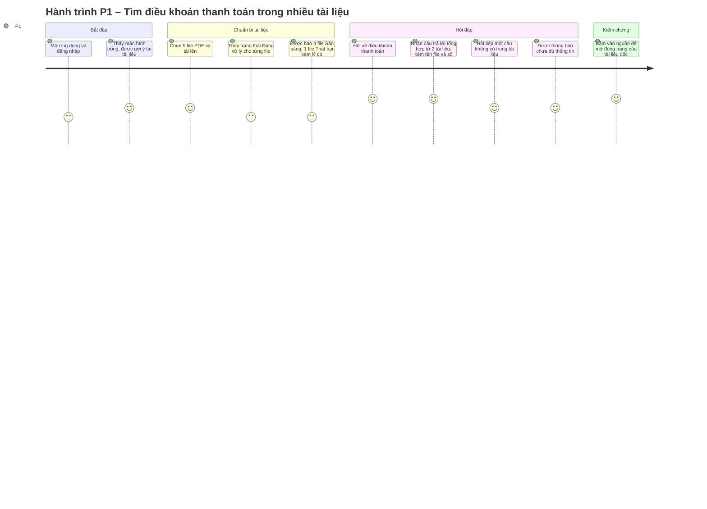

# Product Requirements Document (PRD)
# MVP – Ứng dụng AI Chat với tài liệu PDF

| Trường | Giá trị |
|---|---|
| Mã tài liệu | PRD-AICHAT-001 |
| Phiên bản | 0.2 |
| Trạng thái | **Draft** |
| Ngày | 2026-10-23 |
| Tài liệu gốc | [BRD.md](BRD.md) – BRD-AICHAT-001 v0.2 |
| Chuẩn áp dụng | IEEE 29148-2018 |
| Tác giả | Product Manager / BA – `[TBD: OQ-007]` |
| Người review | Product Owner, Tech Lead, Designer, QA, IT/Security |
| Người phê duyệt | Product Owner – `[TBD: OQ-007]` |

**Lịch sử phiên bản**

| Phiên bản | Ngày | Tác giả | Tóm tắt thay đổi |
|---|---|---|---|
| 0.1 | 2026-10-23 | PM/BA | Bản nháp đầu tiên, chuyển hóa BRD v0.2 thành user story, NFR, yêu cầu UX và tiêu chí phát hành |
| 0.2 | 2026-10-23 | PM/BA | Sửa theo review `PRD_IEEE_29148_Checklist.xlsx`: thêm mục Phạm vi 1.3 (P-DEF-013); tách NFR-004/006/009/012/014 thành NFR-018…NFR-024 (P-DEF-006); thêm AC cho story P1/P2 (P-DEF-007); bỏ chi tiết cách làm (P-DEF-008); thêm bảng mã lý do thất bại và định nghĩa các cụm mơ hồ (P-DEF-009); thêm giới hạn 300 trang (P-DEF-010); viết lại US-023 theo P1 (P-DEF-011); thêm E-19 (P-DEF-012) |

**Quy ước trong tài liệu**

- `[Đề xuất PM – chờ OQ-xxx]`: giá trị PM đề xuất để đội có thể thiết kế và ước lượng; **chưa phải quyết định**. PO hoặc người phụ trách OQ phải xác nhận trước khi baseline PRD.
- `[TBD: OQ-xxx]`: chưa có giá trị, chưa có đề xuất.
- ID câu hỏi mở `OQ-001…OQ-019` dùng chung với BRD; câu hỏi mới phát sinh ở PRD đánh số từ `OQ-101`.
- Ưu tiên: **P0** = bắt buộc để ra mắt (tương ứng Must trong BRD), **P1** = nên có (Should), **P2** = có thì tốt (Could).

---

## 0. Kiểm tra các trụ cột sản phẩm (Product pillars validation)

| Trụ cột | Nội dung | Kiểm tra với BRD | Kết luận |
|---|---|---|---|
| Tên sản phẩm | AI Chat với tài liệu PDF (tên chính thức `[TBD: PO]`) | BRD 4.1 | Đạt – tên thương mại chưa chốt, không chặn phát triển |
| Người dùng mục tiêu | Đội phát triển kinh doanh làm việc với nhiều tài liệu PDF | STK-003, ASM-002 | **Đạt có điều kiện** – chưa có persona và số người dùng (DEF-009, OQ-010). PRD dùng persona giả định ở mục 2.1 |
| Vấn đề | Tìm, đối chiếu, tổng hợp thông tin từ nhiều PDF tốn thời gian và dễ bỏ sót | BRD 4.3 | Đạt – chưa lượng hóa được (OQ-008) |
| Giải pháp cốt lõi | Tải PDF lên → hỏi bằng ngôn ngữ tự nhiên → nhận câu trả lời tổng hợp từ nhiều tài liệu, **luôn kèm nguồn** (tên tài liệu, số trang), và **nói rõ khi tài liệu không có thông tin** | BO-002…BO-004, BR-012…BR-020 | Đạt – điểm khác biệt so với "chat với một file" là hỏi đáp đa tài liệu có dẫn nguồn |
| Trụ cột UX | (1) Hai thao tác chính: tải tài liệu và hỏi; (2) Câu trả lời nào cũng kiểm chứng được; (3) Trung thực khi thiếu thông tin; (4) Trạng thái luôn hiển thị rõ; (5) Web, ưu tiên màn hình máy tính | SRC-001 §6, §8; BR-007, BR-015, BR-019, BR-024, CON-001 | Đạt – trụ cột (5) "ưu tiên màn hình máy tính" là đề xuất PM (OQ-101) |

**Rủi ro lớn nhất khi chuyển BRD sang PRD:** nhiều ngưỡng định lượng trong BRD còn `[TBD]`. PRD đưa ra giá trị đề xuất để đội có thể bắt đầu thiết kế; tất cả được tập hợp tại mục 7.2 để PO chốt một lần.

---

## 1. Tóm tắt điều hành và chiến lược

### 1.1 Tầm nhìn sản phẩm

Mọi thành viên đội phát triển kinh doanh có thể hỏi và nhận ngay câu trả lời có dẫn nguồn từ toàn bộ tài liệu PDF của dự án, thay vì tự đọc và tổng hợp thủ công (BRD 4.2).

Trong MVP, sản phẩm chứng minh một luồng duy nhất hoạt động tốt và đáng tin:

**Tải PDF → Xử lý → Đặt câu hỏi → Nhận câu trả lời có nguồn dẫn chứng.**

### 1.2 Mục tiêu và kết quả then chốt (OKRs)

| Mục tiêu | Kết quả then chốt | Metric BRD | Giá trị mục tiêu | Cách đo |
|---|---|---|---|---|
| **O1. Giảm thời gian tra cứu thông tin trong PDF** | KR1.1 Thời gian trung bình để có câu trả lời chấp nhận được giảm so với cách thủ công | MET-001 | Giảm ≥ 50% so với baseline `[Đề xuất PM – chờ OQ-008, OQ-009]` | Đo thử có kiểm soát trên cùng bộ câu hỏi, trước và sau khi dùng công cụ |
| | KR1.2 Người dùng lần đầu tự hoàn thành luồng tải → hỏi → xem nguồn không cần hướng dẫn | BR-029 | ≥ 80% người thử, mỗi người ≤ 5 phút `[Đề xuất PM – chờ OQ-009]` | Thử nghiệm khả dụng với ≥ 5 người dùng |
| **O2. Câu trả lời đúng, có căn cứ, kiểm chứng được** | KR2.1 Tỷ lệ câu trả lời đúng và có căn cứ | MET-002 | ≥ 80% `[Đề xuất PM – chờ OQ-009]` | Bộ câu hỏi kiểm thử (DEP-005) |
| | KR2.2 Tỷ lệ câu trả lời có nguồn tham chiếu đúng | MET-004 | ≥ 90% `[Đề xuất PM – chờ OQ-009]` | Đối chiếu với PDF gốc |
| | KR2.3 Tỷ lệ từ chối đúng khi tài liệu không có thông tin | MET-005 | ≥ 90% `[Đề xuất PM – chờ OQ-009]` | Bộ câu hỏi "ngoài tài liệu" |
| **O3. Ra mắt MVP an toàn** | KR3.1 Kịch bản nghiệm thu MVP đạt | MET-006 | 7/7 (BRD) | Biên bản nghiệm thu |
| | KR3.2 Sự cố lộ tài liệu cho người không có quyền | MET-007 | 0 `[Unverified – chờ PO/IT-Security]` | Kiểm thử phân quyền; báo cáo sự cố |

### 1.3 Phạm vi MVP

| Hạng mục | Nội dung |
|---|---|
| **Trong phạm vi** | EP-01…EP-07: 21 story P0 (bắt buộc để ra mắt) và 5 story P1 (làm trong MVP nếu kịp, nếu không chuyển sang bản kế tiếp `[Đề xuất PM – PO chốt]`); NFR-001…NFR-024 |
| **Hoãn lại** | US-019 – chọn nhóm tài liệu cho câu hỏi (P2, chờ OQ-018); lưu lịch sử hội thoại qua nhiều phiên (OQ-012); hỗ trợ điện thoại/máy tính bảng (OQ-101) |
| **Ngoài phạm vi** (BRD 4.5) | Định dạng khác PDF; OCR cho PDF scan; chia sẻ tài liệu, cộng tác nhóm, phân quyền chi tiết; tích hợp Google Drive/SharePoint; quản lý phiên bản tài liệu; xuất câu trả lời ra file; huấn luyện/tinh chỉnh mô hình AI; dashboard và báo cáo nâng cao |
| **Ranh giới hệ thống** | Bắt đầu khi người dùng truy cập ứng dụng và chọn file trên máy; kết thúc khi người dùng nhận câu trả lời (hoặc thông báo chưa đủ thông tin) và mở được nguồn. Nằm ngoài sản phẩm, chỉ tích hợp tới: hệ thống tài khoản doanh nghiệp (OQ-102), dịch vụ AI của nhà cung cấp (OQ-005). Việc người dùng sử dụng câu trả lời cho công việc nằm ngoài ranh giới |

---

## 2. Persona và hành trình người dùng

### 2.1 Persona mục tiêu

> **Giả định** – BRD chưa có dữ liệu persona (DEF-009). Các persona dưới đây được dựng từ mô tả trong BRD và phải được xác nhận qua phỏng vấn người dùng (SRC-003) trước khi baseline PRD.

| | **P1 – Chuyên viên phát triển kinh doanh** (chính) | **P2 – Thành viên mới của dự án** (phụ) |
|---|---|---|
| Vai trò | Chuẩn bị đề xuất, trả lời câu hỏi của khách hàng/đối tác, đối chiếu chính sách và thông tin sản phẩm | Cần nắm nhanh nội dung bộ tài liệu dự án đã có sẵn |
| Tài liệu thường dùng | Tài liệu sản phẩm/dịch vụ, chính sách, báo cáo thị trường dạng PDF (SRC-001 §1) | Như P1, nhưng chưa biết thông tin nằm ở file nào |
| Mục tiêu | Có câu trả lời đúng kèm nguồn để trích dẫn lại cho khách hàng hoặc quản lý | Hiểu nhanh bối cảnh dự án mà không phải đọc hết mọi file |
| Khó khăn | Phải mở nhiều file, dò từng trang, dễ bỏ sót khi thông tin nằm ở nhiều tài liệu | Không biết bắt đầu từ đâu; không biết câu trả lời có đầy đủ hay chưa |
| Trình độ công nghệ | Dùng thành thạo ứng dụng văn phòng và web; không có kiến thức về AI `[Giả định]` | Như P1 `[Giả định]` |
| Tần suất sử dụng | Nhiều lần mỗi tuần `[Giả định – chờ OQ-008]` | Dày đặc trong tuần đầu tham gia dự án `[Giả định]` |
| Thiết bị | Máy tính xách tay/để bàn tại văn phòng `[Giả định – OQ-101]` | Như P1 |
| Điều P1/P2 cần tin được | Câu trả lời có nguồn để tự kiểm tra; ứng dụng nói "không biết" khi không có thông tin | Như P1 |

Nếu OQ-001 chốt nhiều người dùng, cần thêm một vai trò **quản trị viên cấp quyền truy cập** (OQ-102).

### 2.2 Hành trình người dùng chính



| Bước | Người dùng làm gì | Sản phẩm phản hồi | Story |
|---|---|---|---|
| 1. Truy cập | Mở ứng dụng | Yêu cầu xác thực; người không có quyền bị từ chối | US-023 |
| 2. Trạng thái trống | Chưa có tài liệu nào | Hiển thị hướng dẫn ngắn và nút tải tài liệu; ô hỏi bị khóa kèm lý do | US-001, mục 4.2 |
| 3. Tải lên | Chọn một hoặc nhiều PDF | Kiểm tra định dạng/dung lượng; file hợp lệ vào danh sách với trạng thái Đang xử lý | US-001…US-004 |
| 4. Xử lý | Chờ hoặc làm việc khác | Tự động xử lý; báo khi Sẵn sàng hoặc Thất bại | US-005…US-008 |
| 5. Hỏi | Gõ câu hỏi tự nhiên | Hiển thị đang tạo câu trả lời | US-012, US-025 |
| 6. Nhận câu trả lời | Đọc câu trả lời | Câu trả lời tổng hợp, kèm tên tài liệu và số trang; hoặc thông báo chưa đủ thông tin | US-013, US-016, US-017, US-020, US-021 |
| 7. Kiểm chứng | Bấm vào nguồn | Mở tài liệu gốc tại trang được trích dẫn | US-022 |
| 8. Dọn dẹp | Xóa tài liệu cũ | Tài liệu biến mất khỏi danh sách và không còn được dùng làm căn cứ | US-010, US-011 |

---

## 3. Yêu cầu chức năng và user story

### 3.1 Ma trận epic

| Epic | Mô tả | BR nguồn | P0 | P1 | P2 |
|---|---|---|---|---|---|
| EP-01 Tiếp nhận tài liệu | Tải PDF lên, kiểm tra định dạng và dung lượng | BR-001…BR-004 | 4 | – | – |
| EP-02 Xử lý và quản lý tài liệu | Xử lý tự động, trạng thái, xóa | BR-005…BR-011 | 6 | 1 | – |
| EP-03 Hỏi đáp | Đặt câu hỏi, trả lời có căn cứ, từ chối khi thiếu thông tin | BR-012…BR-016 | 4 | 1 | – |
| EP-04 Hỏi đáp đa tài liệu | Tổng hợp nhiều tài liệu, nêu mâu thuẫn | BR-017, BR-018 | 1 | 1 | 1 |
| EP-05 Nguồn tham chiếu | Tên tài liệu, số trang, mở tài liệu gốc | BR-019…BR-021 | 2 | 1 | – |
| EP-06 Truy cập và bảo vệ dữ liệu | Xác thực, cách ly tài liệu giữa người dùng | BR-022, BR-023 | 2 | – | – |
| EP-07 Phản hồi và xử lý lỗi | Chỉ báo tiến trình, thông báo lỗi, thử lại | BR-024, BR-027, BR-028 | 2 | 1 | – |
| **Tổng** | | | **21** | **5** | **1** |

BR-016, BR-025, BR-026, BR-029 là yêu cầu chất lượng, được đặc tả tại mục 3.9 (NFR).

### 3.2 EP-01 – Tiếp nhận tài liệu

| ID | User story | Ưu tiên | BR |
|---|---|---|---|
| US-001 | Là P1, tôi muốn tải một file PDF từ máy tính lên ứng dụng, để có thể hỏi đáp về nội dung của nó. | P0 | BR-001 |
| US-002 | Là P1, tôi muốn chọn và tải nhiều file PDF trong một lần, để không phải lặp lại thao tác cho từng file. | P0 | BR-002 |
| US-003 | Là P1, tôi muốn được báo ngay khi chọn nhầm file không phải PDF, để biết vì sao file đó không được nhận. | P0 | BR-003 |
| US-004 | Là P1, tôi muốn được báo khi file quá dung lượng cho phép, để biết cần tách hoặc nén file. | P0 | BR-004 |

**AC – US-001**
- **Given** người dùng đã đăng nhập, **When** chọn 1 file PDF có văn bản, dung lượng trong giới hạn, **Then** file xuất hiện trong danh sách tài liệu với tên file và trạng thái "Đang xử lý".
- **Given** đang tải lên, **When** việc tải lên chưa xong, **Then** người dùng thấy tiến độ tải lên của file đó.

**AC – US-002**
- **Given** giới hạn là N file mỗi lần (N = 10 `[Đề xuất PM – chờ OQ-003]`), **When** người dùng chọn N file PDF hợp lệ, **Then** cả N file xuất hiện trong danh sách với trạng thái "Đang xử lý".
- **Given** người dùng chọn N+1 file, **When** xác nhận tải lên, **Then** ứng dụng không tải file nào và thông báo giới hạn N file mỗi lần.
- **Given** người dùng chọn lẫn file hợp lệ và không hợp lệ, **When** xác nhận tải lên, **Then** các file hợp lệ được nhận, các file không hợp lệ bị liệt kê kèm lý do.

**AC – US-003**
- **Given** người dùng chọn file .docx, .jpg, hoặc file có đuôi .pdf nhưng nội dung không phải PDF, **When** tải lên, **Then** file bị từ chối, thông báo nêu tên file và lý do "không phải file PDF hợp lệ", file không xuất hiện trong danh sách.

**AC – US-004**
- **Given** giới hạn dung lượng là 20 MB/file `[Đề xuất PM – chờ OQ-003]`, **When** người dùng chọn file lớn hơn giới hạn, **Then** file bị từ chối và không được lưu, thông báo nêu tên file, dung lượng file và giới hạn cho phép.
- **Given** giới hạn là 300 trang/file `[Đề xuất PM – chờ OQ-003]`, **When** người dùng chọn PDF nhiều hơn 300 trang, **Then** file bị từ chối và không được lưu, thông báo nêu tên file, số trang và giới hạn cho phép.

### 3.3 EP-02 – Xử lý và quản lý tài liệu

| ID | User story | Ưu tiên | BR |
|---|---|---|---|
| US-005 | Là P1, tôi muốn tài liệu được xử lý tự động ngay sau khi tải lên, để không phải làm thêm bước nào. | P0 | BR-005 |
| US-006 | Là P1, tôi muốn xem danh sách tài liệu của mình cùng trạng thái của từng tài liệu, để biết tài liệu nào đã dùng được. | P0 | BR-006 |
| US-007 | Là P1, tôi muốn được báo khi tài liệu chuyển sang Sẵn sàng, để bắt đầu hỏi ngay mà không phải tải lại trang. | P0 | BR-007 |
| US-008 | Là P1, tôi muốn thấy tài liệu nào xử lý thất bại và lý do, để quyết định thay bằng file khác. | P0 | BR-008 |
| US-009 | Là P1, tôi muốn yêu cầu xử lý lại tài liệu bị thất bại với lý do được phép xử lý lại (bảng mã lý do bên dưới), để không phải tải lại file. | P1 | BR-009 |
| US-010 | Là P1, tôi muốn xóa tài liệu không còn dùng, để danh sách gọn và tài liệu cũ không ảnh hưởng câu trả lời. | P0 | BR-010 |
| US-011 | Là P1, tôi muốn chắc chắn tài liệu đã xóa không còn được dùng để trả lời, để không nhận thông tin lỗi thời. | P0 | BR-011 |

**AC – US-005**
- **Given** một file vừa tải lên thành công, **When** không có thao tác nào khác của người dùng, **Then** trạng thái chuyển từ "Đang xử lý" sang "Sẵn sàng" hoặc "Thất bại" trong thời gian quy định tại NFR-002.

**AC – US-006**
- **Given** người dùng có tài liệu ở cả ba trạng thái, **When** mở danh sách tài liệu, **Then** mỗi dòng hiển thị tên file, trạng thái (Đang xử lý / Sẵn sàng / Thất bại) và thời điểm tải lên; danh sách chỉ gồm tài liệu trong phạm vi quyền của người dùng.
- **Given** người dùng chưa có tài liệu nào, **When** mở ứng dụng, **Then** hiển thị trạng thái trống kèm hướng dẫn tải tài liệu.

**AC – US-007**
- **Given** một tài liệu đang "Đang xử lý" và người dùng đang mở ứng dụng, **When** xử lý thành công, **Then** trạng thái đổi thành "Sẵn sàng" và có thông báo theo mục 4.1, không cần tải lại trang.

**AC – US-008**
- **Given** một PDF bị hỏng hoặc có mật khẩu, **When** xử lý, **Then** trạng thái là "Thất bại" với lý do "không đọc được file" hoặc "file được bảo vệ bằng mật khẩu".
- **Given** một PDF dạng scan (không có lớp văn bản), **When** xử lý, **Then** trạng thái là "Thất bại" với lý do "file không chứa văn bản trích xuất được (PDF scan chưa được hỗ trợ)" `[Đề xuất PM – chờ OQ-013]`.

**Mã lý do thất bại**

| Mã | Lý do hiển thị cho người dùng | Được xử lý lại |
|---|---|---|
| R-01 | Không đọc được file (file hỏng) | Không |
| R-02 | File được bảo vệ bằng mật khẩu | Không |
| R-03 | File không chứa văn bản trích xuất được (PDF scan chưa được hỗ trợ) `[chờ OQ-013]` | Không |
| R-04 | Lỗi xử lý tạm thời – mọi lỗi không thuộc R-01…R-03 (vd. quá thời gian NFR-002, dịch vụ không phản hồi) | Có |

**AC – US-009**
- **Given** tài liệu "Thất bại" với lý do R-04, **When** người dùng chọn "Xử lý lại", **Then** trạng thái chuyển về "Đang xử lý" và tài liệu được xử lý lại mà không cần tải lại file.
- **Given** tài liệu "Thất bại" với lý do R-01, R-02 hoặc R-03, **When** người dùng xem tài liệu, **Then** không có thao tác "Xử lý lại".

**AC – US-010**
- **Given** một tài liệu trong danh sách, **When** người dùng chọn xóa, **Then** ứng dụng hỏi xác nhận; **When** người dùng xác nhận, **Then** tài liệu biến mất khỏi danh sách.
- **Given** tài liệu đang ở trạng thái "Đang xử lý", **When** người dùng xóa, **Then** việc xử lý bị hủy và tài liệu bị xóa.

**AC – US-011**
- **Given** câu hỏi Q chỉ có đáp án trong tài liệu X, **When** người dùng xóa X rồi hỏi lại Q, **Then** câu trả lời không chứa thông tin từ X, không trích dẫn X, và (nếu không tài liệu nào khác có thông tin) ứng dụng thông báo chưa đủ thông tin.

### 3.4 EP-03 – Hỏi đáp

| ID | User story | Ưu tiên | BR |
|---|---|---|---|
| US-012 | Là P1, tôi muốn hỏi bằng câu tự nhiên như khi hỏi đồng nghiệp, để không phải biết trước từ khóa. | P0 | BR-012 |
| US-013 | Là P1, tôi muốn câu trả lời chỉ dựa trên tài liệu đã sẵn sàng của tôi, để tin rằng thông tin đến từ tài liệu dự án. | P0 | BR-013 |
| US-014 | Là P1, tôi muốn hỏi nhiều câu liên tiếp trong cùng một phiên, để làm rõ dần vấn đề. | P0 | BR-014 |
| US-015 | Là P1, tôi muốn câu hỏi tiếp theo hiểu được ngữ cảnh câu trước (vd. "còn tài liệu kia thì sao?"), để không phải nhắc lại. | P1 | BR-014 – chờ OQ-012 |
| US-016 | Là P1, tôi muốn được nói rõ khi tài liệu không có thông tin, để không dùng nhầm câu trả lời bịa đặt. | P0 | BR-015 |

**AC – US-012**
- **Given** người dùng có ít nhất một tài liệu "Sẵn sàng", **When** gõ câu hỏi bằng tiếng Việt hoặc tiếng Anh `[Đề xuất PM – chờ OQ-011]` và gửi, **Then** nhận được câu trả lời trong thời gian quy định tại NFR-001.
- **Given** người dùng chưa có tài liệu "Sẵn sàng", **When** mở ô hỏi, **Then** ô hỏi bị khóa với lời nhắc "Cần ít nhất một tài liệu Sẵn sàng để bắt đầu hỏi".
- **Given** ô hỏi trống hoặc chỉ có khoảng trắng, **When** người dùng gửi, **Then** câu hỏi không được gửi.

**AC – US-013**
- **Given** tài liệu Y đang "Đang xử lý" và tài liệu Z "Sẵn sàng", **When** hỏi câu chỉ có đáp án trong Y, **Then** câu trả lời không dùng và không trích dẫn Y.
- **Given** câu hỏi có đáp án trong Z, **When** hỏi, **Then** câu trả lời khớp với nội dung của Z và trích dẫn Z.

**AC – US-014**
- **Given** người dùng đã nhận một câu trả lời, **When** gửi thêm 5 câu hỏi liên tiếp, **Then** nhận được 5 câu trả lời trong cùng một khung hội thoại, theo đúng thứ tự, không cần tải lại tài liệu hay mở phiên mới.

**AC – US-015** (chờ OQ-012)
- **Given** người dùng vừa hỏi về điều khoản thanh toán trong tài liệu A, **When** hỏi tiếp "còn tài liệu B thì sao?", **Then** câu trả lời nói về điều khoản thanh toán trong tài liệu B và trích dẫn B.
- **Given** 10 cặp câu hỏi tiếp nối trong bộ kiểm thử (DEP-005), **When** chạy kiểm thử, **Then** ≥ 8/10 câu trả lời đúng ngữ cảnh `[Đề xuất PM]`.

**AC – US-016**
- **Given** câu hỏi không có thông tin trong bất kỳ tài liệu "Sẵn sàng" nào, **When** hỏi, **Then** ứng dụng trả lời rõ là chưa đủ thông tin trong tài liệu để trả lời và không kèm nguồn tham chiếu.
- **Given** bộ câu hỏi "ngoài tài liệu" (DEP-005), **When** chạy kiểm thử, **Then** tỷ lệ từ chối đúng đạt NFR-005.

### 3.5 EP-04 – Hỏi đáp đa tài liệu

| ID | User story | Ưu tiên | BR |
|---|---|---|---|
| US-017 | Là P1, tôi muốn một câu trả lời tổng hợp khi thông tin nằm ở nhiều tài liệu, để không phải tự ghép lại. | P0 | BR-017 |
| US-018 | Là P1, tôi muốn được chỉ ra khi các tài liệu nói khác nhau, để biết cần kiểm tra lại với nguồn nào. | P1 | BR-018 |
| US-019 | Là P1, tôi muốn giới hạn câu hỏi trong một nhóm tài liệu tôi chọn, để câu trả lời không lẫn thông tin từ dự án khác. | P2 | Chờ OQ-018 |

**AC – US-017**
- **Given** đáp án chuẩn nằm ở 2 tài liệu "Sẵn sàng" khác nhau, **When** hỏi, **Then** câu trả lời nêu thông tin từ cả 2 tài liệu và trích dẫn cả 2.
- **Given** bộ câu hỏi đa tài liệu (DEP-005), **When** chạy kiểm thử, **Then** tỷ lệ trả lời đầy đủ (MET-003) ≥ 80% `[Đề xuất PM – chờ OQ-009]`.

**AC – US-018**
- **Given** 2 tài liệu "Sẵn sàng" ghi 2 giá trị khác nhau cho cùng một thông tin, **When** hỏi về thông tin đó, **Then** câu trả lời nêu cả hai giá trị, mỗi giá trị kèm tài liệu nguồn, và nói rõ hai tài liệu không thống nhất.

**AC – US-019** (P2, chờ OQ-018)
- **Given** có tài liệu "Sẵn sàng" A, B, C, **When** người dùng chọn chỉ A và B rồi hỏi câu có đáp án trong C, **Then** câu trả lời không dùng và không trích dẫn C.

### 3.6 EP-05 – Nguồn tham chiếu

| ID | User story | Ưu tiên | BR |
|---|---|---|---|
| US-020 | Là P1, tôi muốn thấy tên tài liệu đã dùng cho câu trả lời, để biết thông tin đến từ đâu. | P0 | BR-019 |
| US-021 | Là P1, tôi muốn thấy số trang chứa thông tin, để tìm lại nhanh trong tài liệu gốc. | P0 | BR-020 |
| US-022 | Là P1, tôi muốn bấm vào nguồn để mở đúng trang của tài liệu gốc, để kiểm chứng ngay. | P1 | BR-021 – chờ OQ-014 |

**AC – US-020**
- **Given** một câu trả lời dựa trên tài liệu, **When** hiển thị, **Then** mỗi tài liệu được dùng làm căn cứ xuất hiện trong phần nguồn với đúng tên file.

**AC – US-021**
- **Given** PDF có số trang xác định được, **When** câu trả lời trích dẫn tài liệu đó, **Then** phần nguồn hiển thị số trang và số trang đó chứa thông tin được trích dẫn trong PDF gốc.
- **Given** không xác định được số trang, **When** hiển thị nguồn, **Then** chỉ hiển thị tên tài liệu, không hiển thị số trang sai hoặc số trang giả định.

**AC – US-022** (chờ OQ-014)
- **Given** câu trả lời có nguồn "tên file · tr.X", **When** người dùng bấm vào nguồn, **Then** tài liệu gốc được mở tại trang X.
- **Given** nguồn không có số trang, **When** người dùng bấm vào nguồn, **Then** tài liệu gốc được mở ở trang đầu.
- **Given** tài liệu nguồn đã bị xóa, **When** người dùng bấm vào nguồn, **Then** hiển thị "Tài liệu đã bị xóa" và không mở được (E-19).

### 3.7 EP-06 – Truy cập và bảo vệ dữ liệu

| ID | User story | Ưu tiên | BR |
|---|---|---|---|
| US-023 | Là P1, tôi muốn chỉ người đã được cấp quyền mới vào được ứng dụng, để tài liệu nội bộ của dự án không lọt ra ngoài. | P0 | BR-022 |
| US-024 | Là P1, tôi muốn tài liệu tôi tải lên không hiện ra với người không có quyền, để thông tin của dự án được giữ kín. | P0 | BR-023 – chờ OQ-002 |

**AC – US-023**
- **Given** một người chưa được cấp quyền, **When** truy cập ứng dụng, **Then** bị từ chối và không thấy danh sách tài liệu, không tải lên được, không hỏi được.
- **Given** phiên đăng nhập hết hạn, **When** người dùng thao tác, **Then** được yêu cầu xác thực lại; nội dung câu hỏi đang soạn không bị mất.

**AC – US-024** (áp dụng nếu OQ-002 chốt tài liệu thuộc riêng người tải lên)
- **Given** người dùng A tải tài liệu X, **When** người dùng B hỏi câu chỉ có đáp án trong X, **Then** B không nhận được nội dung, tên hay nguồn tham chiếu của X.
- **Given** người dùng B mở danh sách tài liệu, **When** hiển thị, **Then** không có X.

### 3.8 EP-07 – Phản hồi và xử lý lỗi

| ID | User story | Ưu tiên | BR |
|---|---|---|---|
| US-025 | Là P1, tôi muốn thấy ứng dụng đang xử lý hoặc đang soạn câu trả lời, để biết cần chờ chứ không phải ứng dụng bị treo. | P0 | BR-024 |
| US-026 | Là P1, tôi muốn được báo khi tải lên hoặc câu hỏi bị lỗi, để biết thao tác chưa thành công. | P0 | BR-027 |
| US-027 | Là P1, tôi muốn gửi lại câu hỏi bị lỗi chỉ bằng một thao tác, để không phải gõ lại. | P1 | BR-028 |

**AC – US-025**
- **Given** câu hỏi đã được gửi, **When** câu trả lời chưa xong, **Then** có chỉ báo "đang soạn câu trả lời" và ô hỏi không nhận câu hỏi mới cho tới khi có kết quả hoặc lỗi.
- **Given** tài liệu "Đang xử lý", **When** người dùng xem danh sách, **Then** có chỉ báo đang xử lý trên dòng của tài liệu đó.

**AC – US-026**
- **Given** mất kết nối mạng khi đang tải lên, **When** tải lên thất bại, **Then** file được đánh dấu tải lên thất bại kèm nút "Tải lại", không xuất hiện như tài liệu "Đang xử lý".
- **Given** câu hỏi gặp lỗi (mất mạng, dịch vụ AI không phản hồi, quá thời gian ở NFR-001), **When** lỗi xảy ra, **Then** khung hội thoại hiển thị thông báo lỗi ngay tại vị trí câu trả lời, câu hỏi gốc vẫn hiển thị.

**AC – US-027**
- **Given** một câu hỏi bị lỗi (US-026), **When** người dùng chọn "Gửi lại", **Then** đúng nội dung câu hỏi ban đầu được gửi lại, người dùng không phải gõ lại.
- **Given** lần gửi lại cũng lỗi, **When** lỗi xảy ra, **Then** thông báo lỗi hiển thị lần nữa và vẫn có thể gửi lại.

### 3.9 Yêu cầu phi chức năng (NFR)

| ID | Yêu cầu | Ngưỡng | BR | Kiểm chứng |
|---|---|---|---|---|
| NFR-001 | Thời gian trả lời câu hỏi, tính từ lúc gửi tới khi câu trả lời hoàn chỉnh | p90 ≤ 15 giây; p50 ≤ 8 giây `[Đề xuất PM – chờ OQ-006]` | BR-025 | Đo trên bộ câu hỏi kiểm thử với 100 tài liệu Sẵn sàng/người dùng |
| NFR-002 | Thời gian xử lý một tài liệu ở giới hạn dung lượng | ≤ 3 phút cho file 20 MB / 300 trang `[Đề xuất PM – chờ OQ-003, OQ-006]` | BR-026 | Test với PDF mẫu (DEP-003) |
| NFR-003 | Độ chính xác câu trả lời (MET-002) | ≥ 80% `[Đề xuất PM – chờ OQ-009]` | BR-016 | Bộ câu hỏi kiểm thử, người dùng nghiệp vụ chấm |
| NFR-004 | Độ chính xác tên tài liệu nguồn (MET-004) | ≥ 90% câu trả lời có căn cứ hiển thị đúng tên tài liệu nguồn `[Đề xuất PM – chờ OQ-009]` | BR-019 | Đối chiếu PDF gốc |
| NFR-018 | Độ chính xác số trang | ≥ 85% số trang được hiển thị trùng với trang chứa thông tin trong PDF gốc `[Đề xuất PM – chờ OQ-009]` | BR-020 | Đối chiếu PDF gốc |
| NFR-005 | Tỷ lệ từ chối đúng (MET-005) | ≥ 90% `[Đề xuất PM – chờ OQ-009]` | BR-015 | Bộ câu hỏi "ngoài tài liệu" |
| NFR-006 | Dung lượng mỗi file | ≤ 20 MB `[Đề xuất PM – chờ OQ-003]` | BR-004 | Test biên |
| NFR-019 | Số file mỗi lần tải | ≤ 10 `[Đề xuất PM – chờ OQ-003]` | BR-002 | Test biên |
| NFR-020 | Tổng số tài liệu mỗi người dùng | ≤ 100 `[Đề xuất PM – chờ OQ-003]` | – (OQ-003) | Test biên |
| NFR-021 | Số trang mỗi file | ≤ 300 `[Đề xuất PM – chờ OQ-003]` | BR-004 | Test biên |
| NFR-007 | Người dùng đồng thời | Đạt NFR-001 với 20 người dùng hỏi đồng thời `[Đề xuất PM – chờ OQ-010]` | BR-025 | Load test |
| NFR-008 | Khả dụng | Người dùng lần đầu hoàn thành luồng tải → hỏi → xem nguồn không cần hỗ trợ: ≥ 80% người thử, ≤ 5 phút/người `[Đề xuất PM – chờ OQ-009]` | BR-029 | Usability test ≥ 5 người |
| NFR-009 | Mã hóa khi truyền | Mọi kết nối dùng HTTPS (TLS 1.2 trở lên) `[Đề xuất PM – chờ IT/Security, OQ-017]` | BR-022, BR-023 | Security review |
| NFR-022 | Mã hóa khi lưu | Tài liệu và dữ liệu trích xuất được mã hóa khi lưu trữ; tiêu chuẩn mã hóa `[TBD: IT/Security]` | BR-022, BR-023 | Security review |
| NFR-010 | Phân quyền | Không người dùng nào xem, hỏi về hoặc xóa được tài liệu ngoài phạm vi quyền của mình bằng bất kỳ cách truy cập nào, kể cả gọi trực tiếp tới dịch vụ mà không qua giao diện; không có truy cập ẩn danh | BR-022, BR-023 | Kiểm thử phân quyền (AC-022, AC-023), kiểm thử xâm nhập |
| NFR-011 | Dữ liệu gửi tới nhà cung cấp AI | Chỉ dùng nhà cung cấp được IT/Security phê duyệt, có cam kết không dùng dữ liệu để huấn luyện mô hình; mỗi câu hỏi chỉ gửi các đoạn nội dung được chọn làm căn cứ trả lời, không gửi toàn bộ tài liệu `[TBD: OQ-005]` | SN-010 | Security review hợp đồng/chính sách nhà cung cấp; inspection dữ liệu gửi đi |
| NFR-012 | Nhật ký kiểm toán | Ghi lại ai tải lên, ai xóa tài liệu nào, ai đặt câu hỏi, vào lúc nào `[chờ IT/Security, DEF-002]` | SN-010 | Inspection |
| NFR-023 | Thời gian lưu nhật ký kiểm toán | ≥ 90 ngày `[Đề xuất PM – chờ IT/Security, DEF-002]` | SN-010 | Inspection |
| NFR-013 | Xóa dữ liệu | Khi người dùng xóa tài liệu, file gốc và dữ liệu trích xuất bị xóa khỏi lưu trữ trong ≤ 24 giờ `[Đề xuất PM – chờ OQ-004]` | BR-011 | Test + Inspection |
| NFR-014 | Lưu giữ tài liệu | Tài liệu được lưu tới khi người dùng xóa `[Đề xuất PM – chờ OQ-004]` | – (OQ-004) | Test |
| NFR-024 | Lưu giữ hội thoại | Hội thoại được giữ trong phiên đăng nhập, kể cả khi tải lại trang; mất khi đăng xuất hoặc phiên hết hạn `[Đề xuất PM – chờ OQ-012]` | – (OQ-012) | Test |
| NFR-015 | Mức sẵn sàng | 99% trong giờ làm việc (8:00–18:00, thứ Hai–thứ Sáu); không cam kết ngoài giờ cho MVP `[Đề xuất PM – chờ PO, DEF-003]` | – | Giám sát sau go-live |
| NFR-016 | Ngôn ngữ | Giao diện tiếng Việt; hỏi đáp bằng tiếng Việt và tiếng Anh; câu trả lời dùng ngôn ngữ của câu hỏi `[Đề xuất PM – chờ OQ-011]` | BR-012 | Test |
| NFR-017 | Trình duyệt | Hai phiên bản mới nhất của Chrome và Edge trên máy tính; độ rộng màn hình ≥ 1280 px `[Đề xuất PM – chờ OQ-101]` | CON-001 | Test tương thích |

---

## 4. Yêu cầu UX và UI

### 4.1 Bố cục và luồng tương tác chính

> Phần này mô tả bố cục logic, không phải thiết kế hình ảnh. Designer quyết định chi tiết trình bày.

**Bố cục một màn hình, hai khu vực**

```
┌──────────────────────────────┬─────────────────────────────────────────────┐
│ TÀI LIỆU                     │ HỎI ĐÁP                                     │
│ [ + Tải PDF lên ]            │                                             │
│  (kéo thả file vào đây)      │  Bạn: Điều khoản thanh toán là gì?          │
│                              │                                             │
│ ● hop-dong-A.pdf   Sẵn sàng  │  AI: Thanh toán trong 30 ngày ...           │
│ ◌ bang-gia.pdf  Đang xử lý   │      Nguồn: [hop-dong-A.pdf · tr.4]         │
│ ✕ scan-01.pdf     Thất bại   │             [chinh-sach.pdf · tr.12]        │
│   └ Không có văn bản         │                                             │
│     trích xuất được          │                                             │
│                              │ ┌─────────────────────────────────┐ [Gửi]   │
│ 3/100 tài liệu               │ │ Nhập câu hỏi...                 │         │
│                              │ └─────────────────────────────────┘         │
└──────────────────────────────┴─────────────────────────────────────────────┘
```

| Thành phần | Yêu cầu logic | Story |
|---|---|---|
| Khu vực tài liệu | Luôn hiển thị cạnh khu vực hỏi đáp; có nút tải lên và vùng kéo thả; mỗi dòng gồm tên file, trạng thái, thao tác xóa; số tài liệu đang dùng so với giới hạn | US-001, US-006, US-010 |
| Trạng thái tài liệu | Ba trạng thái phân biệt được bằng cả biểu tượng và chữ (không chỉ dựa vào màu); dòng "Thất bại" hiển thị lý do theo bảng mã lý do (3.3); thao tác "Xử lý lại" chỉ có với lý do R-04 | US-006, US-008, US-009 |
| Ô hỏi | Bị khóa kèm lời nhắc khi chưa có tài liệu Sẵn sàng; gửi câu hỏi và xuống dòng đều làm được chỉ bằng bàn phím; tối đa 2.000 ký tự `[Đề xuất PM]` | US-012 |
| Câu trả lời | Nguồn hiển thị ngay dưới câu trả lời dưới dạng các nhãn "tên file · tr.X" bấm được; câu trả lời "chưa đủ thông tin" được gắn nhãn "Chưa đủ thông tin" và không có phần nguồn | US-016, US-020, US-021, US-022 |
| Mâu thuẫn giữa tài liệu | Câu trả lời liệt kê từng giá trị kèm nguồn riêng | US-018 |
| Xóa tài liệu | Luôn hỏi xác nhận; nêu rõ tài liệu sẽ không còn được dùng để trả lời | US-010 |
| Thông báo | Khi tài liệu chuyển sang Sẵn sàng/Thất bại: hiển thị thông báo tự ẩn sau ≤ 5 giây `[Đề xuất PM]`; thông báo không che ô hỏi và người dùng không phải bấm đóng | US-007 |
| Trợ năng | Mọi thao tác dùng được bằng bàn phím; trạng thái và lỗi được đọc bởi trình đọc màn hình `[Đề xuất PM]` | – |

### 4.2 Trường hợp biên và trạng thái lỗi

| # | Tình huống | Hành vi mong đợi | Story |
|---|---|---|---|
| E-01 | Chưa có tài liệu nào | Khu vực tài liệu hiển thị hướng dẫn tải lên; ô hỏi bị khóa với lời nhắc | US-006, US-012 |
| E-02 | Có tài liệu nhưng chưa tài liệu nào Sẵn sàng | Ô hỏi bị khóa với lời nhắc "Đang xử lý tài liệu, bạn có thể hỏi khi có ít nhất một tài liệu Sẵn sàng" | US-012 |
| E-03 | Mọi tài liệu đều Thất bại | Ô hỏi bị khóa; gợi ý kiểm tra lý do và tải file khác | US-008 |
| E-04 | Mất mạng khi đang tải lên | File được đánh dấu tải lên thất bại kèm "Tải lại"; các file đã tải xong không bị ảnh hưởng | US-026 |
| E-05 | Mất mạng khi đang chờ câu trả lời | Báo lỗi tại vị trí câu trả lời, có "Gửi lại"; câu hỏi không mất | US-026, US-027 |
| E-06 | Dịch vụ AI không phản hồi hoặc vượt thời gian NFR-001 | Báo "Không thể tạo câu trả lời lúc này, vui lòng thử lại"; không hiển thị câu trả lời dở dang như câu trả lời hoàn chỉnh | US-026 |
| E-07 | File không phải PDF / đuôi .pdf giả | Từ chối, nêu tên file và lý do | US-003 |
| E-08 | File vượt dung lượng / số trang / số file mỗi lần / tổng số tài liệu | Từ chối, file không được lưu; thông báo nêu giới hạn bị vượt (NFR-006, NFR-019…NFR-021) | US-002, US-004 |
| E-09 | PDF có mật khẩu | Thất bại, lý do "file được bảo vệ bằng mật khẩu" | US-008 |
| E-10 | PDF scan (không có văn bản) | Thất bại, lý do "không chứa văn bản trích xuất được" `[chờ OQ-013]` | US-008 |
| E-11 | PDF có một phần là ảnh scan | Xử lý phần có văn bản, trạng thái Sẵn sàng; câu hỏi về phần ảnh sẽ nhận "chưa đủ thông tin" `[Đề xuất PM – chờ OQ-013]` | US-016 |
| E-12 | Trùng tên file với tài liệu đã có | Vẫn nhận; hiển thị kèm thời điểm tải lên để phân biệt `[Đề xuất PM – OQ-103]` | US-006 |
| E-13 | Xóa tài liệu khi câu trả lời đang được tạo | Câu trả lời đang tạo được hoàn tất; mọi câu hỏi sau thời điểm xóa không dùng tài liệu đó | US-011 |
| E-14 | Câu hỏi trống hoặc chỉ khoảng trắng | Không gửi | US-012 |
| E-15 | Câu hỏi vượt 2.000 ký tự | Không cho nhập thêm, hiển thị bộ đếm ký tự | US-012 |
| E-16 | Câu hỏi không liên quan tới tài liệu (chào hỏi, kiến thức chung) | Trả lời "chưa đủ thông tin trong tài liệu"; không trả lời bằng kiến thức bên ngoài | US-016 |
| E-17 | Phiên đăng nhập hết hạn | Yêu cầu xác thực lại; giữ nội dung câu hỏi đang soạn | US-023 |
| E-18 | Tải lại trang giữa phiên | Danh sách tài liệu còn nguyên; lịch sử hội thoại theo NFR-024 | US-006 |
| E-19 | Bấm vào nguồn trỏ tới tài liệu đã bị xóa (vd. câu trả lời tạo trong lúc xóa – E-13) | Nhãn nguồn hiển thị "(đã xóa)"; bấm vào thì báo "Tài liệu đã bị xóa", không mở được | US-022 |

---

## 5. Tiêu chí phát hành và chỉ số sau ra mắt

### 5.1 Điều kiện được phép ra mắt (launch gate)

| # | Hạng mục | Điều kiện | Người xác nhận |
|---|---|---|---|
| G-01 | Chức năng | 100% AC của 21 story P0 đạt; 7/7 kịch bản nghiệm thu BRD (MET-006) đạt | QA, PO |
| G-02 | Chất lượng câu trả lời | NFR-003, NFR-004, NFR-005, NFR-018 đạt trên bộ câu hỏi kiểm thử (DEP-005) gồm ≥ 50 câu trong tài liệu, ≥ 20 câu đa tài liệu, ≥ 20 câu ngoài tài liệu `[Đề xuất PM]` | QA, người dùng nghiệp vụ |
| G-03 | Hiệu năng | NFR-001, NFR-002, NFR-007 đạt | Tech Lead, QA |
| G-04 | Bảo mật | Kiểm thử phân quyền AC-022/AC-023 đạt; không còn lỗ hổng mức Critical/High; NFR-009…NFR-013, NFR-022, NFR-023 được IT/Security xác nhận; nhà cung cấp AI được phê duyệt (OQ-005) | IT/Security |
| G-05 | Khả dụng | NFR-008 đạt | PO, Designer |
| G-06 | Kiểm thử | Mọi story P0 có test case; không còn lỗi mức Critical/High mở | QA |
| G-07 | Theo dõi | Toàn bộ sự kiện ở mục 5.2 ghi nhận đúng trên môi trường thử nghiệm | Tech Lead |
| G-08 | Quyết định | Các OQ chặn tại mục 7.1 đã đóng; PRD được PO phê duyệt | PO |
| G-09 | Vận hành | Có người chịu trách nhiệm hỗ trợ sau go-live (OQ-016) | Sponsor |

### 5.2 Theo dõi và phân tích

> **Quyền riêng tư:** sự kiện phân tích **không** chứa nội dung câu hỏi, câu trả lời hay nội dung tài liệu, chỉ chứa ID, số đếm và thời lượng. Việc lưu nội dung để cải thiện chất lượng cần IT/Security phê duyệt riêng (OQ-104).

| ID | Sự kiện | Khi nào | Thuộc tính | Phục vụ |
|---|---|---|---|---|
| EVT-01 | `document_upload_started` | Người dùng xác nhận tải lên | số file, tổng dung lượng | Funnel |
| EVT-02 | `document_upload_rejected` | File bị từ chối | lý do (định dạng / dung lượng / số lượng) | Tinh chỉnh giới hạn |
| EVT-03 | `document_processing_completed` | Tài liệu chuyển sang Sẵn sàng | document_id, số trang, dung lượng, thời gian xử lý | NFR-002 |
| EVT-04 | `document_processing_failed` | Tài liệu chuyển sang Thất bại | document_id, mã lý do | RSK-003, ASM-001 |
| EVT-05 | `document_deleted` | Người dùng xóa tài liệu | document_id, trạng thái lúc xóa | Hành vi sử dụng |
| EVT-06 | `question_submitted` | Gửi câu hỏi | session_id, độ dài câu hỏi, số tài liệu Sẵn sàng | Mức độ sử dụng |
| EVT-07 | `answer_returned` | Câu trả lời hoàn tất | session_id, thời gian trả lời, số nguồn, số tài liệu được trích dẫn, có số trang hay không, loại (có căn cứ / chưa đủ thông tin) | NFR-001, MET-003, MET-005 |
| EVT-08 | `answer_failed` | Câu hỏi gặp lỗi | mã lỗi (mạng / dịch vụ AI / quá thời gian) | Độ ổn định |
| EVT-09 | `citation_clicked` | Người dùng bấm vào nguồn | document_id, có số trang hay không | Mức độ kiểm chứng (BO-004) |
| EVT-10 | `question_retried` | Người dùng gửi lại câu hỏi lỗi | mã lỗi trước đó | US-027 |
| EVT-11 | `access_denied` | Truy cập bị từ chối | loại tài nguyên | MET-007 |

**Funnel chính:** truy cập → tải lên ít nhất 1 tài liệu (EVT-01) → có tài liệu Sẵn sàng (EVT-03) → đặt câu hỏi đầu tiên (EVT-06) → nhận câu trả lời có căn cứ (EVT-07) → bấm vào nguồn (EVT-09).

**Chỉ số theo dõi sau ra mắt (30 ngày đầu)**

| Chỉ số | Cách tính | Mục đích |
|---|---|---|
| Tỷ lệ chuyển đổi funnel | Số người dùng qua từng bước / số người dùng truy cập | Tìm điểm người dùng bỏ dở |
| Tỷ lệ xử lý thất bại | EVT-04 / (EVT-03 + EVT-04) | Kiểm chứng ASM-001 (tỷ lệ PDF scan) |
| Tỷ lệ "chưa đủ thông tin" | EVT-07 loại "chưa đủ thông tin" / tổng EVT-07 | Nếu quá cao: tài liệu thiếu hoặc truy xuất kém |
| Tỷ lệ bấm vào nguồn | EVT-09 / EVT-07 có căn cứ | Mức độ người dùng kiểm chứng |
| Người dùng quay lại hằng tuần | Số người dùng có EVT-06 trong ≥ 2 tuần liên tiếp / tổng người dùng | Mức độ chấp nhận (RSK-008) |
| Thời gian trả lời p50/p90 | Từ EVT-07 | Theo dõi NFR-001 |

---

## 6. Môi trường, giao diện, ràng buộc và phụ thuộc

### 6.1 Môi trường vận hành

| Hạng mục | Mô tả |
|---|---|
| Kênh | Ứng dụng web (CON-001) chạy trên trình duyệt của máy tính (NFR-017) |
| Nơi triển khai | Đám mây hoặc máy chủ nội bộ `[TBD: OQ-005, IT/Security]` |
| Người dùng | Nhân viên nội bộ; số lượng `[TBD: OQ-010]` |

### 6.2 Giao diện

| Loại | Mô tả |
|---|---|
| Giao diện người dùng | Mục 4.1 |
| Giao diện phần mềm | Dịch vụ AI để tạo câu trả lời (nhà cung cấp `[TBD: OQ-005]`); hệ thống xác thực người dùng `[TBD: OQ-001, OQ-102]` |
| Giao diện truyền thông | HTTPS cho mọi kết nối giữa trình duyệt, ứng dụng và dịch vụ AI (NFR-009) |
| Giao diện phần cứng | Không áp dụng |

### 6.3 Ràng buộc

Kế thừa từ BRD: CON-001 (ứng dụng web), CON-002 (chỉ PDF), CON-003 (không OCR), CON-004 (không huấn luyện mô hình riêng), CON-005 (ưu tiên ra mắt nhanh), CON-006 (ngân sách/thời hạn chưa có), CON-007 (chính sách bảo mật doanh nghiệp). Ngoài phạm vi: như BRD mục 4.5.

### 6.4 Phụ thuộc

Kế thừa từ BRD: DEP-001 (nhà cung cấp AI), DEP-002 (chính sách bảo mật/lưu trữ), DEP-003 (bộ PDF mẫu), DEP-004 (chỉ định PO), DEP-005 (bộ câu hỏi kiểm thử). DEP-005 là điều kiện của launch gate G-02.

---

## 7. Câu hỏi mở và quyết định cần chốt

### 7.1 Câu hỏi mở

| ID | Câu hỏi | Ảnh hưởng | Owner | Chặn |
|---|---|---|---|---|
| OQ-001, OQ-002 | Một hay nhiều người dùng? Tài liệu riêng hay dùng chung? | US-023, US-024, NFR-010 | PO + IT/Security | Thiết kế |
| OQ-003 | Giới hạn dung lượng và số lượng file | US-002, US-004, NFR-006, NFR-019…NFR-021 | PO | Thiết kế |
| OQ-004 | Chính sách lưu giữ và xóa | NFR-013, NFR-014 | PO + IT/Security | Thiết kế |
| OQ-005 | Nhà cung cấp AI và dữ liệu gửi ra ngoài | NFR-011, G-04 | PO + IT/Security | Thiết kế |
| OQ-006 | Ngưỡng thời gian trả lời và xử lý | NFR-001, NFR-002 | PO | Launch gate |
| OQ-009 | Giá trị mục tiêu của metric | NFR-003…NFR-005, NFR-008, NFR-018 | PO | Launch gate |
| OQ-011 | Ngôn ngữ hỗ trợ | NFR-016 | PO | Thiết kế |
| OQ-012 | Câu hỏi tiếp nối có hiểu ngữ cảnh không; có lưu lịch sử qua phiên không | US-015, NFR-024 | PO | Ưu tiên US-015 |
| OQ-013 | Xử lý PDF scan | US-008, E-10, E-11 | PO | Thiết kế |
| OQ-014 | Mở tài liệu gốc trong ứng dụng hay không | US-022 | PO | Ưu tiên US-022 |
| OQ-018 | Người dùng có chọn nhóm tài liệu cho câu hỏi không | US-019 | PO | Ưu tiên US-019 |
| OQ-101 | Có cần hỗ trợ điện thoại/máy tính bảng trong MVP không? | NFR-017, trụ cột UX (5) | PO | Thiết kế |
| OQ-102 | Ai cấp và thu hồi quyền truy cập? Dùng tài khoản doanh nghiệp sẵn có hay tài khoản riêng? | US-023, 6.2 | PO + IT/Security | Thiết kế |
| OQ-103 | Xử lý file trùng tên: nhận cả hai, thay thế, hay hỏi người dùng? | E-12 | PO | Không |
| OQ-104 | Có được lưu nội dung câu hỏi/câu trả lời để cải thiện chất lượng không? | 5.2 | IT/Security | Không |

Các OQ còn lại của BRD (OQ-007, OQ-008, OQ-010, OQ-015, OQ-016, OQ-017, OQ-019) vẫn mở và được theo dõi trong BRD.

### 7.2 Các giá trị đề xuất cần PO chốt

| # | Đề xuất | Giá trị | OQ |
|---|---|---|---|
| D-01 | Dung lượng / số file | 20 MB/file; 300 trang/file; 10 file/lần; 100 tài liệu/người dùng | OQ-003 |
| D-02 | Thời gian trả lời | p90 ≤ 15 s; p50 ≤ 8 s | OQ-006 |
| D-03 | Thời gian xử lý | ≤ 3 phút cho file 20 MB / 300 trang | OQ-006 |
| D-04 | Mục tiêu chất lượng | MET-002 ≥ 80%; MET-003 ≥ 80%; MET-004 ≥ 90%; MET-005 ≥ 90% | OQ-009 |
| D-05 | Mục tiêu thời gian | MET-001 giảm ≥ 50% so với baseline | OQ-009 |
| D-06 | Khả dụng | ≥ 80% người thử tự hoàn thành, ≤ 5 phút | OQ-009 |
| D-07 | Người dùng đồng thời | 20 | OQ-010 |
| D-08 | Ngôn ngữ | UI tiếng Việt; hỏi đáp tiếng Việt + tiếng Anh | OQ-011 |
| D-09 | PDF scan | Đánh dấu Thất bại kèm lý do | OQ-013 |
| D-10 | Lưu giữ | Tài liệu lưu tới khi xóa; xóa thật trong ≤ 24 h; hội thoại chỉ trong phiên | OQ-004, OQ-012 |
| D-11 | Mức sẵn sàng | 99% giờ làm việc | DEF-003 |
| D-12 | Nhật ký kiểm toán | Lưu ≥ 90 ngày | DEF-002 |
| D-13 | Thiết bị | Máy tính, Chrome/Edge, ≥ 1280 px | OQ-101 |

---

## 8. Truy vết BR → PRD

| BR | Story / NFR | Ưu tiên |
|---|---|---|
| BR-001 | US-001 | P0 |
| BR-002 | US-002, NFR-019 | P0 |
| BR-003 | US-003 | P0 |
| BR-004 | US-004, NFR-006, NFR-021 | P0 |
| BR-005 | US-005 | P0 |
| BR-006 | US-006 | P0 |
| BR-007 | US-007 | P0 |
| BR-008 | US-008 | P0 |
| BR-009 | US-009 | P1 |
| BR-010 | US-010 | P0 |
| BR-011 | US-011, NFR-013 | P0 |
| BR-012 | US-012, NFR-016 | P0 |
| BR-013 | US-013 | P0 |
| BR-014 | US-014, US-015 | P0 / P1 |
| BR-015 | US-016, NFR-005 | P0 |
| BR-016 | NFR-003 | P0 |
| BR-017 | US-017 | P0 |
| BR-018 | US-018 | P1 |
| BR-019 | US-020, NFR-004 | P0 |
| BR-020 | US-021, NFR-018 | P0 |
| BR-021 | US-022 | P1 |
| BR-022 | US-023, NFR-009, NFR-010, NFR-022 | P0 |
| BR-023 | US-024, NFR-010 | P0 |
| BR-024 | US-025 | P0 |
| BR-025 | NFR-001, NFR-007 | P0 |
| BR-026 | NFR-002 | P0 |
| BR-027 | US-026 | P0 |
| BR-028 | US-027 | P1 |
| BR-029 | NFR-008 | P1 |
| Chưa có BR (OQ-018) | US-019 | P2 |
| SN-010 (chưa có BR – OQ-005, DEF-002) | NFR-011, NFR-012, NFR-023 | P0 `[chờ IT/Security]` |
| Chưa có BR (OQ-003, OQ-004, OQ-012, BRD DEF-003) | NFR-014, NFR-015, NFR-020, NFR-024 | P0 `[chờ PO]` |

**Độ bao phủ:** 29/29 BR có ít nhất một story hoặc NFR. Các mục chưa có BR tương ứng: US-019 (chờ OQ-018); NFR-011, NFR-012, NFR-023 (từ SN-010 và BRD DEF-002); NFR-014, NFR-024 (OQ-004, OQ-012); NFR-015 (BRD DEF-003); NFR-020 (OQ-003). Cần bổ sung BR tương ứng vào BRD khi các OQ được chốt.

---

## 9. Kết luận mức sẵn sàng

**Ready with conditions** – đủ để Designer và Tech Lead bắt đầu thiết kế và ước lượng dựa trên các giá trị đề xuất; **chưa đủ để baseline**.

Điều kiện để baseline PRD v1.0:

1. PO chốt các giá trị đề xuất D-01…D-13 (mục 7.2).
2. IT/Security trả lời OQ-002, OQ-004, OQ-005, OQ-102 và xác nhận NFR-009…NFR-013, NFR-022, NFR-023.
3. Persona P1/P2 được xác nhận qua phỏng vấn người dùng (SRC-003).
4. BRD được cập nhật với BR cho các mục chưa có BR ở mục 8.
