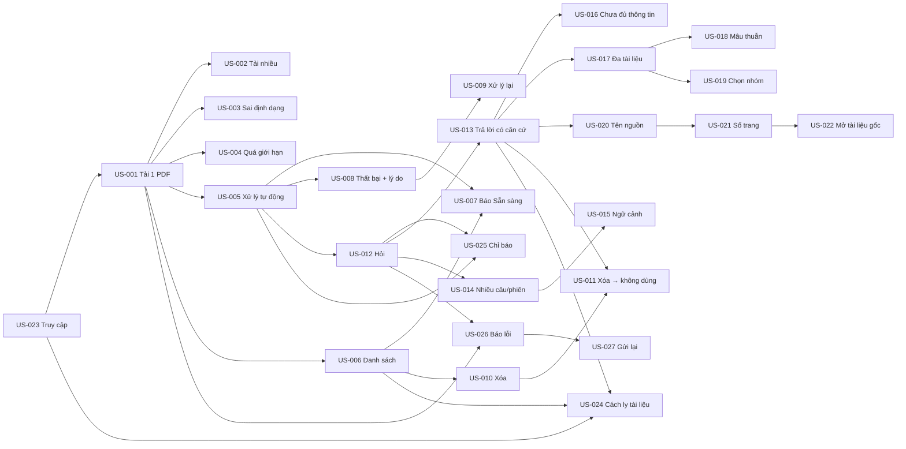

# User Stories – MVP Ứng dụng AI Chat với tài liệu PDF

| Trường | Giá trị |
|---|---|
| Mã tài liệu | US-AICHAT-001 |
| Phiên bản | 0.1 |
| Trạng thái | **Draft** |
| Ngày | 2026-10-23 |
| Tài liệu nguồn | [PRD.md](../02-requirements/PRD.md) v0.2 (mục 3, 4.2, 5.2) · [BRD.md](../02-requirements/BRD.md) v0.2 |
| Người dùng tài liệu | PO, BA, Tech Lead, Developer, Designer, QA |

**Mục đích.** Chuyển 27 user story của PRD thành backlog có thể lập kế hoạch sprint: mỗi story có thẻ chi tiết (AC, phụ thuộc, NFR, trường hợp biên, sự kiện analytics, câu hỏi mở), mức sẵn sàng, và thứ tự triển khai đề xuất.

**Quy ước**

- Nội dung story và AC **giống hệt PRD v0.2**. Khi PRD thay đổi phải cập nhật tài liệu này, và ngược lại.
- ID dùng chung với các tài liệu khác: `BR` (BRD), `NFR`, `E` (trường hợp biên – PRD 4.2), `EVT` (sự kiện analytics – PRD 5.2), `D` (giá trị đề xuất – PRD 7.2), `OQ` (câu hỏi mở), `R` (mã lý do thất bại – PRD 3.3).
- Ưu tiên: **P0** bắt buộc để ra mắt · **P1** nên có · **P2** có thì tốt.
- Persona: **P1** – Chuyên viên phát triển kinh doanh (chính); **P2** – Thành viên mới của dự án (phụ). Cả hai là giả định, chưa xác nhận qua phỏng vấn người dùng (PRD 2.1).
- Story point: `TBD` – đội phát triển ước lượng trong buổi refinement.

**Mức sẵn sàng (readiness)**

| Mức | Ý nghĩa |
|---|---|
| **Ready** | Đủ điều kiện đưa vào sprint theo Definition of Ready (mục 8). |
| **Ready (giả định)** | Có thể làm ngay với giá trị đề xuất `D-xx` trong PRD; nếu PO chốt giá trị khác thì chỉ phải đổi cấu hình/ngưỡng, không đổi hành vi. PO cần chấp nhận giả định trước sprint. |
| **Blocked** | Câu hỏi mở làm thay đổi hành vi của story; chưa nên đưa vào sprint. |

> Mọi story có dùng AI để tạo câu trả lời (US-012…US-022) đều phụ thuộc **DEP-001** (chọn nhà cung cấp AI, OQ-005) để triển khai và **DEP-005** (bộ câu hỏi kiểm thử có đáp án) để nghiệm thu. Hai phụ thuộc này được tính vào mức sẵn sàng bên dưới.

---

## 1. Tổng quan backlog

| ID | Tiêu đề | Epic | Ưu tiên | Lát | Sẵn sàng | Chặn bởi |
|---|---|---|---|---|---|---|
| US-001 | Tải một file PDF | EP-01 | P0 | 1 | Ready | – |
| US-002 | Tải nhiều PDF một lần | EP-01 | P0 | 2 | Ready (giả định) | D-01 / OQ-003 |
| US-003 | Từ chối file không phải PDF | EP-01 | P0 | 2 | Ready | – |
| US-004 | Từ chối file quá dung lượng / số trang | EP-01 | P0 | 2 | Ready (giả định) | D-01 / OQ-003 |
| US-005 | Tự động xử lý sau khi tải lên | EP-02 | P0 | 1 | Ready (giả định) | D-03 / OQ-006 |
| US-006 | Danh sách tài liệu và trạng thái | EP-02 | P0 | 1 | Ready | – |
| US-007 | Báo khi tài liệu Sẵn sàng | EP-02 | P0 | 2 | Ready | – |
| US-008 | Hiển thị Thất bại và lý do | EP-02 | P0 | 2 | Ready (giả định) | D-09 / OQ-013 (R-03) |
| US-009 | Xử lý lại tài liệu lỗi tạm thời | EP-02 | P1 | 3 | Ready | – |
| US-010 | Xóa tài liệu | EP-02 | P0 | 2 | Ready (giả định) | D-10 / OQ-004 |
| US-011 | Tài liệu đã xóa không được dùng | EP-02 | P0 | 2 | Ready (giả định) | DEP-001 |
| US-012 | Hỏi bằng ngôn ngữ tự nhiên | EP-03 | P0 | 1 | Ready (giả định) | D-08 / OQ-011; DEP-001 |
| US-013 | Trả lời chỉ từ tài liệu Sẵn sàng | EP-03 | P0 | 1 | Ready (giả định) | DEP-001, DEP-005; OQ-018 |
| US-014 | Hỏi nhiều câu trong một phiên | EP-03 | P0 | 2 | Ready (giả định) | D-10 / OQ-012 (lưu hội thoại) |
| US-015 | Câu hỏi tiếp nối hiểu ngữ cảnh | EP-03 | P1 | 3 | **Blocked** | OQ-012 |
| US-016 | Báo chưa đủ thông tin | EP-03 | P0 | 2 | Ready (giả định) | DEP-001, DEP-005; D-04 |
| US-017 | Câu trả lời tổng hợp nhiều tài liệu | EP-04 | P0 | 2 | Ready (giả định) | DEP-001, DEP-005; D-04 |
| US-018 | Chỉ ra mâu thuẫn giữa tài liệu | EP-04 | P1 | 3 | Ready (giả định) | DEP-001, DEP-005 |
| US-019 | Chọn nhóm tài liệu cho câu hỏi | EP-04 | P2 | Sau MVP | **Blocked** | OQ-018 |
| US-020 | Hiển thị tên tài liệu nguồn | EP-05 | P0 | 1 | Ready (giả định) | DEP-001 |
| US-021 | Hiển thị số trang | EP-05 | P0 | 2 | Ready (giả định) | ASM-003 (BRD) |
| US-022 | Mở tài liệu gốc tại trang | EP-05 | P1 | 3 | **Blocked** | OQ-014 |
| US-023 | Chỉ người được cấp quyền vào ứng dụng | EP-06 | P0 | 1 | **Blocked** | OQ-001, OQ-102 |
| US-024 | Tài liệu không hiện với người không có quyền | EP-06 | P0 | 2 | **Blocked** | OQ-002 |
| US-025 | Chỉ báo đang xử lý / đang trả lời | EP-07 | P0 | 2 | Ready | – |
| US-026 | Báo lỗi tải lên / câu hỏi | EP-07 | P0 | 2 | Ready (giả định) | D-02 / OQ-006 |
| US-027 | Gửi lại câu hỏi bị lỗi | EP-07 | P1 | 3 | Ready | – |

**Tóm tắt:** 27 story (21 P0, 5 P1, 1 P2). Ready: 7 · Ready (giả định): 15 · Blocked: 5.

**Cần chú ý:** hai story P0 đang bị chặn: **US-023** ở lát 1 (cách xác thực và ai cấp quyền) và **US-024** ở lát 2 (tài liệu riêng hay dùng chung). Chúng quyết định cấu trúc dữ liệu và phân quyền của toàn bộ sản phẩm, nên **OQ-001, OQ-002, OQ-102 cần được chốt trước sprint đầu tiên**.

---

## 2. Story map

Các cột theo hành trình người dùng (PRD 2.2); các hàng là lát phát hành.

| Lát | Truy cập | Tải tài liệu | Theo dõi xử lý | Hỏi | Đọc câu trả lời | Kiểm chứng | Dọn dẹp |
|---|---|---|---|---|---|---|---|
| **1 – Luồng xuyên suốt tối thiểu** | US-023 | US-001 | US-005, US-006 | US-012 | US-013 | US-020 | – |
| **2 – Hoàn thiện P0** | US-024 | US-002, US-003, US-004, US-026 | US-007, US-008, US-025 | US-014 | US-016, US-017 | US-021 | US-010, US-011 |
| **3 – P1** | – | – | US-009 | US-015, US-027 | US-018 | US-022 | – |
| **Sau MVP** | – | – | – | US-019 | – | – | – |

---

## 3. Lát phát hành đề xuất

> Thứ tự này là đề xuất của BA để giảm rủi ro; PO và đội phát triển quyết định kế hoạch sprint.

| Lát | Mục tiêu | Story | Số story | Kết quả kiểm chứng được |
|---|---|---|---|---|
| **1** | Chạy được luồng **Tải PDF → Xử lý → Hỏi → Trả lời có nguồn** với một người dùng, một tài liệu | US-023, US-001, US-005, US-006, US-012, US-013, US-020 | 7 (P0) | Demo end-to-end; đo sớm MET-002 và MET-004 trên bộ câu hỏi nhỏ để phát hiện rủi ro chất lượng AI (RSK-001) |
| **2** | Hoàn thành mọi story P0: nhiều tài liệu, xử lý lỗi, phân quyền, xóa, đa tài liệu, số trang | US-002, US-003, US-004, US-007, US-008, US-010, US-011, US-014, US-016, US-017, US-021, US-024, US-025, US-026 | 14 (P0) | Đạt launch gate G-01…G-07 (PRD 5.1) |
| **3** | Bổ sung P1 nếu còn thời gian trong MVP | US-009, US-015, US-018, US-022, US-027 | 5 (P1) | AC của từng story |
| **Sau MVP** | – | US-019 | 1 (P2) | – |

**Vì sao lát 1 chọn như vậy:** chất lượng câu trả lời AI là rủi ro lớn nhất (RSK-001) và cũng là giá trị cốt lõi. Lát 1 dựng luồng đầy đủ sớm nhất để đo chất lượng thật, thay vì làm xong phần quản lý tài liệu rồi mới phát hiện câu trả lời chưa đạt.

---

## 4. Phụ thuộc giữa các story

---

## 5. Thẻ user story

### EP-01 – Tiếp nhận tài liệu

#### US-001 – Tải một file PDF

| | |
|---|---|
| Story | Là P1, tôi muốn tải một file PDF từ máy tính lên ứng dụng, để có thể hỏi đáp về nội dung của nó. |
| Ưu tiên · Lát · Sẵn sàng | P0 · 1 · Ready |
| Nguồn | BR-001 · BO-005 · SN-001 |
| Phụ thuộc | US-023 |
| NFR | NFR-017 (trình duyệt) |
| Trường hợp biên | E-04 (mất mạng khi tải lên – xử lý ở US-026) |
| Sự kiện | EVT-01 |

**Tiêu chí nghiệm thu**
- **Given** người dùng đã đăng nhập, **When** chọn 1 file PDF có văn bản, dung lượng trong giới hạn, **Then** file xuất hiện trong danh sách tài liệu với tên file và trạng thái "Đang xử lý".
- **Given** đang tải lên, **When** việc tải lên chưa xong, **Then** người dùng thấy tiến độ tải lên của file đó.

#### US-002 – Tải nhiều PDF một lần

| | |
|---|---|
| Story | Là P1, tôi muốn chọn và tải nhiều file PDF trong một lần, để không phải lặp lại thao tác cho từng file. |
| Ưu tiên · Lát · Sẵn sàng | P0 · 2 · Ready (giả định D-01: 10 file/lần) |
| Nguồn | BR-002 · BO-003 · SN-001 |
| Phụ thuộc | US-001, US-003, US-004 (dùng chung kiểm tra file) |
| NFR | NFR-019, NFR-020 |
| Trường hợp biên | E-08 |
| Sự kiện | EVT-01, EVT-02 |
| Câu hỏi mở | OQ-003 |

**Tiêu chí nghiệm thu**
- **Given** giới hạn là N file mỗi lần (N = 10 `[Đề xuất PM – chờ OQ-003]`), **When** người dùng chọn N file PDF hợp lệ, **Then** cả N file xuất hiện trong danh sách với trạng thái "Đang xử lý".
- **Given** người dùng chọn N+1 file, **When** xác nhận tải lên, **Then** ứng dụng không tải file nào và thông báo giới hạn N file mỗi lần.
- **Given** người dùng chọn lẫn file hợp lệ và không hợp lệ, **When** xác nhận tải lên, **Then** các file hợp lệ được nhận, các file không hợp lệ bị liệt kê kèm lý do.

**Ghi chú phân tích:** AC chưa nêu hành vi khi tổng số tài liệu sau khi tải vượt NFR-020 (100 tài liệu/người dùng), ví dụ đang có 95 tài liệu và chọn 10 file. Đề xuất: từ chối cả lần tải và nêu số tài liệu còn được phép thêm, giống quy tắc N+1 file. Cần PO xác nhận (xem mục 9, I-01).

#### US-003 – Từ chối file không phải PDF

| | |
|---|---|
| Story | Là P1, tôi muốn được báo ngay khi chọn nhầm file không phải PDF, để biết vì sao file đó không được nhận. |
| Ưu tiên · Lát · Sẵn sàng | P0 · 2 · Ready |
| Nguồn | BR-003 · BO-005 · SN-008 |
| Phụ thuộc | US-001 |
| Trường hợp biên | E-07 |
| Sự kiện | EVT-02 (lý do: định dạng) |

**Tiêu chí nghiệm thu**
- **Given** người dùng chọn file .docx, .jpg, hoặc file có đuôi .pdf nhưng nội dung không phải PDF, **When** tải lên, **Then** file bị từ chối, thông báo nêu tên file và lý do "không phải file PDF hợp lệ", file không xuất hiện trong danh sách.

#### US-004 – Từ chối file quá dung lượng hoặc quá số trang

| | |
|---|---|
| Story | Là P1, tôi muốn được báo khi file quá dung lượng cho phép, để biết cần tách hoặc nén file. |
| Ưu tiên · Lát · Sẵn sàng | P0 · 2 · Ready (giả định D-01: 20 MB, 300 trang) |
| Nguồn | BR-004 · BO-005 · SN-008, SN-011 |
| Phụ thuộc | US-001 |
| NFR | NFR-006, NFR-021 |
| Trường hợp biên | E-08 |
| Sự kiện | EVT-02 (lý do: dung lượng / số trang) |
| Câu hỏi mở | OQ-003 |

**Tiêu chí nghiệm thu**
- **Given** giới hạn dung lượng là 20 MB/file `[Đề xuất PM – chờ OQ-003]`, **When** người dùng chọn file lớn hơn giới hạn, **Then** file bị từ chối và không được lưu, thông báo nêu tên file, dung lượng file và giới hạn cho phép.
- **Given** giới hạn là 300 trang/file `[Đề xuất PM – chờ OQ-003]`, **When** người dùng chọn PDF nhiều hơn 300 trang, **Then** file bị từ chối và không được lưu, thông báo nêu tên file, số trang và giới hạn cho phép.

**Ghi chú phân tích:** câu story chỉ nói "quá dung lượng" trong khi AC có cả số trang. Đề xuất sửa câu story trong PRD thành "…khi file vượt giới hạn dung lượng hoặc số trang…" (I-02).

### EP-02 – Xử lý và quản lý tài liệu

#### US-005 – Tự động xử lý sau khi tải lên

| | |
|---|---|
| Story | Là P1, tôi muốn tài liệu được xử lý tự động ngay sau khi tải lên, để không phải làm thêm bước nào. |
| Ưu tiên · Lát · Sẵn sàng | P0 · 1 · Ready (giả định D-03: ≤ 3 phút/file 20 MB) |
| Nguồn | BR-005 · BO-001 · SN-001 |
| Phụ thuộc | US-001 |
| NFR | NFR-002 |
| Sự kiện | EVT-03, EVT-04 |
| Câu hỏi mở | OQ-006 |

**Tiêu chí nghiệm thu**
- **Given** một file vừa tải lên thành công, **When** không có thao tác nào khác của người dùng, **Then** trạng thái chuyển từ "Đang xử lý" sang "Sẵn sàng" hoặc "Thất bại" trong thời gian quy định tại NFR-002.

#### US-006 – Danh sách tài liệu và trạng thái

| | |
|---|---|
| Story | Là P1, tôi muốn xem danh sách tài liệu của mình cùng trạng thái của từng tài liệu, để biết tài liệu nào đã dùng được. |
| Ưu tiên · Lát · Sẵn sàng | P0 · 1 · Ready |
| Nguồn | BR-006 · BO-005 · SN-005 |
| Phụ thuộc | US-001 |
| NFR | NFR-020 (hiển thị số tài liệu so với giới hạn – PRD 4.1) |
| Trường hợp biên | E-01, E-12, E-18 |

**Tiêu chí nghiệm thu**
- **Given** người dùng có tài liệu ở cả ba trạng thái, **When** mở danh sách tài liệu, **Then** mỗi dòng hiển thị tên file, trạng thái (Đang xử lý / Sẵn sàng / Thất bại) và thời điểm tải lên; danh sách chỉ gồm tài liệu trong phạm vi quyền của người dùng.
- **Given** người dùng chưa có tài liệu nào, **When** mở ứng dụng, **Then** hiển thị trạng thái trống kèm hướng dẫn tải tài liệu.

#### US-007 – Báo khi tài liệu Sẵn sàng

| | |
|---|---|
| Story | Là P1, tôi muốn được báo khi tài liệu chuyển sang Sẵn sàng, để bắt đầu hỏi ngay mà không phải tải lại trang. |
| Ưu tiên · Lát · Sẵn sàng | P0 · 2 · Ready |
| Nguồn | BR-007 · BO-001 · SN-005 |
| Phụ thuộc | US-005, US-006 |
| Sự kiện | EVT-03 |

**Tiêu chí nghiệm thu**
- **Given** một tài liệu đang "Đang xử lý" và người dùng đang mở ứng dụng, **When** xử lý thành công, **Then** trạng thái đổi thành "Sẵn sàng" và có thông báo theo mục 4.1, không cần tải lại trang.

**Ghi chú phân tích:** PRD 4.1 cũng yêu cầu thông báo khi tài liệu chuyển sang **Thất bại**, nhưng AC chỉ có trường hợp Sẵn sàng. Đề xuất thêm AC cho trường hợp Thất bại (I-03).

#### US-008 – Hiển thị Thất bại và lý do

| | |
|---|---|
| Story | Là P1, tôi muốn thấy tài liệu nào xử lý thất bại và lý do, để quyết định thay bằng file khác. |
| Ưu tiên · Lát · Sẵn sàng | P0 · 2 · Ready (giả định D-09: PDF scan → Thất bại) |
| Nguồn | BR-008 · BO-005 · SN-008 |
| Phụ thuộc | US-005 |
| Trường hợp biên | E-03, E-09, E-10 |
| Sự kiện | EVT-04 |
| Câu hỏi mở | OQ-013 |

**Mã lý do thất bại** (PRD 3.3)

| Mã | Lý do hiển thị cho người dùng | Được xử lý lại |
|---|---|---|
| R-01 | Không đọc được file (file hỏng) | Không |
| R-02 | File được bảo vệ bằng mật khẩu | Không |
| R-03 | File không chứa văn bản trích xuất được (PDF scan chưa được hỗ trợ) `[chờ OQ-013]` | Không |
| R-04 | Lỗi xử lý tạm thời – mọi lỗi không thuộc R-01…R-03 | Có |

**Tiêu chí nghiệm thu**
- **Given** một PDF bị hỏng hoặc có mật khẩu, **When** xử lý, **Then** trạng thái là "Thất bại" với lý do "không đọc được file" hoặc "file được bảo vệ bằng mật khẩu".
- **Given** một PDF dạng scan (không có lớp văn bản), **When** xử lý, **Then** trạng thái là "Thất bại" với lý do "file không chứa văn bản trích xuất được (PDF scan chưa được hỗ trợ)" `[Đề xuất PM – chờ OQ-013]`.

**Ghi chú phân tích:** AC chưa có trường hợp R-04 (lỗi tạm thời, vd. quá thời gian NFR-002). Đề xuất thêm AC: "Given xử lý vượt thời gian NFR-002, Then trạng thái Thất bại với lý do R-04" (I-04).

#### US-009 – Xử lý lại tài liệu lỗi tạm thời

| | |
|---|---|
| Story | Là P1, tôi muốn yêu cầu xử lý lại tài liệu bị thất bại với lý do được phép xử lý lại (bảng mã lý do), để không phải tải lại file. |
| Ưu tiên · Lát · Sẵn sàng | P1 · 3 · Ready |
| Nguồn | BR-009 · BO-005 · SN-008 |
| Phụ thuộc | US-008 |

**Tiêu chí nghiệm thu**
- **Given** tài liệu "Thất bại" với lý do R-04, **When** người dùng chọn "Xử lý lại", **Then** trạng thái chuyển về "Đang xử lý" và tài liệu được xử lý lại mà không cần tải lại file.
- **Given** tài liệu "Thất bại" với lý do R-01, R-02 hoặc R-03, **When** người dùng xem tài liệu, **Then** không có thao tác "Xử lý lại".

#### US-010 – Xóa tài liệu

| | |
|---|---|
| Story | Là P1, tôi muốn xóa tài liệu không còn dùng, để danh sách gọn và tài liệu cũ không ảnh hưởng câu trả lời. |
| Ưu tiên · Lát · Sẵn sàng | P0 · 2 · Ready (giả định D-10: xóa thật trong ≤ 24 giờ) |
| Nguồn | BR-010 · BO-004 · SN-007 |
| Phụ thuộc | US-006 |
| NFR | NFR-013 |
| Trường hợp biên | E-13 |
| Sự kiện | EVT-05 |
| Câu hỏi mở | OQ-004 |

**Tiêu chí nghiệm thu**
- **Given** một tài liệu trong danh sách, **When** người dùng chọn xóa, **Then** ứng dụng hỏi xác nhận; **When** người dùng xác nhận, **Then** tài liệu biến mất khỏi danh sách.
- **Given** tài liệu đang ở trạng thái "Đang xử lý", **When** người dùng xóa, **Then** việc xử lý bị hủy và tài liệu bị xóa.

#### US-011 – Tài liệu đã xóa không được dùng để trả lời

| | |
|---|---|
| Story | Là P1, tôi muốn chắc chắn tài liệu đã xóa không còn được dùng để trả lời, để không nhận thông tin lỗi thời. |
| Ưu tiên · Lát · Sẵn sàng | P0 · 2 · Ready (giả định) |
| Nguồn | BR-011 · BO-004 · SN-007 |
| Phụ thuộc | US-010, US-013 |
| NFR | NFR-013 |
| Trường hợp biên | E-13, E-19 |

**Tiêu chí nghiệm thu**
- **Given** câu hỏi Q chỉ có đáp án trong tài liệu X, **When** người dùng xóa X rồi hỏi lại Q, **Then** câu trả lời không chứa thông tin từ X, không trích dẫn X, và (nếu không tài liệu nào khác có thông tin) ứng dụng thông báo chưa đủ thông tin.

### EP-03 – Hỏi đáp

#### US-012 – Hỏi bằng ngôn ngữ tự nhiên

| | |
|---|---|
| Story | Là P1, tôi muốn hỏi bằng câu tự nhiên như khi hỏi đồng nghiệp, để không phải biết trước từ khóa. |
| Ưu tiên · Lát · Sẵn sàng | P0 · 1 · Ready (giả định D-08: tiếng Việt + tiếng Anh; D-02: p90 ≤ 15 s) |
| Nguồn | BR-012 · BO-002 · SN-002 |
| Phụ thuộc | US-005; DEP-001 |
| NFR | NFR-001, NFR-016 |
| Trường hợp biên | E-01, E-02, E-14, E-15 |
| Sự kiện | EVT-06 |
| Câu hỏi mở | OQ-011, OQ-006 |

**Tiêu chí nghiệm thu**
- **Given** người dùng có ít nhất một tài liệu "Sẵn sàng", **When** gõ câu hỏi bằng tiếng Việt hoặc tiếng Anh `[Đề xuất PM – chờ OQ-011]` và gửi, **Then** nhận được câu trả lời trong thời gian quy định tại NFR-001.
- **Given** người dùng chưa có tài liệu "Sẵn sàng", **When** mở ô hỏi, **Then** ô hỏi bị khóa với lời nhắc "Cần ít nhất một tài liệu Sẵn sàng để bắt đầu hỏi".
- **Given** ô hỏi trống hoặc chỉ có khoảng trắng, **When** người dùng gửi, **Then** câu hỏi không được gửi.

#### US-013 – Trả lời chỉ từ tài liệu Sẵn sàng

| | |
|---|---|
| Story | Là P1, tôi muốn câu trả lời chỉ dựa trên tài liệu đã sẵn sàng của tôi, để tin rằng thông tin đến từ tài liệu dự án. |
| Ưu tiên · Lát · Sẵn sàng | P0 · 1 · Ready (giả định: mỗi câu hỏi dùng toàn bộ tài liệu Sẵn sàng của người dùng cho tới khi chốt OQ-018) |
| Nguồn | BR-013 · BO-002, BO-004 · SN-006 · BRU-002, BRU-005 |
| Phụ thuộc | US-012; DEP-001, DEP-005 |
| NFR | NFR-003, NFR-011 |
| Sự kiện | EVT-07 |
| Câu hỏi mở | OQ-018 |

**Tiêu chí nghiệm thu**
- **Given** tài liệu Y đang "Đang xử lý" và tài liệu Z "Sẵn sàng", **When** hỏi câu chỉ có đáp án trong Y, **Then** câu trả lời không dùng và không trích dẫn Y.
- **Given** câu hỏi có đáp án trong Z, **When** hỏi, **Then** câu trả lời khớp với nội dung của Z và trích dẫn Z.

**Ghi chú phân tích:** đây là story chứa giá trị cốt lõi và rủi ro lớn nhất (RSK-001). Ngưỡng chất lượng tổng thể (NFR-003 – MET-002 ≥ 80%) được đo ở launch gate G-02, không gắn vào một story riêng. Cần bộ câu hỏi kiểm thử (DEP-005) ngay từ lát 1.

#### US-014 – Hỏi nhiều câu trong một phiên

| | |
|---|---|
| Story | Là P1, tôi muốn hỏi nhiều câu liên tiếp trong cùng một phiên, để làm rõ dần vấn đề. |
| Ưu tiên · Lát · Sẵn sàng | P0 · 2 · Ready (giả định D-10: hội thoại giữ trong phiên) |
| Nguồn | BR-014 · BO-002 · SN-002 |
| Phụ thuộc | US-012 |
| NFR | NFR-024 |
| Trường hợp biên | E-18 |
| Câu hỏi mở | OQ-012 |

**Tiêu chí nghiệm thu**
- **Given** người dùng đã nhận một câu trả lời, **When** gửi thêm 5 câu hỏi liên tiếp, **Then** nhận được 5 câu trả lời trong cùng một khung hội thoại, theo đúng thứ tự, không cần tải lại tài liệu hay mở phiên mới.

#### US-015 – Câu hỏi tiếp nối hiểu ngữ cảnh

| | |
|---|---|
| Story | Là P1, tôi muốn câu hỏi tiếp theo hiểu được ngữ cảnh câu trước (vd. "còn tài liệu kia thì sao?"), để không phải nhắc lại. |
| Ưu tiên · Lát · Sẵn sàng | P1 · 3 · **Blocked** |
| Nguồn | BR-014 · BO-002 · SN-002 |
| Phụ thuộc | US-014; DEP-001, DEP-005 (10 cặp câu hỏi tiếp nối) |
| Câu hỏi mở | **OQ-012** – có cần hiểu ngữ cảnh không |

**Tiêu chí nghiệm thu**
- **Given** người dùng vừa hỏi về điều khoản thanh toán trong tài liệu A, **When** hỏi tiếp "còn tài liệu B thì sao?", **Then** câu trả lời nói về điều khoản thanh toán trong tài liệu B và trích dẫn B.
- **Given** 10 cặp câu hỏi tiếp nối trong bộ kiểm thử (DEP-005), **When** chạy kiểm thử, **Then** ≥ 8/10 câu trả lời đúng ngữ cảnh `[Đề xuất PM]`.

#### US-016 – Báo chưa đủ thông tin

| | |
|---|---|
| Story | Là P1, tôi muốn được nói rõ khi tài liệu không có thông tin, để không dùng nhầm câu trả lời bịa đặt. |
| Ưu tiên · Lát · Sẵn sàng | P0 · 2 · Ready (giả định D-04: MET-005 ≥ 90%) |
| Nguồn | BR-015 · BO-004 · SN-006 · BRU-005 |
| Phụ thuộc | US-013; DEP-005 (bộ câu hỏi "ngoài tài liệu") |
| NFR | NFR-005 |
| Trường hợp biên | E-11, E-16 |
| Sự kiện | EVT-07 (loại: chưa đủ thông tin) |

**Tiêu chí nghiệm thu**
- **Given** câu hỏi không có thông tin trong bất kỳ tài liệu "Sẵn sàng" nào, **When** hỏi, **Then** ứng dụng trả lời rõ là chưa đủ thông tin trong tài liệu để trả lời và không kèm nguồn tham chiếu.
- **Given** bộ câu hỏi "ngoài tài liệu" (DEP-005), **When** chạy kiểm thử, **Then** tỷ lệ từ chối đúng đạt NFR-005.

**Ghi chú phân tích:** nên làm cùng sprint với US-013 nếu đội có năng lực, vì hai story cùng kiểm soát hành vi "chỉ trả lời từ tài liệu" và dùng chung bộ kiểm thử.

### EP-04 – Hỏi đáp đa tài liệu

#### US-017 – Câu trả lời tổng hợp nhiều tài liệu

| | |
|---|---|
| Story | Là P1, tôi muốn một câu trả lời tổng hợp khi thông tin nằm ở nhiều tài liệu, để không phải tự ghép lại. |
| Ưu tiên · Lát · Sẵn sàng | P0 · 2 · Ready (giả định D-04: MET-003 ≥ 80%) |
| Nguồn | BR-017 · BO-003 · SN-003 |
| Phụ thuộc | US-013; DEP-005 (bộ câu hỏi đa tài liệu) |
| Sự kiện | EVT-07 (số tài liệu được trích dẫn) |

**Tiêu chí nghiệm thu**
- **Given** đáp án chuẩn nằm ở 2 tài liệu "Sẵn sàng" khác nhau, **When** hỏi, **Then** câu trả lời nêu thông tin từ cả 2 tài liệu và trích dẫn cả 2.
- **Given** bộ câu hỏi đa tài liệu (DEP-005), **When** chạy kiểm thử, **Then** tỷ lệ trả lời đầy đủ (MET-003) ≥ 80% `[Đề xuất PM – chờ OQ-009]`.

#### US-018 – Chỉ ra mâu thuẫn giữa tài liệu

| | |
|---|---|
| Story | Là P1, tôi muốn được chỉ ra khi các tài liệu nói khác nhau, để biết cần kiểm tra lại với nguồn nào. |
| Ưu tiên · Lát · Sẵn sàng | P1 · 3 · Ready (giả định) |
| Nguồn | BR-018 · BO-004 · SN-003 |
| Phụ thuộc | US-017; DEP-005 (cặp tài liệu mâu thuẫn) |

**Tiêu chí nghiệm thu**
- **Given** 2 tài liệu "Sẵn sàng" ghi 2 giá trị khác nhau cho cùng một thông tin, **When** hỏi về thông tin đó, **Then** câu trả lời nêu cả hai giá trị, mỗi giá trị kèm tài liệu nguồn, và nói rõ hai tài liệu không thống nhất.

#### US-019 – Chọn nhóm tài liệu cho câu hỏi

| | |
|---|---|
| Story | Là P1, tôi muốn giới hạn câu hỏi trong một nhóm tài liệu tôi chọn, để câu trả lời không lẫn thông tin từ dự án khác. |
| Ưu tiên · Lát · Sẵn sàng | P2 · Sau MVP · **Blocked** |
| Nguồn | Chưa có BR (OQ-018) |
| Phụ thuộc | US-017 |
| Câu hỏi mở | **OQ-018** |

**Tiêu chí nghiệm thu**
- **Given** có tài liệu "Sẵn sàng" A, B, C, **When** người dùng chọn chỉ A và B rồi hỏi câu có đáp án trong C, **Then** câu trả lời không dùng và không trích dẫn C.

### EP-05 – Nguồn tham chiếu

#### US-020 – Hiển thị tên tài liệu nguồn

| | |
|---|---|
| Story | Là P1, tôi muốn thấy tên tài liệu đã dùng cho câu trả lời, để biết thông tin đến từ đâu. |
| Ưu tiên · Lát · Sẵn sàng | P0 · 1 · Ready (giả định) |
| Nguồn | BR-019 · BO-004 · SN-004 |
| Phụ thuộc | US-013 |
| NFR | NFR-004 |
| Sự kiện | EVT-07 (số nguồn) |

**Tiêu chí nghiệm thu**
- **Given** một câu trả lời dựa trên tài liệu, **When** hiển thị, **Then** mỗi tài liệu được dùng làm căn cứ xuất hiện trong phần nguồn với đúng tên file.

**Ghi chú phân tích:** nếu hai tài liệu trùng tên (E-12), chỉ hiển thị tên file sẽ không phân biệt được nguồn. Đề xuất hiển thị thêm thời điểm tải lên khi có trùng tên (I-05, liên quan OQ-103).

#### US-021 – Hiển thị số trang

| | |
|---|---|
| Story | Là P1, tôi muốn thấy số trang chứa thông tin, để tìm lại nhanh trong tài liệu gốc. |
| Ưu tiên · Lát · Sẵn sàng | P0 · 2 · Ready (giả định – ASM-003: xác định được số trang) |
| Nguồn | BR-020 · BO-004 · SN-004 |
| Phụ thuộc | US-020; DEP-003 (PDF mẫu để kiểm chứng số trang) |
| NFR | NFR-018 |

**Tiêu chí nghiệm thu**
- **Given** PDF có số trang xác định được, **When** câu trả lời trích dẫn tài liệu đó, **Then** phần nguồn hiển thị số trang và số trang đó chứa thông tin được trích dẫn trong PDF gốc.
- **Given** không xác định được số trang, **When** hiển thị nguồn, **Then** chỉ hiển thị tên tài liệu, không hiển thị số trang sai hoặc số trang giả định.

**Ghi chú phân tích:** "số trang" cần định nghĩa rõ: số thứ tự trang trong file PDF (trang 1 là trang đầu của file) hay số trang in trên tài liệu (có thể bắt đầu từ i, ii hoặc khác số thứ tự). Đề xuất dùng số thứ tự trang trong file để khớp với trình xem PDF (I-06).

#### US-022 – Mở tài liệu gốc tại trang

| | |
|---|---|
| Story | Là P1, tôi muốn bấm vào nguồn để mở đúng trang của tài liệu gốc, để kiểm chứng ngay. |
| Ưu tiên · Lát · Sẵn sàng | P1 · 3 · **Blocked** |
| Nguồn | BR-021 · BO-004 · SN-004 |
| Phụ thuộc | US-021 |
| Trường hợp biên | E-19 |
| Sự kiện | EVT-09 |
| Câu hỏi mở | **OQ-014** – mở trong ứng dụng hay người dùng tự mở file |

**Tiêu chí nghiệm thu**
- **Given** câu trả lời có nguồn "tên file · tr.X", **When** người dùng bấm vào nguồn, **Then** tài liệu gốc được mở tại trang X.
- **Given** nguồn không có số trang, **When** người dùng bấm vào nguồn, **Then** tài liệu gốc được mở ở trang đầu.
- **Given** tài liệu nguồn đã bị xóa, **When** người dùng bấm vào nguồn, **Then** hiển thị "Tài liệu đã bị xóa" và không mở được (E-19).

### EP-06 – Truy cập và bảo vệ dữ liệu

#### US-023 – Chỉ người được cấp quyền vào ứng dụng

| | |
|---|---|
| Story | Là P1, tôi muốn chỉ người đã được cấp quyền mới vào được ứng dụng, để tài liệu nội bộ của dự án không lọt ra ngoài. |
| Ưu tiên · Lát · Sẵn sàng | P0 · 1 · **Blocked** |
| Nguồn | BR-022 · BO-006 · SN-010 |
| Phụ thuộc | – (nền cho mọi story khác) |
| NFR | NFR-009, NFR-010, NFR-022 |
| Trường hợp biên | E-17 |
| Sự kiện | EVT-11 |
| Câu hỏi mở | **OQ-001** (một hay nhiều người dùng), **OQ-102** (ai cấp quyền, dùng tài khoản doanh nghiệp hay tài khoản riêng) |

**Tiêu chí nghiệm thu**
- **Given** một người chưa được cấp quyền, **When** truy cập ứng dụng, **Then** bị từ chối và không thấy danh sách tài liệu, không tải lên được, không hỏi được.
- **Given** phiên đăng nhập hết hạn, **When** người dùng thao tác, **Then** được yêu cầu xác thực lại; nội dung câu hỏi đang soạn không bị mất.

**Ghi chú phân tích:** nếu OQ-001 chốt "một người dùng", story có thể đơn giản hóa đáng kể. Nếu chốt "nhiều người dùng", cần thêm story quản trị quyền (US-C01, mục 6). Đây là story phải chốt sớm nhất.

#### US-024 – Tài liệu không hiện với người không có quyền

| | |
|---|---|
| Story | Là P1, tôi muốn tài liệu tôi tải lên không hiện ra với người không có quyền, để thông tin của dự án được giữ kín. |
| Ưu tiên · Lát · Sẵn sàng | P0 · 2 · **Blocked** |
| Nguồn | BR-023 · BO-006 · SN-010 · BRU-006 |
| Phụ thuộc | US-023, US-006, US-013 |
| NFR | NFR-010 |
| Sự kiện | EVT-11 |
| Câu hỏi mở | **OQ-002** (tài liệu riêng hay dùng chung) |

**Tiêu chí nghiệm thu** (áp dụng nếu OQ-002 chốt tài liệu thuộc riêng người tải lên)
- **Given** người dùng A tải tài liệu X, **When** người dùng B hỏi câu chỉ có đáp án trong X, **Then** B không nhận được nội dung, tên hay nguồn tham chiếu của X.
- **Given** người dùng B mở danh sách tài liệu, **When** hiển thị, **Then** không có X.

**Ghi chú phân tích:** chưa có AC nếu OQ-002 chốt "dùng chung" (khi đó cần định nghĩa ai được xóa tài liệu của người khác). AC phải viết lại sau khi chốt.

### EP-07 – Phản hồi và xử lý lỗi

#### US-025 – Chỉ báo đang xử lý / đang trả lời

| | |
|---|---|
| Story | Là P1, tôi muốn thấy ứng dụng đang xử lý hoặc đang soạn câu trả lời, để biết cần chờ chứ không phải ứng dụng bị treo. |
| Ưu tiên · Lát · Sẵn sàng | P0 · 2 · Ready |
| Nguồn | BR-024 · BO-001 · SN-005 |
| Phụ thuộc | US-005, US-012 |

**Tiêu chí nghiệm thu**
- **Given** câu hỏi đã được gửi, **When** câu trả lời chưa xong, **Then** có chỉ báo "đang soạn câu trả lời" và ô hỏi không nhận câu hỏi mới cho tới khi có kết quả hoặc lỗi.
- **Given** tài liệu "Đang xử lý", **When** người dùng xem danh sách, **Then** có chỉ báo đang xử lý trên dòng của tài liệu đó.

#### US-026 – Báo lỗi tải lên và lỗi câu hỏi

| | |
|---|---|
| Story | Là P1, tôi muốn được báo khi tải lên hoặc câu hỏi bị lỗi, để biết thao tác chưa thành công. |
| Ưu tiên · Lát · Sẵn sàng | P0 · 2 · Ready (giả định D-02: quá thời gian = vượt NFR-001) |
| Nguồn | BR-027 · BO-005 · SN-008 |
| Phụ thuộc | US-001, US-012 |
| NFR | NFR-001 |
| Trường hợp biên | E-04, E-05, E-06 |
| Sự kiện | EVT-08 |

**Tiêu chí nghiệm thu**
- **Given** mất kết nối mạng khi đang tải lên, **When** tải lên thất bại, **Then** file được đánh dấu tải lên thất bại kèm nút "Tải lại", không xuất hiện như tài liệu "Đang xử lý".
- **Given** câu hỏi gặp lỗi (mất mạng, dịch vụ AI không phản hồi, quá thời gian ở NFR-001), **When** lỗi xảy ra, **Then** khung hội thoại hiển thị thông báo lỗi ngay tại vị trí câu trả lời, câu hỏi gốc vẫn hiển thị.

**Ghi chú phân tích (INVEST – Small):** story gồm hai luồng độc lập (lỗi tải lên thuộc EP-01, lỗi câu hỏi thuộc EP-03). Đề xuất tách khi lập kế hoạch sprint: **US-026a** lỗi tải lên (làm cùng US-001/US-002) và **US-026b** lỗi câu hỏi (làm cùng US-012) (I-07).

#### US-027 – Gửi lại câu hỏi bị lỗi

| | |
|---|---|
| Story | Là P1, tôi muốn gửi lại câu hỏi bị lỗi chỉ bằng một thao tác, để không phải gõ lại. |
| Ưu tiên · Lát · Sẵn sàng | P1 · 3 · Ready |
| Nguồn | BR-028 · BO-005 · SN-008 |
| Phụ thuộc | US-026 |
| Trường hợp biên | E-05 |
| Sự kiện | EVT-10 |

**Tiêu chí nghiệm thu**
- **Given** một câu hỏi bị lỗi (US-026), **When** người dùng chọn "Gửi lại", **Then** đúng nội dung câu hỏi ban đầu được gửi lại, người dùng không phải gõ lại.
- **Given** lần gửi lại cũng lỗi, **When** lỗi xảy ra, **Then** thông báo lỗi hiển thị lần nữa và vẫn có thể gửi lại.

---

## 6. Story đề xuất bổ sung (chưa được duyệt)

> Các story dưới đây **không có trong PRD v0.2**. Chúng lấp các chỗ trống phát hiện khi review BRD/PRD. PO quyết định có đưa vào backlog hay không; nếu có, cần cập nhật PRD và BRD tương ứng.

| ID tạm | Story đề xuất | Lý do | Ưu tiên đề xuất | Điều kiện |
|---|---|---|---|---|
| US-C01 | Là quản trị viên, tôi muốn cấp và thu hồi quyền truy cập ứng dụng cho nhân viên, để chỉ đúng người dùng được công cụ. | US-023 cần một cách để "được cấp quyền"; chưa có vai trò quản trị (P-DEF-003 trong review PRD) | P0 nếu OQ-001 = nhiều người dùng | OQ-001, OQ-102 |
| US-C02 | Là cán bộ IT/Security, tôi muốn tra cứu nhật ký ai đã tải lên, xóa tài liệu nào và đặt câu hỏi khi nào, để điều tra khi có sự cố. | NFR-012 yêu cầu ghi nhật ký nhưng chưa có ai/cách nào xem nhật ký | P1 | IT/Security xác nhận (DEF-002) |
| US-C03 | Là P1, tôi muốn đăng xuất, để người khác dùng chung máy không xem được tài liệu của tôi. | NFR-024 nhắc tới đăng xuất nhưng không có story | P0 nếu OQ-001 = nhiều người dùng | OQ-001 |
| US-C04 | Là P1, tôi muốn bắt đầu một cuộc hội thoại mới, để câu hỏi về chủ đề khác không bị ảnh hưởng bởi ngữ cảnh cũ. | Cần thiết nếu US-015 (hiểu ngữ cảnh) được làm | P2 | OQ-012 |
| US-C05 | Là P2, tôi muốn hỏi "các tài liệu này nói về những gì", để nắm nhanh bối cảnh dự án. | Persona P2 chưa có story riêng; nhu cầu tổng quan khác với hỏi một thông tin cụ thể | P2 | PO xác nhận nằm trong phạm vi "tổng hợp thông tin" (BO-003) |

---

## 7. Truy vết

### 7.1 BR → story

| BR | Story | BR | Story |
|---|---|---|---|
| BR-001 | US-001 | BR-016 | US-013 (đo ở G-02 – NFR-003) |
| BR-002 | US-002 | BR-017 | US-017 |
| BR-003 | US-003 | BR-018 | US-018 |
| BR-004 | US-004 | BR-019 | US-020 |
| BR-005 | US-005 | BR-020 | US-021 |
| BR-006 | US-006 | BR-021 | US-022 |
| BR-007 | US-007 | BR-022 | US-023 |
| BR-008 | US-008 | BR-023 | US-024 |
| BR-009 | US-009 | BR-024 | US-025 |
| BR-010 | US-010 | BR-025 | NFR-001 (US-012, US-026) |
| BR-011 | US-011 | BR-026 | NFR-002 (US-005) |
| BR-012 | US-012 | BR-027 | US-026 |
| BR-013 | US-013 | BR-028 | US-027 |
| BR-014 | US-014, US-015 | BR-029 | NFR-008 (usability test toàn luồng) |
| BR-015 | US-016 | – | US-019 (chưa có BR – OQ-018) |

**Bao phủ:** 29/29 BR được truy vết tới story hoặc NFR. BR-016, BR-025, BR-026, BR-029 là yêu cầu chất lượng, kiểm chứng ở launch gate (PRD 5.1), không phải story riêng.

### 7.2 Trường hợp biên → story

| E | Story | E | Story | E | Story |
|---|---|---|---|---|---|
| E-01 | US-006, US-012 | E-08 | US-002, US-004 | E-15 | US-012 |
| E-02 | US-012 | E-09 | US-008 | E-16 | US-016 |
| E-03 | US-008 | E-10 | US-008 | E-17 | US-023 |
| E-04 | US-026 | E-11 | US-016 | E-18 | US-006, US-014 |
| E-05 | US-026, US-027 | E-12 | US-006, US-020 | E-19 | US-011, US-022 |
| E-06 | US-026 | E-13 | US-010, US-011 | | |
| E-07 | US-003 | E-14 | US-012 | | |

### 7.3 Sự kiện analytics → story

| EVT | Story | EVT | Story |
|---|---|---|---|
| EVT-01 `document_upload_started` | US-001, US-002 | EVT-07 `answer_returned` | US-013, US-016, US-017, US-020 |
| EVT-02 `document_upload_rejected` | US-002, US-003, US-004 | EVT-08 `answer_failed` | US-026 |
| EVT-03 `document_processing_completed` | US-005, US-007 | EVT-09 `citation_clicked` | US-022 |
| EVT-04 `document_processing_failed` | US-005, US-008 | EVT-10 `question_retried` | US-027 |
| EVT-05 `document_deleted` | US-010 | EVT-11 `access_denied` | US-023, US-024 |
| EVT-06 `question_submitted` | US-012 | | |

**Lưu ý:** EVT-09 (`citation_clicked`) thuộc US-022 (P1, đang Blocked). Nếu US-022 không vào MVP thì chỉ số "tỷ lệ bấm vào nguồn" (PRD 5.2) không đo được sau ra mắt (I-08).

---

## 8. Definition of Ready và Definition of Done

### 8.1 Definition of Ready (DoR)

Một story chỉ được đưa vào sprint khi:

1. Có câu story đầy đủ (vai trò – hành động – giá trị) và AC dạng Given-When-Then.
2. Truy vết được tới BR (hoặc được PO chấp nhận rõ là chưa có BR).
3. Không còn câu hỏi mở làm thay đổi hành vi; giá trị đề xuất `D-xx` đang dùng đã được PO chấp nhận làm giả định cho sprint.
4. Phụ thuộc story ở mục 4 đã xong hoặc nằm cùng sprint.
5. Yêu cầu UX liên quan đã có (PRD 4.1, 4.2) hoặc Designer đã cung cấp thiết kế.
6. Với story có dùng AI: nhà cung cấp AI đã được chọn (DEP-001) và có dữ liệu kiểm thử (DEP-003 PDF mẫu, DEP-005 bộ câu hỏi).
7. Đội đã ước lượng story.

### 8.2 Definition of Done (DoD)

Một story được coi là xong khi:

1. Mọi AC đạt và được QA xác nhận.
2. Có kiểm thử tự động cho các AC kiểm thử tự động được; AC dựa trên bộ câu hỏi (DEP-005) được chạy và ghi kết quả.
3. NFR liên quan trên thẻ story được đo và đạt (hoặc ghi rõ lý do chưa đo được).
4. Trường hợp biên liên quan trên thẻ story được kiểm thử.
5. Sự kiện analytics liên quan được ghi đúng tên và thuộc tính, không chứa nội dung câu hỏi hoặc tài liệu (PRD 5.2).
6. Kiểm thử phân quyền đạt với story chạm tới dữ liệu tài liệu.
7. Không còn lỗi mức Critical/High mở.
8. PO chấp nhận story.

---

## 9. Vấn đề phát hiện khi phân tích

> Các điểm dưới đây phát hiện khi viết thẻ story chi tiết, chưa có trong review PRD. Cần PO/PM quyết định và cập nhật PRD.

| ID | Story | Vấn đề | Đề xuất | Mức độ |
|---|---|---|---|---|
| I-01 | US-002 | Chưa có hành vi khi lần tải làm tổng số tài liệu vượt NFR-020 (100 tài liệu) | Từ chối cả lần tải, nêu số tài liệu còn được phép thêm | Medium |
| I-02 | US-004 | Câu story chỉ nói "quá dung lượng", AC có cả số trang | Sửa câu story thành "vượt giới hạn dung lượng hoặc số trang" | Low |
| I-03 | US-007 | PRD 4.1 yêu cầu thông báo cả khi Thất bại, AC chỉ có Sẵn sàng | Thêm AC thông báo khi chuyển sang Thất bại | Low |
| I-04 | US-008 | AC chưa có trường hợp R-04 (lỗi tạm thời) | Thêm AC: xử lý vượt NFR-002 → Thất bại, lý do R-04 | Medium |
| I-05 | US-020 | Trùng tên file làm nguồn tham chiếu không phân biệt được | Hiển thị thêm thời điểm tải lên khi trùng tên (OQ-103) | Low |
| I-06 | US-021 | "Số trang" chưa định nghĩa: số thứ tự trong file hay số in trên trang | Dùng số thứ tự trang trong file; thêm vào glossary | Medium |
| I-07 | US-026 | Story gộp hai luồng độc lập, chưa đủ nhỏ (INVEST) | Tách US-026a (lỗi tải lên) và US-026b (lỗi câu hỏi) | Low |
| I-08 | US-022 | EVT-09 phụ thuộc story P1 đang Blocked; chỉ số "tỷ lệ bấm vào nguồn" có thể không đo được | Chốt OQ-014 sớm hoặc bỏ chỉ số này khỏi PRD 5.2 cho MVP | Low |
| I-09 | US-024 | Chưa có AC cho trường hợp tài liệu dùng chung (OQ-002 = dùng chung) | Viết AC sau khi chốt OQ-002, gồm quyền xóa tài liệu của người khác | High |
| I-10 | Tất cả | Mọi story đều dùng persona P1; P2 không có story riêng | Xác nhận P2 qua phỏng vấn; cân nhắc US-C05 | Low |

---

## 10. Việc cần làm trước sprint đầu tiên

| # | Việc | Owner | Mở khóa |
|---|---|---|---|
| 1 | Chốt OQ-001, OQ-002, OQ-102 (một/nhiều người dùng, tài liệu riêng/chung, cách cấp quyền) | PO + IT/Security | US-023, US-024, US-C01, US-C03 |
| 2 | Chọn nhà cung cấp AI (OQ-005, DEP-001) | PO + IT/Security + Tech Lead | US-012…US-022 |
| 3 | Thu thập PDF mẫu (DEP-003) và xây dựng bộ câu hỏi kiểm thử có đáp án (DEP-005) | BA + người dùng nghiệp vụ | Nghiệm thu US-013, US-016, US-017, US-018, US-021 |
| 4 | PO chấp nhận các giá trị D-01…D-13 làm giả định cho sprint | PO | 15 story "Ready (giả định)" |
| 5 | Quyết định về I-01…I-10 và 5 story đề xuất (US-C01…US-C05) | PO + PM | Cập nhật PRD v0.3 |
| 6 | Refinement và ước lượng story lát 1 | Đội phát triển | Sprint 1 |
