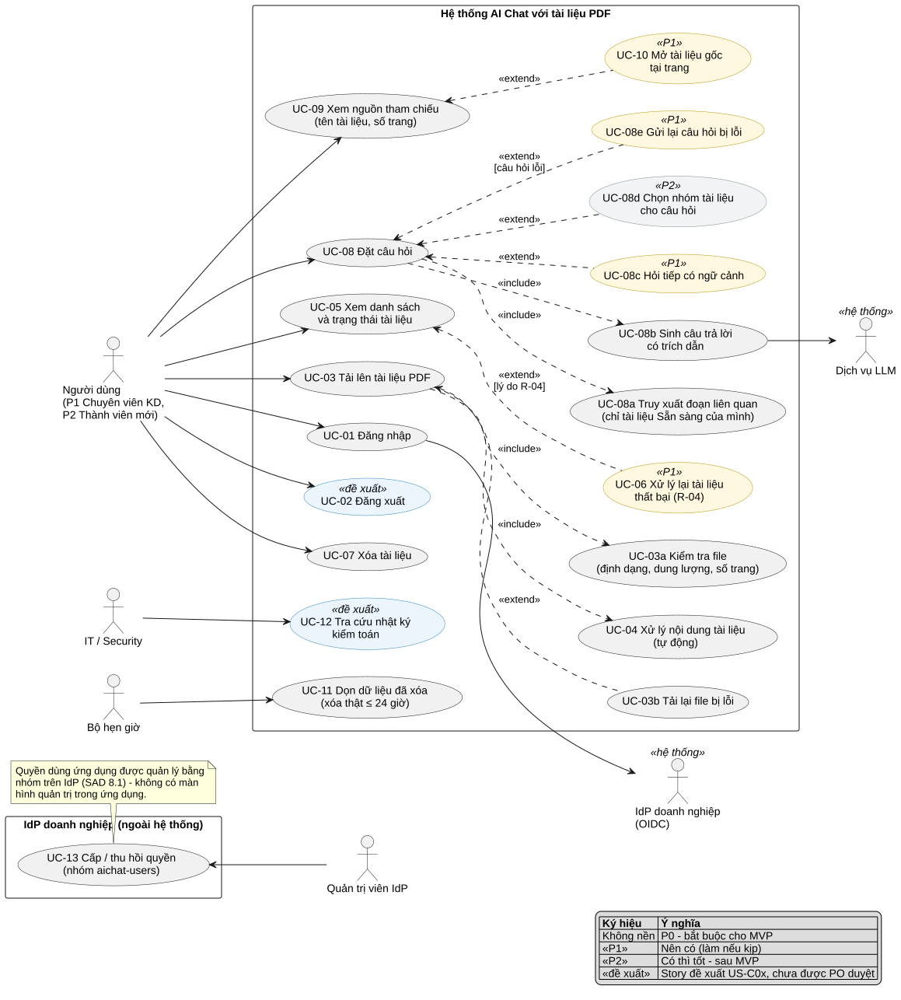
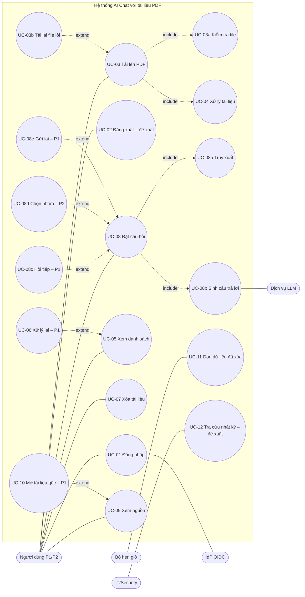

# Use Case Diagram – MVP AI Chat với tài liệu PDF

| Trường | Giá trị |
|---|---|
| Mã tài liệu | UC-AICHAT-001 · v0.1 |
| Ngày | 2026-10-24 |
| Nguồn | [USER_STORIES.md](USER_STORIES.md) v0.1 · [PRD](../02-requirements/PRD.md) v0.2 · [SAD](../04-design/SAD.md) v0.4 · [API_DESIGN](../04-design/API_DESIGN.md) v0.1 |
| Mã nguồn sơ đồ | [use_case_diagram.puml](use_case_diagram.puml) (PlantUML – nguồn chuẩn; đã kiểm tra cú pháp và xuất ảnh bằng PlantUML 1.2024.7) |
| Ảnh | [use_case_diagram.svg](use_case_diagram.svg) · [use_case_diagram.png](use_case_diagram.png) |

Sửa sơ đồ: chỉnh file `.puml`, rồi xuất lại ảnh bằng `java -jar plantuml.jar -charset UTF-8 -tsvg -tpng use_case_diagram.puml` (hoặc extension PlantUML trong VS Code).

## 1. Sơ đồ

**Ký hiệu:** use case không nền = P0 (bắt buộc cho MVP); `«P1»` nên có; `«P2»` sau MVP; `«đề xuất»` = story đề xuất US-C0x chưa được PO duyệt. Mũi tên nét liền = tác nhân tham gia use case; nét đứt `«include»` = luôn xảy ra như một phần của use case gốc; nét đứt `«extend»` = chỉ xảy ra khi có điều kiện.

## 2. Tác nhân

| Tác nhân | Loại | Mô tả | Use case |
|---|---|---|---|
| Người dùng (P1, P2) | Chính, con người | Chuyên viên phát triển kinh doanh và thành viên mới của dự án (PRD 2.1). Hai persona dùng cùng một tập chức năng nên gộp thành một tác nhân | UC-01…UC-10 |
| IT / Security | Chính, con người | Tra cứu nhật ký kiểm toán khi điều tra sự cố | UC-12 |
| Bộ hẹn giờ | Chính, thời gian | Kích hoạt tác vụ định kỳ | UC-11 |
| IdP doanh nghiệp (OIDC) | Phụ, hệ thống bên ngoài | Xác thực người dùng, cung cấp nhóm quyền | UC-01 |
| Dịch vụ LLM | Phụ, hệ thống bên ngoài | Sinh câu trả lời từ các đoạn trích | UC-08b |
| Quản trị viên IdP | Con người, **ngoài hệ thống** | Cấp/thu hồi quyền bằng nhóm trên IdP | UC-13 (thuộc IdP) |

## 3. Danh mục use case

| ID | Use case | Tác nhân | Ưu tiên | Story | Endpoint (API_DESIGN 3.6.1) | Trạng thái |
|---|---|---|---|---|---|---|
| UC-01 | Đăng nhập | Người dùng, IdP | P0 | US-023 | `/auth/login`, `/auth/callback` | Blocked (OQ-001, OQ-102) |
| UC-02 | Đăng xuất | Người dùng | Đề xuất | US-C03 | `POST /auth/logout` | Chờ PO |
| UC-03 | Tải lên tài liệu PDF | Người dùng | P0 | US-001, US-002 | `POST /upload-batches`, `PUT …/files/{client_file_id}` | Ready (giả định D-01) |
| UC-03a | Kiểm tra file | (include) | P0 | US-003, US-004 | như UC-03 | Ready |
| UC-03b | Tải lại file bị lỗi | (extend) | P0* | US-026 | `PUT …/files/{client_file_id}` (cùng ID) | Ready |
| UC-04 | Xử lý nội dung tài liệu | (include, bất đồng bộ) | P0 | US-005, US-008 | – (worker) | Ready (giả định D-03) |
| UC-05 | Xem danh sách và trạng thái tài liệu | Người dùng | P0 | US-006, US-007, US-025 | `GET /documents`, `GET /events` | Ready |
| UC-06 | Xử lý lại tài liệu thất bại | (extend) | P1 | US-009 | `POST /documents/{id}/reprocess` | Ready |
| UC-07 | Xóa tài liệu | Người dùng | P0 | US-010, US-011 | `DELETE /documents/{id}` | Ready (giả định D-10) |
| UC-08 | Đặt câu hỏi | Người dùng | P0 | US-012, US-013, US-014, US-016, US-017, US-018 | `POST /conversations/{id}/messages` | Ready (giả định) |
| UC-08a | Truy xuất đoạn liên quan | (include) | P0 | US-013, US-017 | – (BLUEPRINT ALG-05) | Ready |
| UC-08b | Sinh câu trả lời có trích dẫn | (include), LLM | P0 | US-016, US-020 | – (ALG-06) | Phụ thuộc OQ-005 |
| UC-08c | Hỏi tiếp có ngữ cảnh | (extend) | P1 | US-015 | như UC-08 | Blocked (OQ-012) |
| UC-08d | Chọn nhóm tài liệu cho câu hỏi | (extend) | P2 | US-019 | chưa thiết kế | Blocked (OQ-018) |
| UC-08e | Gửi lại câu hỏi bị lỗi | (extend) | P1 | US-027 | như UC-08 (cùng `client_request_id`) | Ready |
| UC-09 | Xem nguồn tham chiếu | Người dùng | P0 | US-020, US-021 | (trong phản hồi UC-08) | Ready |
| UC-10 | Mở tài liệu gốc tại trang | (extend) | P1 | US-022 | `GET /documents/{id}/file?from=citation` | Blocked (OQ-014) |
| UC-11 | Dọn dữ liệu đã xóa | Bộ hẹn giờ | P0 | US-011, NFR-013 | – (ALG-10) | Ready |
| UC-12 | Tra cứu nhật ký kiểm toán | IT/Security | Đề xuất | US-C02 | – (SQL, vai trò `app_readonly_audit`) | Chờ PO, IT/Security |
| UC-13 | Cấp/thu hồi quyền | Quản trị viên IdP | – | US-C01 | – (ngoài hệ thống) | Chờ OQ-102 |

\* US-026 là P0 nhưng phần "Tải lại" được vẽ là `«extend»` vì chỉ xảy ra khi tải lên lỗi.

**Bao phủ:** 27/27 story của USER_STORIES (US-001…US-027) và 3/5 story đề xuất (US-C01…US-C03) có use case. US-C04 (hội thoại mới) và US-C05 (câu hỏi tổng quan) chưa được vẽ vì phụ thuộc OQ-012 và quyết định phạm vi của PO.

## 4. Đặc tả tóm tắt

> Luồng chi tiết và AC: USER_STORIES mục 5; trường hợp biên `E-xx`: PRD 4.2; luồng hệ thống: SAD 7, API_DESIGN 3.4.

### UC-01 Đăng nhập

| | |
|---|---|
| Tiền điều kiện | Người dùng có tài khoản IdP doanh nghiệp |
| Luồng chính | 1. Mở ứng dụng → 2. Hệ thống chuyển tới IdP → 3. Người dùng đăng nhập (MFA theo IdP) → 4. Hệ thống kiểm tra nhóm `aichat-users`/`aichat-admins` → 5. Tạo phiên, tạo workspace cá nhân lần đầu → 6. Hiển thị màn hình chính |
| Luồng thay thế | 4a. Không thuộc nhóm → trang "Bạn chưa được cấp quyền" (AC US-023). Phiên hết hạn khi đang làm việc → đăng nhập lại, giữ nháp câu hỏi (E-17) |
| Hậu điều kiện | Có phiên hợp lệ; nhật ký `login` / `login_denied` |

### UC-03 Tải lên tài liệu PDF (gồm UC-03a, UC-04; mở rộng UC-03b)

| | |
|---|---|
| Tiền điều kiện | Đã đăng nhập; còn hạn mức |
| Luồng chính | 1. Chọn/kéo thả 1–10 file → 2. Hệ thống đặt chỗ cho lô → 3. Tải từng file, hiển thị tiến độ → 4. **UC-03a** kiểm tra định dạng, dung lượng, số trang, mật khẩu → 5. File hợp lệ vào danh sách "Đang xử lý" → 6. **UC-04** xử lý tự động → "Sẵn sàng" hoặc "Thất bại" + lý do |
| Luồng thay thế | 1a. Quá 10 file hoặc vượt 100 tài liệu → không tải file nào (US-002, I-01). 4a. File sai → bị từ chối kèm lý do, không lưu (E-07, E-08, E-09). 3a. Mất mạng → **UC-03b** tải lại, không tạo bản trùng (E-04). 6a. PDF scan → Thất bại R-03 (E-10) |
| Hậu điều kiện | Tài liệu hợp lệ được lưu và (khi Sẵn sàng) dùng được để hỏi |

### UC-07 Xóa tài liệu

| | |
|---|---|
| Luồng chính | 1. Chọn "Xóa" → 2. Xác nhận → 3. Tài liệu biến mất khỏi danh sách, **không còn được dùng làm căn cứ từ lúc này** |
| Luồng thay thế | Xóa khi đang xử lý → hủy xử lý (US-010). Xóa khi một câu trả lời đang được tạo → câu trả lời đó vẫn hoàn tất, nguồn hiển thị "(đã xóa)" (E-13, E-19) |
| Hậu điều kiện | File gốc bị xóa thật trong ≤ 24 giờ bởi **UC-11** |

### UC-08 Đặt câu hỏi (gồm UC-08a, UC-08b; mở rộng UC-08c, UC-08d, UC-08e)

| | |
|---|---|
| Tiền điều kiện | Có ít nhất một tài liệu Sẵn sàng (nếu không: ô hỏi bị khóa – E-02) |
| Luồng chính | 1. Nhập câu hỏi tiếng Việt/Anh → 2. **UC-08a** truy xuất các đoạn liên quan trong tài liệu Sẵn sàng của chính người dùng → 3. **UC-08b** LLM sinh câu trả lời chỉ từ các đoạn đó, có trích dẫn; hệ thống kiểm tra trích dẫn → 4. Hiển thị câu trả lời tổng hợp từ một hoặc nhiều tài liệu kèm nguồn (**UC-09**), nêu mâu thuẫn nếu có (US-018) |
| Luồng thay thế | 2a. Không có đoạn đủ liên quan → "Chưa đủ thông tin", không gọi LLM (US-016, E-16). 3a. LLM lỗi/quá 15 giây → báo lỗi tại vị trí câu trả lời → **UC-08e** gửi lại (E-05, E-06). 1a. Hỏi quá 10 câu/phút → chờ (429) |
| Hậu điều kiện | Câu hỏi và câu trả lời lưu trong hội thoại của phiên (NFR-024); nhật ký `question_asked` |

### UC-11 Dọn dữ liệu đã xóa

| | |
|---|---|
| Kích hoạt | Ngay khi xóa (job purge) và mỗi giờ (quét phần bị sót) |
| Luồng chính | Xóa file gốc khỏi object storage; đánh dấu `purged_at`; xóa object mồ côi |
| Ngoại lệ | Tài liệu đã xóa > 20 giờ chưa được dọn → cảnh báo vận hành |

## 5. Quan hệ `«include»` / `«extend»`

| Quan hệ | Loại | Điều kiện / lý do |
|---|---|---|
| UC-03 → UC-03a | include | Mọi file đều được kiểm tra |
| UC-03 → UC-04 | include | Mọi file hợp lệ đều được xử lý (bất đồng bộ) |
| UC-03b → UC-03 | extend | Chỉ khi tải lên lỗi mạng/lưu trữ |
| UC-06 → UC-05 | extend | Chỉ khi tài liệu Thất bại với lý do R-04 |
| UC-08 → UC-08a, UC-08b | include | Mọi câu hỏi đều truy xuất; sinh câu trả lời khi truy xuất qua ngưỡng |
| UC-08c → UC-08 | extend | Câu hỏi tiếp nối (chờ OQ-012) |
| UC-08d → UC-08 | extend | Người dùng chọn nhóm tài liệu (sau MVP) |
| UC-08e → UC-08 | extend | Chỉ khi câu hỏi lỗi |
| UC-10 → UC-09 | extend | Người dùng bấm vào nguồn (chờ OQ-014) |

## 6. Xem nhanh bằng Mermaid

Mermaid không có loại sơ đồ use case; bản dưới dùng flowchart để xem nhanh trên trình xem Markdown. **Bản chuẩn là PlantUML ở mục 1.**

