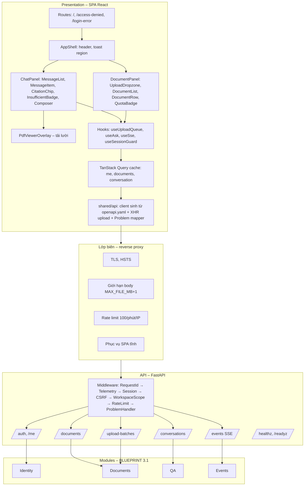
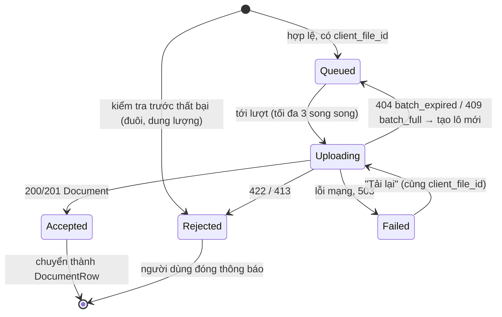
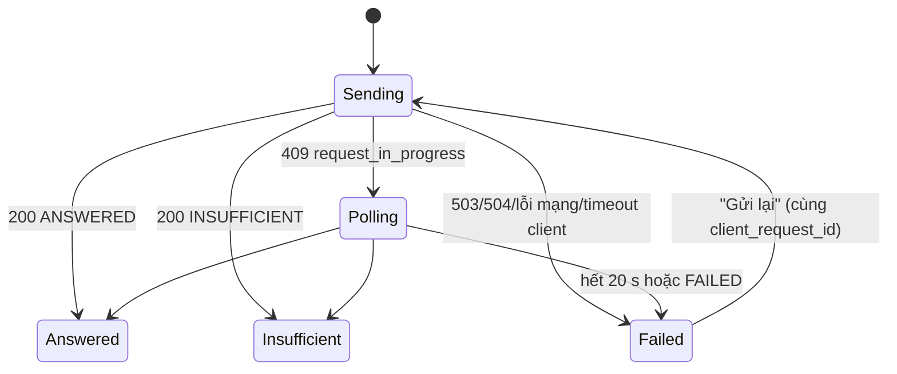

# API Design (SDD – API & UI view)
# MVP – Ứng dụng AI Chat với tài liệu PDF

> **Chuẩn:** IEEE 1016-2009 · **Hợp đồng máy đọc được (nguồn chuẩn):** [openapi.yaml](openapi.yaml) (OpenAPI 3.1, đã kiểm tra bằng `openapi-spec-validator`; mọi ví dụ đã kiểm tra với schema).
> Tài liệu này giải thích *vì sao* và *cách dùng* API từ góc nhìn giao diện; chi tiết trường/kiểu nằm trong `openapi.yaml`. Kiến trúc: [SAD.md](SAD.md); thiết kế chi tiết backend: [BLUEPRINT.md](BLUEPRINT.md); dữ liệu: [DATABASE_DESIGN.md](DATABASE_DESIGN.md).

---

## 1. Bối cảnh và đối tượng thiết kế

### 1.1 Định danh

| Thuộc tính | Giá trị |
|---|---|
| **Tên hệ thống** | AI Chat với tài liệu PDF |
| **Phiên bản tài liệu** | API-DESIGN-AICHAT-001 · v0.1 |
| **Phiên bản API** | `v1` (URI) · hợp đồng `1.0.0-draft.1` |
| **Ngày** | 2026-10-24 |
| **Chủ sở hữu** | API Lead / Tech Lead `[TBD: OQ-007]`; phần UI: Designer |
| **Tài liệu nguồn** | [BRD](../02-requirements/BRD.md) v0.2 · [PRD](../02-requirements/PRD.md) v0.2 · [USER_STORIES](../03-analysis/USER_STORIES.md) v0.1 · [SAD](SAD.md) v0.3 · [BLUEPRINT](BLUEPRINT.md) v0.2 |

| Phiên bản | Ngày | Tác giả | Thay đổi |
|---|---|---|---|
| 0.1 | 2026-10-24 | API Lead | Bản nháp đầu tiên; tạo `openapi.yaml`; đổi endpoint tải file thành idempotent theo `client_file_id` (mục 5, AD-06) |

**Mô tả.** API REST/JSON nội bộ, chỉ phục vụ một client duy nhất: SPA React cùng origin. API cung cấp: đăng nhập OIDC và phiên; lô tải lên và nhận file PDF; danh sách, xóa, xử lý lại, xem tài liệu; hội thoại hỏi đáp có trích dẫn; luồng sự kiện SSE.

### 1.2 Phạm vi và ranh giới

| Loại | Mô tả |
|---|---|
| **Mục đích** | Cho phép người dùng tải PDF, hỏi và nhận câu trả lời có nguồn (BO-001…BO-004), không lộ tài liệu cho người khác (BO-006) |
| **Persona người dùng** | P1 Chuyên viên phát triển kinh doanh, P2 Thành viên mới (mục 2.1) |
| **API consumer** | Duy nhất: SPA của chính hệ thống (first-party). Không có API công khai, đối tác hay ứng dụng di động |
| **Bối cảnh hành trình** | Người dùng đang soạn đề xuất/trả lời khách hàng, cần tra thông tin trong bộ PDF dự án → mở ứng dụng → tải/hỏi → mở nguồn để kiểm chứng → quay lại công việc (PRD 2.2) |
| **Hệ thống bên ngoài** | IdP OIDC (OQ-102), dịch vụ LLM (OQ-005) – **không** lộ qua API này; SPA không gọi trực tiếp |
| **Giao diện bên ngoài** | REST JSON, `multipart/form-data` (tải file), `application/pdf` (xem file), `text/event-stream` (SSE), chuyển hướng OIDC |
| **Kênh UI** | Ứng dụng web một trang (SPA) |
| **Kênh API** | Internal API `/api/v1`, chỉ cùng origin |
| **Điểm chạm UI** | Màn đăng nhập (IdP), màn chính hai khu vực (tài liệu + hỏi đáp), trình xem PDF dạng lớp phủ, trang "chưa được cấp quyền", thông báo trạng thái |
| **Điểm chạm API** | Xác thực (`/auth/*`, `/me`), tải lên (`/upload-batches/*`), tài liệu (`/documents/*`), hỏi đáp (`/conversations/*`), sự kiện (`/events`), vận hành (`/healthz`, `/readyz`) |
| **Ranh giới tin cậy** | Trình duyệt ↔ load balancer (TLS); API trong subnet riêng; LLM/IdP là bên thứ ba (BLUEPRINT 1.2 TB-1…TB-5) |
| **Môi trường triển khai** | Container, đám mây hoặc nội bộ (chưa chọn – OQ-005, OQ-203) |
| **Thiết bị** | Máy tính ≥ 1280 × 720 (NFR-017). Máy tính bảng/điện thoại ngoài phạm vi (OQ-101) |
| **Trình duyệt** | Hai phiên bản mới nhất của Chrome và Edge (NFR-017) |

### 1.3 Giả định và ràng buộc

| Loại | Mô tả |
|---|---|
| **Ràng buộc kỹ thuật** | React 18 + TypeScript; OpenAPI 3.1; OIDC Authorization Code + PKCE qua backend (SAD ADR-011); RFC 9457 cho lỗi; WCAG 2.2 AA; không stream token câu trả lời (ADR-010) |
| **Ràng buộc nghiệp vụ** | Ra mắt nhanh (CON-005); giới hạn D-01…D-13 là đề xuất chưa duyệt → **mọi giới hạn trả về qua `/me.limits`**, SPA không hard-code |
| **Giả định UX** | Người dùng thành thạo web văn phòng, không biết về AI; phiên làm việc 10–30 phút, 3–10 câu hỏi `[Giả định – chờ SRC-003]` |
| **Giả định API** | Chỉ một consumer (SPA) do cùng đội phát triển → không cần SDK, không cần đàm phán phiên bản với bên ngoài; lưu lượng đỉnh ≈ 20 câu hỏi đồng thời, ≈ 2–5 request/giây (NFR-007) |
| **Giả định thiết bị** | 100% máy tính (mạng doanh nghiệp) |
| **Giả định mạng** | Trình duyệt ↔ API < 100 ms; tải lên ≥ 10 Mbit/s (file 20 MB ≈ 16 s) |
| **Giả định dữ liệu** | ≤ 100 tài liệu/người → danh sách không cần phân trang; hội thoại chỉ trong phiên → vài chục tin nhắn |

---

## 2. Stakeholder và mối quan tâm

### 2.1 Persona người dùng

> Giả định từ PRD 2.1, chưa xác nhận qua phỏng vấn (DEF-009 / P-DEF-014).

| Persona | Vai trò | Đặc điểm | Mục tiêu | Khó khăn | Trình độ công nghệ | Tần suất |
|---|---|---|---|---|---|---|
| **P1 – Lan** | Chuyên viên phát triển kinh doanh | 25–40 tuổi, làm việc với nhiều PDF sản phẩm/chính sách/hợp đồng | Có câu trả lời đúng kèm nguồn để trích dẫn cho khách hàng/quản lý | Mở nhiều file, dò từng trang, bỏ sót thông tin nằm ở nhiều tài liệu | Trung bình–khá (ứng dụng văn phòng, web) | Nhiều lần mỗi tuần |
| **P2 – Minh** | Thành viên mới của dự án | Mới tham gia, chưa biết thông tin ở file nào | Nắm nhanh nội dung bộ tài liệu | Không biết bắt đầu từ đâu, không biết câu trả lời đã đủ chưa | Trung bình–khá | Dày đặc tuần đầu |
| **Quản trị viên IdP** | IT nội bộ | Quản lý nhóm trên IdP | Cấp/thu hồi quyền dùng | – (không dùng ứng dụng trực tiếp) | Cao | Khi có người mới |

### 2.2 API consumer

| Consumer | Loại | Trình độ | Mục tiêu | Khó khăn | Lưu lượng dự kiến | SLA nội bộ |
|---|---|---|---|---|---|---|
| **SPA web** | First-party | Cao (cùng đội) | Dữ liệu đúng hình dạng cho từng màn hình, trạng thái thời gian thực, lỗi có thể xử lý | Thao tác dài (tải file lớn, hỏi đáp 5–15 s); mạng đứt giữa chừng; phiên hết hạn khi đang soạn | ≈ 50 người × 20 câu hỏi + 20 file/ngày ≈ 3.000–5.000 request/ngày (không kể SSE) | Hỏi đáp p90 ≤ 15 s (NFR-001); thao tác khác p95 ≤ 300 ms (không gồm thời gian truyền file) |
| **Bộ đánh giá RAG** (`eval/`, BLUEPRINT DE-22) | First-party, công cụ | Cao | Chạy bộ câu hỏi DEP-005 trên staging | Giới hạn tần suất | Vài trăm câu/đêm | Không cam kết; dùng tài khoản kỹ thuật được nới giới hạn ở staging |
| **Giám sát** | Hạ tầng | Cao | `/healthz`, `/readyz` | – | Mỗi 10 s | – |

### 2.3 Stakeholder

| Stakeholder | Vai trò | Quan tâm chính | Mối quan tâm UX/UI | Mối quan tâm API |
|---|---|---|---|---|
| Người dùng (P1, P2) | Đội phát triển kinh doanh | Câu trả lời đúng, nhanh, có nguồn | Hai thao tác chính trên một màn hình; trạng thái rõ | API cung cấp đủ dữ liệu để hiện trạng thái, nguồn, lỗi có hướng dẫn |
| Designer | Thiết kế sản phẩm | Nhất quán, khả dụng | Bộ thiết kế (design tokens), trạng thái trống/lỗi | Hình dạng dữ liệu đủ cho từng trạng thái giao diện |
| Frontend developer | Đội phát triển | Dễ hiện thực | Component tái sử dụng | Kiểu TypeScript sinh từ OpenAPI; mã lỗi máy đọc được |
| Backend/API developer | Đội phát triển | Chất lượng API | – | OpenAPI là hợp đồng; tương thích ngược |
| PO | Sản phẩm | Ra mắt nhanh, OKR | Funnel đo được | Sự kiện analytics phát từ API (PRD 5.2) |
| Trợ năng | (Designer kiêm) | WCAG 2.2 AA | Bàn phím, trình đọc màn hình | Thông điệp lỗi dạng văn bản, không chỉ mã/màu |
| IT/Security | Tuân thủ | Bảo vệ dữ liệu | Hết phiên, đăng xuất | Cookie HttpOnly, CSRF, không lộ ID của người khác, rate limit |
| Vận hành/SRE | Nền tảng | Ổn định | Hiệu năng giao diện | `X-Request-ID`, health check, metric theo route |
| QA | Kiểm thử | Kiểm thử được | Kiểm thử component, E2E | Contract test với `openapi.yaml`; ví dụ hợp lệ |

### 2.4 Mối quan tâm

| ID | Stakeholder | Mối quan tâm | Ưu tiên | Tiêu chí UX/UI | Tiêu chí API |
|---|---|---|---|---|---|
| AC-01 | Người dùng | Dễ dùng | High | Hoàn thành tải → hỏi → xem nguồn ≤ 5 phút, ≥ 80% người thử (NFR-008) | Một màn hình cần tối đa 2 request để hiển thị lần đầu (`/me`, `/documents` + `/conversations/current` song song) |
| AC-02 | Người dùng | Hoàn thành tác vụ dù có lỗi | High | Không mất nội dung đã nhập khi lỗi/hết phiên | Tải file và hỏi đều idempotent (AD-05, AD-06) |
| AC-03 | Người dùng | Hiểu trạng thái | High | Trạng thái tài liệu cập nhật không tải lại trang | SSE `document.status_changed` ≤ 2 s sau khi đổi |
| AC-04 | Designer | Nhất quán | Med | 100% thành phần dùng design tokens | Cùng một kiểu phản hồi cho cùng một tài nguyên ở mọi endpoint (`Document`, `Citation`) |
| AC-05 | Frontend dev | Tái sử dụng | Med | Thành phần `DocumentRow`, `CitationChip`, `ProblemMessage` dùng chung | Kiểu TS sinh tự động từ `openapi.yaml` (openapi-typescript) |
| AC-06 | API dev | Chất lượng hợp đồng | High | – | `openapi.yaml` hợp lệ; FastAPI sinh ra khớp 100% (kiểm tra trong CI bằng oasdiff, 0 khác biệt phá vỡ) |
| AC-07 | QA | Kiểm thử được | High | Mỗi trạng thái UI có test | Mỗi mã lỗi trong `ErrorCode` có ít nhất 1 test sinh ra nó |
| AC-08 | Trợ năng | WCAG | High | WCAG 2.2 AA | `detail` của lỗi là câu tiếng Việt hoàn chỉnh, đọc được bằng trình đọc màn hình |
| AC-09 | IT/Security | Xác thực an toàn | High | Hết phiên → đăng nhập lại, giữ nháp | Không có token trong JavaScript; CSRF trên 100% request thay đổi dữ liệu; 404 cho tài nguyên của người khác |
| AC-10 | SRE | Hiệu năng | High | LCP < 2,5 s | p95 ≤ 300 ms cho endpoint không phải hỏi đáp/tải file; hỏi đáp p90 ≤ 15 s |
| AC-11 | PO | Đo được | Med | Funnel PRD 5.2 | 11 sự kiện EVT ghi từ phía máy chủ, kể cả `citation_clicked` (qua `?from=citation`) |

### 2.5 Kịch bản chất lượng API

| Thuộc tính | Kịch bản |
|---|---|
| **Hiệu năng** | 20 người hỏi đồng thời: `POST …/messages` p50 ≤ 8 s, p90 ≤ 15 s; các endpoint đọc p95 ≤ 300 ms; `PUT` file 20 MB: thời gian máy chủ (ngoài truyền tải) ≤ 3 s |
| **Mở rộng** | Thêm bản API không cần đổi client (phiên trong CSDL, SSE qua LISTEN/NOTIFY, rate limit trong CSDL) |
| **Sẵn sàng** | 99% giờ làm việc (NFR-015); một bản API dừng → client chỉ thấy lỗi mạng một lần, thử lại thành công |
| **Bảo mật** | 0 endpoint dữ liệu truy cập được không cần phiên; 0 endpoint thay đổi dữ liệu không kiểm tra CSRF; giới hạn 10 câu hỏi/phút, 30 file/giờ |
| **Tin cậy** | Gửi lại câu hỏi/file sau lỗi mạng không tạo bản trùng (idempotency) – 0 tài liệu trùng, 0 lần gọi LLM thừa với câu đã trả lời |
| **Phiên bản** | URI `/api/v1`; thay đổi không phá vỡ được thêm trong v1; thay đổi phá vỡ → `/api/v2`, giữ v1 ít nhất đến khi bản SPA cũ không còn được phục vụ (một lần triển khai) |
| **Tài liệu** | `openapi.yaml` có mô tả tiếng Việt, ví dụ hợp lệ; Swagger UI chỉ bật ở dev/staging |
| **Trải nghiệm developer** | Kiểu TypeScript và client sinh tự động; developer mới gọi được API trên dev trong ≤ 15 phút với docker-compose |
| **Quan sát** | `X-Request-ID` trên mọi phản hồi và trong mọi log/trace; metric theo `operationId` |
| **Tương thích ngược** | Trong v1: chỉ thêm trường tùy chọn, thêm giá trị enum được báo trước; client phải bỏ qua trường không biết |

### 2.6 Ma trận ràng buộc API

| Ràng buộc | Yêu cầu trong hệ thống này | Chuẩn | Kiểm chứng |
|---|---|---|---|
| Đặc tả | OpenAPI 3.1 design-first (`openapi.yaml`) | OpenAPI 3.1 | `openapi-spec-validator` + kiểm tra ví dụ trong CI; oasdiff so với bản FastAPI sinh |
| Xác thực | OIDC (Authorization Code + PKCE) ở backend, cookie phiên `HttpOnly` – **không** dùng OAuth2 bearer/JWT phía client (AD-02) | OpenID Connect Core 1.0, RFC 7636, RFC 6265bis | Security review, test E2E đăng nhập |
| CSRF | Double-submit `X-CSRF-Token` cho `POST/PUT/DELETE` | OWASP CSRF Prevention | Test: thiếu/sai token → 403 `csrf_invalid` |
| Giới hạn tần suất | 10 câu/phút, 30 file/giờ mỗi người; 100 request/phút/IP ở proxy; header `RateLimit-*` + `Retry-After` | IETF draft RateLimit header fields; RFC 9110 (Retry-After) | Load test |
| Phân trang | Không phân trang (tối đa 100 tài liệu, hội thoại trong phiên) – AD-08 | – | Review; nếu giới hạn tăng > 500 → thêm phân trang con trỏ trong v1 (thay đổi không phá vỡ) |
| Phiên bản | URI `/api/v1` | SemVer cho hợp đồng | Review |
| Lỗi | Problem Details + `code`, `request_id` | RFC 9457 (thay RFC 7807) | Contract test |
| Idempotency | `client_request_id` (câu hỏi) và `client_file_id` (file) do client sinh – AD-05, AD-06 | Ngữ nghĩa idempotent của PUT (RFC 9110 §9.2.2) | Test gửi lại |
| CORS | **Tắt** – chỉ cùng origin | Same-origin policy | Test: request khác origin bị trình duyệt chặn, không có header `Access-Control-*` |
| Nội dung | `application/json` (UTF-8), `multipart/form-data`, `application/pdf`, `text/event-stream`, `application/problem+json` | RFC 9110 | Contract test |
| Ngừng hỗ trợ | Header `Deprecation` và `Sunset` trên endpoint sắp bỏ | RFC 9745, RFC 8594 | Review |
| Bộ nhớ đệm | Mọi phản hồi dữ liệu: `Cache-Control: private, no-store` | RFC 9111 | Test |

---

## 3. Các góc nhìn thiết kế

### 3.1 Composition view (UI + API)



**Không có trong MVP và lý do:** API Gateway riêng (reverse proxy đủ chức năng biên cho một service – AD-01); GraphQL (một consumer, màn hình đơn giản – AD-01); webhook (không có bên ngoài nhận sự kiện); gRPC nội bộ (embedding service dùng HTTP JSON đơn giản – BLUEPRINT 3.6.5); Admin API (quản lý quyền qua nhóm IdP – SAD 8.1).

| Phần tử | Lớp | Trách nhiệm | Phụ thuộc |
|---|---|---|---|
| `Composer` | UI | Soạn câu hỏi, bộ đếm ký tự, khóa khi không có tài liệu Sẵn sàng, giữ nháp | `useAsk`, `/me.limits` |
| `MessageItem` | UI | Hiển thị câu hỏi, chỉ báo chờ, câu trả lời có `[n]`, nhãn nguồn, nhãn "Chưa đủ thông tin", lỗi + "Gửi lại" | `Answer`, `Message` |
| `CitationChip` | UI | "tên file · tr.X", "(đã xóa)"; bấm → mở trình xem | `Citation` |
| `DocumentRow` | UI | Tên, trạng thái (biểu tượng + chữ), lý do thất bại, "Xử lý lại", "Xóa" | `Document` |
| `UploadDropzone` + `useUploadQueue` | UI | Kiểm tra trước, tạo lô, tải song song 3 file, tiến độ, thử lại an toàn | `/upload-batches/*` |
| `useSse` | UI | Mở `EventSource('/api/v1/events')`, làm mới cache, thông báo | `/events` |
| `useSessionGuard` | UI | Bắt 401 `session_expired`, lưu nháp, chuyển `/auth/login?return_to=` | Mọi endpoint |
| Middleware `WorkspaceScope` | API | `SET LOCAL app.workspace_id` cho transaction của request | Phiên |
| `ProblemHandler` | API | Ánh xạ ngoại lệ miền → Problem + `code`; không lộ stack trace | `ErrorCode` |

### 3.2 Logical view – mô hình tài nguyên

| Tài nguyên | URI | Biểu diễn | Thao tác | Ghi chú |
|---|---|---|---|---|
| Người dùng hiện tại | `/me` | `Me` (+ `ClientLimits`) | GET | Singleton theo phiên |
| Lô tải lên | `/upload-batches`, `/upload-batches/{batch_id}` | `UploadBatch` | POST | Tài nguyên ngắn hạn (10 phút) |
| File trong lô | `/upload-batches/{batch_id}/files/{client_file_id}` | multipart vào → `Document` ra | PUT | ID do client sinh → idempotent |
| Tài liệu | `/documents`, `/documents/{document_id}` | `Document`, `DocumentList` | GET, DELETE | Không trả `storage_key`, `sha256`, `workspace_id` |
| Hành động xử lý lại | `/documents/{document_id}/reprocess` | `Document` | POST | Hành động (controller resource), không idempotent về mặt ngữ nghĩa nhưng an toàn khi gọi lại (lần 2 → 409 vì không còn FAILED) |
| Nội dung tài liệu | `/documents/{document_id}/file` | `application/pdf` | GET | Stream qua API sau kiểm tra quyền |
| Hội thoại hiện tại | `/conversations/current` | `Conversation` | GET | Gắn với phiên |
| Tin nhắn | `/conversations/{conversation_id}/messages` | `AskRequest` → `Answer` | POST | Idempotent theo `client_request_id` |
| Luồng sự kiện | `/events` | `text/event-stream` | GET | Một kết nối/tab |

**Mô hình hiển thị (view model) phía SPA** – suy ra từ tài nguyên, không có endpoint riêng:

| View model | Nguồn | Trạng thái dẫn xuất |
|---|---|---|
| `DocumentRowVM` | `Document` + trạng thái xóa cục bộ | `isAskable = status == READY`; `canRetry = retryable`; `label` từ i18n theo `status`/`failure_code` |
| `ComposerVM` | `DocumentList`, `Me.limits`, `useAsk` | `disabledReason` ∈ {`no_ready_documents`, `sending`, `null`} |
| `MessageVM` | `Message` / `Answer` + trạng thái gửi cục bộ | `phase` ∈ {sending, answered, insufficient, failed, retrying} (mục 3.7) |
| `UploadItemVM` | File đã chọn + phản hồi `PUT` | `phase` ∈ {queued, uploading(progress), accepted, rejected(code), failed(retryable)} |

### 3.3 Dependency view – màn hình → endpoint → module

| Thành phần UI | Endpoint | Module backend | Story |
|---|---|---|---|
| Khởi động ứng dụng | `GET /me`, `GET /documents`, `GET /conversations/current`, `GET /events` (song song) | Identity, Documents, QA, Events | US-006, US-014, US-023 |
| `UploadDropzone` | `POST /upload-batches`, `PUT …/files/{client_file_id}` | Documents | US-001…US-004 |
| `DocumentRow` – Xóa | `DELETE /documents/{id}` | Documents | US-010, US-011 |
| `DocumentRow` – Xử lý lại | `POST /documents/{id}/reprocess` | Documents | US-009 |
| `Composer` / `MessageItem` | `POST /conversations/{id}/messages` | QA (→ Retrieval, LLM) | US-012…US-018, US-020, US-021, US-026, US-027 |
| `CitationChip` → `PdfViewerOverlay` | `GET /documents/{id}/file?from=citation&page=X` | Documents, Events (EVT-09) | US-022 |
| Header – Đăng xuất | `POST /auth/logout` | Identity | US-C03 |
| `useSse` | `GET /events` | Events | US-007, US-025 |
| Mọi thành phần | 401 → `GET /auth/login?return_to=` | Identity | E-17 |

**Phụ thuộc giữa endpoint:** `PUT …/files/{client_file_id}` cần `batch_id` từ `POST /upload-batches`; `POST …/messages` cần `conversation_id` từ `GET /conversations/current`; mọi endpoint (trừ `/auth/login`, `/auth/callback`, `/healthz`, `/readyz`) cần phiên.

**Thứ tự middleware (cố định):** `RequestId` → `Telemetry` → `Session` (401) → `CSRF` (403, chỉ POST/PUT/DELETE) → `WorkspaceScope` → `RateLimit` (429, chỉ endpoint có giới hạn) → router → `ProblemHandler`. Đặt `Session` trước `CSRF` để token CSRF được so với phiên; `RateLimit` sau xác thực để đếm theo người dùng chứ không theo IP.

### 3.4 Interaction view

#### 3.4.1 Tải nhiều file từ giao diện

```mermaid
sequenceDiagram
    autonumber
    participant U as Người dùng
    participant S as SPA (useUploadQueue)
    participant A as API
    U->>S: Kéo thả 5 file
    S->>S: Kiểm tra trước với /me.limits (đuôi, dung lượng, số file); file sai hiện lỗi ngay, không gửi
    S->>S: Gán client_file_id = randomUUID() cho từng file hợp lệ
    S->>A: POST /upload-batches {files:[…4]}
    alt 422 too_many_files / quota_exceeded
        A-->>S: Problem (+ remaining)
        S-->>U: "Bạn chỉ còn có thể thêm N tài liệu" – không tải file nào
    else 201
        A-->>S: {batch_id, slots: 4}
        par tối đa 3 file song song
            S->>A: PUT /upload-batches/{batch_id}/files/{client_file_id} (XHR, có tiến độ)
            A-->>S: 201 Document(PROCESSING) | 422 not_pdf/too_large/too_many_pages/encrypted
        end
        S-->>U: Dòng file chuyển "Đang xử lý" hoặc hiện lý do từ chối
    end
    Note over S,A: Mất mạng giữa chừng → dòng file "Tải lên thất bại – Tải lại"; gửi lại cùng client_file_id → 200/201, không trùng
    A-->>S: SSE document.status_changed (READY / FAILED)
    S-->>U: Thông báo + cập nhật dòng
```

#### 3.4.2 Hỏi, lỗi và gửi lại

```mermaid
sequenceDiagram
    autonumber
    participant U as Người dùng
    participant S as SPA (useAsk)
    participant A as API
    U->>S: Gõ câu hỏi, Enter
    S->>S: client_request_id = randomUUID(); thêm MessageItem phase=sending; khóa Composer
    S->>A: POST /conversations/{id}/messages (timeout phía client 20 s)
    alt 200 ANSWERED / INSUFFICIENT
        A-->>S: Answer
        S-->>U: Câu trả lời + nhãn nguồn, hoặc nhãn "Chưa đủ thông tin"
    else 503 ai_unavailable / 504 ai_timeout / lỗi mạng
        A-->>S: Problem
        S-->>U: Lỗi tại vị trí câu trả lời + "Gửi lại"
        U->>S: Gửi lại
        S->>A: POST cùng client_request_id
        A-->>S: 200 (chạy lại vì lần trước FAILED)
    else 409 request_in_progress (gửi lại khi lần đầu chưa xong)
        S->>A: GET /conversations/current mỗi 2 s, tối đa 20 s
        A-->>S: Message cập nhật
    else 429 rate_limited
        S-->>U: "Bạn hỏi quá nhanh, thử lại sau {Retry-After} giây" – đếm ngược, tự mở khóa
    else 401 session_expired
        S->>S: Lưu nháp (sessionStorage) → /auth/login?return_to=/
    end
```

#### 3.4.3 Phiên hết hạn trong lúc làm việc

1. Còn 5 phút → SSE `session.expiring` → SPA hiện thông báo không chặn "Phiên sắp hết hạn".
2. Request tiếp theo sau khi hết hạn → 401 `session_expired`.
3. `useSessionGuard` lưu nháp câu hỏi và danh sách file đang chờ tải (chỉ tên, để nhắc người dùng chọn lại – không thể lưu nội dung file), chuyển tới `/api/v1/auth/login?return_to=<đường dẫn hiện tại>`.
4. Sau đăng nhập, SPA khôi phục nháp; hội thoại cũ **không còn** (NFR-024) – SPA hiện dòng "Phiên mới – lịch sử hội thoại trước đã được xóa".

### 3.5 Information view – quy ước biểu diễn

| Quy ước | Quy tắc |
|---|---|
| Đặt tên trường | `snake_case`; tên tài nguyên số nhiều trong URI (`/documents`) |
| ID | UUID v4 dạng chuỗi; ID do client sinh (`client_request_id`, `client_file_id`) cũng là UUID |
| Thời gian | RFC 3339, UTC, có `Z` (vd. `2026-10-24T08:15:30Z`); SPA hiển thị theo `vi-VN` và múi giờ người dùng |
| Enum | Trạng thái chữ HOA (`READY`); mã lỗi chữ thường `snake_case`; mã lý do `R-0x` |
| Null | Trường có thể vắng mặt về nghĩa được trả **rõ ràng** là `null` (vd. `failure_code`, `page_number`), không bỏ khỏi JSON |
| Bao bọc | Không bọc trong `{data: …}`; danh sách trả object có `items` để thêm trường tổng hợp (`documents_used`) |
| Văn bản | UTF-8, Unicode NFC; câu trả lời là văn bản thuần có dấu `[n]` – **không** trả HTML/Markdown để tránh XSS; SPA tự tách `[n]` thành nhãn bấm được |
| Tối thiểu hóa dữ liệu | Không bao giờ trả: `storage_key`, `sha256`, `workspace_id`, `batch_id` trên `Document`, nội dung đoạn văn bản, điểm truy xuất, prompt, phản hồi thô của LLM |
| Kích thước | Phản hồi JSON lớn nhất ≈ `DocumentList` 100 phần tử (≈ 30 KB) hoặc `Conversation` (≈ vài chục KB); không nén ở MVP (bật gzip ở proxy nếu đo thấy cần) |

**Mô hình lỗi** (`Problem`, RFC 9457): `type` = `https://errors.aichat.local/<code>` (URI định danh, không cần truy cập được), `title` và `detail` tiếng Việt, `status`, `code` (enum `ErrorCode`), `request_id`. Lỗi có dữ liệu riêng mở rộng bằng `allOf` (vd. `QuotaProblem.remaining`). Client bỏ qua trường không biết.

### 3.6 Interface view

#### 3.6.1 Danh mục endpoint

| # | Phương thức & đường dẫn | `operationId` | Phiên | CSRF | Idempotent | Giới hạn tần suất | Thành công | Lỗi chính | Story |
|---|---|---|---|---|---|---|---|---|---|
| 1 | `GET /auth/login` | authLogin | – | – | ✓ | IP | 302 | – | US-023 |
| 2 | `GET /auth/callback` | authCallback | – | (state OIDC) | – | IP | 302 | – | US-023 |
| 3 | `POST /auth/logout` | authLogout | ✓ | ✓ | ✓ (lần 2 → 401) | – | 204 | 401, 403 | US-C03 |
| 4 | `GET /me` | getMe | ✓ | – | ✓ | – | 200 | 401 | – |
| 5 | `POST /upload-batches` | createUploadBatch | ✓ | ✓ | – (lô mới mỗi lần) | – | 201 | 422 | US-002 |
| 6 | `PUT /upload-batches/{batch_id}/files/{client_file_id}` | uploadFileToBatch | ✓ | ✓ | ✓ | 30 file/giờ | 200, 201 | 404, 409, 413, 422, 429, 503 | US-001, US-003, US-004 |
| 7 | `GET /documents` | listDocuments | ✓ | – | ✓ | – | 200 | 401 | US-006 |
| 8 | `DELETE /documents/{document_id}` | deleteDocument | ✓ | ✓ | ✓ (lần 2 → 404) | – | 204 | 404 | US-010, US-011 |
| 9 | `POST /documents/{document_id}/reprocess` | reprocessDocument | ✓ | ✓ | an toàn (lần 2 → 409) | – | 202 | 404, 409 | US-009 |
| 10 | `GET /documents/{document_id}/file` | getDocumentFile | ✓ | – | ✓ | – | 200 | 404, 410 | US-022 |
| 11 | `GET /conversations/current` | getCurrentConversation | ✓ | – | ✓ (tạo nếu chưa có) | – | 200 | 401 | US-014 |
| 12 | `POST /conversations/{conversation_id}/messages` | askQuestion | ✓ | ✓ | ✓ theo `client_request_id` | 10 câu/phút | 200 | 404, 409, 422, 429, 503, 504 | US-012…US-021, US-027 |
| 13 | `GET /events` | streamEvents | ✓ | – | ✓ | 1 kết nối/tab | 200 stream | 401 | US-007, US-025 |
| 14 | `GET /healthz` | healthz | – | – | ✓ | – | 200 | – | – |
| 15 | `GET /readyz` | readyz | – | – | ✓ | – | 200 | 503 | – |

#### 3.6.2 Chính sách mã trạng thái

| Mã | Dùng khi | Không dùng khi |
|---|---|---|
| 200 | Đọc; hỏi đáp có kết quả (kể cả `INSUFFICIENT` – đây là câu trả lời hợp lệ, không phải lỗi); `PUT` file đã tồn tại | – |
| 201 | Tạo lô; `PUT` tạo tài liệu mới | – |
| 202 | Xử lý lại đã xếp hàng (kết quả đến qua SSE) | – |
| 204 | Xóa, đăng xuất | – |
| 401 | Không có/hết phiên | Thiếu quyền trên tài nguyên cụ thể (dùng 404) |
| 403 | Chỉ `csrf_invalid` | Tài nguyên của người khác (dùng 404 để không lộ sự tồn tại) |
| 404 | Không tồn tại **hoặc** không có quyền; lô hết hạn | – |
| 409 | Trạng thái tài nguyên không cho phép (`batch_full`, `not_retryable`, `no_ready_documents`, `request_in_progress`) | Dữ liệu vào sai (dùng 422) |
| 410 | Tài liệu đã xóa khi mở file từ nguồn trích dẫn | Danh sách/xóa (dùng 404) |
| 413 | Body vượt giới hạn tại proxy | File quá lớn phát hiện trong ứng dụng (dùng 422 `too_large`) |
| 422 | Dữ liệu vào sai nghiệp vụ; JSON sai schema (ánh xạ sang `empty_question` / `question_too_long` khi phù hợp, còn lại `invalid_request` – AD-10) | – |
| 500 | Lỗi không lường trước (`internal_error`, kèm `request_id`) | Mọi lỗi đã phân loại được |
| 429 | Vượt giới hạn tần suất | – |
| 503 | LLM/embedding/storage không sẵn sàng; sandbox bận | – |
| 504 | LLM vượt ngân sách thời gian | – |

#### 3.6.3 Danh mục mã lỗi – thông điệp và hành động UI

| `code` | HTTP | Thông điệp hiển thị (vi) | Hành động UI |
|---|---|---|---|
| `unauthenticated` | 401 | – | Chuyển tới đăng nhập |
| `session_expired` | 401 | "Phiên làm việc đã hết hạn. Đang chuyển tới trang đăng nhập…" | Lưu nháp, chuyển đăng nhập |
| `csrf_invalid` | 403 | "Phiên không hợp lệ, vui lòng tải lại trang." | Nút "Tải lại trang" |
| `not_found` | 404 | "Không tìm thấy tài liệu." | Làm mới danh sách |
| `batch_expired` | 404 | "Phiên tải lên đã hết hạn." | Tự tạo lô mới cho file chưa gửi |
| `batch_full` | 409 | "Đã tải đủ số file của lần này." | Tạo lô mới |
| `no_ready_documents` | 409 | "Cần ít nhất một tài liệu Sẵn sàng để bắt đầu hỏi." | Khóa ô hỏi |
| `not_retryable` | 409 | "Không thể xử lý lại tài liệu này. Vui lòng tải file khác." | Ẩn nút "Xử lý lại" |
| `request_in_progress` | 409 | – (không hiển thị) | Thăm dò `GET /conversations/current` |
| `deleted` | 410 | "Tài liệu đã bị xóa." | Đánh dấu nhãn nguồn "(đã xóa)" |
| `too_many_files` | 422 | "Mỗi lần chỉ tải tối đa {max} file." | Không tải file nào |
| `quota_exceeded` | 422 | "Bạn chỉ còn có thể thêm {remaining} tài liệu." | Không tải file nào |
| `not_pdf` | 422 | "\"{tên}\" không phải file PDF hợp lệ." | Lỗi trên dòng file |
| `too_large` | 413/422 | "\"{tên}\" vượt quá {max} MB." | Lỗi trên dòng file |
| `too_many_pages` | 422 | "\"{tên}\" có hơn {max} trang." | Lỗi trên dòng file |
| `encrypted` | 422 | "\"{tên}\" được bảo vệ bằng mật khẩu." | Lỗi trên dòng file |
| `empty_question` | 422 | – (SPA không cho gửi) | – |
| `question_too_long` | 422 | "Câu hỏi tối đa {max} ký tự." | Bộ đếm ký tự đỏ |
| `idempotency_mismatch` | 422 | "Không gửi được câu hỏi, vui lòng thử lại." | Sinh `client_request_id` mới |
| `rate_limited` | 429 | "Bạn thao tác quá nhanh, vui lòng thử lại sau {n} giây." | Đếm ngược theo `Retry-After` |
| `ai_unavailable` | 503 | "Không thể tạo câu trả lời lúc này, vui lòng thử lại." | "Gửi lại" |
| `ai_timeout` | 504 | "Câu trả lời mất quá nhiều thời gian, vui lòng thử lại." | "Gửi lại" |
| `storage_unavailable` | 503 | "Chưa lưu được file, vui lòng tải lại." | "Tải lại" (cùng `client_file_id`) |
| `server_busy` | 503 | "Hệ thống đang bận, vui lòng thử lại sau ít giây." | Tự thử lại sau `Retry-After` (tối đa 2 lần) |
| `invalid_request` | 422 | "Yêu cầu không hợp lệ." | Ghi log client kèm `request_id` |
| `internal_error` | 500 | "Đã có lỗi xảy ra. Mã tham chiếu: {request_id}." | Hiện mã để báo hỗ trợ |

`invalid_request` (AD-10) được thêm vào `ErrorCode` trong `openapi.yaml`.

#### 3.6.4 Phiên bản và ngừng hỗ trợ

- URI `/api/v1`. SPA và API được triển khai cùng nhau; hợp đồng vẫn giữ tương thích ngược trong v1 để một tab SPA cũ đang mở không bị hỏng khi API được triển khai mới (rolling update).
- Thêm trường/endpoint/giá trị enum mới = thay đổi không phá vỡ (tăng MINOR của `info.version`). SPA phải bỏ qua trường và giá trị enum không biết (hiển thị chung "Trạng thái không xác định").
- Đổi tên/xóa trường, đổi kiểu, đổi ý nghĩa = phá vỡ → `/api/v2`; endpoint v1 tương ứng trả `Deprecation` và `Sunset` ít nhất 14 ngày trước khi gỡ.

### 3.7 State dynamics view – trạng thái giao diện

#### 3.7.1 File đang tải lên (`UploadItemVM`)



#### 3.7.2 Tin nhắn (`MessageVM`)



#### 3.7.3 Dòng tài liệu (`DocumentRowVM`)

`PROCESSING` → `READY` | `FAILED` (theo SSE). Trạng thái cục bộ `Deleting` khi đang gọi `DELETE` (ẩn dòng lạc quan, khôi phục nếu lỗi khác 404). `FAILED` + `retryable` → nút "Xử lý lại" → `PROCESSING` (202).

#### 3.7.4 Phiên (phía SPA)

`Active` → `Expiring` (SSE `session.expiring`) → `Expired` (401) → `Reauthenticating` (chuyển trang) → `Active`. Trạng thái máy chủ: BLUEPRINT 3.7.3.

### 3.8 Algorithm view – thuật toán phía client và API

#### CA-01 – Điều phối tải lên (`useUploadQueue`)

```text
on files selected(files):
    limits := cache /me.limits
    for f in files: kiểm tra đuôi .pdf (không phân biệt hoa thường), size ≤ max_file_mb → sai: UploadItem Rejected (không gửi)
    valid := các file còn lại; mỗi file: client_file_id := crypto.randomUUID()
    if len(valid) > limits.max_files_per_batch: báo too_many_files; return       # không tải file nào (US-002)
    batch := POST /upload-batches {files: valid.map(name, size)}                 # 422 → báo, return
    run pool(concurrency = 3) over valid:
        PUT /upload-batches/{batch.id}/files/{client_file_id} bằng XHR (onprogress → progress)
        201/200 → Accepted ; 422/413 → Rejected(code)
        404 batch_expired / 409 batch_full → đưa các file chưa xong vào lô mới (tối đa 1 lần)
        503 server_busy → chờ Retry-After, thử lại tối đa 2 lần
        lỗi mạng / 503 storage_unavailable → Failed (nút "Tải lại" gửi lại cùng client_file_id)
    invalidate ['documents'], ['me']
```

#### CA-02 – Gửi câu hỏi (`useAsk`)

```text
ask(question):
    q := question.trim(); if q == "" : return ; if len(q) > limits.question_max_chars: báo, return
    crid := crypto.randomUUID(); thêm MessageVM(Sending, crid, q); lưu nháp xóa
    send(crid, q)
send(crid, q):
    res := POST …/messages {client_request_id: crid, question: q}  (AbortController 20 s)
    xử lý theo 3.4.2 ; Failed → giữ (crid, q) trong MessageVM để "Gửi lại" dùng đúng crid
```

#### CA-03 – SSE (`useSse`)

```text
es := new EventSource('/api/v1/events')            # cookie đi kèm vì cùng origin
es.onopen  → invalidate ['documents']             # đồng bộ sau khi kết nối (lại) – không có phát lại sự kiện
es.addEventListener('document.status_changed', e → cập nhật cache document; READY/FAILED → toast)
es.addEventListener('quota.changed', e → cập nhật ['me'])
es.addEventListener('session.expiring', → toast cảnh báo)
es.onerror → trình duyệt tự kết nối lại sau 5 s (retry: 5000); nếu GET /me trả 401 → useSessionGuard
```

#### CA-04 – Tách nhãn trích dẫn

```text
render(answer, citations):
    byOrdinal := map(ordinal → citation)
    tách answer theo regex /\[(\d{1,2})\]/ ; phần số có trong byOrdinal → <CitationRef n> (bấm cuộn tới CitationChip)
    phần số không có → giữ nguyên văn bản (không bao giờ dựng HTML từ answer)
```

#### Thuật toán phía API

Hạn mức lô (ALG-01), kiểm tra file (ALG-02), truy xuất (ALG-05), sinh câu trả lời (ALG-06), idempotency câu hỏi (ALG-08), giới hạn tần suất (ALG-09), xóa mềm (ALG-12): [BLUEPRINT 3.8](BLUEPRINT.md). Idempotency của file (`client_file_id`): BLUEPRINT ALG-01 pha 0.

---

## 4. Truy vết

| Story | Endpoint (#) | Thành phần UI | Kiểm thử |
|---|---|---|---|
| US-001 | 5, 6 | UploadDropzone | E2E + contract |
| US-002 | 5, 6 | UploadDropzone (CA-01) | Integration: 10 OK, 11 → 422, quota |
| US-003, US-004 | 6 | UploadItem Rejected | Contract: `not_pdf`, `too_large`, `too_many_pages`, `encrypted` |
| US-005, US-007 | 13 | useSse, toast | E2E |
| US-006 | 7 | DocumentList | E2E |
| US-008 | 7, 13 | DocumentRow (lý do) | E2E với PDF hỏng/scan/mật khẩu |
| US-009 | 9 | DocumentRow "Xử lý lại" | Integration 202/409 |
| US-010, US-011 | 8 | DocumentRow "Xóa" | Integration + E2E |
| US-012…US-018 | 12 | Composer, MessageItem | E2E + bộ đánh giá DE-22 |
| US-020, US-021 | 12 | CitationChip | Contract (`Citation`) + DE-22 |
| US-022 | 10 | PdfViewerOverlay | E2E (chờ OQ-014) |
| US-023 | 1, 2, mọi endpoint | useSessionGuard | E2E đăng nhập, hết phiên |
| US-024 | 7, 8, 9, 10, 12 | – | Test phân quyền 2 workspace cho mọi endpoint có `{id}` |
| US-025 | 12, 13 | MessageItem Sending, DocumentRow spinner | E2E |
| US-026, US-027 | 6, 12 | UploadItem Failed, MessageItem Failed | E2E mô phỏng lỗi mạng/503/504 |
| US-C03 | 3 | Header | E2E |
| EVT-01…EVT-11 | 5, 6, 8, 12, 10 (`from=citation`) | – | Integration (BLUEPRINT 3.5.3) |

---

## 5. Lý do thiết kế API

| ID | Quyết định | Phương án bị loại và lý do | Truy vết |
|---|---|---|---|
| AD-01 | REST resource-oriented + reverse proxy, không gateway riêng, không GraphQL | **GraphQL:** một consumer, 15 thao tác, màn hình cố định – thêm thư viện và lớp bảo mật (giới hạn độ sâu truy vấn) mà không có lợi. **API Gateway (Kong, AWS API GW):** thêm thành phần vận hành cho một service | SAD ADR-001 |
| AD-02 | Cookie phiên HttpOnly + BFF thay vì bearer token | **OAuth2 bearer/JWT trong SPA:** token đọc được bằng JavaScript (XSS), khó thu hồi | SAD ADR-011 |
| AD-03 | Hỏi đáp đồng bộ (một request trả câu trả lời hoàn chỉnh) | **202 + thăm dò/SSE cho câu trả lời:** thêm trạng thái và endpoint; ngân sách 15 s nằm trong giới hạn thời gian chờ HTTP thông thường (60 s ở proxy). **Stream token:** ADR-010 | NFR-001, ADR-010 |
| AD-04 | SSE cho trạng thái tài liệu | WebSocket, polling – SAD ADR-004 | US-007 |
| AD-05 | `client_request_id` trong body cho câu hỏi | **Header `Idempotency-Key`:** tương đương về kỹ thuật, nhưng ID cần lưu cùng tin nhắn và trả lại trong `Message` để SPA nối "Gửi lại" với đúng tin nhắn sau khi tải lại trang; đặt trong body làm rõ đây là thuộc tính của tài nguyên | US-027 |
| AD-06 | `PUT …/files/{client_file_id}` (ID do client sinh) | **`PUT …/files` không có ID (SAD v0.2):** gửi lại sau mất mạng tạo tài liệu trùng và tốn chỗ đặt. **`POST` + `Idempotency-Key`:** cần lưu khóa riêng; PUT lên URI cố định đã có ngữ nghĩa idempotent chuẩn | E-04, US-026 |
| AD-07 | Lô tải lên hai bước | SAD ADR-014 | US-002 |
| AD-08 | Không phân trang | **Phân trang con trỏ ngay:** thêm độ phức tạp cho danh sách ≤ 100 phần tử; có thể thêm sau mà không phá vỡ (thêm `next_cursor` tùy chọn) | NFR-020 |
| AD-09 | Giới hạn trả qua `/me.limits` | **Hard-code trong SPA:** đổi D-01…D-13 phải build lại SPA và dễ lệch với máy chủ | D-01…D-13 |
| AD-10 | Mọi lỗi kiểm tra schema của FastAPI (422 mặc định) được ánh xạ sang `Problem` với `code` cụ thể hoặc `invalid_request` | **Để nguyên định dạng 422 của FastAPI:** hai định dạng lỗi khác nhau cho client | RFC 9457 |
| AD-11 | 404 thay 403 cho tài nguyên của người khác | **403:** xác nhận tài nguyên tồn tại → dò được ID | NFR-010 |
| AD-12 | Ghi EVT-09 `citation_clicked` từ máy chủ qua `?from=citation` | **Endpoint analytics riêng cho client:** thêm bề mặt tấn công và có thể bị chặn bởi trình chặn quảng cáo; mở file luôn đi qua API nên ghi tại đó là đủ | PRD 5.2 |

## 6. Thay đổi cần đồng bộ sang tài liệu khác

| Thay đổi | Tài liệu cập nhật |
|---|---|
| Đường dẫn `PUT /upload-batches/{batch_id}/files/{client_file_id}`, phản hồi 200 khi đã tồn tại | SAD 6.1 (v0.4), BLUEPRINT ALG-01 (v0.3), schema `document.client_file_id` |
| Mã lỗi `invalid_request`, `internal_error` | `openapi.yaml`, SAD 6.1, BLUEPRINT 3.6.3 |
| `Me.limits`, `UploadBatch.slots`, `Document.page_count/size_bytes/ready_at`, `Answer.client_request_id` | BLUEPRINT 3.6.2 trỏ sang `openapi.yaml` làm nguồn chuẩn |
| `?from=citation&page=` trên `GET /documents/{id}/file` | BLUEPRINT 3.5.3 (EVT-09) |

## 7. Kết luận mức sẵn sàng

**Ready with conditions** – `openapi.yaml` đủ để sinh kiểu TypeScript, mock server (Prism) cho frontend làm song song backend, và contract test. Điều kiện chốt v1.0: chốt OQ-001/OQ-102 (luồng đăng nhập cụ thể theo IdP), OQ-014 (US-022), OQ-012 (US-015); PO duyệt thông điệp lỗi tiếng Việt ở 3.6.3.
