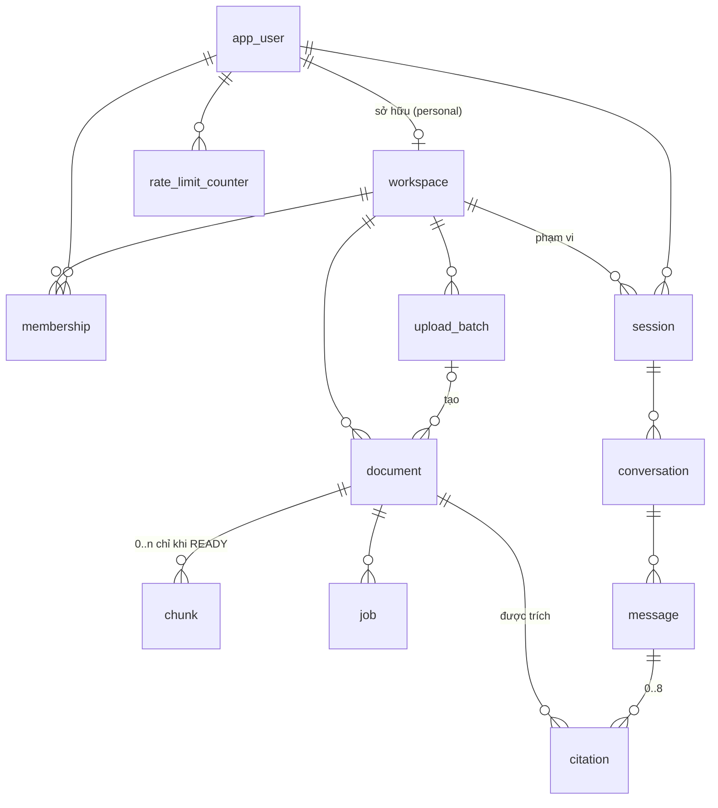

# Database Design
# MVP – Ứng dụng AI Chat với tài liệu PDF

| Trường | Giá trị |
|---|---|
| Mã tài liệu | DB-DESIGN-AICHAT-001 · v0.1 |
| Ngày | 2026-10-24 |
| Template áp dụng | `templates/databaseDesign_SQL_prompt.md` (Phần A) · `templates/databaseDesign_VectorDB_prompt.md` (Phần B) |
| Template không áp dụng | `databaseDesign_NoSQL_prompt.md`, `databaseDesign_GraphrDB_prompt.md` – lý do ở Phần C |
| File kèm theo | [schema.sql](schema.sql) v0.3 (DDL đầy đủ – nguồn chuẩn) · [seed_dev.sql](seed_dev.sql) (dữ liệu mẫu dev) |
| Tài liệu liên quan | [SAD](SAD.md) v0.4 (ADR-005, ADR-012) · [BLUEPRINT](BLUEPRINT.md) v0.3 (3.5, 3.8) · [API_DESIGN](API_DESIGN.md) v0.1 |

Cả hai file SQL đã kiểm tra cú pháp bằng parser của PostgreSQL (`pglast`, gồm thân hàm PL/pgSQL); **chưa chạy trên máy chủ PostgreSQL thật** – việc này nằm trong bước khởi tạo dự án (A.9).

| Phiên bản | Ngày | Tác giả | Thay đổi |
|---|---|---|---|
| 0.1 | 2026-10-24 | Tech Lead | Bản đầu; schema v0.3: quy ước đặt tên, `client_file_id`, `embedding_model`, view, trigger bất biến, COMMENT, `seed_dev.sql` |

---

## Tổng quan và lựa chọn công nghệ

**Một CSDL PostgreSQL 16 + pgvector** lưu cả dữ liệu quan hệ, vector, chỉ mục full-text, hàng đợi tác vụ, phiên, nhật ký (SAD ADR-005). Lý do chính:

1. **Xóa và cách ly trong một transaction.** Xóa tài liệu xóa luôn đoạn và vector trong cùng transaction (BLUEPRINT ALG-12); Row-Level Security áp lên cả vector – không có kho thứ hai phải đồng bộ (NFR-010, NFR-013).
2. **Quy mô nhỏ.** ~225.000 đoạn, tối đa ~2,25 triệu (B.2) – trong khả năng của pgvector HNSW trên một máy.
3. **Ít thành phần vận hành** cho đội nhỏ (CON-005).

---

# Phần A – Thiết kế CSDL quan hệ (SQL)

## A.0 Yêu cầu và đặc tả kỹ thuật

**Yêu cầu nghiệp vụ ảnh hưởng tới dữ liệu**

| # | Yêu cầu | Nguồn | Đáp ứng trong CSDL |
|---|---|---|---|
| 1 | Lưu tài liệu PDF với trạng thái Đang xử lý / Sẵn sàng / Thất bại + lý do | BR-006, BR-008, BRU-001 | `document.status`, `failure_code`, trigger chuyển trạng thái |
| 2 | Chỉ tài liệu Sẵn sàng, chưa xóa mới được dùng để trả lời | BRU-002, BRU-003 | Bất biến đoạn ⇔ READY ∧ chưa xóa, bảo vệ bằng trigger hoãn |
| 3 | Người dùng không thấy dữ liệu ngoài quyền | BR-023, NFR-010 | `workspace_id` + RLS trên 7 bảng |
| 4 | Câu trả lời có nguồn: tên tài liệu + số trang | BR-019, BR-020 | `chunk.page_number`, `citation` có bản chụp tên |
| 5 | Xóa thật ≤ 24 h; nhật ký ≥ 90 ngày; hội thoại trong phiên | NFR-013, NFR-023, NFR-024 | Xóa đoạn trong transaction xóa mềm; phân vùng `audit_event`; CASCADE từ `session` |
| 6 | Hạn mức 100 tài liệu, 10 file/lần | NFR-019, NFR-020 | `upload_batch.remaining_slots`, `vw_workspace_quota` |
| 7 | Không ghi nội dung người dùng vào analytics | PRD 5.2 | CHECK `ck_analytics_event_no_content` |

**Yêu cầu lưu trữ** (giả định 50 người dùng – OQ-010)

| Hạng mục | Giá trị |
|---|---|
| Khối lượng | ~5.000 `document`; ~225.000 `chunk` (tối đa 2,25 triệu); ~22.000 `message`/tháng nhưng chỉ tồn tại trong phiên; `audit_event` ~30.000 hàng/tháng; `analytics_event` ~60.000 hàng/tháng |
| Giao dịch | Đỉnh ~5 request/giây; ghi lớn nhất là ingest (≤ 600 hàng `chunk`/tài liệu) |
| Lưu giữ | Tài liệu tới khi xóa; nhật ký 90 ngày; analytics 180 ngày; job 7 ngày sau khi xong |
| Tăng trưởng | Chưa có dữ liệu – thiết kế cho gấp 2 giả định |
| Sẵn sàng | 99% giờ làm việc (NFR-015) |
| Sao lưu | Sao lưu đầy đủ hằng ngày + WAL (PITR) – thời gian giữ chờ OQ-202 (A.10) |

**Hiệu năng:** truy vấn đọc p95 ≤ 50 ms; truy xuất kết hợp (ALG-05) ≤ 100 ms; ghi chỉ mục một tài liệu 300 trang ≤ 5 s.

**Bảo mật:** mã hóa lưu trữ AES-256 (đĩa/dịch vụ quản lý – NFR-022); TLS cho kết nối; RLS; vai trò tối thiểu; nhật ký kiểm toán chỉ INSERT; tuân thủ pháp lý chờ DEF-002.

**Đặc tả kỹ thuật**

| Hạng mục | Giá trị |
|---|---|
| Nền tảng | PostgreSQL 16 (dịch vụ quản lý hoặc tự quản) |
| Extension | `vector` (pgvector ≥ 0.8). `gen_random_uuid()` có sẵn từ PostgreSQL 13 |
| Bộ mã | UTF-8 |
| Collation | Mặc định CSDL `C.UTF-8` (so sánh nhị phân, nhanh, ổn định giữa các bản). Khi cần sắp xếp tên tiếng Việt: `ORDER BY file_name COLLATE "vi-x-icu"` (cần bản build có ICU) |
| Lưu trữ | Heap mặc định; chỉ mục HNSW, GIN, B-tree |
| Múi giờ | Mọi cột thời gian là `timestamptz`, phiên kết nối đặt `TimeZone = 'UTC'` |

**Quy ước đặt tên**

| Đối tượng | Quy ước | Ví dụ |
|---|---|---|
| Bảng | `snake_case`, **số ít** | `document`, `audit_event` |
| Cột | `snake_case`, số ít | `page_number` |
| Khóa chính | `id` | |
| Khóa ngoại | `{bảng_được_tham_chiếu}_id` | `document_id` |
| Khóa chính / ngoại – ràng buộc | Tên mặc định của PostgreSQL (`{bảng}_pkey`, `{bảng}_{cột}_fkey`) | |
| Unique | `uq_{bảng}_{cột/ý nghĩa}` | `uq_document_batch_client_file` |
| Check | `ck_{bảng}_{quy tắc}` | `ck_document_failure_iff_failed` |
| Index | `idx_{bảng}_{cột/ý nghĩa}` | `idx_chunk_embedding_hnsw` |
| View | `vw_{mục đích}`; báo cáo `vw_report_{…}` | `vw_document_list` |
| Hàm | `fn_{hành động}_{đối tượng}`; hàm trigger `fn_trg_{…}` | `fn_pending_purges` |
| Trigger | `trg_{bảng}_{hành động}_{thời điểm}` | `trg_message_set_updated_at_before_update` |
| Chính sách RLS | `pol_{bảng}_{mục đích}` | `pol_chunk_ws_isolation` |
| Kiểu enum | `snake_case` số ít | `document_status` |

Không dùng thủ tục lưu trữ (`PROCEDURE`) – logic nghiệp vụ nằm trong ứng dụng (BLUEPRINT 3.8); CSDL chỉ giữ hàm bảo trì và trigger bảo vệ bất biến.

## A.1 Sơ đồ thực thể – quan hệ



| Quan hệ | Bản số | Bắt buộc | Ghi chú |
|---|---|---|---|
| app_user – workspace (personal) | 1 : 0..1 | Workspace personal phải có chủ | `uq_workspace_personal_owner`, `ck_workspace_personal_has_owner` |
| workspace – app_user qua membership | n : m | – | Bảng nối `membership` (chuẩn bị cho workspace dùng chung – OQ-002) |
| workspace – document | 1 : 0..n | document bắt buộc có workspace | Tối đa 100 (ứng dụng kiểm tra) |
| upload_batch – document | 1 : 0..n | Tùy chọn (`SET NULL` khi lô bị dọn) | |
| document – chunk | 1 : 0..n | chunk bắt buộc có document | Chỉ tồn tại khi document READY và chưa xóa |
| document – job | 1 : 0..n | Bắt buộc | Tối đa 1 job đang chạy mỗi loại |
| session – conversation – message – citation | 1 : n : n : 0..8 | Bắt buộc | Xóa dây chuyền khi phiên bị xóa |
| document – citation | 1 : 0..n | Bắt buộc | document không bao giờ bị xóa cứng nên FK không chặn |
| `audit_event`, `analytics_event` | – | – | Không có FK (giữ nhật ký kể cả khi đối tượng bị xóa) |

## A.2 Định nghĩa bảng (data dictionary)

DDL đầy đủ ở [schema.sql](schema.sql); mô tả bảng/cột chính cũng có trong CSDL qua `COMMENT ON`.

#### `document`

| Cột | Kiểu | Null | Mặc định | Ràng buộc | Ý nghĩa |
|---|---|---|---|---|---|
| `id` | uuid | Không | `gen_random_uuid()` | PK | |
| `workspace_id` | uuid | Không | | FK workspace | Phạm vi RLS |
| `batch_id` | uuid | Có | | FK upload_batch `SET NULL` | Lô tạo ra tài liệu |
| `client_file_id` | uuid | Không | | `uq_document_batch_client_file (batch_id, client_file_id)` | Khóa idempotency do SPA sinh (API AD-06) |
| `file_name` | text | Không | | 1–255 ký tự | Tên gốc người dùng tải lên |
| `size_bytes` | bigint | Không | | > 0 | |
| `page_count` | int | Không | | > 0 | |
| `status` | `document_status` | Không | `PROCESSING` | Trigger chuyển trạng thái | |
| `failure_code` | `failure_code` | Có | | Khác NULL ⇔ FAILED | R-01…R-04 |
| `storage_key` | text | Không | | Unique | Khóa object storage |
| `sha256` | bytea | Không | | 32 byte | Kiểm tra toàn vẹn file |
| `uploaded_by` | uuid | Không | | FK app_user | |
| `uploaded_at` | timestamptz | Không | `now()` | | |
| `ready_at` | timestamptz | Có | | Khác NULL ⇔ READY | |
| `deleted_at` | timestamptz | Có | | | Xóa mềm |
| `purged_at` | timestamptz | Có | | Chỉ khi đã xóa mềm | File gốc đã xóa thật |

#### `chunk`

| Cột | Kiểu | Null | Ràng buộc | Ý nghĩa |
|---|---|---|---|---|
| `id` | uuid | Không | PK | |
| `document_id` | uuid | Không | FK document `CASCADE` | |
| `workspace_id` | uuid | Không | RLS | Bản sao từ document để lọc không cần join (DD-05, B.4) |
| `page_number` | int | Không | ≥ 1 | Số thứ tự trang trong file |
| `chunk_index` | int | Không | ≥ 0; unique cùng `document_id` | |
| `token_count` | int | Không | > 0 | Theo tokenizer `bge-m3` |
| `content` | text | Không | Không rỗng | Unicode NFC |
| `tsv` | tsvector | – | Sinh tự động `to_tsvector('simple', content)` | Full-text |
| `embedding_model` | text | Không | | Vd. `bge-m3@v1` (B.7) |
| `embedding` | vector(1024) | Không | | float32, chuẩn hóa L2 |

#### `message`

| Cột | Kiểu | Null | Ràng buộc | Ý nghĩa |
|---|---|---|---|---|
| `id` | uuid | Không | PK | |
| `conversation_id` | uuid | Không | FK `CASCADE` | |
| `workspace_id` | uuid | Không | RLS | |
| `client_request_id` | uuid | Không | Unique cùng `conversation_id` | Idempotency (ALG-08) |
| `question` | text | Không | ≥ 1 ký tự (giới hạn 2.000 ở ứng dụng) | |
| `answer` | text | Có | Bắt buộc khi ANSWERED | Văn bản có `[n]` |
| `status` | `message_status` | Không | | PENDING/ANSWERED/INSUFFICIENT/FAILED |
| `error_code` | text | Có | Khác NULL ⇔ FAILED | Mã lỗi API |
| `attempt` | int | Không | ≥ 1 | Tăng khi "Gửi lại" |
| `latency_ms` | int | Có | | |
| `created_at`, `updated_at` | timestamptz | Không | `updated_at` do trigger | |

#### Các bảng khác (tóm tắt)

| Bảng | Cột chính | Ràng buộc đáng chú ý |
|---|---|---|
| `app_user` | `idp_subject`, `email`, `role` | `uq_app_user_idp_subject` |
| `workspace` | `kind`, `personal_owner_id` | Mỗi người tối đa 1 workspace cá nhân |
| `membership` | `(workspace_id, user_id)`, `role` | PK kép; `role ∈ {owner, member}` |
| `session` | `token_hash`, `csrf_token_hash`, `idle_expires_at`, `absolute_expires_at` | Băm 32 byte; idle ≤ absolute |
| `upload_batch` | `remaining_slots`, `expires_at` | slots ≥ 0; hết hạn sau khi tạo |
| `job` | `kind`, `status`, `attempts`, `run_after`, `locked_until`, `finished_at` | 1 job đang chạy/tài liệu/loại; `finished_at` ⇔ trạng thái kết thúc |
| `conversation` | `session_id`, `workspace_id` | CASCADE từ session |
| `citation` | `document_name_snapshot`, `page_number`, `ordinal` | ordinal 1–8, unique trong message |
| `rate_limit_counter` | `(user_id, bucket, window_start)`, `count` | bucket ∈ {question, upload_file} |
| `audit_event` | `at`, `actor_id`, `action`, `target_id`, `outcome`, `request_id` | Phân vùng theo tháng; danh sách `action` cố định |
| `analytics_event` | `event_name`, `actor_hash`, `properties` | 11 tên sự kiện; cấm khóa nội dung |

## A.3 Ánh xạ quan hệ và hành động tham chiếu

| Khóa ngoại | ON DELETE | Lý do |
|---|---|---|
| `membership → workspace`, `membership → app_user` | CASCADE | Bảng nối |
| `workspace.personal_owner_id → app_user` | CASCADE | Gỡ người dùng → gỡ workspace cá nhân (thực hiện bằng quy trình riêng, không phải thao tác thường ngày) |
| `session → app_user` | CASCADE | |
| `session → workspace` | RESTRICT (mặc định) | Không xóa workspace khi còn phiên |
| `upload_batch → workspace` | CASCADE | |
| `document → upload_batch` | SET NULL | Lô bị dọn sau 1 ngày, tài liệu vẫn còn |
| `document → workspace`, `document → app_user` | RESTRICT | Tài liệu không bao giờ bị xóa cứng trong vận hành bình thường |
| `chunk → document` | CASCADE | Phòng thủ; xóa đoạn thực tế làm bằng `DELETE` trong ALG-12 |
| `job → document` | RESTRICT | |
| `conversation → session`, `message → conversation`, `citation → message` | CASCADE | Hội thoại chỉ sống trong phiên (NFR-024) |
| `citation → document` | RESTRICT | |
| `rate_limit_counter → app_user` | CASCADE | |

Không có quan hệ nhiều-nhiều ngoài `membership`.

## A.4 Chỉ mục và hiệu năng

| Index | Loại | Truy vấn dùng | Ghi chú |
|---|---|---|---|
| `idx_document_workspace_status` | B-tree một phần `(workspace_id, status, uploaded_at DESC) WHERE deleted_at IS NULL` | Danh sách tài liệu, đếm hạn mức | Chỉ phủ tài liệu chưa xóa |
| `idx_document_pending_purge` | B-tree một phần | `fn_pending_purges`, `fn_purge_lag_max_seconds` | |
| `uq_document_batch_client_file` | Unique | ALG-01 pha 0 | |
| `idx_chunk_embedding_hnsw` | HNSW `vector_cosine_ops` (m 16, ef_construction 64) | ALG-05 nhánh vector | B.4 |
| `idx_chunk_tsv_gin` | GIN | ALG-05 nhánh full-text | |
| `idx_chunk_workspace_document` | B-tree | Lọc workspace, xóa theo tài liệu | |
| `idx_job_claim` | B-tree một phần `(run_after) WHERE status IN (QUEUED, RUNNING)` | ALG-11 | Nhỏ vì chỉ chứa job đang chờ/chạy |
| `uq_job_active_per_document_kind` | Unique một phần | Chống job trùng | |
| `idx_job_finished` | B-tree một phần | Dọn job cũ | |
| `idx_session_expiry`, `idx_session_user` | B-tree | `expire_sessions`, đăng xuất | |
| `idx_conversation_session`, `idx_message_conversation_created` | B-tree | Tải hội thoại, CASCADE | |
| `idx_upload_batch_workspace_expires` | B-tree | Đếm chỗ đặt còn hạn | |
| `idx_rate_limit_counter_window` | B-tree | Dọn cửa sổ cũ | |
| `idx_audit_event_actor_at`, `idx_audit_event_target` | B-tree trên bảng phân vùng | Tra cứu nhật ký (US-C02) | Tạo tự động trên mỗi phân vùng |
| `idx_analytics_event_name_at`, `idx_analytics_event_at` | B-tree | View báo cáo, dọn dữ liệu | |

**Chiến lược:** chỉ mục một phần cho các bảng có nhiều hàng "không hoạt động" (`document` đã xóa, `job` đã xong); không tạo chỉ mục cho FK của các bảng không bao giờ xóa cứng hàng cha (`citation.document_id`, `job.document_id`); PostgreSQL không có chỉ mục clustered – không dùng `CLUSTER` (bảng ghi liên tục).

## A.5 View

| View | Loại | Dùng bởi | Ghi chú |
|---|---|---|---|
| `vw_document_list` | Nghiệp vụ, `security_invoker` | API `GET /documents` | Thêm cột dẫn xuất `retryable` |
| `vw_workspace_quota` | Nghiệp vụ, `security_invoker` | API `/me`, ALG-01 | `documents_used`, `reserved_slots` |
| `vw_report_daily_questions` | Báo cáo | `app_readonly_analytics` | Số câu hỏi, tỷ lệ ANSWERED/INSUFFICIENT/FAILED, p50/p90 độ trễ |
| `vw_report_daily_ingestion` | Báo cáo | `app_readonly_analytics` | Hoàn tất/thất bại, số PDF scan (kiểm chứng ASM-001), p90 thời gian |
| `vw_report_weekly_active_users` | Báo cáo | `app_readonly_analytics` | Người dùng hoạt động hằng tuần (RSK-008) |

`security_invoker = true` là bắt buộc cho view trên bảng có RLS: view mặc định chạy với quyền chủ sở hữu (`app_migrator`, có BYPASSRLS) và sẽ trả dữ liệu của mọi workspace. **Chưa dùng materialized view** – lượng `analytics_event` (~60.000 hàng/tháng) đủ nhỏ để view thường chạy dưới 1 s; xem lại khi > 5 triệu hàng.

## A.6 Hàm

| Hàm | Loại | Quyền chạy | Mục đích |
|---|---|---|---|
| `fn_current_workspace()` | SQL, STABLE | Mọi vai trò | Đọc `app.workspace_id` cho chính sách RLS |
| `fn_ensure_audit_partition(date)` | PL/pgSQL, SECURITY DEFINER | `app_maintenance` | Tạo phân vùng tháng (chạy hằng ngày, tạo trước 1 tháng) |
| `fn_drop_audit_partitions_before(date)` | PL/pgSQL, SECURITY DEFINER | `app_maintenance` | Xóa phân vùng quá hạn (NFR-023) |
| `fn_pending_purges(interval)` | SQL, SECURITY DEFINER | `app_worker` | Danh sách ID tài liệu cần purge (liên workspace, chỉ trả ID) |
| `fn_purge_lag_max_seconds()` | SQL, SECURITY DEFINER | `app_worker` | Metric độ trễ purge |
| `fn_trg_*` | Hàm trigger | – | A.7 |

Mọi hàm SECURITY DEFINER đặt `SET search_path = public` (chống chiếm quyền qua `search_path`) và bị thu hồi `EXECUTE` khỏi `PUBLIC`.

## A.7 Trigger

| Trigger | Bảng | Thời điểm | Mục đích |
|---|---|---|---|
| `trg_message_set_updated_at_before_update` | message | BEFORE UPDATE | Cập nhật `updated_at` (ALG-08 dùng để phát hiện PENDING treo) |
| `trg_document_status_transition_before_update` | document | BEFORE UPDATE OF status | Chỉ cho phép PROCESSING→READY, PROCESSING→FAILED, FAILED→PROCESSING (SAD 5.4) |
| `trg_chunk_ready_document_after_insert` | chunk | AFTER INSERT, **DEFERRABLE INITIALLY DEFERRED** | Lúc COMMIT: tài liệu của đoạn phải READY và chưa xóa |
| `trg_document_chunks_consistent_after_update` | document | AFTER UPDATE OF status, deleted_at, **DEFERRABLE INITIALLY DEFERRED** | Lúc COMMIT: tài liệu không READY hoặc đã xóa thì không còn đoạn |

Hai trigger hoãn là **lớp phòng thủ thứ hai** cho bất biến mà ALG-04 và ALG-12 đã đảm bảo; nhờ "hoãn tới COMMIT", thứ tự lệnh trong transaction (chèn đoạn rồi mới đổi READY) không gây lỗi giả. Chi phí: một lần tra khóa chính `document` cho mỗi đoạn được chèn (~600 lần/tài liệu, < 50 ms).

**Không dùng trigger kiểm toán** để ghi `audit_event`: nhật ký cần `actor_id` và `request_id` của người dùng – thông tin chỉ có ở tầng ứng dụng. Ứng dụng chỉ có quyền `INSERT` trên `audit_event` (không sửa/xóa được).

## A.8 Kiểu dữ liệu và ràng buộc

| Lựa chọn | Lý do |
|---|---|
| `uuid` (v4, `gen_random_uuid()`) cho khóa chính | Không lộ số lượng/thứ tự bản ghi qua API; sinh được ở client (`client_file_id`, `client_request_id`); trộn dữ liệu giữa môi trường không xung đột. `job.id` dùng `bigint identity` vì chỉ dùng nội bộ và cần thứ tự |
| `timestamptz` | Lưu UTC, tránh lỗi múi giờ |
| Kiểu `ENUM` cho trạng thái | Giá trị hợp lệ được CSDL kiểm tra; thêm giá trị mới bằng `ALTER TYPE … ADD VALUE` (không phá vỡ). Mã lỗi API (`message.error_code`) để `text` vì danh sách thay đổi theo API |
| `text` + CHECK thay vì `varchar(n)` | PostgreSQL lưu như nhau; CHECK cho phép thông điệp lỗi rõ và đổi giới hạn bằng một lệnh |
| `bytea` cho băm | 32 byte cố định, kiểm tra bằng `octet_length` |
| `vector(1024)` | B.2 |
| `tsvector` cột sinh `STORED` | Không phải tính lại khi truy vấn; luôn khớp `content` |
| `jsonb` cho `analytics_event.properties` | Thuộc tính khác nhau theo sự kiện (BLUEPRINT 3.5.3); CHECK cấm khóa chứa nội dung |
| Ngưỡng nghiệp vụ **không** đặt trong CHECK | Là cấu hình (D-01…D-13 chưa duyệt) – đổi không cần migration |

## A.9 Migration và dữ liệu mẫu

**Công cụ:** Alembic (SAD ADR-002). Mỗi file migration có `upgrade()` và `downgrade()`; revision `0001_initial` thực thi `schema.sql`.

**Quy tắc migration không gián đoạn (expand/contract – BLUEPRINT QA-12):**

1. *Expand:* thêm cột cho phép NULL / bảng / chỉ mục mới; chỉ mục trên bảng lớn tạo bằng `CREATE INDEX CONCURRENTLY` trong migration riêng, không nằm trong transaction.
2. Triển khai mã mới đọc/ghi được cả cấu trúc cũ và mới; backfill theo lô 1.000 hàng.
3. *Contract:* đặt `NOT NULL`, xóa cột cũ – ở bản phát hành sau.
4. Không bao giờ đổi tên cột trong một bước.
5. `ALTER TYPE … ADD VALUE` chạy riêng (không trong transaction có dùng giá trị mới).

**Ví dụ – thêm `client_file_id` nếu schema đã chạy bản v0.2:**

```sql
-- 0002_expand
ALTER TABLE document ADD COLUMN client_file_id uuid;
CREATE UNIQUE INDEX CONCURRENTLY uq_document_batch_client_file ON document (batch_id, client_file_id);
-- backfill (tài liệu cũ không có khóa idempotency từ client)
UPDATE document SET client_file_id = gen_random_uuid() WHERE client_file_id IS NULL;
-- 0003_contract (bản phát hành sau)
ALTER TABLE document ALTER COLUMN client_file_id SET NOT NULL;
```

**Dữ liệu mẫu:** [seed_dev.sql](seed_dev.sql) – 3 người dùng, 3 workspace, 3 tài liệu (PROCESSING, READY có 2 đoạn, FAILED R-03). Script từ chối chạy nếu `app.env` khác `dev`. Vector mẫu là hằng số chuẩn hóa – chỉ để hiển thị giao diện, không dùng đánh giá truy xuất. Dữ liệu kiểm thử chất lượng RAG dùng bộ PDF mẫu DEP-003 nạp qua API, không qua SQL.

**Kiểm thử schema trong CI:** Testcontainers PostgreSQL 16 + pgvector; chạy `alembic upgrade head`, `seed_dev.sql`, rồi bộ test RLS (đặt `app.workspace_id` của A, đọc dữ liệu B → 0 hàng) và test trigger (chèn đoạn cho tài liệu PROCESSING rồi COMMIT → lỗi).

## A.10 Quản trị CSDL

**Sao lưu và khôi phục**

| Hạng mục | Thiết kế |
|---|---|
| Sao lưu | Snapshot đầy đủ hằng ngày + lưu WAL liên tục (PITR) |
| RPO / RTO | ≤ 15 phút / ≤ 4 giờ (SAD 8.2, đề xuất) |
| Thời gian giữ | **Chờ OQ-202:** 7 ngày (đề xuất kỹ thuật) mâu thuẫn với NFR-013 (xóa ≤ 24 h). Phương án: (a) giữ 1 ngày; (b) giữ 7 ngày và ghi nhận ngoại lệ có văn bản; (c) khi khôi phục, chạy lại xóa cho mọi tài liệu có trong nhật ký `document_delete` sau thời điểm sao lưu |
| Diễn tập khôi phục | Mỗi quý khôi phục vào staging, chạy test RLS và kiểm tra bất biến |
| Mã hóa | Bản sao lưu mã hóa bằng khóa KMS khác khóa CSDL |

**Kế hoạch bảo trì**

| Việc | Tần suất | Thực hiện |
|---|---|---|
| Tạo phân vùng `audit_event` tháng tới | Hằng ngày | `fn_ensure_audit_partition` (`app_maintenance`) |
| Xóa phân vùng nhật ký quá 90 ngày | Hằng ngày | `fn_drop_audit_partitions_before(current_date - 90)` – phân vùng chỉ bị xóa khi toàn bộ tháng đã quá hạn, nên dữ liệu thực tế được giữ 90–120 ngày |
| Xóa `analytics_event` > 180 ngày, `rate_limit_counter` > 2 giờ, `job` xong > 7 ngày, `upload_batch` hết hạn > 1 ngày, `session` hết hạn | 15 phút – hằng ngày | `app_maintenance` |
| Autovacuum `chunk` | Liên tục | `autovacuum_vacuum_scale_factor = 0.05`, `autovacuum_analyze_scale_factor = 0.02` cho bảng `chunk` (xóa/chèn theo lô lớn) |
| `REINDEX INDEX CONCURRENTLY idx_chunk_embedding_hnsw` | Khi recall đo được giảm (B.6) hoặc sau khi xóa > 30% đoạn | Thủ công |
| Cập nhật bản vá PostgreSQL/pgvector | Hằng tháng | Theo lịch bảo trì ngoài giờ |

**Truy vấn giám sát**

```sql
-- Kích thước bảng và chỉ mục lớn nhất
SELECT relname, pg_size_pretty(pg_total_relation_size(relid)) AS total, pg_size_pretty(pg_indexes_size(relid)) AS indexes
FROM pg_catalog.pg_statio_user_tables ORDER BY pg_total_relation_size(relid) DESC LIMIT 10;

-- Chỉ mục không được dùng
SELECT relname, indexrelname, idx_scan FROM pg_stat_user_indexes WHERE idx_scan = 0 ORDER BY relname;

-- Truy vấn chậm nhất (cần extension pg_stat_statements)
SELECT round(mean_exec_time::numeric, 1) AS mean_ms, calls, left(query, 120) AS query
FROM pg_stat_statements ORDER BY mean_exec_time DESC LIMIT 10;

-- Hàng đợi job
SELECT kind, status, count(*), min(run_after) AS oldest FROM job WHERE status IN ('QUEUED','RUNNING') GROUP BY 1, 2;

-- Độ trễ purge (cảnh báo > 20 giờ – NFR-013)
SELECT fn_purge_lag_max_seconds() / 3600 AS purge_lag_hours;

-- Kết nối theo vai trò và trạng thái
SELECT usename, state, count(*) FROM pg_stat_activity GROUP BY 1, 2 ORDER BY 3 DESC;

-- Khóa đang chờ
SELECT pid, wait_event_type, wait_event, left(query, 100) FROM pg_stat_activity WHERE wait_event_type = 'Lock';

-- Kiểm tra bất biến (phải trả 0)
SELECT count(*) FROM chunk c JOIN document d ON d.id = c.document_id
WHERE d.status <> 'READY' OR d.deleted_at IS NOT NULL;
```

**Tham số đề xuất (máy 2 vCPU / 8 GB – SAD 9.2):** `shared_buffers = 2GB`, `effective_cache_size = 6GB`, `work_mem = 16MB`, `maintenance_work_mem = 1GB` (xây HNSW), `max_connections = 100`, `random_page_cost = 1.1` (SSD), `shared_preload_libraries = 'pg_stat_statements'`, `log_min_duration_statement = 500ms`. Nếu số kết nối từ các bản API/worker vượt 60, đặt PgBouncer chế độ **transaction** – tương thích với `SET LOCAL app.workspace_id` (chỉ sống trong transaction) nhưng **không** tương thích với `LISTEN` → kết nối `LISTEN` của API đi thẳng vào PostgreSQL.

---

# Phần B – Thiết kế lưu trữ vector

## B.1 Yêu cầu nghiệp vụ

| # | Yêu cầu | Nguồn |
|---|---|---|
| 1 | Tìm đoạn liên quan tới câu hỏi tiếng Việt/tiếng Anh trong tài liệu của chính người dùng | BR-012, BR-013, NFR-016 |
| 2 | Trả về đoạn kèm tài liệu và số trang để trích dẫn | BR-019, BR-020 |
| 3 | Tổng hợp được từ nhiều tài liệu | BR-017 |
| 4 | Tài liệu bị xóa không còn được tìm thấy ngay lập tức | BR-011 |
| 5 | Không gửi nội dung tài liệu ra ngoài để tạo vector | NFR-011 |

## B.2 Đặc điểm dữ liệu vector

| Thuộc tính | Giá trị |
|---|---|
| Mô hình | `BAAI/bge-m3`, chế độ dense, tự chạy (SAD ADR-007) |
| Số chiều | 1024 |
| Kiểu | float32 (`vector`); phương án `halfvec` (float16) khi > 1 triệu đoạn (B.6) |
| Chuẩn hóa | L2 = 1 → khoảng cách cosine; dùng toán tử `<=>` |
| Số lượng | ~225.000 (giả định), tối đa ~2,25 triệu |
| Kích thước | 4 KB/vector float32 → ~0,9 GB (giả định), ~9 GB (tối đa) |
| Tần suất cập nhật | Theo lô khi ingest (≤ 600 vector/tài liệu); xóa theo tài liệu; không cập nhật từng vector |
| Văn bản đầu vào | Đoạn 500–800 token trong một trang (ADR-008); câu hỏi ≤ 2.000 ký tự. `bge-m3` không cần tiền tố "query:"/"passage:" |

## B.3 Metadata

Metadata nằm **cùng hàng** với vector trong bảng `chunk` (không có kho metadata riêng).

| Trường | Loại | Dùng để | Cập nhật | Chỉ mục |
|---|---|---|---|---|
| `workspace_id` | Có cấu trúc, lực lượng cao | **Lọc bằng nhau** (bắt buộc ở mọi truy vấn) + RLS | Tĩnh | B-tree (`idx_chunk_workspace_document`) |
| `embedding_model` | Có cấu trúc, lực lượng rất thấp (1–2 giá trị) | Lọc bằng nhau | Tĩnh (đổi khi tạo lại vector) | Không (lọc sau HNSW, chọn lọc ~100%) |
| `document_id` | Có cấu trúc | Ánh xạ trích dẫn; lọc theo nhóm tài liệu (US-019, sau MVP) | Tĩnh | B-tree (cột thứ 2 của chỉ mục trên) |
| `page_number`, `chunk_index`, `token_count` | Có cấu trúc | Trả về để trích dẫn; không lọc | Tĩnh | Không |
| `content` | Phi cấu trúc | Đưa vào prompt; tìm kiếm full-text | Tĩnh | GIN trên `tsv` |
| Tên tài liệu, trạng thái | Ở bảng `document` | Lấy cho ≤ 8 kết quả cuối | Động | PK |

Dung lượng metadata: ~0,7 GB văn bản + ~0,2 GB `tsvector` + vài chục MB cột khác (giả định). **Không** lưu trạng thái tài liệu trên `chunk`: nhờ bất biến "đoạn chỉ tồn tại khi tài liệu READY và chưa xóa", truy vấn không cần lọc trạng thái – đây là thiết kế chủ ý để tránh lọc qua join (BLUEPRINT B-DEF-003).

## B.4 Chỉ mục và tối ưu lọc

| Hạng mục | Thiết kế |
|---|---|
| Thuật toán | HNSW (`idx_chunk_embedding_hnsw`), `m = 16`, `ef_construction = 64`, `vector_cosine_ops` |
| Tham số truy vấn | `SET LOCAL hnsw.ef_search = 80`; `SET LOCAL hnsw.iterative_scan = relaxed_order` (pgvector ≥ 0.8) để HNSW quét thêm khi bộ lọc `workspace_id` loại nhiều kết quả |
| Lọc | Điều kiện `workspace_id` + `embedding_model` trên **cùng bảng** với vector (không join) |
| Workspace nhỏ | Workspace ≤ 5.000 đoạn: planner có thể chọn quét tuần tự qua `idx_chunk_workspace_document` + tính khoảng cách chính xác – vẫn < 100 ms và recall = 100% |
| Kết hợp full-text | Nhánh `tsvector` (GIN) + RRF (k = 60) – ALG-05 |
| Chi phí lọc | Mục tiêu ≤ 10 ms thêm so với không lọc ở ~225.000 đoạn – đo ở SPIKE-04 |
| Phân vùng | Không trong MVP. Khi > 5 triệu đoạn: phân vùng `chunk` theo `hash(workspace_id)` (16 phân vùng), mỗi phân vùng một HNSW nhỏ |
| Nén | Không trong MVP; B.6 |

**Vì sao không chọn IVFFlat:** IVFFlat cần huấn luyện danh sách cụm trên dữ liệu đã có và recall giảm khi dữ liệu thay đổi nhiều (xóa/chèn theo tài liệu); HNSW không cần huấn luyện, phù hợp dữ liệu tăng dần từ 0.

## B.5 Yêu cầu tìm kiếm

| Hạng mục | Giá trị |
|---|---|
| Loại | ANN (HNSW) + full-text, hợp nhất RRF; top-30 mỗi nhánh → top-8 |
| Độ trễ | Toàn bộ ALG-05 (một câu SQL) ≤ 100 ms p95; nhúng câu hỏi ≤ 300 ms (SAD 7.4) |
| Lọc | Bằng nhau trên `workspace_id`, `embedding_model`; sau MVP thêm `document_id = ANY(:ids)` (US-019) |
| Recall | recall@30 của HNSW so với tìm kiếm chính xác ≥ 0,95 (B.6) |
| Chất lượng cuối | Đo ở mức câu trả lời: MET-002 ≥ 80%, NFR-018 ≥ 85% (DE-22) |
| Đa phương thức | Không (chỉ văn bản; CON-003) |

## B.6 Khả năng mở rộng, đo recall và nén

**Đo recall** (chạy trong bộ đánh giá DE-22, mỗi tuần và sau mỗi thay đổi tham số):

```sql
-- Với mỗi câu hỏi mẫu q và workspace ws:
-- (1) ANN
SET LOCAL hnsw.ef_search = 80;
SELECT id FROM chunk WHERE workspace_id = :ws AND embedding_model = :m ORDER BY embedding <=> :q LIMIT 30;
-- (2) Chính xác: tắt chỉ mục
SET LOCAL enable_indexscan = off;
SELECT id FROM chunk WHERE workspace_id = :ws AND embedding_model = :m ORDER BY embedding <=> :q LIMIT 30;
-- recall@30 = |(1) ∩ (2)| / 30 ; mục tiêu trung bình ≥ 0,95
```

| Ngưỡng | Hành động |
|---|---|
| recall@30 < 0,95 | Tăng `ef_search` (80 → 120), đo lại độ trễ |
| recall vẫn thấp sau khi xóa nhiều | `REINDEX INDEX CONCURRENTLY idx_chunk_embedding_hnsw` |
| > 1 triệu đoạn hoặc HNSW không vừa RAM | Chuyển `embedding` sang `halfvec(1024)` (giảm 50%), đo lại MET-002 trên DEP-005; chấp nhận nếu giảm < 1 điểm % |
| > 5 triệu đoạn | Phân vùng theo `hash(workspace_id)`; cân nhắc lại SAD ADR-005 |

**Tốc độ nạp:** tính theo thông lượng embedding (SPIKE-02), không phải CSDL; ghi 600 đoạn bằng `COPY` < 2 s.

**Sao chép/sẵn sàng:** theo PostgreSQL (A.10); không cần sao chép riêng cho vector.

## B.7 Tích hợp và phiên bản mô hình

| Hạng mục | Thiết kế |
|---|---|
| Sinh vector | Embedding service nội bộ (`POST /embed`, BLUEPRINT 3.6.5), lô 32 |
| Nguồn dữ liệu | Worker ingest (ALG-04) |
| Giao diện truy vấn | SQL qua SQLAlchemy Core trong `RetrievalService` |
| Giám sát | Metric `retrieval_latency_seconds`, `retrieval_top_score` (SAD 8.3); kích thước HNSW (A.10); recall (B.6) |
| Phiên bản mô hình | `chunk.embedding_model` = `"{tên}@{phiên bản}"` (vd. `bge-m3@v1`); cấu hình `EMBEDDING_MODEL_ID` |

**Đổi mô hình embedding (vector của hai mô hình không so sánh được):**

1. Triển khai embedding service phiên bản mới song song; đặt cấu hình worker ghi `EMBEDDING_MODEL_ID = bge-m3@v2` cho tài liệu **mới**.
2. Job nền tạo lại vector cho tài liệu cũ: với mỗi tài liệu, trong một transaction xóa đoạn `@v1` và chèn đoạn `@v2`.
3. Trong lúc chuyển đổi, truy xuất lọc theo `embedding_model = @v1` cho tới khi 100% tài liệu đã có `@v2`, rồi đổi cấu hình truy xuất sang `@v2` (một lần, không có giai đoạn trộn).
4. Nếu số chiều thay đổi: thêm cột `embedding_v2 vector(n)` + chỉ mục mới (expand), chuyển đổi, xóa cột cũ (contract).

## B.8 Lựa chọn công nghệ vector

| Công nghệ | Ưu | Nhược với hệ thống này | Kết luận |
|---|---|---|---|
| **pgvector** | Cùng CSDL: transaction chung với xóa tài liệu, RLS áp lên vector, SQL cho metadata, một hệ thống sao lưu | Mở rộng giới hạn ở vài triệu vector/máy | **Chọn** (SAD ADR-005) |
| Pinecone | Dịch vụ quản lý, quy mô lớn | Nội dung đoạn + vector ra khỏi hạ tầng (NFR-011); thêm nhà cung cấp cần IT/Security duyệt | Loại |
| Qdrant / Weaviate / Milvus (tự chạy) | Lọc metadata mạnh, hiệu năng cao | Thêm một kho phải vận hành và đồng bộ khi xóa (NFR-013), phải tự làm phân quyền | Loại cho MVP; xem lại nếu > 5 triệu đoạn |
| Elasticsearch / OpenSearch | Full-text + vector | Nặng cho quy mô này; vẫn là kho thứ hai | Loại |
| Redis Stack | Rất nhanh, trong bộ nhớ | Toàn bộ vector trong RAM; kho thứ hai | Loại |
| Chroma | Đơn giản, Python | Chưa phù hợp production đa người dùng có phân quyền | Loại |
| Vertex AI / Azure AI Search | Dịch vụ quản lý | Gắn với một đám mây chưa được chọn (OQ-005, OQ-203) | Loại |

---

# Phần C – NoSQL và Graph: không áp dụng

| Template | Vì sao không áp dụng | Khi nào xem lại |
|---|---|---|
| NoSQL (document, key-value, wide-column) | Dữ liệu có cấu trúc, quan hệ rõ (tài liệu – đoạn – trích dẫn), cần transaction nhiều bảng (ALG-01, ALG-04, ALG-12) và RLS; khối lượng nhỏ. Nhu cầu key-value duy nhất (giới hạn tần suất, phiên) đã đáp ứng bằng bảng PostgreSQL (BLUEPRINT DD-04) | Khi cần cache phiên/giới hạn tần suất với > 1.000 request/giây → Redis |
| Graph | Không có truy vấn duyệt quan hệ nhiều bước; quan hệ sâu nhất là session → conversation → message → citation → document, truy vấn bằng join cố định | Nếu sản phẩm thêm đồ thị tri thức (thực thể – quan hệ giữa các tài liệu) cho GraphRAG – ngoài phạm vi MVP |

---

## Truy vết

| Yêu cầu | Đối tượng CSDL |
|---|---|
| BR-006, BR-008, BRU-001 | `document.status`, `failure_code`, `trg_document_status_transition_before_update` |
| BR-011, BRU-003, NFR-013 | ALG-12 (xóa đoạn), `deleted_at`, `purged_at`, `fn_pending_purges`, `trg_document_chunks_consistent_after_update` |
| BR-013, BRU-002 | Bất biến đoạn ⇔ READY, `trg_chunk_ready_document_after_insert` |
| BR-019, BR-020, NFR-018 | `chunk.page_number`, `citation.document_name_snapshot`, `citation.page_number` |
| BR-023, NFR-010 | RLS `pol_*_ws_isolation`, vai trò tối thiểu, view `security_invoker` |
| NFR-012, NFR-023 | `audit_event` phân vùng, `fn_drop_audit_partitions_before`, `app_readonly_audit` |
| NFR-019, NFR-020 | `upload_batch`, `vw_workspace_quota` |
| NFR-024 | CASCADE `session → conversation → message → citation` |
| US-027 | `uq_message_conversation_request` |
| API AD-06 (E-04) | `uq_document_batch_client_file` |
| PRD 5.2 | `analytics_event`, `ck_analytics_event_no_content`, `vw_report_*` |
| NFR-011 | Vector sinh trong hạ tầng (B.7) |

## Vấn đề mở

| Mục | Phụ thuộc |
|---|---|
| Thời gian giữ bản sao lưu | OQ-202 |
| Chạy `schema.sql` + `seed_dev.sql` trên PostgreSQL 16 + pgvector thật, chạy test RLS/trigger | Khởi tạo dự án |
| Đo recall và độ trễ lọc thực tế | SPIKE-04 |
| Workspace dùng chung (bảng `membership` đã sẵn sàng, chính sách RLS cần mở rộng theo thành viên) | OQ-002 |

**Mức sẵn sàng: Ready with conditions** – schema áp dụng được ngay cho lát 1; cần chạy kiểm thử trên PostgreSQL thật và chốt OQ-202 trước production.
