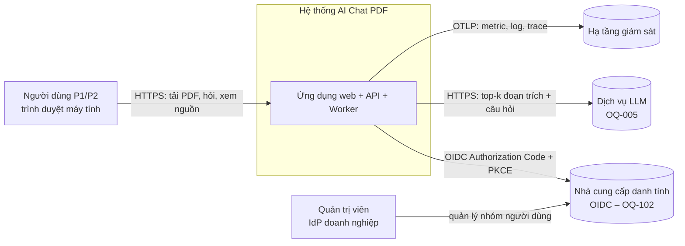
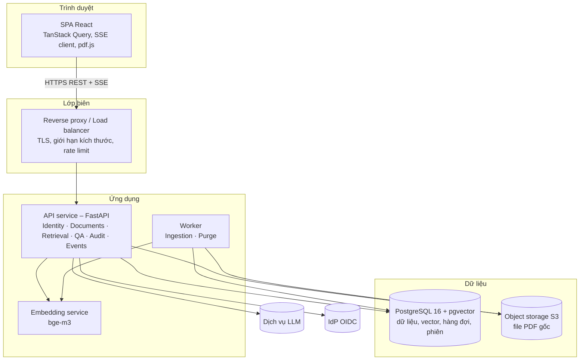
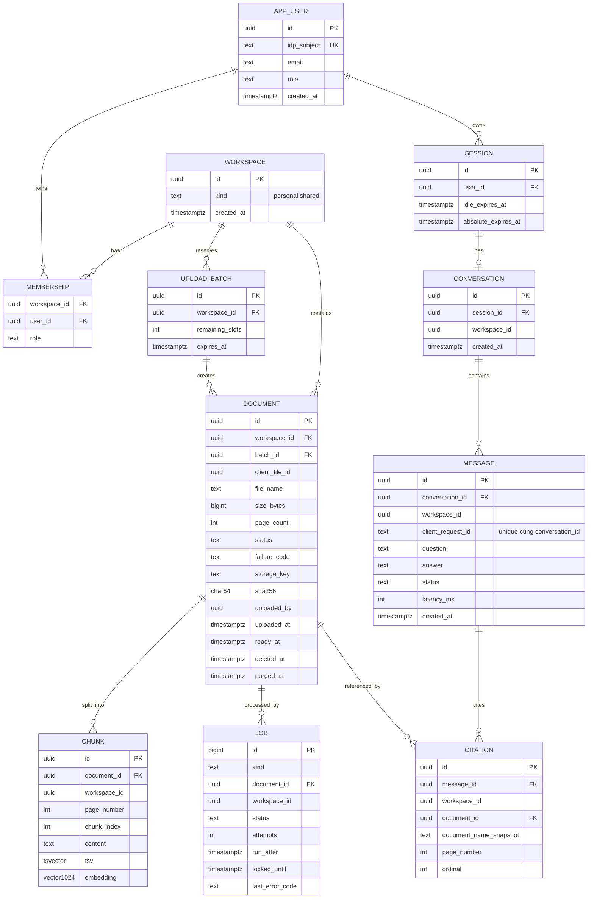
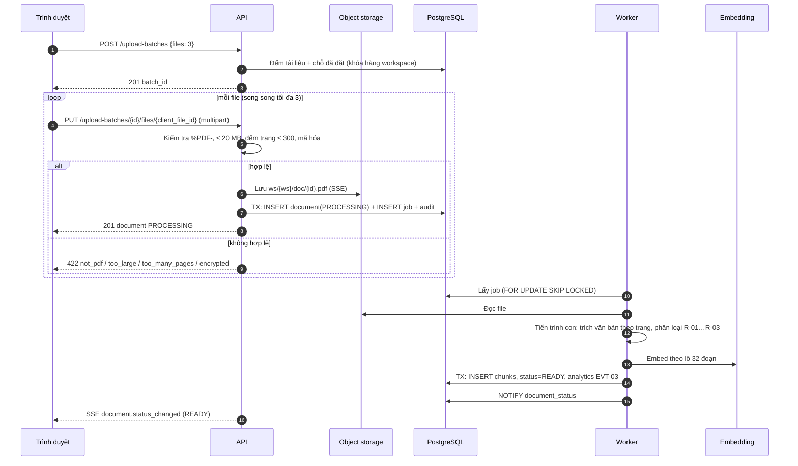
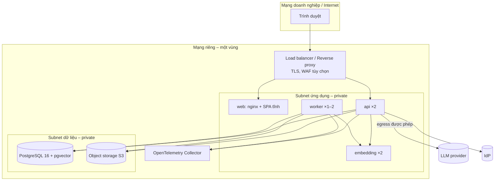
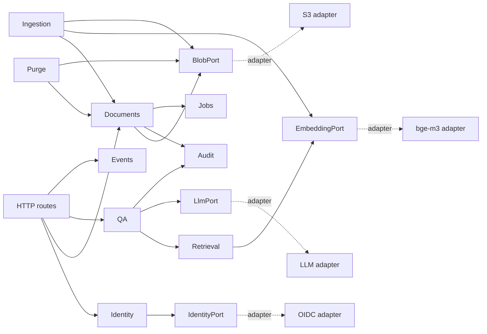

# Software Architecture Design (SAD)
# MVP – Ứng dụng AI Chat với tài liệu PDF

| Trường | Giá trị |
|---|---|
| Mã tài liệu | SAD-AICHAT-001 |
| Phiên bản | 0.4 |
| Trạng thái | **Draft** – mọi quyết định công nghệ ở trạng thái *Proposed* |
| Ngày | 2026-10-24 |
| Chuẩn áp dụng | IEEE 1016-2009 (Software Design Descriptions) |
| Tài liệu nguồn | [BRD.md](../02-requirements/BRD.md) v0.2 · [PRD.md](../02-requirements/PRD.md) v0.2 · [USER_STORIES.md](../03-analysis/USER_STORIES.md) v0.1 |
| Tác giả | Kiến trúc sư phần mềm / Tech Lead – `[TBD: OQ-007]` |
| Người review | Tech Lead, Developer, IT/Security, QA, PO |

**Lịch sử phiên bản**

| Phiên bản | Ngày | Tác giả | Tóm tắt thay đổi |
|---|---|---|---|
| 0.1 | 2026-10-24 | Architect | Bản nháp đầu tiên |
| 0.2 | 2026-10-24 | Architect | Sửa theo review `SAD_IEEE_1016_Checklist.xlsx`: RLS cho bảng hội thoại (S-DEF-001); chống race khi xóa tài liệu đang xử lý (S-DEF-002); cô lập kiểm tra PDF lúc nhận file (S-DEF-003); sửa ngân sách thời gian LLM (S-DEF-004); 2 bản embedding (S-DEF-005); thuật toán hạn mức và lô tải lên – mục 5.3a (S-DEF-006); luồng đăng nhập, phiên, CSRF – mục 7.3a (S-DEF-007); vai trò CSDL – mục 5.1 (S-DEF-008); đặc tả SSE và danh mục mã lỗi (S-DEF-009, S-DEF-010); subnet riêng (S-DEF-011); bổ sung truy vết (S-DEF-013); ước tính lưu lượng token (S-DEF-016); định danh ẩn danh trong analytics (S-DEF-017) |
| 0.3 | 2026-10-24 | Architect | Đồng bộ với BLUEPRINT v0.2: đoạn/vector bị xóa ngay khi xóa mềm, purge chỉ xóa file gốc; thêm mã lỗi `request_in_progress`, `idempotency_mismatch`, `storage_unavailable`, `server_busy`; giới hạn tần suất bằng bộ đếm trong PostgreSQL; vai trò `app_readonly_audit` |
| 0.4 | 2026-10-24 | Architect | Đồng bộ với API_DESIGN v0.1: `openapi.yaml` là hợp đồng chính thức (design-first); tải file `PUT …/files/{client_file_id}` idempotent; mã lỗi `invalid_request`, `internal_error`; tên bảng `audit_event`, `analytics_event` |

**Quy ước**

- `ADR-xxx`: quyết định kiến trúc (mục 10). Trạng thái **Proposed** = đề xuất, cần Tech Lead và IT/Security duyệt.
- `[chờ OQ-xxx]`: thiết kế phụ thuộc câu hỏi mở. Câu hỏi mở từ BRD/PRD giữ nguyên ID; câu hỏi mới phát sinh ở SAD đánh số từ `OQ-201`.
- `SPIKE-xx`: thử nghiệm kỹ thuật ngắn để kiểm chứng giả định trước khi chốt thiết kế (mục 12).
- Giá trị số lấy từ PRD (`NFR-xxx`, `D-xx`), là đề xuất chưa được PO duyệt. Nếu PO đổi giá trị, chỉ cần đổi cấu hình; kiến trúc không thay đổi.

---

## 0. Tóm tắt ràng buộc kỹ thuật

| # | Ràng buộc | Nguồn | Hệ quả kiến trúc |
|---|---|---|---|
| C-1 | Ứng dụng web, trình duyệt máy tính (Chrome/Edge, ≥ 1280 px) | CON-001, NFR-017 | SPA một trang, không cần mobile/SSR |
| C-2 | Chỉ PDF có lớp văn bản; không OCR | CON-002, CON-003 | Pipeline trích xuất văn bản, phát hiện PDF scan (R-03) |
| C-3 | Không huấn luyện/tinh chỉnh mô hình AI riêng | CON-004 | Dùng mô hình có sẵn qua API theo mô hình RAG (truy xuất + sinh câu trả lời) |
| C-4 | Ưu tiên ra mắt nhanh | CON-005 | Ít thành phần hạ tầng nhất có thể; một ngôn ngữ backend; một cơ sở dữ liệu |
| C-5 | Câu trả lời chỉ dựa trên tài liệu Sẵn sàng trong phạm vi quyền; luôn kèm nguồn; báo "chưa đủ thông tin" khi thiếu căn cứ | BRU-002, BRU-005, BR-013, BR-015, BR-019 | Truy xuất có lọc quyền trước; kiểm tra trích dẫn phía máy chủ trước khi trả về |
| C-6 | Không ai truy cập tài liệu ngoài quyền bằng bất kỳ đường nào | NFR-010, BR-023 | Phân quyền ở tầng dữ liệu (Row-Level Security) ngoài tầng ứng dụng |
| C-7 | Chỉ gửi tới nhà cung cấp AI các đoạn làm căn cứ, không gửi toàn bộ tài liệu; nhà cung cấp phải được IT/Security duyệt | NFR-011, OQ-005 | Tạo embedding trong hạ tầng của mình; chỉ gửi top-k đoạn trích tới LLM; lớp adapter để đổi nhà cung cấp |
| C-8 | Xóa thật trong ≤ 24 giờ | NFR-013 | Xóa mềm tức thì + tác vụ dọn dữ liệu (purge) |
| C-9 | Quy mô MVP nhỏ: 20 người dùng hỏi đồng thời, ≤ 100 tài liệu/người, ≤ 20 MB và ≤ 300 trang/file | NFR-006, NFR-007, NFR-019…NFR-021 | Monolith một vùng (region), không cần phân mảnh dữ liệu |
| C-10 | p90 thời gian trả lời ≤ 15 s; xử lý file lớn nhất ≤ 3 phút | NFR-001, NFR-002 | Ngân sách thời gian cho từng bước (mục 7.4); xử lý tài liệu bất đồng bộ |
| C-11 | Nơi triển khai (đám mây/nội bộ), nhà cung cấp AI, cách xác thực **chưa chốt** | OQ-005, OQ-001, OQ-102 | Đóng gói container, không phụ thuộc nhà cung cấp đám mây; adapter cho LLM, embedding, lưu trữ file, IdP |

**Tech stack:** người yêu cầu chưa chỉ định. Tài liệu này **đề xuất** một stack (ADR-002…ADR-007) và ghi rõ phương án thay thế.

---

## 1. Mục tiêu kiến trúc và nguyên tắc thiết kế

### 1.1 Ba động lực kiến trúc chính

| # | Động lực | Vì sao quan trọng nhất | Thiết kế ưu tiên nó như thế nào |
|---|---|---|---|
| D1 | **Câu trả lời có căn cứ và trích dẫn kiểm chứng được** | Giá trị cốt lõi và rủi ro lớn nhất (BO-002, BO-004, RSK-001) | Chia đoạn không vượt ranh giới trang để giữ số trang chính xác (ADR-008); truy xuất kết hợp vector + từ khóa (ADR-009); LLM chỉ được trích dẫn ID đoạn đã truy xuất, máy chủ kiểm tra lại trước khi trả về; ba lớp phát hiện "chưa đủ thông tin" (ADR-010) |
| D2 | **Cách ly dữ liệu và bảo mật** | Tài liệu nội bộ; IT/Security có thể chặn go-live (STK-007, BO-006) | Mọi dữ liệu gắn `workspace_id`; Row-Level Security trong PostgreSQL; truy xuất lọc theo quyền *trước* khi xếp hạng; chỉ top-k đoạn trích ra khỏi hạ tầng (ADR-011, ADR-012) |
| D3 | **Đơn giản để ra mắt nhanh và vận hành bởi đội nhỏ** | CON-005; quy mô MVP nhỏ | Modular monolith + một worker; PostgreSQL làm cả CSDL quan hệ, vector store và hàng đợi (ADR-001, ADR-005, ADR-006) |

Hiệu năng (NFR-001, NFR-002) là động lực thứ tư. Ở quy mô MVP, độ trễ bị chi phối bởi thời gian sinh câu trả lời của LLM, không phải kiến trúc nội bộ (mục 7.4).

### 1.2 Mẫu kiến trúc tổng thể

**Modular monolith theo Clean Architecture, cộng một worker xử lý bất đồng bộ, áp dụng mô hình RAG** (ADR-001).

- **Một ứng dụng API** chia module theo nghiệp vụ (Identity, Documents, Ingestion, Retrieval, QA, Audit). Các module chỉ gọi nhau qua interface nội bộ, không truy cập bảng của nhau trực tiếp.
- **Một worker** dùng chung codebase, chạy các tác vụ dài: xử lý PDF, tạo embedding, dọn dữ liệu đã xóa.
- **Lõi nghiệp vụ không phụ thuộc hạ tầng:** LLM, embedding, lưu trữ file, IdP đều đứng sau *port* (interface), mỗi nhà cung cấp là một *adapter*. Nhờ vậy đổi nhà cung cấp khi OQ-005 được chốt mà không sửa lõi.

**Vì sao không chọn microservices:** 20 người dùng đồng thời không cần mở rộng từng phần riêng; microservices thêm chi phí mạng, triển khai, giám sát và giao dịch phân tán mà đội MVP không có lợi gì. Ranh giới module được giữ chặt để có thể tách thành service sau nếu cần.

### 1.3 Nguyên tắc thiết kế

| # | Nguyên tắc | Áp dụng |
|---|---|---|
| P1 | Lọc quyền trước, xếp hạng sau | Truy vấn vector luôn có điều kiện `workspace_id` và `status = READY` |
| P2 | Không tin đầu ra của LLM | Trích dẫn, trạng thái và định dạng câu trả lời được máy chủ kiểm tra lại |
| P3 | Không ghi nội dung người dùng vào log, metric, analytics | Chỉ ID, số đếm, thời lượng (PRD 5.2) |
| P4 | Mọi tác vụ dài đều bất đồng bộ và có thể chạy lại an toàn (idempotent) | Xử lý tài liệu, dọn dữ liệu |
| P5 | Phụ thuộc bên ngoài đứng sau adapter | LLM, embedding, object storage, IdP |
| P6 | Cấu hình hóa mọi ngưỡng từ PRD | Giới hạn file, thời gian chờ, ngưỡng điểm truy xuất |

---

## 2. Bối cảnh và phạm vi (Context view)



**Hệ thống cung cấp:** tiếp nhận PDF; xử lý và lập chỉ mục nội dung; quản lý danh sách tài liệu và trạng thái; hỏi đáp có trích dẫn; mở tài liệu gốc; nhật ký kiểm toán; sự kiện analytics.

**Hệ thống cần từ môi trường:**

| Dịch vụ bên ngoài | Mục đích | Trạng thái |
|---|---|---|
| Nhà cung cấp danh tính (OIDC) | Xác thực; nhóm người dùng quyết định ai được vào và ai là quản trị | `[chờ OQ-001, OQ-102]` |
| Dịch vụ LLM | Sinh câu trả lời từ đoạn trích | `[chờ OQ-005]` – đề xuất ADR-007 |
| Object storage tương thích S3 | Lưu file PDF gốc | Thuộc hạ tầng triển khai (mục 9) |
| Hạ tầng giám sát | Thu metric, log, trace | Thuộc hạ tầng triển khai |

**Ngoài ranh giới:** quản lý tài khoản nhân viên (thuộc IdP); huấn luyện mô hình; OCR; tích hợp kho tài liệu bên ngoài (BRD 4.5).

---

## 3. Phân rã thành phần (Composition view)



### 3.1 Lớp client (Frontend)

| Hạng mục | Thiết kế |
|---|---|
| Kiểu ứng dụng | SPA React + TypeScript, build bằng Vite thành file tĩnh (ADR-003) |
| Phân phối | File tĩnh qua reverse proxy (hoặc CDN nội bộ); cache-busting theo hash tên file; `index.html` không cache |
| Quản lý trạng thái | **Trạng thái máy chủ** (danh sách tài liệu, hội thoại): TanStack Query, làm mới khi nhận sự kiện SSE. **Trạng thái giao diện** (ô soạn câu hỏi, file đang chọn): state cục bộ của component. Không dùng Redux |
| Giao thức | REST/JSON qua HTTPS cho thao tác; **Server-Sent Events** cho cập nhật trạng thái tài liệu và câu trả lời hoàn tất (ADR-004) |
| Xác thực | Cookie phiên `HttpOnly; Secure; SameSite=Lax` do API cấp; SPA không giữ token (ADR-011) |
| Xem PDF (US-022) | pdf.js, tải file qua API có kiểm tra quyền, mở đúng trang `[chờ OQ-014]` |
| Kiểm tra phía client | Định dạng, dung lượng, số file trước khi gửi, chỉ để phản hồi nhanh; máy chủ luôn kiểm tra lại |
| Ngôn ngữ | Giao diện tiếng Việt (NFR-016), chuỗi tách ra file i18n |
| Lưu ý khi phiên hết hạn | Nội dung ô soạn câu hỏi được giữ trong `sessionStorage` cho tới khi gửi thành công (US-023, E-17) |

### 3.2 Lớp nghiệp vụ (Application layer)

| Module | Trách nhiệm | Story / yêu cầu |
|---|---|---|
| **Identity** | Đăng nhập OIDC, phiên, ánh xạ nhóm IdP → vai trò `user` / `admin`, cung cấp `workspace_id` cho mọi request | US-023, US-C01, US-C03, NFR-010 |
| **Documents** | Đặt chỗ lô tải lên (kiểm tra số file, hạn mức 100 tài liệu), nhận file, kiểm tra định dạng/dung lượng/số trang, lưu file, tạo bản ghi tài liệu, xóa mềm, xử lý lại | US-001…US-004, US-006, US-009, US-010, I-01 |
| **Ingestion** (worker) | Trích văn bản theo trang, phát hiện R-01…R-04, chia đoạn, gọi embedding, ghi chỉ mục, chuyển trạng thái | US-005, US-008, NFR-002 |
| **Retrieval** | Tạo embedding câu hỏi, truy xuất kết hợp vector + full-text trong phạm vi quyền, hợp nhất xếp hạng, cổng ngưỡng điểm | US-013, US-017, ADR-009 |
| **QA** | Dựng prompt, gọi LLM, kiểm tra JSON và trích dẫn, quyết định `ANSWERED` / `INSUFFICIENT`, lưu hội thoại | US-012…US-018, US-020, US-021, ADR-010 |
| **Purge** (worker) | Xóa thật file gốc của tài liệu đã xóa mềm trong ≤ 24 giờ (đoạn và vector đã bị xóa ngay trong transaction xóa mềm – BLUEPRINT ALG-12); dọn object mồ côi | US-011, NFR-013 |
| **Audit** | Ghi sự kiện kiểm toán (ai, làm gì, lúc nào – không ghi nội dung) | NFR-012, NFR-023 |
| **Events** | Phát sự kiện SSE cho người dùng; ghi sự kiện analytics EVT-01…EVT-11 | US-007, US-025, PRD 5.2 |

**Tác vụ bất đồng bộ (worker):**

| Tác vụ | Kích hoạt | Đồng thời | Thử lại |
|---|---|---|---|
| `ingest_document` | Tải lên thành công; người dùng chọn "Xử lý lại" | 2 tác vụ/worker | Tự động tối đa 2 lần với lỗi tạm thời (backoff 30 s, 120 s); sau đó Thất bại – R-04 |
| `purge_document` | Xóa mềm; lượt quét mỗi giờ (hàm `fn_pending_purges`) cho bản ghi bị sót | 1 | Không giới hạn đến khi thành công. Cảnh báo nếu tài liệu đã xóa > 20 giờ chưa được dọn (hàm `fn_purge_lag_max_seconds`) |
| `expire_sessions` | Lịch mỗi 15 phút | 1 | – |
| `prune_audit` | Lịch hằng ngày; xóa nhật ký quá thời hạn lưu (NFR-023) | 1 | – |

### 3.3 Lớp dữ liệu (Data infrastructure)

| Thành phần | Công nghệ đề xuất | Lưu gì | Chính sách lưu giữ |
|---|---|---|---|
| CSDL chính | PostgreSQL 16 + extension `pgvector` (ADR-005) | Tài liệu, đoạn văn bản, vector, hội thoại, trích dẫn, phiên, hàng đợi tác vụ, nhật ký kiểm toán, sự kiện analytics | Theo bảng ở mục 5.3 |
| Hàng đợi | Bảng `jobs` trong PostgreSQL, lấy việc bằng `SELECT … FOR UPDATE SKIP LOCKED` (ADR-006) | Tác vụ worker | Xóa tác vụ hoàn tất sau 7 ngày |
| Lưu trữ file | Object storage tương thích S3 (S3 / MinIO), mã hóa phía máy chủ | File PDF gốc, khóa `ws/{workspace_id}/doc/{document_id}.pdf` | Tới khi người dùng xóa (NFR-014); xóa thật ≤ 24 h (NFR-013); **tắt versioning** |
| Cache | **Không dùng trong MVP** | – | Thêm Redis chỉ khi đo được nhu cầu |
| Message broker | **Không dùng trong MVP** (thay bằng bảng `jobs`) | – | – |

### 3.4 Lớp Backend / API

API REST, tiền tố `/api/v1`, JSON UTF-8, lỗi theo RFC 9457 (`application/problem+json`). Hợp đồng chi tiết ở mục 6.

| Nhóm | Ranh giới | Đầu vào | Đầu ra |
|---|---|---|---|
| `/auth/*` | Identity | Mã OIDC | Cookie phiên |
| `/upload-batches/*` | Documents | Danh sách file (tên, dung lượng), sau đó từng file multipart | Tài liệu được nhận / bị từ chối kèm lý do |
| `/documents/*` | Documents | ID tài liệu | Danh sách, xóa, xử lý lại, tải file |
| `/conversations/*` | QA | Câu hỏi | Câu trả lời + trích dẫn + trạng thái |
| `/events` | Events | – | Luồng SSE |
| `/healthz`, `/readyz` | Vận hành | – | Trạng thái dịch vụ (không cần đăng nhập, không lộ dữ liệu) |

---

## 4. Thiết kế chi tiết pipeline RAG

### 4.1 Xử lý tài liệu (ingestion)

| Bước | Thiết kế | Lý do |
|---|---|---|
| 1. Kiểm tra khi nhận file | Byte đầu file phải là `%PDF-`; dung lượng ≤ 20 MB; mở bằng `pypdf` để đếm trang ≤ 300 và phát hiện mã hóa (R-02). Phần dùng `pypdf` chạy trong **tiến trình con** (giới hạn 10 s, 256 MB, không mạng) để PDF độc hại không làm treo API; quá giới hạn → từ chối với mã `not_pdf`. Kiểm tra trên file tạm; nếu bị từ chối thì xóa file tạm, **không lưu** | US-003, US-004 ("không được lưu"); cô lập rủi ro PDF độc hại |
| 2. Trích văn bản | `pypdf` trích theo từng trang, chạy trong **tiến trình con** có giới hạn thời gian (120 s) và bộ nhớ (1 GB), không có mạng | Cô lập rủi ro PDF độc hại hoặc gây treo |
| 3. Phân loại lỗi | Không mở được → R-01; có mật khẩu → R-02; tổng ký tự trích được < 20 × số trang → R-03 (PDF scan) `[ngưỡng hiệu chỉnh ở SPIKE-03]`; lỗi khác hoặc quá thời gian → R-04 | Bảng mã lý do PRD 3.3 |
| 4. Chuẩn hóa | Unicode NFC (quan trọng với dấu tiếng Việt), gộp khoảng trắng, nối từ bị ngắt dòng có gạch nối | Chất lượng truy xuất |
| 5. Chia đoạn | Chia **trong từng trang**, không vượt ranh giới trang; mục tiêu 500 token, tối đa 800, chồng lấn 80 token; ưu tiên cắt ở ranh giới đoạn văn/câu (ADR-008) | Mỗi đoạn có đúng một số trang → trích dẫn trang chính xác (NFR-018) |
| 6. Embedding | Gọi embedding service theo lô 32 đoạn; mô hình `bge-m3` (đa ngôn ngữ, hỗ trợ tiếng Việt, 1024 chiều) (ADR-007) | Vector không rời hạ tầng (NFR-011) |
| 7. Ghi chỉ mục | Trong **một transaction**: `SELECT … FROM document WHERE id = :id FOR UPDATE`; nếu `deleted_at IS NOT NULL` thì rollback và kết thúc job (tài liệu đã bị xóa giữa chừng); ngược lại xóa đoạn cũ (nếu chạy lại), chèn đoạn mới + vector + `tsvector`, chuyển `READY`, ghi `ready_at`, phát sự kiện | Idempotent; không có trạng thái nửa vời; không ghi dữ liệu cho tài liệu đã xóa (NFR-013) |

Số trang lưu là **số thứ tự trang trong file PDF, bắt đầu từ 1** (đề xuất cho I-06 trong USER_STORIES).

### 4.2 Truy xuất (retrieval)

1. Tạo embedding cho câu hỏi (cùng mô hình `bge-m3`).
2. Chạy song song hai truy vấn, **cả hai đều lọc** `workspace_id = :ws AND document.status = 'READY' AND document.deleted_at IS NULL`:
   - Vector: 30 đoạn gần nhất theo khoảng cách cosine (chỉ mục HNSW).
   - Full-text: 30 đoạn khớp nhất theo `ts_rank_cd` trên `tsvector` cấu hình `simple` (PostgreSQL không có bộ tách từ tiếng Việt; cấu hình `simple` vẫn khớp được từ giữ nguyên dấu).
3. Hợp nhất hai danh sách bằng **Reciprocal Rank Fusion** (k = 60), lấy **8 đoạn** đầu.
4. **Cổng ngưỡng:** nếu độ tương đồng cosine cao nhất < τ (giá trị khởi đầu 0,45, hiệu chỉnh bằng bộ câu hỏi DEP-005 ở SPIKE-04) **và** không có kết quả full-text → trả `INSUFFICIENT` ngay, không gọi LLM.
5. Khi US-019 (chọn nhóm tài liệu) được duyệt: thêm điều kiện `document_id = ANY(:selected)`; không đổi kiến trúc.

### 4.3 Sinh câu trả lời và kiểm tra (ADR-010)

**Prompt hệ thống (tóm tắt):** chỉ trả lời từ các đoạn được cung cấp; mỗi ý phải gắn mã nguồn `[S1]…[S8]`; nếu không đủ căn cứ trả `status = insufficient`; nếu các nguồn mâu thuẫn, nêu từng giá trị kèm nguồn (US-018); trả lời bằng ngôn ngữ của câu hỏi (NFR-016); không dùng kiến thức bên ngoài (E-16).

**Đầu vào LLM:** câu hỏi + 8 đoạn, mỗi đoạn có mã `S1…S8` (không gửi `document_id`, đường dẫn hay thông tin người dùng). Câu hỏi tiếp nối (US-015, *chờ OQ-012*): thêm tối đa 3 lượt hỏi đáp gần nhất để viết lại câu hỏi trước bước truy xuất.

**Đầu ra bắt buộc dạng JSON:**

```json
{
  "status": "answered | insufficient",
  "answer": "Văn bản trả lời có chèn [S1], [S3]...",
  "citations": ["S1", "S3"],
  "conflict": false
}
```

**Kiểm tra phía máy chủ trước khi trả về:**

| Kiểm tra | Nếu không đạt |
|---|---|
| JSON hợp lệ theo schema | Gọi lại một lần với yêu cầu sửa định dạng; vẫn lỗi → `FAILED` (E-06) |
| Mọi mã trong `citations` và trong `answer` thuộc tập S1…S8 đã gửi | Loại mã không hợp lệ; nếu không còn trích dẫn hợp lệ → chuyển `INSUFFICIENT` |
| `status = answered` nhưng không có trích dẫn | Chuyển `INSUFFICIENT` |
| Tài liệu được trích dẫn bị xóa trong lúc tạo câu trả lời | Vẫn trả câu trả lời, đánh dấu nguồn `deleted = true` (E-13, E-19) |

Sau kiểm tra, máy chủ ánh xạ `S1…` sang `document_id`, tên tài liệu và số trang, lưu vào bảng `citations` kèm **bản chụp tên tài liệu** để nguồn vẫn hiển thị đúng khi tài liệu bị xóa hoặc trùng tên (I-05).

**Ngân sách token mỗi câu hỏi:** khoảng 1.000 token prompt hệ thống + 8 × tối đa 800 token đoạn trích + câu hỏi ≈ 7.500 token vào; tối đa 1.000 token ra.

**Ước tính lưu lượng token mỗi tháng** (để tính chi phí khi có bảng giá nhà cung cấp – OQ-206): giả định 50 người dùng × 20 câu hỏi/ngày × 22 ngày làm việc = 22.000 câu hỏi/tháng `[giả định – chờ OQ-010]`. Trường hợp xấu nhất (mọi câu hỏi đều gọi LLM, dùng hết ngân sách): ≈ 165 triệu token vào và ≈ 22 triệu token ra mỗi tháng. Chi phí = token vào × đơn giá vào + token ra × đơn giá ra `[đơn giá TBD theo nhà cung cấp được chọn – OQ-005]`. Câu hỏi bị cổng ngưỡng chặn (`INSUFFICIENT` trước LLM) không tốn token LLM.

---

## 5. Kiến trúc dữ liệu (Information view)

### 5.1 Chiến lược mô hình dữ liệu

- **Một CSDL PostgreSQL, schema dùng chung**, mỗi module sở hữu bảng của mình; module khác chỉ truy cập qua interface của module sở hữu (ADR-001).
- **Cách ly theo `workspace_id`** trên mọi bảng chứa dữ liệu người dùng (ADR-012). MVP: mỗi người dùng một workspace cá nhân. Nếu OQ-002 chốt "dùng chung", thêm bảng thành viên workspace, không phải đổi cấu trúc bảng tài liệu.
- **Row-Level Security** bật trên **mọi** bảng chứa dữ liệu người dùng: `document`, `chunk`, `upload_batch`, `job`, `conversation`, `message`, `citation`. Mọi bảng này đều có cột `workspace_id` (kể cả bảng con như `message`, `citation`, để chính sách RLS không phụ thuộc phép join). Chính sách: `USING (workspace_id = current_setting('app.workspace_id')::uuid)`.
- **Vai trò CSDL** (không vai trò nào của ứng dụng có `BYPASSRLS`):

  | Vai trò | Dùng bởi | Cách đặt phạm vi |
  |---|---|---|
  | `app_api` | API | `SET LOCAL app.workspace_id` từ phiên đăng nhập, đầu mỗi transaction |
  | `app_worker` | Worker – `ingest_document`, `purge_document` | `SET LOCAL app.workspace_id` từ cột `workspace_id` của job, trước khi đọc/ghi dữ liệu của tài liệu |
  | `app_maintenance` | Tác vụ `expire_sessions`, `prune_audit` | Chỉ có quyền trên `session`, `conversation`/`message`/`citation` (xóa theo phiên hết hạn) và `audit_event`; không có quyền trên `document`, `chunk` |
  | `app_migrator` | Alembic khi triển khai | Sở hữu schema; không dùng lúc chạy |
- **Quan hệ + vector + full-text trong cùng CSDL** → xóa tài liệu và xóa vector nằm trong cùng transaction, không có trạng thái lệch giữa hai kho.

### 5.2 Mô hình dữ liệu logic (Logical view)



Bảng ngoài sơ đồ: `audit_event` (actor_id, action, target_type, target_id, at – **không có nội dung**), `analytics_event` (event_name, properties JSONB không chứa nội dung, at).

**Chỉ mục chính**

| Bảng | Chỉ mục | Phục vụ |
|---|---|---|
| `chunk` | HNSW `embedding vector_cosine_ops` (m = 16, ef_construction = 64; `ef_search = 80` lúc truy vấn) | Truy xuất vector |
| `chunk` | GIN `tsv` | Full-text |
| `chunk` | B-tree `(workspace_id, document_id)` | Lọc quyền, xóa |
| `document` | B-tree `(workspace_id, status) WHERE deleted_at IS NULL` | Danh sách, lọc tài liệu Sẵn sàng |
| `document` | B-tree `(deleted_at) WHERE purged_at IS NULL` | Tác vụ dọn dữ liệu |
| `job` | B-tree `(status, run_after)` | Lấy việc từ hàng đợi |
| `message` | Unique `(conversation_id, client_request_id)` | Gửi lại không bị trùng (US-027); khóa idempotency chỉ có nghĩa trong một hội thoại |
| `audit_event` | Phân vùng theo tháng trên `at` | Xóa nhật ký quá hạn nhanh (NFR-023) |

Lưu ý hiệu năng: truy vấn vector có điều kiện lọc có thể làm HNSW trả thiếu kết quả. Bật `hnsw.iterative_scan` (pgvector ≥ 0.8); nếu workspace nhỏ (< 5.000 đoạn) thì quét tuần tự trong phạm vi workspace vẫn đạt < 100 ms.

### 5.3 Lưu giữ và xóa dữ liệu

| Dữ liệu | Lưu bao lâu | Cách xóa |
|---|---|---|
| File PDF, đoạn, vector | Tới khi người dùng xóa | Xóa mềm: trong cùng transaction đặt `deleted_at` và **xóa đoạn + vector** → không thể được truy xuất từ lúc commit; `purge_document` xóa file gốc trong ≤ 24 h (NFR-013) |
| Hội thoại, câu hỏi, câu trả lời | Trong phiên đăng nhập (NFR-024) | Xóa khi đăng xuất hoặc khi `expire_sessions` phát hiện phiên hết hạn |
| Trích dẫn | Cùng hội thoại | Cùng hội thoại |
| Nhật ký kiểm toán | ≥ 90 ngày (NFR-023) | Xóa phân vùng tháng quá hạn |
| Sự kiện analytics | 180 ngày `[Đề xuất]` | Xóa theo lịch |
| Bản sao lưu CSDL | 7 ngày `[Đề xuất]` | **Xung đột với NFR-013** – xem OQ-202 |

### 5.3a Hạn mức và lô tải lên

Thực thi NFR-019 (≤ 10 file/lần), NFR-020 (≤ 100 tài liệu/người dùng), US-002 ("N+1 file → không tải file nào") và I-01.

- **Số đã dùng** của workspace = số `document` chưa xóa + tổng `remaining_slots` của các `upload_batch` còn hạn.
- **`POST /upload-batches`** – trong một transaction có khóa hàng `workspace` (`SELECT … FOR UPDATE`, để hai lô đồng thời không vượt hạn mức): số file > 10 → 422 `too_many_files`; số đã dùng + số file > 100 → 422 `quota_exceeded` kèm `remaining` = số tài liệu còn được thêm; ngược lại tạo lô với `remaining_slots` = số file, hết hạn sau 10 phút.
- **`PUT /upload-batches/{id}/files/{client_file_id}`** – nếu file với `client_file_id` đã được nhận → 200 tài liệu hiện có, không trừ chỗ đặt (API AD-06); khóa hàng lô: lô hết hạn → 404 `batch_expired`; `remaining_slots` = 0 → 409 `batch_full`. Kiểm tra file; **thành công hay bị từ chối đều trừ 1** `remaining_slots`. File thành công trở thành `document` (có `batch_id`) nên vẫn được tính; file bị từ chối không được lưu nên chỗ đặt được trả lại.
- **Lô hết hạn** tự động không còn được tính (điều kiện `expires_at > now()`); tác vụ `expire_sessions` xóa lô quá 1 ngày.

### 5.4 Trạng thái tài liệu (State dynamics view)

```mermaid
stateDiagram-v2
    [*] --> PROCESSING: tải lên hợp lệ / tạo job
    PROCESSING --> READY: ingest thành công
    PROCESSING --> FAILED: R-01 / R-02 / R-03
    PROCESSING --> PROCESSING: lỗi tạm thời, tự thử lại (≤ 2 lần)
    PROCESSING --> FAILED: R-04 sau khi hết lượt thử lại
    FAILED --> PROCESSING: người dùng "Xử lý lại" (chỉ R-04)
    PROCESSING --> DELETED: người dùng xóa (hủy job; ingest đang chạy sẽ rollback)
    READY --> DELETED: người dùng xóa
    FAILED --> DELETED: người dùng xóa
    DELETED --> PURGED: purge_document (≤ 24 h)
    PURGED --> [*]
```



Ánh xạ giao diện: `PROCESSING` → "Đang xử lý"; `READY` → "Sẵn sàng"; `FAILED` → "Thất bại" + lý do; `DELETED`, `PURGED` → không hiển thị (BRU-001).

**Trạng thái câu hỏi:** `PENDING` → `ANSWERED` | `INSUFFICIENT` | `FAILED`.

---

## 6. Giao diện (Interface view)

### 6.1 API nội bộ (SPA ↔ API)

| Phương thức & đường dẫn | Mô tả | Yêu cầu | Phản hồi thành công | Lỗi chính |
|---|---|---|---|---|
| `GET /api/v1/auth/login` | Bắt đầu OIDC | – | 302 tới IdP | – |
| `GET /api/v1/auth/callback` | Nhận mã OIDC | `code`, `state` | 302 về SPA + cookie phiên | 401 |
| `POST /api/v1/auth/logout` | Đăng xuất, xóa hội thoại | – | 204 | – |
| `GET /api/v1/me` | Người dùng hiện tại, hạn mức | – | `{user, role, documents_used, documents_limit}` | 401 |
| `POST /api/v1/upload-batches` | Đặt chỗ cho một lần tải | `{files:[{name, size_bytes}]}` | 201 `{batch_id, expires_at}` | 422 `too_many_files` (> 10), `quota_exceeded` (vượt 100 – I-01) |
| `PUT /api/v1/upload-batches/{batch_id}/files/{client_file_id}` | Tải một file (multipart, ≤ 20 MB); idempotent theo `client_file_id` do SPA sinh | `file` | 201 tài liệu mới `PROCESSING`; 200 nếu đã nhận trước đó | 422 `not_pdf`, `too_large`, `too_many_pages`, `encrypted`; 404 lô hết hạn |
| `GET /api/v1/documents` | Danh sách tài liệu | – | `[{id, file_name, status, failure_code, uploaded_at}]` | 401 |
| `DELETE /api/v1/documents/{id}` | Xóa tài liệu | – | 204 | 404 (không tồn tại **hoặc không có quyền** – không phân biệt để tránh dò ID) |
| `POST /api/v1/documents/{id}/reprocess` | Xử lý lại | – | 202 | 409 `not_retryable` (không phải R-04) |
| `GET /api/v1/documents/{id}/file` | Tải PDF gốc để xem | – | 200 `application/pdf` (stream) | 404; 410 `deleted` (E-19) |
| `GET /api/v1/conversations/current` | Hội thoại của phiên (giữ khi tải lại trang) | – | `{id, messages:[…]}` | 401 |
| `POST /api/v1/conversations/{id}/messages` | Đặt câu hỏi | `{client_request_id, question}` (≤ 2.000 ký tự) | 200 `{message_id, status, answer, citations:[{document_id, document_name, page_number, deleted}], latency_ms}` | 409 `no_ready_documents`; 422 `empty_question`; 429 `rate_limited`; 503 `ai_unavailable`; 504 `ai_timeout` |
| `GET /api/v1/events` | Luồng SSE | – | Xem bảng sự kiện SSE dưới đây | 401 |

**Hợp đồng chính thức:** [openapi.yaml](openapi.yaml) (OpenAPI 3.1, design-first – giải thích ở [API_DESIGN.md](API_DESIGN.md)). CI so sánh OpenAPI do FastAPI sinh ra (`/api/v1/openapi.json`) với file này và chặn khi có khác biệt phá vỡ. Bảng trên là tóm tắt.

**Quy ước chung:** mọi lỗi theo RFC 9457 với trường `code` máy đọc được và `detail` tiếng Việt; mọi request có header `X-Request-ID` (sinh nếu thiếu) để truy vết; gửi lại cùng `client_request_id` **trong cùng hội thoại của phiên hiện tại** trả lại kết quả cũ nếu đã có, không gọi LLM lần hai (US-027).

**Sự kiện SSE** (`text/event-stream`, mỗi sự kiện có `id` tăng dần và `data` JSON):

| Sự kiện | Khi nào | `data` |
|---|---|---|
| `document.status_changed` | Tài liệu chuyển PROCESSING / READY / FAILED | `{document_id, status, failure_code}` |
| `quota.changed` | Số tài liệu đã dùng thay đổi | `{documents_used, documents_limit}` |
| `session.expiring` | Còn 5 phút trước khi phiên hết hạn | `{expires_at}` |
| (comment `: ping`) | Mỗi 25 s | – giữ kết nối qua proxy/load balancer có thời gian chờ nhàn rỗi 60 s |

Máy chủ gửi `retry: 5000`. Khi kết nối lại, SPA gọi lại `GET /documents` để đồng bộ; MVP **không** phát lại sự kiện bị lỡ theo `Last-Event-ID`. Hai bản API nhận sự kiện qua PostgreSQL `LISTEN/NOTIFY` (kênh `document_status`), mỗi bản chỉ chuyển tiếp sự kiện cho các kết nối SSE của workspace tương ứng.

**Danh mục mã lỗi**

| HTTP | `code` | Ý nghĩa | Story / E |
|---|---|---|---|
| 401 | `unauthenticated` | Chưa đăng nhập | US-023 |
| 401 | `session_expired` | Phiên hết hạn – SPA giữ bản nháp câu hỏi và chuyển tới đăng nhập | E-17 |
| 403 | `csrf_invalid` | Thiếu hoặc sai CSRF token | – |
| 404 | `not_found` | Không tồn tại hoặc không có quyền (không phân biệt) | US-024 |
| 404 | `batch_expired` | Lô tải lên hết hạn | US-002 |
| 409 | `batch_full` | Đã tải đủ số file của lô | US-002 |
| 409 | `no_ready_documents` | Chưa có tài liệu Sẵn sàng | E-02 |
| 409 | `not_retryable` | Lý do thất bại không phải R-04 | US-009 |
| 409 | `request_in_progress` | Gửi lại `client_request_id` khi câu hỏi còn đang xử lý | US-027 |
| 422 | `idempotency_mismatch` | Cùng `client_request_id` nhưng khác nội dung câu hỏi | US-027 |
| 410 | `deleted` | Tài liệu nguồn đã bị xóa | E-19 |
| 422 | `too_many_files`, `quota_exceeded`, `not_pdf`, `too_large`, `too_many_pages`, `encrypted`, `empty_question`, `question_too_long` | Dữ liệu vào không hợp lệ | US-002…US-004, E-14, E-15 |
| 429 | `rate_limited` | Vượt giới hạn tần suất; kèm header `Retry-After` (giây) | – |
| 503 | `ai_unavailable` | Dịch vụ LLM/embedding lỗi hoặc mạch đang mở | E-06 |
| 503 | `storage_unavailable` | Không ghi được object storage | US-001 |
| 503 | `server_busy` | Hàng chờ kiểm tra file đầy | US-001 |
| 504 | `ai_timeout` | LLM vượt ngân sách thời gian | E-06, NFR-001 |
| 422 | `invalid_request` | JSON sai schema không thuộc mã cụ thể nào | – |
| 500 | `internal_error` | Lỗi không lường trước, kèm `request_id` | – |

### 6.2 Giao diện với hệ thống bên ngoài

| Hệ thống | Giao thức | Dữ liệu gửi đi | Dữ liệu nhận về | Thời gian chờ / thử lại | Xử lý khi lỗi |
|---|---|---|---|---|---|
| LLM (adapter `LlmPort`) | HTTPS REST theo SDK nhà cung cấp | Prompt hệ thống, câu hỏi, ≤ 8 đoạn trích có mã S1…S8 | JSON theo schema 4.3 | 10 s; thử lại 1 lần nếu lỗi 429/5xx xảy ra trong 3 s đầu, thời gian chờ lần thử lại theo ngân sách còn lại (mục 7.4) | Circuit breaker: mở sau 5 lỗi liên tiếp trong 60 s, thử lại sau 30 s; trả 503 `ai_unavailable` (E-06) |
| Embedding service (`EmbeddingPort`) | HTTP nội bộ `POST /embed` | Danh sách văn bản (≤ 32) | Vector 1024 chiều | 30 s/lô (ingest); 2 s (câu hỏi) | Ingest: lỗi tạm thời → thử lại job; câu hỏi: 503 |
| IdP (`IdentityPort`) | OIDC Authorization Code + PKCE, kiểm tra ID token bằng JWKS | `client_id`, redirect URI | ID token (sub, email, groups) | 10 s | Trang lỗi đăng nhập |
| Object storage (`BlobPort`) | S3 API qua HTTPS | File PDF | File PDF | 30 s, 3 lần thử | Tải lên thất bại → 503; ingest → R-04 |
| Hạ tầng giám sát | OTLP/gRPC tới OpenTelemetry Collector | Metric, log, trace (không nội dung) | – | Không chặn request | Bỏ dữ liệu giám sát, không ảnh hưởng người dùng |

---

## 7. Luồng tương tác (Interaction view)

### 7.1 Tải lên và xử lý tài liệu



### 7.2 Hỏi đáp

```mermaid
sequenceDiagram
    autonumber
    participant B as Trình duyệt
    participant A as API (QA + Retrieval)
    participant P as PostgreSQL
    participant E as Embedding
    participant L as LLM
    B->>A: POST /conversations/{id}/messages {client_request_id, question}
    A->>P: Kiểm tra phiên, RLS workspace, idempotency, rate limit
    A->>E: Embed câu hỏi
    par truy xuất song song
        A->>P: Vector top-30 (lọc workspace, READY, chưa xóa)
    and
        A->>P: Full-text top-30 (cùng bộ lọc)
    end
    A->>A: RRF → top-8; cổng ngưỡng τ
    alt dưới ngưỡng
        A-->>B: 200 status=INSUFFICIENT (không gọi LLM)
    else đủ căn cứ
        A->>L: Prompt + 8 đoạn S1…S8 (timeout 10 s)
        L-->>A: JSON {status, answer, citations}
        A->>A: Kiểm tra schema + trích dẫn; ánh xạ S→tài liệu/trang
        A->>P: Lưu message + citations; audit; EVT-07
        A-->>B: 200 ANSWERED + citations
    end
```

### 7.3 Xóa tài liệu

```mermaid
sequenceDiagram
    autonumber
    participant B as Trình duyệt
    participant A as API
    participant P as PostgreSQL
    participant W as Worker
    participant S as Object storage
    B->>A: DELETE /documents/{id}
    A->>P: TX: UPDATE document SET deleted_at=now() (khóa hàng); DELETE chunks; hủy job đang chờ; INSERT purge job; audit
    Note over P,W: Nếu worker đang ingest, transaction cuối của worker phải chờ khóa hàng<br/>rồi thấy deleted_at ≠ NULL và rollback (mục 4.1 bước 7)
    A-->>B: 204 (từ thời điểm này tài liệu không còn được truy xuất)
    W->>P: Lấy purge job
    W->>S: Xóa object
    W->>P: purged_at=now()
```

### 7.3a Đăng nhập, phiên và đăng xuất

```mermaid
sequenceDiagram
    autonumber
    participant B as Trình duyệt
    participant A as API (Identity)
    participant I as IdP (OIDC)
    participant P as PostgreSQL
    B->>A: GET /auth/login
    A->>A: Sinh state, nonce, code_verifier (PKCE); lưu tạm trong cookie đã ký, 10 phút
    A-->>B: 302 tới IdP (code_challenge, state, nonce)
    B->>I: Đăng nhập (MFA theo chính sách IdP)
    I-->>B: 302 /auth/callback?code&state
    B->>A: GET /auth/callback
    A->>I: Đổi code + code_verifier lấy ID token
    A->>A: Kiểm tra chữ ký (JWKS), iss, aud, nonce, exp; đọc claim groups
    alt không thuộc aichat-users / aichat-admins
        A->>P: audit access_denied
        A-->>B: 302 trang "Bạn chưa được cấp quyền"
    else được phép
        A->>P: Upsert app_user; tạo workspace cá nhân nếu chưa có; INSERT session
        A-->>B: 302 về SPA + Set-Cookie session (HttpOnly) + csrf_token
    end
    Note over B,A: Mỗi request: kiểm tra phiên, gia hạn idle_expires_at; quá hạn → 401 session_expired
    B->>A: POST /auth/logout (X-CSRF-Token)
    A->>P: Xóa session, conversation, message, citation của phiên; audit
    A-->>B: 204 + xóa cookie
```

### 7.4 Ngân sách thời gian cho một câu hỏi (NFR-001: p90 ≤ 15 s)

| Bước | Ngân sách p90 |
|---|---|
| Xác thực phiên, RLS, idempotency | 30 ms |
| Embedding câu hỏi | 300 ms |
| Truy xuất vector + full-text song song, RRF | 200 ms |
| Sinh câu trả lời bởi LLM (~7.500 token vào, ≤ 1.000 token ra) | 10.000 ms (thời gian chờ lần gọi đầu) |
| Kiểm tra, ánh xạ trích dẫn, lưu | 100 ms |
| Mạng trình duyệt ↔ API | 300 ms |
| **Tổng (không thử lại)** | **≈ 10,9 s** |

**Quy tắc thử lại để không vượt 15 s:** chỉ thử lại khi lần gọi đầu lỗi 429/5xx **trong 3 s đầu**; thời gian chờ của lần thử lại = 15 s − thời gian đã trôi qua − 1,5 s dự phòng (tối đa ≈ 10,5 s). Đường xấu nhất: 0,9 s (các bước trước LLM) + 3 s + 10,5 s ≈ 14,4 s, cộng 0,1 s kiểm tra và lưu → ≤ 15 s. Lần gọi đầu vượt 10 s → không thử lại, trả 504 `ai_timeout`.

Điểm nghẽn duy nhất là LLM; cần xác nhận độ trễ thực tế của nhà cung cấp được chọn ở SPIKE-01.

---

## 8. Mối quan tâm xuyên suốt

### 8.1 Bảo mật và tuân thủ

| Chủ đề | Thiết kế | Yêu cầu |
|---|---|---|
| Xác thực | OIDC Authorization Code + PKCE với IdP doanh nghiệp, thực hiện phía máy chủ (mẫu Backend-for-Frontend); không lưu token trong trình duyệt (ADR-011) | US-023, NFR-010 |
| Phiên | Lưu trong PostgreSQL; cookie `HttpOnly; Secure; SameSite=Lax`; hết hạn khi không hoạt động 2 giờ, tối đa 10 giờ `[Đề xuất – OQ-205]`; đăng xuất xóa phiên và hội thoại | NFR-024, US-C03 |
| Phân quyền | Vai trò từ nhóm IdP: `aichat-users` → `user`, `aichat-admins` → `admin`. Người không thuộc nhóm bị từ chối tại callback. Quản trị viên cấp quyền bằng cách thêm nhân viên vào nhóm IdP – không cần màn hình quản trị trong ứng dụng (đề xuất giải quyết US-C01) | US-023, US-C01, P-DEF-003 |
| Cách ly dữ liệu | Ba lớp: (1) mọi truy vấn của repository có điều kiện `workspace_id`; (2) PostgreSQL Row-Level Security; (3) khóa object storage có tiền tố workspace và file chỉ được tải qua API sau khi kiểm tra quyền. Trả 404 thay vì 403 để không lộ sự tồn tại của tài liệu | NFR-010, US-024 |
| CSRF | Double-submit: khi tạo phiên, API đặt thêm cookie `csrf_token` (ngẫu nhiên 32 byte, `Secure; SameSite=Strict`, **không** HttpOnly) và lưu giá trị trong phiên. SPA đọc cookie này và gửi header `X-CSRF-Token` cho mọi request `POST/PUT/DELETE`; API so khớp với giá trị trong phiên, sai → 403 `csrf_invalid`. Kết hợp cookie phiên `SameSite=Lax` | – |
| Mã hóa khi truyền | TLS 1.2+ (ưu tiên 1.3) tại reverse proxy; HSTS; kết nối nội bộ tới PostgreSQL, object storage, LLM đều dùng TLS | NFR-009 |
| Mã hóa khi lưu | Object storage: SSE-KMS (AES-256); PostgreSQL: mã hóa ổ đĩa (dịch vụ quản lý) hoặc LUKS (nội bộ); bản sao lưu được mã hóa `[tiêu chuẩn chờ IT/Security]` | NFR-022 |
| Bí mật | API key LLM, client secret OIDC, mật khẩu CSDL lấy từ secret manager (AWS Secrets Manager / HashiCorp Vault) lúc khởi động; không nằm trong image hay repo; xoay vòng 90 ngày | – |
| Dữ liệu gửi tới LLM | Chỉ câu hỏi + ≤ 8 đoạn trích; không gửi tên người dùng, `document_id`, toàn bộ file. Chỉ dùng nhà cung cấp có cam kết không huấn luyện trên dữ liệu và được IT/Security duyệt | NFR-011, OQ-005 |
| Tải lên an toàn | Kiểm tra byte đầu file; giới hạn kích thước tại proxy (21 MB/request); phân tích PDF trong tiến trình con bị giới hạn tài nguyên, không mạng; tùy chọn quét mã độc ClamAV `[chờ OQ-204]` | US-003, US-004 |
| Prompt injection | Đoạn trích được đặt trong khối dữ liệu có phân tách rõ, prompt hệ thống yêu cầu coi là dữ liệu; LLM không có công cụ hay quyền gọi hành động; đầu ra được kiểm tra schema và trích dẫn – injection tối đa chỉ làm sai nội dung câu trả lời, không làm lộ dữ liệu workspace khác vì truy xuất đã lọc quyền | RSK-001 |
| Giới hạn tần suất | 10 câu hỏi/phút/người dùng; 30 file/giờ/người dùng; tại proxy 100 request/phút/IP `[Đề xuất]`. Đếm theo cửa sổ cố định trong bảng `rate_limit_counter` (PostgreSQL) để đúng khi có 2 bản API – BLUEPRINT ALG-09 | Chi phí, lạm dụng |
| Nhật ký kiểm toán | `audit_event`: đăng nhập, tải lên, xóa, đặt câu hỏi, từ chối truy cập – chỉ ID và thời điểm; ứng dụng chỉ có quyền `INSERT`, không `UPDATE/DELETE` (trừ tác vụ xóa quá hạn chạy bằng vai trò riêng) IT/Security tra cứu bằng vai trò chỉ đọc `app_readonly_audit` (US-C02) | NFR-012, NFR-023 |
| Tuân thủ pháp lý | Chưa xác định quy định áp dụng (bảo vệ dữ liệu cá nhân, chuyển dữ liệu ra nước ngoài nếu dùng LLM ngoài Việt Nam) – `[chờ DEF-002, OQ-203]` | BRD DEF-002 |

### 8.2 Độ tin cậy và khả năng chịu lỗi

| Cơ chế | Thiết kế |
|---|---|
| Mức sẵn sàng | Mục tiêu 99% giờ làm việc (NFR-015): 2 bản API, 2 bản embedding, 1–2 bản worker, PostgreSQL có dịch vụ quản lý một vùng (Single-AZ đủ cho MVP; Multi-AZ nếu ngân sách cho phép) |
| Khởi động lại | Health check `/healthz` (sống) và `/readyz` (kết nối được CSDL); bộ điều phối container tự khởi động lại bản lỗi |
| LLM | Timeout 10 s; thử lại tối đa 1 lần theo quy tắc ở mục 7.4; circuit breaker (mục 6.2); khi mạch mở trả ngay 503 với thông báo E-06 thay vì chờ |
| Hàng đợi | Job có `locked_until` (10 phút); worker chết giữa chừng → job được lấy lại; ingest idempotent (xóa đoạn cũ trước khi ghi) |
| Thử lại tự động | Lỗi tạm thời khi ingest: 2 lần (30 s, 120 s) trước khi Thất bại R-04 |
| Idempotency | `client_request_id` cho câu hỏi; `batch_id` cho tải lên |
| Đóng gọn | Khi tắt, API ngừng nhận request mới, chờ request đang chạy tối đa 20 s; worker trả job về hàng đợi |
| Sao lưu | PostgreSQL: sao lưu đầy đủ hằng ngày + point-in-time recovery; giữ 7 ngày `[OQ-202]`. Object storage: **không bật versioning** để đáp ứng NFR-013; mất file sau sự cố → người dùng tải lại (chấp nhận được cho MVP) |
| RPO / RTO | RPO ≤ 15 phút cho CSDL (PITR); RTO ≤ 4 giờ `[Đề xuất – chờ PO, P-DEF-005]` |
| Giảm cấp chức năng | Nếu LLM lỗi: danh sách tài liệu, tải lên, xử lý vẫn hoạt động; chỉ hỏi đáp bị ảnh hưởng. Nếu cả 2 bản embedding service lỗi: ingest tạm dừng (job thử lại), hỏi đáp trả 503 |

### 8.3 Giám sát (Observability)

| Loại | Thiết kế |
|---|---|
| Trace | OpenTelemetry SDK trong API và worker; span cho từng bước: embed, truy xuất vector, full-text, LLM, kiểm tra trích dẫn, ingest từng giai đoạn. Trace ID lan truyền qua job (lưu trong bản ghi job) |
| Metric (Prometheus) | `answer_latency_seconds` (histogram, nhãn `status`); `llm_latency_seconds`; `llm_tokens_total{direction}`; `retrieval_latency_seconds`; `retrieval_top_score` (histogram, để hiệu chỉnh τ); `ingestion_duration_seconds`; `ingestion_failures_total{code}`; `job_queue_depth{kind}`; `purge_lag_seconds`; `http_requests_total{route,status}`; `circuit_breaker_state` |
| Log | JSON có cấu trúc, gồm `trace_id`, `request_id`, `user_id` dạng ẩn danh (hash), route, mã lỗi. **Cấm** ghi câu hỏi, câu trả lời, nội dung đoạn, tên file; có bộ lọc tự động xóa các trường này trước khi xuất |
| Dashboard | (1) Hỏi đáp: p50/p90 thời gian trả lời, tỷ lệ `INSUFFICIENT`, lỗi LLM, token; (2) Tài liệu: thời gian xử lý, tỷ lệ thất bại theo mã R, độ sâu hàng đợi; (3) Bảo mật: số lần từ chối truy cập (MET-007) |
| Cảnh báo | p90 trả lời > 15 s trong 15 phút; lỗi LLM > 10% trong 10 phút; mạch LLM mở; hàng đợi ingest > 50 job hoặc job chờ > 10 phút; tỷ lệ ingest thất bại > 20% trong 1 giờ; tài liệu đã xóa chưa được dọn sau 20 giờ; HTTP 5xx > 2% |
| Analytics sản phẩm | Bảng `analytics_event` cho EVT-01…EVT-11 (PRD 5.2), không chứa nội dung. Mỗi sự kiện có `actor_hash` = HMAC-SHA256(user_id, khóa bí mật cố định trong secret manager) – đủ để tính funnel và "người dùng quay lại hằng tuần" nhưng không truy ngược ra người dùng nếu không có khóa; giữ 180 ngày. Truy vấn bằng SQL/BI |

---

## 9. Triển khai và tài nguyên

### 9.1 Ánh xạ thành phần → hạ tầng (Physical / execution view)

Mọi thành phần đóng gói thành container (ADR-013). Hai phương án triển khai dùng cùng image; chọn khi chốt OQ-005.



| Thành phần | Phương án A – Đám mây (ví dụ AWS) | Phương án B – Máy chủ nội bộ |
|---|---|---|
| Load balancer / TLS | Application Load Balancer + ACM | nginx / HAProxy + chứng chỉ nội bộ |
| web, api, worker, embedding | ECS Fargate (hoặc Kubernetes) | Docker Compose trên 1–2 VM, hoặc Kubernetes nội bộ |
| PostgreSQL + pgvector | Amazon RDS for PostgreSQL 16 (hỗ trợ pgvector) | PostgreSQL 16 tự quản + pgvector |
| Object storage | Amazon S3 (SSE-KMS, chặn truy cập công khai) | MinIO (mã hóa phía máy chủ) |
| Bí mật | AWS Secrets Manager | HashiCorp Vault |
| Giám sát | CloudWatch / Amazon Managed Prometheus + Grafana | Prometheus + Grafana + Loki + Tempo |
| Vùng dữ liệu | `[chờ OQ-203]` – nếu yêu cầu dữ liệu ở Việt Nam, Phương án B hoặc nhà cung cấp đám mây có trung tâm dữ liệu tại Việt Nam | Trong nước |

**Mạng:** chỉ load balancer nằm ở subnet công khai. web, api, worker, embedding ở subnet ứng dụng riêng; PostgreSQL và object storage (endpoint riêng/VPC endpoint) ở subnet dữ liệu riêng, chỉ nhận kết nối từ subnet ứng dụng. Kết nối ra ngoài (LLM, IdP) đi qua NAT với danh sách tên miền được phép.

Môi trường: `dev` (Docker Compose trên máy lập trình viên), `staging` (giống production, dữ liệu giả), `production`.

### 9.2 Phân bổ tài nguyên (Resource view)

Ước tính cho NFR-007 (20 người hỏi đồng thời) và giả định 50 người dùng × 100 tài liệu `[chờ OQ-010]`.

| Thành phần | Số bản | CPU / RAM mỗi bản | Lý do |
|---|---|---|---|
| web (nginx) | 1 | 0,25 vCPU / 256 MB | Chỉ phục vụ file tĩnh |
| api | 2 | 1 vCPU / 1 GB | I/O bất đồng bộ; phần lớn thời gian chờ LLM; 2 bản để sẵn sàng |
| worker | 1 (tăng lên 2 khi hàng đợi > 20) | 2 vCPU / 4 GB | Trích PDF tốn CPU; giới hạn 1 GB/tiến trình con × 2 tác vụ đồng thời |
| embedding (`bge-m3`, CPU) | 2 | 4 vCPU / 8 GB | Mô hình ~2,3 GB; 2 bản để hỏi đáp không dừng khi một bản khởi động lại hoặc đang bận embed tài liệu lớn (NFR-015); API gọi bản nhàn rỗi qua load balancing nội bộ. **Cần SPIKE-02** xác nhận đạt NFR-002, nếu không thì dùng GPU (1 × NVIDIA T4/L4) hoặc API embedding được duyệt |
| PostgreSQL | 1 (Multi-AZ tùy chọn) | 2 vCPU / 8 GB, SSD 100 GB | Chỉ mục HNSW nên nằm gọn trong RAM (xem ước tính dưới) |
| Object storage | – | ~10 GB (trung bình 2 MB × 5.000 file), tối đa 100 GB | – |

**Ước tính dung lượng vector:** giả định trung bình 30 trang/tài liệu × ~1,5 đoạn/trang × 5.000 tài liệu ≈ 225.000 đoạn. Vector 1024 chiều × 4 byte ≈ 4 KB/đoạn → ~0,9 GB vector + ~1–1,5 GB chỉ mục HNSW + ~0,7 GB văn bản. Trường hợp xấu nhất (mọi file 300 trang) ≈ 2,25 triệu đoạn ≈ 9 GB vector; khi đó dùng kiểu `halfvec` (giảm một nửa) hoặc tăng RAM CSDL.

**Ước tính thời gian xử lý file lớn nhất (NFR-002 ≤ 3 phút):** trích 300 trang bằng `pypdf` ~10–30 s; ~450–600 đoạn; embedding `bge-m3` trên 4 vCPU ước 0,1–0,3 s/đoạn → 45–180 s. **Sát giới hạn – rủi ro TR-02**, phải đo ở SPIKE-02.

**Lưu ý hàng đợi:** NFR-002 đo cho một file. Khi 10 người cùng tải 10 file lớn, file cuối phải chờ trong hàng đợi và vượt 3 phút. Cần PO làm rõ NFR-002 có tính thời gian chờ hay không (OQ-201).

---

## 10. Quyết định kiến trúc (ADR)

> Tất cả ở trạng thái **Proposed**. "Truy vết" chỉ tới động lực (D1–D3) hoặc yêu cầu.

| ADR | Quyết định | Phương án bị loại và lý do | Hệ quả | Truy vết |
|---|---|---|---|---|
| **ADR-001** Mẫu kiến trúc | Modular monolith (Clean Architecture) + một worker | **Microservices**: chi phí vận hành, giao dịch phân tán, không cần ở 20 người dùng. **Serverless functions**: thời gian xử lý PDF/embedding dài, cold start ảnh hưởng NFR-001, khó chạy mô hình embedding | Triển khai đơn giản; phải giữ kỷ luật ranh giới module (kiểm tra bằng import-linter) | D3, CON-005 |
| **ADR-002** Ngôn ngữ backend | Python 3.12 + FastAPI + Pydantic v2 + SQLAlchemy 2 (async) + Alembic | **Node.js/NestJS**: hệ sinh thái xử lý PDF và mô hình embedding yếu hơn → phải thêm service Python. **Java/Spring**: nặng hơn cho đội nhỏ, thư viện AI ít hơn | Một ngôn ngữ cho API, worker, embedding; dùng async để chờ LLM không chặn | D3, C-4 |
| **ADR-003** Frontend | SPA React + TypeScript + Vite, phục vụ tĩnh | **Next.js (SSR)**: không cần SEO hay render phía máy chủ cho công cụ nội bộ sau đăng nhập; thêm một runtime Node. **Server-rendered templates (Jinja + HTMX)**: khó làm cập nhật trạng thái thời gian thực và trình xem PDF | Cần CORS = cùng origin qua reverse proxy | C-1 |
| **ADR-004** Cập nhật thời gian thực | Server-Sent Events | **WebSocket**: cần kênh hai chiều nhưng chỉ cần máy chủ → client; phức tạp hơn qua proxy. **Polling**: trễ và tốn request (US-007 yêu cầu không cần tải lại) | Phân phối sự kiện giữa 2 bản API qua PostgreSQL `LISTEN/NOTIFY` | US-007, US-025 |
| **ADR-005** CSDL và vector store | PostgreSQL 16 + pgvector (HNSW) + full-text, dùng chung một CSDL | **Pinecone / vector DB dạng SaaS**: dữ liệu ra ngoài hạ tầng (NFR-011), thêm nhà cung cấp cần duyệt. **Qdrant / Weaviate tự quản**: thêm thành phần vận hành; xóa tài liệu phải đồng bộ hai kho. **OpenSearch**: nặng cho quy mô này | Xóa, phân quyền (RLS), giao dịch nhất quán trong một kho; giới hạn mở rộng ở vài triệu vector – đủ cho MVP | D1, D2, D3, NFR-010, NFR-013 |
| **ADR-006** Hàng đợi tác vụ | Bảng `jobs` trong PostgreSQL + `SKIP LOCKED` | **Celery + Redis**: thêm Redis và một hệ thống cần vận hành. **SQS / RabbitMQ**: thêm thành phần, gắn với nhà cung cấp; không ghi được tài liệu và job trong cùng transaction | Tạo tài liệu và job trong một transaction (không mất job); thông lượng hàng trăm job/phút là đủ | D3, P4 |
| **ADR-007** Mô hình AI | **Embedding:** `bge-m3` tự chạy (đa ngôn ngữ, có tiếng Việt, giấy phép MIT). **LLM:** truy cập qua adapter; đề xuất Claude Sonnet 5.5 (`claude-sonnet-5-5`) qua kênh được IT/Security duyệt (API trực tiếp hoặc qua dịch vụ đám mây trong vùng được phép) | **Embedding qua API bên ngoài**: toàn bộ nội dung tài liệu rời hạ tầng, trái NFR-011. **LLM tự chạy (mô hình mã nguồn mở)**: cần GPU, chất lượng tiếng Việt và khả năng tuân thủ định dạng JSON/trích dẫn thấp hơn → rủi ro NFR-003; giữ làm phương án dự phòng nếu IT/Security không cho dữ liệu ra ngoài | Phụ thuộc OQ-005; SPIKE-01 so sánh chất lượng trên DEP-005; đổi nhà cung cấp chỉ cần adapter mới | D1, C-3, C-7, NFR-011 |
| **ADR-008** Chia đoạn theo trang | Chia đoạn trong phạm vi một trang, 500–800 token, chồng lấn 80 token | **Chia cố định không theo trang**: đoạn có thể trải hai trang → số trang trích dẫn sai (NFR-018). **Chia theo cấu trúc tiêu đề**: PDF thường không có cấu trúc đáng tin | Đoạn cuối trang ngắn hơn; câu bị cắt giữa hai trang có thể mất ngữ cảnh – bù bằng chồng lấn trong trang | D1, US-021, NFR-018 |
| **ADR-009** Truy xuất kết hợp | Vector + full-text, hợp nhất bằng RRF, top-8 | **Chỉ vector**: kém với mã số, tên riêng, số hợp đồng. **Thêm reranker (cross-encoder)**: tăng chất lượng nhưng thêm 0,5–1 s và tài nguyên; để lại cho sau nếu SPIKE-01 cho thấy MET-002 < 80% | Cần hiệu chỉnh τ và top-k trên DEP-005 | D1, NFR-003 |
| **ADR-010** Kiểm soát câu trả lời có căn cứ | Đầu ra JSON có mã trích dẫn; máy chủ kiểm tra; ba lớp phát hiện "chưa đủ thông tin" (ngưỡng truy xuất → LLM tự báo → không có trích dẫn hợp lệ); **không stream token** trong MVP | **Stream token ra giao diện**: hiển thị câu trả lời trước khi kiểm tra trích dẫn → có thể hiện nội dung không căn cứ rồi phải rút lại; trái E-06 "không hiển thị câu trả lời dở dang như hoàn chỉnh". **Tin trích dẫn do LLM tự ghi tên file/trang**: LLM có thể bịa | Người dùng chờ toàn bộ câu trả lời (≤ 15 s) với chỉ báo đang soạn (US-025); có thể bật streaming sau khi có cơ chế kiểm tra từng phần | D1, US-016, US-020, BRU-005 |
| **ADR-011** Xác thực | OIDC + PKCE qua backend (BFF), cookie phiên phía máy chủ, vai trò từ nhóm IdP | **JWT lưu trong trình duyệt**: dễ bị lấy cắp qua XSS, khó thu hồi khi đăng xuất. **Tài khoản riêng của ứng dụng (mật khẩu)**: phải tự quản lý mật khẩu, khôi phục; chỉ dùng nếu OQ-001 = một người dùng thử nghiệm và không có IdP | Cần IdP hỗ trợ OIDC và claim nhóm `[chờ OQ-102]` | D2, US-023, NFR-010 |
| **ADR-012** Mô hình cách ly | `workspace_id` trên mọi dữ liệu + Row-Level Security; MVP mỗi người một workspace | **Lọc theo `owner_id` chỉ ở tầng ứng dụng**: một lỗi lập trình là lộ dữ liệu (NFR-010 "bất kỳ cách truy cập nào"). **CSDL riêng cho từng người dùng**: vận hành nặng, không cần | Hỗ trợ được cả hai kết quả của OQ-002 mà không đổi schema | D2, BR-023, OQ-002 |
| **ADR-013** Đóng gói và triển khai | Container (OCI), cấu hình qua biến môi trường, chạy được trên đám mây hoặc nội bộ | **Gắn chặt một nhà cung cấp đám mây (dịch vụ riêng)**: OQ-005 và OQ-203 chưa chốt, có thể phải chạy nội bộ | Phải tự chọn bộ điều phối container khi chốt hạ tầng | C-11 |
| **ADR-014** Đặt chỗ lô tải lên | Hai bước: `POST /upload-batches` kiểm tra số file và hạn mức, rồi tải từng file | **Một request multipart cho 10 file (≤ 200 MB)**: request lớn dễ đứt, khó báo lỗi từng file, proxy phải cho phép body 200 MB. **Tải từng file độc lập không đặt chỗ**: không thực thi được quy tắc "N+1 file → không tải file nào" (US-002) và hạn mức 100 (I-01) | Thêm một request mỗi lần tải; lô hết hạn sau 10 phút | US-002, I-01, NFR-019, NFR-020 |
| **ADR-015** Thư viện PDF | `pypdf` (giấy phép BSD) | **PyMuPDF**: nhanh và chính xác hơn nhưng giấy phép AGPL (hoặc thương mại) – cần pháp chế duyệt. **pdfplumber/pdfminer**: chậm hơn với file 300 trang | Nếu SPIKE-03 cho thấy `pypdf` trích sai thứ tự chữ hoặc số trang, cân nhắc mua giấy phép PyMuPDF | NFR-002, NFR-018 |

---

## 11. Phụ thuộc (Dependency view)

### 11.1 Phụ thuộc giữa các module



Quy tắc: module nghiệp vụ không import adapter; QA không truy cập bảng `document` trực tiếp mà qua Documents/Retrieval; kiểm tra tự động bằng `import-linter` trong CI.

### 11.2 Thư viện và dịch vụ

| Thành phần | Mục đích | Giấy phép | Ghi chú |
|---|---|---|---|
| React, TypeScript, Vite | SPA | MIT / Apache-2.0 | – |
| TanStack Query | Trạng thái máy chủ phía client | MIT | – |
| pdf.js | Xem PDF (US-022) | Apache-2.0 | Chờ OQ-014 |
| FastAPI, Pydantic v2, Uvicorn | API | MIT / BSD | – |
| SQLAlchemy 2, Alembic, psycopg 3 | Truy cập CSDL, migration | MIT / LGPL (psycopg) | psycopg dùng như thư viện liên kết động – cần pháp chế xác nhận |
| pgvector | Vector trong PostgreSQL | PostgreSQL License | Phiên bản ≥ 0.8 (iterative scan) |
| pypdf | Trích văn bản PDF | BSD-3 | ADR-015 |
| FlagEmbedding / sentence-transformers + `BAAI/bge-m3` | Embedding | MIT / Apache-2.0 | ADR-007 |
| SDK nhà cung cấp LLM | Gọi LLM | Theo nhà cung cấp | Chờ OQ-005 |
| Authlib | OIDC client | BSD-3 | – |
| OpenTelemetry SDK, structlog, prometheus-client | Giám sát | Apache-2.0 / MIT | – |
| PostgreSQL 16, nginx, MinIO (nếu nội bộ) | Hạ tầng | PostgreSQL / BSD-2 / AGPL-3 (MinIO) | MinIO AGPL dùng như dịch vụ độc lập không sửa mã – cần pháp chế xác nhận |

Phiên bản cụ thể được ghim khi khởi tạo dự án (file khóa phụ thuộc), cập nhật bảo mật hằng tháng.

---

## 12. Rủi ro kỹ thuật và thử nghiệm cần làm

| ID | Rủi ro | Mức độ | Giảm thiểu |
|---|---|---|---|
| TR-01 | Chất lượng truy xuất + sinh câu trả lời tiếng Việt không đạt NFR-003/NFR-005 | High | SPIKE-01 trước sprint 1; phương án nâng cấp: reranker, điều chỉnh chia đoạn, đổi LLM |
| TR-02 | Embedding trên CPU không đạt NFR-002 cho file 300 trang | Medium | SPIKE-02; phương án: GPU, giảm kích thước mô hình, embedding API được duyệt |
| TR-03 | `pypdf` trích sai thứ tự chữ (nhiều cột, bảng) hoặc sai số trang | Medium | SPIKE-03 trên DEP-003; phương án: PyMuPDF có giấy phép |
| TR-04 | LLM vượt 10 s ở p90 khi tải cao hoặc bị giới hạn tần suất | Medium | Đo ở SPIKE-01 với 20 người dùng đồng thời; xin hạn mức cao hơn; giảm token vào (top-k 6) |
| TR-05 | IT/Security không cho gửi dữ liệu ra ngoài | High | Phương án LLM tự chạy (ADR-007) – cần GPU và kiểm tra lại NFR-003 |
| TR-06 | Bản sao lưu giữ dữ liệu đã xóa quá 24 giờ | Medium | OQ-202 |

| Spike | Mục tiêu | Tiêu chí thành công | Đầu vào cần có |
|---|---|---|---|
| SPIKE-01 | Kiểm chứng pipeline RAG với LLM ứng viên | MET-002 ≥ 80%, MET-004 ≥ 90%, MET-005 ≥ 90% trên DEP-005; p90 ≤ 15 s với 20 người đồng thời | DEP-003, DEP-005, quyền dùng LLM thử nghiệm (OQ-005) |
| SPIKE-02 | Thông lượng embedding | File 300 trang xử lý xong ≤ 3 phút trên cấu hình 9.2 | DEP-003 |
| SPIKE-03 | Chất lượng trích văn bản và số trang | ≥ 85% số trang đúng (NFR-018); phân loại đúng PDF scan (R-03) | DEP-003 (gồm PDF scan, nhiều cột, có mật khẩu) |
| SPIKE-04 | Hiệu chỉnh ngưỡng τ và top-k | Tối đa hóa MET-005 mà MET-002 vẫn ≥ 80% | DEP-005 |

---

## 13. Truy vết yêu cầu → kiến trúc

| Yêu cầu | Thành phần | ADR / mục |
|---|---|---|
| US-001…US-004, NFR-006, NFR-019…NFR-021 | Documents, API upload-batches, proxy | ADR-014, ADR-015, 4.1, 6.1 |
| US-005, US-008, US-009, NFR-002 | Ingestion worker, jobs, embedding | ADR-006, ADR-007, 4.1, 5.4, 9.2 |
| US-006, US-007, US-025 | Documents, Events (SSE), SPA | ADR-004, 3.1 |
| US-010, US-011, NFR-013, E-13, E-19 | Documents (xóa mềm), Purge worker, citations snapshot | 5.3, 7.3, 4.3 |
| US-012, US-014, NFR-016, NFR-024 | QA, conversation trong phiên | 3.2, 5.3 |
| US-013, US-016, US-017, US-018, NFR-003, NFR-005 | Retrieval, QA | ADR-005, ADR-009, ADR-010, 4.2, 4.3 |
| US-015 | QA (viết lại câu hỏi) | 4.3 – chờ OQ-012 |
| US-019 | Retrieval (lọc theo danh sách tài liệu) | 4.2 bước 5 – chờ OQ-018 |
| US-020, US-021, NFR-004, NFR-018 | Ingestion (chia theo trang), QA (ánh xạ trích dẫn) | ADR-008, ADR-010 |
| US-022 | API tải file, pdf.js | 3.1, 6.1 – chờ OQ-014 |
| US-023, US-C01, US-C03, NFR-010 | Identity, IdP | ADR-011, 8.1 |
| US-024, NFR-010, BO-006 | RLS, workspace | ADR-012, 5.1, 8.1 |
| US-026, US-027 | QA (idempotency, circuit breaker), SPA | 6.2, 8.2 |
| NFR-001, NFR-007 | Toàn bộ đường hỏi đáp | 7.4, 9.2 |
| NFR-009, NFR-022 | Proxy TLS, mã hóa lưu trữ | 8.1 |
| NFR-011 | Embedding tự chạy, chỉ gửi top-k đoạn | ADR-007, 4.3 |
| NFR-012, NFR-023 | Audit | 8.1, 5.3 |
| NFR-015 | Số bản chạy, health check, sao lưu | 8.2 |
| NFR-017 | SPA | ADR-003 |
| PRD 5.2 (EVT-01…EVT-11) | Events, `analytics_event` | 8.3 |
| I-01 (USER_STORIES) | Đặt chỗ lô tải lên | ADR-014 |
| I-05, I-06 (USER_STORIES) | Snapshot tên tài liệu; số trang = thứ tự trong file | 4.1, 4.3 |
| NFR-008 (khả dụng) | Không ảnh hưởng kiến trúc – thuộc thiết kế giao diện (PRD 4.1) | – |
| NFR-014 (lưu giữ tài liệu) | Documents, object storage | 5.3 |
| US-C02 (tra cứu nhật ký – đề xuất) | `audit_event`; MVP: IT/Security tra cứu bằng SQL với vai trò chỉ đọc; màn hình tra cứu chỉ làm nếu story được duyệt | 8.1 |
| US-C04 (hội thoại mới – đề xuất) | QA: thêm `POST /conversations` tạo hội thoại mới trong phiên; không đổi mô hình dữ liệu | 5.2 |
| US-C05 (câu hỏi tổng quan – đề xuất) | Retrieval top-8 không đủ cho câu hỏi "các tài liệu nói về gì"; cần tóm tắt theo tài liệu lúc ingest – **ngoài MVP**, đánh giá lại nếu story được duyệt | 4.2 |

---

## 14. Câu hỏi mở phát sinh từ thiết kế

| ID | Câu hỏi | Ảnh hưởng | Owner |
|---|---|---|---|
| OQ-201 | NFR-002 (≤ 3 phút) tính cả thời gian chờ trong hàng đợi khi nhiều người tải cùng lúc không? | Số worker, embedding GPU hay CPU | PO |
| OQ-202 | Bản sao lưu CSDL giữ 7 ngày sẽ còn đoạn văn bản của tài liệu đã xóa, mâu thuẫn với NFR-013 (≤ 24 h). Chấp nhận ngoại lệ cho bản sao lưu, hay giảm thời gian giữ bản sao lưu xuống 1 ngày? | Sao lưu, tuân thủ | PO + IT/Security |
| OQ-203 | Dữ liệu (file, đoạn trích gửi LLM) có được lưu hoặc xử lý ngoài Việt Nam không? | Chọn hạ tầng (9.1), nhà cung cấp LLM | IT/Security + Pháp chế |
| OQ-204 | Có yêu cầu quét mã độc file tải lên không? | Thêm ClamAV vào pipeline | IT/Security |
| OQ-205 | Thời gian hết hạn phiên: đề xuất 2 giờ không hoạt động, tối đa 10 giờ – có phù hợp chính sách doanh nghiệp? | Phiên, NFR-024 | IT/Security |
| OQ-206 | Ngân sách chi phí LLM hằng tháng? | Giới hạn tần suất, chọn mô hình | Sponsor |

Các câu hỏi mở từ BRD/PRD ảnh hưởng trực tiếp tới kiến trúc: **OQ-005** (nhà cung cấp AI – ADR-007), **OQ-001, OQ-102** (xác thực – ADR-011), **OQ-002** (cách ly – ADR-012), **OQ-012** (US-015), **OQ-014** (US-022).

---

## 15. Kết luận mức sẵn sàng

**Ready with conditions** – đủ để đội bắt đầu dựng khung dự án (repository, CI, Docker Compose, schema CSDL, module Documents/Ingestion) và chạy các spike. **Chưa đủ để chốt** cho tới khi:

1. Tech Lead và IT/Security duyệt ADR-001…ADR-015.
2. Chốt OQ-005 (nhà cung cấp LLM), OQ-203 (vùng dữ liệu) → chọn phương án triển khai 9.1.
3. Chốt OQ-001, OQ-102 (cách xác thực) → hoàn thiện ADR-011.
4. SPIKE-01…SPIKE-03 đạt tiêu chí, hoặc ADR được điều chỉnh theo kết quả.
