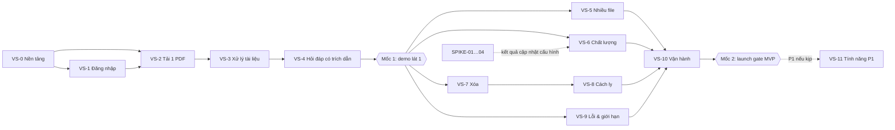
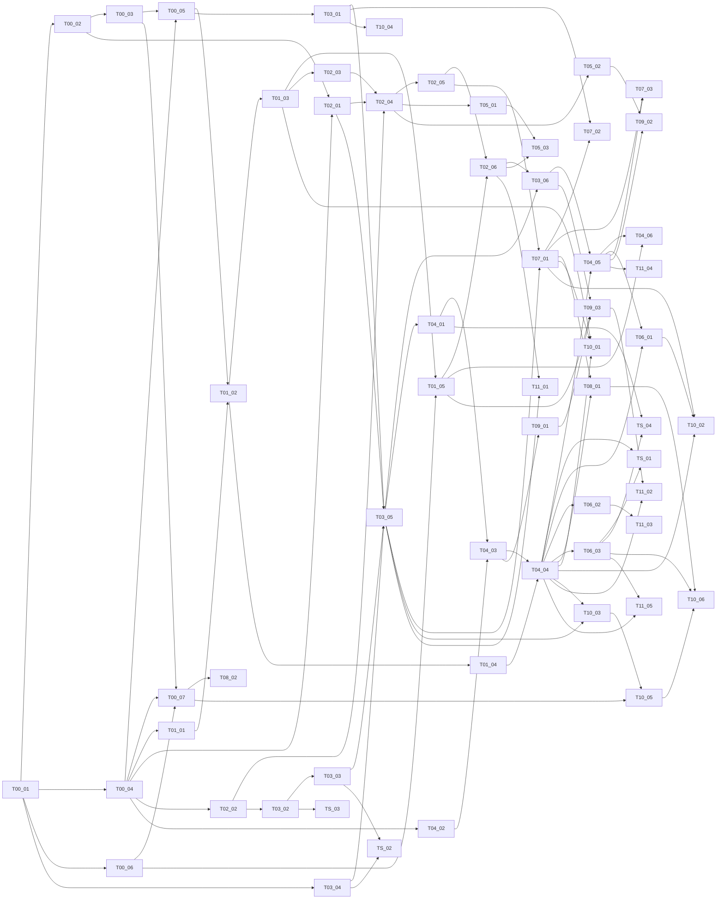

# Kế hoạch triển khai – MVP AI Chat với tài liệu PDF

| Trường | Giá trị |
|---|---|
| Mã tài liệu | PLAN-AICHAT-001 · v0.1 |
| Ngày | 2026-10-24 |
| Đầu vào | [SAD](../04-design/SAD.md) v0.4 · [USER_STORIES](../03-analysis/USER_STORIES.md) v0.1 · [BLUEPRINT](../04-design/BLUEPRINT.md) v0.3 · [API_DESIGN](../04-design/API_DESIGN.md) + [openapi.yaml](../04-design/openapi.yaml) · [DATABASE_DESIGN](../04-design/DATABASE_DESIGN.md) + [schema.sql](../04-design/schema.sql) · [html_design](../04-design/html_design/index.html) |
| Số task | 59 (54 sẵn sàng, 5 bị chặn) trong 13 nhóm |

## 1. Cách chia

- **Lát dọc (vertical slice):** mỗi lát đi xuyên giao diện → API → CSDL/worker và kết thúc bằng một thứ **demo được** (cột "Demo" ở mục 3). Riêng VS-0 là nền tảng bắt buộc, nhưng cũng kết thúc bằng một ứng dụng chạy được.
- **Thứ tự theo USER_STORIES mục 3:** lát 1 (VS-0…VS-4) dựng luồng xuyên suốt *Tải PDF → Xử lý → Hỏi → Trả lời có nguồn* sớm nhất để đo chất lượng AI thật (rủi ro RSK-001); lát 2 (VS-5…VS-10) hoàn thiện mọi story P0 và điều kiện ra mắt; lát 3 (VS-11) là P1.
- **Task cho agent:** mỗi task là một pull request, kích thước S (≤ ~200 dòng, 1–2 vòng lặp) hoặc M (~200–400 dòng, 2–4 vòng lặp), có danh sách file, các bước, tiêu chí hoàn thành kiểm tra được và lệnh kiểm chứng. Không có task L – task nào lớn hơn phải tách trước khi làm.
- **Không chờ quyết định bên ngoài:** phần phụ thuộc câu hỏi mở được làm sau *port/adapter* với bản giả (IdP giả lập, LLM giả, embedding giả). Đổi sang nhà cung cấp thật chỉ là cấu hình hoặc thêm adapter.

## 2. Bản đồ lát

**Mốc 1 – demo lát 1** (sau T04-06): PO xem luồng xuyên suốt; chạy SPIKE-01 sớm nhất có thể.
**Mốc 2 – launch gate** (sau T10-06): PRD 5.1 G-01…G-09.

## 3. Các lát

| Lát | Giai đoạn | Nội dung | Story | Demo / tiêu chí lát | Task |
|---|---|---|---|---|---|
| **VS-0** Nền tảng chạy được | Lát 1 | Repo, CI, docker-compose, schema CSDL, API khung, SPA khung | – | `make up` → mở http://localhost:8080 thấy khung giao diện S01; `GET /api/v1/readyz` = ready; CI xanh | [T00-01](tasks/T00-01_khoi-tao-monorepo-va-cong-cu.md), [T00-02](tasks/T00-02_docker-compose-moi-truong-dev.md), [T00-03](tasks/T00-03_migration-0001-tu-schema-sql-va-fixture-csdl-cho.md), [T00-04](tasks/T00-04_khung-api-settings-loi-rfc-9457-request-id-healt.md), [T00-05](tasks/T00-05_ha-tang-csdl-engine-theo-vai-tro-va-pham-vi-work.md), [T00-06](tasks/T00-06_khung-spa-theo-thiet-ke-s01-va-client-api-sinh-t.md), [T00-07](tasks/T00-07_pipeline-ci.md) |
| **VS-1** Đăng nhập và phiên | Lát 1 | OIDC với IdP giả lập, phiên, CSRF, workspace cá nhân, /me | US-023, US-C03 | Đăng nhập bằng mock IdP → thấy email ở header; người ngoài nhóm → S09; đăng xuất | [T01-01](tasks/T01-01_identityport-va-adapter-oidc-authorization-code.md), [T01-02](tasks/T01-02_phien-dang-nhap-va-cookie.md), [T01-03](tasks/T01-03_endpoint-auth-va-me.md), [T01-04](tasks/T01-04_middleware-csrf-va-thu-tu-middleware.md), [T01-05](tasks/T01-05_spa-phien-header-nguoi-dung-trang-loi-dang-nhap.md) |
| **VS-2** Tải lên một PDF | Lát 1 | Lô tải lên, kiểm tra file trong sandbox, lưu object storage, danh sách tài liệu | US-001, US-006 | Kéo thả 1 PDF → thấy tiến độ → dòng 'Đang xử lý' trong danh sách | [T02-01](tasks/T02-01_blobport-va-adapter-s3-minio.md), [T02-02](tasks/T02-02_sandbox-va-kiem-tra-pdf-khi-nhan-alg-02.md), [T02-03](tasks/T02-03_api-tao-lo-tai-len-va-han-muc-alg-01-create-batc.md), [T02-04](tasks/T02-04_api-nhan-file-vao-lo-alg-01-accept-file-idempote.md), [T02-05](tasks/T02-05_api-danh-sach-tai-lieu.md), [T02-06](tasks/T02-06_spa-vung-tai-len-mot-file-va-danh-sach-tai-lieu.md) |
| **VS-3** Xử lý tài liệu | Lát 1 | Hàng đợi job, trích văn bản, chia đoạn theo trang, embedding, ghi chỉ mục, SSE | US-005, US-007, US-008, US-025 | Tài liệu tự chuyển 'Sẵn sàng' không cần tải lại trang; PDF scan → 'Thất bại' + lý do | [T03-01](tasks/T03-01_hang-doi-job-va-vong-lap-worker-alg-11.md), [T03-02](tasks/T03-02_trich-van-ban-va-phan-loai-loi-alg-03-extract.md), [T03-03](tasks/T03-03_chia-doan-trong-trang-alg-03-chunk.md), [T03-04](tasks/T03-04_embedding-service-va-embeddingport.md), [T03-05](tasks/T03-05_pipeline-ingest-va-ghi-chi-muc-alg-04.md), [T03-06](tasks/T03-06_sse-phat-trang-thai-tai-lieu-toi-giao-dien.md) |
| **VS-4** Hỏi đáp có trích dẫn | Lát 1 | Truy xuất kết hợp, LLM qua adapter, kiểm tra trích dẫn, hội thoại, giao diện chat | US-012, US-013, US-014, US-020 | Hỏi một câu → câu trả lời có [1] và nhãn 'tên file · tr.X'; hỏi tiếp trong cùng phiên. **Hết lát 1 (walking skeleton)** | [T04-01](tasks/T04-01_truy-xuat-ket-hop-va-cong-nguong-alg-05.md), [T04-02](tasks/T04-02_llmport-adapter-gia-va-adapter-nha-cung-cap.md), [T04-03](tasks/T04-03_sinh-cau-tra-loi-va-kiem-tra-trich-dan-alg-06.md), [T04-04](tasks/T04-04_hoi-thoai-va-api-dat-cau-hoi-alg-08-co-ban.md), [T04-05](tasks/T04-05_spa-khung-chat-cau-tra-loi-va-nhan-nguon.md), [T04-06](tasks/T04-06_demo-lat-1-e2e-luong-xuyen-suot.md) |
| **VS-5** Nhiều file và giới hạn | Lát 2 | Tải nhiều file, mọi đường từ chối, hạn mức, idempotency, giới hạn tần suất tải lên | US-002, US-003, US-004 | Chọn 12 file → không tải file nào; 10 file → tải song song 3; mất mạng → 'Tải lại' không tạo trùng | [T05-01](tasks/T05-01_hoan-thien-cac-duong-tu-choi-file-va-lo.md), [T05-02](tasks/T05-02_gioi-han-tan-suat-alg-09-cho-tai-file.md), [T05-03](tasks/T05-03_spa-tai-nhieu-file-day-du-ca-01-va-thong-bao-gio.md) |
| **VS-6** Chất lượng câu trả lời | Lát 2 | Chưa đủ thông tin, tổng hợp nhiều tài liệu, số trang, bộ đánh giá RAG | US-016, US-017, US-021 | Câu hỏi ngoài tài liệu → 'Chưa đủ thông tin'; báo cáo MET-002…005 từ bộ đánh giá | [T06-01](tasks/T06-01_duong-chua-du-thong-tin-day-du.md), [T06-02](tasks/T06-02_tong-hop-nhieu-tai-lieu-va-so-trang.md), [T06-03](tasks/T06-03_bo-danh-gia-rag-de-22-va-dinh-dang-bo-cau-hoi.md) |
| **VS-7** Xóa tài liệu | Lát 2 | Xóa mềm + xóa đoạn trong một transaction, dọn file gốc ≤ 24 h | US-010, US-011 | Xóa tài liệu → không còn được trích dẫn ngay; file gốc biến mất khỏi MinIO sau job purge | [T07-01](tasks/T07-01_api-xoa-tai-lieu-alg-12.md), [T07-02](tasks/T07-02_worker-purge-va-luot-quet-alg-10.md), [T07-03](tasks/T07-03_spa-hop-xac-nhan-xoa-va-nguon-da-xoa.md) |
| **VS-8** Cách ly và bảo mật | Lát 2 | Bộ test phân quyền mọi endpoint, RLS, header bảo mật, quét bí mật/phụ thuộc | US-024 | Bộ test 2 workspace xanh 100%; báo cáo quét bảo mật không còn High/Critical | [T08-01](tasks/T08-01_bo-test-phan-quyen-va-cach-ly-toan-he-thong.md), [T08-02](tasks/T08-02_cung-hoa-bao-mat-http-va-chuoi-cung-ung.md) |
| **VS-9** Lỗi, giới hạn và phiên | Lát 2 | Circuit breaker, 503/504, giới hạn câu hỏi, xử lý lỗi phía giao diện, hết phiên | US-025, US-026 | Tắt LLM giả → thẻ lỗi + 'Gửi lại'; hỏi 11 câu/phút → đếm ngược; hết phiên → S11, giữ nháp | [T09-01](tasks/T09-01_circuit-breaker-llm-va-anh-xa-503-504-alg-07.md), [T09-02](tasks/T09-02_gioi-han-cau-hoi-va-dem-nguoc-tren-giao-dien.md), [T09-03](tasks/T09-03_spa-the-loi-cau-tra-loi-canh-bao-het-phien.md) |
| **VS-10** Vận hành và đo lường | Lát 2 | Nhật ký kiểm toán, analytics, giám sát, tác vụ bảo trì, đóng gói triển khai, load test | NFR-012, PRD 5.2 | Dashboard Grafana có số liệu; k6 20 người dùng đạt p90 ≤ 15 s; báo cáo launch gate G-01…G-09 | [T10-01](tasks/T10-01_nhat-ky-kiem-toan-day-du.md), [T10-02](tasks/T10-02_su-kien-analytics-evt-01-evt-11.md), [T10-03](tasks/T10-03_giam-sat-trace-metric-dashboard-canh-bao.md), [T10-04](tasks/T10-04_tac-vu-bao-tri-dinh-ky.md), [T10-05](tasks/T10-05_dong-goi-va-cau-hinh-trien-khai-staging.md), [T10-06](tasks/T10-06_load-test-va-bao-cao-launch-gate.md) |
| **VS-11** Tính năng P1 | Lát 3 | Xử lý lại, gửi lại câu hỏi, mâu thuẫn, trình xem PDF, câu hỏi tiếp nối | US-009, US-015, US-018, US-022, US-027 | Từng tính năng P1 theo AC của story | [T11-01](tasks/T11-01_xu-ly-lai-tai-lieu-loi-tam-thoi-us-009.md), [T11-02](tasks/T11-02_gui-lai-cau-hoi-bi-loi-us-027.md), [T11-03](tasks/T11-03_neu-mau-thuan-giua-tai-lieu-us-018.md), [T11-04](tasks/T11-04_trinh-xem-pdf-tai-trang-us-022.md), [T11-05](tasks/T11-05_cau-hoi-tiep-noi-hieu-ngu-canh-us-015.md) |
| **SPIKE** Thử nghiệm kỹ thuật | Song song | SPIKE-01…04 (SAD 12) – chạy song song, kết quả cập nhật cấu hình/ADR | – | Báo cáo spike có số liệu và đề xuất | [TS-01](tasks/TS-01_spike-01-chat-luong-va-do-tre-rag-voi-llm-ung-vi.md), [TS-02](tasks/TS-02_spike-02-thong-luong-embedding.md), [TS-03](tasks/TS-03_spike-03-chat-luong-trich-van-ban-va-so-trang.md), [TS-04](tasks/TS-04_spike-04-hieu-chinh-nguong-va-top-k.md) |

## 4. Danh sách task

| Task | Tiêu đề | Lát | Cỡ | Trạng thái | Phụ thuộc |
|---|---|---|---|---|---|
| [T00-01](tasks/T00-01_khoi-tao-monorepo-va-cong-cu.md) | Khởi tạo monorepo và công cụ | VS-0 | S | Done | – |
| [T00-02](tasks/T00-02_docker-compose-moi-truong-dev.md) | docker-compose môi trường dev | VS-0 | S | Done | T00-01 |
| [T00-03](tasks/T00-03_migration-0001-tu-schema-sql-va-fixture-csdl-cho.md) | Migration 0001 từ schema.sql và fixture CSDL cho test | VS-0 | M | Done | T00-02 |
| [T00-04](tasks/T00-04_khung-api-settings-loi-rfc-9457-request-id-healt.md) | Khung API: settings, lỗi RFC 9457, request id, health | VS-0 | M | Done | T00-01 |
| [T00-05](tasks/T00-05_ha-tang-csdl-engine-theo-vai-tro-va-pham-vi-work.md) | Hạ tầng CSDL: engine theo vai trò và phạm vi workspace | VS-0 | M | Done | T00-03, T00-04 |
| [T00-06](tasks/T00-06_khung-spa-theo-thiet-ke-s01-va-client-api-sinh-t.md) | Khung SPA theo thiết kế S01 và client API sinh từ OpenAPI | VS-0 | M | Done | T00-01 |
| [T00-07](tasks/T00-07_pipeline-ci.md) | Pipeline CI | VS-0 | S | Partial | T00-03, T00-04, T00-06 |
| [T01-01](tasks/T01-01_identityport-va-adapter-oidc-authorization-code.md) | IdentityPort và adapter OIDC (Authorization Code + PKCE) | VS-1 | M | Done | T00-04 |
| [T01-02](tasks/T01-02_phien-dang-nhap-va-cookie.md) | Phiên đăng nhập và cookie | VS-1 | M | Done | T00-05, T01-01 |
| [T01-03](tasks/T01-03_endpoint-auth-va-me.md) | Endpoint /auth/* và /me | VS-1 | M | Done | T01-02 |
| [T01-04](tasks/T01-04_middleware-csrf-va-thu-tu-middleware.md) | Middleware CSRF và thứ tự middleware | VS-1 | S | Done | T01-02 |
| [T01-05](tasks/T01-05_spa-phien-header-nguoi-dung-trang-loi-dang-nhap.md) | SPA: phiên, header người dùng, trang lỗi đăng nhập | VS-1 | M | Done | T00-06, T01-03 |
| [T02-01](tasks/T02-01_blobport-va-adapter-s3-minio.md) | BlobPort và adapter S3/MinIO | VS-2 | S | Partial | T00-02, T00-04 |
| [T02-02](tasks/T02-02_sandbox-va-kiem-tra-pdf-khi-nhan-alg-02.md) | Sandbox và kiểm tra PDF khi nhận (ALG-02) | VS-2 | M | Done | T00-04 |
| [T02-03](tasks/T02-03_api-tao-lo-tai-len-va-han-muc-alg-01-create-batc.md) | API tạo lô tải lên và hạn mức (ALG-01 create_batch) | VS-2 | S | Done | T01-03 |
| [T02-04](tasks/T02-04_api-nhan-file-vao-lo-alg-01-accept-file-idempote.md) | API nhận file vào lô (ALG-01 accept_file, idempotent) | VS-2 | M | Done | T02-01, T02-02, T02-03 |
| [T02-05](tasks/T02-05_api-danh-sach-tai-lieu.md) | API danh sách tài liệu | VS-2 | S | Done | T02-04 |
| [T02-06](tasks/T02-06_spa-vung-tai-len-mot-file-va-danh-sach-tai-lieu.md) | SPA: vùng tải lên một file và danh sách tài liệu | VS-2 | M | Done | T01-05, T02-05 |
| [T03-01](tasks/T03-01_hang-doi-job-va-vong-lap-worker-alg-11.md) | Hàng đợi job và vòng lặp worker (ALG-11) | VS-3 | M | Done | T00-05 |
| [T03-02](tasks/T03-02_trich-van-ban-va-phan-loai-loi-alg-03-extract.md) | Trích văn bản và phân loại lỗi (ALG-03 extract) | VS-3 | M | Done | T02-02 |
| [T03-03](tasks/T03-03_chia-doan-trong-trang-alg-03-chunk.md) | Chia đoạn trong trang (ALG-03 chunk) | VS-3 | M | Done | T03-02 |
| [T03-04](tasks/T03-04_embedding-service-va-embeddingport.md) | Embedding service và EmbeddingPort | VS-3 | M | Done | T00-01 |
| [T03-05](tasks/T03-05_pipeline-ingest-va-ghi-chi-muc-alg-04.md) | Pipeline ingest và ghi chỉ mục (ALG-04) | VS-3 | M | Done | T03-01, T03-03, T03-04, T02-01 |
| [T03-06](tasks/T03-06_sse-phat-trang-thai-tai-lieu-toi-giao-dien.md) | SSE: phát trạng thái tài liệu tới giao diện | VS-3 | M | Done | T03-05, T02-06 |
| [T04-01](tasks/T04-01_truy-xuat-ket-hop-va-cong-nguong-alg-05.md) | Truy xuất kết hợp và cổng ngưỡng (ALG-05) | VS-4 | M | Done | T03-05 |
| [T04-02](tasks/T04-02_llmport-adapter-gia-va-adapter-nha-cung-cap.md) | LlmPort, adapter giả và adapter nhà cung cấp | VS-4 | M | Done | T00-04 |
| [T04-03](tasks/T04-03_sinh-cau-tra-loi-va-kiem-tra-trich-dan-alg-06.md) | Sinh câu trả lời và kiểm tra trích dẫn (ALG-06) | VS-4 | M | Done | T04-01, T04-02 |
| [T04-04](tasks/T04-04_hoi-thoai-va-api-dat-cau-hoi-alg-08-co-ban.md) | Hội thoại và API đặt câu hỏi (ALG-08 cơ bản) | VS-4 | M | Done | T04-03, T01-04 |
| [T04-05](tasks/T04-05_spa-khung-chat-cau-tra-loi-va-nhan-nguon.md) | SPA: khung chat, câu trả lời và nhãn nguồn | VS-4 | M | Done | T04-04, T03-06 |
| [T04-06](tasks/T04-06_demo-lat-1-e2e-luong-xuyen-suot.md) | Demo lát 1: E2E luồng xuyên suốt | VS-4 | S | Done | T04-05, T01-05 |
| [TS-01](tasks/TS-01_spike-01-chat-luong-va-do-tre-rag-voi-llm-ung-vi.md) | SPIKE-01: chất lượng và độ trễ RAG với LLM ứng viên | SPIKE | M | Deferred | T04-04, T06-03 |
| [TS-02](tasks/TS-02_spike-02-thong-luong-embedding.md) | SPIKE-02: thông lượng embedding | SPIKE | S | Deferred | T03-04, T03-03 |
| [TS-03](tasks/TS-03_spike-03-chat-luong-trich-van-ban-va-so-trang.md) | SPIKE-03: chất lượng trích văn bản và số trang | SPIKE | S | Partial | T03-02 |
| [TS-04](tasks/TS-04_spike-04-hieu-chinh-nguong-va-top-k.md) | SPIKE-04: hiệu chỉnh ngưỡng τ và top-k | SPIKE | S | Deferred | T04-01, T06-03 |
| [T05-01](tasks/T05-01_hoan-thien-cac-duong-tu-choi-file-va-lo.md) | Hoàn thiện các đường từ chối file và lô | VS-5 | S | Done | T02-04 |
| [T05-02](tasks/T05-02_gioi-han-tan-suat-alg-09-cho-tai-file.md) | Giới hạn tần suất (ALG-09) cho tải file | VS-5 | S | Done | T02-04 |
| [T05-03](tasks/T05-03_spa-tai-nhieu-file-day-du-ca-01-va-thong-bao-gio.md) | SPA: tải nhiều file đầy đủ (CA-01) và thông báo giới hạn | VS-5 | M | Done | T02-06, T05-01 |
| [T06-01](tasks/T06-01_duong-chua-du-thong-tin-day-du.md) | Đường 'Chưa đủ thông tin' đầy đủ | VS-6 | S | Done | T04-04, T04-05 |
| [T06-02](tasks/T06-02_tong-hop-nhieu-tai-lieu-va-so-trang.md) | Tổng hợp nhiều tài liệu và số trang | VS-6 | S | Done | T04-04 |
| [T06-03](tasks/T06-03_bo-danh-gia-rag-de-22-va-dinh-dang-bo-cau-hoi.md) | Bộ đánh giá RAG (DE-22) và định dạng bộ câu hỏi | VS-6 | M | Deferred | T04-04 |
| [T07-01](tasks/T07-01_api-xoa-tai-lieu-alg-12.md) | API xóa tài liệu (ALG-12) | VS-7 | S | Done | T03-05, T02-05 |
| [T07-02](tasks/T07-02_worker-purge-va-luot-quet-alg-10.md) | Worker purge và lượt quét (ALG-10) | VS-7 | S | Done | T07-01, T03-01 |
| [T07-03](tasks/T07-03_spa-hop-xac-nhan-xoa-va-nguon-da-xoa.md) | SPA: hộp xác nhận xóa và nguồn đã xóa | VS-7 | S | Done | T07-01, T04-05 |
| [T08-01](tasks/T08-01_bo-test-phan-quyen-va-cach-ly-toan-he-thong.md) | Bộ test phân quyền và cách ly toàn hệ thống | VS-8 | M | Done | T07-01, T04-04 |
| [T08-02](tasks/T08-02_cung-hoa-bao-mat-http-va-chuoi-cung-ung.md) | Cứng hóa bảo mật HTTP và chuỗi cung ứng | VS-8 | S | Partial | T00-07 |
| [T09-01](tasks/T09-01_circuit-breaker-llm-va-anh-xa-503-504-alg-07.md) | Circuit breaker LLM và ánh xạ 503/504 (ALG-07) | VS-9 | S | Done | T04-03 |
| [T09-02](tasks/T09-02_gioi-han-cau-hoi-va-dem-nguoc-tren-giao-dien.md) | Giới hạn câu hỏi và đếm ngược trên giao diện | VS-9 | S | Done | T05-02, T04-05 |
| [T09-03](tasks/T09-03_spa-the-loi-cau-tra-loi-canh-bao-het-phien.md) | SPA: thẻ lỗi câu trả lời, cảnh báo hết phiên | VS-9 | S | Done | T09-01, T03-06, T01-05 |
| [T10-01](tasks/T10-01_nhat-ky-kiem-toan-day-du.md) | Nhật ký kiểm toán đầy đủ | VS-10 | S | Done | T07-01, T04-04, T01-03 |
| [T10-02](tasks/T10-02_su-kien-analytics-evt-01-evt-11.md) | Sự kiện analytics EVT-01…EVT-11 | VS-10 | S | Done | T07-01, T04-04, T06-01 |
| [T10-03](tasks/T10-03_giam-sat-trace-metric-dashboard-canh-bao.md) | Giám sát: trace, metric, dashboard, cảnh báo | VS-10 | M | Partial | T04-04, T03-05 |
| [T10-04](tasks/T10-04_tac-vu-bao-tri-dinh-ky.md) | Tác vụ bảo trì định kỳ | VS-10 | S | Done | T03-01 |
| [T10-05](tasks/T10-05_dong-goi-va-cau-hinh-trien-khai-staging.md) | Đóng gói và cấu hình triển khai staging | VS-10 | M | Deferred | T00-07, T10-03 |
| [T10-06](tasks/T10-06_load-test-va-bao-cao-launch-gate.md) | Load test và báo cáo launch gate | VS-10 | M | Deferred | T10-05, T06-03, T08-01 |
| [T11-01](tasks/T11-01_xu-ly-lai-tai-lieu-loi-tam-thoi-us-009.md) | Xử lý lại tài liệu lỗi tạm thời (US-009) | VS-11 | S | Done | T03-05, T02-06 |
| [T11-02](tasks/T11-02_gui-lai-cau-hoi-bi-loi-us-027.md) | Gửi lại câu hỏi bị lỗi (US-027) | VS-11 | S | Done | T09-03, T04-04 |
| [T11-03](tasks/T11-03_neu-mau-thuan-giua-tai-lieu-us-018.md) | Nêu mâu thuẫn giữa tài liệu (US-018) | VS-11 | S | Partial | T06-02 |
| [T11-04](tasks/T11-04_trinh-xem-pdf-tai-trang-us-022.md) | Trình xem PDF tại trang (US-022) | VS-11 | M | Done | T04-05 |
| [T11-05](tasks/T11-05_cau-hoi-tiep-noi-hieu-ngu-canh-us-015.md) | Câu hỏi tiếp nối hiểu ngữ cảnh (US-015) | VS-11 | M | Deferred | T04-04, T06-03 |

**Trạng thái triển khai (26/10/2026, bản demo trong `app/`):** *Done* = đã làm và có test; *Partial* = làm một phần, xem ghi chú trong task; *Deferred* = chưa làm (bị chặn hoặc cần hạ tầng/dữ liệu chưa có). Khác biệt so với kế hoạch: [app/README.md](../../app/README.md#khác-biệt-so-với-kế-hoạch).

**Trạng thái:** *Ready* = làm được ngay; *Ready (giả định)* = làm được với giá trị đề xuất/bản giả, cần PO/IT-Security xác nhận trước production; *Blocked* = chờ câu hỏi mở hoặc dữ liệu (ghi trong task).

## 5. Đồ thị phụ thuộc task

**Thứ tự gợi ý khi chỉ có một agent:** T00-01 → T00-02 → T00-03 → T00-04 → T00-05 → T00-06 → T00-07 → T01-01 → T01-02 → T01-04 → T01-03 → T01-05 → T02-01 → T02-02 → T02-03 → T02-04 → T02-05 → T02-06 → T03-01 → T03-02 → T03-03 → T03-04 → TS-02 → T03-05 → T03-06 → T04-01 → T04-02 → T04-03 → T04-04 → T04-05 → T04-06 (**Mốc 1**) → T06-03 → T06-01 → T06-02 → T07-01 → T07-02 → T07-03 → T05-01 → T05-02 → T05-03 → T09-01 → T09-02 → T09-03 → T08-01 → T08-02 → T10-01 → T10-02 → T10-03 → T10-04 → T10-05 → T10-06 (**Mốc 2**) → T11-01 → T11-02 → T11-03.

**Song song khi có nhiều agent:** sau T00-01, nhánh frontend (T00-06) và backend (T00-02…T00-05) chạy song song; T02-01, T02-02, T03-04, T04-02 không phụ thuộc nhau và có thể làm cùng lúc; TS-02 chạy ngay khi có T03-03, T03-04.

## 6. Quy trình làm một task (cho agent)

1. **Đọc** file task và các mục "Tài liệu tham chiếu". Thiết kế là nguồn chuẩn: tên bảng/cột theo `schema.sql`, endpoint và schema theo `openapi.yaml`, thuật toán theo `BLUEPRINT` ALG-xx, giao diện theo `html_design`.
2. **Kiểm tra phụ thuộc** đã xong (tiêu chí hoàn thành của task trước đã tick).
3. **Viết test trước** từ "Tiêu chí hoàn thành", rồi hiện thực tới khi xanh.
4. **Chạy lệnh "Kiểm chứng"** và `make lint typecheck`.
5. **Tick** các ô trong file task, ghi ngắn vào cuối file: ngày, PR, quyết định nhỏ đã đưa ra.
6. **Nếu thiết kế sai hoặc thiếu:** không tự đổi hành vi đã đặc tả. Sửa ở mức tối thiểu để task chạy, ghi rõ trong PR và mở mục "Đề xuất sửa tài liệu" (tài liệu + mục + đề xuất). Lỗi rõ ràng trong `schema.sql`/`openapi.yaml` phát hiện khi chạy thật thì sửa cả tài liệu trong cùng PR.
7. **Dừng và hỏi** khi: task cần quyết định nằm trong danh sách câu hỏi mở; thay đổi vượt phạm vi file đã liệt kê nhiều hơn 3 file; hoặc sau 3 vòng lặp vẫn không xanh.

### Quy ước chung

| Hạng mục | Quy ước |
|---|---|
| Backend | Python 3.12, uv, FastAPI, SQLAlchemy 2 Core (async, psycopg 3), Pydantic v2, ruff, mypy strict, pytest (+ Testcontainers, hypothesis) |
| Frontend | React 18 + TypeScript strict, Vite, TanStack Query, vitest, Playwright + axe-core, pnpm |
| Lệnh | `make up` · `make lint` · `make typecheck` · `make test-unit` · `make test-int` · `make e2e` (định nghĩa ở T00-01) |
| Nhánh / PR | `task/<ID>-<slug>`; tiêu đề PR bắt đầu bằng ID task; một task một PR |
| Bản giả | `llm_fake`, `embedding_fake`, `blob_memory`, mock-oauth2-server – mặc định trong test và dev |
| Dữ liệu thật | Không commit PDF thật của doanh nghiệp; fixture sinh bằng script |
| Definition of Done | USER_STORIES mục 8.2 + tiêu chí trong từng task |

## 7. Những gì đang bị chặn và cách xử lý

| Phụ thuộc | Task bị ảnh hưởng | Trong lúc chờ |
|---|---|---|
| OQ-005 nhà cung cấp LLM | T04-02 (adapter thật), TS-01 | Dùng `llm_fake`; adapter Anthropic chỉ bật khi có khóa |
| OQ-001, OQ-102 IdP và cách cấp quyền | T01-01…T01-03 (chỉ phần cấu hình) | Phát triển với mock-oauth2-server; đổi IdP = đổi cấu hình |
| OQ-003, OQ-006, OQ-009 ngưỡng | Mọi task dùng giới hạn | Dùng giá trị D-01…D-13 trong `.env.example` |
| DEP-003, DEP-005 PDF mẫu, bộ câu hỏi | TS-01, TS-03, TS-04, chỉ số chất lượng ở G-02 | Fixture tự tạo + `eval/datasets/sample.jsonl` |
| OQ-012 | T11-05 | Không làm |
| OQ-014 | T11-04 | Không làm. Endpoint `GET /documents/<built-in function id>/file` và sự kiện EVT-09 nằm trong T11-04; nếu PO chốt "không mở trong ứng dụng" thì vẫn tách phần endpoint ra làm (người dùng cần tải file gốc để kiểm chứng) |
| OQ-202, OQ-203 | T10-05 (production) | Chỉ dựng staging |
| US-019 (P2, OQ-018) | Không có task | Ngoài MVP |

## 8. Truy vết story → task

| Story | Task |
|---|---|
| US-001 | T02-01, T02-04, T02-06, T04-06 |
| US-002 | T02-03, T05-01, T05-02, T05-03 |
| US-003 | T02-02, T05-01, T05-03 |
| US-004 | T02-02, T05-01, T05-03 |
| US-005 | T03-01, T03-03, T03-04, T03-05, T04-06, TS-02 |
| US-006 | T02-05, T02-06, T04-06 |
| US-007 | T03-06 |
| US-008 | T03-02, T03-05 |
| US-009 | T11-01 |
| US-010 | T07-01, T07-03 |
| US-011 | T07-01, T07-02, T07-03 |
| US-012 | T04-02, T04-04, T04-05, T04-06 |
| US-013 | T04-01, T04-03, T04-06, T06-03, TS-01 |
| US-014 | T04-04, T04-05 |
| US-015 | T11-05 |
| US-016 | T04-03, T06-01, T06-03, TS-01, TS-04 |
| US-017 | T04-01, T06-02, T06-03 |
| US-018 | T11-03 |
| US-019 | **chưa có** – xem ghi chú |
| US-020 | T04-03, T04-05, T04-06 |
| US-021 | T03-03, T06-02, T06-03, TS-03 |
| US-022 | T11-04 |
| US-023 | T01-01, T01-02, T01-03, T01-04, T01-05, T04-06 |
| US-024 | T08-01, T08-02 |
| US-025 | T03-06, T04-05, T09-03 |
| US-026 | T05-03, T09-01, T09-02, T09-03 |
| US-027 | T11-02 |

**Ghi chú:** US-019 (P2) không có task theo USER_STORIES mục 3 ("Sau MVP"). Story đề xuất: US-C01 (cấp quyền qua nhóm IdP) nằm trong T01-03; US-C02 (tra cứu nhật ký) qua vai trò `app_readonly_audit` trong T10-01; US-C03 (đăng xuất) trong T01-03, T01-05; US-C04, US-C05 chưa có task.

## 9. Rủi ro của kế hoạch

| Rủi ro | Ảnh hưởng | Giảm thiểu |
|---|---|---|
| Chất lượng RAG tiếng Việt không đạt (TR-01) | Phải đổi mô hình/chiến lược sau khi đã xây xong | Lát 1 kết thúc sớm; TS-01 ngay sau Mốc 1; tham số RAG là cấu hình |
| Embedding CPU chậm (TR-02) | NFR-002 không đạt | TS-02 chạy sớm (chỉ cần T03-03, T03-04) |
| Agent hiểu sai thiết kế | Làm lại | Mỗi task trỏ tới mục tài liệu cụ thể; test viết từ tiêu chí trước khi code |
| Schema chưa chạy trên PostgreSQL thật | Lỗi ở T00-03 | T00-03 là task thứ 3; sửa cả tài liệu |
| Sandbox chỉ chạy trên Linux | Dev trên Windows không chạy được test sandbox | Chạy trong container/CI; test đánh dấu skip có lý do |
