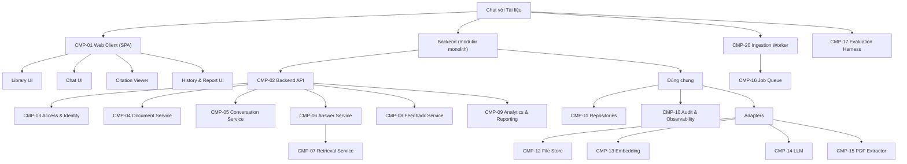
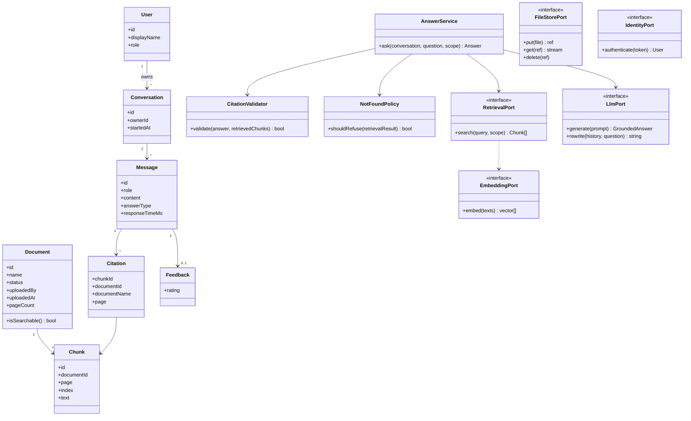
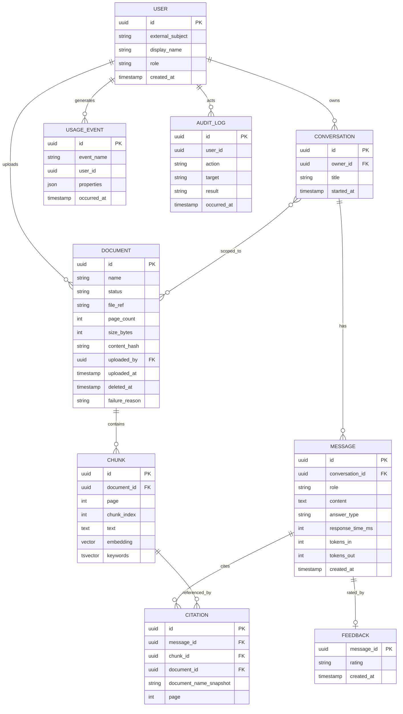
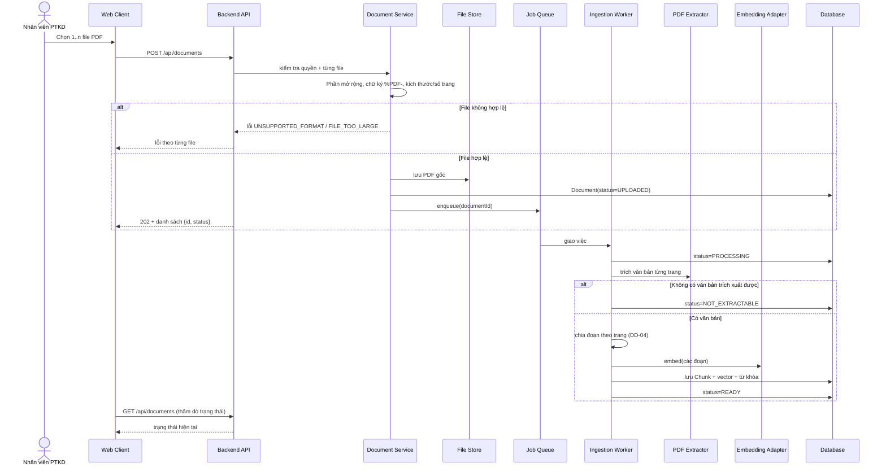
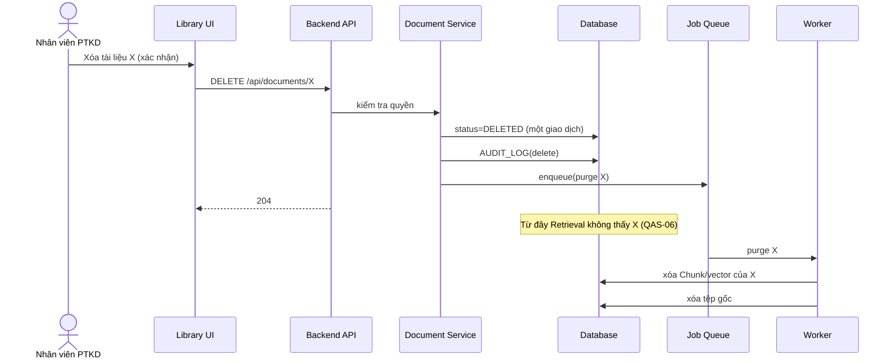
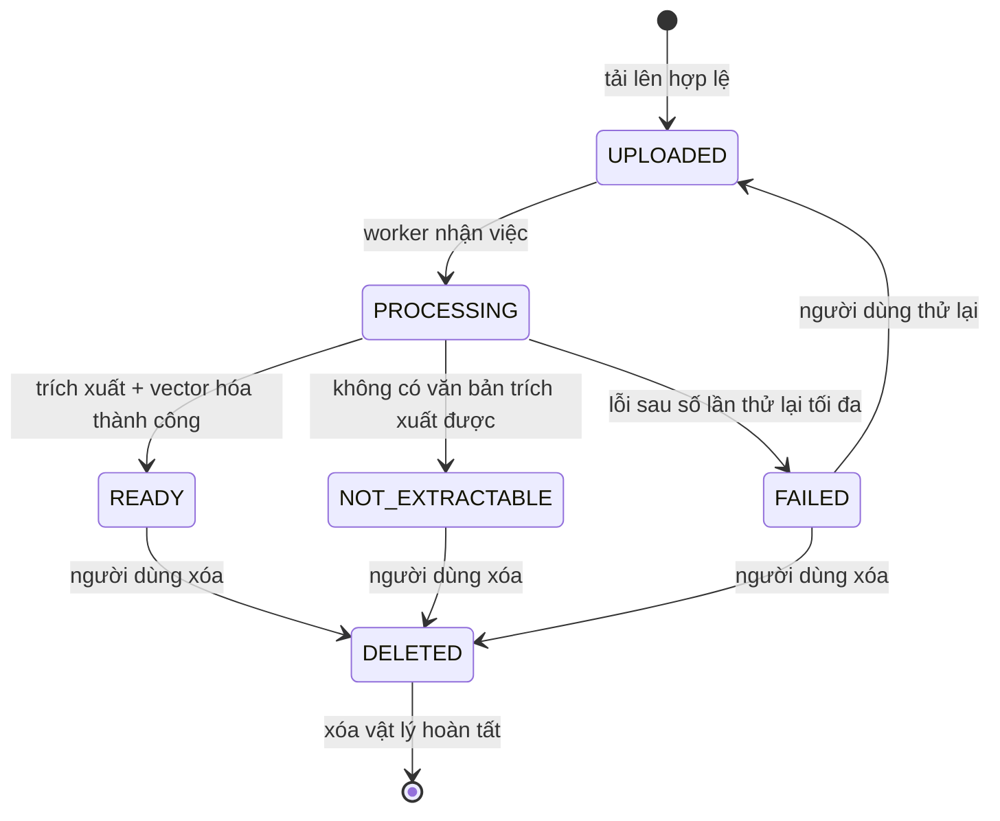
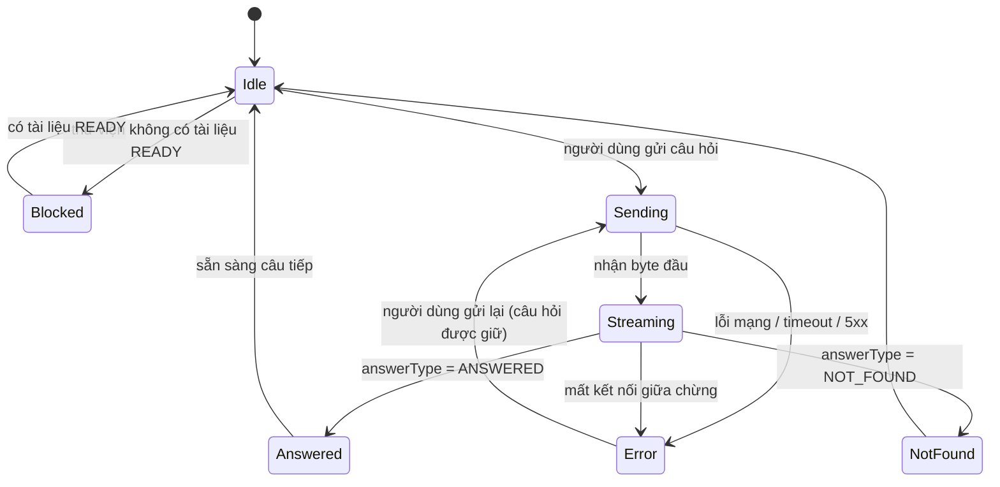
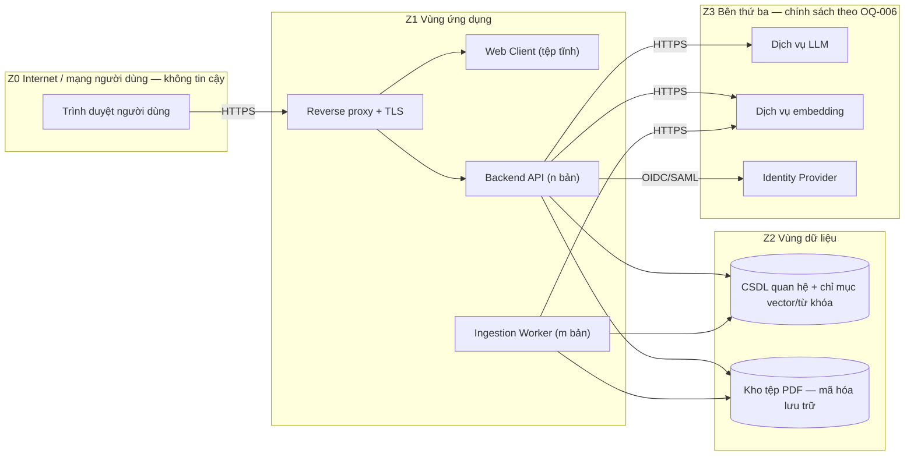

# Software Blueprint Design (SDD) — Chat với Tài liệu (MVP)

> **Chuẩn áp dụng:** IEEE 1016-2009 (Software Design Descriptions)
> **Prompt nguồn:** [docs/bluePrint_design_prompt.md](../bluePrint_design_prompt.md)
> **Tài liệu đầu vào:** [BRD](../requirements/BRD.md) · [PRD](../requirements/PRD.md) · [Use Case Diagram](../UseCase_Diagram.drawio)
> **Quy ước truy vết:** `BR-xxx`, `BRU-xxx`, `CON-xxx`, `OQ-xxx`, `AC-xxx` lấy từ BRD; `US-xxx` lấy từ PRD; các ID mới của tài liệu này: `CN-xx` (concern), `QAS-xx` (quality scenario), `CMP-xx` (thành phần), `DD-xx` (quyết định thiết kế), `API-xx` (giao diện).
> **Nhãn giá trị:** `[Proposed]` = đề xuất thiết kế, **chưa** được Sponsor/IT-Bảo mật xác nhận · `[TBD: OQ-xxx]` = chờ quyết định kinh doanh · `[Unverified]` = suy luận, chưa có nguồn.

---

## 0. Cách đọc tài liệu và trạng thái quyết định

SDD này chuyển các yêu cầu trong BRD/PRD thành thiết kế. Có hai loại nội dung cần phân biệt:

1. **Ràng buộc từ yêu cầu** — lấy nguyên từ BRD/PRD (ví dụ: ứng dụng web, chỉ PDF, bắt buộc trích dẫn, trả lời "không tìm thấy").
2. **Quyết định thiết kế** (`DD-xx`) — do đội phát triển đề xuất để đáp ứng ràng buộc (ví dụ: kiến trúc, công nghệ). Chúng là `[Proposed]` và có thể đổi mà không cần sửa BRD.

**Quyết định kinh doanh còn mở nhưng ảnh hưởng thiết kế** (kế thừa từ BRD): OQ-006 (chính sách dữ liệu AI — **chặn thiết kế triển khai AI**), OQ-009 (ngôn ngữ), OQ-011 (phân quyền), OQ-013 (giới hạn file), OQ-014 (thời gian phản hồi), OQ-015 (số người dùng). Thiết kế vì vậy giữ các điểm này **có thể cấu hình/thay thế** thay vì khóa cứng (xem DD-03, DD-07).

---

## 1. Bối cảnh & Đối tượng thiết kế (Context & Subject)

### 1.1 Nhận diện hệ thống

| Thuộc tính | Giá trị |
|---|---|
| **Tên hệ thống** | Chat với Tài liệu (tên làm việc; tên chính thức `[TBD: OQ-016]`) |
| **Phiên bản SDD** | v0.1 (Draft) |
| **Ngày tài liệu** | 2026-10-21 |
| **Chủ sở hữu tài liệu** | Đội phát triển / Kiến trúc sư phụ trách `[TBD: OQ-001]` |
| **Trạng thái** | Draft — chờ review kỹ thuật và chốt OQ-006 |

**Lịch sử phiên bản**

| Phiên bản | Ngày | Tác giả | Thay đổi |
|---|---|---|---|
| 0.1 | 2026-10-21 | Đội phát triển | Bản nháp đầu tiên từ BRD v0.1 và PRD v0.1 |

**Mô tả hệ thống.** Ứng dụng web cho đội Phát triển kinh doanh tải tài liệu PDF vào một thư viện dùng chung và đặt câu hỏi bằng ngôn ngữ tự nhiên. AI tạo câu trả lời **chỉ dựa trên nội dung thư viện**, kèm trích dẫn tên tài liệu + số trang; khi không có thông tin thì báo "không tìm thấy". Hệ thống ghi nhận mức sử dụng và đánh giá để Sponsor ra quyết định go/no-go sau MVP (BRD §2, PRD §1).

### 1.2 Phạm vi hệ thống và ranh giới bên ngoài

| Loại ranh giới | Mô tả |
|---|---|
| **Mục đích hệ thống** | Rút ngắn thời gian tra cứu thông tin nằm rải rác trong nhiều PDF, với câu trả lời kiểm chứng được (BO-001, BO-002). |
| **Hệ thống bên ngoài** | (1) **Dịch vụ LLM** để sinh câu trả lời; (2) **Dịch vụ embedding** để vector hóa văn bản (có thể cùng nhà cung cấp với LLM); (3) **Identity Provider** để xác thực `[TBD: OQ-018]`. Nhà cung cấp cụ thể và nơi đặt dịch vụ phụ thuộc OQ-006. |
| **Loại người dùng** | Nhân viên PTKD (tải tài liệu, hỏi đáp); Sponsor/Quản lý (xem báo cáo); IT/Bảo mật (xác nhận tuân thủ, kiểm toán); người quản trị hệ thống (vận hành — `[Unverified]`, BRD chưa nêu vai trò này). |
| **Giao diện bên ngoài** | REST/JSON over HTTPS cho trình duyệt; HTTPS tới API của dịch vụ LLM/embedding; OIDC/SAML tới Identity Provider `[TBD: OQ-018]`; không có giao diện hàng đợi/webhook công khai. |
| **Ranh giới tin cậy** | Z0 Internet/trình duyệt người dùng (không tin cậy) → Z1 vùng ứng dụng (API, worker) → Z2 vùng dữ liệu (CSDL, kho tệp) → Z3 nhà cung cấp AI bên thứ ba (**ngoài** kiểm soát của tổ chức; chính sách theo OQ-006). Xem §3.8. |
| **Môi trường triển khai** | `[TBD: OQ-006]` — đám mây công cộng, đám mây riêng hay tại chỗ phụ thuộc chính sách dữ liệu. Thiết kế dùng container để chạy được ở cả ba (DD-08). |

### 1.3 Giả định và ràng buộc

| Loại | Mô tả | Nguồn |
|---|---|---|
| **Ràng buộc kỹ thuật** | Truy cập qua ứng dụng web; đầu vào chỉ PDF; câu trả lời do AI tạo ra. | CON-002, CON-003, CON-004 |
| **Ràng buộc kinh doanh** | Là MVP; ngân sách và thời hạn chưa xác định. | CON-001, CON-005 `[TBD: OQ-005]` |
| **Giả định môi trường** | Người dùng ở mạng nội bộ/Internet ổn định, dùng trình duyệt hiện đại `[TBD: OQ-020]`; nhà cung cấp AI sẵn sàng ≥ mức dịch vụ công bố của họ `[Unverified]`. | — |
| **Giả định dữ liệu** | Phần lớn PDF có văn bản trích xuất được (ASM-001); thư viện dùng chung cho cả đội (ASM-002); quy mô thư viện, kích thước file và số người dùng chưa biết `[TBD: OQ-002, OQ-013, OQ-015]`. Để định cỡ ban đầu, thiết kế **giả định** tối đa ~500 tài liệu, ~100 trang/tài liệu, ~50 người dùng `[Proposed]` và phải kiểm lại khi có số liệu thật. | ASM-001, ASM-002 |
| **Giả định chính sách** | Được phép gửi nội dung tới dịch vụ AI bên ngoài (ASM-003). **Nếu sai**, phải dùng mô hình tự lưu trữ — thiết kế tách AI sau cổng (port) để giảm chi phí thay đổi. | ASM-003, OQ-006 |

---

## 2. Các bên liên quan & Mối quan tâm (Stakeholders & Concerns)

### 2.1 Nhận diện bên liên quan

| Bên liên quan | Vai trò | Mối quan tâm chính | Nguồn |
|---|---|---|---|
| Nhân viên PTKD | Người dùng cuối | Câu trả lời đúng, có nguồn, nhanh; dễ dùng | STK-002 |
| Sponsor / Quản lý | Tài trợ, ra quyết định go/no-go | Số liệu sử dụng/hữu ích; chi phí vận hành hợp lý | STK-001 |
| IT / Bảo mật / Pháp chế | Bảo vệ dữ liệu nội bộ | Bảo mật dữ liệu, kiểm soát truy cập, tuân thủ chính sách AI, dấu vết kiểm toán | STK-005 |
| Đội BA | Phân tích yêu cầu | Truy vết yêu cầu → thiết kế → kiểm thử | STK-003 |
| Đội phát triển | Xây dựng và bảo trì | Dễ hiểu, dễ bảo trì, dễ thay đổi nhà cung cấp AI, dễ kiểm thử | STK-004 |
| Người sở hữu tài liệu | Cung cấp nội dung | Nội dung được trích dẫn đúng ngữ cảnh | STK-006 |
| QA / Kiểm thử | Xác minh chất lượng | Bộ câu hỏi kiểm thử lặp lại được; đo MET-002 tự động được | `[Unverified]` — BRD chưa liệt kê vai trò |
| Vận hành / DevOps | Triển khai, giám sát | Triển khai đơn giản, log/metric, sao lưu | `[Unverified]` — BRD chưa liệt kê vai trò |

### 2.2 Mối quan tâm của bên liên quan (IEEE 1016-2009)

| ID | Bên liên quan | Mối quan tâm | Ưu tiên | Tiêu chí chấp nhận (đo được) | Nguồn |
|---|---|---|---|---|---|
| CN-01 | Nhân viên PTKD, Sponsor | **Độ đúng và bám nguồn của câu trả lời** | High | ≥ mục tiêu MET-002 trên bộ kiểm thử; 100% câu trả lời có thông tin tài liệu đều có trích dẫn, ≥ 95% trích dẫn đúng trang (AC-008, AC-010) | BR-008, BR-010, BO-002 |
| CN-02 | Nhân viên PTKD | **Không bịa thông tin** khi tài liệu thiếu | High | ≥ 95% trên ≥ 20 câu hỏi không có đáp án trả lời "không tìm thấy" (AC-011) | BR-011, RSK-001 |
| CN-03 | Nhân viên PTKD | **Thời gian phản hồi** | High | ≥ 90% câu trả lời trong ngưỡng `[TBD: OQ-014]` giây (AC-012) | BR-012 |
| CN-04 | IT/Bảo mật | **Bảo mật & tuân thủ dữ liệu khi dùng dịch vụ AI** | High | IT/Bảo mật xác nhận bằng văn bản (AC-020) | BR-020, OQ-006 |
| CN-05 | IT/Bảo mật | **Kiểm soát truy cập** | High | 100% điểm chức năng từ chối người chưa xác thực/không được cấp quyền (AC-018) | BR-018 |
| CN-06 | Nhân viên PTKD, IT | **Quyền riêng tư hội thoại**: chỉ chủ hội thoại xem được | High | Người khác không mở được hội thoại (AC-017) | BRU-005 `[Unverified]` |
| CN-07 | Sponsor, Nhân viên PTKD | **Tính toàn vẹn thư viện**: tài liệu đã xóa không còn được dùng | High | Sau xóa, câu hỏi về nội dung riêng của tài liệu đó trả "không tìm thấy" (AC-007) | BRU-002, RSK-004 |
| CN-08 | Nhân viên PTKD | **Trạng thái xử lý tài liệu rõ ràng, không lỗi âm thầm** | High | 100% tài liệu có một trạng thái xác định; PDF không trích xuất được bị báo (AC-003, AC-004) | BR-003, BR-004 |
| CN-09 | Sponsor | **Đo lường để ra quyết định** | High | Báo cáo tuần khớp nhật ký thô (AC-021) | BR-021, MET-003, MET-004 |
| CN-10 | Đội phát triển, IT | **Thay thế được nhà cung cấp AI** mà không viết lại nghiệp vụ | High | Đổi nhà cung cấp LLM/embedding chỉ sửa trong adapter và cấu hình; kiểm thử hồi quy đạt trên bộ kiểm thử | DEP-003, ASM-003 `[Proposed]` |
| CN-11 | QA, BA | **Kiểm thử lặp lại được** chất lượng câu trả lời | High | Chạy được bộ câu hỏi kiểm thử tự động, ra báo cáo MET-002/AC-011 trong một lệnh `[Proposed]` | AC-008–AC-011, OQ-008 |
| CN-12 | Sponsor | **Kiểm soát chi phí AI** | Med | Theo dõi được số truy vấn và token theo tuần; có hạn mức cấu hình | RSK-006, OQ-005 |
| CN-13 | Nhân viên PTKD | **Dễ dùng cho người không kỹ thuật** | Med | Người dùng lần đầu tải 1 PDF và nhận câu trả lời đầu tiên mà không cần hướng dẫn `[Proposed]` | SN-001, SN-002 |
| CN-14 | Đội phát triển, Vận hành | **Dễ bảo trì, triển khai, giám sát** | Med | Một lệnh triển khai; log có cấu trúc; health check `[Proposed]` | CON-001 |
| CN-15 | IT/Bảo mật | **Dấu vết kiểm toán** (ai tải/xóa/hỏi gì, lúc nào) | Med | 100% thao tác tải/xóa/đăng nhập thất bại có bản ghi kiểm toán `[Proposed]` | BR-018 `[Unverified]` |
| CN-16 | Sponsor, Vận hành | **Đáp ứng quy mô thử nghiệm** | Low | Phục vụ số người dùng thử nghiệm `[TBD: OQ-015]` không suy giảm vượt ngưỡng CN-03 | OQ-015 |

### 2.3 Kịch bản thuộc tính chất lượng (sáu thành phần)

Mọi giá trị đo là `[Proposed]` trừ khi có dẫn nguồn BRD/PRD.

| ID | Thuộc tính | Source | Stimulus | Artifact | Environment | Response | Response Measure |
|---|---|---|---|---|---|---|---|
| QAS-01 | **Performance** (CN-03) | Nhân viên PTKD | Đặt một câu hỏi | Answer Service + Retrieval + LLM Adapter | Vận hành bình thường, ≤ số người dùng đồng thời thiết kế | Trả câu trả lời hoàn chỉnh | ≥ 90% trong `[TBD: OQ-014]` giây; đề xuất mục tiêu nội bộ P90 ≤ 15 s `[Proposed]` |
| QAS-02 | **Performance — ingestion** | Nhân viên PTKD | Tải 1 PDF ≤ 100 trang | Ingestion Worker | Bình thường | Tài liệu chuyển "sẵn sàng" | P90 ≤ 120 s `[Proposed]`; trạng thái luôn hiển thị |
| QAS-03 | **Correctness / Groundedness** (CN-01, CN-02) | Nhân viên PTKD | Hỏi câu thuộc/không thuộc nội dung thư viện | Answer Service | Thư viện chứa tài liệu thật | Trả lời kèm trích dẫn hợp lệ, hoặc "không tìm thấy" | Theo AC-008, AC-010, AC-011 |
| QAS-04 | **Security — access** (CN-05) | Người chưa xác thực | Gọi bất kỳ API nghiệp vụ | API Gateway/Access module | Internet | Từ chối, không lộ dữ liệu | 100% từ chối (AC-018); ghi `access_denied` |
| QAS-05 | **Security — data** (CN-04) | Kẻ tấn công mạng / nhà cung cấp AI | Chặn bắt hoặc truy cập dữ liệu | Toàn bộ luồng dữ liệu | Mọi môi trường | Dữ liệu được bảo vệ | TLS ≥ 1.2 trên mọi kết nối; mã hóa lưu trữ (AES-256) `[Proposed]`; việc gửi tới AI theo OQ-006 |
| QAS-06 | **Integrity — deletion** (CN-07) | Nhân viên PTKD | Xóa tài liệu X rồi hỏi về nội dung riêng của X | Document Service + Retrieval | Bình thường | X ngừng được dùng ngay, trả "không tìm thấy" | Hiệu lực ≤ 1 giây sau xác nhận xóa (lọc theo trạng thái); xóa vật lý ≤ `[TBD: OQ-019]` |
| QAS-07 | **Maintainability / Modifiability** (CN-10) | Đội phát triển | Đổi nhà cung cấp LLM | LLM Adapter, cấu hình | Giai đoạn bảo trì | Thay adapter, không đổi nghiệp vụ | Chỉ thay đổi trong ≤ 2 module (adapter + cấu hình); chạy lại bộ kiểm thử |
| QAS-08 | **Testability** (CN-11) | QA | Chạy đánh giá chất lượng | Evaluation harness, API | CI hoặc local | Báo cáo tỷ lệ đạt, trích dẫn đúng, không-bịa | Một lệnh; < 15 phút cho 100 câu hỏi `[Proposed]` |
| QAS-09 | **Observability** (CN-09, CN-12, CN-14) | Vận hành / Sponsor | Hoạt động bình thường hoặc lỗi | Logging, Metrics, Analytics | Production | Phát sinh log, metric, sự kiện | Log JSON có `request_id`; metric độ trễ/tỷ lệ lỗi; 11 sự kiện telemetry PRD §5.2 |
| QAS-10 | **Availability** | Người dùng | Truy cập trong giờ làm việc | Toàn hệ thống | Giờ hành chính | Hệ thống khả dụng | ≥ 99% trong giờ làm việc `[Proposed — TBD: OQ-017]`; phục hồi sau sự cố tiến trình ≤ 5 phút |
| QAS-11 | **Scalability** (CN-16) | Số người dùng tăng | Tăng lên ~50 người dùng, ~500 tài liệu | API, DB, vector index | Thử nghiệm | Giữ nguyên hiệu năng | QAS-01 vẫn đạt `[TBD: OQ-015]`; mở rộng ngang cho API/worker |
| QAS-12 | **Deployability** (CN-14) | Vận hành | Phát hành phiên bản mới | Pipeline CI/CD | Mọi môi trường | Triển khai + quay lui được | Một lệnh triển khai/rollback; migration CSDL có thể đảo ngược `[Proposed]` |
| QAS-13 | **Privacy** (CN-06) | Người dùng B | Cố mở hội thoại của người dùng A | Conversation Service | Bình thường | Từ chối | 100% từ chối (AC-017) |
| QAS-14 | **Cost control** (CN-12) | Hệ thống | Vượt hạn mức truy vấn tuần | Answer Service, Usage module | Bình thường | Cảnh báo/giới hạn theo cấu hình | Hạn mức cấu hình được; cảnh báo ở 80% `[Proposed]` |

### 2.4 Kịch bản chất lượng UX/UI

| Thuộc tính | Kịch bản UX/UI | Nguồn |
|---|---|---|
| **Usability** | Người dùng lần đầu tải 1 PDF, đợi "sẵn sàng", đặt câu hỏi đầu tiên và đọc được trích dẫn trong ≤ 3 phút (không tính thời gian xử lý) và không cần hướng dẫn `[Proposed]` | SN-001, SN-002 |
| **Trust & Verifiability** | Từ câu trả lời, người dùng mở đúng trang PDF được trích dẫn bằng **1 thao tác** | BR-010, SN-004 |
| **Accessibility** | Mọi thành phần tương tác dùng được bằng bàn phím và trình đọc màn hình (WCAG 2.1 AA) `[Proposed — TBD: OQ-020]` | — |
| **Performance (UI)** | Khung giao diện tải ≤ 2,5 s (LCP) trên mạng văn phòng; phản hồi xác nhận thao tác ≤ 300 ms `[Proposed]` | — |
| **Responsiveness** | Dùng được từ 1024 px trở lên; trên màn nhỏ hơn vẫn đọc được, không cuộn ngang. Không có app di động native (CON-002) | CON-002 |
| **Error Recovery** | Lỗi tải lên/mạng hiển thị ngay tại mục bị lỗi, có nút thử lại, không mất câu hỏi đã nhập | PRD §4.2 |
| **Feedback & Affordance** | Mọi thao tác dài (xử lý tài liệu, chờ trả lời) có chỉ báo tiến trình trong ≤ 300 ms | BR-003, BR-012 |
| **Information Architecture** | Từ mọi màn hình, đến Thư viện / Hội thoại / Lịch sử trong ≤ 1 lần nhấp (điều hướng cố định) | PRD §4.1 |
| **"Không tìm thấy"** | Trạng thái "không tìm thấy" khác biệt thị giác với câu trả lời có nội dung | BR-011, PRD §4.1 |
| **Internationalization** | Giao diện và câu trả lời hỗ trợ ngôn ngữ được phê duyệt `[TBD: OQ-009]`; chuỗi giao diện tách khỏi mã để thêm ngôn ngữ | BR-015 |

### 2.5 Ma trận ràng buộc UX/UI

| Ràng buộc | Yêu cầu | Chuẩn/Công cụ | Cách xác minh |
|---|---|---|---|
| Độ tương phản màu | ≥ 4,5:1 với chữ thường | WCAG 2.1 AA | Kiểm tra tự động + thủ công |
| Chữ | Nội dung ≥ 16 px, co giãn được | Design system `[TBD]` | Rà soát thiết kế |
| Trạng thái tải | Skeleton/spinner trong ≤ 300 ms | UX best practice | Giám sát hiệu năng |
| Thông báo lỗi | Rõ, hành động được, không thuật ngữ kỹ thuật | UX writing | Rà soát nội dung |
| Trạng thái rỗng | Mọi màn hình rỗng chỉ rõ bước tiếp theo (PRD §4.2: thư viện rỗng) | UX best practice | Kiểm kê UI |
| Xác nhận thao tác phá hủy | Xóa tài liệu yêu cầu xác nhận | PRD §4.1 | Kiểm thử UI |
| Điều hướng bàn phím | Thứ tự tab hợp lý, focus nhìn thấy được | WCAG 2.1 AA | Kiểm thử thủ công |
| Hỗ trợ trình duyệt | Phiên bản hiện hành của các trình duyệt chính `[TBD: OQ-020]` | — | Ma trận kiểm thử |

---

## 3. Các góc nhìn thiết kế (Design Views)

IEEE 1016-2009 định nghĩa nhiều viewpoint; tài liệu này dùng **tám view** phù hợp nhất với hệ thống, mỗi view nêu rõ concern mà nó giải quyết:

| View | Viewpoint IEEE 1016-2009 | Concern chính |
|---|---|---|
| 3.1 Composition | Composition | CN-10, CN-14 |
| 3.2 Logical | Logical | CN-01, CN-02, CN-07, CN-10 |
| 3.3 Dependency | Dependency | CN-10, CN-14 |
| 3.4 Information | Information | CN-04, CN-06, CN-07, CN-09, CN-15 |
| 3.5 Interface | Interface | CN-05, CN-10, CN-13 |
| 3.6 Interaction (kèm Algorithm) | Interaction + Algorithm | CN-01, CN-02, CN-03, CN-08 |
| 3.7 State Dynamics | State dynamics | CN-08, CN-13 |
| 3.8 Resource & Deployment | Resource (+ Deployment) | CN-03, CN-04, CN-12, CN-14, CN-16 |

---

### 3.1 Composition View

**Mục đích:** mô tả hệ thống được lắp từ những đơn vị nào.
**Concern:** CN-10 (thay được AI), CN-14 (dễ bảo trì/triển khai).

**DD-01 — Kiến trúc: modular monolith + worker nền.** Một mã nguồn backend chia module rõ ràng, chạy thành hai tiến trình (API và Worker), cộng với front-end SPA. Lý do: MVP, đội nhỏ, quy mô nhỏ (CON-001, OQ-015); microservices thêm chi phí vận hành mà chưa có nhu cầu. Các module giữ ranh giới đủ rõ để tách sau nếu cần.

| ID | Thành phần | Loại | Cha | Trách nhiệm | Phụ thuộc | Yêu cầu |
|---|---|---|---|---|---|---|
| CMP-01 | Web Client (SPA) | Ứng dụng | Hệ thống | Giao diện: đăng nhập, thư viện, hội thoại, lịch sử, báo cáo, xem trích dẫn | API (HTTPS) | CON-002, BR-001…BR-021 |
| CMP-01a | Library UI | Module | CMP-01 | Tải lên, danh sách, trạng thái, xóa | CMP-02 | BR-001…BR-007 |
| CMP-01b | Chat UI | Module | CMP-01 | Nhập câu hỏi, hiển thị câu trả lời + trích dẫn, đánh giá, chọn phạm vi | CMP-02 | BR-008…BR-016, BR-019 |
| CMP-01c | Citation Viewer | Module | CMP-01 | Mở đúng tài liệu/trang được trích dẫn | CMP-02 | BR-010 |
| CMP-01d | History & Report UI | Module | CMP-01 | Lịch sử hội thoại; báo cáo tuần cho Sponsor | CMP-02 | BR-017, BR-021 |
| CMP-02 | Backend API | Tiến trình | Hệ thống | Điểm vào REST; xác thực, phân quyền, điều phối nghiệp vụ | CMP-03…CMP-10 | Toàn bộ |
| CMP-03 | Access & Identity | Module | CMP-02 | Xác thực qua IdP, phân quyền, phiên | IdP `[TBD: OQ-018]` | BR-018 |
| CMP-04 | Document Service | Module | CMP-02 | Nhận file, kiểm tra định dạng/giới hạn, quản lý vòng đời, xóa | CMP-11, CMP-12 | BR-001…BR-007 |
| CMP-05 | Conversation Service | Module | CMP-02 | Hội thoại, tin nhắn, lịch sử, cách ly theo người dùng | CMP-11 | BR-013, BR-016, BR-017 |
| CMP-06 | Answer Service (RAG orchestrator) | Module | CMP-02 | Điều phối: viết lại câu hỏi, truy xuất, sinh câu trả lời, kiểm tra trích dẫn | CMP-07, CMP-13, CMP-14 | BR-008…BR-015 |
| CMP-07 | Retrieval Service | Module | CMP-06 | Tìm đoạn văn liên quan (vector + từ khóa), lọc theo phạm vi/trạng thái | CMP-11, CMP-14 | BR-009, BR-014, BRU-002 |
| CMP-08 | Feedback Service | Module | CMP-02 | Ghi đánh giá "hữu ích/không" | CMP-11 | BR-019 |
| CMP-09 | Analytics & Reporting | Module | CMP-02 | Ghi sự kiện telemetry, tạo báo cáo tuần, theo dõi token/chi phí | CMP-11 | BR-021, MET-003, MET-004 |
| CMP-10 | Audit & Observability | Module (xuyên suốt) | CMP-02 | Log có cấu trúc, metric, bản ghi kiểm toán, health check | — | CN-09, CN-14, CN-15 |
| CMP-20 | Ingestion Worker | Tiến trình | Hệ thống | Trích xuất văn bản, phát hiện PDF không đọc được, chia đoạn, vector hóa, đánh chỉ mục | CMP-11, CMP-12, CMP-13, CMP-15 | BR-003, BR-004 |
| CMP-11 | Persistence (Repositories) | Module | CMP-02/20 | Truy cập CSDL qua repository | CSDL | — |
| CMP-12 | File Store Adapter | Adapter | CMP-02/20 | Lưu/đọc/xóa tệp PDF gốc | Kho tệp | BR-001, BR-007 |
| CMP-13 | Embedding Adapter | Adapter (port) | CMP-06/20 | Vector hóa văn bản qua dịch vụ embedding | Dịch vụ embedding | CN-10, BR-020 |
| CMP-14 | LLM Adapter | Adapter (port) | CMP-06 | Gọi mô hình sinh câu trả lời, trả dữ liệu có cấu trúc | Dịch vụ LLM | CN-10, BR-020 |
| CMP-15 | PDF Text Extractor | Adapter | CMP-20 | Trích văn bản theo từng trang | Thư viện PDF | BR-004 |
| CMP-16 | Job Queue | Hạ tầng | Hệ thống | Hàng đợi xử lý tài liệu bất đồng bộ | CSDL hoặc broker nhẹ | BR-003 |
| CMP-17 | Evaluation Harness | Công cụ (CLI) | Hệ thống | Chạy bộ câu hỏi kiểm thử, tính MET-002/AC-011 | CMP-02 (qua API) | CN-11, OQ-008 |

**Sơ đồ:**



---

### 3.2 Logical View

**Mục đích:** mô tả các khái niệm nghiệp vụ và cổng (port) giữa nghiệp vụ với hạ tầng.
**Concern:** CN-01, CN-02, CN-07, CN-10.

**DD-02 — Hexagonal (ports & adapters).** Logic nghiệp vụ (quy tắc BRU-001…BRU-005, kiểm tra trích dẫn, trả "không tìm thấy") nằm trong lõi và chỉ phụ thuộc vào **cổng** (interface). LLM, embedding, kho tệp, IdP là adapter. Lý do: OQ-006 chưa chốt nên nhà cung cấp AI và nơi đặt dịch vụ có thể đổi (CN-10).



**Quy tắc nghiệp vụ gắn vào lõi (không nằm trong adapter):**

| Quy tắc | Nơi thực thi | Cách thực thi |
|---|---|---|
| BRU-001 Chỉ trả lời từ thư viện | `NotFoundPolicy`, prompt sinh câu trả lời | Không có đoạn liên quan đạt ngưỡng → từ chối trước khi gọi LLM; prompt yêu cầu chỉ dùng ngữ cảnh được cấp |
| BRU-002 Tài liệu đã xóa không được dùng | `Retrieval` (bộ lọc), `Document.isSearchable()` | Mọi truy vấn lọc `status = READY`; xóa chuyển trạng thái ngay |
| BRU-003 Có trích dẫn tên tài liệu + trang | `CitationValidator` | Câu trả lời không có trích dẫn hợp lệ không được trả về dạng "có nội dung" |
| BRU-004 Chỉ PDF | `Document Service` | Kiểm tra phần mở rộng **và** chữ ký tệp (`%PDF-`) |
| BRU-005 Hội thoại riêng tư | `Conversation Service` | Mọi truy vấn lọc theo `ownerId` |

---

### 3.3 Dependency View

**Mục đích:** nêu phụ thuộc giữa các module và với hệ thống ngoài.
**Concern:** CN-10, CN-14.

**Quy tắc phụ thuộc (kiểm tra được trong CI `[Proposed]`):**
1. Lõi nghiệp vụ (Answer, Retrieval, Document, Conversation) **không** import trực tiếp thư viện của nhà cung cấp AI/kho tệp/IdP — chỉ qua port.
2. Phụ thuộc đi một chiều: UI → API → Service → Port ← Adapter. Không có vòng.
3. Mọi lời gọi ra ngoài đi qua adapter có timeout, retry giới hạn và log.

| Từ \ Đến | Access | Document | Conversation | Answer | Retrieval | Feedback | Analytics | Persistence | Adapters |
|---|---|---|---|---|---|---|---|---|---|
| **API (controller)** | ● | ● | ● | ● | | ● | ● | | |
| **Document** | ● (quyền) | | | | | | ● (sự kiện) | ● | ● file |
| **Conversation** | ● | | | | | | ● | ● | |
| **Answer** | ● | | ● | | ● | | ● | ● | ● LLM, embedding |
| **Retrieval** | | | | | | | | ● | ● embedding |
| **Feedback** | ● | | ● | | | | ● | ● | |
| **Analytics** | | | | | | | | ● | |
| **Ingestion Worker** | | ● | | | | | ● | ● | ● file, embedding, extractor |

**Phụ thuộc hệ thống ngoài:**

| Hệ thống ngoài | Dùng cho | Nếu không khả dụng | Giảm thiểu |
|---|---|---|---|
| Dịch vụ LLM | Sinh câu trả lời, viết lại câu hỏi | Không trả lời được | Timeout rõ ràng, thông báo lỗi thân thiện, cho phép hỏi lại; hiển thị đoạn trích liên quan làm phương án dự phòng `[Proposed]` |
| Dịch vụ embedding | Vector hóa tài liệu và câu hỏi | Không xử lý tài liệu mới/không truy vấn được | Hàng đợi thử lại cho tài liệu; thông báo lỗi cho câu hỏi |
| Identity Provider `[TBD: OQ-018]` | Đăng nhập | Không đăng nhập mới | Phiên hiện có tiếp tục đến hết hạn |

---

### 3.4 Information View

**Mục đích:** mô tả dữ liệu, quan hệ, vòng đời và phân loại.
**Concern:** CN-04, CN-06, CN-07, CN-09, CN-15.

**DD-03 — Một CSDL quan hệ cho cả dữ liệu nghiệp vụ và chỉ mục vector/từ khóa; tệp gốc ở kho tệp riêng.** Lý do: giảm số thành phần vận hành; quy mô giả định nhỏ (§1.3). Chỉ mục vector ẩn sau `RetrievalPort`, đổi được sang dịch vụ chuyên dụng nếu quy mô lớn (OQ-015). Loại CSDL cụ thể `[Proposed]`: PostgreSQL với phần mở rộng vector; nếu OQ-006 buộc chạy tại chỗ, vẫn dùng được.



**Từ điển dữ liệu — quyết định đáng chú ý:**

| Quyết định | Lý do |
|---|---|
| `DOCUMENT.status` ∈ `UPLOADED`, `PROCESSING`, `READY`, `NOT_EXTRACTABLE`, `FAILED`, `DELETED` (xem §3.7) | Mỗi tài liệu luôn có trạng thái xác định (CN-08, BR-003, BR-004) |
| **DD-04** — `CHUNK` **không vượt qua ranh giới trang**; mỗi chunk có đúng một `page` | Giữ trích dẫn số trang chính xác (AC-010 ≥ 95%). Đánh đổi: thông tin vắt qua hai trang bị tách → bù bằng việc lấy thêm chunk lân cận khi truy xuất |
| `CITATION.document_name_snapshot` | Hội thoại cũ vẫn hiển thị tên tài liệu đã xóa (PRD §4.2, BRU-002 chỉ cấm dùng làm nguồn mới) |
| `DOCUMENT.content_hash` | Phát hiện tải trùng; hỗ trợ OQ-012 (phiên bản) sau này mà không đổi lược đồ lớn |
| `MESSAGE.tokens_in/out` | Theo dõi chi phí (CN-12) |
| `USAGE_EVENT` tách khỏi `MESSAGE` | Báo cáo tuần không phụ thuộc nội dung hội thoại (hỗ trợ OQ-006: không cần log nội dung) |
| `AUDIT_LOG` chỉ ghi hành động và đối tượng, **không** ghi nội dung câu hỏi | Tránh lưu nội dung nhạy cảm ngoài phạm vi OQ-006 (PRD §5.2) |

**Phân loại và vòng đời dữ liệu:**

| Dữ liệu | Phân loại | Bảo vệ | Lưu giữ |
|---|---|---|---|
| PDF gốc, chunk, vector | Nội bộ (có thể nhạy cảm) | Mã hóa lưu trữ; chỉ người được cấp quyền truy cập | Đến khi xóa; xóa vật lý sau `[TBD: OQ-019]` |
| Hội thoại, tin nhắn | Nội bộ, riêng tư theo người dùng | Lọc theo `owner_id` | `[TBD: OQ-019]` |
| Sự kiện sử dụng | Nội bộ | Không chứa nội dung câu hỏi | `[TBD: OQ-019]` |
| Nhật ký kiểm toán | Nội bộ, nhạy cảm vừa | Chỉ ghi thêm (append-only), quyền đọc hạn chế | `[TBD: OQ-019]` |

**Xóa tài liệu (BR-007, BRU-002):** (1) đặt `status = DELETED` trong một giao dịch — từ đây Retrieval không còn thấy tài liệu; (2) tác vụ nền xóa tệp, chunk và vector; (3) ghi `AUDIT_LOG`. Bước (1) đáp ứng QAS-06; bước (2) theo OQ-019.

---

### 3.5 Interface View

**Mục đích:** hợp đồng giữa các thành phần và với bên ngoài.
**Concern:** CN-05, CN-10, CN-13.

**DD-05 — REST/JSON qua HTTPS, xác thực bằng token phiên; trả lời qua streaming.** Streaming (Server-Sent Events) cho phép hiển thị câu trả lời dần, cải thiện cảm nhận tốc độ (CN-03). Chỉ khi câu trả lời **đã qua kiểm tra trích dẫn** mới được đánh dấu hoàn tất; xem DD-06.

**Giao diện nội bộ (trình duyệt ↔ API)**

| ID | Phương thức & đường dẫn | Mục đích | Quyền | Yêu cầu |
|---|---|---|---|---|
| API-01 | `GET /api/auth/session` · `POST /api/auth/logout` | Trạng thái phiên; đăng xuất (đăng nhập thực hiện qua IdP `[TBD: OQ-018]`) | Công khai / đã xác thực | BR-018 |
| API-02 | `POST /api/documents` (multipart, nhiều file) | Tải lên một hoặc nhiều PDF; trả danh sách `{id, status, error?}` từng file | Người dùng | BR-001, BR-002, BR-005 |
| API-03 | `GET /api/documents` | Danh sách thư viện (tên, người tải, ngày, trạng thái) | Người dùng | BR-006 |
| API-04 | `GET /api/documents/{id}` | Chi tiết/trạng thái một tài liệu | Người dùng | BR-003, BR-004 |
| API-05 | `DELETE /api/documents/{id}` | Xóa tài liệu | Người dùng `[TBD: OQ-011]` | BR-007 |
| API-06 | `GET /api/documents/{id}/file` (hỗ trợ HTTP Range) | Lấy tệp PDF gốc; Citation Viewer mở đúng trang được trích dẫn ở phía client (làm rõ trong SAD §2.4) | Người dùng | BR-010 |
| API-07 | `POST /api/conversations` | Tạo hội thoại mới | Người dùng | BR-016 |
| API-08 | `GET /api/conversations` · `GET /api/conversations/{id}` | Danh sách / nội dung hội thoại của chính mình | Chủ hội thoại | BR-017, BRU-005 |
| API-09 | `POST /api/conversations/{id}/messages` (phản hồi SSE) | Gửi câu hỏi; nhận câu trả lời + trích dẫn; tham số tùy chọn `documentIds[]` | Chủ hội thoại | BR-008…BR-015 |
| API-10 | `PUT /api/messages/{id}/feedback` | Đánh giá hữu ích/không | Chủ hội thoại | BR-019 |
| API-11 | `GET /api/reports/weekly?weekStart=` | Báo cáo tuần (người dùng hoạt động, số câu hỏi) | Sponsor / quản trị | BR-021 |
| API-12 | `GET /health/live` · `GET /health/ready` | Kiểm tra sức khỏe | Nội bộ | CN-14 |

**Hợp đồng câu trả lời (API-09) — cấu trúc kết quả cuối:**

```json
{
  "messageId": "uuid",
  "answerType": "ANSWERED | NOT_FOUND",
  "content": "văn bản câu trả lời",
  "citations": [
    { "documentId": "uuid", "documentName": "string", "page": 12 }
  ],
  "responseTimeMs": 8200
}
```

Quy ước bất biến: nếu `answerType = ANSWERED` thì `citations` **không rỗng** và mọi trích dẫn tham chiếu tới chunk đã được truy xuất (BRU-003). Nếu `NOT_FOUND` thì `citations` rỗng (BRU-001).

**Mô hình lỗi chung:** `{ "error": { "code", "message", "requestId" } }` với `message` thân thiện cho người dùng (PRD §4.2).

| Mã | HTTP | Tình huống | Hành vi |
|---|---|---|---|
| `UNAUTHENTICATED` | 401 | Chưa đăng nhập | Chuyển tới đăng nhập (AC-018) |
| `FORBIDDEN` | 403 | Không có quyền | Từ chối, ghi `access_denied` |
| `UNSUPPORTED_FORMAT` | 415 | File không phải PDF | Từ chối (AC-002) |
| `FILE_TOO_LARGE` | 413 | Vượt giới hạn `[TBD: OQ-013]` | Từ chối, nêu giới hạn (AC-005) |
| `NOT_EXTRACTABLE` | 422 | PDF không có văn bản | Lưu bản ghi ở trạng thái `NOT_EXTRACTABLE`, báo người dùng (AC-004) |
| `NO_READY_DOCUMENTS` | 409 | Thư viện chưa có tài liệu sẵn sàng | Hướng dẫn tải tài liệu (PRD §4.2) |
| `UPSTREAM_TIMEOUT` | 504 | Dịch vụ AI quá thời gian | Cho phép hỏi lại, không mất câu hỏi |
| `UPSTREAM_UNAVAILABLE` | 503 | Dịch vụ AI lỗi | Như trên |
| `RATE_LIMITED` | 429 | Vượt hạn mức | Thông báo chờ (QAS-14) |

**Giao diện ra ngoài (qua adapter)**

| Cổng | Hợp đồng nghiệp vụ | Ghi chú |
|---|---|---|
| `LlmPort.generate` | Đầu vào: câu hỏi + danh sách đoạn (id, tên tài liệu, trang, văn bản) + chỉ thị chỉ dùng ngữ cảnh + ngôn ngữ đích. Đầu ra có cấu trúc: `{answerable, content, citedChunkIds[]}` | Bất kỳ nhà cung cấp nào đáp ứng hợp đồng này đều thay thế được (CN-10) |
| `LlmPort.rewrite` | Đầu vào: lịch sử gần nhất + câu hỏi nối tiếp. Đầu ra: câu hỏi độc lập | BR-013 |
| `EmbeddingPort.embed` | Danh sách văn bản → danh sách vector cùng số chiều | Số chiều cố định theo mô hình; đổi mô hình = vector hóa lại toàn bộ (rủi ro DD-07) |
| `IdentityPort.authenticate` | Token → người dùng + vai trò | `[TBD: OQ-018]` |
| `FileStorePort` | `put/get/delete` theo tham chiếu | — |

---

### 3.6 Interaction View (kèm Algorithm)

**Mục đích:** cách các thành phần phối hợp theo thời gian cho các kịch bản chính.
**Concern:** CN-01, CN-02, CN-03, CN-08.

#### 3.6.1 Tải lên và xử lý tài liệu (US-A1…A5)



Ghi chú: giao diện thăm dò trạng thái định kỳ khi còn tài liệu `UPLOADED/PROCESSING`; có thể thay bằng đẩy sự kiện về sau. Lỗi tạm thời của dịch vụ embedding → thử lại giới hạn rồi đặt `FAILED` kèm `failure_reason` và cho người dùng thử lại (không lỗi âm thầm, CN-08).

#### 3.6.2 Đặt câu hỏi (US-C1…C8, D1)

```mermaid
sequenceDiagram
    actor U as Nhân viên PTKD
    participant UI as Chat UI
    participant API as Backend API
    participant ACC as Access
    participant CONV as Conversation Service
    participant ANS as Answer Service
    participant RET as Retrieval Service
    participant EMB as Embedding Adapter
    participant LLM as LLM Adapter
    participant DB as Database

    U->>UI: Nhập câu hỏi (tùy chọn chọn tài liệu)
    UI->>API: POST /conversations/{id}/messages
    API->>ACC: xác thực + kiểm tra chủ hội thoại
    ACC-->>API: OK
    API->>CONV: lưu câu hỏi, lấy lịch sử gần nhất
    API->>ANS: ask(question, history, scope)
    opt Có lịch sử hội thoại (BR-013)
        ANS->>LLM: rewrite(history, question)
        LLM-->>ANS: câu hỏi độc lập
    end
    ANS->>RET: search(câu hỏi, scope)
    RET->>EMB: embed(câu hỏi)
    RET->>DB: vector + từ khóa, lọc READY và scope
    RET-->>ANS: danh sách đoạn kèm điểm
    alt Không có đoạn đạt ngưỡng (BRU-001)
        ANS-->>API: NOT_FOUND (không gọi sinh câu trả lời)
    else Có đoạn đạt ngưỡng
        ANS->>LLM: generate(câu hỏi, đoạn, ngôn ngữ)
        LLM-->>ANS: {answerable, content, citedChunkIds}
        ANS->>ANS: CitationValidator
        alt answerable=false hoặc trích dẫn không hợp lệ
            ANS-->>API: NOT_FOUND
        else Hợp lệ
            ANS-->>API: ANSWERED + trích dẫn (tên tài liệu, trang)
        end
    end
    API->>CONV: lưu tin nhắn + trích dẫn + thời gian + token
    API->>DB: ghi USAGE_EVENT (question_asked, answer_returned)
    API-->>UI: SSE: nội dung + trích dẫn + answerType
    UI-->>U: Hiển thị câu trả lời; trích dẫn mở được 1 thao tác
```

#### 3.6.3 Xóa tài liệu (US-B2)



#### 3.6.4 Thuật toán trả lời có căn cứ (Algorithm viewpoint)

**DD-06 — Truy xuất rồi sinh (RAG) với hai lớp bảo vệ chống bịa thông tin.**

| Bước | Mô tả | Yêu cầu | Tham số cần hiệu chỉnh |
|---|---|---|---|
| 1 | Xác định phạm vi: các tài liệu `READY`, giao với `documentIds` nếu người dùng chọn | BRU-002, BR-014 | — |
| 2 | Nếu có lịch sử, viết lại câu hỏi nối tiếp thành câu hỏi độc lập | BR-013 | số lượt lịch sử đưa vào |
| 3 | Truy xuất lai: tìm vector + tìm từ khóa, hợp nhất điểm | BR-008 | `k`, trọng số vector/từ khóa |
| 4 | Đa dạng hóa nguồn: giới hạn số đoạn tối đa mỗi tài liệu, lấy đoạn lân cận cùng trang/trang kề | BR-009 | giới hạn mỗi tài liệu |
| 5 | **Lớp 1 — ngưỡng liên quan**: nếu điểm cao nhất < ngưỡng → `NOT_FOUND`, **không** gọi LLM sinh câu trả lời | BR-011, BRU-001 | `relevance_threshold` |
| 6 | Sinh câu trả lời với chỉ thị: chỉ dùng ngữ cảnh; trả `answerable=false` nếu không đủ; nêu `citedChunkIds`; trả lời cùng ngôn ngữ câu hỏi | BR-010, BR-015 | mẫu prompt |
| 7 | **Lớp 2 — kiểm tra trích dẫn**: mọi `citedChunkId` phải thuộc tập đoạn đã truy xuất và `citedChunkIds` không rỗng; nếu không → `NOT_FOUND` (hoặc thử lại một lần) | BRU-003, AC-010 | số lần thử lại |
| 8 | Ánh xạ `citedChunkIds` → (tên tài liệu, số trang); lưu snapshot tên | BR-010 | — |

Giá trị `relevance_threshold`, `k`, giới hạn mỗi tài liệu **phải được hiệu chỉnh bằng bộ câu hỏi kiểm thử** (`[TBD: OQ-008]`) thông qua CMP-17: tăng ngưỡng giảm bịa (AC-011) nhưng có thể tăng "không tìm thấy" sai (giảm MET-002); đây là đánh đổi chính của hệ thống và cần Business Owner chọn điểm cân bằng.

**Giới hạn đã biết (cần nói rõ với người dùng/Sponsor):**
- Tìm theo vector có thể bỏ sót câu hỏi tổng hợp **toàn tài liệu** ("tóm tắt cả tài liệu") — chỉ truy xuất top-k đoạn.
- Bảng biểu/hình ảnh trong PDF có thể không được trích xuất đúng (RSK-003).
- Kiểm tra trích dẫn chỉ đảm bảo trích dẫn **trỏ tới đoạn đã truy xuất**, không đảm bảo mô hình diễn giải đúng đoạn đó — độ đúng nội dung vẫn đo bằng MET-002.

---

### 3.7 State Dynamics View

**Mục đích:** hành vi theo trạng thái của đối tượng quan trọng.
**Concern:** CN-08, CN-13.

#### Vòng đời tài liệu



| Trạng thái | Có thể dùng làm nguồn trả lời? | Hiển thị cho người dùng |
|---|---|---|
| UPLOADED / PROCESSING | Không | "Đang xử lý" |
| READY | **Có** | "Sẵn sàng" |
| NOT_EXTRACTABLE | Không | Cảnh báo "không thể truy vấn" gắn vào dòng tài liệu (BR-004) |
| FAILED | Không | Lỗi + nút thử lại |
| DELETED | Không | Không hiển thị |

#### Vòng đời một lượt hỏi (phía giao diện)



Quy ước: câu trả lời **chưa hoàn tất kiểm tra trích dẫn** không được hiển thị như kết quả cuối; nếu mất kết nối giữa chừng, không giữ lại câu trả lời dở dang (PRD §4.2).

---

### 3.8 Resource & Deployment View

**Mục đích:** tài nguyên, nơi chạy, ranh giới tin cậy.
**Concern:** CN-03, CN-04, CN-12, CN-14, CN-16.

**DD-07 — Cách ly nhà cung cấp AI sau port và cấu hình.** Nơi đặt LLM/embedding (đám mây công cộng, vùng riêng, tự lưu trữ) chọn bằng cấu hình sau khi OQ-006 được giải quyết; **không** cố định trong mã. Rủi ro: đổi **mô hình embedding** buộc vector hóa lại toàn bộ thư viện (số chiều khác) → cần công cụ reindex (`[Proposed]`).

**DD-08 — Đóng gói bằng container; hạ tầng cụ thể theo OQ-006.** Cùng một ảnh container chạy trên nền tảng nào cũng được.



**Tài nguyên và định cỡ ban đầu** (`[Proposed]`, dựa trên giả định §1.3; kiểm lại khi có OQ-002, OQ-013, OQ-015):

| Tài nguyên | Ước tính | Căn cứ |
|---|---|---|
| Số chunk | ~500 tài liệu × ~100 trang × ~2 chunk/trang ≈ 100.000 | Giả định §1.3 |
| Dung lượng vector | ≈ 100.000 × số chiều × 4 byte (ví dụ 1.536 chiều ≈ 0,6 GB) | Phụ thuộc mô hình embedding |
| Kho tệp PDF | Vài GB | Giả định kích thước file trung bình vài MB |
| API | 2 bản (HA cơ bản) | QAS-10 |
| Worker | 1–2 bản; tăng khi tải hàng loạt | QAS-02 |
| Cuộc gọi AI | ~ số câu hỏi/tuần × (1–2 lời gọi LLM + 1 embedding) | CN-12, theo dõi qua `tokens_in/out` |

**Môi trường:** `dev` (cục bộ, dịch vụ AI giả lập hoặc khóa riêng), `staging` (giống production, dùng bộ tài liệu mẫu/đã ẩn thông tin — DEP-001), `production`. Dữ liệu thật **không** được dùng ở `dev` (RSK-002).

**Biện pháp theo ranh giới tin cậy:**

| Ranh giới | Biện pháp |
|---|---|
| Z0 → Z1 | TLS; xác thực mọi API nghiệp vụ; kiểm tra đầu vào (loại tệp, kích thước); giới hạn tốc độ |
| Z1 → Z2 | Tài khoản dịch vụ quyền tối thiểu; mã hóa lưu trữ; không mở cổng CSDL ra ngoài |
| Z1 → Z3 | Chỉ gửi **đoạn văn cần thiết** (không gửi cả tệp); khóa API trong kho bí mật; tuân thủ OQ-006 (nơi xử lý, lưu giữ, huấn luyện); timeout + retry giới hạn |
| Nội dung tài liệu → LLM | Coi nội dung PDF là **dữ liệu không tin cậy** (có thể chứa chỉ dẫn độc hại — prompt injection): prompt tách rõ ngữ cảnh khỏi chỉ thị; kiểm tra trích dẫn (Lớp 2) giảm tác hại; LLM không có công cụ/quyền hành động nào ngoài sinh văn bản |

**Quan sát (CN-09, CN-14):** log JSON có `request_id`; metric độ trễ theo bước (truy xuất, sinh), tỷ lệ `NOT_FOUND`, tỷ lệ lỗi AI, độ sâu hàng đợi, số token; `health/live|ready`; 11 sự kiện telemetry của PRD §5.2 ghi vào `USAGE_EVENT`.

---

## 4. Quyết định thiết kế và cơ sở lập luận (Design Rationale)

| ID | Quyết định | Lý do | Phương án đã cân nhắc | Rủi ro / đánh đổi | Liên quan |
|---|---|---|---|---|---|
| DD-01 | Modular monolith + worker | MVP, đội nhỏ, vận hành đơn giản | Microservices; serverless | Khó mở rộng độc lập từng module nếu quy mô tăng lớn | CON-001, OQ-015 |
| DD-02 | Hexagonal (port/adapter) | Đổi nhà cung cấp AI theo OQ-006 mà không đổi nghiệp vụ; kiểm thử với adapter giả | Gọi SDK nhà cung cấp trực tiếp | Thêm một lớp trừu tượng | CN-10, DEP-003 |
| DD-03 | Một CSDL quan hệ + vector/từ khóa; tệp ở kho riêng | Ít thành phần; đủ cho ~10⁵ chunk | Vector DB chuyên dụng; Elasticsearch | Có thể cần tách khi quy mô tăng | OQ-015 |
| DD-04 | Chunk không vượt ranh giới trang | Trích dẫn số trang chính xác | Chunk theo số token bất kể trang | Thông tin vắt trang dễ bị tách | AC-010 |
| DD-05 | REST/JSON + SSE; xác thực bằng phiên | Phổ biến, dễ kiểm thử; streaming giảm độ trễ cảm nhận | WebSocket; GraphQL | SSE một chiều (đủ cho nhu cầu) | CN-03 |
| DD-06 | RAG với 2 lớp chống bịa (ngưỡng + kiểm tra trích dẫn) | Đáp ứng BRU-001/003, RSK-001 một cách kiểm chứng được | Chỉ dựa vào prompt | Tăng "không tìm thấy" sai nếu ngưỡng cao | BR-010, BR-011 |
| DD-07 | Nhà cung cấp AI qua cấu hình; công cụ reindex | Chờ OQ-006 | Khóa một nhà cung cấp | Đổi embedding = vector hóa lại | OQ-006 |
| DD-08 | Container hóa | Chạy được trên cloud/on-prem | Cài trực tiếp lên máy chủ | Cần chuẩn hóa pipeline | OQ-006 |
| DD-09 | Xử lý tài liệu bất đồng bộ qua hàng đợi | Tải lên không chặn; thử lại có kiểm soát | Xử lý đồng bộ trong request | Cần thăm dò/đẩy trạng thái | BR-003 |
| DD-10 | Xóa mềm tức thì rồi xóa vật lý nền | BRU-002 có hiệu lực ngay | Xóa vật lý đồng bộ | Cần tác vụ dọn dẹp và theo dõi | QAS-06 |
| DD-11 | `USAGE_EVENT` không chứa nội dung câu hỏi | Giảm rủi ro dữ liệu nhạy cảm khi OQ-006 chưa rõ | Log đầy đủ để dễ gỡ lỗi | Khó tái hiện lỗi chất lượng — dùng bộ kiểm thử thay thế | PRD §5.2 |

**Công nghệ tham chiếu `[Proposed]`** (không phải ràng buộc; đội phát triển xác nhận trước khi khởi động): Python + FastAPI cho Backend/Worker; React + TypeScript cho Web Client; PostgreSQL + pgvector; kho tệp tương thích S3; hàng đợi dựa trên CSDL cho giai đoạn MVP. Các lựa chọn này đáp ứng các view ở trên nhưng không bắt buộc; mọi thành phần tương tác bên ngoài đã nằm sau port nên có thể thay.

---

## 5. Truy vết (Traceability)

### 5.1 Concern → View

| Concern | Composition | Logical | Dependency | Information | Interface | Interaction | State | Resource |
|---|:-:|:-:|:-:|:-:|:-:|:-:|:-:|:-:|
| CN-01 Đúng, bám nguồn | | ● | | ● | ● | ● | | |
| CN-02 Không bịa | | ● | | | ● | ● | ● | |
| CN-03 Thời gian phản hồi | | | | | ● | ● | ● | ● |
| CN-04 Tuân thủ dữ liệu AI | | | ● | ● | | | | ● |
| CN-05 Kiểm soát truy cập | ● | | | | ● | | | ● |
| CN-06 Riêng tư hội thoại | | ● | | ● | ● | | | |
| CN-07 Toàn vẹn thư viện | | ● | | ● | | ● | ● | |
| CN-08 Trạng thái rõ ràng | | | | ● | ● | ● | ● | |
| CN-09 Đo lường | ● | | | ● | ● | | | ● |
| CN-10 Thay nhà cung cấp AI | ● | ● | ● | | ● | | | ● |
| CN-11 Kiểm thử lặp lại | ● | | | | | ● | | |
| CN-12 Chi phí AI | | | | ● | | | | ● |
| CN-13 Dễ dùng | | | | | ● | | ● | |
| CN-14 Bảo trì/triển khai | ● | | ● | | ● | | | ● |
| CN-15 Kiểm toán | ● | | | ● | | | | ● |
| CN-16 Quy mô | | | | | | | | ● |

### 5.2 Yêu cầu BRD → Thành phần thiết kế → Kiểm chứng

| Yêu cầu | Thành phần | View chính | Kiểm chứng |
|---|---|---|---|
| BR-001 Tải PDF | CMP-01a, CMP-04, CMP-12, CMP-16, CMP-20 | 3.5 (API-02), 3.6.1 | AC-001 |
| BR-002 Từ chối non-PDF | CMP-04 | 3.5, 3.6.1 | AC-002 |
| BR-003 Trạng thái "sẵn sàng" | CMP-04, CMP-20, CMP-01a | 3.4, 3.7 | AC-003 |
| BR-004 PDF không trích xuất | CMP-15, CMP-20 | 3.6.1, 3.7 | AC-004 |
| BR-005 Giới hạn kích thước `[TBD: OQ-013]` | CMP-04 | 3.5 | AC-005 |
| BR-006 Danh sách thư viện | CMP-04, CMP-01a | 3.5 (API-03) | AC-006 |
| BR-007 Xóa tài liệu | CMP-04, CMP-20 | 3.4, 3.6.3 | AC-007 |
| BR-008 Hỏi đáp | CMP-06, CMP-07, CMP-13, CMP-14 | 3.6.2, 3.6.4 | AC-008 |
| BR-009 Tổng hợp đa tài liệu | CMP-07, CMP-06 | 3.6.4 (bước 4) | AC-009 |
| BR-010 Trích dẫn | CMP-06 (CitationValidator), CMP-01c | 3.5, 3.6.4 | AC-010 |
| BR-011 "Không tìm thấy" | CMP-06 (NotFoundPolicy) | 3.6.4 (bước 5, 7) | AC-011 |
| BR-012 Thời gian phản hồi `[TBD: OQ-014]` | CMP-06, CMP-14, SSE | 3.5, 3.8 | AC-012, QAS-01 |
| BR-013 Hỏi nối tiếp | CMP-05, CMP-06, CMP-14 (rewrite) | 3.6.2 | AC-013 |
| BR-014 Giới hạn phạm vi | CMP-07, CMP-01b | 3.6.4 (bước 1) | AC-014 |
| BR-015 Ngôn ngữ `[TBD: OQ-009]` | CMP-14, CMP-01 (i18n) | 3.5 | AC-015 |
| BR-016 Hội thoại mới | CMP-05 | 3.5 (API-07) | AC-016 |
| BR-017 Lịch sử | CMP-05, CMP-01d | 3.5 (API-08) | AC-017 |
| BR-018 Truy cập có xác thực | CMP-03 | 3.5, 3.8 | AC-018 |
| BR-019 Đánh giá | CMP-08 | 3.5 (API-10) | AC-019 |
| BR-020 Tuân thủ dữ liệu AI `[TBD: OQ-006]` | CMP-13, CMP-14, CMP-10, DD-07 | 3.8 | AC-020 |
| BR-021 Báo cáo tuần | CMP-09 | 3.4, 3.5 (API-11) | AC-021 |

Quy tắc kinh doanh: BRU-001 → DD-06 (bước 5, 6); BRU-002 → DD-10, bộ lọc `READY`; BRU-003 → CitationValidator; BRU-004 → Document Service; BRU-005 → Conversation Service (lọc `owner_id`).

**Độ phủ:** 21/21 yêu cầu BR có ít nhất một thành phần và một cách kiểm chứng; 16/16 concern có ít nhất một view.

---

## 6. Rủi ro thiết kế và vấn đề mở

### 6.1 Câu hỏi mở kế thừa từ BRD ảnh hưởng thiết kế

| ID | Câu hỏi | Ảnh hưởng thiết kế | Trạng thái |
|---|---|---|---|
| OQ-006 | Chính sách dữ liệu cho dịch vụ AI | **Chặn** chọn nhà cung cấp/nơi đặt AI, môi trường triển khai, phạm vi log | Open (BRD) |
| OQ-008 | Bộ câu hỏi kiểm thử | Không hiệu chỉnh được ngưỡng/`k`; không chạy được CMP-17 | Open (BRD) |
| OQ-009 | Ngôn ngữ hỗ trợ | Chọn mô hình embedding đa ngữ; prompt; i18n UI | Open (BRD) |
| OQ-011 | Phân quyền | Mô hình vai trò trong CMP-03; quyền xóa (API-05) | Open (BRD) |
| OQ-013 | Giới hạn file | Cấu hình kiểm tra tải lên; định cỡ | Open (BRD) |
| OQ-014 | Ngưỡng thời gian | Ngân sách độ trễ từng bước; cần streaming hay không | Open (BRD) |
| OQ-015 | Số người dùng | Định cỡ, quyết định DD-03 | Open (BRD) |

### 6.2 Câu hỏi mới phát sinh khi thiết kế

| ID | Câu hỏi | Tại sao quan trọng | Người phụ trách đề xuất | Hạn đề xuất | Trạng thái |
|---|---|---|---|---|---|
| OQ-017 | Mức khả dụng và giờ hỗ trợ mong muốn của MVP? | Quyết định số bản chạy, sao lưu, QAS-10 | Sponsor + Vận hành | 2026-11-06 | Open |
| OQ-018 | Dùng Identity Provider nào (SSO công ty hay tài khoản riêng)? Ai quản lý danh sách người dùng? | Quyết định CMP-03, API-01, chi phí vận hành | IT/Bảo mật | 2026-10-30 | Open |
| OQ-019 | Thời gian lưu giữ: tệp đã xóa, hội thoại, sự kiện sử dụng, nhật ký kiểm toán? | Quyết định lược đồ, tác vụ dọn dẹp, tuân thủ | IT/Bảo mật + Pháp chế | 2026-11-06 | Open |
| OQ-020 | Trình duyệt hỗ trợ và mức truy cập (accessibility) yêu cầu? | Phạm vi kiểm thử UI | Business Owner | 2026-11-06 | Open |

### 6.3 Rủi ro thiết kế

| ID | Rủi ro | Giảm thiểu trong thiết kế | Nguồn |
|---|---|---|---|
| DR-01 | Mô hình diễn giải sai đoạn được trích dẫn dù trích dẫn "hợp lệ" | Đo MET-002 bằng chấm điểm thủ công trên bộ kiểm thử; hiển thị trích dẫn mở được 1 thao tác để người dùng tự kiểm | RSK-001 |
| DR-02 | Ngưỡng liên quan đặt sai → bịa nhiều hoặc "không tìm thấy" sai nhiều | Hiệu chỉnh bằng CMP-17; cấu hình được không cần triển khai lại | RSK-001 |
| DR-03 | Prompt injection từ nội dung PDF | Tách ngữ cảnh khỏi chỉ thị; kiểm tra trích dẫn; LLM không có quyền hành động | RSK-002 |
| DR-04 | Đổi mô hình embedding phải vector hóa lại toàn bộ | Công cụ reindex; lưu `embedding_model` theo chunk `[Proposed]` | DD-07 |
| DR-05 | Bảng biểu/PDF phức tạp mất cấu trúc khi trích xuất | Cảnh báo tài liệu chất lượng thấp; OCR/xử lý bảng để giai đoạn sau | RSK-003 |
| DR-06 | Chi phí gọi AI vượt dự kiến | Hạn mức cấu hình, đo token, cảnh báo 80% | RSK-006 |
| DR-07 | Dịch vụ AI chậm/không khả dụng | Timeout, thông báo rõ, cho phép hỏi lại | CN-03 |

---

## 7. Danh mục kiểm tra và trạng thái sẵn sàng

| Kiểm tra | Kết quả | Ghi chú |
|---|---|---|
| Có 8 view, mỗi view nêu concern | Đạt | §3 |
| Mọi concern ánh xạ tới ≥ 1 view | Đạt | §5.1 |
| Mọi BR trong BRD ánh xạ tới thành phần và kiểm chứng | Đạt | §5.2 |
| Quyết định thiết kế có lý do và phương án thay thế | Đạt | §4 |
| Giá trị chưa được phê duyệt được gắn nhãn | Đạt | `[Proposed]` / `[TBD]` xuyên suốt |
| Thiết kế không phụ thuộc quyết định OQ-006 | **Một phần** | Cách ly bằng port (DD-02, DD-07), nhưng chọn nhà cung cấp/môi trường vẫn **bị chặn** |
| Có thể bắt đầu cài đặt | **Một phần** | Phần không phụ thuộc AI (thư viện, xác thực, hội thoại, báo cáo, giao diện) có thể bắt đầu; phần AI chỉ làm được với adapter giả |

**Trạng thái: `Draft — sẵn sàng review kỹ thuật`.** Khuyến nghị thứ tự: (1) chốt OQ-006 và OQ-018; (2) đội phát triển xác nhận công nghệ tham chiếu ở §4; (3) thu thập bộ câu hỏi kiểm thử (OQ-008) sớm vì cần cho hiệu chỉnh DD-06; (4) bắt đầu cài đặt các thành phần không phụ thuộc AI song song.
