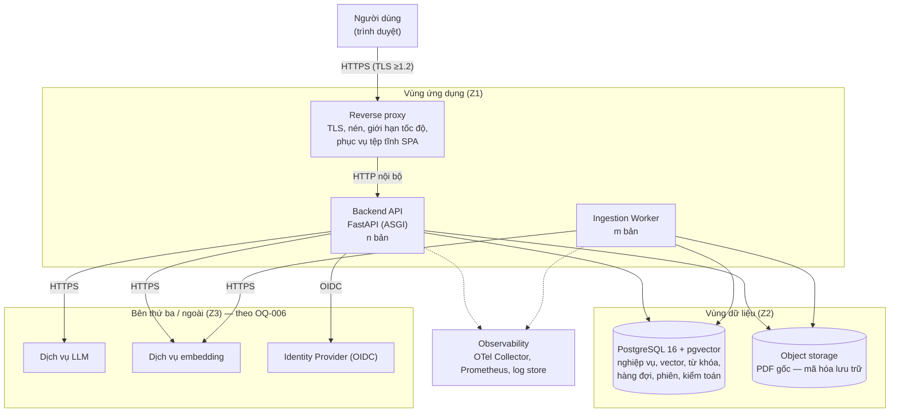

# Software Architecture Design Document (SAD) — Chat với Tài liệu (MVP)

> **Chuẩn áp dụng:** IEEE 1016-2009
> **Prompt nguồn:** [docs/SAD_Prompt_IEEE_standard.md](../SAD_Prompt_IEEE_standard.md)
> **Tài liệu đầu vào:** [BRD](../requirements/BRD.md) · [PRD](../requirements/PRD.md) · [Blueprint Design (SDD)](Blueprint_Design.md)
> **Quan hệ với SDD:** SDD mô tả *cái gì* (các view, concern, hợp đồng). SAD chốt *bằng công nghệ và cơ chế cụ thể nào*. ID kế thừa từ SDD (`CMP-xx`, `API-xx`, `DD-xx`, `CN-xx`, `QAS-xx`); ID mới của SAD là `AD-xx` (quyết định kiến trúc) và `SP-xx` (spike cần chạy).
> **Nhãn giá trị:** `[Proposed]` = đề xuất kiến trúc, chưa được xác nhận · `[TBD: OQ-xxx]` = chờ quyết định kinh doanh · `[Estimate]` = ước lượng chưa đo, phải kiểm chứng bằng spike · `[Verify]` = sự kiện về công cụ/thư viện cần kiểm tra lại phiên bản khi áp dụng.

---

## 0. Tóm tắt ràng buộc kỹ thuật (Technical constraints summary)

### 0.1 Nền tảng hệ thống

| Hạng mục | Giá trị | Nguồn |
|---|---|---|
| **Tên hệ thống** | Chat với Tài liệu (tên chính thức `[TBD: OQ-016]`) | BRD |
| **Chức năng kinh doanh cốt lõi** | Tải PDF vào thư viện dùng chung; hỏi đáp ngôn ngữ tự nhiên; AI trả lời **chỉ từ nội dung thư viện**, kèm trích dẫn tên tài liệu + số trang, hoặc báo "không tìm thấy" | BR-008, BR-010, BR-011 |
| **Quy mô mục tiêu** | BRD chưa có số. Giả định để định cỡ: ≤ ~500 tài liệu, ≤ ~100 trang/tài liệu (≈ 100.000 chunk), ≤ ~50 người dùng đăng ký, ≤ ~10 câu hỏi đồng thời `[Proposed]`; lưu lượng thấp (≪ 1 req/s trung bình). Phải kiểm lại khi có OQ-002, OQ-013, OQ-015 | SDD §1.3 |
| **Công nghệ ưu tiên** | Chưa có ràng buộc từ tổ chức. SAD đề xuất bộ công nghệ ở §6 | `[Proposed]` |
| **Ràng buộc then chốt** | (1) Ứng dụng web, chỉ PDF, câu trả lời do AI sinh (CON-002/003/004); (2) là MVP — ngân sách/thời hạn chưa rõ (CON-001, OQ-005); (3) **chính sách gửi dữ liệu tới dịch vụ AI chưa chốt** (OQ-006) → quyết định nhà cung cấp AI, nơi đặt dịch vụ, môi trường triển khai, phạm vi log; (4) data residency chưa biết `[TBD: OQ-006]`; (5) bắt buộc trích dẫn, không bịa (BRU-001, BRU-003) | BRD §9 |

### 0.2 Tác động của các ràng buộc lên kiến trúc

| Ràng buộc | Hệ quả kiến trúc |
|---|---|
| OQ-006 chưa chốt | Mọi lời gọi AI đi qua cổng (port) + cấu hình; kiến trúc chạy được cả với dịch vụ AI công cộng lẫn mô hình tự lưu trữ (AD-03) |
| Quy mô nhỏ, đội nhỏ, MVP | Tránh hệ phân tán: modular monolith, không broker riêng, không cache tầng riêng (AD-01, AD-05, AD-06) |
| Độ tin cậy của câu trả lời quan trọng hơn tốc độ tuyệt đối | Đường trả lời có hai lớp kiểm soát cứng (ngưỡng liên quan + kiểm tra trích dẫn) — đánh đổi thêm độ trễ nhỏ (AD-07) |
| Ngôn ngữ chưa chốt (OQ-009; tiếng Việt rất có thể) | Chọn mô hình embedding đa ngữ; full-text search không phụ thuộc từ điển ngôn ngữ (AD-08) |
| Nội dung PDF là dữ liệu không tin cậy | Phân tích PDF trong worker cô lập tài nguyên; chống prompt injection (§4.1) |

---

## 1. Mục tiêu kiến trúc và Nguyên tắc thiết kế

### 1.1 Ba động lực kiến trúc hàng đầu

| # | Động lực | Vì sao | Thiết kế ưu tiên nó như thế nào | Đánh đổi chấp nhận |
|---|---|---|---|---|
| **D1** | **Độ tin cậy của câu trả lời (trustworthiness)** — đúng, bám nguồn, không bịa | Giá trị MVP nằm ở việc đội dám dùng câu trả lời (BO-002, RSK-001, CN-01/02) | Truy xuất lai (vector + từ khóa); chunk không vượt trang để trích dẫn đúng trang (DD-04); ngưỡng liên quan trước khi gọi LLM; kiểm tra mọi trích dẫn thuộc tập đoạn đã truy xuất; bộ đánh giá tự động chạy được (CMP-17) | Tăng "không tìm thấy" sai khi ngưỡng cao; thêm ~vài trăm ms cho kiểm tra |
| **D2** | **Khả năng thay đổi nhà cung cấp AI và tuân thủ dữ liệu** | OQ-006 có thể buộc đổi hướng bất cứ lúc nào (ASM-003, CN-04, CN-10) | Hexagonal: `LlmPort`/`EmbeddingPort`; cấu hình theo môi trường; chỉ gửi đoạn cần thiết; không log nội dung; công cụ reindex | Thêm một lớp trừu tượng; đổi mô hình embedding phải vector hóa lại |
| **D3** | **Đơn giản trong vận hành và thời gian ra MVP** | CON-001; đội nhỏ; ngân sách/thời hạn chưa rõ (CN-14) | Một CSDL (PostgreSQL) làm cả dữ liệu, vector, từ khóa, hàng đợi, phiên; hai loại tiến trình (API, Worker); không Redis/Kafka/Elasticsearch | Giới hạn mở rộng tới ~10⁵–10⁶ chunk; xem ngưỡng tách ở AD-05 |

*Động lực phụ:* **thời gian phản hồi** (CN-03, QAS-01) được xử lý bằng streaming và ngân sách độ trễ (§3.2.1) chứ không bằng thêm hạ tầng; con số chốt theo OQ-014.

### 1.2 Mô thức kiến trúc

**Mô thức vĩ mô (AD-01): Modular Monolith theo Clean/Hexagonal Architecture, kèm Worker bất đồng bộ dùng hàng đợi trong CSDL.**

| Phương án | Đánh giá | Kết luận |
|---|---|---|
| **Modular monolith + worker (chọn)** | Một mã nguồn, một đơn vị triển khai cho API, một cho Worker (cùng ảnh container, khác lệnh chạy). Ranh giới module cưỡng chế bằng quy tắc phụ thuộc. Phù hợp quy mô và đội nhỏ | ✅ |
| Microservices | Cần service discovery, tracing phân tán, quản lý nhiều CSDL/phiên bản hợp đồng — chi phí không tương xứng với ~50 người dùng | ✗ |
| Serverless (hàm + dịch vụ quản lý) | Hợp tải thấp, nhưng xử lý PDF dài, streaming SSE và phụ thuộc OQ-006 (nơi đặt dịch vụ) làm khó kiểm soát | ✗ (xem xét lại nếu OQ-006 chọn đám mây quản lý) |
| Event-driven đầy đủ (broker) | Không có nhiều nhà tiêu thụ độc lập; một hàng đợi đơn giản là đủ | ✗ |

**Các mẫu hỗ trợ:**

| Mẫu | Áp dụng ở đâu | Lý do |
|---|---|---|
| Ports & Adapters | `LlmPort`, `EmbeddingPort`, `FileStorePort`, `IdentityPort`, `PdfTextPort` | D2 |
| Repository | Truy cập CSDL | Tách nghiệp vụ khỏi SQL; kiểm thử |
| Transactional job queue | Hàng đợi trong PostgreSQL (`FOR UPDATE SKIP LOCKED`) | D3; công việc nhất quán với giao dịch nghiệp vụ |
| RAG (Retrieve-then-Generate) với guardrails | Answer Service | D1 |
| Circuit Breaker + Timeout + Retry có giới hạn | Mọi lời gọi ra dịch vụ AI | §4.2 |
| Expand/Contract migration | Thay đổi lược đồ CSDL | Triển khai không gián đoạn (§4.2) |
| Soft delete + purge nền | Xóa tài liệu | BRU-002 hiệu lực tức thì |

**Quy tắc cưỡng chế kiến trúc `[Proposed]`:** kiểm tra import trong CI (ví dụ `import-linter`) — lõi nghiệp vụ không import thư viện của nhà cung cấp AI/kho tệp/IdP; phụ thuộc một chiều UI → Controller → Application Service → Domain ← Adapter.

---

## 2. Phân rã thành phần hệ thống

### 2.0 Sơ đồ container (mức C4-2)



### 2.1 Tầng Frontend / Client (CMP-01)

| Khía cạnh | Quyết định | Lý do / chi tiết |
|---|---|---|
| **Mô hình giao diện** | **SPA** (React + TypeScript, build bằng Vite) | Ứng dụng sau đăng nhập, không cần SEO → không cần SSR (AD-02) |
| **Phân phối** | Tệp tĩnh có băm nội dung trong tên (`app.[hash].js`) do reverse proxy phục vụ; `Cache-Control: public, max-age=31536000, immutable` cho tệp băm, `no-cache` cho `index.html`. Không cần CDN cho giai đoạn thử nghiệm (người dùng nội bộ) | Đơn giản (D3); thêm CDN sau không đổi kiến trúc |
| **Quản lý trạng thái** | *Server state*: **TanStack Query** (cache, thăm dò trạng thái tài liệu, vô hiệu hóa sau thao tác). *Client state* (ô nhập, tài liệu được chọn, trạng thái lượt hỏi): trạng thái cục bộ component + một store nhỏ cho phiên | Tránh store toàn cục lớn; máy trạng thái lượt hỏi theo SDD §3.7 |
| **Giao thức** | REST/JSON `fetch` tới `/api/v1/*`, cùng nguồn gốc (same-origin) với SPA | Không cần CORS; cookie phiên `SameSite` hoạt động |
| **Streaming câu trả lời** | `POST` rồi đọc phản hồi `text/event-stream` bằng `fetch` + `ReadableStream` (**không** dùng `EventSource` vì nó chỉ hỗ trợ GET). Phân tích khung SSE phía client | API-09 là POST |
| **Xem trích dẫn** | **pdf.js** mở `GET /api/v1/documents/{id}/file` (hỗ trợ `Range`), nhảy tới trang `page` của trích dẫn | CMP-01c, BR-010; mở được trong 1 thao tác |
| **Cập nhật trạng thái tài liệu** | Thăm dò `GET /documents` mỗi 3 giây **chỉ khi** còn tài liệu `UPLOADED/PROCESSING`; dừng khi hết | Đủ cho quy mô; có thể thay bằng SSE sau |
| **i18n / truy cập** | Chuỗi giao diện tách khỏi mã (thư viện i18n); WCAG 2.1 AA `[TBD: OQ-020]` | QAS UX, BR-015 |
| **Bảo vệ phía client** | CSP nghiêm ngặt (`default-src 'self'`; `object-src 'none'`), không dùng `dangerouslySetInnerHTML` với nội dung câu trả lời — hiển thị bằng trình render Markdown đã làm sạch | Nội dung do AI sinh là đầu vào không tin cậy |

### 2.2 Tầng Ứng dụng / Logic nghiệp vụ (CMP-03…CMP-10, CMP-20)

**Ranh giới module (một mã nguồn, mỗi module là một package):**

| Module | Trách nhiệm | Mở ra cho module khác | Không được làm |
|---|---|---|---|
| `access` (CMP-03) | Phiên, vai trò, kiểm tra quyền | `require_role()`, `current_user()` | Biết chi tiết nghiệp vụ tài liệu |
| `documents` (CMP-04) | Tiếp nhận, kiểm tra tệp, vòng đời, xóa | `DocumentService` | Gọi LLM |
| `ingestion` (CMP-20) | Trích văn bản, chia chunk, embed, lập chỉ mục | Công việc `ingest_document`, `purge_document`, `reindex` | Phục vụ HTTP |
| `retrieval` (CMP-07) | Truy xuất lai, lọc phạm vi/trạng thái | `RetrievalPort` | Sinh câu trả lời |
| `answering` (CMP-06) | Viết lại câu hỏi, điều phối RAG, `NotFoundPolicy`, `CitationValidator` | `AnswerService` | Truy cập SQL trực tiếp |
| `conversations` (CMP-05) | Hội thoại, tin nhắn, cách ly theo chủ sở hữu | `ConversationService` | — |
| `feedback` (CMP-08) | Đánh giá câu trả lời | — | — |
| `analytics` (CMP-09) | Ghi sự kiện, báo cáo tuần, token/chi phí | `emit(event)` | Lưu nội dung câu hỏi |
| `platform` (CMP-10) | Cấu hình, log, metric, trace, kiểm toán, health | — | — |
| `adapters/*` (CMP-12…15) | Triển khai các port | — | Chứa quy tắc nghiệp vụ |

**Worker bất đồng bộ (CMP-20 + CMP-16):**

| Hạng mục | Thiết kế |
|---|---|
| Hàng đợi | Bảng `job` trong PostgreSQL: `id, type, payload, status(queued/running/succeeded/failed), attempts, max_attempts, run_after, locked_by, locked_at, last_error`. Worker lấy việc bằng `SELECT … WHERE status='queued' AND run_after<=now() ORDER BY run_after FOR UPDATE SKIP LOCKED LIMIT 1` trong giao dịch → không hai worker nhận cùng việc |
| Loại việc | `ingest_document` (BR-003/004), `purge_document` (BR-007), `reindex_all` (đổi mô hình embedding) |
| Thử lại | Lỗi tạm thời (429/5xx/timeout từ dịch vụ embedding): tối đa 5 lần, lùi theo cấp số nhân có nhiễu: `delay = min(300s, 5s·2^n) ± 20%`. Hết lần → `status=failed`, tài liệu `FAILED` + `failure_reason` |
| Bất biến | Việc phải **idempotent**: `ingest_document` xóa chunk dở dang của tài liệu trước khi ghi lại; `purge_document` xóa nếu còn |
| Việc "mồ côi" | Việc `running` có `locked_at` quá 15 phút bị coi là chết và đưa về `queued` bởi vòng quét của worker |
| Đồng thời | Mặc định 2 việc/worker, đổi bằng cấu hình; giới hạn tốc độ gọi embedding theo cấu hình để không vượt hạn mức nhà cung cấp |
| Cô lập tài nguyên | Phân tích PDF chạy trong **tiến trình con** có giới hạn thời gian (mặc định 120 s/tài liệu) và bộ nhớ (cgroup/`ulimit`) vì bộ phân tích PDF là bề mặt tấn công và dễ ngốn tài nguyên với tệp độc hại |

**Quy trình xử lý tài liệu (`ingest_document`):**

1. Đặt `PROCESSING`; đọc PDF từ kho tệp.
2. Trích văn bản **từng trang** bằng bộ trích văn bản (`PdfTextPort`).
3. Nếu tổng số ký tự có nghĩa < ngưỡng (mặc định 50 ký tự/tài liệu, hoặc < 10% số trang có văn bản `[Proposed]`) → `NOT_EXTRACTABLE` (BR-004), dừng.
4. Chuẩn hóa văn bản (Unicode NFC — quan trọng cho tiếng Việt, bỏ ký tự điều khiển, gộp xuống dòng do ngắt dòng PDF).
5. Chia chunk **bên trong từng trang** (DD-04): mục tiêu ~300–500 token, chồng lấp ~50 token trong cùng trang `[Proposed — hiệu chỉnh bằng OQ-008]`.
6. Embed theo lô (kích thước lô theo giới hạn nhà cung cấp); ghi `chunk` (văn bản, vector, `tsvector`, `embedding_model`).
7. Đặt `READY` **trong cùng giao dịch** với bước ghi cuối để không có trạng thái `READY` mà thiếu chunk.

### 2.3 Tầng Hạ tầng dữ liệu

| Thành phần | Lựa chọn cụ thể | Chi tiết |
|---|---|---|
| **CSDL chính** | **PostgreSQL 16** (một primary) | Dữ liệu nghiệp vụ, vector, từ khóa, hàng đợi, phiên, sự kiện, kiểm toán (AD-05). Giao dịch ACID cho vòng đời tài liệu |
| **Chỉ mục vector** | Phần mở rộng **pgvector**, cột `vector(N)` với chỉ mục **HNSW** `vector_cosine_ops` (`m=16`, `ef_construction=64` mặc định, `hnsw.ef_search` đặt 80–100) `[Proposed — hiệu chỉnh]` | N = số chiều mô hình embedding. `[Verify]` chỉ mục HNSW kiểu `vector` giới hạn ≤ 2.000 chiều; mô hình nhiều chiều hơn phải giảm chiều hoặc dùng `halfvec` |
| **Lọc theo phạm vi** | Truy vấn lọc `document.status='READY'` và `document_id = ANY(:scope)`. Lọc kèm HNSW có thể trả ít hơn `k` kết quả → bật quét lặp (`hnsw.iterative_scan`, `[Verify]` từ pgvector 0.8) hoặc, khi phạm vi hẹp, quét chính xác. Chọn theo benchmark SP-01 | Tránh "mất" kết quả khi lọc |
| **Chỉ mục từ khóa** | Cột `tsvector` sinh từ văn bản chunk, chỉ mục **GIN**. Cấu hình `simple` + `unaccent` (không dùng từ điển ngôn ngữ vì PostgreSQL không có từ điển tiếng Việt dựng sẵn) | Chấp nhận chất lượng từ khóa trung bình; vector là kênh chính. Xem lại khi OQ-009 chốt |
| **Hợp nhất kết quả** | **Reciprocal Rank Fusion** (`score = Σ 1/(60 + rank_i)`) giữa danh sách vector và từ khóa; không cần chuẩn hóa điểm giữa hai hệ | Đơn giản, bền với phân phối điểm khác nhau |
| **Hàng đợi / message broker** | **Không dùng broker riêng**; bảng `job` trong PostgreSQL (AD-06) | Đủ cho hàng chục tài liệu/giờ. **Ngưỡng tách:** khi cần > ~50 việc/giây hoặc độ trễ nhận việc > 5 s, chuyển sang Redis/RabbitMQ qua cùng cổng `JobQueuePort` |
| **Cache** | **Không có tầng cache riêng** (AD-06). Chỉ cache trong tiến trình: khóa công khai của IdP (JWKS, TTL 1 giờ), cấu hình. **Không cache câu trả lời** vì phụ thuộc trạng thái thư viện (BRU-002) và quyền | Tránh trả câu trả lời dùng nội dung đã xóa |
| **Phiên** | Bảng `session` trong PostgreSQL (id ngẫu nhiên 256-bit, `user_id`, `expires_at`, `last_seen_at`) | Thu hồi phiên tức thì; không cần Redis |
| **Lưu trữ tệp** | **Object storage tương thích S3** (đám mây hoặc MinIO tại chỗ), bucket riêng tư, khóa đối tượng `documents/{uuid}.pdf`, mã hóa phía máy chủ (AES-256) | Chọn theo OQ-006; cùng giao diện `FileStorePort` |
| **Sao lưu** | Sao lưu cơ sở hằng ngày + lưu trữ WAL liên tục (PITR); kho tệp bật versioning hoặc sao chép | Mục tiêu RPO ≤ 15 phút, RTO ≤ 4 giờ `[Proposed — TBD: OQ-017]` |

**Chính sách lưu giữ dữ liệu** (giá trị mặc định đề xuất; chốt theo OQ-019):

| Dữ liệu | Mặc định đề xuất | Cơ chế |
|---|---|---|
| Tài liệu đã xóa (tệp, chunk, vector) | Xóa vật lý ≤ 24 giờ sau khi xóa | Việc `purge_document`; ẩn ngay lập tức nhờ `status=DELETED` |
| Hội thoại và tin nhắn | Giữ trong thời gian thử nghiệm + 90 ngày; người dùng xóa được hội thoại của mình `[Proposed]` | Việc dọn định kỳ |
| `usage_event` | 13 tháng | Phân vùng theo tháng, bỏ phân vùng cũ |
| `audit_log` | 12 tháng, chỉ ghi thêm | Vai trò CSDL của ứng dụng không có `UPDATE/DELETE` trên bảng này |
| Phiên | Hết hạn tuyệt đối 12 giờ, rảnh 60 phút `[Proposed]` | Việc dọn định kỳ |

### 2.4 Tầng Backend / API

**Phân lớp bên trong Backend API:**

```text
HTTP (FastAPI router)        ← xác thực/giải mã yêu cầu, ánh xạ lỗi → HTTP
  └─ Application service     ← điều phối nghiệp vụ, giao dịch, kiểm tra quyền
       └─ Domain             ← thực thể, NotFoundPolicy, CitationValidator (không I/O)
            └─ Ports         ← LlmPort, EmbeddingPort, RetrievalPort, FileStorePort, ...
                 └─ Adapters ← SQL repository, S3, nhà cung cấp AI, IdP
```

**Quy ước chung**

| Hạng mục | Quy ước |
|---|---|
| Phiên bản | Tiền tố `/api/v1`; thay đổi phá vỡ hợp đồng → `/api/v2` |
| Định dạng | JSON UTF-8; thời gian ISO-8601 UTC; ID là UUID |
| Xác thực | Cookie phiên `HttpOnly; Secure; SameSite=Lax`; thao tác ghi yêu cầu header chống CSRF `X-CSRF-Token` (double-submit) |
| Phân trang | `GET` danh sách: `limit` (mặc định 50, tối đa 200) + `cursor` |
| Lỗi | `{ "error": { "code", "message", "requestId" } }` — danh mục mã ở SDD §3.5 |
| Truy vết | Header `X-Request-Id` (sinh nếu thiếu), trả lại trong phản hồi và log |
| Kiểm tra đầu vào | Mô hình **Pydantic** cho mọi body/query; từ chối trường lạ |
| Tính lũy đẳng | `POST /documents`: client gửi `Idempotency-Key` (tùy chọn) để thử lại an toàn; trùng `content_hash` do cùng người dùng trong 24 giờ trả bản ghi hiện có |

**Khai báo đầu vào/đầu ra các endpoint** (tinh chỉnh SDD §3.5; quyền theo SDD, `[TBD: OQ-011]`):

| API | Đầu vào | Đầu ra thành công | Ghi chú |
|---|---|---|---|
| API-02 `POST /documents` | `multipart/form-data`, trường `files[]` (1..n PDF); giới hạn mỗi tệp và số tệp `[TBD: OQ-013]` | `202` `{ "items": [ { "name", "id?", "status", "error?" } ] }` — thành công/lỗi **từng tệp** độc lập | Tệp được **truyền luồng** xuống kho tệp (không nạp cả tệp vào RAM); kiểm tra `%PDF-` ở byte đầu |
| API-03 `GET /documents` | `limit`, `cursor`, `status?` | `{ "items": [ { "id", "name", "status", "uploadedBy", "uploadedAt", "pageCount", "failureReason?" } ], "nextCursor" }` | BR-006 |
| API-04 `GET /documents/{id}` | — | Một phần tử như trên | Dùng để thăm dò |
| API-05 `DELETE /documents/{id}` | — | `204` | Đặt `DELETED` + việc `purge_document` + kiểm toán; lũy đẳng |
| API-06 `GET /documents/{id}/file` | Header `Range` tùy chọn | `200/206 application/pdf` | `Content-Disposition: inline`, `X-Content-Type-Options: nosniff`; chỉ khi `status ≠ DELETED` |
| API-07 `POST /conversations` | `{ "title?" }` | `201` `{ "id", "startedAt" }` | BR-016 |
| API-08 `GET /conversations`, `GET /conversations/{id}` | `limit`, `cursor` | Danh sách / chi tiết kèm tin nhắn và trích dẫn | Lọc cứng theo `owner_id` |
| API-09 `POST /conversations/{id}/messages` | `{ "question": string (1..2000 ký tự), "documentIds?": uuid[] }` | `200 text/event-stream`: sự kiện `status` (`retrieving`, `generating`), `token` (đoạn văn bản), `final` (`messageId`, `answerType`, `content`, `citations[]`, `responseTimeMs`), hoặc `error` | Sự kiện `final` mới là kết quả có hiệu lực (SDD §3.5, §3.7); `token` chỉ để hiển thị tạm |
| API-10 `PUT /messages/{id}/feedback` | `{ "rating": "helpful" \| "not_helpful" }` | `204` | Ghi đè được |
| API-11 `GET /reports/weekly` | `weekStart` (thứ Hai, ISO date) | `{ "weekStart", "activeUsers", "questionsAsked", "answers": {"answered","notFound"}, "feedback": {"helpful","notHelpful"}, "tokens": {"in","out"} }` | Chỉ vai trò Sponsor/Admin; AC-021 |
| API-12 `GET /health/live`, `/health/ready` | — | `200`/`503` | `ready` kiểm tra CSDL (và hàng đợi), **không** gọi dịch vụ AI |

**Về phát luồng câu trả lời và kiểm tra trích dẫn.** Kiểm tra trích dẫn (lớp 2) cần câu trả lời đầy đủ. Để không hiển thị nội dung chưa được kiểm tra như kết quả cuối, đề xuất **AD-07**: LLM trả **đầu ra có cấu trúc** `{answerable, content, citedChunkIds}`; hệ thống sinh xong rồi kiểm tra rồi mới phát `final`. Cho cảm nhận tốc độ, các sự kiện `status` báo tiến trình từng bước; sự kiện `token` chỉ bật nếu SP-02 chứng minh có thể phát luồng `content` an toàn (ví dụ trích dẫn gắn đánh dấu ngay trong luồng). Mặc định MVP: **không phát `token`**, chỉ phát `status` và `final`. Nhờ vậy BRU-003 được đảm bảo cứng.

---

## 3. Kiến trúc dữ liệu và Luồng tích hợp

### 3.1 Chiến lược mô hình dữ liệu cốt lõi

| Quyết định | Nội dung | Lý do |
|---|---|---|
| **Quan hệ, một lược đồ chung** | Một CSDL PostgreSQL, một lược đồ cho mọi module; **không** database-per-service | Một đơn vị triển khai; giao dịch xuyên module (xóa tài liệu + kiểm toán); AD-05 |
| **Sở hữu theo module** | Mỗi bảng thuộc một module; module khác không `JOIN`/ghi bảng của module khác trực tiếp, trừ qua service (cưỡng chế bằng quy ước + review) — trừ `retrieval` được đọc `chunk` và `document` | Giữ khả năng tách sau này |
| **Cách ly dữ liệu người dùng** | Mọi truy vấn hội thoại lọc `owner_id` ở tầng repository. Bật thêm **Row Level Security** của PostgreSQL cho `conversation`/`message` (`USING owner_id = current_setting('app.user_id')::uuid`) làm lớp phòng thủ thứ hai `[Proposed]` | AC-017, BRU-005 |
| **Thư viện dùng chung** | `document`/`chunk` không có cột chủ sở hữu quyết định quyền đọc (mọi người dùng được phép đọc toàn thư viện) — theo ASM-002. Nếu OQ-011 đòi phân quyền: thêm bảng `document_acl` và điều kiện lọc trong `retrieval` | Thiết kế mở sẵn điểm mở rộng, không xây trước |
| **Nhất quán trạng thái** | `document.status` là nguồn sự thật duy nhất cho "có được dùng làm nguồn không". `retrieval` luôn `JOIN document` và lọc `READY`. Chunk của tài liệu `DELETED` vẫn có thể còn trong bảng một thời gian nhưng **không bao giờ** được trả về | BRU-002, QAS-06 |
| **Phiên bản embedding** | Mỗi `chunk` lưu `embedding_model` (và số chiều). Truy xuất chỉ so sánh với chunk cùng `embedding_model` hiện hành. Đổi mô hình = việc `reindex_all` ghi vector mới, sau đó chuyển cấu hình | Tránh trộn không gian vector khác nhau (DR-04) |
| **Snapshot trích dẫn** | `citation.document_name_snapshot` | Hội thoại cũ vẫn đọc được sau khi xóa tài liệu |
| **Dữ liệu phân tích tách khỏi nội dung** | `usage_event` chỉ chứa thuộc tính vận hành (không nội dung câu hỏi/trả lời) | OQ-006, DD-11 |

**Trích DDL cho phần quyết định hiệu năng và tính đúng đắn** `[Proposed]`:

```sql
CREATE EXTENSION IF NOT EXISTS vector;
CREATE EXTENSION IF NOT EXISTS unaccent;

CREATE TABLE document (
  id            uuid PRIMARY KEY,
  name          text        NOT NULL,
  status        text        NOT NULL CHECK (status IN
                  ('UPLOADED','PROCESSING','READY','NOT_EXTRACTABLE','FAILED','DELETED')),
  file_ref      text        NOT NULL,
  content_hash  text        NOT NULL,
  page_count    int,
  size_bytes    bigint      NOT NULL,
  uploaded_by   uuid        NOT NULL REFERENCES app_user(id),
  uploaded_at   timestamptz NOT NULL DEFAULT now(),
  deleted_at    timestamptz,
  failure_reason text
);
CREATE INDEX document_status_idx ON document (status);

CREATE TABLE chunk (
  id              uuid PRIMARY KEY,
  document_id     uuid NOT NULL REFERENCES document(id),
  page            int  NOT NULL,                 -- DD-04: chunk không vượt trang
  chunk_index     int  NOT NULL,
  text            text NOT NULL,
  embedding_model text NOT NULL,
  embedding       vector(1536) NOT NULL,         -- N theo mô hình được chọn
  keywords        tsvector GENERATED ALWAYS AS
                    (to_tsvector('simple', unaccent(text))) STORED,
  UNIQUE (document_id, page, chunk_index)
);
CREATE INDEX chunk_embedding_hnsw ON chunk USING hnsw (embedding vector_cosine_ops);
CREATE INDEX chunk_keywords_gin   ON chunk USING gin (keywords);
CREATE INDEX chunk_document_idx   ON chunk (document_id);

CREATE TABLE job (
  id           uuid PRIMARY KEY,
  type         text NOT NULL,
  payload      jsonb NOT NULL,
  status       text NOT NULL DEFAULT 'queued',
  attempts     int  NOT NULL DEFAULT 0,
  max_attempts int  NOT NULL DEFAULT 5,
  run_after    timestamptz NOT NULL DEFAULT now(),
  locked_by    text,
  locked_at    timestamptz,
  last_error   text
);
CREATE INDEX job_ready_idx ON job (run_after) WHERE status = 'queued';
```

Ghi chú: biểu thức `to_tsvector('simple', unaccent(text))` trong cột sinh yêu cầu hàm bất biến (immutable); `unaccent` mặc định là `STABLE` nên thường phải bọc bằng hàm `IMMUTABLE` riêng khi tạo cột sinh `[Verify]`. Chuyển `1536` theo mô hình thực tế (ràng buộc ≤ 2.000 chiều cho HNSW `vector`).

### 3.2 Luồng dữ liệu (Sequence / Data Flow Narrative)

Sơ đồ tuần tự chi tiết nằm ở SDD §3.6; phần này mô tả **giao thức, dữ liệu trao đổi và ngân sách độ trễ**.

#### 3.2.1 Luồng 1 — Đặt câu hỏi từ đầu đến cuối (API-09)

Mọi bước gắn với yêu cầu: BR-008…BR-015, BRU-001/002/003.

| # | Bước | Giao thức / dữ liệu | Ngân sách `[Estimate — SP-01]` |
|---|---|---|---|
| 1 | Trình duyệt gửi `POST /api/v1/conversations/{id}/messages` `{question, documentIds?}` với cookie phiên + `X-CSRF-Token` | HTTPS → reverse proxy (`proxy_buffering off` cho đường dẫn này để SSE không bị gom) | — |
| 2 | Proxy kiểm tra giới hạn tốc độ rồi chuyển tới API | HTTP nội bộ, giữ `X-Request-Id` | < 5 ms |
| 3 | API xác thực phiên (tra bảng `session`), kiểm tra chủ hội thoại (`owner_id`) và quyền | SQL 1–2 truy vấn | < 20 ms |
| 4 | Lưu tin nhắn người dùng; đọc N lượt gần nhất (mặc định N=6) làm lịch sử | SQL | < 20 ms |
| 5 | Phát SSE `status: retrieving` | `text/event-stream` | — |
| 6 | *Chỉ khi có lịch sử:* `LlmPort.rewrite` → câu hỏi độc lập. Timeout 15 s; lỗi → dùng câu hỏi gốc (suy giảm nhẹ) | HTTPS → dịch vụ LLM, mô hình nhỏ/rẻ nếu có | 0,5–2 s |
| 7 | `EmbeddingPort.embed(câu hỏi)` | HTTPS → dịch vụ embedding | 0,1–0,5 s |
| 8 | Truy xuất lai trong PostgreSQL: top-`k_v` (mặc định 20) từ HNSW và top-`k_t` (20) từ GIN, đều lọc `document.status='READY'` và phạm vi; hợp nhất RRF; giữ tối đa `k` (mặc định 8) đoạn, tối đa 3 đoạn/tài liệu để đa dạng nguồn (BR-009); thêm đoạn kề cùng trang | SQL (hai truy vấn song song) | 50–300 ms |
| 9 | **Lớp 1:** nếu điểm vector tốt nhất < `relevance_threshold` **và** không có khớp từ khóa → trả `NOT_FOUND`, **bỏ qua** bước 10 | Tính cục bộ | < 1 ms |
| 10 | Phát `status: generating`; `LlmPort.generate` với: chỉ thị hệ thống (chỉ dùng ngữ cảnh; `answerable=false` nếu không đủ; trả lời cùng ngôn ngữ câu hỏi), các đoạn đánh số `[c1]…[cK]` kèm tên tài liệu + trang, câu hỏi. Đầu ra bắt buộc dạng JSON schema `{answerable, content, citedChunkIds[]}`. Timeout tổng 60 s | HTTPS → dịch vụ LLM | 3–10 s |
| 11 | **Lớp 2:** `CitationValidator` — `answerable=true`, `citedChunkIds` không rỗng, mọi id ∈ tập đoạn đã truy xuất. Sai → thử lại tối đa 1 lần với nhắc nhở; vẫn sai → `NOT_FOUND` | Tính cục bộ | < 5 ms (+ một lần gọi nếu thử lại) |
| 12 | Ánh xạ `citedChunkIds` → `{documentId, documentName, page}` (loại trùng) | Bộ nhớ | < 1 ms |
| 13 | Giao dịch: lưu tin nhắn trợ lý + `citation` + `response_time_ms` + `tokens_in/out`; ghi `usage_event` `question_asked`, `answer_returned` | SQL, một giao dịch | < 30 ms |
| 14 | Phát SSE `final` rồi đóng luồng; giao diện hiển thị câu trả lời; trích dẫn mở pdf.js tại đúng trang | `text/event-stream` | — |

**Tổng ngân sách `[Estimate]`:** ≈ 4–13 s ở trường hợp thường, lệch về bước 10. Mục tiêu nội bộ P90 ≤ 15 s (SDD QAS-01) nằm sát biên → **SP-01 phải đo thực tế** trước khi chốt giá trị với OQ-014. Nếu không đạt, đòn bẩy theo thứ tự: mô hình nhỏ hơn cho `rewrite`; giảm `k`; rút ngắn ngữ cảnh; mô hình sinh nhanh hơn.

**Hành vi lỗi trong luồng:**

| Sự cố | Hành vi | Mã |
|---|---|---|
| Embedding lỗi/timeout (bước 7) | Thử lại 1 lần (lũy đẳng); sau đó `error` `UPSTREAM_UNAVAILABLE` | 503/504 |
| LLM lỗi trước khi có đầu ra (bước 10) | Thử lại 1 lần nếu lỗi 429/5xx; sau đó `error`; câu hỏi giữ nguyên để hỏi lại | 503/504 |
| Mất kết nối trình duyệt giữa chừng | API hủy lời gọi LLM đang chạy khi phát hiện ngắt kết nối; tin nhắn trợ lý **không** lưu | — |
| Không có tài liệu `READY` | Trả `409 NO_READY_DOCUMENTS` ở bước 3, không gọi AI | 409 |

#### 3.2.2 Luồng 2 — Tải lên và lập chỉ mục tài liệu (API-02)

| # | Bước | Giao thức / dữ liệu |
|---|---|---|
| 1 | Giao diện gửi `POST /api/v1/documents` `multipart/form-data` (1..n tệp) | HTTPS; proxy đặt `client_max_body_size` theo OQ-013 |
| 2 | API xác thực + quyền; với **từng tệp**: kiểm tra phần mở rộng, 5 byte đầu `%PDF-`, kích thước (đếm khi truyền luồng, dừng ngay khi vượt) | Truyền luồng, không đệm toàn tệp trong RAM |
| 3 | Tệp hợp lệ: tính SHA-256 khi truyền luồng, ghi vào kho tệp tại khóa `documents/{uuid}.pdf` | S3 `PutObject` (multipart nếu lớn) |
| 4 | Một giao dịch SQL: chèn `document(status=UPLOADED)`, chèn `job(ingest_document)`, chèn `audit_log(upload)` | SQL |
| 5 | Phản hồi `202` kèm trạng thái từng tệp (tệp lỗi có `error` ngay) | JSON |
| 6 | Worker nhận việc bằng `SKIP LOCKED`, thực hiện quy trình §2.2 (7 bước), có thể mất vài chục giây | SQL, S3 `GetObject`, HTTPS tới embedding theo lô |
| 7 | Kết thúc: `READY` / `NOT_EXTRACTABLE` / `FAILED`; ghi `usage_event` `document_upload_succeeded` hoặc `document_upload_rejected` | SQL |
| 8 | Giao diện thăm dò `GET /documents` (3 s/lần) và cập nhật trạng thái; tài liệu `READY` mở khóa việc hỏi | JSON |

**Điểm nhất quán:** bước 4 làm cho bản ghi tài liệu và việc xử lý xuất hiện cùng lúc hoặc không xuất hiện (nếu bước 4 lỗi, tệp đã ghi ở bước 3 trở thành tệp mồ côi → vòng dọn định kỳ xóa các đối tượng trong kho tệp không có bản ghi `document` sau 24 giờ).

#### 3.2.3 Luồng 3 — Xóa tài liệu (API-05)

1. `DELETE /api/v1/documents/{id}` → API kiểm tra quyền.
2. Một giao dịch: `status=DELETED`, `deleted_at=now()`, chèn `job(purge_document)`, chèn `audit_log(delete)`. **Từ lúc commit**, `retrieval` không còn trả đoạn của tài liệu này (BRU-002, QAS-06).
3. Trả `204`.
4. Worker `purge_document`: xóa `chunk` theo lô, xóa đối tượng trong kho tệp, giữ lại bản ghi `document` (đã `DELETED`) và `citation` cũ để hội thoại cũ vẫn hiển thị tên (snapshot). Hoàn tất ≤ 24 giờ theo mặc định OQ-019.

---

## 4. Các mối quan tâm xuyên suốt và Hạ tầng

### 4.1 Bảo mật và tuân thủ

#### 4.1.1 Xác thực và phân quyền

| Hạng mục | Thiết kế |
|---|---|
| **Xác thực** | **OIDC Authorization Code + PKCE** với Identity Provider của tổ chức `[TBD: OQ-018]`. Backend là *confidential client* thực hiện trao đổi mã; xác thực chữ ký ID token qua JWKS (cache 1 giờ), kiểm tra `iss`, `aud`, `exp`, `nonce`. Nếu không có IdP: tài khoản cục bộ với băm **Argon2id**, giới hạn đăng nhập sai (5 lần/15 phút/tài khoản) |
| **Phiên** | Sau đăng nhập tạo phiên phía máy chủ (§2.3), cấp cookie `HttpOnly; Secure; SameSite=Lax`. **Không** lưu token trong `localStorage`/`sessionStorage` (chống đánh cắp bằng XSS). Xoay id phiên khi đăng nhập; thu hồi khi đăng xuất |
| **Chống CSRF** | `SameSite=Lax` + header `X-CSRF-Token` (double-submit) cho mọi `POST/PUT/DELETE`; kiểm tra `Origin` |
| **Phân quyền** | RBAC kiểm tra ở tầng Application Service (không chỉ ở router): vai trò `MEMBER`, `SPONSOR`, `ADMIN` `[Proposed — OQ-011]` |
| **Thực thi "từ chối mặc định"** | Mọi router phải khai báo phụ thuộc xác thực; bài kiểm tra tự động duyệt toàn bộ route và thất bại nếu có route nghiệp vụ nào thiếu xác thực (AC-018) |

| Hành động | MEMBER | SPONSOR | ADMIN |
|---|:-:|:-:|:-:|
| Tải lên / xem thư viện / xem tệp PDF | ✓ | ✓ (xem) | ✓ |
| Xóa tài liệu | ✓ `[TBD: OQ-011]` | — | ✓ |
| Hỏi đáp, hội thoại của chính mình | ✓ | — | — |
| Đánh giá câu trả lời của mình | ✓ | — | — |
| Báo cáo tuần | — | ✓ | ✓ |
| Xem hội thoại của người khác | ✗ | ✗ | ✗ (không có quyền này trong MVP) |

#### 4.1.2 Mã hóa

| Phạm vi | Biện pháp |
|---|---|
| **Trong truyền tải** | TLS ≥ 1.2 (ưu tiên 1.3) cho trình duyệt ↔ proxy và mọi kết nối ra ngoài; HSTS (`max-age` ≥ 1 năm); kết nối CSDL/kho tệp trong mạng nội bộ cũng bật TLS nếu nằm khác host |
| **Lưu trữ** | Mã hóa đĩa/volume của CSDL; mã hóa phía máy chủ của kho tệp (AES-256); sao lưu cũng được mã hóa. **Không** mã hóa cấp ứng dụng ở MVP (vector và văn bản chunk phải truy vấn được) — rủi ro được ghi nhận |
| **Mật khẩu** (nếu dùng tài khoản cục bộ) | Argon2id |

#### 4.1.3 Quản lý bí mật

Khóa API dịch vụ AI, mật khẩu CSDL, bí mật OIDC, khóa ký phiên: nạp từ kho bí mật của nền tảng (cloud secret manager / Vault / Docker/K8s secrets) vào biến môi trường lúc chạy; **không** nằm trong ảnh container, mã nguồn hay log. Mỗi môi trường có bộ bí mật riêng; xoay vòng được mà không build lại. Quét bí mật trong CI (ví dụ `gitleaks`) `[Proposed]`.

#### 4.1.4 Bảo vệ khi nhận tệp PDF

| Mối đe dọa | Biện pháp |
|---|---|
| Tệp giả mạo định dạng | Kiểm tra phần mở rộng **và** chữ ký `%PDF-` |
| Tệp khổng lồ / "PDF bomb" | Giới hạn kích thước khi truyền luồng; giới hạn số trang; giới hạn thời gian và bộ nhớ của tiến trình phân tích |
| Khai thác lỗ hổng bộ phân tích PDF | Phân tích trong tiến trình con bị giới hạn, quyền tối thiểu, không có truy cập mạng ra ngoài; cập nhật thư viện định kỳ |
| Mã độc trong PDF | Hệ thống không thực thi nội dung PDF (chỉ trích văn bản). Quét phần mềm độc hại (ví dụ ClamAV) là tùy chọn `[Proposed — TBD: OQ-006/IT]` |
| Tên tệp độc hại / path traversal | Khóa đối tượng là UUID sinh phía máy chủ; tên gốc chỉ lưu trong cột `name`, luôn thoát ký tự khi hiển thị |
| XSS qua tên tệp hoặc câu trả lời | Thoát/làm sạch đầu ra; CSP; `nosniff` |

#### 4.1.5 Bảo vệ dữ liệu khi dùng dịch vụ AI (BR-020, OQ-006)

| Biện pháp | Chi tiết |
|---|---|
| Tối thiểu hóa | Chỉ gửi **đoạn văn bản cần thiết** + câu hỏi; không gửi tệp PDF nguyên bản; không gửi tên người dùng |
| Không dùng cho huấn luyện | Yêu cầu hợp đồng/cấu hình tài khoản nhà cung cấp tắt việc dùng dữ liệu để huấn luyện và nêu thời gian lưu giữ — **điều kiện phê duyệt** `[TBD: OQ-006]` |
| Nơi xử lý | Vùng/khu vực dịch vụ AI cấu hình theo môi trường để đáp ứng data residency `[TBD: OQ-006]` |
| Không log nội dung | Log và `usage_event` không chứa văn bản câu hỏi/câu trả lời/đoạn trích; chỉ độ dài, số đoạn, mã trạng thái |
| Phương án tự lưu trữ | Cùng `LlmPort`/`EmbeddingPort` có adapter cho mô hình tự chạy (ví dụ máy chủ suy luận nội bộ) — chất lượng câu trả lời phải được đo lại bằng CMP-17 |
| Chống prompt injection | Chỉ thị hệ thống tách khỏi ngữ cảnh (đánh dấu ranh giới rõ ràng, nội dung PDF được mô tả là "dữ liệu, không phải chỉ dẫn"); đầu ra bắt buộc theo schema; Lớp 2 kiểm tra trích dẫn; LLM **không có công cụ** (không gọi API, không đọc tệp, không duyệt web); đầu ra hiển thị bằng trình render đã làm sạch |

#### 4.1.6 Kiểm toán

Bảng `audit_log` ghi: đăng nhập thành công/thất bại, tải lên, xóa, truy cập bị từ chối (`access_denied`), xem báo cáo, thay đổi vai trò. Chỉ ghi hành động và đối tượng, **không** ghi nội dung. Vai trò CSDL của ứng dụng chỉ có `INSERT`/`SELECT` trên bảng này; quyền đọc hạn chế cho IT/Bảo mật.

#### 4.1.7 Mối đe dọa chính và đối phó

| Mối đe dọa | Hạng | Đối phó chính |
|---|---|---|
| Lộ tài liệu qua dịch vụ AI bên ngoài (RSK-002) | Cao | §4.1.5; OQ-006 là cổng phê duyệt |
| Truy cập trái phép thư viện | Cao | OIDC, RBAC, kiểm thử tự động route (AC-018) |
| Câu trả lời sai/bịa (RSK-001) | Cao | Hai lớp guardrail, bộ đánh giá, trích dẫn kiểm chứng được |
| Prompt injection từ PDF | Trung bình | §4.1.5 |
| Tệp PDF độc hại | Trung bình | §4.1.4 |
| Đánh cắp phiên (XSS/CSRF) | Trung bình | Cookie HttpOnly, CSP, CSRF token |
| Lạm dụng/chi phí AI (RSK-006) | Trung bình | Giới hạn tốc độ, hạn mức token, cảnh báo |

### 4.2 Độ tin cậy và khả năng chịu lỗi

| Cơ chế | Thiết kế cụ thể `[Proposed]` |
|---|---|
| **Khả dụng mục tiêu** | ≥ 99% trong giờ làm việc `[TBD: OQ-017]` (≈ 22 ngày × 8 giờ = 176 giờ làm việc/tháng, cho phép ≈ 1,8 giờ gián đoạn/tháng) — phù hợp triển khai một máy chủ có tự khởi động lại |
| **Triển khai tham chiếu (giai đoạn thử nghiệm)** | 1 máy chủ/VM chạy container: reverse proxy, API ×2, Worker ×1–2; PostgreSQL và kho tệp là dịch vụ quản lý hoặc có sao lưu. Chính sách `restart: unless-stopped`. **Không chịu được hỏng cả máy chủ** — chấp nhận ở MVP; nâng cấp bằng nhiều node + CSDL có standby streaming replication khi cần |
| **Timeout (bắt buộc cho mọi I/O ngoài)** | Embedding: kết nối 3 s / tổng 15 s. LLM `rewrite`: 15 s. LLM `generate`: 60 s. CSDL: truy vấn 5 s (truy xuất 3 s). Kho tệp: 30 s. IdP: 5 s |
| **Retry** | Chỉ cho thao tác **lũy đẳng** và lỗi tạm thời (kết nối, 429, 5xx). Embedding: tối đa 2 lần (đường hỏi) / 5 lần (worker) với lùi theo cấp số nhân có nhiễu. `generate`: tối đa 1 lần thử lại và chỉ khi chưa nhận được đầu ra. Tôn trọng header `Retry-After` |
| **Circuit breaker** | Mỗi nhà cung cấp AI một bộ ngắt: mở sau 5 lỗi liên tiếp hoặc ≥ 50% lỗi trong cửa sổ 30 s với ≥ 10 yêu cầu; khi mở, từ chối nhanh (`UPSTREAM_UNAVAILABLE`) trong 30 s rồi nửa mở với 1 yêu cầu thử |
| **Giới hạn tốc độ** | Mỗi người dùng: 20 câu hỏi/phút và 10 tệp tải lên/phút (token bucket tại proxy hoặc middleware API) `[Proposed]`. Tổng số truy vấn AI đồng thời tối đa theo cấu hình (semaphore) để bảo vệ hạn mức và chi phí; vượt → `429 RATE_LIMITED` |
| **Áp lực ngược (backpressure)** | Hàng đợi `job` không giới hạn nhưng có metric độ sâu và cảnh báo; Worker giới hạn đồng thời; tải lên không bị từ chối khi hàng đợi dài (trạng thái "đang xử lý" hiển thị hợp lý) |
| **Suy giảm có kiểm soát** | LLM sập → đường hỏi trả lỗi thân thiện; thư viện, danh sách, xem tệp, lịch sử, báo cáo **vẫn hoạt động**. Embedding sập → tài liệu mới chờ ở `UPLOADED/PROCESSING` và thử lại, người dùng vẫn hỏi được trên tài liệu `READY` cũ nếu embedding câu hỏi còn chạy được (nếu không, báo lỗi) |
| **Hạn chế "câu trả lời không đạt"** | Không có cơ chế dự phòng trả lời dựa trên văn bản thô khi LLM sập ở MVP; có thể xem xét hiển thị các đoạn liên quan (đã truy xuất) kèm trích dẫn như phương án dự phòng `[Proposed]` — cần Business Owner duyệt vì không còn là "câu trả lời" |
| **Sao lưu & khôi phục** | Sao lưu cơ sở hằng ngày + lưu trữ WAL (PITR). RPO ≤ 15 phút, RTO ≤ 4 giờ `[Proposed]`. **Diễn tập khôi phục** trước khi ra mắt và mỗi quý. Việc xóa vật lý đã hoàn tất có thể "sống lại" khi khôi phục sao lưu → quy trình khôi phục phải chạy lại danh sách tài liệu `DELETED` để purge `[Proposed]` |
| **Triển khai không gián đoạn** | Cuốn chiếu (rolling) với ≥ 2 bản API; kiểm tra `health/ready` trước khi nhận lưu lượng; kết thúc nhẹ nhàng (graceful shutdown) chờ các luồng SSE đang chạy tối đa 60 s; Worker dừng nhận việc mới rồi hoàn tất việc đang chạy |
| **Di chuyển lược đồ** | Expand/Contract: thêm cột/bảng tương thích ngược → triển khai mã mới → dọn phần cũ ở bản sau; công cụ Alembic; migration chạy một lần trước khi triển khai API; mọi migration có bước đảo ngược hoặc ghi rõ "không thể đảo" |
| **Quay lui** | Giữ ảnh container phiên bản trước; quay lui mã không cần quay lui lược đồ nhờ Expand/Contract |

### 4.3 Khả năng quan sát (Observability)

| Trụ cột | Thiết kế |
|---|---|
| **Log** | JSON trên stdout (`structlog` hoặc tương đương), thu gom bởi nền tảng/agent vào kho log tập trung. Trường chuẩn: `timestamp`, `level`, `service` (api/worker), `request_id`, `trace_id`, `user_id` (UUID, không tên), `route`, `status`, `duration_ms`, `error_code`. **Cấm** ghi nội dung tài liệu/câu hỏi/câu trả lời. Giữ log theo OQ-019 |
| **Metric** | Xuất định dạng **Prometheus** tại `/metrics` (chỉ mạng nội bộ). Danh mục tối thiểu ở bảng dưới |
| **Tracing** | **OpenTelemetry** SDK trong API và Worker, xuất OTLP tới Collector. Span cho: yêu cầu HTTP, từng bước của luồng hỏi (`rewrite`, `embed`, `retrieve`, `generate`, `validate`), mỗi lời gọi ra ngoài, mỗi việc worker. `trace_id` lan truyền từ API sang Worker qua `job.payload` để nối luồng tải lên → lập chỉ mục. Lấy mẫu 100% ở giai đoạn thử nghiệm (lưu lượng thấp) |
| **Sự kiện sản phẩm** | 11 sự kiện telemetry của PRD §5.2 ghi vào `usage_event` (nguồn cho MET-003/004, AC-021) — tách biệt với log kỹ thuật |
| **Đánh giá chất lượng liên tục** | CMP-17 chạy bộ câu hỏi kiểm thử theo lịch (hằng đêm và trước mỗi phát hành), xuất MET-002, tỷ lệ AC-011, độ chính xác trích dẫn; so với lần trước để phát hiện suy giảm khi đổi mô hình/prompt/ngưỡng (OQ-008) |
| **Health check** | `/health/live` (tiến trình sống), `/health/ready` (CSDL + hàng đợi truy cập được; **không** phụ thuộc dịch vụ AI để tránh khởi động lại dây chuyền) |

**Danh mục metric tối thiểu:**

| Metric | Loại | Mục đích / cảnh báo |
|---|---|---|
| `http_request_duration_seconds{route,status}` | histogram | Độ trễ, tỷ lệ lỗi theo route |
| `answer_pipeline_duration_seconds{stage}` | histogram | Phân rã độ trễ (QAS-01); cảnh báo khi P90 tổng > ngưỡng OQ-014 |
| `answers_total{type=answered\|not_found\|error}` | counter | Tỷ lệ `not_found` tăng đột biến → ngưỡng sai/thư viện thiếu |
| `citation_validation_failures_total` | counter | Chất lượng đầu ra LLM; tăng → xem prompt/mô hình |
| `llm_tokens_total{direction}`, `embedding_tokens_total` | counter | Chi phí (CN-12); cảnh báo ở 80% hạn mức |
| `upstream_requests_total{provider,outcome}`, `circuit_breaker_state{provider}` | counter/gauge | Sức khỏe dịch vụ AI |
| `job_queue_depth{type}`, `job_age_seconds`, `jobs_failed_total{type}` | gauge/counter | Hàng đợi tắc; cảnh báo khi tuổi việc cũ nhất > 10 phút |
| `documents_by_status{status}` | gauge | Tài liệu kẹt ở `PROCESSING`/`FAILED` |
| `db_connections_in_use`, `db_query_duration_seconds` | gauge/histogram | Cạn kết nối, truy vấn chậm |
| `rate_limited_total` | counter | Lạm dụng/hạn mức |
| `access_denied_total{reason}` | counter | Dấu hiệu tấn công/cấu hình quyền sai (AC-018) |

**Cảnh báo ban đầu `[Proposed]`:** (1) tỷ lệ lỗi 5xx > 2% trong 5 phút; (2) P90 độ trễ trả lời > ngưỡng OQ-014 trong 15 phút; (3) circuit breaker mở > 5 phút; (4) tuổi việc cũ nhất > 10 phút hoặc tài liệu `PROCESSING` > 30 phút; (5) chi phí token tuần ≥ 80% hạn mức; (6) đĩa CSDL > 80%; (7) sao lưu thất bại.

---

## 5. Nhật ký quyết định kiến trúc (Architecture Decision Log)

| ID | Quyết định | Phương án đã bỏ | Lý do chính | Điều kiện xem lại | Liên quan SDD |
|---|---|---|---|---|---|
| AD-01 | Modular monolith (Hexagonal) + Worker | Microservices; serverless | Quy mô nhỏ, đội nhỏ, MVP | > ~10⁶ chunk hoặc nhiều đội cùng phát triển | DD-01, DD-02 |
| AD-02 | SPA React + TypeScript, không SSR | Next.js SSR; server-rendered | Ứng dụng nội bộ sau đăng nhập, không cần SEO | Yêu cầu SEO/truy cập công khai | CMP-01 |
| AD-03 | AI sau port + cấu hình theo môi trường | Gọi SDK nhà cung cấp trực tiếp | OQ-006 chưa chốt | — (nền tảng) | DD-02, DD-07 |
| AD-04 | Cookie phiên phía máy chủ (OIDC) thay vì JWT trong trình duyệt | JWT lưu `localStorage` | An toàn hơn trước XSS; thu hồi tức thì; SPA cùng nguồn gốc | Cần API công khai cho client không phải trình duyệt | CMP-03 |
| AD-05 | PostgreSQL 16 + pgvector (HNSW) + GIN cho dữ liệu, vector, từ khóa | Vector DB riêng; Elasticsearch/OpenSearch | Một thành phần vận hành; đủ cho ~10⁵ chunk | Truy xuất P95 > 500 ms ở quy mô thật, hoặc > ~10⁶ chunk | DD-03 |
| AD-06 | Hàng đợi trong PostgreSQL, không broker, không cache riêng | Redis/RabbitMQ/Kafka; Redis cache | Quy mô thấp; giao dịch nhất quán; ít thành phần | > ~50 việc/giây; cần nhiều nhà tiêu thụ độc lập | DD-09 |
| AD-07 | Đầu ra LLM có cấu trúc + kiểm tra trích dẫn trước khi phát `final`; mặc định không phát `token` | Phát luồng token tức thì | Đảm bảo cứng BRU-003/BR-010 | SP-02 chứng minh phát luồng an toàn | DD-06 |
| AD-08 | Embedding đa ngữ; từ khóa dùng cấu hình `simple` + `unaccent` | Từ điển ngôn ngữ riêng | PostgreSQL không có từ điển tiếng Việt dựng sẵn; vector là kênh chính | OQ-009 chốt; chất lượng từ khóa kém khi đo | OQ-009 |
| AD-09 | Phân tích PDF trong tiến trình con có giới hạn tài nguyên | Phân tích trong tiến trình worker | PDF là đầu vào không tin cậy | — | DD-09, §4.1.4 |
| AD-10 | Container hóa; tham chiếu 1 VM cho thử nghiệm, nâng cấp sau | Kubernetes ngay từ đầu | Chi phí vận hành; quy mô | OQ-017 yêu cầu HA cao hơn | DD-08 |

## 6. Bộ công nghệ tham chiếu `[Proposed]`

| Lớp | Chọn | Ghi chú / điều cần kiểm tra |
|---|---|---|
| Frontend | React 18 + TypeScript, Vite, TanStack Query, pdf.js | `[Verify]` phiên bản khi khởi tạo; pdf.js giấy phép Apache-2.0 |
| Backend | Python 3.12, FastAPI (ASGI) + Uvicorn, Pydantic, SQLAlchemy 2 + Alembic | Phù hợp hệ sinh thái AI/PDF |
| Trích văn bản PDF | `pypdfium2` hoặc `pdfminer.six` | **Cẩn trọng giấy phép:** PyMuPDF dùng AGPL — chỉ dùng nếu Pháp chế chấp thuận `[Verify]` |
| CSDL | PostgreSQL 16 + pgvector (≥ 0.8 nếu dùng quét lặp), `unaccent` | `[Verify]` hỗ trợ trên dịch vụ PostgreSQL quản lý đã chọn |
| Lưu trữ tệp | S3-compatible (dịch vụ quản lý hoặc MinIO) | Theo OQ-006 |
| Reverse proxy | Nginx hoặc Caddy | SSE: tắt đệm cho đường dẫn hỏi đáp |
| AI | `LlmPort`/`EmbeddingPort`; nhà cung cấp và mô hình **chưa chọn** `[TBD: OQ-006, OQ-009]` | Tiêu chí chọn: hỗ trợ tiếng Việt, đầu ra có cấu trúc (JSON schema), chính sách dữ liệu, độ trễ, giá |
| Quan sát | OpenTelemetry (SDK + Collector), Prometheus, kho log tập trung của tổ chức | Công cụ hiển thị/lưu trữ theo hạ tầng sẵn có `[TBD]` |
| Kiểm thử | pytest; Playwright cho E2E; CMP-17 (bộ đánh giá) | — |
| CI/CD | Pipeline của tổ chức; quét bí mật, `import-linter`, quét phụ thuộc | — |

## 7. Spike cần chạy trước khi chốt (rủi ro kỹ thuật chưa kiểm chứng)

| ID | Câu hỏi cần trả lời | Phương pháp | Chặn quyết định | Hạn đề xuất |
|---|---|---|---|---|
| SP-01 | Độ trễ thực của luồng hỏi (từng bước) và chất lượng truy xuất ở ~10⁵ chunk có lọc phạm vi; chọn quét lặp hay quét chính xác | Nạp tài liệu mẫu (DEP-001), đo P50/P90 từng bước; thử 2–3 mô hình | OQ-014; AD-05; giá trị `k`, ngưỡng | 2026-11-13 |
| SP-02 | Có thể phát luồng nội dung câu trả lời mà vẫn bảo đảm trích dẫn hợp lệ không? | Thử đầu ra có đánh dấu trích dẫn nội tuyến + kiểm tra khi kết thúc | AD-07 (có bật `token`) | 2026-11-13 |
| SP-03 | Chất lượng trích văn bản và chia chunk trên PDF thật (bảng, nhiều cột, tiếng Việt có dấu) | Chạy 20–30 PDF mẫu, đối chiếu thủ công | RSK-003; OQ-010; ngưỡng `NOT_EXTRACTABLE` | 2026-11-13 |
| SP-04 | Mô hình embedding/LLM nào đạt MET-002 với tiếng Việt trong khuôn khổ chính sách OQ-006 | Dùng CMP-17 + bộ câu hỏi OQ-008 trên các ứng viên | OQ-006, OQ-009, AD-03 | Sau khi có OQ-006, OQ-008 |

## 8. Truy vết, vấn đề mở và trạng thái

### 8.1 Truy vết yêu cầu → quyết định kiến trúc

| Yêu cầu/Concern | Quyết định/Mục SAD |
|---|---|
| BR-001…BR-005, CN-08 | §2.2 (quy trình ingest), §3.2.2, AD-09 |
| BR-006, BR-007, BRU-002, CN-07 | §3.1 (trạng thái nhất quán), §3.2.3, AD-05 |
| BR-008…BR-011, BR-014, CN-01, CN-02 | §3.2.1, AD-05, AD-07, AD-08 |
| BR-010, BRU-003 | §3.2.1 bước 10–12, AD-07 |
| BR-012, CN-03 | §3.2.1 (ngân sách độ trễ), §4.2 (timeout), SP-01 |
| BR-013 | §3.2.1 bước 6 |
| BR-015 | AD-08, SP-04 |
| BR-016, BR-017, BRU-005, CN-06 | §3.1 (RLS, cách ly) |
| BR-018, CN-05 | §4.1.1, AD-04 |
| BR-019, BR-021, CN-09 | §2.4 (API-10/11), §4.3 (`usage_event`) |
| BR-020, CN-04, CN-10 | §4.1.5, AD-03, OQ-006 |
| CN-12 | §4.2 (giới hạn), §4.3 (metric token) |
| CN-14 | §4.2 (triển khai/quay lui), AD-10 |
| CN-15 | §4.1.6 |

### 8.2 Vấn đề mở ảnh hưởng kiến trúc

| ID | Vấn đề | Ảnh hưởng | Trạng thái |
|---|---|---|---|
| OQ-006 | Chính sách dữ liệu AI | **Chặn** chọn nhà cung cấp, môi trường, log; xem §4.1.5 | Open (BRD) |
| OQ-008 | Bộ câu hỏi kiểm thử | Không hiệu chỉnh ngưỡng/`k`; không chạy CMP-17 | Open (BRD) |
| OQ-009 | Ngôn ngữ | Chọn mô hình embedding; AD-08 | Open (BRD) |
| OQ-011 | Phân quyền | Ma trận quyền §4.1.1; `document_acl` | Open (BRD) |
| OQ-013 | Giới hạn file | Cấu hình proxy/API; định cỡ | Open (BRD) |
| OQ-014 | Ngưỡng thời gian | Có cần tối ưu thêm sau SP-01 | Open (BRD) |
| OQ-015 | Số người dùng | Định cỡ, AD-05/AD-06 | Open (BRD) |
| OQ-017 | Khả dụng, giờ hỗ trợ | Topology §4.2, RPO/RTO | Open (SDD) |
| OQ-018 | Identity Provider | §4.1.1 | Open (SDD) |
| OQ-019 | Thời gian lưu giữ | §2.3 | Open (SDD) |
| OQ-020 | Trình duyệt, accessibility | §2.1 | Open (SDD) |

### 8.3 Trạng thái

**`Draft — sẵn sàng review kiến trúc`.** Điều kiện để chuyển sang `Approved`:
1. Chốt OQ-006 và OQ-018 (nền tảng cho AD-03, AD-04, §4.1).
2. Chạy SP-01, SP-03 để kiểm chứng giả định hiệu năng và chất lượng trích xuất (các `[Estimate]` ở §3.2.1).
3. Đội phát triển xác nhận bộ công nghệ §6 (đặc biệt giấy phép thư viện PDF).
4. Business Owner xác nhận đánh đổi D1 (ngưỡng liên quan: ít bịa hơn ↔ "không tìm thấy" sai nhiều hơn).

Các con số ghi `[Proposed]`/`[Estimate]` trong tài liệu này (ngân sách độ trễ, timeout, hạn mức, kích thước chunk, RPO/RTO, thời gian lưu giữ) là điểm khởi đầu kỹ thuật, **không** phải cam kết đã được kinh doanh chấp thuận.
