# Tài liệu User Stories kèm ảnh màn hình — Chat với Tài liệu (MVP)

> **Nguồn:** [PRD §3](../requirements/PRD.md) (21 user story) · [BRD](../requirements/BRD.md) (yêu cầu `BR-xxx`, tiêu chí `AC-xxx`, câu hỏi mở `OQ-xxx`) · [Blueprint Design](Blueprint_Design.md) · [SAD](SAD.md)
> **Màn hình:** thiết kế HTML tại [html_design/](html_design/index.html); ảnh chụp tại [images/](images/). Mở file HTML để thử tương tác.
> **Trạng thái:** Draft, kế thừa trạng thái của BRD/PRD. Giá trị còn chờ quyết định kinh doanh được ghi `[TBD: OQ-xxx]`.
> **Nguyên tắc:** tài liệu này **không tạo thêm yêu cầu mới**. Mỗi story lấy từ PRD §3 và truy vết về `BR-xxx`. Dữ liệu và câu trả lời trong ảnh là **dữ liệu minh họa**.

---

## 1. Tổng quan

### 1.1 Quy ước

| Mục | Ý nghĩa |
|---|---|
| **P0 / P1 / P2** | Must / Should / Could (PRD §3). P0 là bắt buộc để phát hành |
| **Persona** | **Nhân viên PTKD** (người dùng chính), **Sponsor** (xem báo cáo), **Quản trị hệ thống**, **IT/Bảo mật** |
| **AC** | Tiêu chí chấp nhận dạng Given-When-Then. Story P0 lấy nguyên từ PRD; story P1/P2 viết lại từ `AC-xxx` của BRD |
| **Ảnh** | Mỗi ảnh có chú thích nêu thành phần giao diện cần đối chiếu khi nghiệm thu |

### 1.2 Danh sách story

| Epic | Story | Tóm tắt | Ưu tiên | BR | Màn hình |
|---|---|---|---|---|---|
| **A. Tiếp nhận tài liệu** | [US-A1](#us-a1) | Tải lên một hoặc nhiều PDF | P0 | BR-001 | 02 |
| | [US-A2](#us-a2) | Báo lỗi khi file không phải PDF | P0 | BR-002 | 02 |
| | [US-A3](#us-a3) | Xem trạng thái xử lý tài liệu | P0 | BR-003 | 02 |
| | [US-A4](#us-a4) | Cảnh báo PDF không trích xuất được | P0 | BR-004 | 02 |
| | [US-A5](#us-a5) | Biết giới hạn kích thước/số trang | P1 | BR-005 | 02, 03 |
| **B. Thư viện** | [US-B1](#us-b1) | Xem danh sách thư viện | P0 | BR-006 | 02 |
| | [US-B2](#us-b2) | Xóa tài liệu | P0 | BR-007 | 02 |
| **C. Hỏi đáp** | [US-C1](#us-c1) | Hỏi bằng ngôn ngữ tự nhiên | P0 | BR-008 | 04 |
| | [US-C2](#us-c2) | Tổng hợp từ nhiều tài liệu | P0 | BR-009 | 04 |
| | [US-C3](#us-c3) | Trích dẫn tên tài liệu + số trang | P0 | BR-010 | 04, 06 |
| | [US-C4](#us-c4) | Báo "không tìm thấy" | P0 | BR-011 | 05 |
| | [US-C5](#us-c5) | Thời gian phản hồi chấp nhận được | P0 | BR-012 | 05 |
| | [US-C6](#us-c6) | Hỏi câu nối tiếp | P1 | BR-013 | 04 |
| | [US-C7](#us-c7) | Giới hạn phạm vi tài liệu | P1 | BR-014 | 04 |
| | [US-C8](#us-c8) | Hỏi/đáp bằng ngôn ngữ làm việc | P0 | BR-015 | 04 |
| **D. Hội thoại** | [US-D1](#us-d1) | Bắt đầu hội thoại mới | P0 | BR-016 | 04 |
| | [US-D2](#us-d2) | Xem lại lịch sử hội thoại | P2 | BR-017 | 07 |
| **E. Truy cập & dữ liệu** | [US-E1](#us-e1) | Chỉ người được cấp quyền mới truy cập | P0 | BR-018 | 01, 09 |
| | [US-E2](#us-e2) | Xử lý dữ liệu theo chính sách đã duyệt | P0 | BR-020 | *(không có màn hình)* |
| **F. Phản hồi & đo lường** | [US-F1](#us-f1) | Đánh giá câu trả lời | P1 | BR-019 | 04 |
| | [US-F2](#us-f2) | Báo cáo sử dụng hằng tuần | P0 | BR-021 | 08 |

**Tổng:** 21 story = **16 P0** · 4 P1 (A5, C6, C7, F1) · 1 P2 (D2). *Ghi chú:* bản PRD trước đây ghi nhầm "14 P0" dù danh sách bên cạnh gồm 16 story; số liệu trong PRD §3.1, §5.1 và §9 đã được sửa lại thành 16.

### 1.3 Bản đồ màn hình

| # | Màn hình | File HTML | Ảnh chính |
|---|---|---|---|
| 01 | Đăng nhập | [01_login.html](html_design/01_login.html) | `login.png` |
| 02 | Thư viện tài liệu | [02_library.html](html_design/02_library.html) | `library.png` |
| 03 | Thư viện trống | [03_library_empty.html](html_design/03_library_empty.html) | `library_empty.png` |
| 04 | Hỏi đáp | [04_chat.html](html_design/04_chat.html) | `chat.png` |
| 05 | Hỏi đáp: trạng thái đặc biệt | [05_chat_states.html](html_design/05_chat_states.html) | `chat_*.png` |
| 06 | Xem trích dẫn | [06_citation_viewer.html](html_design/06_citation_viewer.html) | `viewer_*.png` |
| 07 | Lịch sử hội thoại | [07_history.html](html_design/07_history.html) | `history.png` |
| 08 | Báo cáo tuần (Sponsor) | [08_weekly_report.html](html_design/08_weekly_report.html) | `report.png` |
| 09 | Lỗi truy cập | [09_access_denied.html](html_design/09_access_denied.html) | `denied_*.png` |

---

## 2. Epic A — Tiếp nhận tài liệu

### US-A1 — Tải lên một hoặc nhiều PDF · **P0**

**Là** nhân viên PTKD, **tôi muốn** tải lên một hoặc nhiều file PDF cùng lúc, **để** đưa tài liệu vào phạm vi có thể hỏi đáp.

- **Nguồn:** BR-001 · BO-001 · SN-001 · `AC-001`
- **Kỹ thuật liên quan:** API-02, CMP-04, CMP-20

**Tiêu chí chấp nhận**
- *Given* tôi đang ở màn hình thư viện tài liệu,
  *When* tôi chọn và tải lên 3 file PDF hợp lệ cùng lúc,
  *Then* cả 3 tài liệu xuất hiện trong danh sách thư viện với trạng thái xử lý ban đầu.

**Màn hình: 02 Thư viện tài liệu**

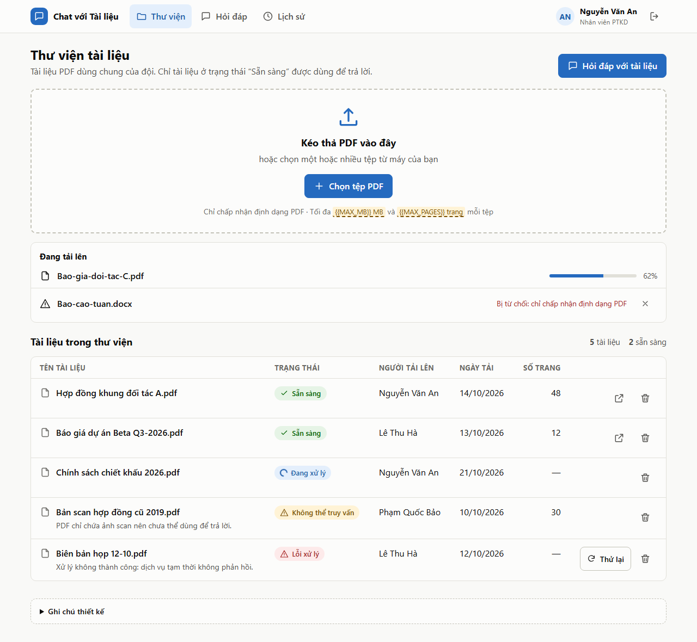

*Đối chiếu:* vùng kéo thả và nút "Chọn tệp PDF" (chọn nhiều tệp); khay "Đang tải lên" hiện tiến trình từng tệp; tệp tải xong xuất hiện đầu danh sách với trạng thái "Đang xử lý".

---

### US-A2 — Báo lỗi khi file không phải PDF · **P0**

**Là** nhân viên PTKD, **tôi muốn** được thông báo rõ ràng khi tải lên file không phải PDF, **để** biết sửa lại thao tác.

- **Nguồn:** BR-002 · BRU-004 · SN-001 · `AC-002`
- **Kỹ thuật liên quan:** API-02 (lỗi `UNSUPPORTED_FORMAT`)

**Tiêu chí chấp nhận**
- *Given* tôi đang tải tài liệu lên,
  *When* tôi chọn một file .docx, .jpg hoặc .xlsx,
  *Then* hệ thống từ chối file đó, không thêm vào thư viện và hiển thị thông báo nêu rõ "chỉ chấp nhận định dạng PDF".

**Màn hình: 02 Thư viện tài liệu** (xem ảnh ở US-A1)

*Đối chiếu:* trong khay "Đang tải lên", dòng `Bao-cao-tuan.docx` có biểu tượng cảnh báo và chữ "Bị từ chối: chỉ chấp nhận định dạng PDF"; có nút đóng thông báo. Tệp bị từ chối **không** có trong bảng thư viện bên dưới.

---

### US-A3 — Xem trạng thái xử lý tài liệu · **P0**

**Là** nhân viên PTKD, **tôi muốn** thấy trạng thái "đang xử lý" / "sẵn sàng" của mỗi tài liệu, **để** biết khi nào có thể hỏi về nó.

- **Nguồn:** BR-003 · SN-001 · `AC-003`
- **Kỹ thuật liên quan:** API-03/04; giao diện thăm dò trạng thái 3 giây/lần khi còn tài liệu đang xử lý (SAD §2.1)

**Tiêu chí chấp nhận**
- *Given* một PDF hợp lệ vừa được tải lên,
  *When* quá trình xử lý hoàn tất,
  *Then* trạng thái tài liệu chuyển sang "sẵn sàng" và một câu hỏi về nội dung riêng của tài liệu đó được trả lời đúng ngay sau đó.

**Màn hình: 02 Thư viện tài liệu** (xem ảnh ở US-A1)

*Đối chiếu:* cột "Trạng thái" dùng **biểu tượng + chữ + màu** (không chỉ màu): "Sẵn sàng" (dấu tick xanh), "Đang xử lý" (vòng quay xanh dương). Bộ đếm "5 tài liệu · 2 sẵn sàng" ở đầu danh sách.

---

### US-A4 — Cảnh báo PDF không trích xuất được · **P0**

**Là** nhân viên PTKD, **tôi muốn** được cảnh báo khi một PDF không chứa văn bản trích xuất được (ví dụ bản scan), **để** không hiểu nhầm rằng tài liệu đã được dùng làm nguồn.

- **Nguồn:** BR-004 · SN-005 · RSK-003 · `AC-004`
- **Kỹ thuật liên quan:** trạng thái `NOT_EXTRACTABLE` (SDD §3.7)

**Tiêu chí chấp nhận**
- *Given* tôi tải lên một PDF chỉ chứa ảnh scan,
  *When* hệ thống xử lý xong tài liệu,
  *Then* tôi nhận được thông báo "tài liệu này không thể truy vấn", và các câu trả lời sau đó không trích dẫn tài liệu này.

**Màn hình: 02 Thư viện tài liệu** (xem ảnh ở US-A1)

*Đối chiếu:* dòng `Bản scan hợp đồng cũ 2019.pdf` có nhãn vàng "Không thể truy vấn" **và** câu giải thích ngay dưới tên ("PDF chỉ chứa ảnh scan nên chưa thể dùng để trả lời"). Cảnh báo nằm cố định trên dòng tài liệu, không phải thông báo thoáng qua (PRD §4.2).

---

### US-A5 — Biết giới hạn kích thước/số trang · **P1**

**Là** nhân viên PTKD, **tôi muốn** biết giới hạn kích thước/số trang file trước khi tải lên, **để** tránh tải lên thất bại không rõ lý do.

- **Nguồn:** BR-005 · SN-001, SN-010 · `AC-005` · **`[TBD: OQ-013]`**
- **Kỹ thuật liên quan:** API-02 (lỗi `FILE_TOO_LARGE`)

**Tiêu chí chấp nhận** *(viết lại từ AC-005)*
- *Given* giới hạn kích thước và số trang đã được phê duyệt,
  *When* tôi tải lên file đúng giới hạn,
  *Then* hệ thống chấp nhận file.
- *Given* giới hạn đã được phê duyệt,
  *When* tôi tải lên file vượt giới hạn,
  *Then* hệ thống từ chối và thông báo nêu rõ giới hạn.

**Màn hình: 02 và 03**

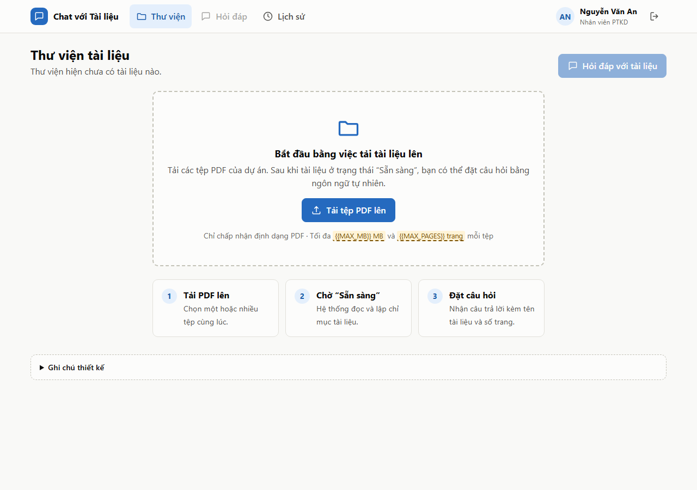

*Đối chiếu:* dòng "Chỉ chấp nhận định dạng PDF · Tối đa `{{MAX_MB}}` MB và `{{MAX_PAGES}}` trang mỗi tệp" nằm ngay dưới nút chọn tệp, ở cả màn 02 và 03. Hai giá trị đang là chỗ giữ chỗ (tô nét đứt) **chờ OQ-013**.

---

## 3. Epic B — Quản lý thư viện tài liệu

### US-B1 — Xem danh sách thư viện · **P0**

**Là** nhân viên PTKD, **tôi muốn** xem danh sách tất cả tài liệu trong thư viện (tên, người tải lên, ngày, trạng thái), **để** biết phạm vi kiến thức hiện có trước khi đặt câu hỏi.

- **Nguồn:** BR-006 · SN-009 · `AC-006`
- **Kỹ thuật liên quan:** API-03

**Tiêu chí chấp nhận**
- *Given* thư viện có ít nhất một tài liệu,
  *When* tôi mở màn hình danh sách thư viện,
  *Then* mỗi tài liệu hiển thị đủ 4 thông tin: tên, người tải lên, ngày tải lên, trạng thái.

**Màn hình: 02 Thư viện tài liệu**

*Đối chiếu:* bảng có các cột Tên tài liệu, Trạng thái, Người tải lên, Ngày tải, Số trang (cột số trang là thông tin bổ sung hữu ích, ngoài 4 thông tin tối thiểu).

---

### US-B2 — Xóa tài liệu · **P0**

**Là** nhân viên PTKD, **tôi muốn** xóa một tài liệu khỏi thư viện, **để** loại bỏ tài liệu lỗi thời hoặc sai trước khi nó ảnh hưởng tới câu trả lời.

- **Nguồn:** BR-007 · BRU-002 · SN-009 · `AC-007` · quyền xóa **`[TBD: OQ-011]`**
- **Kỹ thuật liên quan:** API-05; xóa mềm tức thì rồi xóa vật lý nền (DD-10)

**Tiêu chí chấp nhận**
- *Given* tài liệu X đang ở trạng thái "sẵn sàng" trong thư viện,
  *When* tôi xóa tài liệu X,
  *Then* tài liệu X không còn xuất hiện trong danh sách, và một câu hỏi sau đó về nội dung chỉ có trong X nhận được câu trả lời "không tìm thấy thông tin", không dùng nội dung đã xóa.

**Màn hình: 02 — hộp thoại xác nhận xóa**

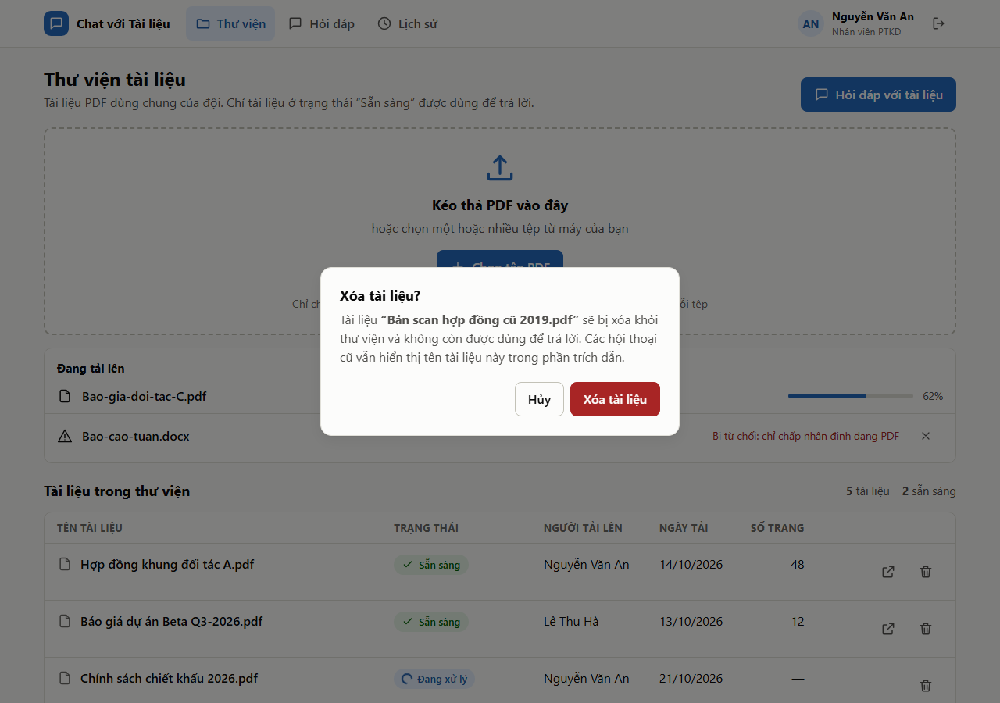

*Đối chiếu:* thao tác xóa luôn qua hộp thoại xác nhận nêu tên tài liệu và hệ quả ("không còn được dùng để trả lời; hội thoại cũ vẫn hiển thị tên"); nút "Hủy" nhận focus đầu tiên, phím Esc đóng hộp thoại; xóa xong có thông báo nhanh và bộ đếm cập nhật.

---

## 4. Epic C — Hỏi đáp với tài liệu

### US-C1 — Hỏi bằng ngôn ngữ tự nhiên · **P0**

**Là** nhân viên PTKD, **tôi muốn** đặt câu hỏi bằng ngôn ngữ tự nhiên và nhận câu trả lời dựa trên nội dung các tài liệu trong thư viện, **để** không phải tự đọc toàn bộ tài liệu.

- **Nguồn:** BR-008 · BO-001 · SN-002 · `AC-008`
- **Kỹ thuật liên quan:** API-09, CMP-06, CMP-07

**Tiêu chí chấp nhận**
- *Given* thư viện có tài liệu ở trạng thái "sẵn sàng",
  *When* tôi đặt một câu hỏi thuộc bộ câu hỏi kiểm thử,
  *Then* tôi nhận được câu trả lời; trên toàn bộ bộ kiểm thử, tỷ lệ câu trả lời "đạt" đạt mục tiêu MET-002 đã được phê duyệt `[TBD: OQ-007, OQ-008]`.

**Màn hình: 04 Hỏi đáp**

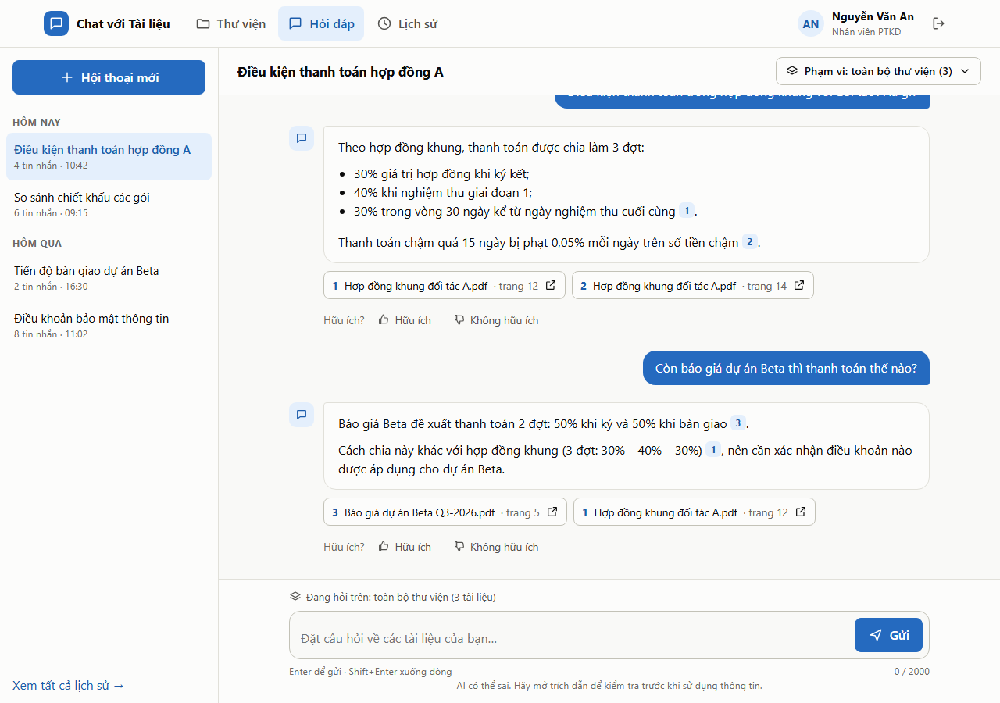

*Đối chiếu:* ô nhập câu hỏi cố định ở cuối màn hình (Enter để gửi, Shift+Enter xuống dòng, bộ đếm 2000 ký tự); câu trả lời hiển thị dạng luồng trò chuyện; dòng nhắc "AI có thể sai. Hãy mở trích dẫn để kiểm tra". Chất lượng câu trả lời (AC-008) kiểm bằng bộ câu hỏi kiểm thử, không kiểm được qua ảnh.

---

### US-C2 — Tổng hợp từ nhiều tài liệu · **P0**

**Là** nhân viên PTKD, **tôi muốn** câu trả lời tổng hợp thông tin từ nhiều tài liệu khi câu hỏi liên quan đến nhiều nguồn, **để** không phải tự đối chiếu thủ công.

- **Nguồn:** BR-009 · BO-001 · SN-003 · `AC-009`
- **Kỹ thuật liên quan:** truy xuất đa dạng nguồn, tối đa 3 đoạn/tài liệu (SAD §3.2.1 bước 8)

**Tiêu chí chấp nhận**
- *Given* câu trả lời cho câu hỏi của tôi nằm rải rác ở ≥ 2 tài liệu,
  *When* tôi đặt câu hỏi đó,
  *Then* câu trả lời chứa đầy đủ các phần thông tin liên quan và trích dẫn tất cả tài liệu tương ứng (≥ 2 tài liệu).

**Màn hình: 04 Hỏi đáp** (xem ảnh ở US-C1)

*Đối chiếu:* ở lượt hỏi thứ hai, câu trả lời so sánh **báo giá Beta** (trích dẫn 3) với **hợp đồng khung** (trích dẫn 1) và chỉ ra điểm khác nhau; hai chip nguồn thuộc hai tài liệu khác nhau.

---

### US-C3 — Trích dẫn tên tài liệu + số trang · **P0**

**Là** nhân viên PTKD, **tôi muốn** mỗi câu trả lời có trích dẫn tên tài liệu và số trang, **để** kiểm chứng được trước khi dùng thông tin.

- **Nguồn:** BR-010 · BRU-003 · BO-002 · SN-004 · `AC-010`
- **Kỹ thuật liên quan:** `CitationValidator`, API-06 (tệp PDF, hỗ trợ Range)

**Tiêu chí chấp nhận**
- *Given* câu trả lời chứa thông tin lấy từ tài liệu,
  *When* câu trả lời được hiển thị,
  *Then* 100% câu trả lời như vậy kèm trích dẫn tên tài liệu + số trang, và ≥ 95% trích dẫn trỏ đúng tới tài liệu/trang chứa thông tin khi được đối chiếu thủ công.

**Màn hình: 04 Hỏi đáp → 06 Xem trích dẫn**

*Đối chiếu (04):* số hiệu trong văn bản (**1**, **2**) khớp với chip nguồn bên dưới ("Hợp đồng khung đối tác A.pdf · trang 12"); bấm vào số hiệu hoặc chip đều mở màn hình xem trích dẫn.

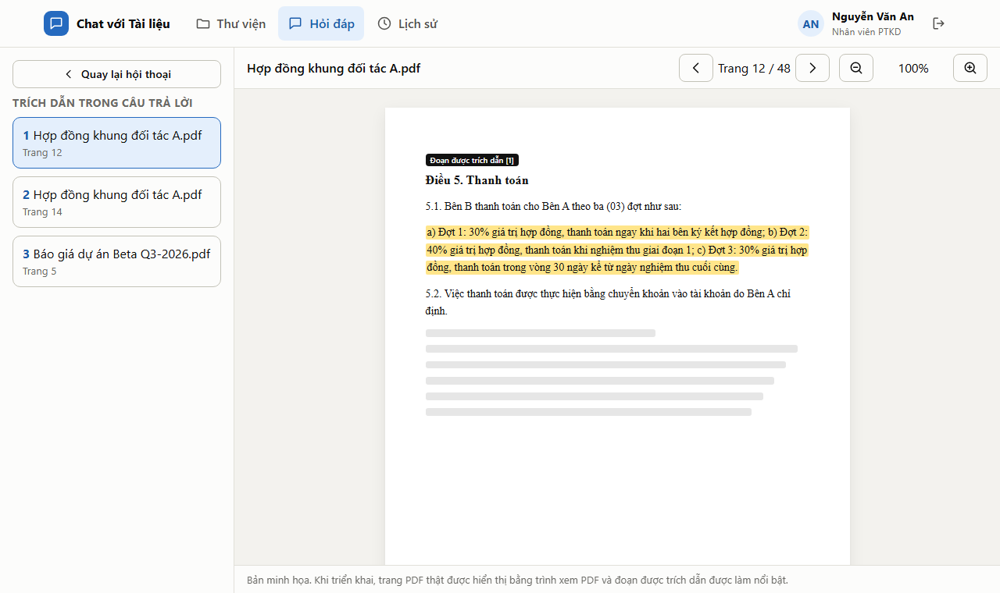

*Đối chiếu (06):* mở đúng tài liệu và đúng **trang 12/48**; đoạn được trích dẫn có nền vàng **và** nhãn chữ "Đoạn được trích dẫn [1]" (không chỉ dựa vào màu); danh sách bên trái cho phép chuyển nhanh giữa các trích dẫn của cùng câu trả lời.

Các trích dẫn khác của cùng cuộc hội thoại:

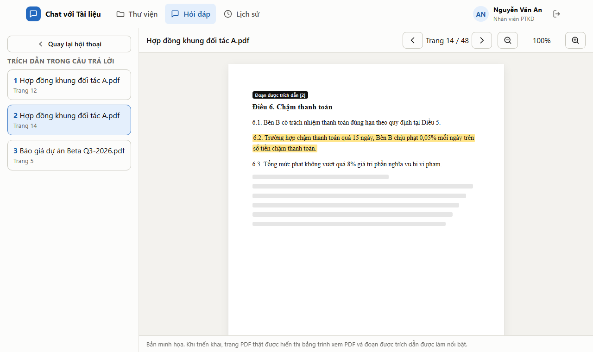 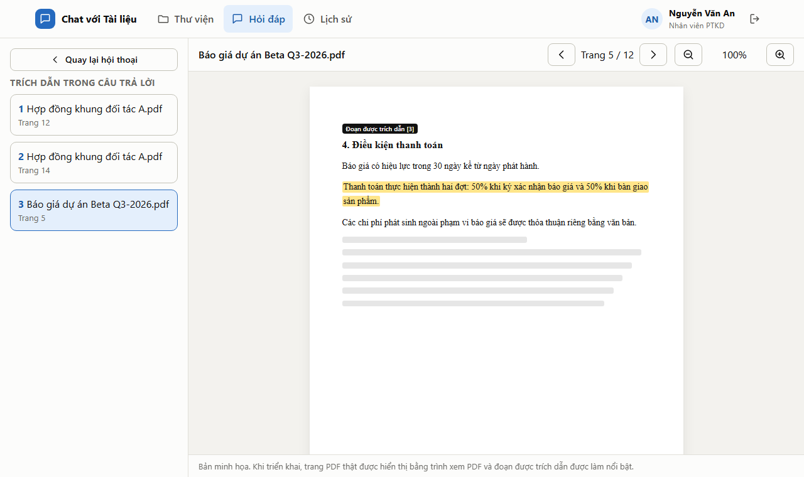

---

### US-C4 — Báo "không tìm thấy" · **P0**

**Là** nhân viên PTKD, **tôi muốn** được báo rõ khi thư viện không có thông tin để trả lời, **để** không bị đánh lừa bởi câu trả lời bịa đặt.

- **Nguồn:** BR-011 · BRU-001 · BO-002 · SN-005 · RSK-001 · `AC-011`
- **Kỹ thuật liên quan:** `NotFoundPolicy`, hai lớp kiểm soát (ngưỡng liên quan + kiểm tra trích dẫn)

**Tiêu chí chấp nhận**
- *Given* không tài liệu nào trong thư viện chứa thông tin để trả lời câu hỏi,
  *When* tôi đặt câu hỏi đó,
  *Then* hệ thống thông báo không tìm thấy thông tin trong tài liệu thay vì tạo ra nội dung không có nguồn; đạt ≥ 95% trên ≥ 20 câu hỏi kiểm thử loại này.

**Màn hình: 05 — trạng thái "Không tìm thấy"**

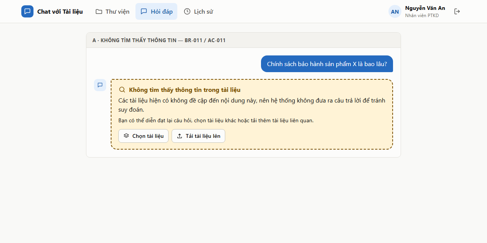

*Đối chiếu:* khung **nét đứt, nền cảnh báo, tiêu đề riêng** khác hẳn câu trả lời thường để người dùng không nhầm (PRD §4.1); không có trích dẫn; có hai hành động gợi ý "Chọn tài liệu" và "Tải tài liệu lên".

---

### US-C5 — Thời gian phản hồi chấp nhận được · **P0**

**Là** nhân viên PTKD, **tôi muốn** nhận được câu trả lời trong thời gian chấp nhận được, **để** công cụ thực sự nhanh hơn tra cứu thủ công.

- **Nguồn:** BR-012 · BO-001 · SN-002 · `AC-012` · **`[TBD: OQ-014]`**
- **Kỹ thuật liên quan:** ngân sách độ trễ SAD §3.2.1, SP-01

**Tiêu chí chấp nhận**
- *Given* tôi đặt một câu hỏi thuộc bộ kiểm thử,
  *When* hệ thống xử lý câu hỏi,
  *Then* ≥ 90% câu trả lời được trả về trong giới hạn thời gian `[TBD: OQ-014]` giây đã phê duyệt.

**Màn hình: 05 — trạng thái đang xử lý**

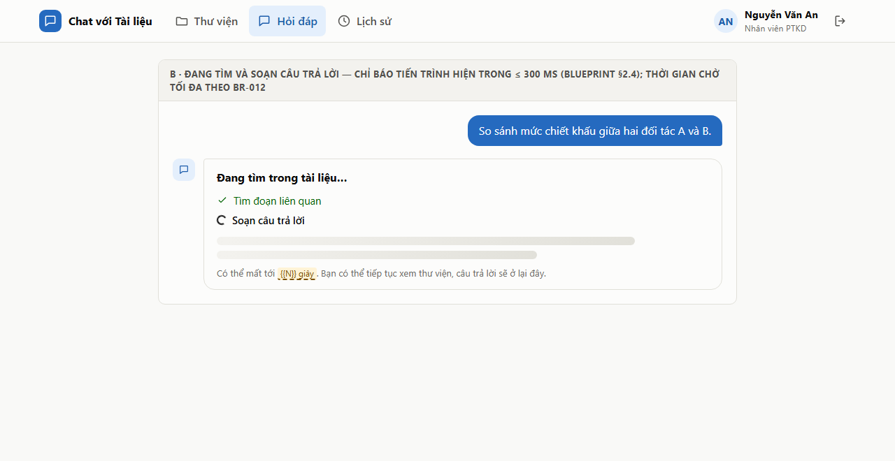

*Đối chiếu:* chỉ báo tiến trình xuất hiện trong ≤ 300 ms (Blueprint §2.4) với hai bước "Tìm đoạn liên quan" (xong) và "Soạn câu trả lời" (đang chạy) cùng khung xương; ngưỡng thời gian chờ tối đa là giá trị giữ chỗ **chờ OQ-014**. Tiêu chí 90% đo bằng bộ kiểm thử thời gian, không đo được qua ảnh.

---

### US-C6 — Hỏi câu nối tiếp · **P1**

**Là** nhân viên PTKD, **tôi muốn** đặt câu hỏi nối tiếp tham chiếu ngầm tới câu hỏi/câu trả lời trước, **để** không phải lặp lại ngữ cảnh mỗi lần hỏi.

- **Nguồn:** BR-013 · SN-006 · `AC-013`
- **Kỹ thuật liên quan:** viết lại câu hỏi từ lịch sử (SAD §3.2.1 bước 6)

**Tiêu chí chấp nhận** *(viết lại từ AC-013)*
- *Given* tôi vừa hỏi "Điều kiện thanh toán của hợp đồng A là gì?" và nhận câu trả lời,
  *When* tôi hỏi tiếp "Còn báo giá Beta thì sao?" trong cùng hội thoại,
  *Then* câu trả lời nói về điều kiện thanh toán của báo giá Beta.

**Màn hình: 04 Hỏi đáp**

*Đối chiếu:* câu hỏi thứ hai "Còn báo giá dự án Beta thì thanh toán thế nào?" không nhắc lại chủ đề "thanh toán" hay "điều kiện" nhưng câu trả lời vẫn đúng ngữ cảnh.

---

### US-C7 — Giới hạn phạm vi tài liệu · **P1**

**Là** nhân viên PTKD, **tôi muốn** giới hạn câu hỏi vào một hoặc một số tài liệu cụ thể, **để** tăng độ chính xác khi tôi đã biết nguồn.

- **Nguồn:** BR-014 · BO-002 · SN-003 · `AC-014`
- **Kỹ thuật liên quan:** tham số `documentIds` của API-09

**Tiêu chí chấp nhận** *(viết lại từ AC-014)*
- *Given* thư viện có tài liệu X và Y cùng chứa thông tin liên quan,
  *When* tôi chọn phạm vi chỉ gồm tài liệu Y rồi đặt câu hỏi,
  *Then* câu trả lời chỉ trích dẫn tài liệu Y.

**Màn hình: 04 — bộ chọn phạm vi**

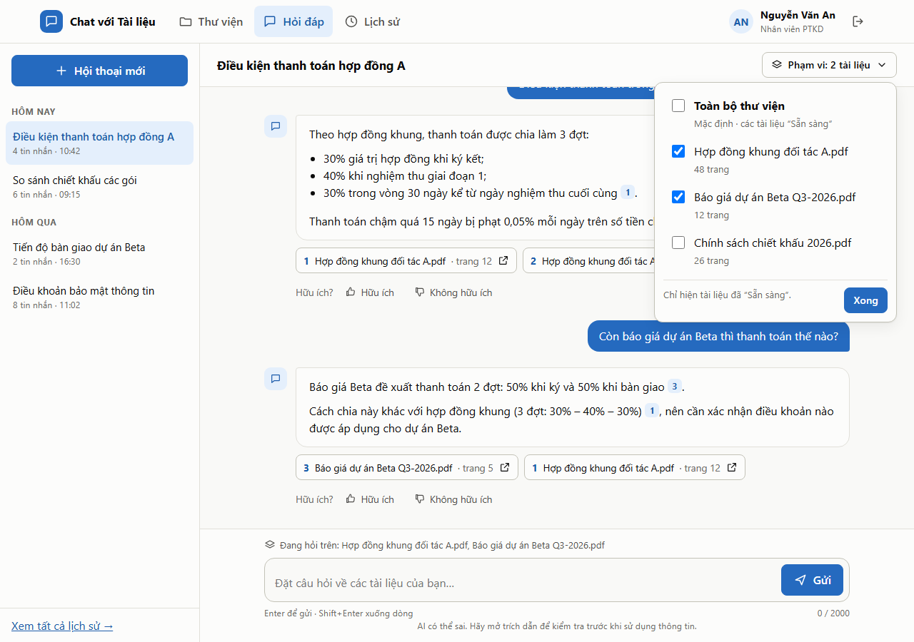

*Đối chiếu:* nút "Phạm vi" ở đầu hội thoại mở danh sách tài liệu **chỉ gồm tài liệu "Sẵn sàng"**; mặc định "Toàn bộ thư viện". Khi chọn một phần, nhãn nút đổi thành "Phạm vi: 2 tài liệu" và dòng trên ô nhập liệt kê tên tài liệu đang áp dụng.

---

### US-C8 — Hỏi/đáp bằng ngôn ngữ làm việc · **P0**

**Là** nhân viên PTKD, **tôi muốn** hỏi và nhận trả lời bằng ngôn ngữ làm việc của mình, **để** không phải tự dịch.

- **Nguồn:** BR-015 · SN-002 · `AC-015` · **`[TBD: OQ-009]`**
- **Kỹ thuật liên quan:** mô hình embedding đa ngữ, chuỗi giao diện tách khỏi mã (i18n)

**Tiêu chí chấp nhận**
- *Given* tôi đặt câu hỏi bằng một trong các ngôn ngữ được phê duyệt `[TBD: OQ-009]`,
  *When* hệ thống trả lời,
  *Then* câu trả lời ở cùng ngôn ngữ với câu hỏi và vẫn đạt tiêu chí AC-008.

**Màn hình: 04 Hỏi đáp** (xem ảnh ở US-C1)

*Đối chiếu:* thiết kế hiện chỉ thể hiện giao diện và câu hỏi/đáp **tiếng Việt**. Danh sách ngôn ngữ được hỗ trợ chưa chốt, nên chưa có màn hình chuyển ngôn ngữ; không đưa vào thiết kế cho tới khi OQ-009 được giải quyết.

---

## 5. Epic D — Quản lý hội thoại

### US-D1 — Bắt đầu hội thoại mới · **P0**

**Là** nhân viên PTKD, **tôi muốn** bắt đầu một hội thoại mới không mang ngữ cảnh của hội thoại trước, **để** tách biệt các chủ đề tra cứu khác nhau.

- **Nguồn:** BR-016 · SN-006 · `AC-016`
- **Kỹ thuật liên quan:** API-07

**Tiêu chí chấp nhận**
- *Given* tôi đã có một hội thoại trước đó về chủ đề A,
  *When* tôi bắt đầu một hội thoại mới và hỏi câu nối tiếp dạng "Còn B thì sao?",
  *Then* câu trả lời không dựa trên ngữ cảnh của hội thoại A.

**Màn hình: 04 Hỏi đáp** (xem ảnh ở US-C1)

*Đối chiếu:* nút "**Hội thoại mới**" nổi bật ở đầu thanh bên trái, tách biệt với danh sách hội thoại đang có; hội thoại đang mở được đánh dấu bằng nền xanh nhạt.

---

### US-D2 — Xem lại lịch sử hội thoại · **P2**

**Là** nhân viên PTKD, **tôi muốn** xem lại các hội thoại trước đây của mình, **để** không phải hỏi lại câu đã hỏi.

- **Nguồn:** BR-017 · BRU-005 · SN-007 · `AC-017`
- **Kỹ thuật liên quan:** API-08 (lọc cứng theo chủ sở hữu)

**Tiêu chí chấp nhận** *(viết lại từ AC-017)*
- *Given* tôi đã có các hội thoại trước đây,
  *When* tôi mở lịch sử,
  *Then* tôi thấy đầy đủ câu hỏi và câu trả lời đã có; người dùng khác không xem được các hội thoại này.

**Màn hình: 07 Lịch sử hội thoại**

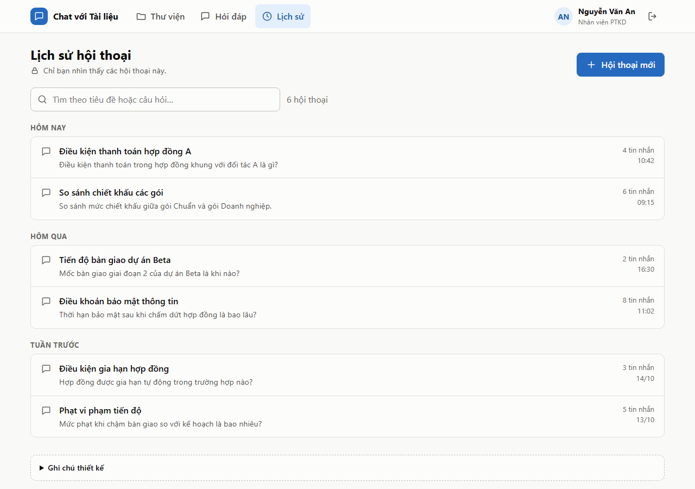

*Đối chiếu:* dòng "Chỉ bạn nhìn thấy các hội thoại này"; hội thoại nhóm theo Hôm nay / Hôm qua / Tuần trước, mỗi mục có tiêu đề, câu hỏi đầu, số tin nhắn và giờ.

Trạng thái không có kết quả khi tìm kiếm:

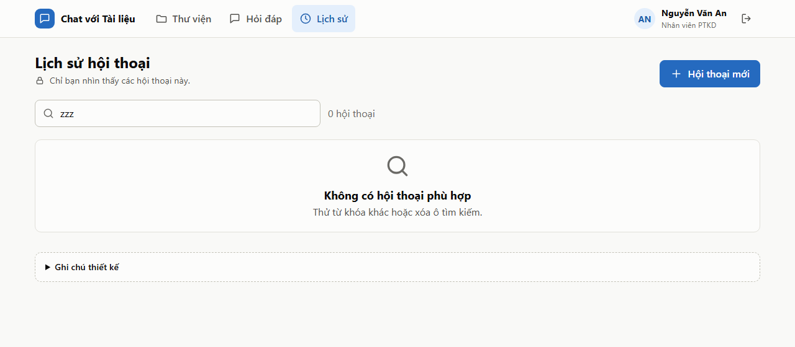

---

## 6. Epic E — Truy cập & bảo vệ dữ liệu

### US-E1 — Chỉ người được cấp quyền mới truy cập · **P0**

**Là** quản trị hệ thống, **tôi muốn** chỉ người dùng đã xác thực và được cấp quyền mới truy cập được thư viện và chức năng hỏi đáp, **để** bảo vệ tài liệu nội bộ.

- **Nguồn:** BR-018 · SN-011 · `AC-018` · cơ chế xác thực **`[TBD: OQ-018]`**
- **Kỹ thuật liên quan:** API-01, OIDC + cookie phiên (SAD §4.1.1), mã lỗi `UNAUTHENTICATED`/`FORBIDDEN`

**Tiêu chí chấp nhận**
- *Given* một người dùng chưa đăng nhập hoặc không nằm trong danh sách được cấp quyền,
  *When* người đó cố truy cập thư viện hoặc chức năng hỏi đáp,
  *Then* truy cập bị từ chối ở 100% các điểm chức năng được kiểm thử.

**Màn hình: 01 Đăng nhập và 09 Lỗi truy cập**

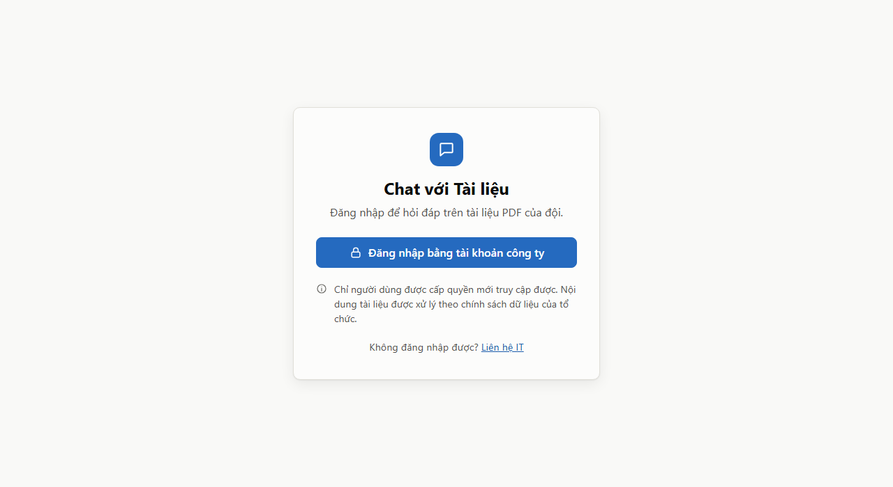 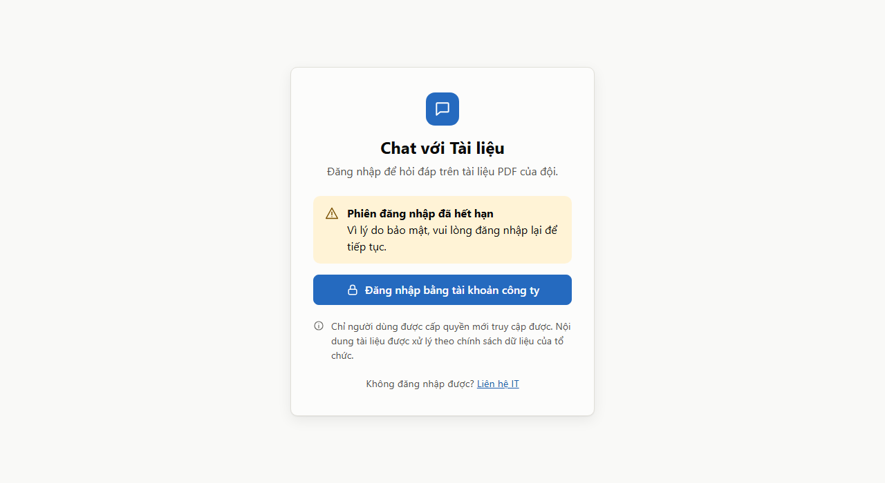

*Đối chiếu (01):* nút đăng nhập bằng tài khoản công ty; ghi chú chỉ người được cấp quyền mới truy cập; biến thể thông báo "Phiên đăng nhập đã hết hạn" (cũng có "Tài khoản chưa được cấp quyền" khi thêm `#denied`).

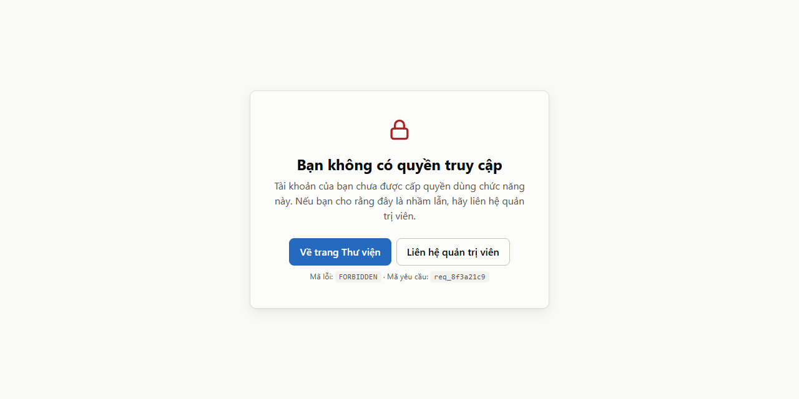 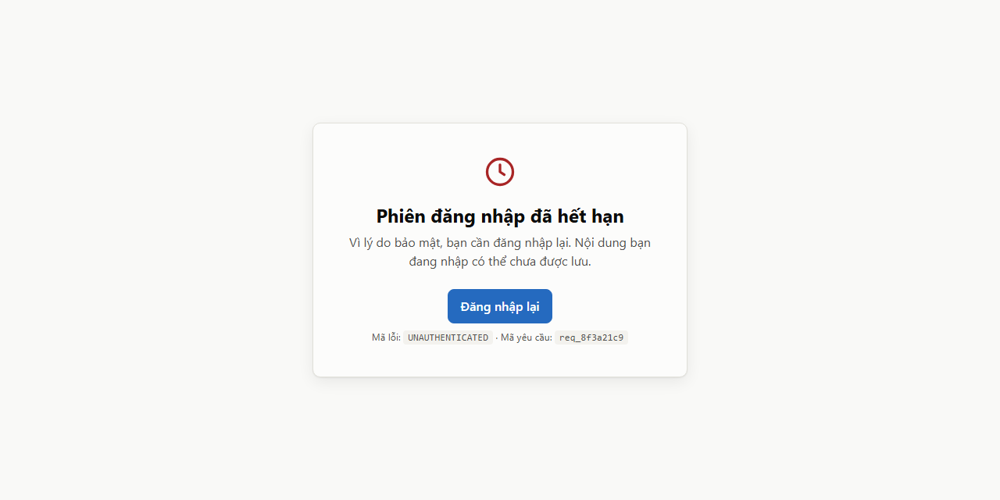

*Đối chiếu (09):* không lộ bất kỳ nội dung thư viện nào; hiển thị mã lỗi (`FORBIDDEN`, `UNAUTHENTICATED`) và mã yêu cầu để IT truy vết; có đường quay về hoặc liên hệ quản trị viên.

---

### US-E2 — Xử lý dữ liệu theo chính sách đã duyệt · **P0**

**Là** IT/Bảo mật, **tôi muốn** việc xử lý nội dung tài liệu tuân thủ chính sách dữ liệu đã duyệt, **để** tài liệu nội bộ không bị sử dụng sai mục đích.

- **Nguồn:** BR-020 · SN-011 · `AC-020` · **chặn cứng bởi `OQ-006`**
- **Kỹ thuật liên quan:** SAD §4.1.5, AD-03

**Tiêu chí chấp nhận**
- *Given* chính sách dữ liệu đã được IT/Bảo mật xác định (OQ-006),
  *When* hệ thống xử lý nội dung tài liệu (gửi tới dịch vụ AI, lưu trữ, log),
  *Then* IT/Bảo mật xác nhận bằng văn bản rằng cách xử lý đáp ứng chính sách đó.

**Màn hình: không có.** Story này là điều kiện về cách hệ thống xử lý dữ liệu và quy trình ký duyệt, không phải thao tác trên giao diện. Giao diện chỉ gián tiếp hỗ trợ qua ghi chú ở màn hình đăng nhập ("Nội dung tài liệu được xử lý theo chính sách dữ liệu của tổ chức"). Không thể bắt đầu phát triển kỹ thuật phần AI cho tới khi OQ-006 được giải quyết.

---

## 7. Epic F — Phản hồi & đo lường giá trị

### US-F1 — Đánh giá câu trả lời · **P1**

**Là** nhân viên PTKD, **tôi muốn** đánh giá một câu trả lời là "hữu ích" hoặc "không hữu ích", **để** đóng góp dữ liệu cải thiện công cụ.

- **Nguồn:** BR-019 · BO-004 · SN-008 · `AC-019` · MET-004
- **Kỹ thuật liên quan:** API-10

**Tiêu chí chấp nhận** *(viết lại từ AC-019)*
- *Given* tôi đang xem một câu trả lời,
  *When* tôi chọn "Hữu ích" hoặc "Không hữu ích",
  *Then* đánh giá được ghi nhận và xuất hiện trong số liệu MET-004.

**Màn hình: 04 Hỏi đáp** (xem ảnh ở US-C1)

*Đối chiếu:* dưới mỗi câu trả lời có cặp nút "Hữu ích" / "Không hữu ích" nhỏ, không chặn việc đọc tiếp; nút đã chọn có nền xanh và viền (`aria-pressed`), bấm lại để bỏ chọn.

---

### US-F2 — Báo cáo sử dụng hằng tuần · **P0**

**Là** Sponsor, **tôi muốn** nhận báo cáo sử dụng hằng tuần (số người dùng hoạt động, số câu hỏi), **để** có dữ liệu ra quyết định go/no-go sau MVP.

- **Nguồn:** BR-021 · BO-003 · SN-008 · `AC-021` · MET-003
- **Kỹ thuật liên quan:** API-11, bảng `usage_event`

**Tiêu chí chấp nhận**
- *Given* một tuần sử dụng đã kết thúc,
  *When* báo cáo tuần được tạo,
  *Then* báo cáo thể hiện số người dùng hoạt động và số câu hỏi đã đặt, khớp với nhật ký sử dụng thực tế của tuần đó.

**Màn hình: 08 Báo cáo hằng tuần (vai trò Sponsor)**

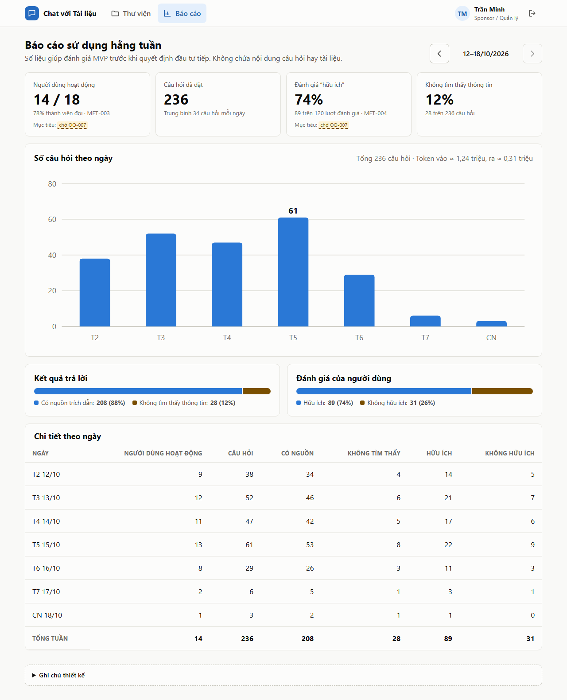

*Đối chiếu:* chọn tuần bằng nút trước/sau; bốn ô chỉ số (người dùng hoạt động, câu hỏi, tỷ lệ hữu ích, tỷ lệ không tìm thấy); biểu đồ cột có bảng chi tiết tương ứng bên dưới; **số tổng của bảng khớp số trên ô chỉ số** (đây là điều kiện AC-021 phải kiểm với nhật ký thật). Giá trị mục tiêu hiển thị là giữ chỗ **chờ OQ-007**; mẫu số "18 thành viên" **chờ OQ-015**.

---

## 8. Ma trận Story ↔ Màn hình ↔ Ảnh

| Story | Màn hình | Ảnh |
|---|---|---|
| US-A1…A4, B1 | 02 | `library.png` |
| US-A5 | 02, 03 | `library_empty.png` |
| US-B2 | 02 | `library_delete_modal.png` |
| US-C1, C2, C6, C8, D1, F1 | 04 | `chat.png` |
| US-C3 | 04, 06 | `chat.png`, `viewer_p12.png`, `viewer_p14.png`, `viewer_beta_p5.png` |
| US-C4 | 05 | `chat_notfound.png` |
| US-C5 | 05 | `chat_loading.png` |
| US-C7 | 04 | `chat_scope.png` |
| US-D2 | 07 | `history.png`, `history_noresult.png` |
| US-E1 | 01, 09 | `login.png`, `login_expired.png`, `denied_403.png`, `denied_401.png` |
| US-E2 | — | *(không có)* |
| US-F2 | 08 | `report.png` |
| *(trạng thái lỗi, xem mục 9)* | 05 | `chat_error.png`, `chat_offline.png`, `chat_blocked.png`, `chat_ratelimit.png` |

---

## 9. Trạng thái lỗi của màn hình Hỏi đáp (PRD §4.2)

Các trạng thái này không thuộc một story riêng mà là yêu cầu chung về xử lý lỗi của PRD §4.2 và SDD §3.7, áp dụng cho nhóm story C.

| Tình huống | Ảnh | Điểm cần đối chiếu |
|---|---|---|
| Lỗi dịch vụ AI / quá thời gian | 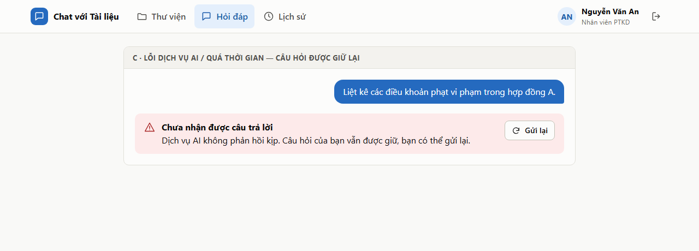 | Câu hỏi được giữ; có nút "Gửi lại" |
| Mất kết nối mạng | 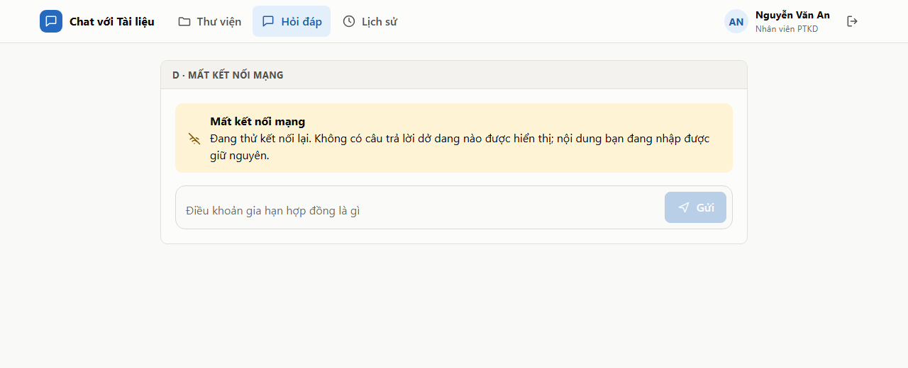 | Không hiển thị câu trả lời dở dang; nội dung đang nhập được giữ |
| Chưa có tài liệu sẵn sàng | 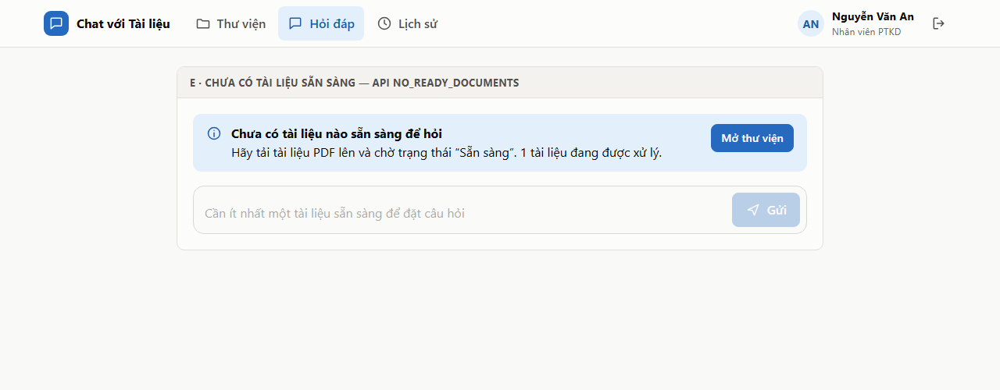 | Chặn đặt câu hỏi; dẫn tới thư viện |
| Vượt giới hạn tốc độ | 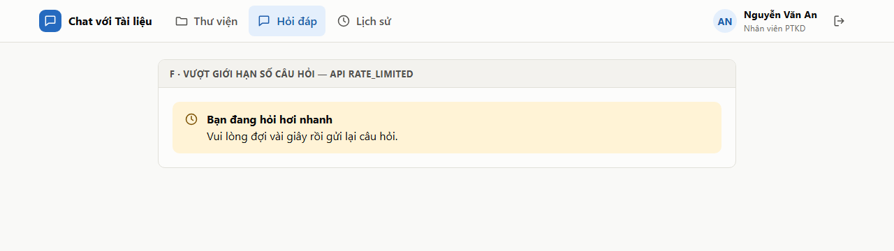 | Thông báo thân thiện, không kỹ thuật |

---

## 10. Phần thiết kế vượt ra ngoài user story hiện có

Các điểm sau xuất hiện trong thiết kế màn hình nhưng **chưa có story hoặc BR tương ứng** trong PRD/BRD. Cần BA và Sponsor quyết định giữ, thêm story hay bỏ.

| Điểm | Nằm ở | Nguồn gốc | Đề xuất |
|---|---|---|---|
| Nút **"Thử lại"** cho tài liệu lỗi xử lý (`FAILED`) | 02 | SDD §3.7 (vòng đời tài liệu) | Thêm vào US-A3 hoặc tạo story riêng |
| Trạng thái **"Vượt giới hạn tốc độ"** | 05 | SDD §3.5 (`RATE_LIMITED`), SAD §4.2 | Giữ như yêu cầu phi chức năng |
| **Tìm kiếm** trong lịch sử hội thoại | 07 | Thiết kế bổ sung | Hoãn nếu cần cắt phạm vi (P2) |
| Thống kê **token** trong báo cáo | 08 | SDD CN-12 (kiểm soát chi phí) | Giữ nếu Sponsor cần theo dõi chi phí (RSK-006) |
| Chỉ số **"Không tìm thấy"** và **"Hữu ích"** trong báo cáo | 08 | MET-004, SDD | Xác nhận với Sponsor |
| Cột **Số trang** trong thư viện | 02 | Thiết kế bổ sung | Giữ (thông tin hữu ích, rủi ro thấp) |

## 11. Câu hỏi mở ảnh hưởng đến các story

| OQ | Ảnh hưởng | Story |
|---|---|---|
| OQ-006 | Chính sách dữ liệu AI — chặn cứng | US-E2; gián tiếp US-C1…C5 |
| OQ-007 | Giá trị mục tiêu MET-001…004 | US-C1, US-F1, US-F2 |
| OQ-008 | Bộ câu hỏi kiểm thử | US-C1, C2, C3, C4 |
| OQ-009 | Ngôn ngữ hỗ trợ | US-C8 |
| OQ-011 | Phân quyền, quyền xóa | US-B2 |
| OQ-013 | Giới hạn kích thước/số trang | US-A5 |
| OQ-014 | Ngưỡng thời gian phản hồi | US-C5 |
| OQ-015 | Số người dùng (mẫu số báo cáo) | US-F2 |
| OQ-018 | Cơ chế xác thực | US-E1 |

## 12. Tạo lại ảnh màn hình

Ảnh được chụp tự động từ các file HTML bằng Chrome ở chế độ không giao diện (cửa sổ 1280 px). Khi thiết kế thay đổi, chụp lại các ảnh trong [images/](images/) để tài liệu không lệch với màn hình. Các ảnh trạng thái (hộp thoại xóa, bộ chọn phạm vi, các khung ở màn 05) được chụp bằng bản sao tạm của file HTML đã mở sẵn trạng thái cần thể hiện.
