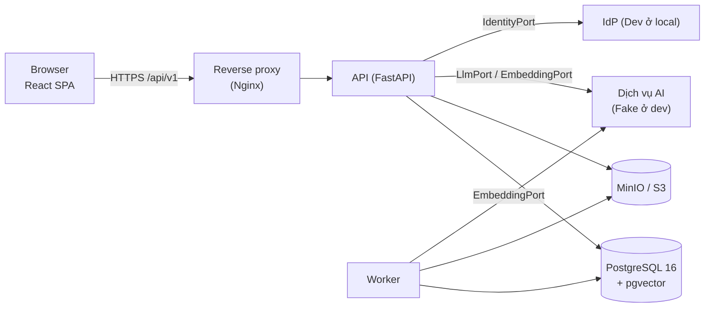
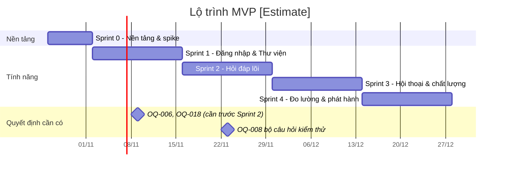

# Kế hoạch triển khai (Implementation Plan) — Chat với Tài liệu (MVP)

> **Dành cho:** developer backend, frontend, QA tham gia xây dựng MVP.
> **Đầu vào:** [SAD](../design/SAD.md) · [User Stories](../design/User_Stories.md) · [Blueprint/SDD](../design/Blueprint_Design.md) · [PRD](../requirements/PRD.md) · [BRD](../requirements/BRD.md) · [Thiết kế màn hình HTML](../design/html_design/index.html)
> **Trạng thái:** Draft v0.1 — 2026-10-21.
> **Nhãn:** `[TBD: OQ-xxx]` = chờ quyết định kinh doanh · `[Estimate]` = ước lượng, sẽ chỉnh sau Sprint 0 · `[Default]` = giá trị tạm dùng khi phát triển, thay khi OQ được chốt.

---

## 0. Đọc nhanh (5 phút)

| Câu hỏi | Trả lời ngắn |
|---|---|
| **Xây gì?** | Web app: tải PDF vào thư viện chung → hỏi đáp bằng ngôn ngữ tự nhiên → AI trả lời **chỉ từ tài liệu**, kèm **tên tài liệu + số trang**, hoặc báo **"không tìm thấy"**. 21 user story (16 P0, 4 P1, 1 P2). |
| **Kiến trúc?** | Modular monolith Python (FastAPI) gồm 2 tiến trình **API** và **Worker** + SPA React. Một PostgreSQL 16 + pgvector làm tất cả (dữ liệu, vector, full-text, hàng đợi, phiên). Tệp PDF ở object storage S3-compatible. AI nằm sau `LlmPort`/`EmbeddingPort`. |
| **Bao lâu?** | 5 sprint ≈ 9 tuần `[Estimate]`: Sprint 0 (1 tuần, nền tảng) + 4 sprint × 2 tuần. |
| **Đang bị chặn bởi gì?** | **OQ-006** (chính sách dữ liệu AI) chặn việc chọn nhà cung cấp AI thật. **Không chặn việc bắt đầu code**: mọi thứ chạy với `FakeLlm`/`FakeEmbedding` cho tới khi OQ-006 có kết quả (§9). |
| **Quy tắc không được vi phạm** | (1) Câu trả lời `ANSWERED` luôn có ≥ 1 trích dẫn hợp lệ. (2) Tài liệu không ở trạng thái `READY` không bao giờ được dùng làm nguồn. (3) Không log nội dung tài liệu/câu hỏi/câu trả lời. (4) Lõi nghiệp vụ không import SDK nhà cung cấp AI. |
| **Bắt đầu từ đâu?** | §3 (dựng môi trường) → §5 Sprint 0 → nhận task theo bảng của sprint. |

---

## 1. Phạm vi và nguyên tắc

### 1.1 Phạm vi MVP

**Có trong MVP:** tất cả 21 story trong [User_Stories.md](../design/User_Stories.md), 9 màn hình trong [html_design/](../design/html_design/index.html), bộ đánh giá chất lượng (CMP-17).

**Không có (BRD §5.2–5.3):** định dạng khác PDF, OCR cho PDF scan, phân quyền theo từng tài liệu, xuất file, quản lý phiên bản tài liệu, ứng dụng di động, tích hợp hệ thống khác.

### 1.2 Các quyết định coi như đã chốt cho việc code

Các mục sau được SAD ghi là `[Proposed]`. **Kế hoạch này dùng chúng làm mặc định**; Tech Lead xác nhận ở buổi kick-off (T-000). Nếu đổi, chỉ ảnh hưởng phần tương ứng.

| Hạng mục | Lựa chọn | Nguồn |
|---|---|---|
| Backend | Python 3.12, FastAPI + Uvicorn, Pydantic v2, SQLAlchemy 2 (async), Alembic | SAD §6 |
| Frontend | React 18 + TypeScript, Vite, TanStack Query, React Router, pdf.js | SAD §2.1 |
| CSDL | PostgreSQL 16 + pgvector, `unaccent` | SAD AD-05 |
| Hàng đợi | Bảng `job` + `FOR UPDATE SKIP LOCKED` (không Redis/RabbitMQ) | SAD AD-06 |
| Lưu tệp | S3-compatible (MinIO ở local) | SAD §2.3 |
| Trích văn bản PDF | `pypdfium2` (giấy phép Apache/BSD). **Không dùng PyMuPDF** trừ khi Pháp chế duyệt (AGPL) | SAD §6 |
| Xác thực | OIDC qua `IdentityPort`; **ở dev dùng `DevIdentity`** (đăng nhập giả lập) cho tới khi có OQ-018 | SAD AD-04 |
| Trả lời | Đầu ra LLM có cấu trúc → kiểm tra trích dẫn → mới phát `final`; **không phát luồng `token` ở MVP** | SAD AD-07 |
| Kiểm thử | pytest, Testcontainers (PostgreSQL thật), Vitest + Testing Library, Playwright (E2E) | SAD §6 |

### 1.3 Giả định về đội

`[Estimate]` 2 backend, 1 frontend, 1 QA bán thời gian, 1 Tech Lead (kiêm backend). Nếu đội khác, giữ thứ tự sprint và giãn thời gian.

---

## 2. Kiến trúc tóm tắt cho developer



**Luồng dữ liệu chính cần nhớ:**

1. **Tải lên:** `POST /documents` → kiểm tra → lưu S3 → giao dịch {`document(UPLOADED)`, `job(ingest_document)`, `audit_log`} → `202`.
2. **Xử lý:** Worker lấy job → trích văn bản từng trang → nếu không có chữ: `NOT_EXTRACTABLE` → chia chunk **trong từng trang** → embed → ghi chunk → `READY`.
3. **Hỏi:** `POST /conversations/{id}/messages` (SSE) → (viết lại câu hỏi nếu có lịch sử) → embed câu hỏi → tìm vector + full-text, lọc `READY` + phạm vi → hợp nhất RRF → **ngưỡng liên quan** → LLM sinh JSON `{answerable, content, citedChunkIds}` → **kiểm tra trích dẫn** → lưu → phát `final`.
4. **Xóa:** đặt `DELETED` ngay (truy xuất không còn thấy) → job `purge_document` dọn chunk và tệp.

Chi tiết từng bước: SAD §3.2.

---

## 3. Cấu trúc mã nguồn và môi trường phát triển

### 3.1 Cấu trúc repository (monorepo)

```text
chat-with-docs/
├─ backend/
│  ├─ app/
│  │  ├─ main.py                  # tạo FastAPI app, gắn router, middleware
│  │  ├─ worker.py                # vòng lặp worker (lệnh chạy riêng)
│  │  ├─ platform/                # config, logging, request_id, metrics, tracing, errors, audit
│  │  ├─ access/                  # session, roles, require_role(), current_user()
│  │  ├─ documents/               # router, service, repository, validators
│  │  ├─ ingestion/               # jobs: ingest_document, purge_document, reindex_all
│  │  ├─ retrieval/               # hybrid search, RRF, RetrievalPort impl
│  │  ├─ answering/               # AnswerService, NotFoundPolicy, CitationValidator, prompts/
│  │  ├─ conversations/           # router, service, repository
│  │  ├─ feedback/
│  │  ├─ analytics/               # emit(event), weekly report
│  │  ├─ jobs/                    # JobQueue (SKIP LOCKED), retry/backoff
│  │  ├─ ports/                   # LlmPort, EmbeddingPort, FileStorePort, IdentityPort, PdfTextPort
│  │  └─ adapters/                # fake/, openai_like/ (ví dụ), s3/, pdfium/, oidc/, dev_identity/
│  ├─ migrations/                 # Alembic
│  ├─ tests/                      # unit/, integration/, contract/
│  └─ pyproject.toml
├─ frontend/
│  ├─ src/
│  │  ├─ app/                     # router, layout (AppBar), providers
│  │  ├─ pages/                   # Login, Library, Chat, CitationViewer, History, WeeklyReport, ErrorPage
│  │  ├─ components/              # Badge, Button, Banner, Modal, Dropzone, CitationChip, ...
│  │  ├─ api/                     # client fetch, kiểu dữ liệu, SSE parser
│  │  ├─ styles/tokens.css        # lấy từ docs/design/html_design (common CSS)
│  │  └─ i18n/vi.json
│  └─ package.json
├─ eval/                          # CMP-17: bộ câu hỏi + script chấm điểm
├─ deploy/
│  ├─ docker-compose.yml
│  ├─ nginx.conf
│  └─ .env.example
├─ .github/workflows/ci.yml       # hoặc CI của tổ chức
└─ docs/                          # tài liệu hiện có
```

**Quy tắc phụ thuộc (CI kiểm bằng `import-linter`):**
- `documents, ingestion, retrieval, answering, conversations, feedback, analytics` **không** import `app.adapters.*` hay SDK bên ngoài — chỉ import `app.ports`.
- Chỉ `app/main.py` và `app/worker.py` (composition root) được khởi tạo adapter và tiêm vào service.
- Module không đọc/ghi bảng của module khác trực tiếp; gọi qua service. Ngoại lệ: `retrieval` được đọc `chunk` và `document`.

### 3.2 Chạy local

**Yêu cầu:** Docker Desktop, Python 3.12, Node.js 20 LTS trở lên, `make` (hoặc chạy lệnh tương ứng).

```bash
cp deploy/.env.example deploy/.env
make up          # postgres(pgvector) + minio + api + worker + web + nginx
make migrate     # alembic upgrade head
make seed        # tạo user dev, nạp 5 PDF mẫu (DEP-001) — dùng tài liệu không nhạy cảm
open http://localhost:8080
```

Phác thảo `docker-compose.yml` (tên image `[Verify]` trước khi dùng):

```yaml
services:
  db:
    image: pgvector/pgvector:pg16
    environment: { POSTGRES_DB: cwd, POSTGRES_USER: cwd, POSTGRES_PASSWORD: cwd }
    ports: ["5432:5432"]
  minio:
    image: minio/minio
    command: server /data --console-address ":9001"
    ports: ["9000:9000", "9001:9001"]
  api:
    build: ../backend
    command: uvicorn app.main:app --host 0.0.0.0 --port 8000
    env_file: .env
    depends_on: [db, minio]
  worker:
    build: ../backend
    command: python -m app.worker
    env_file: .env
    depends_on: [db, minio]
  web:
    build: ../frontend          # build tĩnh, nginx phục vụ
  proxy:
    image: nginx:stable
    volumes: ["./nginx.conf:/etc/nginx/nginx.conf:ro"]
    ports: ["8080:80"]
```

**Lưu ý cho `nginx.conf`:** đường dẫn hỏi đáp trả SSE phải tắt đệm, nếu không người dùng sẽ không thấy sự kiện `status`:

```nginx
location ~ ^/api/v1/conversations/.+/messages$ {
  proxy_pass http://api:8000;
  proxy_buffering off;
  proxy_read_timeout 120s;
}
```

### 3.3 Biến môi trường

| Biến | Ví dụ / mặc định | Ghi chú |
|---|---|---|
| `DATABASE_URL` | `postgresql+asyncpg://cwd:cwd@db:5432/cwd` | |
| `S3_ENDPOINT`, `S3_BUCKET`, `S3_ACCESS_KEY`, `S3_SECRET_KEY` | MinIO local | Bí mật lấy từ secret manager ở staging/prod |
| `AI_PROVIDER` | `fake` | `fake` ở dev/CI; nhà cung cấp thật sau OQ-006 |
| `EMBEDDING_MODEL`, `EMBEDDING_DIM` | `fake-384`, `384` `[Default]` | Đổi mô hình = chạy `reindex_all` |
| `LLM_MODEL`, `LLM_REWRITE_MODEL` | — | Sau OQ-006/SP-04 |
| `AUTH_MODE` | `dev` | `oidc` khi có OQ-018 |
| `MAX_UPLOAD_MB`, `MAX_PAGES` | `50`, `500` `[Default]` | **Thay khi OQ-013 chốt** |
| `ANSWER_TIMEOUT_S` | `60` | SAD §4.2 |
| `RELEVANCE_THRESHOLD` | `0.30` `[Default]` | **Hiệu chỉnh bằng bộ kiểm thử (OQ-008)** |
| `RETRIEVAL_KV`, `RETRIEVAL_KT`, `RETRIEVAL_K`, `MAX_CHUNKS_PER_DOC` | `20`, `20`, `8`, `3` | SAD §3.2.1 |
| `HISTORY_TURNS` | `6` | |
| `RATE_LIMIT_QUESTIONS_PER_MIN`, `RATE_LIMIT_UPLOADS_PER_MIN` | `20`, `10` `[Default]` | |
| `WEEKLY_TOKEN_BUDGET` | — | Cảnh báo ở 80% (CN-12) |
| `LOG_LEVEL`, `OTEL_EXPORTER_OTLP_ENDPOINT` | `INFO`, trống ở local | |

**Mọi ngưỡng nghiệp vụ phải đọc từ cấu hình**, không viết cứng — nhiều giá trị đang chờ OQ.

---

## 4. Quy ước phát triển

### 4.1 Backend

| Chủ đề | Quy ước |
|---|---|
| Phân lớp | Router (HTTP) → Service (nghiệp vụ, giao dịch, kiểm quyền) → Domain (không I/O) → Port. Kiểm quyền ở **service**, không chỉ ở router |
| API | Tiền tố `/api/v1`; JSON; UUID; thời gian ISO-8601 UTC; phân trang `limit` + `cursor` |
| Lỗi | Ném `AppError(code, http_status, message)`; middleware chuyển thành `{ "error": { "code", "message", "requestId" } }`. Danh sách mã: SDD §3.5 |
| Request ID | Middleware đọc/sinh `X-Request-Id`, gắn vào log, trace và phản hồi |
| Log | JSON, có `request_id`, `user_id` (UUID). **Cấm** log văn bản câu hỏi, câu trả lời, nội dung chunk, tên tệp đầy đủ ở mức INFO |
| Giao dịch | Một use case = một giao dịch; ghi `job` và `audit_log` **trong cùng giao dịch** với thay đổi nghiệp vụ |
| Gọi ra ngoài | Luôn có timeout; retry chỉ cho thao tác lũy đẳng; dùng helper chung `call_upstream()` (timeout + retry + circuit breaker + metric) |
| Cấu hình | `pydantic-settings`; không đọc `os.environ` rải rác |

### 4.2 Frontend

| Chủ đề | Quy ước |
|---|---|
| Thiết kế | **Bám màn hình trong `docs/design/html_design/`**. Sao chép biến màu và thành phần từ CSS chung của các file HTML vào `styles/tokens.css` |
| Dữ liệu server | TanStack Query; khóa query theo tài nguyên (`['documents']`, `['conversation', id]`) |
| Chuỗi hiển thị | Đặt trong `i18n/vi.json`, không viết cứng trong component (chuẩn bị cho OQ-009) |
| Nội dung AI | Hiển thị bằng trình render Markdown **đã làm sạch**; cấm `dangerouslySetInnerHTML` |
| Truy cập | Mọi nút có nhãn; trạng thái dùng biểu tượng + chữ (không chỉ màu); focus nhìn thấy được; hộp thoại có `aria-modal`, Esc để đóng |
| Gọi API | Một client dùng chung: tự gửi `X-CSRF-Token`, xử lý 401 (về đăng nhập) và 403 (trang lỗi) |

### 4.3 Git và review

- Nhánh: `main` (luôn deploy được) ← `feature/US-C3-citation-viewer`. PR nhỏ, ≤ ~400 dòng thay đổi.
- Tên commit/PR có mã story hoặc task: `US-A1: streaming upload to S3`.
- PR cần: 1 review, CI xanh (lint, type check, test, import-linter, gitleaks), cập nhật test.

### 4.4 Definition of Ready (story được nhận vào sprint khi)

- Có AC trong [User_Stories.md](../design/User_Stories.md) và màn hình tương ứng.
- Giá trị phụ thuộc OQ đã có **giá trị `[Default]` cấu hình được** (không cần chờ OQ để code).
- Phụ thuộc kỹ thuật (task trước) đã xong hoặc cùng sprint.

### 4.5 Definition of Done

- [ ] Code merge vào `main`, CI xanh.
- [ ] Test đơn vị + tích hợp cho logic mới; AC của story có test tự động (E2E hoặc tích hợp) khi khả thi.
- [ ] Giao diện khớp màn hình thiết kế (QA so với ảnh trong `docs/design/images/`).
- [ ] Không log nội dung nhạy cảm; route mới có kiểm tra xác thực.
- [ ] Sự kiện telemetry liên quan đã ghi (PRD §5.2).
- [ ] Tài liệu API (OpenAPI tự sinh) đúng; cập nhật `.env.example` nếu thêm cấu hình.
- [ ] Demo được trên môi trường staging.

---

## 5. Kế hoạch theo sprint

### 5.0 Tổng quan



| Sprint | Mục tiêu demo được | Story |
|---|---|---|
| **0** (1 tuần) | Chạy được bộ khung local + CI; đăng nhập dev; trang trống có app shell | — (nền tảng), bắt đầu SP-01, SP-03 |
| **1** (2 tuần) | Tải PDF, xem trạng thái, xóa; truy cập trái phép bị chặn | US-E1, A1, A2, A3, A4, A5, B1, B2 |
| **2** (2 tuần) | Hỏi một câu, nhận câu trả lời có trích dẫn, mở đúng trang; "không tìm thấy" | US-D1, C1, C2, C3, C4 |
| **3** (2 tuần) | Hỏi nối tiếp, chọn phạm vi, đánh giá, lịch sử; xử lý mọi trạng thái lỗi | US-C5, C6, C7, C8, D2, F1 |
| **4** (2 tuần) | Báo cáo tuần; giám sát; bảo mật; hồ sơ tuân thủ; đạt launch gate | US-F2, E2 + launch gate |

Ước lượng task dùng thang ngày-người `[Estimate]`.

---

### 5.1 Sprint 0 — Nền tảng (1 tuần)

**Mục tiêu:** mọi người chạy được hệ thống local trong ≤ 30 phút; CI chạy trên mỗi PR.

| ID | Task | Người | Ước lượng | Kết quả kiểm được |
|---|---|---|---|---|
| T-000 | Kick-off kỹ thuật: xác nhận §1.2, phân vai, quy trình | Tech Lead | 0,5 | Biên bản quyết định |
| T-001 | Tạo monorepo theo §3.1; lint/format (ruff, mypy, eslint, prettier); `import-linter`; gitleaks | BE | 1 | CI xanh với job rỗng |
| T-002 | `docker-compose` + `nginx.conf` + `.env.example` + `Makefile` | BE | 1 | `make up` chạy đủ 6 service |
| T-003 | Khung FastAPI: settings, log JSON, middleware `X-Request-Id`, xử lý lỗi chung, `/health/live`, `/health/ready` | BE | 1 | Test: lỗi trả đúng định dạng; health OK |
| T-004 | Alembic + migration đầu tiên: `app_user`, `session`, `document`, `chunk`, `job`, `audit_log`, `usage_event`, extension `vector`, `unaccent` (DDL: SAD §3.1, §6.1 dưới đây) | BE | 1,5 | `make migrate` chạy được lên/xuống |
| T-005 | Khung React: Vite, router, `tokens.css` từ HTML design, AppBar theo vai trò, trang 404/403/401 (màn 09) | FE | 2 | Điều hướng giữa các trang rỗng; khớp màn 09 |
| T-006 | `IdentityPort` + `DevIdentity` + phiên cookie + CSRF + `require_role()`; trang đăng nhập (màn 01) | BE+FE | 2 | Đăng nhập dev → vào được app; gọi API không cookie → 401 |
| T-007 | Ports + adapter giả: `FakeEmbedding` (vector xác định từ hash văn bản), `FakeLlm` (trả JSON trích dẫn chunk đầu tiên hoặc `answerable=false`) | BE | 1 | Test đơn vị cho adapter giả |
| T-008 | **SP-03:** chạy `pypdfium2` trên 20–30 PDF mẫu; đánh giá tiếng Việt có dấu, bảng, nhiều cột; đề xuất ngưỡng `NOT_EXTRACTABLE` | BE | 1,5 | Báo cáo ngắn trong `docs/implement/spikes/SP-03.md` |
| T-009 | Thu thập bộ PDF mẫu (DEP-001) và **bắt đầu soạn bộ câu hỏi kiểm thử** với đội PTKD (OQ-008) | QA + BA | liên tục | ≥ 30 câu hỏi có đáp án và trang nguồn trước cuối Sprint 2 |

---

### 5.2 Sprint 1 — Đăng nhập & Thư viện (US-E1, A1–A5, B1, B2)

**Demo cuối sprint:** đăng nhập → tải 3 PDF + 1 tệp .docx → thấy .docx bị từ chối, 3 PDF chuyển "Đang xử lý" rồi "Sẵn sàng"; một PDF scan hiện "Không thể truy vấn"; xóa một tài liệu qua hộp thoại xác nhận.

| ID | Task | Story | Thành phần | Ước lượng | Ghi chú triển khai |
|---|---|---|---|---|---|
| T-101 | `JobQueue`: `enqueue()`, `claim()` bằng `SKIP LOCKED`, `complete()`, `fail()` với backoff, quét job "mồ côi" > 15 phút | A3 | CMP-16 | 2 | §6.3 |
| T-102 | `FileStorePort` + adapter S3 (MinIO); khóa `documents/{uuid}.pdf`; ghi luồng (multipart) | A1 | CMP-12 | 1 | Không đọc cả tệp vào RAM |
| T-103 | `POST /api/v1/documents`: nhận nhiều tệp, kiểm phần mở rộng + 5 byte `%PDF-` + kích thước khi đang truyền; kết quả **riêng từng tệp**; giao dịch document + job + audit | A1, A2, A5 | CMP-04, API-02 | 2,5 | Mã lỗi `UNSUPPORTED_FORMAT`, `FILE_TOO_LARGE`; `Idempotency-Key` tùy chọn |
| T-104 | Worker `ingest_document`: trích văn bản theo trang (tiến trình con, timeout 120 s), chuẩn hóa NFC, phát hiện `NOT_EXTRACTABLE`, chia chunk trong trang, embed theo lô, ghi chunk, đặt `READY` cùng giao dịch | A3, A4 | CMP-20, CMP-15 | 3 | §6.4. Dùng `FakeEmbedding` |
| T-105 | `GET /documents`, `GET /documents/{id}`, `GET /documents/{id}/file` (Range) | A3, B1, C3 | API-03/04/06 | 1,5 | File chỉ trả khi `status ≠ DELETED` |
| T-106 | `DELETE /documents/{id}`: `DELETED` + job `purge_document` + audit; worker purge xóa chunk và tệp | B2 | API-05 | 1,5 | Lũy đẳng; quyền xóa `[TBD: OQ-011]` → mặc định MEMBER |
| T-107 | Màn **02 Thư viện**: dropzone (kéo thả + chọn nhiều), khay tiến trình, bảng có badge trạng thái, hộp thoại xóa, toast, nút "Thử lại" | A1–A5, B1, B2 | CMP-01a | 4 | Thăm dò 3 s/lần **chỉ khi** còn tài liệu `UPLOADED/PROCESSING` |
| T-108 | Màn **03 Thư viện trống** + vô hiệu hóa mục "Hỏi đáp" khi không có tài liệu `READY` | A5 | CMP-01a | 1 | |
| T-109 | Kiểm thử bảo vệ route: test tự động duyệt mọi route trong app và khẳng định route nghiệp vụ trả 401 khi không có phiên | E1 | CMP-03 | 1 | AC-018; chạy trong CI mãi mãi |
| T-110 | Sự kiện: `document_upload_attempted/succeeded/rejected`, `document_deleted`, `access_denied` | A1, A2, B2, E1 | CMP-09 | 0,5 | Không chứa tên tệp đầy đủ |
| T-111 | E2E Playwright cho AC-001…AC-007, AC-018 | tất cả | — | 2 | Dùng PDF mẫu trong `tests/fixtures` |

**Retry tài liệu lỗi (nút "Thử lại" trên màn 02):** không có story riêng (xem User_Stories §10). Triển khai đơn giản: `POST /documents/{id}/retry` đưa `FAILED` → `UPLOADED` + enqueue lại. Ước lượng 0,5 ngày; cần PO xác nhận giữ lại.

---

### 5.3 Sprint 2 — Hỏi đáp lõi (US-D1, C1, C2, C3, C4)

**Điều kiện vào sprint:** OQ-006 và OQ-018 **nên** có kết quả (mốc 09/11). Nếu chưa có, sprint vẫn chạy hoàn toàn với `FakeLlm`; chỉ T-208 dời sang sprint sau.

**Demo cuối sprint:** tạo hội thoại → hỏi "Điều kiện thanh toán hợp đồng A?" → nhận câu trả lời có trích dẫn [1][2] → bấm trích dẫn mở đúng trang 12 với đoạn được tô; hỏi câu không có trong tài liệu → "Không tìm thấy thông tin".

| ID | Task | Story | Thành phần | Ước lượng | Ghi chú triển khai |
|---|---|---|---|---|---|
| T-201 | Migration: `conversation`, `message`, `citation`, `feedback`; RLS tùy chọn cho `conversation/message` | D1 | CMP-05 | 1 | |
| T-202 | `POST /conversations`, `GET /conversations`, `GET /conversations/{id}` (lọc `owner_id`) | D1, D2 | API-07/08 | 1 | |
| T-203 | `RetrievalService.search()`: hai truy vấn song song (HNSW + GIN), lọc `READY` + phạm vi, RRF, tối đa 3 đoạn/tài liệu, lấy đoạn kề | C1, C2 | CMP-07 | 3 | SQL mẫu §6.5 |
| T-204 | `NotFoundPolicy` (lớp 1) và `CitationValidator` (lớp 2) — **thuần domain, test đơn vị đầy đủ** | C3, C4 | CMP-06 | 1,5 | §6.6 |
| T-205 | `AnswerService.ask()`: điều phối truy xuất → lớp 1 → LLM → lớp 2 → ánh xạ trích dẫn → lưu một giao dịch | C1–C4 | CMP-06 | 3 | Pseudo-code §6.6 |
| T-206 | Prompt v1 (tách chỉ thị khỏi ngữ cảnh, yêu cầu JSON theo schema, cùng ngôn ngữ câu hỏi); lưu ở `answering/prompts/` có phiên bản | C1, C3 | CMP-06 | 1 | Coi nội dung PDF là dữ liệu không tin cậy |
| T-207 | `POST /conversations/{id}/messages` trả SSE: `status`, `final`, `error`; hủy lời gọi LLM khi client ngắt | C1 | API-09 | 2 | Định dạng sự kiện §6.7 |
| T-208 | Adapter AI thật (`LlmPort`, `EmbeddingPort`) theo kết quả OQ-006; `reindex_all` | C1 | CMP-13/14 | 2 | **Chặn bởi OQ-006** |
| T-209 | Màn **04 Hỏi đáp** (phần lõi): thanh hội thoại bên trái, nút "Hội thoại mới", luồng tin nhắn, ô nhập, số hiệu trích dẫn + chip nguồn, khung "Không tìm thấy" riêng | D1, C1–C4 | CMP-01b | 4 | SSE qua `fetch` + `ReadableStream`, **không** dùng `EventSource` |
| T-210 | Màn **06 Xem trích dẫn** bằng pdf.js: mở `GET /documents/{id}/file`, nhảy đến trang, danh sách trích dẫn bên trái, chuyển trang, thu phóng | C3 | CMP-01c | 3 | Tô đoạn: tìm vị trí văn bản chunk trên lớp text của pdf.js; nếu không tìm được, chỉ nhảy trang |
| T-211 | **Bộ đánh giá CMP-17 v1**: đọc `eval/questions.yaml`, gọi API, xuất tỷ lệ đúng trích dẫn (AC-010), tỷ lệ "không tìm thấy" đúng (AC-011), và bảng để chấm điểm thủ công nội dung (MET-002) | C1–C4 | CMP-17 | 2 | §7.3 |
| T-212 | Sự kiện `question_asked`, `answer_returned`, `conversation_started` | C1, D1 | CMP-09 | 0,5 | |
| T-213 | E2E cho AC-008 (luồng), AC-009, AC-010, AC-011, AC-016 với `FakeLlm` có kịch bản | C1–C4, D1 | — | 2 | |

---

### 5.4 Sprint 3 — Hội thoại & chất lượng (US-C5, C6, C7, C8, D2, F1)

**Demo cuối sprint:** hỏi nối tiếp "Còn báo giá Beta thì sao?"; giới hạn phạm vi 1 tài liệu; đánh giá câu trả lời; mở lịch sử và tìm hội thoại; tắt mạng/giả lập AI lỗi để thấy đúng trạng thái màn 05.

| ID | Task | Story | Thành phần | Ước lượng | Ghi chú triển khai |
|---|---|---|---|---|---|
| T-301 | Viết lại câu hỏi nối tiếp (`LlmPort.rewrite`, `HISTORY_TURNS=6`, timeout 15 s, lỗi → dùng câu gốc) | C6 | CMP-06 | 1,5 | AC-013 |
| T-302 | Tham số `documentIds` + bộ chọn phạm vi trên màn 04 (chỉ liệt kê `READY`) | C7 | CMP-07, CMP-01b | 2 | AC-014 |
| T-303 | `PUT /messages/{id}/feedback` + nút Hữu ích/Không hữu ích (`aria-pressed`, bấm lại để bỏ) + sự kiện `answer_feedback_submitted` | F1 | CMP-08 | 1,5 | AC-019 |
| T-304 | Màn **07 Lịch sử**: nhóm theo ngày, tìm theo tiêu đề/câu hỏi đầu (bỏ dấu khi so khớp), trạng thái không có kết quả; sự kiện `conversation_resumed` | D2 | CMP-01d | 2 | Tìm kiếm là thiết kế bổ sung — PO xác nhận |
| T-305 | `call_upstream()`: timeout, retry có backoff + jitter, circuit breaker (mở sau 5 lỗi liên tiếp hoặc ≥ 50%/30 s), metric | C5 | CMP-10 | 2 | SAD §4.2 |
| T-306 | Giới hạn tốc độ theo người dùng (token bucket) + semaphore số truy vấn AI đồng thời → `429 RATE_LIMITED` | C5 | CMP-02 | 1 | |
| T-307 | Các trạng thái màn **05** trên màn 04: đang xử lý (`status` events), lỗi AI + "Gửi lại" giữ câu hỏi, mất mạng, chưa có tài liệu (`409`), quá nhanh (`429`) | C4, C5 | CMP-01b | 3 | Không giữ câu trả lời dở dang |
| T-308 | i18n: toàn bộ chuỗi vào `vi.json`; prompt yêu cầu trả lời cùng ngôn ngữ câu hỏi | C8 | CMP-01, CMP-06 | 1 | Danh sách ngôn ngữ `[TBD: OQ-009]` |
| T-309 | **SP-01:** đo độ trễ từng bước trên ~10⁵ chunk (nạp tổng hợp nếu thiếu tài liệu thật); chọn quét lặp hay quét chính xác khi lọc phạm vi | C5 | — | 2 | Kết quả dùng để chốt OQ-014; ghi `docs/implement/spikes/SP-01.md` |
| T-310 | Hiệu chỉnh `RELEVANCE_THRESHOLD`, `k` bằng CMP-17 trên bộ câu hỏi (OQ-008) | C1, C4 | CMP-17 | 1,5 | Đánh đổi bịa ↔ "không tìm thấy" sai: trình bày cho Business Owner chọn |
| T-311 | E2E cho AC-012 (đo thời gian), AC-013, AC-014, AC-015, AC-017, AC-019 | tất cả | — | 2 | |

---

### 5.5 Sprint 4 — Đo lường, vận hành & phát hành (US-F2, E2)

**Demo cuối sprint:** Sponsor đăng nhập, xem báo cáo tuần khớp nhật ký; dashboard giám sát; IT/Bảo mật nhận hồ sơ tuân thủ; staging đạt toàn bộ launch gate.

| ID | Task | Story | Thành phần | Ước lượng | Ghi chú triển khai |
|---|---|---|---|---|---|
| T-401 | `GET /reports/weekly?weekStart=` (vai trò SPONSOR/ADMIN): người dùng hoạt động, số câu hỏi, answered/not found, feedback, token | F2 | CMP-09, API-11 | 2 | Tính từ `usage_event`; tuần bắt đầu thứ Hai |
| T-402 | Màn **08 Báo cáo tuần**: chọn tuần, 4 ô chỉ số, biểu đồ cột theo ngày (có tooltip), bảng chi tiết, thanh tỷ lệ | F2 | CMP-01d | 3 | Mục tiêu hiển thị `[TBD: OQ-007]` |
| T-403 | Kiểm tra đối soát AC-021: script so tổng báo cáo với truy vấn trực tiếp trên `usage_event` | F2 | — | 1 | Chạy trong CI integration |
| T-404 | Observability: OpenTelemetry (API + Worker, nối `trace_id` qua `job.payload`), `/metrics` Prometheus theo danh mục SAD §4.3, 7 cảnh báo ban đầu | — | CMP-10 | 3 | |
| T-405 | Bảo mật: header (CSP, HSTS, `nosniff`), cookie flags, rà soát log không chứa nội dung, quét phụ thuộc, kiểm tra quyền `audit_log` chỉ INSERT/SELECT | E1, E2 | — | 2 | |
| T-406 | **Hồ sơ tuân thủ cho IT/Bảo mật (AC-020):** mô tả luồng dữ liệu tới AI, dữ liệu gửi đi, nơi xử lý, thời gian lưu, cấu hình "không dùng để huấn luyện", danh sách log — để IT ký duyệt | E2 | — | 1,5 | Dựa trên SAD §4.1.5; **chặn bởi OQ-006** |
| T-407 | Lưu giữ & dọn dẹp: phiên hết hạn, purge tài liệu ≤ 24 giờ, phân vùng `usage_event` theo tháng, dọn tệp mồ côi trong S3 | — | CMP-20 | 1,5 | Thời hạn `[TBD: OQ-019]` |
| T-408 | Sao lưu + **diễn tập khôi phục** trên staging; sau khôi phục chạy lại purge tài liệu `DELETED` | — | — | 1 | RPO/RTO `[TBD: OQ-017]` |
| T-409 | Triển khai staging: rolling deploy, graceful shutdown (chờ SSE ≤ 60 s), migration expand/contract, rollback | — | — | 2 | |
| T-410 | Chạy toàn bộ launch gate (§8) + UAT với 3–5 người dùng PTKD | tất cả | — | 2 | |

---

## 6. Hướng dẫn kỹ thuật cho các phần khó

### 6.1 Lược đồ CSDL

DDL cho `document`, `chunk`, `job` có sẵn trong SAD §3.1. Các bảng còn lại:

```sql
CREATE TABLE app_user (
  id uuid PRIMARY KEY, external_subject text UNIQUE NOT NULL,
  display_name text NOT NULL, role text NOT NULL CHECK (role IN ('MEMBER','SPONSOR','ADMIN')),
  created_at timestamptz NOT NULL DEFAULT now()
);
CREATE TABLE session (
  id text PRIMARY KEY,                     -- 256-bit ngẫu nhiên, base64url
  user_id uuid NOT NULL REFERENCES app_user(id),
  csrf_token text NOT NULL,
  expires_at timestamptz NOT NULL, last_seen_at timestamptz NOT NULL
);
CREATE TABLE conversation (
  id uuid PRIMARY KEY, owner_id uuid NOT NULL REFERENCES app_user(id),
  title text, started_at timestamptz NOT NULL DEFAULT now()
);
CREATE INDEX conversation_owner_idx ON conversation (owner_id, started_at DESC);
CREATE TABLE message (
  id uuid PRIMARY KEY, conversation_id uuid NOT NULL REFERENCES conversation(id),
  role text NOT NULL CHECK (role IN ('user','assistant')),
  content text NOT NULL, answer_type text CHECK (answer_type IN ('ANSWERED','NOT_FOUND')),
  response_time_ms int, tokens_in int, tokens_out int,
  created_at timestamptz NOT NULL DEFAULT now()
);
CREATE TABLE citation (
  id uuid PRIMARY KEY, message_id uuid NOT NULL REFERENCES message(id),
  chunk_id uuid,                            -- có thể đã bị purge
  document_id uuid NOT NULL, document_name_snapshot text NOT NULL, page int NOT NULL,
  ordinal int NOT NULL                      -- số hiệu [1], [2] hiển thị
);
CREATE TABLE feedback (
  message_id uuid PRIMARY KEY REFERENCES message(id),
  rating text NOT NULL CHECK (rating IN ('helpful','not_helpful')),
  created_at timestamptz NOT NULL DEFAULT now()
);
CREATE TABLE usage_event (
  id uuid, event_name text NOT NULL, user_id uuid, properties jsonb NOT NULL DEFAULT '{}',
  occurred_at timestamptz NOT NULL DEFAULT now()
) PARTITION BY RANGE (occurred_at);
CREATE TABLE audit_log (
  id uuid PRIMARY KEY, user_id uuid, action text NOT NULL, target text,
  result text NOT NULL, occurred_at timestamptz NOT NULL DEFAULT now()
);
```

Lưu ý:
- `citation.chunk_id` **không** có khóa ngoại cứng tới `chunk` vì chunk bị xóa khi purge; hội thoại cũ dùng `document_name_snapshot` + `page`.
- Thêm cột `chunk.embedding_model`; truy xuất chỉ so sánh chunk cùng `EMBEDDING_MODEL` hiện hành.
- Số chiều `vector(N)` theo `EMBEDDING_DIM`. HNSW trên kiểu `vector` giới hạn ≤ 2.000 chiều `[Verify]`.
- Cột sinh `keywords` dùng `unaccent`: bọc `unaccent` trong một hàm `IMMUTABLE` riêng (`f_unaccent`) trước khi tạo cột sinh `[Verify]`.

### 6.2 Trạng thái tài liệu

```text
UPLOADED → PROCESSING → READY | NOT_EXTRACTABLE | FAILED
FAILED → UPLOADED (thử lại)
READY | NOT_EXTRACTABLE | FAILED → DELETED
```

Chỉ `READY` được dùng làm nguồn. Mọi chuyển trạng thái đi qua một hàm duy nhất `DocumentService.transition(doc, to)` để kiểm tra hợp lệ và ghi log.

### 6.3 Hàng đợi việc

```sql
-- claim một việc (trong một giao dịch)
UPDATE job SET status = 'running', locked_by = :worker, locked_at = now(), attempts = attempts + 1
WHERE id = (
  SELECT id FROM job
  WHERE status = 'queued' AND run_after <= now()
  ORDER BY run_after
  FOR UPDATE SKIP LOCKED
  LIMIT 1
)
RETURNING *;
```

- Lỗi tạm thời: `status='queued'`, `run_after = now() + min(300 s, 5 s·2^attempts) ± 20%`. Hết `max_attempts` → `failed` và tài liệu `FAILED`.
- Vòng quét mỗi phút: `running` có `locked_at < now() - 15 phút` → về `queued`.
- Mọi handler phải **lũy đẳng** (chạy lại không sinh dữ liệu trùng).
- Worker không có việc thì ngủ 1–2 giây rồi hỏi lại (có thể thêm `LISTEN/NOTIFY` sau).

### 6.4 Xử lý tài liệu (`ingest_document`)

```python
def ingest_document(document_id):
    doc = documents.get(document_id)
    if doc.status not in ("UPLOADED", "PROCESSING"):
        return                                   # đã bị xóa/đã xử lý → bỏ qua (lũy đẳng)
    documents.transition(doc, "PROCESSING")
    pages = pdf_text.extract_pages(files.get(doc.file_ref), timeout_s=120)   # tiến trình con
    if not has_meaningful_text(pages):           # ngưỡng lấy từ SP-03
        documents.transition(doc, "NOT_EXTRACTABLE"); return
    chunks = []
    for page_no, text in pages:
        text = normalize(text)                   # Unicode NFC, bỏ ký tự điều khiển, nối dòng bị ngắt
        chunks += split_within_page(text, page_no, target_tokens=400, overlap=50)
    vectors = embed_in_batches(chunks)           # EmbeddingPort, có retry
    with transaction():
        chunk_repo.delete_by_document(doc.id)    # dọn bản dở dang nếu chạy lại
        chunk_repo.insert_many(doc.id, chunks, vectors, model=settings.EMBEDDING_MODEL)
        documents.transition(doc, "READY", page_count=len(pages))
```

### 6.5 Truy xuất lai

```sql
-- (a) vector
SELECT c.id, c.document_id, c.page, c.text, 1 - (c.embedding <=> :qvec) AS score
FROM chunk c JOIN document d ON d.id = c.document_id
WHERE d.status = 'READY' AND c.embedding_model = :model
  AND (:scope_is_null OR c.document_id = ANY(:scope))
ORDER BY c.embedding <=> :qvec
LIMIT :kv;

-- (b) full-text
SELECT c.id, c.document_id, c.page, c.text,
       ts_rank(c.keywords, plainto_tsquery('simple', f_unaccent(:q))) AS score
FROM chunk c JOIN document d ON d.id = c.document_id
WHERE d.status = 'READY'
  AND (:scope_is_null OR c.document_id = ANY(:scope))
  AND c.keywords @@ plainto_tsquery('simple', f_unaccent(:q))
ORDER BY score DESC
LIMIT :kt;
```

Hợp nhất trong Python:

```python
def rrf(vector_hits, text_hits, k=60):
    score = defaultdict(float)
    for hits in (vector_hits, text_hits):
        for rank, h in enumerate(hits, start=1):
            score[h.id] += 1 / (k + rank)
    ranked = sorted(score, key=score.get, reverse=True)
    return cap_per_document(ranked, max_per_doc=settings.MAX_CHUNKS_PER_DOC)[: settings.RETRIEVAL_K]
```

- Khi lọc theo phạm vi, HNSW có thể trả ít hơn `kv` dòng. Đặt `SET LOCAL hnsw.ef_search = 100`; nếu vẫn thiếu, bật quét lặp (pgvector ≥ 0.8) hoặc quét chính xác khi phạm vi hẹp — chọn theo SP-01.
- Lớp 1 cần điểm vector tốt nhất **trước** RRF (RRF không còn ý nghĩa ngưỡng).

### 6.6 Điều phối trả lời

```python
async def ask(conversation, question, scope):
    query = question
    if conversation.has_history():
        query = await safe(llm.rewrite(history(conversation, n=settings.HISTORY_TURNS), question),
                           fallback=question)
    qvec = await embedding.embed([query])
    v_hits, t_hits = await gather(retrieval.vector(qvec, scope), retrieval.text(query, scope))

    if not_found_policy.should_refuse(best_vector_score(v_hits), has_text_match=bool(t_hits)):
        return Answer.not_found()                                    # Lớp 1: không gọi LLM

    chunks = retrieval.with_neighbors(rrf(v_hits, t_hits))
    out = await llm.generate(build_prompt(question, chunks))         # JSON schema bắt buộc
    if not citation_validator.is_valid(out, chunks):
        out = await llm.generate(build_prompt(question, chunks, reminder=True))   # thử lại 1 lần
        if not citation_validator.is_valid(out, chunks):
            return Answer.not_found()                                # Lớp 2
    return Answer.answered(out.content, map_citations(out.cited_chunk_ids, chunks))
```

`CitationValidator.is_valid(out, chunks)` trả `True` khi và chỉ khi: `out.answerable` là `True`, `out.cited_chunk_ids` không rỗng, và **mọi** id thuộc tập `chunks`. `out.answerable = False` → `NOT_FOUND`.

Test đơn vị bắt buộc cho validator: id lạ, danh sách rỗng, `answerable=false`, trùng id, một id hợp lệ + một id lạ (phải **sai**).

### 6.7 Giao thức SSE của API-09

```text
event: status
data: {"stage":"retrieving"}

event: status
data: {"stage":"generating"}

event: final
data: {"messageId":"…","answerType":"ANSWERED","content":"…",
       "citations":[{"ordinal":1,"documentId":"…","documentName":"Hợp đồng khung đối tác A.pdf","page":12}],
       "responseTimeMs":8200}
```

Khi lỗi: `event: error` + `data: {"code":"UPSTREAM_TIMEOUT","message":"…","requestId":"…"}`. Lỗi xảy ra **trước** khi mở luồng (401/403/404/409/429) trả HTTP thường với JSON lỗi, không mở SSE.

Phía client: `fetch(url, {method:'POST', body, headers})` → đọc `response.body.getReader()` → tách theo dòng trống → phân tích `event:` / `data:`. Chỉ sự kiện `final` mới tạo tin nhắn trợ lý; khi mất kết nối, bỏ mọi trạng thái tạm.

### 6.8 Ánh xạ màn hình → route frontend

| Màn hình | Route | API chính |
|---|---|---|
| 01 Đăng nhập | `/login` | API-01 |
| 02 / 03 Thư viện | `/library` (03 là trạng thái rỗng của 02) | API-02…05 |
| 04 / 05 Hỏi đáp | `/chat`, `/chat/:conversationId` (05 là các trạng thái của 04) | API-07…10 |
| 06 Xem trích dẫn | `/documents/:id/view?page=12&cite=1&message=:messageId` | API-06, API-08 |
| 07 Lịch sử | `/history` | API-08 |
| 08 Báo cáo tuần | `/reports/weekly?weekStart=2026-10-12` (chỉ SPONSOR/ADMIN) | API-11 |
| 09 Lỗi | `/error/401`, `/error/403`, `/error/404`, `/error/503` | — |

Thanh điều hướng theo vai trò: MEMBER thấy Thư viện · Hỏi đáp · Lịch sử; SPONSOR thấy Thư viện · Báo cáo.

---

## 7. Kiểm thử

### 7.1 Tầng kiểm thử

| Tầng | Công cụ | Phạm vi | Chạy khi |
|---|---|---|---|
| Đơn vị | pytest, Vitest | Domain (validator, policy, chuyển trạng thái, RRF), component UI | Mỗi PR |
| Tích hợp | pytest + Testcontainers PostgreSQL/MinIO, adapter giả | Repository, job queue, ingest, retrieval SQL, API | Mỗi PR |
| Hợp đồng API | OpenAPI + kiểm tra schema phản hồi | Mọi endpoint | Mỗi PR |
| E2E | Playwright | Một kịch bản cho mỗi AC | Mỗi merge vào `main` |
| Chất lượng câu trả lời | CMP-17 trên bộ câu hỏi thật, **AI thật** | AC-008…AC-011, MET-002 | Hằng đêm + trước phát hành |
| Hiệu năng | Script tải (k6 hoặc Locust) | AC-012, QAS-01 | Cuối Sprint 3, trước phát hành |
| Bảo mật | Test route tự động, quét phụ thuộc, gitleaks | AC-018, §4.1 SAD | Mỗi PR |

### 7.2 AC → loại kiểm thử

| AC | Story | Kiểm thử |
|---|---|---|
| AC-001, 002, 003, 004, 005, 006, 007 | A1–A5, B1, B2 | E2E + tích hợp |
| AC-008, 009 | C1, C2 | CMP-17 (AI thật) + E2E luồng (FakeLlm) |
| AC-010 | C3 | CMP-17 (độ chính xác trích dẫn) + unit validator + E2E mở đúng trang |
| AC-011 | C4 | CMP-17 (≥ 20 câu không có đáp án) + unit policy |
| AC-012 | C5 | Test hiệu năng |
| AC-013, 014, 015, 016, 017, 019 | C6, C7, C8, D1, D2, F1 | E2E |
| AC-018 | E1 | Test route tự động + E2E |
| AC-020 | E2 | Review thủ công: IT ký hồ sơ T-406 |
| AC-021 | F2 | Script đối soát T-403 |

### 7.3 Bộ đánh giá CMP-17

`eval/questions.yaml`:

```yaml
- id: Q001
  question: "Điều kiện thanh toán trong hợp đồng khung với đối tác A là gì?"
  expect: answered
  sources: [{ document: "Hợp đồng khung đối tác A.pdf", pages: [12] }]
  reference_answer: "3 đợt: 30% khi ký, 40% khi nghiệm thu GĐ1, 30% trong 30 ngày sau nghiệm thu cuối"
- id: Q101
  question: "Chính sách bảo hành sản phẩm X là bao lâu?"
  expect: not_found
```

Lệnh `python -m eval.run --base-url … --out eval/report.md` xuất:
- **Độ chính xác trích dẫn:** % câu `answered` có ≥ 1 trích dẫn trùng `sources` (mục tiêu AC-010 ≥ 95%).
- **Đúng "không tìm thấy":** % câu `not_found` trả `NOT_FOUND` (AC-011 ≥ 95%).
- **Bảng chấm thủ công** nội dung so với `reference_answer` cho MET-002 (người PTKD chấm "đạt/không đạt").
- So sánh với lần chạy trước để phát hiện suy giảm khi đổi prompt, mô hình hay ngưỡng.

---

## 8. Launch gate (điều kiện lên production)

Kiểm trên staging, theo PRD §5.1:

- [ ] 100% story P0 (16 story) đạt AC.
- [ ] CMP-17: đạt mục tiêu MET-002 đã phê duyệt `[TBD: OQ-007]`; AC-010 ≥ 95%; AC-011 ≥ 95% trên ≥ 20 câu.
- [ ] Hiệu năng: ≥ 90% câu trả lời trong ngưỡng `[TBD: OQ-014]`.
- [ ] Test route tự động: 100% route nghiệp vụ từ chối khi chưa xác thực.
- [ ] IT/Bảo mật ký hồ sơ tuân thủ (AC-020) — **phụ thuộc OQ-006**.
- [ ] Giá trị OQ-009, OQ-013, OQ-014 đã thay thế các `[Default]` trong cấu hình.
- [ ] Báo cáo tuần chạy ít nhất 1 chu kỳ, đối soát khớp (AC-021).
- [ ] 100% AC-001…AC-021 có kịch bản kiểm thử và đã pass.
- [ ] Diễn tập khôi phục sao lưu thành công; cảnh báo hoạt động; rollback đã thử.

---

## 9. Phụ thuộc, rủi ro và cách làm trong lúc chờ

### 9.1 Quyết định cần có và ảnh hưởng tới lập trình

| OQ | Cần trước | Nếu chưa có thì developer làm gì |
|---|---|---|
| **OQ-006** Chính sách dữ liệu AI | Sprint 2 (T-208), Sprint 4 (T-406) | Dùng `FakeLlm`/`FakeEmbedding`; mọi luồng và test chạy đầy đủ. Không gửi dữ liệu thật tới bất kỳ dịch vụ AI nào |
| **OQ-018** Identity Provider | Sprint 2 | Dùng `DevIdentity`; adapter OIDC viết sau, cùng `IdentityPort` |
| **OQ-008** Bộ câu hỏi kiểm thử | Sprint 3 (T-310) | Dùng bộ câu hỏi tạm do QA soạn từ PDF mẫu; không hiệu chỉnh ngưỡng chính thức |
| **OQ-009** Ngôn ngữ | Sprint 3 | Chỉ tiếng Việt; chuỗi trong `vi.json` |
| **OQ-011** Quyền xóa | Sprint 1 | Mặc định MEMBER được xóa; kiểm quyền qua một hàm để đổi nhanh |
| **OQ-013** Giới hạn tệp | Launch | `[Default]` 50 MB / 500 trang qua cấu hình |
| **OQ-014** Ngưỡng thời gian | Launch | Đo bằng SP-01; báo cáo số đo cho Business Owner |
| **OQ-015** Số người dùng | Sprint 4 | Báo cáo hiển thị số đếm thực; mẫu số lấy từ cấu hình |
| **OQ-017, OQ-019** Khả dụng, lưu giữ | Sprint 4 | Dùng mặc định SAD §2.3, §4.2 |

### 9.2 Rủi ro kỹ thuật

| Rủi ro | Dấu hiệu sớm | Xử lý |
|---|---|---|
| Trích văn bản PDF tiếng Việt kém (dấu, bảng) | SP-03 thấy lỗi dấu, mất cột | Thử `pdfminer.six`; cảnh báo tài liệu chất lượng thấp; OCR để giai đoạn sau |
| Độ trễ vượt ngưỡng | SP-01 P90 > 15 s | Mô hình nhỏ cho `rewrite`, giảm `k`, rút gọn ngữ cảnh, mô hình sinh nhanh hơn |
| Lọc phạm vi làm HNSW trả thiếu kết quả | Test phạm vi hẹp trả < k | Quét lặp / quét chính xác (§6.5) |
| Tô đoạn trích dẫn trên pdf.js không khớp văn bản | Viewer không tìm thấy chuỗi | Chỉ nhảy trang + hiện đoạn trích ở danh sách bên trái |
| LLM không tuân thủ JSON schema | Tỷ lệ lỗi validator cao | Bật chế độ structured output của nhà cung cấp; thử lại 1 lần; theo dõi `citation_validation_failures_total` |
| Lộ nội dung qua log | Review thấy log có văn bản | Test tự động quét log trong integration test; rà soát ở T-405 |

---

## 10. Phụ lục

### 10.1 Danh mục API (tóm tắt)

| API | Endpoint | Sprint |
|---|---|---|
| API-01 | `GET /api/v1/auth/session`, `POST /api/v1/auth/logout` (+ đăng nhập theo IdP) | 0 |
| API-02 | `POST /api/v1/documents` | 1 |
| API-03/04 | `GET /api/v1/documents`, `GET /api/v1/documents/{id}` | 1 |
| API-05 | `DELETE /api/v1/documents/{id}` | 1 |
| API-06 | `GET /api/v1/documents/{id}/file` (Range) | 1 |
| API-07/08 | `POST/GET /api/v1/conversations`, `GET /api/v1/conversations/{id}` | 2 |
| API-09 | `POST /api/v1/conversations/{id}/messages` (SSE) | 2 |
| API-10 | `PUT /api/v1/messages/{id}/feedback` | 3 |
| API-11 | `GET /api/v1/reports/weekly?weekStart=` | 4 |
| API-12 | `GET /health/live`, `GET /health/ready` | 0 |
| *(bổ sung)* | `POST /api/v1/documents/{id}/retry` | 1 — chờ PO xác nhận |

### 10.2 Sự kiện telemetry (PRD §5.2)

| Sự kiện | Ghi ở task |
|---|---|
| `document_upload_attempted`, `document_upload_succeeded`, `document_upload_rejected`, `document_deleted` | T-110 |
| `access_denied` | T-110 |
| `question_asked`, `answer_returned`, `conversation_started` | T-212 |
| `answer_feedback_submitted`, `conversation_resumed` | T-303, T-304 |
| `weekly_usage_report_generated` | T-401 |

### 10.3 Truy vết Story → Task

| Story | Task |
|---|---|
| US-A1 | T-102, T-103, T-107, T-111 |
| US-A2 | T-103, T-107 |
| US-A3 | T-101, T-104, T-105, T-107 |
| US-A4 | T-104, T-107 |
| US-A5 | T-103, T-107, T-108 |
| US-B1 | T-105, T-107 |
| US-B2 | T-106, T-107 |
| US-C1 | T-203, T-205, T-206, T-207, T-209, T-211 |
| US-C2 | T-203, T-205 |
| US-C3 | T-204, T-205, T-209, T-210 |
| US-C4 | T-204, T-205, T-209, T-310 |
| US-C5 | T-305, T-306, T-307, T-309 |
| US-C6 | T-301 |
| US-C7 | T-302 |
| US-C8 | T-308 |
| US-D1 | T-201, T-202, T-209 |
| US-D2 | T-202, T-304 |
| US-E1 | T-006, T-109, T-405 |
| US-E2 | T-208, T-406 |
| US-F1 | T-303 |
| US-F2 | T-401, T-402, T-403 |
