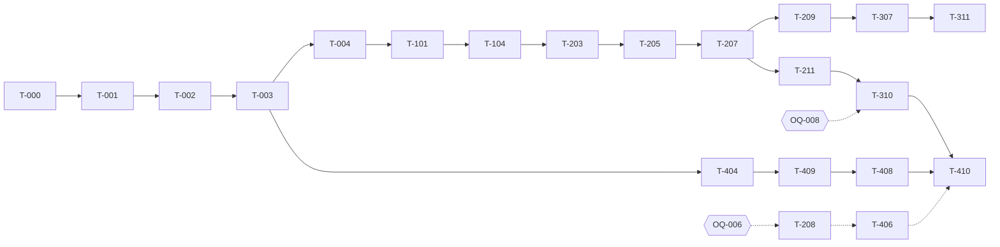

# Danh sách task triển khai — Chat với Tài liệu (MVP)

> Mỗi task trong [Implement_plan.md](../Implement_plan.md) là một file riêng, theo mẫu [_TEMPLATE.md](_TEMPLATE.md).
> **Cách dùng:** nhận task có trạng thái *To do* mà mọi task ở cột "Phụ thuộc" đã *Done* → đọc file task → làm theo mục 5 "Các bước thực hiện" → tự kiểm theo mục 6 "Tiêu chí chấp nhận" và Definition of Done → mở PR có mã task trong tiêu đề (ví dụ `T-103: upload API`).
> Cập nhật dòng "Trạng thái" trong file task khi bắt đầu (*In progress*) và khi merge (*Done*).

**Chú thích:** BE = Backend · FE = Frontend · FS = Fullstack · ⛔ = bị chặn bởi quyết định kinh doanh (OQ) · ước lượng tính bằng ngày-người `[Estimate]`.

---

## Sprint 0 — Nền tảng (1 tuần) · ≈ 11,5 ngày-người + T-009

| Task | Tên | Loại | Story | Ước lượng | Phụ thuộc |
|---|---|---|---|---|---|
| [T-000](T-000-kickoff-technical-decisions.md) | Kick-off và chốt quyết định kỹ thuật | Quy trình | — | 0,5 | — |
| [T-001](T-001-monorepo-ci-lint.md) | Monorepo, CI, lint, import-linter, gitleaks | DevOps | — | 1 | T-000 |
| [T-002](T-002-docker-compose-local-env.md) | Docker Compose và môi trường local | DevOps | — | 1 | T-001 |
| [T-003](T-003-fastapi-skeleton.md) | Khung FastAPI: settings, log, request id, lỗi, health | BE | — | 1 | T-001, T-002 |
| [T-004](T-004-db-migrations-baseline.md) | Alembic và lược đồ CSDL ban đầu | BE | — | 1,5 | T-003 |
| [T-005](T-005-frontend-skeleton.md) | Khung React, design tokens, AppBar, trang lỗi | FE | — | 2 | T-001 |
| [T-006](T-006-auth-session-dev-identity.md) | Phiên, CSRF, phân quyền, DevIdentity, màn đăng nhập | FS | US-E1 | 2 | T-003, T-004, T-005 |
| [T-007](T-007-ports-and-fake-adapters.md) | Ports và adapter giả (FakeLlm, FakeEmbedding) | BE | — | 1 | T-003 |
| [T-008](T-008-spike-sp03-pdf-extraction.md) | Spike SP-03: trích văn bản PDF | Spike | US-A4 | 1,5 | T-000 |
| [T-009](T-009-sample-docs-and-eval-questions.md) | Bộ PDF mẫu và bộ câu hỏi kiểm thử | QA | US-C1…C4 | liên tục | T-000 |

## Sprint 1 — Đăng nhập & Thư viện (2 tuần) · ≈ 20,5 ngày-người

| Task | Tên | Loại | Story | Ước lượng | Phụ thuộc |
|---|---|---|---|---|---|
| [T-101](T-101-job-queue.md) | Hàng đợi việc trong PostgreSQL | BE | US-A3 | 2 | T-004 |
| [T-102](T-102-file-store-s3-adapter.md) | FileStorePort và adapter S3/MinIO | BE | US-A1 | 1 | T-003 |
| [T-103](T-103-upload-api.md) | API tải lên tài liệu | BE | US-A1, A2, A5 | 2,5 | T-006, T-101, T-102 |
| [T-104](T-104-ingest-worker.md) | Worker xử lý tài liệu | BE | US-A3, A4 | 3 | T-007, T-008, T-101, T-102 |
| [T-105](T-105-document-read-apis.md) | API đọc danh sách, chi tiết, tệp PDF | BE | US-A3, B1, C3 | 1,5 | T-102, T-103 |
| [T-106](T-106-delete-document-purge.md) | Xóa tài liệu và dọn dữ liệu nền | BE | US-B2 | 1,5 | T-101, T-102, T-103 |
| [T-107](T-107-library-screen.md) | Màn hình 02 Thư viện | FE | US-A1…A5, B1, B2 | 4 | T-005, T-103, T-104, T-105, T-106 |
| [T-108](T-108-empty-library-screen.md) | Màn hình 03 Thư viện trống | FE | US-A5 | 1 | T-107 |
| [T-109](T-109-route-auth-guard-test.md) | Test tự động bảo vệ mọi route | BE | US-E1 | 1 | T-006 |
| [T-110](T-110-telemetry-documents-access.md) | Sự kiện telemetry tài liệu và truy cập | BE | US-A1, A2, B2, E1 | 0,5 | T-103, T-106 |
| [T-111](T-111-e2e-sprint1.md) | E2E Sprint 1 (AC-001…007, AC-018) | QA | Sprint 1 | 2 | T-107, T-108, T-009 |
| [T-112](T-112-retry-failed-document.md) | Thử lại tài liệu lỗi xử lý | FS | *chờ PO xác nhận* | 0,5 | T-101, T-104, T-107 |

## Sprint 2 — Hỏi đáp lõi (2 tuần) · ≈ 26 ngày-người

| Task | Tên | Loại | Story | Ước lượng | Phụ thuộc |
|---|---|---|---|---|---|
| [T-201](T-201-conversation-schema.md) | Lược đồ hội thoại, tin nhắn, trích dẫn | BE | US-D1 | 1 | T-004 |
| [T-202](T-202-conversation-apis.md) | API hội thoại | BE | US-D1, D2 | 1 | T-006, T-201 |
| [T-203](T-203-hybrid-retrieval.md) | Truy xuất lai (vector + full-text + RRF) | BE | US-C1, C2 | 3 | T-007, T-104 |
| [T-204](T-204-notfound-policy-citation-validator.md) | NotFoundPolicy và CitationValidator | BE | US-C3, C4 | 1,5 | T-007 |
| [T-205](T-205-answer-service.md) | AnswerService điều phối trả lời | BE | US-C1…C4 | 3 | T-201, T-203, T-204, T-206 |
| [T-206](T-206-prompt-v1.md) | Prompt v1 | BE | US-C1, C3 | 1 | T-007 |
| [T-207](T-207-messages-sse-api.md) | API gửi câu hỏi trả SSE | BE | US-C1 | 2 | T-202, T-205 |
| [T-208](T-208-real-ai-adapters-reindex.md) | Adapter AI thật và reindex ⛔ | BE | US-C1, E2 | 2 | T-007, **OQ-006** |
| [T-209](T-209-chat-screen-core.md) | Màn hình 04 Hỏi đáp (lõi) | FE | US-D1, C1…C4 | 4 | T-005, T-202, T-207 |
| [T-210](T-210-citation-viewer-screen.md) | Màn hình 06 Xem trích dẫn | FE | US-C3 | 3 | T-105, T-209 |
| [T-211](T-211-eval-harness-v1.md) | Bộ đánh giá CMP-17 v1 | QA | US-C1…C4 | 2 | T-009, T-207 |
| [T-212](T-212-telemetry-qa.md) | Sự kiện telemetry hỏi đáp | BE | US-C1, D1 | 0,5 | T-207 |
| [T-213](T-213-e2e-sprint2.md) | E2E Sprint 2 (AC-008…011, AC-016) | QA | Sprint 2 | 2 | T-209, T-210 |

## Sprint 3 — Hội thoại & chất lượng (2 tuần) · ≈ 19,5 ngày-người

| Task | Tên | Loại | Story | Ước lượng | Phụ thuộc |
|---|---|---|---|---|---|
| [T-301](T-301-follow-up-rewrite.md) | Viết lại câu hỏi nối tiếp | BE | US-C6 | 1,5 | T-205 |
| [T-302](T-302-document-scope.md) | Giới hạn phạm vi tài liệu | FS | US-C7 | 2 | T-203, T-209 |
| [T-303](T-303-answer-feedback.md) | Đánh giá câu trả lời | FS | US-F1 | 1,5 | T-201, T-209 |
| [T-304](T-304-history-screen.md) | Màn hình 07 Lịch sử | FE | US-D2 | 2 | T-005, T-202 |
| [T-305](T-305-upstream-resilience.md) | `call_upstream()`: timeout, retry, circuit breaker | BE | US-C5 | 2 | T-007, T-207 |
| [T-306](T-306-rate-limiting.md) | Giới hạn tốc độ và số truy vấn AI đồng thời | BE | US-C5 | 1 | T-207 |
| [T-307](T-307-chat-states.md) | Các trạng thái đặc biệt của Hỏi đáp (màn 05) | FE | US-C4, C5 | 3 | T-209, T-305, T-306 |
| [T-308](T-308-i18n.md) | Quốc tế hóa chuỗi giao diện | FS | US-C8 | 1 | T-005, T-206 |
| [T-309](T-309-spike-sp01-latency.md) | Spike SP-01: đo độ trễ | Spike | US-C5 | 2 | T-203, T-205 (nên có T-208) |
| [T-310](T-310-threshold-calibration.md) | Hiệu chỉnh ngưỡng liên quan ⛔ | QA | US-C1, C4 | 1,5 | T-009, T-211, **OQ-008** |
| [T-311](T-311-e2e-sprint3.md) | E2E Sprint 3 (AC-012…015, AC-017, AC-019) | QA | Sprint 3 | 2 | T-301, T-302, T-303, T-304, T-307, T-308 |

## Sprint 4 — Đo lường, vận hành & phát hành (2 tuần) · ≈ 19 ngày-người

| Task | Tên | Loại | Story | Ước lượng | Phụ thuộc |
|---|---|---|---|---|---|
| [T-401](T-401-weekly-report-api.md) | API báo cáo tuần | BE | US-F2 | 2 | T-110, T-212, T-303 |
| [T-402](T-402-weekly-report-screen.md) | Màn hình 08 Báo cáo tuần | FE | US-F2 | 3 | T-005, T-401 |
| [T-403](T-403-report-reconciliation.md) | Đối soát báo cáo (AC-021) | QA | US-F2 | 1 | T-401 |
| [T-404](T-404-observability.md) | Observability: tracing, metric, cảnh báo | DevOps | — | 3 | T-003, T-305 |
| [T-405](T-405-security-hardening.md) | Gia cố bảo mật | BE/DevOps | US-E1, E2 | 2 | T-109 |
| [T-406](T-406-compliance-package.md) | Hồ sơ tuân thủ cho IT/Bảo mật ⛔ | Quy trình | US-E2 | 1,5 | T-208, **OQ-006** |
| [T-407](T-407-retention-cleanup.md) | Lưu giữ và dọn dẹp dữ liệu | BE | — | 1,5 | T-101, T-106 |
| [T-408](T-408-backup-restore-drill.md) | Sao lưu và diễn tập khôi phục | DevOps | — | 1 | T-407, T-409 |
| [T-409](T-409-staging-deployment.md) | Triển khai staging, rolling deploy, rollback | DevOps | — | 2 | T-404 |
| [T-410](T-410-launch-gate-uat.md) | Chạy launch gate và UAT | QA | Tất cả | 2 | T-309, T-310, T-402, T-403, T-405, T-406, T-408, T-409 |

---

## Đường găng (critical path)

Chuỗi dài nhất quyết định ngày phát hành:

**Task bị chặn bởi quyết định kinh doanh:** T-208 và T-406 (OQ-006), T-310 (OQ-008). Mọi task khác làm được với adapter giả và giá trị `[Default]` — xem [Implement_plan §9.1](../Implement_plan.md#91-quyết-định-cần-có-và-ảnh-hưởng-tới-lập-trình).

## Cần Tech Lead / PO chốt ở T-000

Khi viết task phát hiện các điểm tài liệu nguồn còn mâu thuẫn hoặc thiếu. Mỗi điểm đã có phương án `[Proposed]` trong task liên quan; cần chốt để không làm lại.

| # | Điểm cần chốt | Phương án đề xuất | Task |
|---|---|---|---|
| 1 | Đường dẫn API: Blueprint §3.5 dùng `/api/...`, SAD và kế hoạch dùng `/api/v1/...` | Dùng `/api/v1` | tất cả |
| 2 | Mã lỗi còn thiếu trong danh mục SDD §3.5 (400/404/409/422/500) | `VALIDATION_ERROR`, `NOT_FOUND`, `INVALID_STATE`, `INVALID_SCOPE`, `INTERNAL_ERROR` | T-003, T-202, T-302 |
| 3 | Bảng API-09 trong SAD §2.4 vẫn liệt kê sự kiện `token`, trái với AD-07 | Không phát `token` ở MVP; client bỏ qua sự kiện lạ | T-207, T-209 |
| 4 | Xóa tài liệu đang `UPLOADED/PROCESSING` (màn 02 có nút xóa, máy trạng thái chưa cho phép) | Cho phép; worker kiểm `DELETED` trước khi ghi chunk | T-104, T-106 |
| 5 | `MAX_PAGES` không kiểm được lúc tải lên (API không phân tích PDF) | Worker đặt `FAILED` với `failure_reason=TOO_MANY_PAGES`, ẩn nút thử lại | T-103, T-104 |
| 6 | Đánh số trích dẫn: màn 04 đánh số xuyên hội thoại, dữ liệu lưu theo từng tin nhắn | Đánh số theo từng câu trả lời | T-205, T-209, T-210 |
| 7 | Phạm vi `documentIds` chứa tài liệu không `READY`: SDD nói lấy giao, task đề xuất từ chối | Từ chối `422 INVALID_SCOPE` | T-302 |
| 8 | Bỏ chọn đánh giá: API-10 chỉ có `PUT` | Thêm `DELETE /messages/{id}/feedback`; báo cáo đếm trạng thái cuối mỗi tin nhắn | T-303, T-401 |
| 9 | Thời điểm ghi `question_asked` (SAD ghi cùng câu trả lời) | Ghi khi lưu câu hỏi, để câu hỏi lỗi vẫn được đếm | T-212, T-401 |
| 10 | API-11 chỉ có tổng tuần, màn 08 cần số theo ngày và mẫu số | Thêm `days[]`, `teamSize`, múi giờ `Asia/Ho_Chi_Minh` | T-401, T-402 |
| 11 | Quyền và điều hướng của SPONSOR/ADMIN trên thư viện và hỏi đáp | SPONSOR chỉ xem thư viện; ADMIN dùng điều hướng như SPONSOR | T-005, T-107 |
| 12 | Staging cần `DevIdentity` cho tới khi có OQ-018, trái với kiểm tra khởi động của T-405 | Ngoại lệ có thời hạn cho staging | T-405, T-409 |
| 13 | T-310 chỉ có ý nghĩa khi có embedding thật | Trên thực tế T-310 cũng phụ thuộc T-208 / OQ-006 | T-310 |
| 14 | SP-03 cần xong trong Sprint 0 (T-104 dùng kết quả), SAD đặt hạn 13/11 | Đưa SP-03 vào Sprint 0 như kế hoạch | T-008 |
| 15 | Biến môi trường mới do các task đề xuất chưa có trong Implement_plan §3.3 | Gom vào `.env.example` ở T-002, tên trong T-006 được ưu tiên | T-002 |

## Truy vết story → task

| Story | Task |
|---|---|
| US-A1 | T-102, T-103, T-107, T-110, T-111 |
| US-A2 | T-103, T-107, T-110 |
| US-A3 | T-101, T-104, T-105, T-107 |
| US-A4 | T-008, T-104, T-107 |
| US-A5 | T-103, T-107, T-108 |
| US-B1 | T-105, T-107 |
| US-B2 | T-106, T-107, T-110 |
| US-C1 | T-203, T-205, T-206, T-207, T-208, T-209, T-211, T-212 |
| US-C2 | T-203, T-205 |
| US-C3 | T-204, T-205, T-209, T-210 |
| US-C4 | T-204, T-205, T-209, T-307, T-310 |
| US-C5 | T-305, T-306, T-307, T-309 |
| US-C6 | T-301 |
| US-C7 | T-302 |
| US-C8 | T-308 |
| US-D1 | T-201, T-202, T-209, T-212 |
| US-D2 | T-202, T-304 |
| US-E1 | T-006, T-109, T-110, T-405 |
| US-E2 | T-208, T-405, T-406 |
| US-F1 | T-303 |
| US-F2 | T-401, T-402, T-403 |
