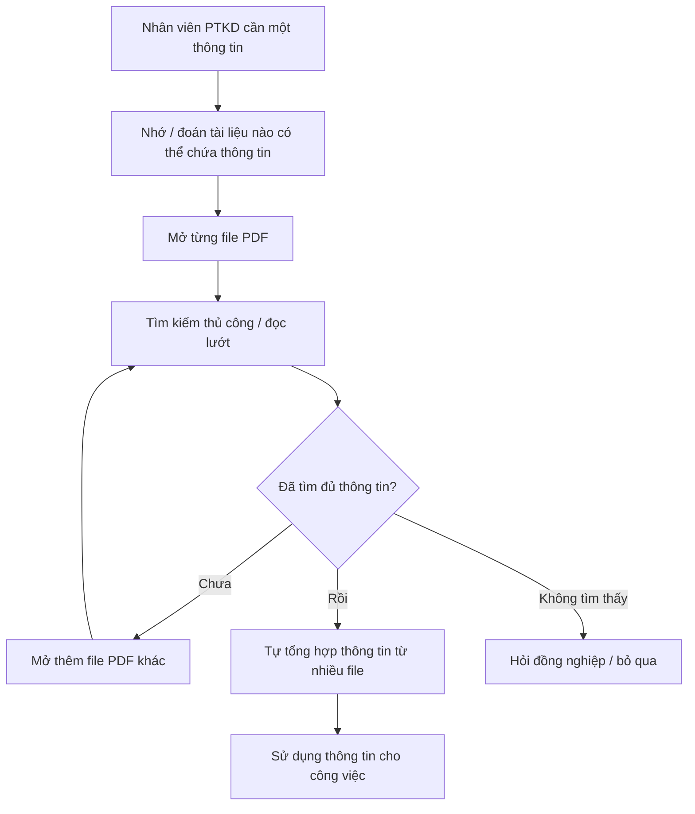
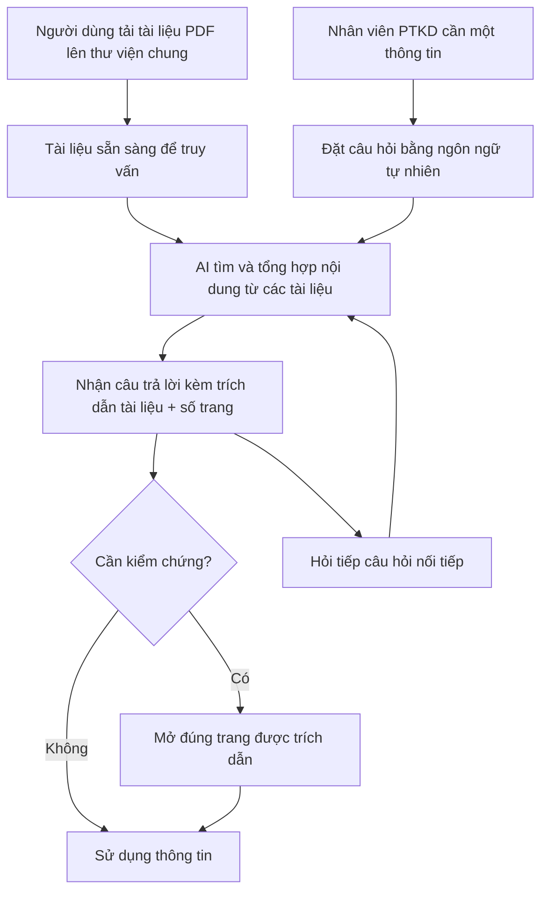

# Business Requirements Document (BRD) — Chat với Tài liệu (MVP)

> **Chuẩn áp dụng:** IEEE 29148-2018 · **Giai đoạn SDLC:** 5.2 Requirements and discovery
> **Prompt nguồn:** [docs/BRD_Prompt_IEEE_standard.md](../BRD_Prompt_IEEE_standard.md)

---

## 0. Tóm tắt kiểm tra đầu vào (Validation summary)

**Đầu vào đã nhận**

| Source ID | Nguồn | Loại | Chủ sở hữu | Ngày / Phiên bản | Nội dung chứng minh |
|---|---|---|---|---|---|
| SRC-001 | Yêu cầu từ quản lý (mô tả bối cảnh trong mục 2.1 của prompt BRD) | Sponsor brief (bản tóm tắt bằng lời) | Quản lý / Sponsor `[TBD: OQ-001]` | 2026-10-19 / v1.0 | Vấn đề kinh doanh, mục tiêu MVP, phạm vi cốt lõi (web app, upload PDF, chat với AI) |
| SRC-002 | Đề xuất tính năng bổ sung của đội BA (tài liệu này) | Phân tích của BA — **chưa được Sponsor xác nhận** | Đội BA | 2026-10-19 / v1.0 | Các tính năng bổ sung (trích dẫn nguồn, quản lý thư viện, lịch sử hội thoại, phản hồi câu trả lời…) |
| SRC-003 | IEEE 29148-2018 | Tiêu chuẩn | IEEE | 2018 | Quy tắc chất lượng yêu cầu |

**Đầu vào còn thiếu**

- Không có số liệu nền (baseline): thời gian tìm thông tin hiện tại, số lượng file PDF, số người dùng, tần suất tra cứu.
- Không có biên bản phỏng vấn người dùng (đội phát triển kinh doanh) — toàn bộ nhu cầu người dùng hiện suy ra từ SRC-001.
- Không có thông tin về ngân sách, thời hạn, chính sách bảo mật dữ liệu, mức độ mật của tài liệu.
- Không có tên Sponsor, Business Owner, người phê duyệt.
- Không có mẫu BRD nội bộ (`requirements/BRD-Template.md` không tồn tại trong repo).

**Ba rủi ro lớn nhất đối với chất lượng yêu cầu**

1. **Thiếu baseline đo lường** → các mục tiêu BO-001…BO-004 chưa thể kiểm chứng cho tới khi có số liệu hiện trạng (OQ-002, OQ-003).
2. **Chưa rõ chính sách bảo mật tài liệu** khi gửi nội dung tới dịch vụ AI → có thể làm thay đổi phạm vi và ràng buộc (OQ-006, RSK-002).
3. **Tính năng bổ sung (SRC-002) chưa được Sponsor xác nhận** → nguy cơ phình phạm vi MVP (OQ-004).

---

## 1. Kiểm soát tài liệu (Document control)

| Mục | Giá trị |
|---|---|
| Tiêu đề | Business Requirements Document — Chat với Tài liệu (MVP) |
| Mã tài liệu | BRD-CWA-001 |
| Phiên bản | 0.1 |
| Trạng thái | **Draft** |
| Tác giả | Đội BA (`unphuphu`) |
| Người đóng góp | `[TBD: OQ-001]` |
| Người review | Sponsor, đại diện đội phát triển kinh doanh, đội phát triển, IT/Bảo mật `[TBD: OQ-001]` |
| Người phê duyệt | Quản lý giao yêu cầu (Executive sponsor) `[TBD: OQ-001]` |
| Phân loại bảo mật | Nội bộ (Internal) |

**Lịch sử phiên bản**

| Phiên bản | Ngày | Tác giả | Tóm tắt thay đổi |
|---|---|---|---|
| 0.1 | 2026-10-19 | Đội BA | Bản nháp đầu tiên dựa trên SRC-001 và đề xuất SRC-002 |

**Danh sách phân phối:** Sponsor, Business Owner, Trưởng đội phát triển kinh doanh, Trưởng nhóm phát triển, IT/Bảo mật.

**Quy ước ngôn ngữ yêu cầu (tương đương IEEE 29148):**

| Tiếng Anh | Tiếng Việt dùng trong tài liệu | Ý nghĩa |
|---|---|---|
| shall | **phải** | Bắt buộc |
| should | **nên** | Mong muốn, không bắt buộc |
| may | **được phép** | Tùy chọn cho phép |

---

## 2. Tóm tắt điều hành (Executive summary)

**Vấn đề.** Đội phát triển kinh doanh đang làm việc với nhiều tài liệu PDF của dự án và khó nắm bắt đầy đủ nội dung. Mỗi lần cần một thông tin, nhân viên phải mở và tổng hợp thủ công từ nhiều file, gây tốn thời gian (SRC-001). Mức thiệt hại định lượng (giờ công/tháng, số lần tra cứu) hiện **chưa được đo** `[TBD: OQ-002]`.

**Thay đổi đề xuất.** Xây dựng MVP một ứng dụng web cho phép người dùng tải lên tài liệu PDF và đặt câu hỏi bằng ngôn ngữ tự nhiên; AI trả lời dựa trên nội dung các tài liệu đã tải lên, kèm trích dẫn nguồn để người dùng tự kiểm chứng (SRC-001, SRC-002).

**Lợi ích kỳ vọng và cách đo.**
- Giảm thời gian tìm một thông tin trong bộ tài liệu (MET-001).
- Câu trả lời đủ chính xác và có nguồn để đội kinh doanh tin dùng (MET-002).
- Mức độ sử dụng thực tế của đội trong giai đoạn thử nghiệm (MET-003, MET-004).

**Đầu tư, thời gian, rủi ro chính.** Ngân sách và thời hạn chưa được xác định `[TBD: OQ-005]`. Rủi ro chính: AI trả lời sai/bịa thông tin (RSK-001), lộ tài liệu nội bộ cho bên thứ ba (RSK-002), PDF dạng ảnh scan không đọc được (RSK-003).

**Quyết định cần từ người phê duyệt.**
1. Xác nhận phạm vi MVP tại mục 5 (bao gồm các tính năng BA đề xuất được đánh dấu SRC-002).
2. Cung cấp/ủy quyền thu thập số liệu baseline và chỉ định Business Owner.
3. Quyết định chính sách dữ liệu khi sử dụng dịch vụ AI bên ngoài (OQ-006).

---

## 3. Bối cảnh kinh doanh và phát biểu vấn đề

### 3.1 Quy trình hiện tại (Current state)

Nguồn: SRC-001. Chi tiết các bước là suy luận của BA `[Unverified]` — cần xác nhận qua phỏng vấn người dùng (OQ-003).

### 3.2 Quy trình đề xuất (Proposed state)

### 3.3 Đối tượng bị ảnh hưởng

| Đối tượng | Ảnh hưởng | Bằng chứng |
|---|---|---|
| Đội phát triển kinh doanh | Tốn thời gian tổng hợp thông tin từ nhiều PDF; khó nắm đầy đủ nội dung | SRC-001 |
| Quản lý | Hiệu suất đội bị giảm; quyết định có thể dựa trên thông tin chưa đầy đủ | SRC-001 (suy luận) `[Unverified]` |

### 3.4 Chi phí của việc không làm gì

- **Chi phí thời gian:** giờ công dành cho tra cứu thủ công `[TBD: OQ-002]`.
- **Rủi ro chất lượng:** bỏ sót thông tin khi không đọc hết tài liệu, dẫn tới quyết định kinh doanh thiếu căn cứ `[Unverified]`.
- **Doanh thu/khách hàng:** chưa có bằng chứng định lượng `[TBD: OQ-002]`.

### 3.5 Nguyên nhân gốc và triệu chứng

| Triệu chứng | Nguyên nhân gốc |
|---|---|
| Mất nhiều thời gian để tìm một thông tin | Thông tin phân tán trong nhiều file PDF, không có điểm truy vấn tập trung |
| Khó nắm bắt đầy đủ nội dung | Khối lượng tài liệu vượt quá khả năng đọc của đội (số lượng cụ thể `[TBD: OQ-002]`) |
| Phải tự tổng hợp từ nhiều file | Không có công cụ đối chiếu, tổng hợp nội dung xuyên tài liệu |

### 3.6 Tại sao là bây giờ

Quản lý đã chính thức giao yêu cầu phát triển MVP (SRC-001). Nguyên nhân kích hoạt cụ thể (dự án mới, số tài liệu tăng, sự kiện sắp tới…) chưa được nêu `[TBD: OQ-005]`.

---

## 4. Động lực và mục tiêu kinh doanh

| ID | Động lực kinh doanh | Mục tiêu (kết quả) | Metric ID | Baseline | Target | Thời hạn | Nguồn |
|---|---|---|---|---|---|---|---|
| BO-001 | Thời gian tra cứu thông tin trong PDF cao | Giảm thời gian để nhân viên PTKD tìm được một thông tin trong bộ tài liệu dự án | MET-001 | `[TBD: OQ-002]` | `[TBD: OQ-007]` — BA đề xuất: giảm ≥ 50% so với baseline | Cuối giai đoạn thử nghiệm MVP `[TBD: OQ-005]` | SRC-001 |
| BO-002 | Thông tin sai có thể dẫn tới quyết định sai | Đội PTKD nhận được câu trả lời chính xác và kiểm chứng được từ tài liệu | MET-002 | Không áp dụng (năng lực mới) | `[TBD: OQ-007]` — BA đề xuất: ≥ 85% câu trả lời đạt yêu cầu trên bộ câu hỏi kiểm thử | Trước khi mở cho toàn đội | SRC-001, SRC-002 |
| BO-003 | MVP cần chứng minh giá trị trước khi đầu tư tiếp | Đội PTKD sử dụng công cụ thường xuyên trong giai đoạn thử nghiệm | MET-003 | 0 (công cụ mới) | `[TBD: OQ-007]` — BA đề xuất: ≥ 70% thành viên đội dùng ít nhất 1 lần/tuần | 4 tuần sau khi ra mắt `[TBD: OQ-005]` | SRC-001 |
| BO-004 | Cần căn cứ để quyết định phát triển tiếp (go/no-go) | Người dùng đánh giá công cụ hữu ích cho công việc | MET-004 | Không áp dụng | `[TBD: OQ-007]` — BA đề xuất: ≥ 70% câu trả lời được đánh giá "hữu ích" | Cuối giai đoạn thử nghiệm | SRC-001, SRC-002 |

> Các giá trị "BA đề xuất" là `[Unverified]` — chỉ là điểm khởi đầu để Sponsor thảo luận, **không phải** mục tiêu đã được chấp thuận.

### 4.1 Định nghĩa chỉ số

| ID | Định nghĩa | Công thức | Nguồn dữ liệu | Chủ sở hữu | Tần suất | Ngày baseline |
|---|---|---|---|---|---|---|
| MET-001 | Thời gian trung bình từ lúc nhân viên bắt đầu tìm một thông tin tới lúc có câu trả lời dùng được | Tổng thời gian tìm / số câu hỏi trong bộ câu hỏi mẫu chuẩn | Đo bấm giờ trên bộ câu hỏi mẫu (trước MVP: thủ công; sau MVP: dùng công cụ) | Business Owner `[TBD: OQ-001]` | Một lần trước MVP, một lần cuối thử nghiệm | `[TBD: OQ-002]` |
| MET-002 | Tỷ lệ câu trả lời đúng nội dung **và** có trích dẫn trỏ đúng tài liệu/trang chứa thông tin | Số câu trả lời đạt / tổng số câu hỏi kiểm thử × 100% | Bộ câu hỏi kiểm thử có đáp án do đội PTKD soạn (OQ-008) | Đại diện đội PTKD | Mỗi lần phát hành | Không áp dụng |
| MET-003 | Tỷ lệ thành viên đội PTKD đặt ít nhất 1 câu hỏi trong tuần | Số người dùng hoạt động trong tuần / tổng thành viên đội × 100% | Thống kê sử dụng của ứng dụng | Sponsor | Hằng tuần | Ngày ra mắt MVP |
| MET-004 | Tỷ lệ câu trả lời được người dùng đánh giá "hữu ích" | Số đánh giá "hữu ích" / tổng số đánh giá × 100% | Chức năng đánh giá câu trả lời (BR-019) | Đại diện đội PTKD | Hằng tuần | Ngày ra mắt MVP |

---

## 5. Phạm vi (Scope)

### 5.1 Trong phạm vi

- **Năng lực:** tải lên tài liệu PDF; quản lý thư viện tài liệu; hỏi đáp bằng ngôn ngữ tự nhiên dựa trên nội dung tài liệu; trích dẫn nguồn; hội thoại nhiều lượt; lịch sử hội thoại; đánh giá câu trả lời.
- **Đơn vị tổ chức:** đội phát triển kinh doanh của dự án (SRC-001).
- **Kênh:** ứng dụng web (SRC-001).
- **Miền dữ liệu:** tài liệu PDF của dự án kinh doanh có chứa văn bản trích xuất được.
- **Địa lý / ngôn ngữ:** `[TBD: OQ-009]`.

### 5.2 Ngoài phạm vi

| Hạng mục | Lý do |
|---|---|
| Định dạng khác PDF (Word, Excel, PowerPoint, hình ảnh) | SRC-001 chỉ yêu cầu PDF; giữ MVP gọn |
| Nhận dạng ký tự (OCR) cho PDF dạng ảnh scan | Tăng độ phức tạp; chờ xác nhận tỷ lệ PDF scan (OQ-010) |
| Chỉnh sửa nội dung tài liệu PDF | Không thuộc vấn đề kinh doanh |
| Ứng dụng di động native | SRC-001 chỉ định ứng dụng web |
| Tích hợp với hệ thống nội bộ khác (CRM, Drive, SharePoint…) | Không có trong SRC-001; xem xét giai đoạn sau |
| Người dùng bên ngoài tổ chức | MVP phục vụ đội nội bộ |

### 5.3 Hoãn lại (Deferred)

| Hạng mục | Lý do hoãn |
|---|---|
| Phân quyền theo từng tài liệu / nhóm tài liệu | Phụ thuộc OQ-011; MVP dùng thư viện chung cho cả đội |
| Xuất câu trả lời/hội thoại ra file | Giá trị chưa được chứng minh |
| Tóm tắt tự động toàn bộ một tài liệu | Có thể đạt được qua câu hỏi; xem lại sau thử nghiệm |
| Quản lý phiên bản tài liệu (bản cũ/bản mới) | Phụ thuộc OQ-012 |
| OCR cho PDF scan | Xem 5.2 |

### 5.4 Ranh giới

Sáng kiến bắt đầu từ khi người dùng có file PDF trong tay và kết thúc khi người dùng nhận được câu trả lời kèm nguồn. Việc tạo ra, phê duyệt, lưu trữ chính thức tài liệu PDF gốc nằm ngoài sáng kiến.

---

## 6. Các bên liên quan và nhu cầu

### 6.1 Danh sách bên liên quan

| ID | Bên liên quan | Vai trò | Quan tâm | Ảnh hưởng | Nhu cầu | Nguồn |
|---|---|---|---|---|---|---|
| STK-001 | Quản lý giao yêu cầu (Executive sponsor) | Tài trợ, phê duyệt MVP | Chứng minh giá trị, chi phí hợp lý, ra quyết định go/no-go | High | SN-008, SN-009 | SRC-001 |
| STK-002 | Đội phát triển kinh doanh (người dùng cuối) | Tra cứu thông tin từ tài liệu dự án | Tìm thông tin nhanh, đúng, tin cậy được | High | SN-001 – SN-007 | SRC-001 |
| STK-003 | Đội BA | Phân tích yêu cầu, đề xuất tính năng | Yêu cầu rõ ràng, truy vết được | Medium | SN-009 | SRC-001 |
| STK-004 | Đội phát triển | Xây dựng MVP | Phạm vi rõ ràng, khả thi trong thời hạn | Medium | SN-010 | `[Unverified]` |
| STK-005 | IT / Bảo mật / Pháp chế | Bảo vệ dữ liệu nội bộ | Tài liệu không bị lộ ra ngoài; tuân thủ chính sách | High — **có thể chặn triển khai** | SN-011 | `[Unverified]` — OQ-006 |
| STK-006 | Người soạn / sở hữu tài liệu PDF | Cung cấp nội dung | Tài liệu được trích dẫn đúng, không bị diễn giải sai | Low | SN-012 | `[Unverified]` |

### 6.2 Nhu cầu của các bên liên quan

| ID | Bên liên quan | Phát biểu nhu cầu | Khó khăn hiện tại | Bằng chứng | Ưu tiên |
|---|---|---|---|---|---|
| SN-001 | STK-002 | Tôi cần đưa các tài liệu PDF của dự án vào một nơi để có thể hỏi về chúng | Tài liệu phân tán, phải mở từng file | SRC-001 | Must |
| SN-002 | STK-002 | Tôi cần hỏi bằng ngôn ngữ thường ngày và nhận câu trả lời trực tiếp | Phải đọc lướt nhiều trang để tìm | SRC-001 | Must |
| SN-003 | STK-002 | Tôi cần câu trả lời tổng hợp được thông tin nằm ở nhiều tài liệu khác nhau | Phải tự tổng hợp từ nhiều file | SRC-001 | Must |
| SN-004 | STK-002 | Tôi cần biết câu trả lời lấy từ tài liệu nào, trang nào để kiểm chứng | Không thể tin câu trả lời AI nếu không có nguồn | SRC-002 | Must |
| SN-005 | STK-002 | Tôi cần biết khi tài liệu không có thông tin, thay vì nhận câu trả lời bịa | Rủi ro dùng thông tin sai | SRC-002 | Must |
| SN-006 | STK-002 | Tôi cần hỏi tiếp các câu nối tiếp mà không phải nhắc lại ngữ cảnh | Mất thời gian diễn đạt lại | SRC-002 | Should |
| SN-007 | STK-002 | Tôi cần xem lại các cuộc hội thoại trước đây | Phải hỏi lại câu đã hỏi | SRC-002 | Could |
| SN-008 | STK-001 | Tôi cần số liệu để quyết định có phát triển tiếp sau MVP hay không | Chưa có số liệu hiện trạng | SRC-001 | Must |
| SN-009 | STK-001, STK-003 | Tôi cần biết thư viện đang có những tài liệu nào và loại bỏ tài liệu không còn phù hợp | Tài liệu lỗi thời có thể làm sai câu trả lời | SRC-002 | Must |
| SN-010 | STK-004 | Tôi cần phạm vi và tiêu chí nghiệm thu rõ ràng | Phạm vi mơ hồ dẫn tới làm lại | `[Unverified]` | Must |
| SN-011 | STK-005 | Tôi cần đảm bảo chỉ người được phép mới truy cập được tài liệu và nội dung không bị dùng ngoài mục đích | Chưa có chính sách cho công cụ AI | `[Unverified]` | Must |
| SN-012 | STK-006 | Tôi cần nội dung tài liệu được trích dẫn đúng ngữ cảnh | Diễn giải sai gây hiểu lầm | `[Unverified]` | Should |

---

## 7. Yêu cầu kinh doanh (Business requirements)

**Thang ưu tiên:** Must (thiếu thì sáng kiến thất bại) · Should (giá trị đáng kể, có cách thay thế) · Could (mong muốn) · Won't (loại trừ trong bản phát hành này).

### 7.1 Nhóm A — Tiếp nhận tài liệu

| ID | Yêu cầu | Lý do | Nguồn | Ưu tiên | Tiêu chí nghiệm thu | Phương pháp kiểm chứng | Trạng thái |
|---|---|---|---|---|---|---|---|
| BR-001 | Người dùng được cấp quyền **phải** tải được một hoặc nhiều tài liệu PDF vào thư viện tài liệu dùng chung. | Đưa tài liệu vào phạm vi truy vấn | BO-001 / SN-001 | Must | AC-001 | Test | Draft |
| BR-002 | Khi người dùng tải lên một file không phải PDF, ứng dụng **phải** từ chối file đó và thông báo lý do cho người dùng. | Đảm bảo BRU-004 | SN-001 | Must | AC-002 | Test | Draft |
| BR-003 | Khi một tài liệu đã sẵn sàng để truy vấn, ứng dụng **phải** hiển thị trạng thái "sẵn sàng" của tài liệu đó cho người dùng. | Người dùng biết khi nào có thể hỏi về tài liệu | SN-001 | Must | AC-003 | Demonstration | Draft |
| BR-004 | Khi một tài liệu PDF không chứa văn bản trích xuất được, ứng dụng **phải** thông báo cho người dùng rằng tài liệu đó không thể truy vấn. | Tránh người dùng tưởng tài liệu đã được dùng (xem RSK-003) | SN-005 | Must | AC-004 | Test | Draft |
| BR-005 | Ứng dụng **phải** chấp nhận tài liệu PDF có kích thước tối đa `[TBD: OQ-013]` MB và số trang tối đa `[TBD: OQ-013]` trang. | Đặt giới hạn vận hành rõ ràng | SN-001 / SN-010 | Must | AC-005 | Test | Draft — chờ OQ-013 |

### 7.2 Nhóm B — Quản lý thư viện tài liệu

| ID | Yêu cầu | Lý do | Nguồn | Ưu tiên | Tiêu chí nghiệm thu | Phương pháp kiểm chứng | Trạng thái |
|---|---|---|---|---|---|---|---|
| BR-006 | Người dùng được cấp quyền **phải** xem được danh sách tài liệu trong thư viện gồm tên tài liệu, người tải lên, ngày tải lên và trạng thái. | Biết phạm vi kiến thức hiện có | SN-009 | Must | AC-006 | Demonstration | Draft |
| BR-007 | Người dùng được cấp quyền **phải** xóa được một tài liệu khỏi thư viện. | Loại tài liệu lỗi thời/sai | SN-009 | Must | AC-007 | Test | Draft — quyền xóa chờ OQ-011 |

### 7.3 Nhóm C — Hỏi đáp với tài liệu

| ID | Yêu cầu | Lý do | Nguồn | Ưu tiên | Tiêu chí nghiệm thu | Phương pháp kiểm chứng | Trạng thái |
|---|---|---|---|---|---|---|---|
| BR-008 | Người dùng được cấp quyền **phải** đặt được câu hỏi bằng ngôn ngữ tự nhiên và nhận câu trả lời được tạo ra từ nội dung các tài liệu trong thư viện. | Năng lực cốt lõi của MVP | BO-001 / SN-002 | Must | AC-008 | Test | Draft |
| BR-009 | Khi thông tin cần thiết nằm ở nhiều tài liệu, câu trả lời **phải** tổng hợp thông tin từ tất cả các tài liệu liên quan. | Giải quyết việc tổng hợp thủ công | BO-001 / SN-003 | Must | AC-009 | Test | Draft |
| BR-010 | Mỗi câu trả lời chứa thông tin từ tài liệu **phải** kèm trích dẫn gồm tên tài liệu và số trang nguồn. | Cho phép kiểm chứng, xây dựng niềm tin | BO-002 / SN-004, SN-012 | Must | AC-010 | Test | Draft |
| BR-011 | Khi các tài liệu trong thư viện không chứa thông tin để trả lời câu hỏi, ứng dụng **phải** thông báo cho người dùng rằng không tìm thấy thông tin trong tài liệu. | Tránh thông tin bịa đặt | BO-002 / SN-005 | Must | AC-011 | Test | Draft |
| BR-012 | Người dùng **phải** nhận được câu trả lời trong vòng `[TBD: OQ-014]` giây cho ít nhất 90% câu hỏi. | Giá trị phụ thuộc vào việc nhanh hơn tra cứu thủ công | BO-001 / SN-002 | Must | AC-012 | Test | Draft — chờ OQ-014 |
| BR-013 | Người dùng **nên** đặt được câu hỏi nối tiếp tham chiếu tới câu hỏi và câu trả lời trước đó trong cùng cuộc hội thoại. | Giảm việc diễn đạt lại | SN-006 | Should | AC-013 | Test | Draft |
| BR-014 | Người dùng **nên** giới hạn được phạm vi câu hỏi vào một hoặc một số tài liệu được chọn. | Tăng độ chính xác khi biết rõ nguồn | BO-002 / SN-003 | Should | AC-014 | Test | Draft |
| BR-015 | Ứng dụng **phải** chấp nhận câu hỏi và trả lời bằng `[TBD: OQ-009]` (tiếng Việt và/hoặc tiếng Anh). | Phù hợp ngôn ngữ làm việc của đội và tài liệu | SN-002 | Must | AC-015 | Test | Draft — chờ OQ-009 |

### 7.4 Nhóm D — Hội thoại

| ID | Yêu cầu | Lý do | Nguồn | Ưu tiên | Tiêu chí nghiệm thu | Phương pháp kiểm chứng | Trạng thái |
|---|---|---|---|---|---|---|---|
| BR-016 | Người dùng **phải** bắt đầu được một cuộc hội thoại mới không mang ngữ cảnh của cuộc hội thoại trước. | Tách các chủ đề tra cứu độc lập | SN-006 | Must | AC-016 | Test | Draft |
| BR-017 | Người dùng **nên** xem lại được danh sách và nội dung các cuộc hội thoại trước đó của chính mình. | Tránh hỏi lại | SN-007 | Could | AC-017 | Demonstration | Draft |

### 7.5 Nhóm E — Truy cập và bảo vệ dữ liệu

| ID | Yêu cầu | Lý do | Nguồn | Ưu tiên | Tiêu chí nghiệm thu | Phương pháp kiểm chứng | Trạng thái |
|---|---|---|---|---|---|---|---|
| BR-018 | Chỉ người dùng đã được xác thực và thuộc danh sách được cấp quyền **phải** truy cập được thư viện tài liệu và chức năng hỏi đáp. | Bảo vệ tài liệu nội bộ | SN-011 | Must | AC-018 | Test | Draft |
| BR-020 | Việc xử lý nội dung tài liệu **phải** tuân thủ chính sách dữ liệu của tổ chức đối với dịch vụ AI `[TBD: OQ-006]`. | Điều kiện để IT/Bảo mật chấp thuận | SN-011 | Must | AC-020 | Inspection / Review | Draft — chờ OQ-006 |

### 7.6 Nhóm F — Đo lường giá trị

| ID | Yêu cầu | Lý do | Nguồn | Ưu tiên | Tiêu chí nghiệm thu | Phương pháp kiểm chứng | Trạng thái |
|---|---|---|---|---|---|---|---|
| BR-019 | Người dùng **nên** đánh giá được từng câu trả lời là "hữu ích" hoặc "không hữu ích". | Cung cấp dữ liệu cho MET-004 | BO-004 / SN-008 | Should | AC-019 | Demonstration | Draft |
| BR-021 | Sponsor **phải** nhận được số liệu sử dụng hằng tuần gồm số người dùng hoạt động và số câu hỏi đã đặt. | Cung cấp dữ liệu cho MET-003 và quyết định go/no-go | BO-003 / SN-008 | Must | AC-021 | Inspection | Draft |

> Ghi chú: BR-020 được đặt trong nhóm E trước BR-019 vì nhóm theo năng lực; ID được giữ nguyên, không đánh số lại.

### 7.7 Tiêu chí nghiệm thu (Acceptance criteria)

| ID | Yêu cầu | Tiêu chí (kiểm chứng khách quan) |
|---|---|---|
| AC-001 | BR-001 | Tải lên cùng lúc 3 file PDF hợp lệ → cả 3 xuất hiện trong danh sách thư viện. |
| AC-002 | BR-002 | Tải lên file .docx, .jpg, .xlsx → mỗi file bị từ chối, không xuất hiện trong thư viện, người dùng thấy thông báo nêu "chỉ chấp nhận PDF". |
| AC-003 | BR-003 | Sau khi tải lên một PDF hợp lệ, trạng thái chuyển sang "sẵn sàng"; một câu hỏi về nội dung chỉ có trong file đó được trả lời đúng ngay sau khi trạng thái là "sẵn sàng". |
| AC-004 | BR-004 | Tải lên một PDF chỉ chứa ảnh scan → người dùng nhận thông báo tài liệu không thể truy vấn; câu trả lời sau đó không trích dẫn tài liệu này. |
| AC-005 | BR-005 | File ở đúng giới hạn được chấp nhận; file vượt giới hạn 1 MB hoặc 1 trang bị từ chối kèm thông báo nêu giới hạn. |
| AC-006 | BR-006 | Danh sách thư viện hiển thị đủ 4 thông tin (tên, người tải, ngày tải, trạng thái) cho 100% tài liệu đã tải lên. |
| AC-007 | BR-007 | Sau khi xóa tài liệu X, tài liệu X không còn trong danh sách và câu hỏi về nội dung chỉ có trong X nhận câu trả lời "không tìm thấy thông tin" (BRU-002). |
| AC-008 | BR-008 | Với bộ câu hỏi kiểm thử (OQ-008), đạt tỷ lệ đúng ≥ mục tiêu MET-002 đã được phê duyệt. |
| AC-009 | BR-009 | Với các câu hỏi kiểm thử có đáp án nằm ở ≥ 2 tài liệu, câu trả lời chứa đủ các phần thông tin và trích dẫn ≥ 2 tài liệu tương ứng. |
| AC-010 | BR-010 | 100% câu trả lời có chứa thông tin từ tài liệu đều có trích dẫn; ≥ 95% trích dẫn trỏ tới đúng tài liệu và trang chứa thông tin (người kiểm tra mở trang để đối chiếu). |
| AC-011 | BR-011 | Với ≥ 20 câu hỏi kiểm thử mà đáp án không có trong thư viện, ≥ 95% câu trả lời nêu rõ không tìm thấy thông tin và không đưa ra nội dung bịa. |
| AC-012 | BR-012 | Trên bộ câu hỏi kiểm thử, ≥ 90% câu trả lời được trả về trong giới hạn thời gian đã phê duyệt (OQ-014). |
| AC-013 | BR-013 | Hỏi "Giá của gói A là bao nhiêu?" rồi hỏi "Còn gói B thì sao?" → câu trả lời thứ hai nói về giá gói B. |
| AC-014 | BR-014 | Khi chọn chỉ tài liệu Y, câu trả lời chỉ trích dẫn tài liệu Y, kể cả khi tài liệu khác cũng có thông tin liên quan. |
| AC-015 | BR-015 | Câu hỏi bằng mỗi ngôn ngữ được phê duyệt nhận câu trả lời bằng cùng ngôn ngữ đó, đạt tiêu chí AC-008. |
| AC-016 | BR-016 | Trong hội thoại mới, câu hỏi "Còn gói B thì sao?" không được trả lời dựa trên ngữ cảnh của hội thoại trước. |
| AC-017 | BR-017 | Người dùng mở lại được hội thoại cũ và thấy đầy đủ câu hỏi, câu trả lời đã có; người dùng khác không xem được hội thoại này. |
| AC-018 | BR-018 | Người chưa xác thực hoặc không nằm trong danh sách được cấp quyền bị từ chối truy cập tại 100% các chức năng trong phiên kiểm thử. |
| AC-019 | BR-019 | Đánh giá trên một câu trả lời được ghi nhận và xuất hiện trong số liệu MET-004. |
| AC-020 | BR-020 | IT/Bảo mật xác nhận bằng văn bản rằng cách xử lý dữ liệu đáp ứng chính sách đã được xác định ở OQ-006. |
| AC-021 | BR-021 | Báo cáo tuần thể hiện số người dùng hoạt động và số câu hỏi khớp với nhật ký sử dụng của tuần đó. |

---

## 8. Quy tắc kinh doanh (Business rules)

| ID | Quy tắc | Loại | Phạm vi | Người thực thi | Nguồn |
|---|---|---|---|---|---|
| BRU-001 | Câu trả lời chỉ được dựa trên nội dung các tài liệu trong thư viện, không dựa trên kiến thức bên ngoài. | Policy | Hỏi đáp | Business Owner | SRC-001, SRC-002 |
| BRU-002 | Tài liệu đã bị xóa khỏi thư viện không được dùng làm nguồn cho bất kỳ câu trả lời nào sau thời điểm xóa. | Policy | Thư viện, hỏi đáp | Business Owner | SRC-002 |
| BRU-003 | Mọi thông tin lấy từ tài liệu trong câu trả lời phải đi kèm trích dẫn tên tài liệu và số trang. | Policy | Hỏi đáp | Business Owner | SRC-002 |
| BRU-004 | Chỉ tài liệu định dạng PDF được chấp nhận vào thư viện. | Decision | Tiếp nhận tài liệu | Business Owner | SRC-001 |
| BRU-005 | Hội thoại của một người dùng chỉ hiển thị với chính người dùng đó. | Policy | Hội thoại | IT/Bảo mật | SRC-002 `[Unverified]` — xác nhận tại OQ-011 |

---

## 9. Ràng buộc (Constraints)

| ID | Ràng buộc | Loại | Bên áp đặt | Tác động | Nguồn |
|---|---|---|---|---|---|
| CON-001 | Sản phẩm giao là MVP (phiên bản khả dụng tối thiểu). | Organizational | Quản lý (STK-001) | Ưu tiên năng lực Must; tính năng Could có thể bị cắt | SRC-001 |
| CON-002 | Người dùng truy cập qua ứng dụng web. | Technical | Quản lý (STK-001) | Loại trừ ứng dụng desktop/mobile native | SRC-001 |
| CON-003 | Định dạng tài liệu đầu vào là PDF. | Organizational | Quản lý (STK-001) | Loại trừ các định dạng khác | SRC-001 |
| CON-004 | Câu trả lời được tạo ra bởi AI. | Technical | Quản lý (STK-001) | Chấp nhận rủi ro sai lệch vốn có của AI (RSK-001) | SRC-001 |
| CON-005 | Ngân sách và thời hạn MVP | Budget / Time | Quản lý (STK-001) | `[TBD: OQ-005]` | — |

---

## 10. Giả định, phụ thuộc và rủi ro

| ID | Hạng mục | Loại | Mô tả | Tác động nếu sai | Người phụ trách | Xác thực / giảm thiểu | Hạn |
|---|---|---|---|---|---|---|---|
| ASM-001 | Phần lớn PDF có văn bản trích xuất được | Assumption | PDF của dự án chủ yếu là PDF văn bản, không phải ảnh scan | Nhiều tài liệu không truy vấn được; cần đưa OCR vào phạm vi | BA | Khảo sát mẫu tài liệu (OQ-010) | 2026-10-30 |
| ASM-002 | Đội PTKD dùng chung một thư viện tài liệu | Assumption | Mọi thành viên được xem toàn bộ tài liệu dự án | Cần phân quyền theo tài liệu → tăng phạm vi | Sponsor | Xác nhận tại OQ-011 | 2026-10-30 |
| ASM-003 | Được phép dùng dịch vụ AI bên ngoài để xử lý tài liệu | Assumption | Tài liệu không thuộc loại cấm đưa ra ngoài | Phải dùng giải pháp AI nội bộ → chi phí và thời gian tăng | IT/Bảo mật | Xác nhận tại OQ-006 | 2026-10-30 |
| ASM-004 | Đội PTKD sẵn sàng tham gia đo baseline và soạn bộ câu hỏi kiểm thử | Assumption | Có người và thời gian để đo MET-001, soạn đáp án cho MET-002 | Không đo được mục tiêu | Sponsor | Xác nhận tại OQ-002, OQ-008 | 2026-10-30 |
| DEP-001 | Bộ tài liệu PDF mẫu | Dependency | Cần bộ PDF thực tế (hoặc đã ẩn thông tin nhạy cảm) để phát triển và kiểm thử | Không kiểm chứng được AC-008…AC-011 | Đội PTKD | Theo dõi tại OQ-008 | `[TBD: OQ-005]` |
| DEP-002 | Quyết định chính sách dữ liệu từ IT/Bảo mật | Dependency | Quy định nơi xử lý và lưu trữ nội dung tài liệu | Chặn BR-020 và có thể chặn triển khai | IT/Bảo mật | Theo dõi tại OQ-006 | 2026-10-30 |
| DEP-003 | Dịch vụ AI và hạ tầng lưu trữ | Dependency | Cần quyền truy cập dịch vụ AI/hạ tầng theo quyết định của DEP-002 | Không triển khai được | Đội phát triển | Chuyển sang SAD | `[TBD: OQ-005]` |
| RSK-001 | AI trả lời sai hoặc bịa thông tin | Risk | AI tạo nội dung không có trong tài liệu → người dùng tin và dùng → quyết định kinh doanh sai | High | BA + Đội phát triển | Bắt buộc trích dẫn (BR-010), trả lời "không tìm thấy" (BR-011), kiểm thử MET-002 trước khi ra mắt | Trước ra mắt |
| RSK-002 | Lộ tài liệu nội bộ | Risk | Nội dung gửi tới dịch vụ AI bên ngoài hoặc truy cập trái phép → lộ thông tin kinh doanh | High | IT/Bảo mật | BR-018, BR-020; quyết định OQ-006 trước khi phát triển | 2026-10-30 |
| RSK-003 | PDF scan/bảng biểu/hình ảnh không được hiểu đúng | Risk | Nội dung không phải văn bản thuần → bị bỏ sót → câu trả lời thiếu | Medium | BA | BR-004 thông báo rõ; khảo sát OQ-010; cân nhắc OCR ở giai đoạn sau | 2026-10-30 |
| RSK-004 | Tài liệu cũ và mới mâu thuẫn | Risk | Thư viện chứa nhiều phiên bản → câu trả lời dựa trên thông tin lỗi thời | Medium | Đội PTKD | BR-006, BR-007 để dọn thư viện; OQ-012 | Trong thử nghiệm |
| RSK-005 | Mức sử dụng thấp | Risk | Người dùng chưa tin công cụ → quay lại cách cũ → không chứng minh được giá trị | Medium | Sponsor | Đào tạo ngắn, thu phản hồi (BR-019), theo dõi MET-003 hằng tuần | 4 tuần sau ra mắt |
| RSK-006 | Chi phí sử dụng AI vượt dự kiến | Risk | Số câu hỏi/khối lượng tài liệu lớn → chi phí vận hành cao | Medium | Sponsor | Xác định ngân sách (OQ-005), theo dõi qua BR-021 | `[TBD: OQ-005]` |
| RSK-007 | Phình phạm vi MVP | Risk | Thêm tính năng đề xuất SRC-002 → trễ hạn | Medium | BA | Sponsor phê duyệt phạm vi (OQ-004); giữ thang ưu tiên MoSCoW | 2026-10-30 |

---

## 11. Truy vết (Traceability)

| Mục tiêu | Nhu cầu | Yêu cầu | Tiêu chí nghiệm thu | ID PRD/SRS |
|---|---|---|---|---|
| BO-001 | SN-001 | BR-001 | AC-001 | [TBD] |
| BO-001 | SN-001 | BR-002 | AC-002 | [TBD] |
| BO-001 | SN-001 | BR-003 | AC-003 | [TBD] |
| BO-002 | SN-005 | BR-004 | AC-004 | [TBD] |
| BO-001 | SN-001, SN-010 | BR-005 | AC-005 | [TBD] |
| BO-002 | SN-009 | BR-006 | AC-006 | [TBD] |
| BO-002 | SN-009 | BR-007 | AC-007 | [TBD] |
| BO-001 | SN-002 | BR-008 | AC-008 | [TBD] |
| BO-001 | SN-003 | BR-009 | AC-009 | [TBD] |
| BO-002 | SN-004, SN-012 | BR-010 | AC-010 | [TBD] |
| BO-002 | SN-005 | BR-011 | AC-011 | [TBD] |
| BO-001 | SN-002 | BR-012 | AC-012 | [TBD] |
| BO-001 | SN-006 | BR-013 | AC-013 | [TBD] |
| BO-002 | SN-003 | BR-014 | AC-014 | [TBD] |
| BO-001 | SN-002 | BR-015 | AC-015 | [TBD] |
| BO-001 | SN-006 | BR-016 | AC-016 | [TBD] |
| BO-003 | SN-007 | BR-017 | AC-017 | [TBD] |
| — | SN-011 | BR-018 | AC-018 | [TBD] |
| BO-004 | SN-008 | BR-019 | AC-019 | [TBD] |
| — | SN-011 | BR-020 | AC-020 | [TBD] |
| BO-003 | SN-008 | BR-021 | AC-021 | [TBD] |

**Báo cáo độ phủ**

| Kiểm tra | Kết quả |
|---|---|
| Mục tiêu không có yêu cầu | Không có — BO-001…BO-004 đều có ≥ 1 yêu cầu. |
| Yêu cầu mồ côi (không có mục tiêu hoặc nhu cầu) | Không có. BR-018, BR-020 truy vết tới SN-011 (nhu cầu tuân thủ), không trực tiếp tới BO — chấp nhận được. |
| Nhu cầu không có yêu cầu | Không có — SN-001…SN-012 đều được phủ (SN-010 được phủ gián tiếp qua toàn bộ AC và BR-005). |
| Yêu cầu thiếu tiêu chí nghiệm thu / phương pháp kiểm chứng | Không có. Tuy nhiên AC-005, AC-012, AC-015, AC-020 phụ thuộc giá trị `[TBD]` chưa được quyết định. |

---

## 12. Câu hỏi mở và quyết định

| ID | Câu hỏi / quyết định cần có | Tại sao quan trọng | Người phụ trách | Hạn | Trạng thái | Giải quyết |
|---|---|---|---|---|---|---|
| OQ-001 | Ai là Executive sponsor, Business Owner và danh sách reviewer chính thức? | Cần người phê duyệt và chịu trách nhiệm chỉ số | Quản lý giao yêu cầu | 2026-10-23 | Open | — |
| OQ-002 | Baseline hiện tại: số lượng file PDF, số trang trung bình, số lần tra cứu/tuần, thời gian trung bình để tìm một thông tin? | Không có baseline thì BO-001 không kiểm chứng được | Business Owner | 2026-10-30 | Open | — |
| OQ-003 | Có thể phỏng vấn 3–5 thành viên đội PTKD để xác nhận quy trình hiện tại và nhu cầu SN-001…SN-007? | Nhu cầu hiện chỉ suy ra từ SRC-001 | BA | 2026-10-30 | Open | — |
| OQ-004 | Sponsor có chấp thuận các tính năng BA đề xuất (SRC-002: trích dẫn, quản lý thư viện, lịch sử hội thoại, đánh giá câu trả lời, giới hạn phạm vi tài liệu) trong MVP? | Quyết định phạm vi MVP | Sponsor | 2026-10-26 | Open | — |
| OQ-005 | Ngân sách, thời hạn ra mắt MVP, thời gian thử nghiệm và nguyên nhân kích hoạt dự án? | Ảnh hưởng CON-005, tính khả thi | Sponsor | 2026-10-26 | Open | — |
| OQ-006 | Chính sách dữ liệu: tài liệu có được gửi tới dịch vụ AI bên ngoài không? Yêu cầu về nơi lưu trữ, thời gian lưu, việc nhà cung cấp dùng dữ liệu để huấn luyện? | Có thể chặn triển khai (STK-005); quyết định BR-020 | IT/Bảo mật | 2026-10-30 | Open | — |
| OQ-007 | Giá trị mục tiêu chính thức cho MET-001…MET-004? | Mục tiêu hiện chỉ là đề xuất của BA | Sponsor | 2026-10-30 | Open | — |
| OQ-008 | Ai soạn bộ câu hỏi kiểm thử có đáp án (tối thiểu bao nhiêu câu) và cung cấp bộ PDF mẫu? | Cần cho AC-008…AC-011, DEP-001 | Business Owner | 2026-11-06 | Open | — |
| OQ-009 | Ngôn ngữ của tài liệu và của câu hỏi: tiếng Việt, tiếng Anh hay cả hai? | Quyết định BR-015 | Business Owner | 2026-10-26 | Open | — |
| OQ-010 | Tỷ lệ PDF dạng ảnh scan hoặc chứa nhiều bảng biểu/hình ảnh trong bộ tài liệu? | Xác thực ASM-001, quyết định có cần OCR | BA + Đội PTKD | 2026-10-30 | Open | — |
| OQ-011 | Mọi thành viên đều được tải lên/xóa/xem mọi tài liệu, hay cần phân quyền? Ai được xóa tài liệu? | Ảnh hưởng BR-007, BRU-005, ASM-002 | Sponsor + IT/Bảo mật | 2026-10-30 | Open | — |
| OQ-012 | Có cần xử lý nhiều phiên bản của cùng một tài liệu không? | Rủi ro RSK-004 | Business Owner | 2026-11-06 | Open | — |
| OQ-013 | Giới hạn kích thước file (MB), số trang mỗi file và tổng số tài liệu trong thư viện? | Quyết định BR-005 | Business Owner + Đội phát triển | 2026-11-06 | Open | — |
| OQ-014 | Thời gian chờ tối đa chấp nhận được cho một câu trả lời? | Quyết định BR-012 | Business Owner | 2026-11-06 | Open | — |
| OQ-015 | Số lượng người dùng dự kiến trong giai đoạn thử nghiệm? | Cần cho MET-003 và ước lượng chi phí (RSK-006) | Sponsor | 2026-10-30 | Open | — |

**Quyết định đã ghi nhận**

| Ngày | Quyết định | Người quyết định | Lý do |
|---|---|---|---|
| 2026-10-19 | Phát triển MVP ứng dụng web "Chat với tài liệu" cho file PDF | Quản lý giao yêu cầu | Giảm thời gian tổng hợp thông tin từ nhiều PDF (SRC-001) |

---

## 13. Thuật ngữ và tài liệu tham khảo

### 13.1 Thuật ngữ

| Thuật ngữ | Định nghĩa |
|---|---|
| MVP | Minimum Viable Product — phiên bản sản phẩm với tập năng lực tối thiểu đủ để kiểm chứng giá trị với người dùng thật. |
| PTKD | Phát triển kinh doanh (Business Development). |
| Thư viện tài liệu | Tập hợp các tài liệu PDF đã được tải lên và có thể dùng làm nguồn trả lời. |
| Tài liệu "sẵn sàng" | Tài liệu đã được tải lên thành công và có thể được dùng làm nguồn cho câu trả lời. |
| Văn bản trích xuất được | Nội dung chữ trong PDF có thể sao chép/chọn được, khác với chữ nằm trong ảnh scan. |
| Trích dẫn | Thông tin chỉ ra tên tài liệu và số trang mà nội dung câu trả lời được lấy ra. |
| Hội thoại | Chuỗi câu hỏi và câu trả lời liên tiếp của một người dùng, chia sẻ cùng ngữ cảnh. |
| Câu hỏi nối tiếp | Câu hỏi tham chiếu ngầm tới câu hỏi hoặc câu trả lời trước trong cùng hội thoại. |
| Câu trả lời "đạt" | Câu trả lời đúng nội dung so với đáp án chuẩn **và** có trích dẫn trỏ tới đúng tài liệu và trang (dùng cho MET-002). |
| Người dùng hoạt động | Người dùng đặt ít nhất một câu hỏi trong tuần đang xét. |
| OCR | Optical Character Recognition — nhận dạng ký tự từ hình ảnh. |
| Bịa thông tin (hallucination) | AI đưa ra nội dung không có trong tài liệu nguồn nhưng trình bày như sự thật. |

### 13.2 Tài liệu tham khảo

| Tên | Phiên bản | Vị trí | Ngày truy cập |
|---|---|---|---|
| BRD Prompt — IEEE standard | 1.0 | [docs/BRD_Prompt_IEEE_standard.md](../BRD_Prompt_IEEE_standard.md) | 2026-10-19 |
| ISO/IEC/IEEE 29148:2018 — Requirements engineering | 2018 | iso.org | 2026-10-19 |

---

## 14. Phê duyệt

| Vai trò | Họ tên | Quyết định | Chữ ký / ngày |
|---|---|---|---|
| Executive sponsor | `[TBD: OQ-001]` | [Approve / Approve with conditions / Reject] | |
| Business owner | `[TBD: OQ-001]` | [Approve / Reject] | |
| Product manager / product owner | `[TBD: OQ-001]` | [Approve / Reject] | |
| IT / Bảo mật / Pháp chế | `[TBD: OQ-001]` | [Approve / Reject] | |

**Phiên bản đề nghị phê duyệt:** sẽ là phiên bản 1.0 sau khi đóng các OQ chặn.
**Điều kiện phê duyệt:** OQ-001, OQ-002, OQ-004, OQ-005, OQ-006, OQ-007, OQ-009, OQ-013, OQ-014 phải được giải quyết.

---

## 15. Phụ lục

### 15.1 Danh sách tính năng BA đề xuất (SRC-002) — chờ Sponsor xác nhận (OQ-004)

| Tính năng | Yêu cầu liên quan | Lý do đề xuất |
|---|---|---|
| Trích dẫn tên tài liệu + số trang | BR-010 | Không có nguồn thì người dùng không thể tin câu trả lời AI cho công việc kinh doanh |
| Trả lời "không tìm thấy" | BR-011 | Giảm rủi ro thông tin bịa (RSK-001) |
| Quản lý thư viện (xem, xóa) | BR-006, BR-007 | Kiểm soát nguồn kiến thức, loại tài liệu lỗi thời |
| Hỏi nối tiếp | BR-013 | Trải nghiệm hội thoại tự nhiên |
| Giới hạn câu hỏi vào tài liệu được chọn | BR-014 | Tăng độ chính xác khi người dùng biết rõ nguồn |
| Lịch sử hội thoại | BR-017 | Tránh hỏi lại |
| Đánh giá câu trả lời | BR-019 | Dữ liệu cho quyết định go/no-go |
| Báo cáo sử dụng hằng tuần | BR-021 | Dữ liệu cho quyết định go/no-go |

### 15.2 Ghi chú chuyển cho PRD/SAD (không phải yêu cầu kinh doanh)

- Kỹ thuật truy xuất nội dung (ví dụ: tìm kiếm ngữ nghĩa / RAG), lựa chọn mô hình AI, cách lưu trữ tài liệu, cơ chế xác thực — để đội phát triển quyết định trong SAD, trong khuôn khổ chính sách OQ-006.
- Giao diện hiển thị trích dẫn (ví dụ: bấm vào trích dẫn để mở đúng trang PDF) — chuyển cho PRD.

---

## 16. Kết quả kiểm tra (Verification checklist)

### 16.1 Chất lượng yêu cầu

| Kiểm tra | Kết quả | Ghi chú |
|---|---|---|
| Mọi yêu cầu dùng cú pháp "phải/nên" và chỉ một nghĩa vụ | Đạt | |
| Không có ngôn ngữ giải pháp/thiết kế | Đạt | Ý tưởng thiết kế chuyển sang 15.2 |
| Định lượng khi số lượng ảnh hưởng nghiệm thu | **Chưa đạt** | BR-005, BR-012 có giá trị `[TBD]` (OQ-013, OQ-014) |
| Không còn từ ngữ mơ hồ | Đạt | |
| Thuật ngữ chuyên biệt có trong glossary | Đạt | |
| Không trùng lặp/mâu thuẫn | Đạt | |
| ID duy nhất, cố định | Đạt | |

### 16.2 Độ đầy đủ và truy vết

| Kiểm tra | Kết quả | Ghi chú |
|---|---|---|
| Mỗi BO có ≥ 1 yêu cầu | Đạt | |
| Mỗi yêu cầu truy vết tới BO hoặc SN | Đạt | |
| Mỗi yêu cầu có ≥ 1 AC | Đạt | |
| Mỗi yêu cầu có phương pháp kiểm chứng | Đạt | |
| Mỗi nhóm bên liên quan có ≥ 1 nhu cầu | Đạt | STK-004, STK-005, STK-006 là `[Unverified]` |
| Phạm vi, loại trừ, giả định, phụ thuộc, rủi ro đã điền | Đạt | |
| Mỗi OQ có người phụ trách và hạn | Đạt | |

### 16.3 Xác nhận kinh doanh

| Kiểm tra | Kết quả | Ghi chú |
|---|---|---|
| Vấn đề có bằng chứng, không chỉ khẳng định | **Một phần** | Chỉ có SRC-001; thiếu số liệu (OQ-002, OQ-003) |
| Baseline và target có nguồn, đo được | **Chưa đạt** | OQ-002, OQ-007 |
| Lợi ích và chi phí nêu bằng ngôn ngữ kinh doanh | **Một phần** | Chi phí chưa có (OQ-005) |
| Sponsor xác nhận vấn đề và kết quả mong muốn | **Chưa đạt** | Chờ review |
| Người đọc kinh doanh hiểu được không cần dịch kỹ thuật | Đạt | |

**Lỗi đối với yêu cầu Must:** BR-005 (OQ-013), BR-012 (OQ-014), BR-015 (OQ-009), BR-020 (OQ-006) chưa thể nghiệm thu do thiếu giá trị quyết định.

---

## 17. Tuyên bố sẵn sàng

**Trạng thái: `Ready with conditions`** — sẵn sàng cho vòng **review** với các bên liên quan; **chưa sẵn sàng phê duyệt**.

Các hạng mục chặn phê duyệt:

- **Yêu cầu Must chưa hoàn chỉnh:** BR-005, BR-012, BR-015, BR-020.
- **Câu hỏi mở chặn:** OQ-001, OQ-002, OQ-004, OQ-005, OQ-006, OQ-007, OQ-009, OQ-013, OQ-014.
- **Kiểm tra chưa đạt:** baseline/target (16.3), xác nhận của Sponsor (16.3).
