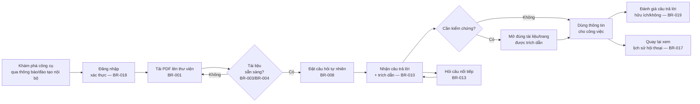

# Product Requirement Document (PRD) — Chat với Tài liệu (MVP)

> **Chuẩn áp dụng:** IEEE 29148-2018 (điều chỉnh cho khuôn mẫu PRD của Product Management)
> **Prompt nguồn:** [docs/PRD_Prompt_IEEE_standard.md](../PRD_Prompt_IEEE_standard.md)
> **Tài liệu gốc:** [docs/requirements/BRD.md](BRD.md) — mọi mục tiêu, yêu cầu, quy tắc và câu hỏi mở trong PRD này đều truy vết ngược về BRD (BO-xxx, SN-xxx, BR-xxx, OQ-xxx).
> **Trạng thái BRD nguồn:** `Draft`, `Ready with conditions` — nhiều giá trị trong PRD này vẫn mang nhãn `[TBD: OQ-xxx]` kế thừa từ BRD cho tới khi Sponsor/IT-Bảo mật chốt.

---

## 0. Xác nhận các trụ cột sản phẩm (Product pillars validation)

Trước khi viết PRD, các trụ cột sản phẩm được rút ra từ BRD như sau. Phần nào BRD chưa chốt được giữ nguyên dạng câu hỏi mở — PRD **không tự suy đoán thay**.

| Trụ cột | Giá trị rút ra từ BRD | Nguồn | Trạng thái |
|---|---|---|---|
| **Tên sản phẩm/tính năng** | "Chat với Tài liệu" (tên làm việc; tên thương mại chính thức chưa có) | BRD §Tiêu đề | `[TBD: OQ-016]` |
| **Người dùng mục tiêu** | Nhân viên đội Phát triển kinh doanh (PTKD) cần tra cứu thông tin nằm rải rác trong nhiều PDF dự án | BRD STK-002, SN-001–SN-007 | Đã xác nhận ở mức mô tả, **chưa phỏng vấn trực tiếp** (OQ-003) |
| **Vấn đề đau** | Tốn thời gian mở và tổng hợp thủ công thông tin từ nhiều file PDF; khó nắm bắt đầy đủ nội dung | BRD §3, BO-001 | Đã xác nhận định tính; **chưa có baseline định lượng** (OQ-002) |
| **Giải pháp cốt lõi** | Ứng dụng web: tải PDF lên thư viện dùng chung → hỏi đáp bằng ngôn ngữ tự nhiên → AI trả lời tổng hợp từ nhiều tài liệu kèm trích dẫn tên tài liệu + số trang | BRD BR-001, BR-008–BR-011 | Đã xác nhận |
| **Trụ cột UX/thị giác** | Web-first (không có app di động native); tối giản thao tác nhập liệu (hỏi bằng câu tự nhiên thay vì filter/search phức tạp); câu trả lời phải "kiểm chứng được" (trích dẫn luôn đi kèm, không chỉ là tính năng phụ) | BRD CON-002, BR-010, SN-004 | Đã xác nhận |

**Khoảng trống cần Sponsor/BA bổ sung trước khi PRD này được coi là final:** tên sản phẩm chính thức (OQ-016), ngôn ngữ hỗ trợ (OQ-009), giới hạn file (OQ-013), ngưỡng thời gian phản hồi (OQ-014), chính sách dữ liệu AI (OQ-006). Các mục này được đánh dấu xuyên suốt PRD bên dưới.

---

## 1. Tóm tắt điều hành & Chiến lược (Executive Summary & Strategy)

### 1.1 Tầm nhìn sản phẩm (Product Vision)

Trở thành điểm truy vấn tri thức duy nhất của đội Phát triển kinh doanh cho toàn bộ tài liệu dự án dạng PDF: thay vì "đi tìm tài liệu", người dùng "hỏi và nhận câu trả lời kiểm chứng được". MVP là bước đầu tiên để kiểm chứng giả thuyết này trước khi mở rộng sang định dạng tài liệu khác hoặc các đội khác trong tổ chức (BRD §5.2 — ngoài phạm vi MVP).

### 1.2 Mục tiêu & Kết quả then chốt (OKRs cho MVP)

OKR được suy ra trực tiếp từ các mục tiêu kinh doanh BO-001–BO-004 trong BRD; giá trị target giữ nguyên trạng thái `[Unverified]`/`[TBD]` như trong BRD cho tới khi Sponsor phê duyệt (OQ-007).

| OKR | Key Result | Nguồn BRD | Trạng thái |
|---|---|---|---|
| **O1: Người dùng tìm thấy thông tin nhanh hơn cách làm thủ công** | KR1 — Giảm ≥ 50% thời gian trung bình để tìm một thông tin trong bộ tài liệu, đo trên bộ câu hỏi mẫu (MET-001) | BO-001 | `[TBD: OQ-002, OQ-007]` — chờ baseline |
| **O2: Người dùng tin tưởng câu trả lời của AI** | KR2 — ≥ 85% câu trả lời trong bộ kiểm thử đạt yêu cầu (đúng nội dung **và** trích dẫn đúng tài liệu/trang) (MET-002) | BO-002 | `[TBD: OQ-007, OQ-008]` — chờ phê duyệt target + bộ câu hỏi kiểm thử |
| **O3: MVP chứng minh được giá trị để đầu tư tiếp** | KR3 — ≥ 70% thành viên đội PTKD dùng công cụ ≥ 1 lần/tuần trong 4 tuần thử nghiệm (MET-003); KR4 — ≥ 70% câu trả lời được đánh giá "hữu ích" (MET-004) | BO-003, BO-004 | `[TBD: OQ-005, OQ-007]` — chờ thời hạn thử nghiệm + target |

> **Lưu ý chiến lược:** không đặt thêm OKR nào ngoài 4 mục tiêu đã có trong BRD — PRD không được tạo thêm mục tiêu kinh doanh mới mà BRD chưa phê duyệt.

---

## 2. Persona & Hành trình người dùng (User Personas & User Journeys)

### 2.1 Persona mục tiêu

**Persona chính — "Nhân viên PTKD" (dựa trên STK-002 / SN-001–SN-007)**

| Thuộc tính | Mô tả |
|---|---|
| Vai trò | Thành viên đội Phát triển kinh doanh, làm việc hằng ngày với nhiều tài liệu dự án dạng PDF |
| Mục tiêu | Tìm nhanh một thông tin cụ thể (điều khoản, số liệu, điều kiện…) nằm trong một hoặc nhiều tài liệu, và tin tưởng được câu trả lời để dùng cho công việc |
| Nỗi đau hiện tại | Phải nhớ tài liệu nào có thể chứa thông tin, mở từng file, đọc lướt, tự tổng hợp; đôi khi bỏ sót vì không đọc hết |
| Hành vi | Đặt câu hỏi tự nhiên, thường hỏi tiếp các câu nối tiếp liên quan đến cùng chủ đề; cần kiểm tra lại nguồn trước khi dùng thông tin cho quyết định |
| Mức độ kỹ thuật | Người dùng nghiệp vụ, không kỹ thuật — giao diện phải không cần hướng dẫn kỹ thuật để dùng |

**Persona phụ — "Quản lý/Sponsor" (dựa trên STK-001 / SN-008)**

| Thuộc tính | Mô tả |
|---|---|
| Vai trò | Người giao yêu cầu MVP, cần số liệu để ra quyết định go/no-go sau giai đoạn thử nghiệm |
| Mục tiêu | Theo dõi mức độ sử dụng và mức độ hữu ích của công cụ mà không cần tự dùng hằng ngày |
| Tương tác với sản phẩm | Xem báo cáo sử dụng hằng tuần (BR-021); không tham gia thao tác tải tài liệu hay hỏi đáp |

**Persona chưa đủ dữ liệu để mô tả sâu:** vai trò "quản trị thư viện" (ai có quyền xóa tài liệu — BR-007) phụ thuộc OQ-011 trong BRD, hiện mặc định là mọi thành viên đội PTKD đều có quyền này; nếu OQ-011 được giải quyết khác, persona và luồng quyền trong PRD cần cập nhật.

### 2.2 Hành trình người dùng cấp cao (High-Level User Journey)

Điểm thành công của hành trình (North Star cho MVP): người dùng đi từ "có câu hỏi" đến "có câu trả lời đáng tin, kiểm chứng được" mà **không cần mở thủ công từng file PDF**.

---

## 3. Yêu cầu chức năng & User Stories (Functional Requirements & User Stories)

Mỗi epic ánh xạ trực tiếp tới một nhóm yêu cầu kinh doanh trong BRD §7. Thang ưu tiên BRD (Must/Should/Could) được chuyển sang thang Agile: **Must → P0, Should → P1, Could → P2**. AC dạng Given-When-Then được viết lại từ các AC-xxx tương ứng trong BRD cho mọi story P0; story P1/P2 dẫn chiếu AC-xxx gốc.

### Epic A — Tiếp nhận tài liệu (nguồn: BRD §7.1, BR-001–BR-005)

| ID | User Story | Priority | Nguồn |
|---|---|---|---|
| US-A1 | Là nhân viên PTKD, tôi muốn tải lên một hoặc nhiều file PDF cùng lúc, để đưa tài liệu vào phạm vi có thể hỏi đáp. | **P0** | BR-001 |
| US-A2 | Là nhân viên PTKD, tôi muốn được thông báo rõ ràng khi tải lên một file không phải PDF, để tôi biết sửa lại thao tác. | **P0** | BR-002 |
| US-A3 | Là nhân viên PTKD, tôi muốn thấy trạng thái "đang xử lý" / "sẵn sàng" của mỗi tài liệu, để biết khi nào có thể hỏi về nó. | **P0** | BR-003 |
| US-A4 | Là nhân viên PTKD, tôi muốn được cảnh báo khi một PDF không chứa văn bản trích xuất được (ví dụ bản scan), để tôi không hiểu nhầm rằng tài liệu đã được dùng làm nguồn. | **P0** | BR-004 |
| US-A5 | Là nhân viên PTKD, tôi muốn biết giới hạn kích thước/số trang file trước khi tải lên, để tránh tải lên thất bại không rõ lý do. | **P1** | BR-005 — `[TBD: OQ-013]` |

**Given-When-Then cho story P0**

- **US-A1 (AC-001):**
  *Given* tôi đang ở màn hình thư viện tài liệu,
  *When* tôi chọn và tải lên 3 file PDF hợp lệ cùng lúc,
  *Then* cả 3 tài liệu xuất hiện trong danh sách thư viện với trạng thái xử lý ban đầu.

- **US-A2 (AC-002):**
  *Given* tôi đang tải tài liệu lên,
  *When* tôi chọn một file .docx, .jpg hoặc .xlsx,
  *Then* hệ thống từ chối file đó, không thêm vào thư viện, và hiển thị thông báo nêu rõ "chỉ chấp nhận định dạng PDF".

- **US-A3 (AC-003):**
  *Given* một PDF hợp lệ vừa được tải lên,
  *When* quá trình xử lý hoàn tất,
  *Then* trạng thái tài liệu chuyển sang "sẵn sàng" và một câu hỏi về nội dung riêng của tài liệu đó được trả lời đúng ngay sau đó.

- **US-A4 (AC-004):**
  *Given* tôi tải lên một PDF chỉ chứa ảnh scan (không có văn bản trích xuất được),
  *When* hệ thống xử lý xong tài liệu,
  *Then* tôi nhận được thông báo "tài liệu này không thể truy vấn", và các câu trả lời sau đó không trích dẫn tài liệu này.

### Epic B — Quản lý thư viện tài liệu (nguồn: BRD §7.2, BR-006–BR-007)

| ID | User Story | Priority | Nguồn |
|---|---|---|---|
| US-B1 | Là nhân viên PTKD, tôi muốn xem danh sách tất cả tài liệu trong thư viện (tên, người tải lên, ngày, trạng thái), để biết phạm vi kiến thức hiện có trước khi đặt câu hỏi. | **P0** | BR-006 |
| US-B2 | Là nhân viên PTKD, tôi muốn xóa một tài liệu khỏi thư viện, để loại bỏ tài liệu lỗi thời hoặc sai trước khi nó ảnh hưởng tới câu trả lời. | **P0** | BR-007 |

**Given-When-Then cho story P0**

- **US-B1 (AC-006):**
  *Given* thư viện có ít nhất một tài liệu,
  *When* tôi mở màn hình danh sách thư viện,
  *Then* mỗi tài liệu hiển thị đủ 4 thông tin: tên, người tải lên, ngày tải lên, trạng thái.

- **US-B2 (AC-007, BRU-002):**
  *Given* tài liệu X đang ở trạng thái "sẵn sàng" trong thư viện,
  *When* tôi xóa tài liệu X,
  *Then* tài liệu X không còn xuất hiện trong danh sách, và một câu hỏi sau đó về nội dung chỉ có trong X nhận được câu trả lời "không tìm thấy thông tin", không dùng nội dung đã xóa.

> **Ghi chú quyền hạn:** US-B2 hiện áp dụng cho mọi người dùng được cấp quyền truy cập thư viện chung, theo giả định ASM-002 trong BRD. Nếu OQ-011 (phân quyền theo tài liệu) được giải quyết khác, story này cần tách thêm điều kiện vai trò.

### Epic C — Hỏi đáp với tài liệu (nguồn: BRD §7.3, BR-008–BR-015) — **Lõi giá trị MVP**

| ID | User Story | Priority | Nguồn |
|---|---|---|---|
| US-C1 | Là nhân viên PTKD, tôi muốn đặt câu hỏi bằng ngôn ngữ tự nhiên và nhận câu trả lời dựa trên nội dung các tài liệu trong thư viện, để không phải tự đọc toàn bộ tài liệu. | **P0** | BR-008 |
| US-C2 | Là nhân viên PTKD, tôi muốn câu trả lời tổng hợp thông tin từ nhiều tài liệu khi câu hỏi liên quan đến nhiều nguồn, để không phải tự đối chiếu thủ công. | **P0** | BR-009 |
| US-C3 | Là nhân viên PTKD, tôi muốn mỗi câu trả lời có trích dẫn tên tài liệu và số trang, để tôi kiểm chứng được trước khi dùng thông tin. | **P0** | BR-010 |
| US-C4 | Là nhân viên PTKD, tôi muốn được báo rõ khi thư viện không có thông tin để trả lời câu hỏi của tôi, để tôi không bị đánh lừa bởi một câu trả lời bịa đặt. | **P0** | BR-011 |
| US-C5 | Là nhân viên PTKD, tôi muốn nhận được câu trả lời trong thời gian chấp nhận được, để công cụ thực sự nhanh hơn cách tra cứu thủ công. | **P0** | BR-012 — `[TBD: OQ-014]` |
| US-C6 | Là nhân viên PTKD, tôi muốn đặt câu hỏi nối tiếp tham chiếu ngầm tới câu hỏi/câu trả lời trước, để không phải lặp lại ngữ cảnh mỗi lần hỏi. | **P1** | BR-013 |
| US-C7 | Là nhân viên PTKD, tôi muốn giới hạn câu hỏi vào một hoặc một số tài liệu cụ thể, để tăng độ chính xác khi tôi đã biết nguồn. | **P1** | BR-014 |
| US-C8 | Là nhân viên PTKD, tôi muốn hỏi và nhận trả lời bằng ngôn ngữ làm việc của mình, để không phải tự dịch câu hỏi hay câu trả lời. | **P0** | BR-015 — `[TBD: OQ-009]` |

**Given-When-Then cho story P0**

- **US-C1 (AC-008):**
  *Given* thư viện có tài liệu ở trạng thái "sẵn sàng",
  *When* tôi đặt một câu hỏi thuộc bộ câu hỏi kiểm thử,
  *Then* tôi nhận được câu trả lời; trên toàn bộ bộ kiểm thử, tỷ lệ câu trả lời "đạt" đạt mục tiêu MET-002 đã được phê duyệt.

- **US-C2 (AC-009):**
  *Given* câu trả lời cho câu hỏi của tôi nằm rải rác ở ≥ 2 tài liệu,
  *When* tôi đặt câu hỏi đó,
  *Then* câu trả lời chứa đầy đủ các phần thông tin liên quan và trích dẫn tất cả tài liệu tương ứng (≥ 2 tài liệu).

- **US-C3 (AC-010):**
  *Given* câu trả lời chứa thông tin lấy từ tài liệu,
  *When* câu trả lời được hiển thị,
  *Then* 100% câu trả lời như vậy kèm trích dẫn tên tài liệu + số trang, và ≥ 95% trích dẫn trỏ đúng tới tài liệu/trang chứa thông tin khi được đối chiếu thủ công.

- **US-C4 (AC-011):**
  *Given* không tài liệu nào trong thư viện chứa thông tin để trả lời câu hỏi,
  *When* tôi đặt câu hỏi đó,
  *Then* hệ thống thông báo không tìm thấy thông tin trong tài liệu thay vì tạo ra nội dung không có nguồn; đạt ≥ 95% trên ≥ 20 câu hỏi kiểm thử loại này.

- **US-C5 (AC-012):**
  *Given* tôi đặt một câu hỏi thuộc bộ kiểm thử,
  *When* hệ thống xử lý câu hỏi,
  *Then* ≥ 90% câu trả lời được trả về trong giới hạn thời gian `[TBD: OQ-014]` giây đã phê duyệt.

- **US-C8 (AC-015):**
  *Given* tôi đặt câu hỏi bằng một trong các ngôn ngữ được phê duyệt (`[TBD: OQ-009]`),
  *When* hệ thống trả lời,
  *Then* câu trả lời ở cùng ngôn ngữ với câu hỏi, và vẫn đạt tiêu chí AC-008.

### Epic D — Quản lý hội thoại (nguồn: BRD §7.4, BR-016–BR-017)

| ID | User Story | Priority | Nguồn |
|---|---|---|---|
| US-D1 | Là nhân viên PTKD, tôi muốn bắt đầu một hội thoại mới không mang ngữ cảnh của hội thoại trước, để tách biệt các chủ đề tra cứu khác nhau. | **P0** | BR-016 |
| US-D2 | Là nhân viên PTKD, tôi muốn xem lại các hội thoại trước đây của mình, để không phải hỏi lại câu đã hỏi. | **P2** | BR-017 |

**Given-When-Then cho story P0**

- **US-D1 (AC-016):**
  *Given* tôi đã có một hội thoại trước đó về chủ đề A,
  *When* tôi bắt đầu một hội thoại mới và hỏi câu nối tiếp dạng "Còn B thì sao?",
  *Then* câu trả lời không dựa trên ngữ cảnh của hội thoại A (vì hội thoại mới không mang ngữ cảnh cũ).

### Epic E — Truy cập & bảo vệ dữ liệu (nguồn: BRD §7.5, BR-018, BR-020)

| ID | User Story | Priority | Nguồn |
|---|---|---|---|
| US-E1 | Là quản trị hệ thống, tôi muốn chỉ người dùng đã xác thực và được cấp quyền mới truy cập được thư viện và chức năng hỏi đáp, để bảo vệ tài liệu nội bộ. | **P0** | BR-018 |
| US-E2 | Là IT/Bảo mật, tôi muốn việc xử lý nội dung tài liệu tuân thủ chính sách dữ liệu đã duyệt, để tài liệu nội bộ không bị sử dụng sai mục đích. | **P0** | BR-020 — **blocker, chờ OQ-006** |

**Given-When-Then cho story P0**

- **US-E1 (AC-018):**
  *Given* một người dùng chưa đăng nhập hoặc không nằm trong danh sách được cấp quyền,
  *When* người đó cố truy cập thư viện hoặc chức năng hỏi đáp,
  *Then* truy cập bị từ chối ở 100% các điểm chức năng được kiểm thử.

- **US-E2 (AC-020):**
  *Given* chính sách dữ liệu đã được IT/Bảo mật xác định (OQ-006),
  *When* hệ thống xử lý nội dung tài liệu (gửi tới dịch vụ AI, lưu trữ, log),
  *Then* IT/Bảo mật xác nhận bằng văn bản rằng cách xử lý đáp ứng chính sách đó.

  > **Trạng thái:** story này **không thể bắt đầu phát triển kỹ thuật** cho tới khi OQ-006 được giải quyết — đây là gate, không phải một tính năng có thể "làm tạm rồi sửa sau".

### Epic F — Phản hồi & đo lường giá trị (nguồn: BRD §7.6, BR-019, BR-021)

| ID | User Story | Priority | Nguồn |
|---|---|---|---|
| US-F1 | Là nhân viên PTKD, tôi muốn đánh giá một câu trả lời là "hữu ích" hoặc "không hữu ích", để đóng góp dữ liệu cho việc cải thiện công cụ. | **P1** | BR-019 |
| US-F2 | Là Sponsor, tôi muốn nhận báo cáo sử dụng hằng tuần (số người dùng hoạt động, số câu hỏi), để có dữ liệu ra quyết định go/no-go sau MVP. | **P0** | BR-021 |

**Given-When-Then cho story P0**

- **US-F2 (AC-021):**
  *Given* một tuần sử dụng đã kết thúc,
  *When* báo cáo tuần được tạo,
  *Then* báo cáo thể hiện số người dùng hoạt động và số câu hỏi đã đặt, khớp với nhật ký sử dụng thực tế của tuần đó.

### 3.1 Bảng tổng hợp ưu tiên

| Priority | Số lượng story | Ghi chú |
|---|---|---|
| P0 (Must) | 16 (US-A1–A4, B1–B2, C1–C5, C8, D1, E1–E2, F2) | Bắt buộc cho launch; US-C5, C8, E2 có giá trị số/điều kiện chờ OQ |
| P1 (Should) | 4 (US-A5, C6, C7, F1) | Có giá trị rõ nhưng có thể trì hoãn nếu thời gian gấp |
| P2 (Could) | 1 (US-D2) | Mong muốn, không chặn launch |

**Không có story nào gắn với yêu cầu "Won't"** — BRD không loại trừ yêu cầu Must nào ở phiên bản này.

---

## 4. Yêu cầu UX & UI (UX & UI Requirements)

> Đây là nơi các ý tưởng thiết kế được phép xuất hiện (BRD §15.2 chuyển giao các ghi chú thiết kế này cho PRD/SAD). PRD mô tả **kỳ vọng hành vi**, không khóa cứng giải pháp UI cụ thể — thiết kế chi tiết (wireframe, design system) thuộc giai đoạn thiết kế kế tiếp.

### 4.1 Logic layout & tương tác cốt lõi

| Vùng màn hình | Kỳ vọng hành vi |
|---|---|
| **Thư viện tài liệu** | Danh sách tài liệu luôn hiển thị tên, trạng thái, người tải lên, ngày tải (US-B1); nút tải lên nổi bật, hỗ trợ kéo-thả và chọn nhiều file (US-A1); mỗi tài liệu có hành động xóa yêu cầu xác nhận (US-B2). |
| **Khung hội thoại** | Ô nhập câu hỏi dạng tự nhiên (không phải form có cấu trúc) luôn ở vị trí cố định (US-C1); câu trả lời hiển thị dạng luồng trò chuyện, trích dẫn hiển thị **ngay trong** câu trả lời, không ẩn sau một cú nhấp bổ sung (US-C3); nhấn vào trích dẫn mở đúng tài liệu tại đúng trang. |
| **Chọn phạm vi tài liệu** | Cho phép chọn một/nhiều tài liệu cụ thể để giới hạn phạm vi câu hỏi (US-C7), mặc định là "toàn bộ thư viện" khi không chọn. |
| **Danh sách hội thoại** | Sidebar hoặc màn hình riêng liệt kê hội thoại theo thời gian, cho phép mở lại (US-D2); nút "Hội thoại mới" rõ ràng, tách biệt khỏi hội thoại đang mở (US-D1). |
| **Đánh giá câu trả lời** | Mỗi câu trả lời có cặp nút "hữu ích / không hữu ích" nhỏ, không chặn luồng đọc tiếp (US-F1). |

**Nguyên tắc UX bắt buộc (không thương lượng, vì gắn trực tiếp với yêu cầu Must):**
- Trích dẫn **không phải tính năng tùy chọn ẩn** — nó là một phần không thể tách rời của mọi câu trả lời có dùng thông tin từ tài liệu (BR-010).
- Trạng thái "không tìm thấy thông tin" phải được trình bày khác biệt rõ ràng với một câu trả lời bình thường, để người dùng không nhầm lẫn với câu trả lời có nội dung (BR-011).

### 4.2 Trường hợp biên & trạng thái lỗi

| Tình huống | Hành vi kỳ vọng | Nguồn |
|---|---|---|
| Mất kết nối mạng trong khi tải tài liệu | Hiển thị trạng thái lỗi rõ ràng, cho phép thử lại mà không mất các tài liệu đã tải thành công trước đó | Suy luận từ BR-001, `[Unverified]` — cần xác nhận với đội phát triển |
| Mất kết nối trong khi chờ câu trả lời | Hiển thị trạng thái lỗi, câu hỏi không bị mất (có thể gửi lại), không hiển thị câu trả lời một phần gây hiểu nhầm | Suy luận từ BR-012, `[Unverified]` |
| Thư viện rỗng (chưa có tài liệu nào) | Màn hình hội thoại hiển thị hướng dẫn tải tài liệu lên trước, chặn việc đặt câu hỏi khi chưa có tài liệu nào sẵn sàng | Suy luận từ BR-001, BR-008 |
| Tải lên file sai định dạng | Từ chối ngay tại thời điểm chọn file nếu có thể phát hiện qua phần mở rộng, kèm thông báo rõ lý do | BR-002 / AC-002 |
| Tải lên PDF là ảnh scan | Hiển thị cảnh báo "không thể truy vấn" gắn trực tiếp vào dòng tài liệu đó trong thư viện, không chỉ ở thông báo thoáng qua | BR-004 / AC-004 |
| Tải lên file vượt giới hạn kích thước/số trang | Từ chối kèm thông báo nêu rõ giới hạn (giá trị cụ thể `[TBD: OQ-013]`) | BR-005 |
| Câu hỏi không có thông tin trong thư viện | Trả lời "không tìm thấy thông tin trong tài liệu hiện có", **không** suy diễn hay trả lời từ kiến thức ngoài tài liệu | BR-011 / BRU-001 |
| Câu hỏi vượt thời gian phản hồi | Hiển thị trạng thái "đang xử lý" quá ngưỡng cần có chỉ báo tiến trình; nếu vượt timeout hệ thống, báo lỗi và cho phép hỏi lại | BR-012, `[TBD: OQ-014]` |
| Người dùng chưa xác thực truy cập trực tiếp URL | Chuyển hướng tới màn hình đăng nhập, không hiển thị bất kỳ nội dung thư viện/hội thoại nào | BR-018 / AC-018 |
| Xóa tài liệu đang được dùng trong một hội thoại cũ | Hội thoại cũ vẫn hiển thị nội dung đã có, nhưng không dùng tài liệu đã xóa cho câu hỏi mới | BR-007, BRU-002 |

---

## 5. Tiêu chí phát hành & Chỉ số sau ra mắt (Release Criteria & Post-Launch Metrics)

### 5.1 Tiêu chí mở cổng phát hành (Launch Gate Criteria)

MVP **không được** đưa vào production nếu bất kỳ điều kiện nào dưới đây chưa đạt — các điều kiện này bắt nguồn trực tiếp từ các yêu cầu Must (P0) và từ các điều kiện phê duyệt BRD (BRD §14).

| Hạng mục | Tiêu chí mở cổng | Nguồn |
|---|---|---|
| **Chức năng** | 100% user story P0 (16 story, §3.1) đạt Given-When-Then tương ứng trên môi trường staging | BRD §16.1 |
| **Chất lượng câu trả lời** | Đạt mục tiêu MET-002 đã phê duyệt trên bộ câu hỏi kiểm thử (OQ-008) — AC-008, AC-009 | BO-002, OQ-007, OQ-008 |
| **Chống bịa thông tin** | ≥ 95% trên ≥ 20 câu hỏi "không có đáp án trong tài liệu" được trả lời đúng là "không tìm thấy" (AC-011) | BR-011, RSK-001 |
| **Hiệu năng** | ≥ 90% câu trả lời trong ngưỡng thời gian đã duyệt (AC-012) | BR-012, `[TBD: OQ-014]` |
| **Bảo mật & quyền truy cập** | 100% điểm chức năng từ chối truy cập với người dùng chưa xác thực/không được cấp quyền (AC-018) | BR-018 |
| **Tuân thủ dữ liệu** | IT/Bảo mật ký xác nhận bằng văn bản cách xử lý dữ liệu đáp ứng chính sách đã duyệt (AC-020) | BR-020, OQ-006 — **blocker cứng** |
| **Dữ liệu đầu vào** | Giới hạn file (OQ-013), ngôn ngữ hỗ trợ (OQ-009), ngưỡng thời gian phản hồi (OQ-014) đã được Business Owner chốt bằng số cụ thể | BR-005, BR-012, BR-015 |
| **Đo lường** | Cơ chế báo cáo tuần (US-F2/AC-021) đã chạy thử tối thiểu 1 chu kỳ và số liệu khớp với nhật ký thô | BR-021 |
| **QA coverage** | 100% AC-001 đến AC-021 có kịch bản kiểm thử tương ứng và đã pass ở môi trường staging | BRD §7.7 |

**Trạng thái hiện tại:** launch gate **chưa thể đóng** vì OQ-006 (chính sách dữ liệu), OQ-008 (bộ câu hỏi kiểm thử), OQ-013/OQ-014/OQ-009 (giới hạn & ngưỡng cụ thể) và OQ-007 (target chính thức) đều đang mở trong BRD.

### 5.2 Phân tích & Theo dõi (Analytics & Tracking)

Telemetry tối thiểu cần instrument để đo được OKR §1.2 và vận hành MET-001–MET-004. Tên sự kiện là đề xuất làm việc, có thể đổi theo chuẩn đặt tên của đội phát triển.

| Sự kiện (event) | Thuộc tính chính | Phục vụ đo lường |
|---|---|---|
| `document_upload_attempted` | user_id, file_type, file_size, timestamp | Phễu tải lên; phát hiện tỷ lệ lỗi định dạng (US-A2) |
| `document_upload_succeeded` | document_id, user_id, page_count, processing_time_ms | Kích thước thư viện theo thời gian; MET-001 baseline/sau |
| `document_upload_rejected` | reason (`wrong_format` \| `not_extractable` \| `too_large`), file_type | Tần suất mỗi loại lỗi (AC-002, AC-004, AC-005) |
| `document_deleted` | document_id, user_id | Theo dõi vòng đời thư viện (US-B2) |
| `question_asked` | conversation_id, user_id, question_length, scoped_documents (null hoặc danh sách), language | Mẫu số cho MET-003; đầu vào cho đo thời gian phản hồi |
| `answer_returned` | conversation_id, response_time_ms, citation_count, answer_type (`answered` \| `not_found`) | MET-001 (thời gian), MET-002 (qua chấm điểm thủ công đối chiếu với bộ kiểm thử), AC-012 |
| `answer_feedback_submitted` | conversation_id, message_id, rating (`helpful` \| `not_helpful`) | MET-004 |
| `conversation_started` | conversation_id, user_id | Phễu sử dụng; phân biệt hội thoại mới (US-D1) |
| `conversation_resumed` | conversation_id, user_id | Mức dùng lại lịch sử (US-D2) |
| `weekly_usage_report_generated` | week_start_date, active_user_count, question_count | Nguồn trực tiếp cho US-F2/AC-021, MET-003 |
| `access_denied` | attempted_path, reason (`unauthenticated` \| `unauthorized`) | Kiểm chứng AC-018; giám sát bảo mật (US-E1) |

**Nguyên tắc ghi log liên quan tới OQ-006:** nội dung câu hỏi/câu trả lời **không** được giả định là an toàn để log đầy đủ dưới dạng văn bản thô cho tới khi chính sách dữ liệu (OQ-006) xác nhận phạm vi cho phép — đội phát triển cần làm rõ việc này cùng IT/Bảo mật trước khi implement logging chi tiết.

---

## 6. Truy vết ngược về BRD (Traceability)

| PRD Epic | BRD Business Requirement(s) | BRD Objective |
|---|---|---|
| A — Tiếp nhận tài liệu | BR-001–BR-005 | BO-001 |
| B — Quản lý thư viện | BR-006–BR-007 | BO-002 |
| C — Hỏi đáp với tài liệu | BR-008–BR-015 | BO-001, BO-002 |
| D — Quản lý hội thoại | BR-016–BR-017 | BO-001, BO-003 |
| E — Truy cập & bảo vệ dữ liệu | BR-018, BR-020 | — (gắn SN-011, tuân thủ) |
| F — Phản hồi & đo lường | BR-019, BR-021 | BO-003, BO-004 |

Mọi user story trong PRD này bắt nguồn từ một `BR-xxx` đã tồn tại trong BRD — **không có story nào được tạo thêm ngoài phạm vi BRD đã nêu**. Các tính năng ở BRD §15.1 (đề xuất BA, chờ Sponsor xác nhận qua OQ-004) đã được đưa vào đầy đủ ở các epic tương ứng (US-C3/C4/C7, US-B1/B2, US-C6, US-D2, US-F1, US-F2) và **vẫn mang tình trạng chờ xác nhận** như trong BRD.

---

## 7. Vấn đề mở kế thừa từ BRD (Open Issues)

PRD không tự giải quyết các câu hỏi mở của BRD. Bảng dưới liệt kê đúng các OQ của BRD có ảnh hưởng trực tiếp tới nội dung PRD này, cộng thêm một mục mới phát sinh khi viết PRD (OQ-016).

| ID | Câu hỏi | Ảnh hưởng tới PRD | Trạng thái |
|---|---|---|---|
| OQ-002 | Baseline thời gian tra cứu hiện tại | Không tính được % cải thiện cho O1/KR1 | Open (BRD) |
| OQ-003 | Phỏng vấn xác nhận nhu cầu người dùng | Persona chính (§2.1) chưa được xác thực trực tiếp | Open (BRD) |
| OQ-004 | Sponsor phê duyệt tính năng BA đề xuất | US-C6, US-C7, US-B1/B2, US-D2, US-F1, US-F2 chờ xác nhận phạm vi | Open (BRD) |
| OQ-005 | Ngân sách, thời hạn, thời gian thử nghiệm | Không đặt được mốc ngày cho KR3/KR4 và launch gate | Open (BRD) |
| OQ-006 | Chính sách dữ liệu cho dịch vụ AI | **Blocker cứng** cho US-E2 và cho thiết kế logging ở §5.2 | Open (BRD) |
| OQ-007 | Giá trị target chính thức cho MET-001–MET-004 | OKR ở §1.2 dùng giá trị đề xuất, chưa phê duyệt | Open (BRD) |
| OQ-008 | Bộ câu hỏi kiểm thử có đáp án | Không đo được AC-008, AC-009, AC-011 tại QA | Open (BRD) |
| OQ-009 | Ngôn ngữ hỗ trợ | US-C8/AC-015 chưa có giá trị cụ thể | Open (BRD) |
| OQ-011 | Phân quyền theo tài liệu | Ảnh hưởng điều kiện quyền hạn của US-B2 | Open (BRD) |
| OQ-013 | Giới hạn kích thước/số trang file | US-A5/AC-005 chưa có số cụ thể | Open (BRD) |
| OQ-014 | Ngưỡng thời gian phản hồi | US-C5/AC-012 và launch gate hiệu năng chưa có số cụ thể | Open (BRD) |
| **OQ-016** | **(Mới)** Tên sản phẩm/thương hiệu chính thức | Chỉ ảnh hưởng tới nhãn hiển thị trong UI, không chặn chức năng | Open — đề xuất người phụ trách: Sponsor/Marketing nội bộ, hạn đề xuất 2026-11-06 |

---

## 8. Phạm vi không thuộc PRD (chuyển cho SAD/Design)

Theo đúng ranh giới mà BRD đã đặt ra (BRD §15.2), các quyết định sau **không** được chốt trong PRD mà chuyển cho giai đoạn Thiết kế hệ thống (SAD) và Thiết kế giao diện (UI design system), trong khuôn khổ chính sách dữ liệu một khi OQ-006 được giải quyết:

- Kỹ thuật truy xuất nội dung tài liệu (semantic search, RAG, chunking strategy).
- Lựa chọn mô hình/nhà cung cấp AI cụ thể.
- Kiến trúc lưu trữ tài liệu và vector index.
- Cơ chế xác thực cụ thể (SSO, OAuth, tài khoản nội bộ…).
- Wireframe/mockup chi tiết, bảng màu, typography (thuộc design system).

---

## 9. Trạng thái tài liệu

**Trạng thái: `Draft — Ready for cross-functional review`**, chưa sẵn sàng để Engineering bắt đầu commit kế hoạch sprint, vì:

- 1 story P0 (US-E2 / BR-020) bị **chặn cứng** bởi OQ-006.
- 2 story P0 khác (US-C5, US-C8) phụ thuộc số liệu cụ thể từ OQ-014, OQ-009; US-A5 (P1) phụ thuộc OQ-013.
- OKR ở §1.2 dùng giá trị target chưa phê duyệt chính thức (OQ-007).

**Khuyến nghị bước tiếp theo:** tổ chức một buổi review PRD + BRD cùng Sponsor, Business Owner và IT/Bảo mật tập trung đúng vào nhóm OQ-006, OQ-007, OQ-008, OQ-009, OQ-013, OQ-014 trước khi chuyển PRD sang Engineering để ước lượng.
