# Hướng dẫn sử dụng AI Chat PDF

AI Chat PDF giúp bạn hỏi đáp với chính các file PDF của mình: hợp đồng, chính sách, bảng giá, báo cáo…
Mỗi câu trả lời đều ghi rõ **tên tài liệu và số trang** để bạn mở ra kiểm chứng.

Việc dùng gồm 3 bước: **tải PDF lên → chờ "Sẵn sàng" → đặt câu hỏi**.

---

## Mục lục

1. [Đăng nhập](#1-đăng-nhập)
2. [Làm quen với màn hình chính](#2-làm-quen-với-màn-hình-chính)
3. [Tải tài liệu lên](#3-tải-tài-liệu-lên)
4. [Trạng thái tài liệu](#4-trạng-thái-tài-liệu)
5. [Đặt câu hỏi và đọc câu trả lời](#5-đặt-câu-hỏi-và-đọc-câu-trả-lời)
6. [Mở tài liệu gốc tại trang được trích dẫn](#6-mở-tài-liệu-gốc-tại-trang-được-trích-dẫn)
7. [Xóa tài liệu](#7-xóa-tài-liệu)
8. [Đăng xuất và hết phiên](#8-đăng-xuất-và-hết-phiên)
9. [Thông báo thường gặp](#9-thông-báo-thường-gặp)
10. [Mẹo đặt câu hỏi](#10-mẹo-đặt-câu-hỏi)

---

## 1. Đăng nhập

Mở trình duyệt (Edge hoặc Chrome) và vào địa chỉ do bộ phận IT cung cấp. Với bản demo, địa chỉ là
<http://localhost:8080>.

Trang đăng nhập hiện ra. Bản demo dùng tài khoản mẫu, nên bạn chỉ cần bấm chọn một tài khoản, ví dụ
**Nguyễn Lan (P1)**:

> Khi triển khai chính thức, đây sẽ là trang đăng nhập bằng tài khoản công ty của bạn.

Tài khoản không thuộc nhóm được phép dùng ứng dụng sẽ thấy trang dưới đây. Khi đó hãy liên hệ quản trị viên để
được thêm vào nhóm `aichat-users`, rồi bấm **Đăng nhập lại**.

## 2. Làm quen với màn hình chính

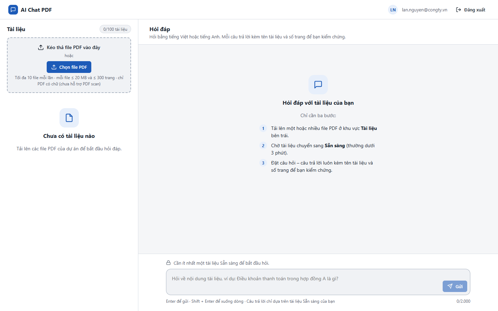

| Khu vực | Vị trí | Công dụng |
|---|---|---|
| **Thanh trên cùng** | Trên cùng | Email của bạn và nút **Đăng xuất** |
| **Tài liệu** | Cột trái | Tải PDF lên, xem trạng thái, xóa tài liệu. Góc phải hiện số tài liệu đã dùng, ví dụ `0/100 tài liệu` |
| **Hỏi đáp** | Bên phải | Đặt câu hỏi và đọc câu trả lời |
| **Ô hỏi** | Dưới cùng bên phải | Bị khóa (kèm biểu tượng ổ khóa và lý do) cho tới khi có ít nhất một tài liệu *Sẵn sàng* |

Tài liệu của bạn là **riêng tư**: người dùng khác không xem được và không hỏi được về tài liệu của bạn.

## 3. Tải tài liệu lên

Có hai cách:

- **Kéo thả** một hoặc nhiều file PDF vào khung nét đứt *Kéo thả file PDF vào đây*, hoặc
- Bấm nút **Chọn file PDF** rồi chọn file (giữ `Ctrl` để chọn nhiều file).

Mỗi file hiện thanh tiến độ. Hệ thống tải tối đa 3 file cùng lúc, các file còn lại hiện *Đang chờ tải lên*:

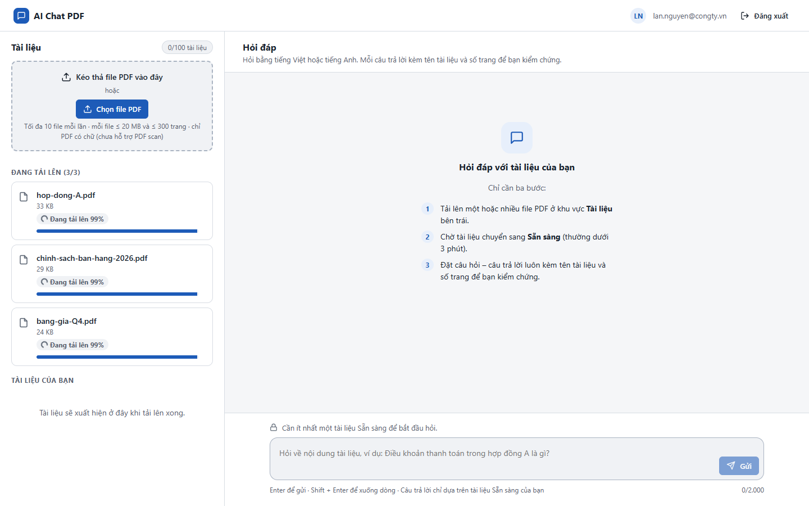

**Giới hạn:**

| Giới hạn | Mức |
|---|---|
| Loại file | Chỉ PDF **có chữ** (chọn/bôi đen được chữ). Chưa hỗ trợ PDF scan từ ảnh chụp |
| Dung lượng | Tối đa 20 MB mỗi file |
| Số trang | Tối đa 300 trang mỗi file |
| Mỗi lần tải | Tối đa 10 file |
| Tổng số tài liệu | Tối đa 100 tài liệu mỗi người |

Nếu chọn quá 10 file một lúc, **không file nào được tải lên** và hệ thống báo để bạn chọn lại:

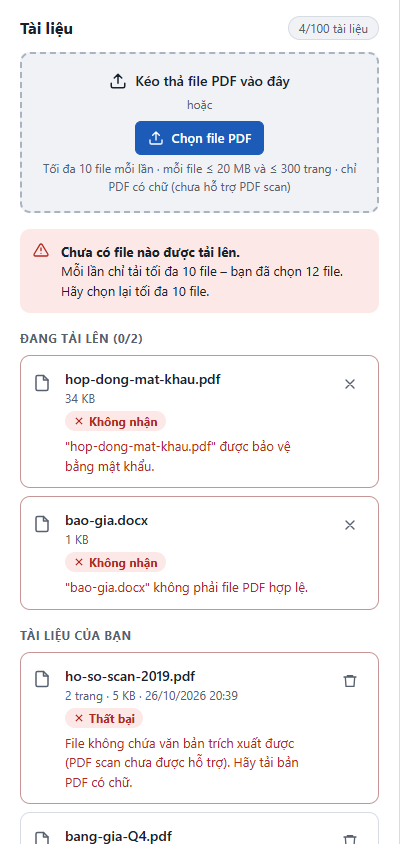

Khi còn 5 chỗ trống trở xuống, số tài liệu ở góc trên chuyển sang màu cảnh báo. Lúc đó hãy xóa bớt tài liệu
không còn dùng.

## 4. Trạng thái tài liệu

Sau khi tải lên, hệ thống đọc và lập chỉ mục tài liệu. Việc này thường mất vài giây, với tài liệu dài có thể
tới khoảng 3 phút. Bạn không cần tải lại trang: trạng thái tự cập nhật, và góc dưới bên trái hiện thông báo khi
tài liệu đã sẵn sàng.

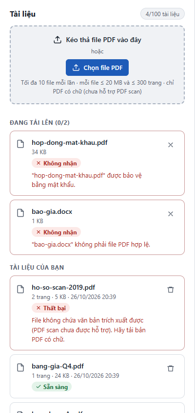

| Trạng thái | Ý nghĩa | Bạn cần làm gì |
|---|---|---|
| ⟳ **Đang tải lên x%** | File đang được gửi lên | Chờ, không đóng trang |
| ⟳ **Đang xử lý** | Hệ thống đang đọc nội dung | Chờ; có thể hỏi về các tài liệu khác đã sẵn sàng |
| ✓ **Sẵn sàng** | Đã dùng được để hỏi đáp | – |
| ✕ **Không nhận** | File bị từ chối ngay khi tải lên (không phải PDF, có mật khẩu, quá lớn, quá nhiều trang) | Đọc lý do bên dưới, sửa file rồi tải lại. Bấm **✕** để ẩn thông báo |
| ✕ **Thất bại** | Đã nhận file nhưng không đọc được nội dung | Đọc lý do bên dưới |

Các lý do *Thất bại* thường gặp:

| Lý do hiển thị | Cách khắc phục |
|---|---|
| File không chứa văn bản trích xuất được (PDF scan…) | Dùng bản PDF xuất từ Word/Excel thay cho bản scan |
| File được bảo vệ bằng mật khẩu | Mở file, gỡ mật khẩu, lưu lại rồi tải lên |
| Không đọc được nội dung file | File có thể bị hỏng; xuất lại PDF từ file gốc |
| Lỗi xử lý tạm thời | Bấm nút **Xử lý lại** ngay trên dòng tài liệu, không cần tải lại file |

Mất mạng khi đang tải lên thì dòng file hiện **Tải lên thất bại** kèm nút **Tải lại**. Bấm **Tải lại** an toàn:
tài liệu sẽ không bị tạo trùng.

## 5. Đặt câu hỏi và đọc câu trả lời

Gõ câu hỏi vào ô dưới cùng rồi nhấn **Enter** hoặc bấm **Gửi**. Muốn xuống dòng thì nhấn **Shift + Enter**.
Câu hỏi dài tối đa 2.000 ký tự (bộ đếm ở góc phải bên dưới ô hỏi). Có thể hỏi bằng tiếng Việt hoặc tiếng Anh.

Trong lúc hệ thống soạn câu trả lời (thường dưới 15 giây), ô hỏi tạm khóa và hiện dấu ba chấm.

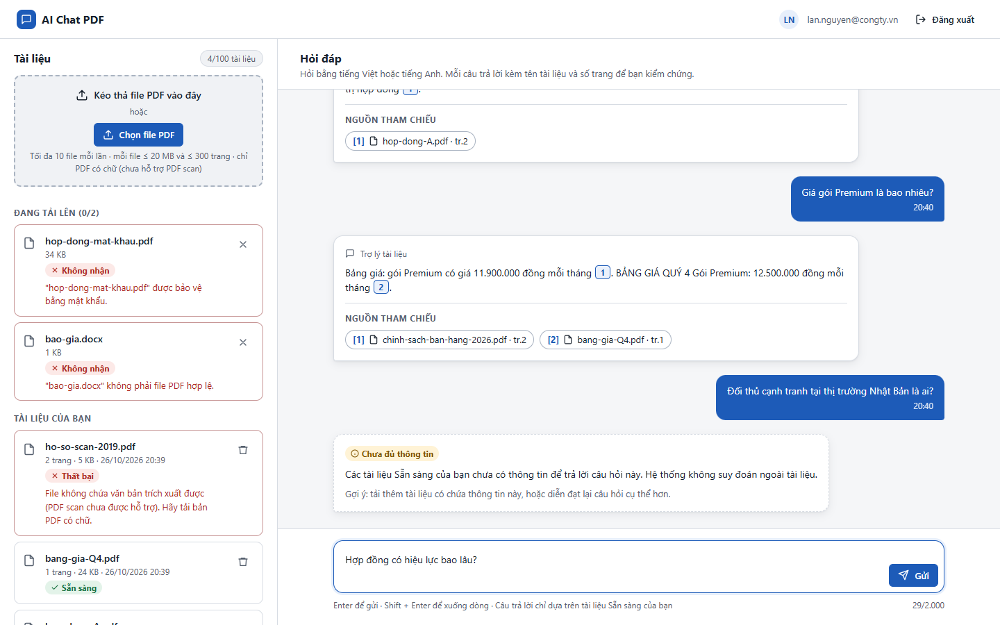

### Câu trả lời có nguồn

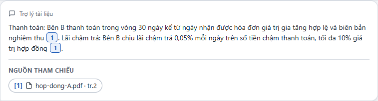

- Các số trong ô nhỏ như **1** ngay trong câu trả lời cho biết thông tin đó lấy từ nguồn nào.
- Phần **Nguồn tham chiếu** liệt kê từng nguồn theo dạng **[số] tên tài liệu · tr.số trang**. Ví dụ
  `[1] hop-dong-A.pdf · tr.2` nghĩa là thông tin nằm ở trang 2 của file `hop-dong-A.pdf`.
- Bấm vào số trong câu hoặc vào nhãn nguồn để mở tài liệu gốc đúng trang đó (mục 6).

### Câu trả lời tổng hợp từ nhiều tài liệu

Nếu thông tin nằm ở nhiều tài liệu, câu trả lời ghi nguồn riêng cho từng ý:

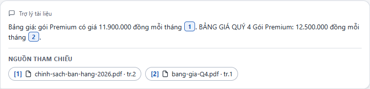

Ở ví dụ trên, hai tài liệu ghi hai giá khác nhau cho gói Premium (11.900.000 và 12.500.000 đồng). Hãy mở cả
hai nguồn để xem tài liệu nào mới hơn trước khi dùng thông tin.

### "Chưa đủ thông tin"

Nếu các tài liệu *Sẵn sàng* của bạn không chứa thông tin để trả lời, hệ thống sẽ **không đoán** mà hiện:

Khi đó bạn có thể tải thêm tài liệu có thông tin này, hoặc hỏi cụ thể hơn bằng từ ngữ có trong tài liệu.

### Lịch sử hỏi đáp

Hội thoại được giữ khi bạn tải lại trang. Khi **đăng xuất hoặc hết phiên**, lần đăng nhập sau sẽ bắt đầu một
hội thoại mới. Tài liệu đã tải lên vẫn còn nguyên.

## 6. Mở tài liệu gốc tại trang được trích dẫn

Bấm vào nhãn nguồn (ví dụ `[1] hop-dong-A.pdf · tr.2`). Trình xem tài liệu mở ra đúng trang được trích dẫn:

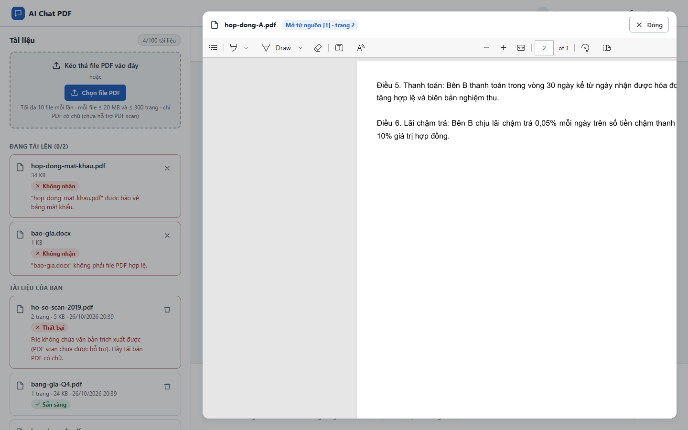

- Dòng trên cùng cho biết bạn đang xem nguồn nào và trang mấy, ví dụ *Mở từ nguồn [1] · trang 2*.
- Thanh công cụ của trình duyệt cho phép phóng to/thu nhỏ, chuyển trang, tìm chữ (`Ctrl + F`), tải về hoặc in.
- Bấm **Đóng** hoặc nhấn phím **Esc** để quay lại hội thoại.

## 7. Xóa tài liệu

Bấm biểu tượng **thùng rác** ở dòng tài liệu cần xóa. Hệ thống hỏi lại để xác nhận:

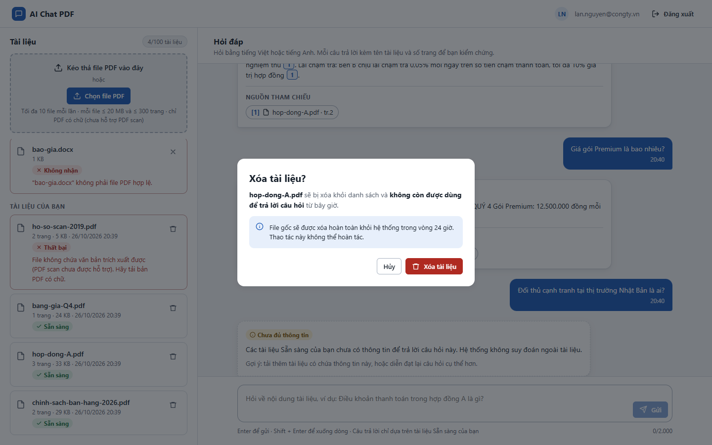

- **Xóa tài liệu**: tài liệu biến mất khỏi danh sách và **không còn được dùng để trả lời** từ lúc đó.
  File gốc được xóa hẳn khỏi hệ thống trong vòng 24 giờ. Thao tác này **không thể hoàn tác**.
- **Hủy** (hoặc phím Esc): giữ nguyên tài liệu.
- Xóa một tài liệu đang *Đang xử lý* thì việc xử lý cũng bị hủy.

Các câu trả lời cũ từng trích dẫn tài liệu đã xóa vẫn còn trong hội thoại, nhưng nhãn nguồn chuyển sang viền nét
đứt kèm chữ **(đã xóa)** và không mở được nữa:

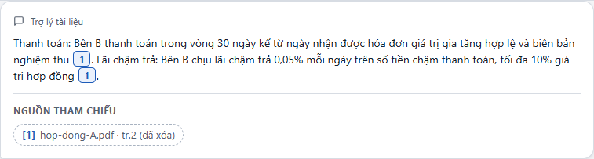

## 8. Đăng xuất và hết phiên

- **Đăng xuất:** bấm **Đăng xuất** ở góc trên bên phải.
- **Hết phiên:** phiên tự hết hạn sau 2 giờ không thao tác, hoặc sau tối đa 10 giờ kể từ lúc đăng nhập. Trước khi
  hết hạn, góc dưới bên trái hiện cảnh báo *Phiên sắp hết hạn*. Khi đã hết hạn, bạn thấy trang dưới đây và được
  chuyển tới trang đăng nhập sau 5 giây:

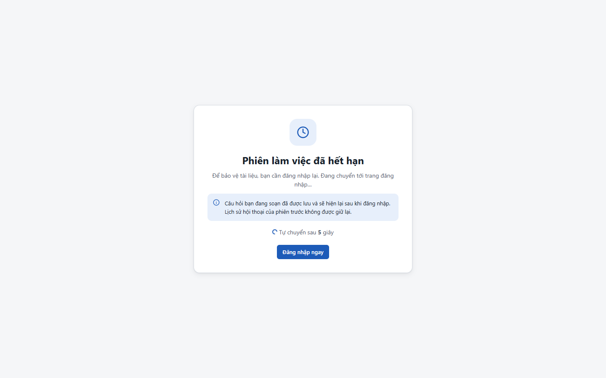

Câu hỏi bạn đang gõ dở **được giữ lại** và tự hiện lại trong ô hỏi sau khi đăng nhập.

## 9. Thông báo thường gặp

| Thông báo | Ý nghĩa và cách xử lý |
|---|---|
| *Cần ít nhất một tài liệu Sẵn sàng để bắt đầu hỏi.* | Chưa có tài liệu nào xử lý xong. Tải PDF lên và chờ trạng thái *Sẵn sàng* |
| *Bạn thao tác quá nhanh. Vui lòng thử lại sau N giây.* | Mỗi người hỏi tối đa 10 câu mỗi phút. Chờ hết đếm ngược; câu hỏi của bạn vẫn còn trong ô |
| *Không thể tạo câu trả lời lúc này…* hoặc *Hệ thống phản hồi quá lâu.* | Lỗi tạm thời. Bấm **Gửi lại** ngay dưới thông báo; câu hỏi không bị gửi trùng |
| *Mất kết nối khi đang tải lên…* | Kiểm tra mạng rồi bấm **Tải lại** trên dòng file |
| *Bạn chỉ còn có thể thêm N tài liệu* | Sắp hết hạn mức 100 tài liệu. Xóa tài liệu không còn dùng |
| *Chưa có file nào được tải lên. Mỗi lần chỉ tải tối đa 10 file…* | Chọn lại tối đa 10 file mỗi lần |
| *Không thể đăng nhập* | Phiên đăng nhập quá hạn (ví dụ để trang đăng nhập quá lâu). Bấm **Thử đăng nhập lại**. Nếu lặp lại, gửi *mã tham chiếu* trên trang cho bộ phận hỗ trợ |

## 10. Mẹo đặt câu hỏi

- **Hỏi cụ thể, dùng từ ngữ có trong tài liệu.** "Bên B thanh toán trong vòng bao nhiêu ngày?" cho kết quả tốt
  hơn "Tiền trả khi nào?".
- **Mỗi lần một ý.** Tách "thời hạn thanh toán và phí phạt" thành hai câu hỏi.
- **Mỗi câu hỏi là độc lập.** Hệ thống chưa hiểu câu hỏi tiếp nối kiểu "Còn điều khoản đó thì sao?". Hãy nhắc lại
  đầy đủ chủ đề trong từng câu.
- **Luôn kiểm chứng thông tin quan trọng** bằng cách bấm vào nguồn, nhất là số tiền, ngày tháng và điều khoản hợp đồng.
- **Gặp "Chưa đủ thông tin"** thì kiểm tra tài liệu chứa thông tin đó đã ở trạng thái *Sẵn sàng* chưa.

---

*Gặp sự cố kỹ thuật (không mở được trang, tài liệu đứng mãi ở "Đang xử lý"…)? Liên hệ người quản trị hệ thống.
Người quản trị xem [Hướng dẫn cài đặt](HUONG_DAN_CAI_DAT.md#6-xử-lý-sự-cố).*
