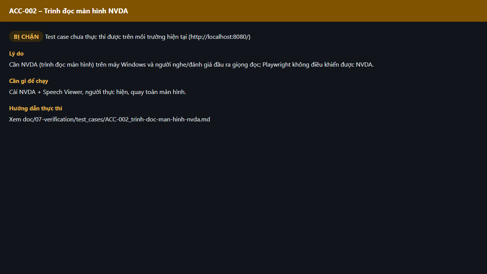

# Test report – ACC-002: Trình đọc màn hình NVDA

| Trường | Giá trị |
|---|---|
| Test case | [ACC-002](../../doc/07-verification/test_cases/ACC-002_trinh-doc-man-hinh-nvda.md) |
| Kết luận | **BỊ CHẶN** |
| Bắt đầu | 2026-10-27T15:16:52.275Z |
| Kết thúc | 2026-10-27T15:16:58.973Z (6.7 s) |
| Cách thực hiện | Không thực thi – bị chặn (evidence/blocked.ts) |
| URL ứng dụng | http://localhost:8080/ |
| Bản build | 166929f + thay đổi chưa commit trong app/ |
| Trình duyệt | Microsoft Edge (Playwright, channel msedge) |
| Hệ điều hành | win32 x64 |

## Kết quả từng bước

| # | Bước | Kết quả mong đợi | Kết quả thực tế | Trạng thái | Bằng chứng |
|---|---|---|---|---|---|
| 1 | Kiểm tra điều kiện thực thi | Cài NVDA + Speech Viewer, người thực hiện, quay toàn màn hình. | Cần NVDA (trình đọc màn hình) trên máy Windows và người nghe/đánh giá đầu ra giọng đọc; Playwright không điều khiển được NVDA. | Bị chặn | [ảnh](screenshots/01-ly-do-bi-chan.png) |

## Video

- [ACC-002-blocked.webm](video/ACC-002-blocked.webm)

## Ảnh chụp màn hình

## Log

- (không có)

## Ghi chú / lỗi phát hiện

- Bị chặn: Cần NVDA (trình đọc màn hình) trên máy Windows và người nghe/đánh giá đầu ra giọng đọc; Playwright không điều khiển được NVDA.
- Cần: Cài NVDA + Speech Viewer, người thực hiện, quay toàn màn hình.
