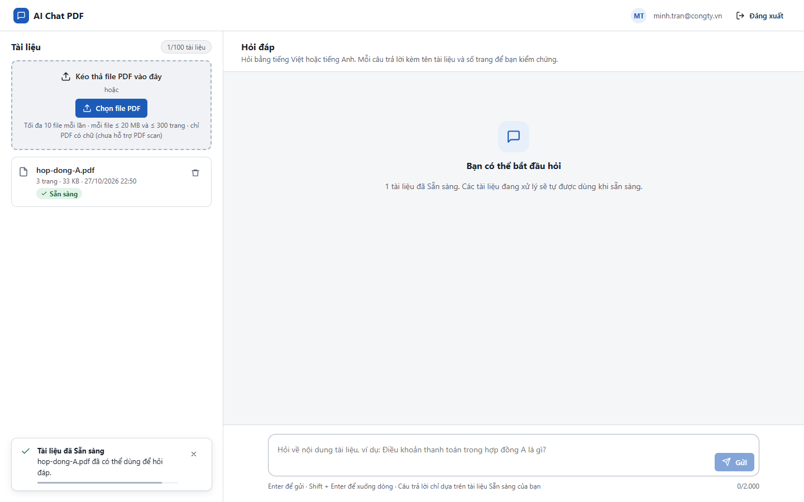
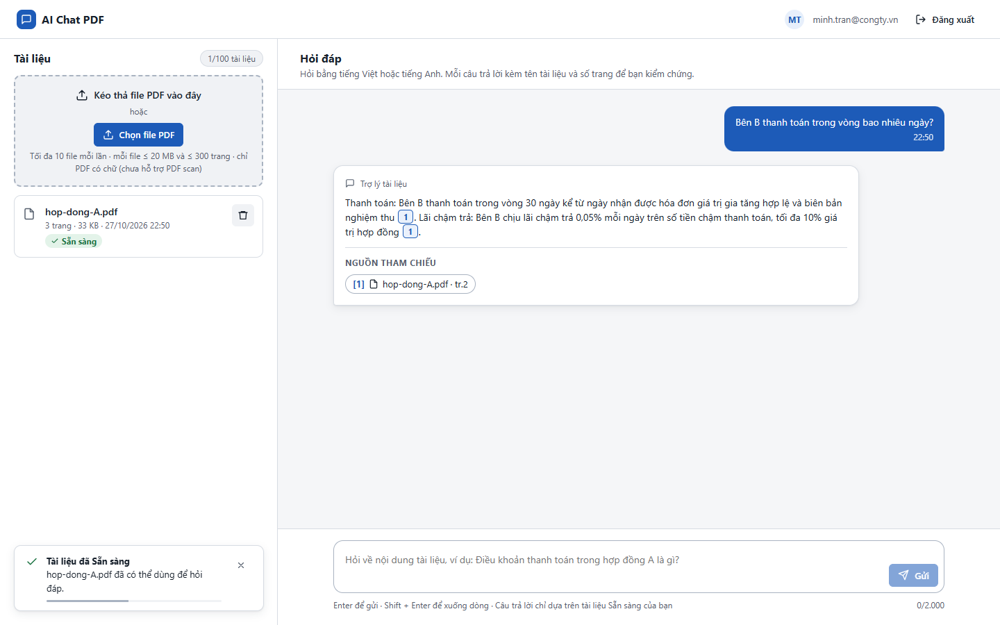

# Test report – ACC-004: Thuộc tính ARIA

| Trường | Giá trị |
|---|---|
| Test case | [ACC-004](../../doc/07-verification/test_cases/ACC-004_thuoc-tinh-aria.md) |
| Kết luận | **ĐẠT** |
| Bắt đầu | 2026-10-27T15:50:32.615Z |
| Kết thúc | 2026-10-27T15:50:46.253Z (13.6 s) |
| Cách thực hiện | Tự động – Playwright (app/frontend/evidence/fixture.ts) |
| URL ứng dụng | http://localhost:8080/ |
| Bản build | 166929f + thay đổi chưa commit trong app/ |
| Trình duyệt | Microsoft Edge (Playwright, channel msedge) |
| Hệ điều hành | win32 x64 |
| Spec | app/frontend/testcases/ACC-004_thuoc-tinh-aria.spec.ts |

## Kết quả từng bước

| # | Bước | Kết quả mong đợi | Kết quả thực tế | Trạng thái | Bằng chứng |
|---|---|---|---|---|---|
| 1 | Đăng nhập P2, xóa tài liệu cũ | Màn hình chính | Như mong đợi | Đạt | [ảnh](screenshots/01-dang-nhap-p2-xoa-tai-lieu-cu.png) |
| 2 | Chạy axe toàn trang (mọi rule) | 0 vi phạm mức serious/critical | 0 vi phạm (0 serious/critical), 22 rule đạt | Đạt | [ảnh](screenshots/02-chay-axe-toan-trang-moi-rule.png) |
| 3 | Trong lúc tải: role=progressbar, aria-valuenow | Có và cập nhật | Như mong đợi | Đạt | [ảnh](screenshots/03-trong-luc-tai-role-progressbar-aria-valuenow.png) |
| 4 | Trong lúc chờ câu trả lời: article[aria-busy=true] | Có | Như mong đợi | Đạt | [ảnh](screenshots/04-trong-luc-cho-cau-tra-loi-article-aria-busy-true.png) |
| 5 | Dialog trình xem và dialog xóa | dialog: aria-modal=true, aria-labelledby; xóa: role=alertdialog | Như mong đợi | Đạt | [ảnh](screenshots/05-dialog-trinh-xem-va-dialog-xoa.png) |

## Video

- [ACC-004-app.webm](video/ACC-004-app.webm)

## Ảnh chụp màn hình

![Bước 4 – Trong lúc chờ câu trả lời: article[aria-busy=true]](screenshots/04-trong-luc-cho-cau-tra-loi-article-aria-busy-true.png)

## Log

- (không có)

## Ghi chú / lỗi phát hiện

- axe (tag wcag2a/2aa/21a/21aa): 0 vi phạm mọi mức, 0 mức serious/critical; 22 rule đạt.
