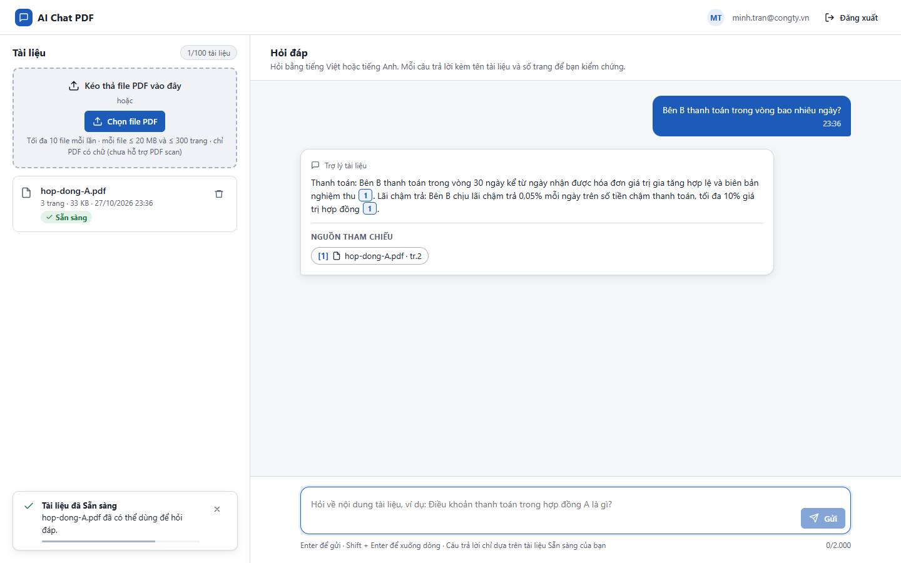
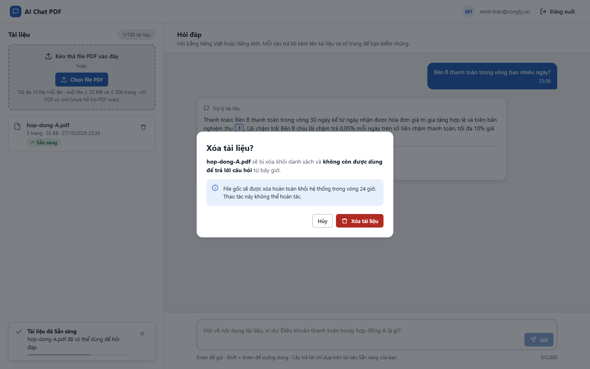
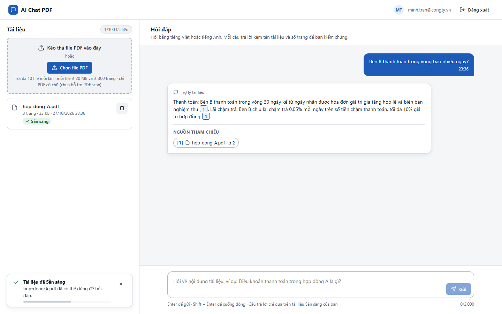
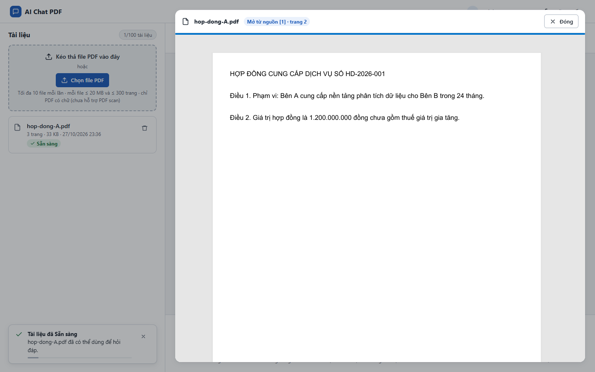
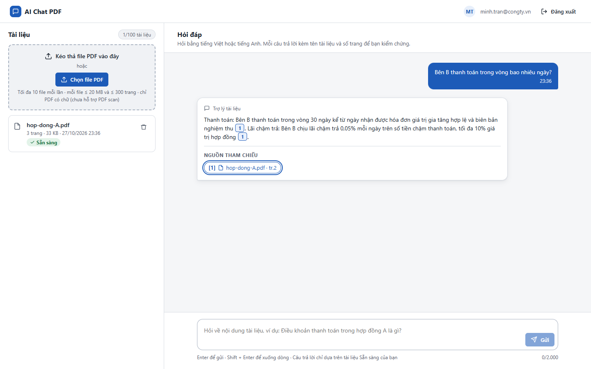
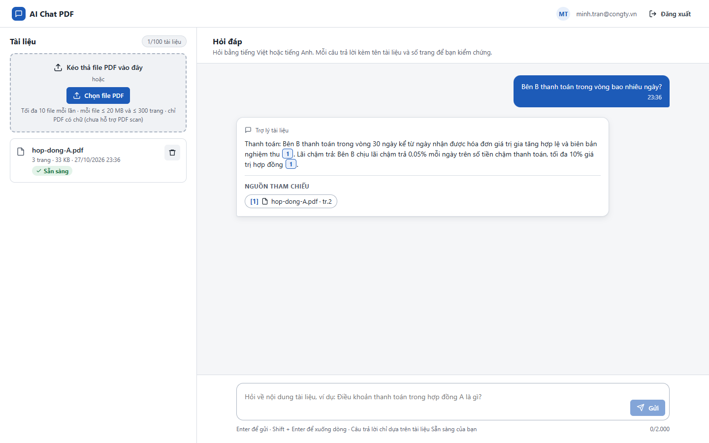

# Test report – ACC-005: Quản lý focus

| Trường | Giá trị |
|---|---|
| Test case | [ACC-005](../../doc/07-verification/test_cases/ACC-005_quan-ly-focus.md) |
| Kết luận | **ĐẠT** |
| Bắt đầu | 2026-10-27T16:36:11.486Z |
| Kết thúc | 2026-10-27T16:36:24.551Z (13.1 s) |
| Cách thực hiện | Tự động – Playwright (app/frontend/evidence/fixture.ts) |
| URL ứng dụng | http://localhost:8080/ |
| Bản build | 166929f + thay đổi chưa commit trong app/ |
| Trình duyệt | Microsoft Edge (Playwright, channel msedge) |
| Hệ điều hành | win32 x64 |
| Spec | app/frontend/testcases/ACC-005_quan-ly-focus.spec.ts |

## Kết quả từng bước

| # | Bước | Kết quả mong đợi | Kết quả thực tế | Trạng thái | Bằng chứng |
|---|---|---|---|---|---|
| 1 | Đăng nhập P2, tải hop-dong-A.pdf, hỏi một câu | Có câu trả lời với nguồn | Như mong đợi | Đạt | [ảnh](screenshots/01-dang-nhap-p2-tai-hop-dong-a-pdf-hoi-mot-cau.png) |
| 2 | Mở dialog xóa | document.activeElement = nút Hủy | Như mong đợi | Đạt | [ảnh](screenshots/02-mo-dialog-xoa.png) |
| 3 | Esc | Dialog đóng | Như mong đợi | Đạt | [ảnh](screenshots/03-esc.png) |
| 4 | Bấm chip nguồn | Focus ở nút Đóng của trình xem | Như mong đợi | Đạt | [ảnh](screenshots/04-bam-chip-nguon.png) |
| 5 | Esc | Focus về đúng chip vừa bấm | Như mong đợi | Đạt | [ảnh](screenshots/05-esc.png) |
| 6 | Kiểm tra focus không lọt ra phía sau dialog khi đang mở (Tab và Shift+Tab nhiều lần) | Focus chỉ xoay vòng trong dialog (bẫy focus) | 12 lần Tab/Shift+Tab: trong-dialog → có bẫy focus | Đạt | [ảnh](screenshots/06-kiem-tra-focus-khong-lot-ra-phia-sau-dialog-khi-da.png) |

## Video

- [ACC-005-app.webm](video/ACC-005-app.webm)

## Ảnh chụp màn hình

## Log

- (không có)

## Ghi chú / lỗi phát hiện

- (không có)
