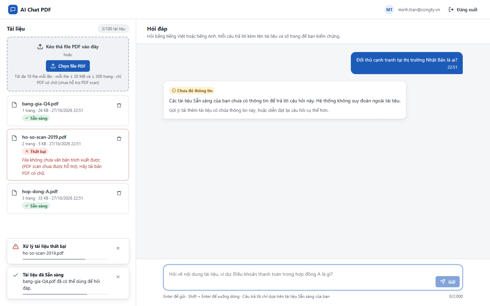
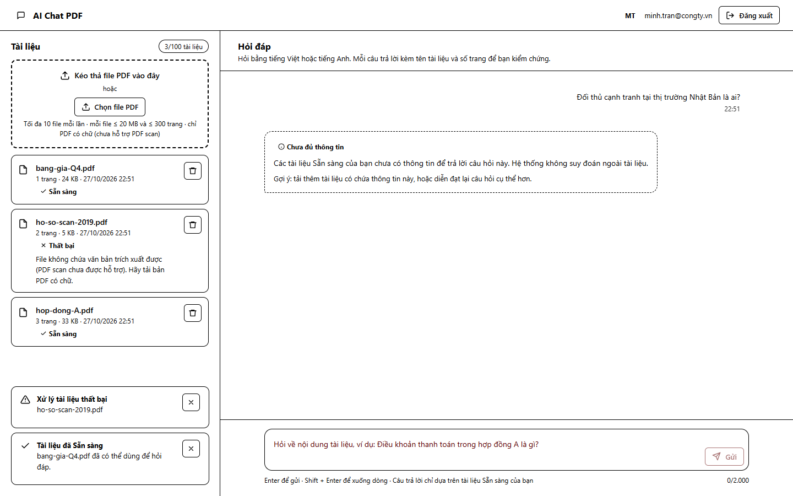
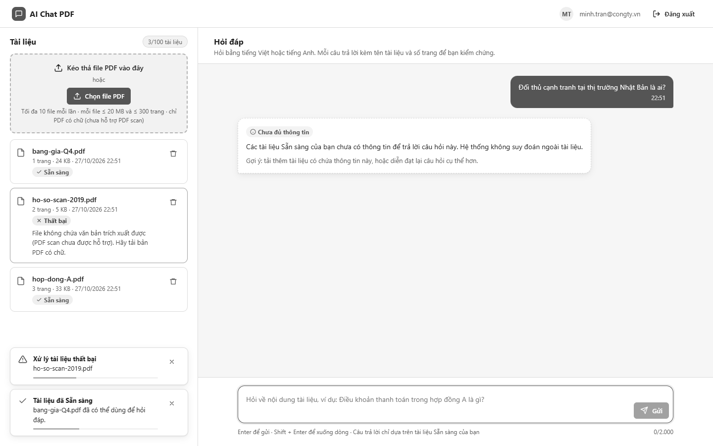

# Test report – ACC-006: Trạng thái không chỉ dựa vào màu

| Trường | Giá trị |
|---|---|
| Test case | [ACC-006](../../doc/07-verification/test_cases/ACC-006_trang-thai-khong-chi-dua-vao-mau.md) |
| Kết luận | **CẦN NGƯỜI XÁC NHẬN** |
| Bắt đầu | 2026-10-27T15:51:03.817Z |
| Kết thúc | 2026-10-27T15:51:22.685Z (18.9 s) |
| Cách thực hiện | Tự động – Playwright (app/frontend/evidence/fixture.ts) |
| URL ứng dụng | http://localhost:8080/ |
| Bản build | 166929f + thay đổi chưa commit trong app/ |
| Trình duyệt | Microsoft Edge (Playwright, channel msedge) |
| Hệ điều hành | win32 x64 |
| Spec | app/frontend/testcases/ACC-006_trang-thai-khong-chi-dua-vao-mau.spec.ts |

## Kết quả từng bước

| # | Bước | Kết quả mong đợi | Kết quả thực tế | Trạng thái | Bằng chứng |
|---|---|---|---|---|---|
| 1 | Đăng nhập P2; tạo đủ 3 trạng thái (Đang xử lý, Sẵn sàng, Thất bại) | Mỗi dòng có biểu tượng + chữ trạng thái | Như mong đợi | Đạt | [ảnh](screenshots/01-dang-nhap-p2-tao-du-3-trang-thai-dang-xu-ly-san-sa.png) |
| 2 | Chế độ tương phản cao (forcedColors: active) | Vẫn phân biệt được trạng thái | Trạng thái hiển thị bằng chữ: Sẵn sàng \| Thất bại \| Sẵn sàng | Đạt | [ảnh](screenshots/02-che-do-tuong-phan-cao-forcedcolors-active.png) |
| 3 | Xem ảnh ở thang xám (grayscale) | Phân biệt được Sẵn sàng / Thất bại / Chưa đủ thông tin bằng chữ | Ảnh chụp ở thang xám: trạng thái và nhãn loại câu trả lời vẫn đọc được nhờ biểu tượng + chữ (người đánh giá xác nhận bằng ảnh). | Cần người xác nhận | [ảnh](screenshots/03-xem-anh-o-thang-xam-grayscale.png) |

## Video

- [ACC-006-app.webm](video/ACC-006-app.webm)

## Ảnh chụp màn hình

## Log

- (không có)

## Ghi chú / lỗi phát hiện

- (không có)
