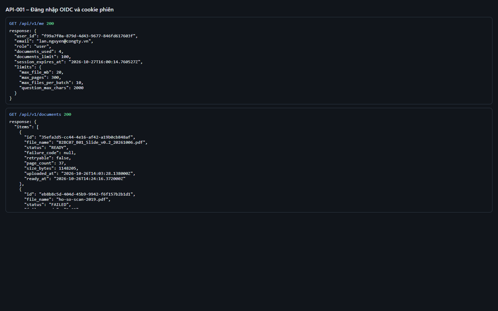
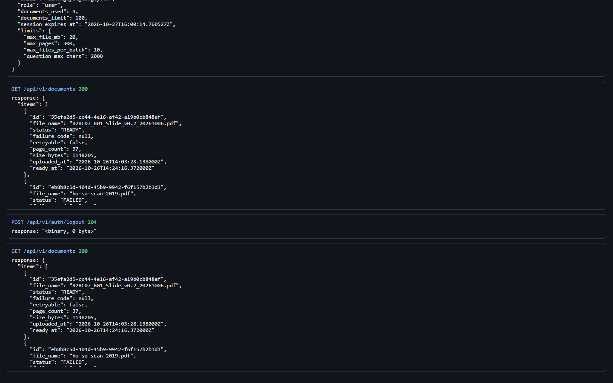

# Test report – API-001: Đăng nhập OIDC và cookie phiên

| Trường | Giá trị |
|---|---|
| Test case | [API-001](../../doc/07-verification/test_cases/API-001_dang-nhap-oidc-va-cookie-phien.md) |
| Kết luận | **ĐẠT** |
| Bắt đầu | 2026-10-27T14:00:01.655Z |
| Kết thúc | 2026-10-27T14:00:29.038Z (27.4 s) |
| Cách thực hiện | Tự động – Playwright (app/frontend/evidence/fixture.ts) |
| URL ứng dụng | http://localhost:8080/ |
| Bản build | 166929f + thay đổi chưa commit trong app/ |
| Trình duyệt | Microsoft Edge (Playwright, channel msedge) |
| Hệ điều hành | win32 x64 |
| Spec | app/frontend/testcases/API-001_dang-nhap-oidc-va-cookie-phien.spec.ts |

## Kết quả từng bước

| # | Bước | Kết quả mong đợi | Kết quả thực tế | Trạng thái | Bằng chứng |
|---|---|---|---|---|---|
| 1 | Mở http://localhost:8080/ khi chưa đăng nhập | Chuyển tới IdP :8090/authorize, có state và code_challenge_method=S256 | URL: http://localhost:8090/authorize?state=…&code_challenge_method=S256 | Đạt | [ảnh](screenshots/01-mo-http-localhost-8080-khi-chua-dang-nhap.png) |
| 2 | Chọn P1 | Quay về http://localhost:8080/; hiển thị lan.nguyen@congty.vn | Như mong đợi | Đạt | [ảnh](screenshots/02-chon-p1.png) |
| 3 | Đọc cookie trình duyệt | sid: HttpOnly, SameSite=Lax; csrf_token: SameSite=Strict, không HttpOnly | sid(httpOnly=true, sameSite=Lax); csrf_token(httpOnly=false, sameSite=Strict) | Đạt | [ảnh](screenshots/03-doc-cookie-trinh-duyet.png) |
| 4 | GET /api/v1/me | 200; email, documents_limit=100, limits.max_files_per_batch=10, session_expires_at | email=lan.nguyen@congty.vn, expires=2026-10-27T16:00:14.760527Z | Đạt | [ảnh](screenshots/04-get-api-v1-me.png) |
| 5 | Đăng xuất rồi đăng nhập lại P1; GET /documents | Cùng workspace: danh sách tài liệu giống trước | Như mong đợi | Đạt | [ảnh](screenshots/05-dang-xuat-roi-dang-nhap-lai-p1-get-documents.png) |

## Video

- [API-001-app.webm](video/API-001-app.webm)
- [API-001-page2.webm](video/API-001-page2.webm)

## Ảnh chụp màn hình

## Log

- [api.log](logs/api.log)

## Ghi chú / lỗi phát hiện

- (không có)
