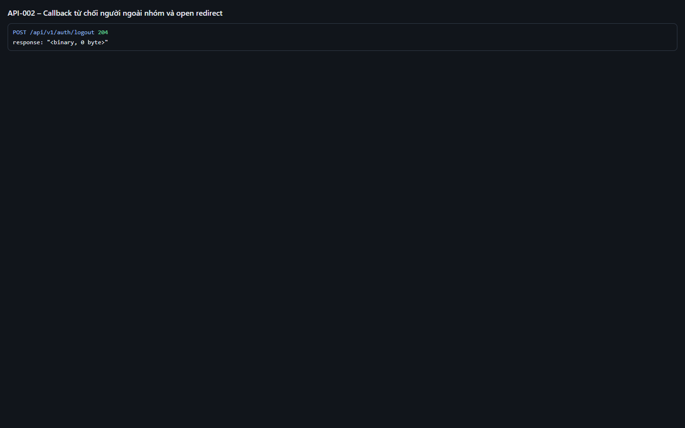
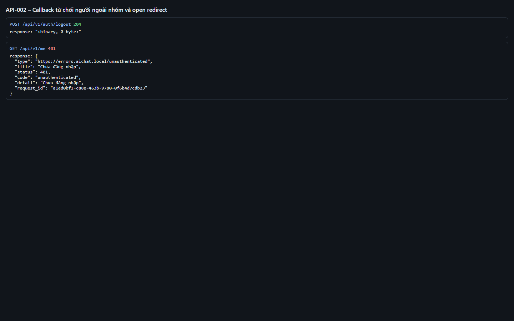

# Test report – API-002: Callback từ chối người ngoài nhóm và open redirect

| Trường | Giá trị |
|---|---|
| Test case | [API-002](../../doc/07-verification/test_cases/API-002_callback-tu-choi-nguoi-ngoai-nhom-va-open-redirect.md) |
| Kết luận | **ĐẠT** |
| Bắt đầu | 2026-10-27T14:00:31.984Z |
| Kết thúc | 2026-10-27T14:00:38.718Z (6.7 s) |
| Cách thực hiện | Tự động – Playwright (app/frontend/evidence/fixture.ts) |
| URL ứng dụng | http://localhost:8080/ |
| Bản build | 166929f + thay đổi chưa commit trong app/ |
| Trình duyệt | Microsoft Edge (Playwright, channel msedge) |
| Hệ điều hành | win32 x64 |
| Spec | app/frontend/testcases/API-002_callback-tu-choi-nguoi-ngoai-nhom-va-open-redirect.spec.ts |

## Kết quả từng bước

| # | Bước | Kết quả mong đợi | Kết quả thực tế | Trạng thái | Bằng chứng |
|---|---|---|---|---|---|
| 1 | Mở /api/v1/auth/login?return_to=https://evil.example rồi chọn P1 | Sau callback về http://localhost:8080/ (không tới evil.example) | Như mong đợi | Đạt | [ảnh](screenshots/01-mo-api-v1-auth-login-return-to-https-evil-example-.png) |
| 2 | Đăng xuất; mở / và chọn Người ngoài nhóm | URL /access-denied; trang Bạn chưa được cấp quyền | Như mong đợi | Đạt | [ảnh](screenshots/02-dang-xuat-mo-va-chon-nguoi-ngoai-nhom.png) |
| 3 | GET /api/v1/me trong phiên đó | 401 unauthenticated – không có phiên | Như mong đợi | Đạt | [ảnh](screenshots/03-get-api-v1-me-trong-phien-do.png) |

## Video

- [API-002-app.webm](video/API-002-app.webm)
- [API-002-page2.webm](video/API-002-page2.webm)

## Ảnh chụp màn hình

## Log

- [api.log](logs/api.log)

## Ghi chú / lỗi phát hiện

- (không có)
