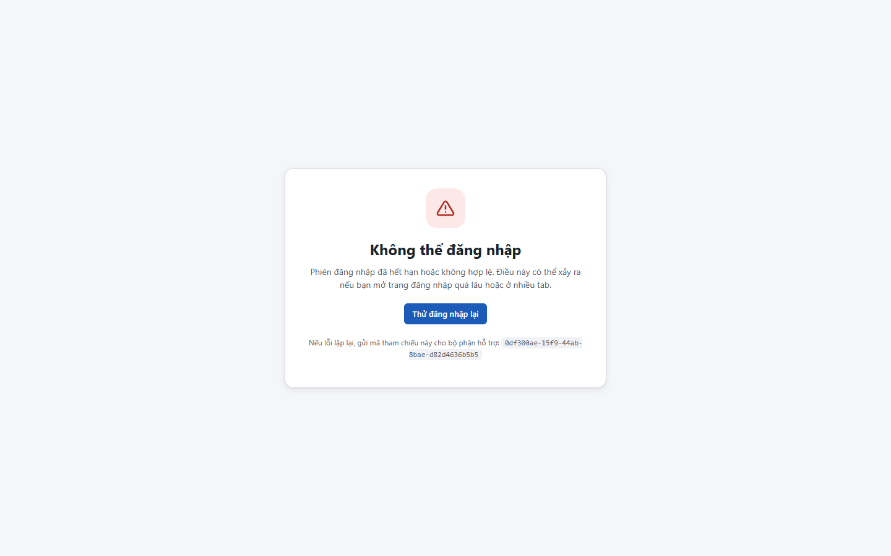
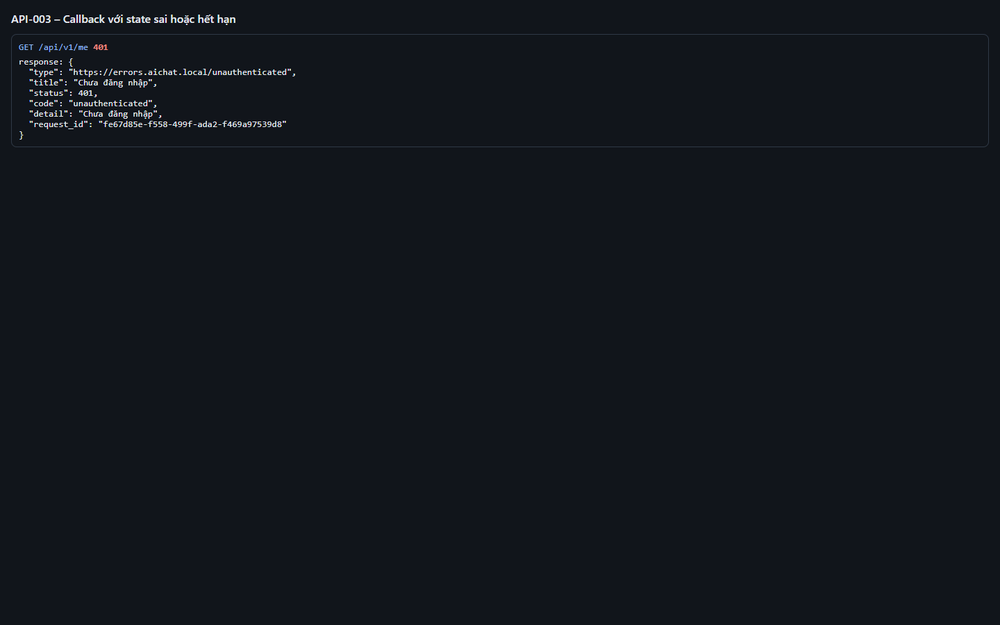

# Test report – API-003: Callback với state sai hoặc hết hạn

| Trường | Giá trị |
|---|---|
| Test case | [API-003](../../doc/07-verification/test_cases/API-003_callback-voi-state-sai-hoac-het-han.md) |
| Kết luận | **ĐẠT** |
| Bắt đầu | 2026-10-27T14:08:36.292Z |
| Kết thúc | 2026-10-27T14:08:51.484Z (15.2 s) |
| Cách thực hiện | Tự động – Playwright (app/frontend/evidence/fixture.ts) |
| URL ứng dụng | http://localhost:8080/ |
| Bản build | 166929f + thay đổi chưa commit trong app/ |
| Trình duyệt | Microsoft Edge (Playwright, channel msedge) |
| Hệ điều hành | win32 x64 |
| Spec | app/frontend/testcases/API-003_callback-voi-state-sai-hoac-het-han.spec.ts |

## Kết quả từng bước

| # | Bước | Kết quả mong đợi | Kết quả thực tế | Trạng thái | Bằng chứng |
|---|---|---|---|---|---|
| 1 | Mở /api/v1/auth/callback?code=p1&state=sai | 302 tới /login-error?ref=<request_id> | URL: /login-error?ref=0df300ae-15f9-44ab-8bae-d82d4636b5b5 | Đạt | [ảnh](screenshots/01-mo-api-v1-auth-callback-code-p1-state-sai.png) |
| 2 | Quan sát trang lỗi | Có mã tham chiếu và nút Thử đăng nhập lại | Như mong đợi | Đạt | [ảnh](screenshots/02-quan-sat-trang-loi.png) |
| 3 | GET /api/v1/me | 401 – không có phiên | Như mong đợi | Đạt | [ảnh](screenshots/03-get-api-v1-me.png) |
| 4 | Bấm Thử đăng nhập lại và chọn P1 | Đăng nhập thành công | Như mong đợi | Đạt | [ảnh](screenshots/04-bam-thu-dang-nhap-lai-va-chon-p1.png) |

## Video

- [API-003-app.webm](video/API-003-app.webm)
- [API-003-page2.webm](video/API-003-page2.webm)

## Ảnh chụp màn hình

## Log

- [api.log](logs/api.log)

## Ghi chú / lỗi phát hiện

- (không có)
