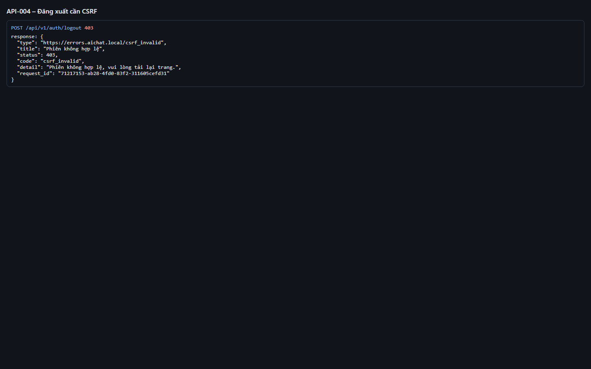
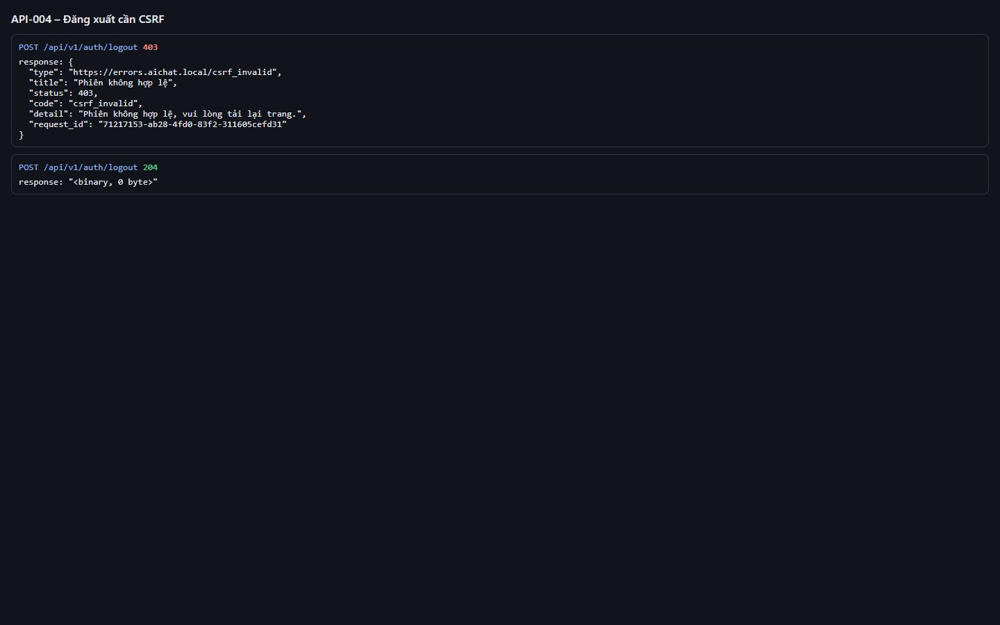
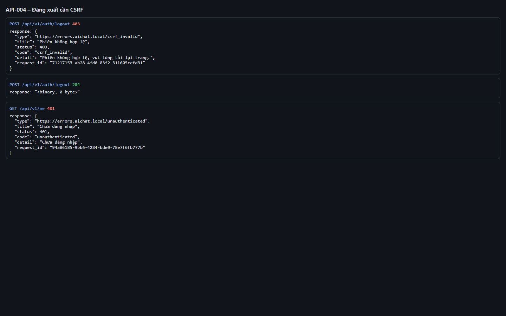

# Test report – API-004: Đăng xuất cần CSRF

| Trường | Giá trị |
|---|---|
| Test case | [API-004](../../doc/07-verification/test_cases/API-004_dang-xuat-can-csrf.md) |
| Kết luận | **ĐẠT** |
| Bắt đầu | 2026-10-27T14:00:57.881Z |
| Kết thúc | 2026-10-27T14:01:05.402Z (7.5 s) |
| Cách thực hiện | Tự động – Playwright (app/frontend/evidence/fixture.ts) |
| URL ứng dụng | http://localhost:8080/ |
| Bản build | 166929f + thay đổi chưa commit trong app/ |
| Trình duyệt | Microsoft Edge (Playwright, channel msedge) |
| Hệ điều hành | win32 x64 |
| Spec | app/frontend/testcases/API-004_dang-xuat-can-csrf.spec.ts |

## Kết quả từng bước

| # | Bước | Kết quả mong đợi | Kết quả thực tế | Trạng thái | Bằng chứng |
|---|---|---|---|---|---|
| 1 | Đăng nhập P1 | Vào màn hình chính | Như mong đợi | Đạt | [ảnh](screenshots/01-dang-nhap-p1.png) |
| 2 | POST /auth/logout không có X-CSRF-Token | 403 csrf_invalid, application/problem+json | Như mong đợi | Đạt | [ảnh](screenshots/02-post-auth-logout-khong-co-x-csrf-token.png) |
| 3 | POST /auth/logout có X-CSRF-Token | 204 | Như mong đợi | Đạt | [ảnh](screenshots/03-post-auth-logout-co-x-csrf-token.png) |
| 4 | GET /me | 401 unauthenticated | Như mong đợi | Đạt | [ảnh](screenshots/04-get-me.png) |

## Video

- [API-004-app.webm](video/API-004-app.webm)
- [API-004-page2.webm](video/API-004-page2.webm)

## Ảnh chụp màn hình

## Log

- [api.log](logs/api.log)

## Ghi chú / lỗi phát hiện

- (không có)
