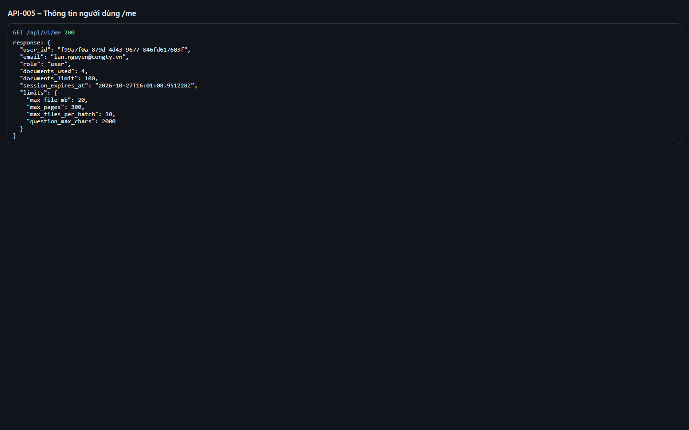

# Test report – API-005: Thông tin người dùng /me

| Trường | Giá trị |
|---|---|
| Test case | [API-005](../../doc/07-verification/test_cases/API-005_thong-tin-nguoi-dung-me.md) |
| Kết luận | **ĐẠT** |
| Bắt đầu | 2026-10-27T14:01:07.650Z |
| Kết thúc | 2026-10-27T14:01:14.156Z (6.5 s) |
| Cách thực hiện | Tự động – Playwright (app/frontend/evidence/fixture.ts) |
| URL ứng dụng | http://localhost:8080/ |
| Bản build | 166929f + thay đổi chưa commit trong app/ |
| Trình duyệt | Microsoft Edge (Playwright, channel msedge) |
| Hệ điều hành | win32 x64 |
| Spec | app/frontend/testcases/API-005_thong-tin-nguoi-dung-me.spec.ts |

## Kết quả từng bước

| # | Bước | Kết quả mong đợi | Kết quả thực tế | Trạng thái | Bằng chứng |
|---|---|---|---|---|---|
| 1 | Đăng nhập P1 | Màn hình chính | Như mong đợi | Đạt | [ảnh](screenshots/01-dang-nhap-p1.png) |
| 2 | GET /api/v1/me | 200; user_id, email, role, documents_used, documents_limit, session_expires_at (ISO, Z) | {"role":"user","used":4,"limit":100} | Đạt | [ảnh](screenshots/02-get-api-v1-me.png) |
| 3 | Đối chiếu limits với giao diện | max_file_mb=20, max_pages=300, max_files_per_batch=10, question_max_chars=2000 khớp chữ trên màn hình | Như mong đợi | Đạt | [ảnh](screenshots/03-doi-chieu-limits-voi-giao-dien.png) |

## Video

- [API-005-app.webm](video/API-005-app.webm)
- [API-005-page2.webm](video/API-005-page2.webm)

## Ảnh chụp màn hình

## Log

- [api.log](logs/api.log)

## Ghi chú / lỗi phát hiện

- (không có)
