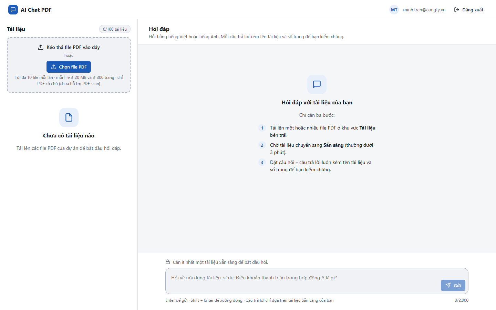
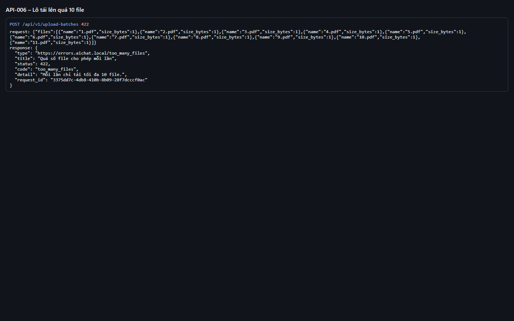
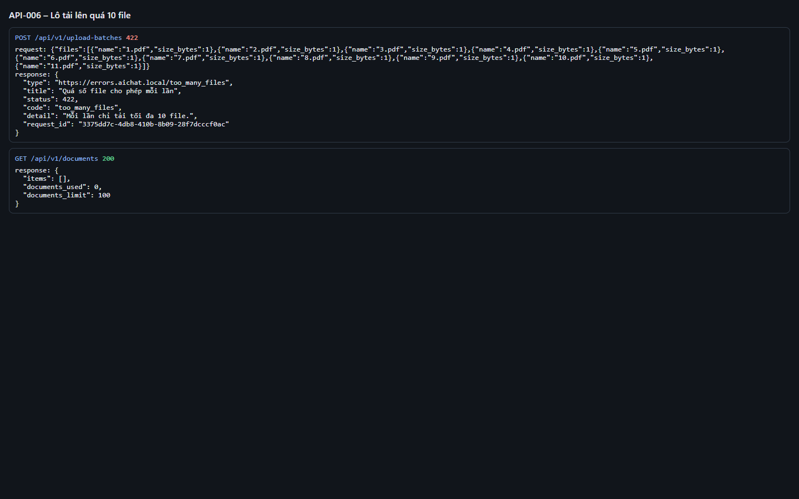

# Test report – API-006: Lô tải lên quá 10 file

| Trường | Giá trị |
|---|---|
| Test case | [API-006](../../doc/07-verification/test_cases/API-006_lo-tai-len-qua-10-file.md) |
| Kết luận | **ĐẠT** |
| Bắt đầu | 2026-10-27T14:08:54.157Z |
| Kết thúc | 2026-10-27T14:09:04.393Z (10.2 s) |
| Cách thực hiện | Tự động – Playwright (app/frontend/evidence/fixture.ts) |
| URL ứng dụng | http://localhost:8080/ |
| Bản build | 166929f + thay đổi chưa commit trong app/ |
| Trình duyệt | Microsoft Edge (Playwright, channel msedge) |
| Hệ điều hành | win32 x64 |
| Spec | app/frontend/testcases/API-006_lo-tai-len-qua-10-file.spec.ts |

## Kết quả từng bước

| # | Bước | Kết quả mong đợi | Kết quả thực tế | Trạng thái | Bằng chứng |
|---|---|---|---|---|---|
| 1 | Đăng nhập P2, xóa tài liệu cũ | Danh sách rỗng | Như mong đợi | Đạt | [ảnh](screenshots/01-dang-nhap-p2-xoa-tai-lieu-cu.png) |
| 2 | POST /upload-batches với 11 mục | 422 too_many_files; application/problem+json | Như mong đợi | Đạt | [ảnh](screenshots/02-post-upload-batches-voi-11-muc.png) |
| 3 | GET /documents | Danh sách vẫn rỗng | Như mong đợi | Đạt | [ảnh](screenshots/03-get-documents.png) |

## Video

- [API-006-app.webm](video/API-006-app.webm)
- [API-006-page2.webm](video/API-006-page2.webm)

## Ảnh chụp màn hình

## Log

- [api.log](logs/api.log)

## Ghi chú / lỗi phát hiện

- (không có)
