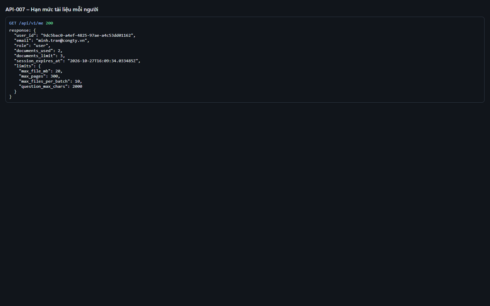
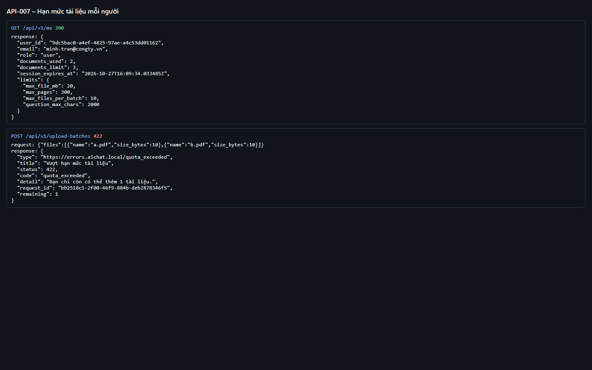
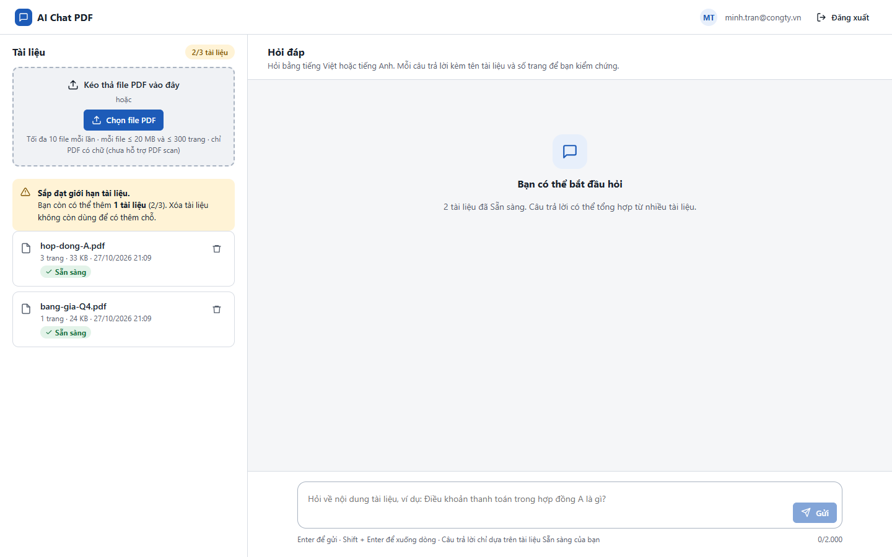

# Test report – API-007: Hạn mức tài liệu mỗi người

| Trường | Giá trị |
|---|---|
| Test case | [API-007](../../doc/07-verification/test_cases/API-007_han-muc-100-tai-lieu.md) |
| Kết luận | **ĐẠT** |
| Bắt đầu | 2026-10-27T14:09:06.594Z |
| Kết thúc | 2026-10-27T14:11:09.300Z (122.7 s) |
| Cách thực hiện | Tự động – Playwright (app/frontend/evidence/fixture.ts) |
| URL ứng dụng | http://localhost:8080/ |
| Bản build | 166929f + thay đổi chưa commit trong app/ |
| Trình duyệt | Microsoft Edge (Playwright, channel msedge) |
| Hệ điều hành | win32 x64 |
| Spec | app/frontend/testcases/API-007_han-muc-100-tai-lieu.spec.ts |

## Kết quả từng bước

| # | Bước | Kết quả mong đợi | Kết quả thực tế | Trạng thái | Bằng chứng |
|---|---|---|---|---|---|
| 1 | Khởi động lại ứng dụng với MAX_DOCS_PER_WORKSPACE=3 | Ứng dụng sẵn sàng | Như mong đợi | Đạt | [ảnh](screenshots/01-khoi-dong-lai-ung-dung-voi-max-docs-per-workspace-.png) |
| 2 | Đăng nhập P2, tải 2 file (còn 1 chỗ) | GET /me → documents_used = limit − 1 | Như mong đợi | Đạt | [ảnh](screenshots/02-dang-nhap-p2-tai-2-file-con-1-cho.png) |
| 3 | POST /upload-batches xin 2 file | 422 quota_exceeded, remaining = 1 | HTTP 422 quota_exceeded remaining=1 | Đạt | [ảnh](screenshots/03-post-upload-batches-xin-2-file.png) |
| 4 | Quan sát giao diện | Huy hiệu hạn mức đổi màu cảnh báo; thông báo Sắp đạt giới hạn tài liệu | Như mong đợi | Đạt | [ảnh](screenshots/04-quan-sat-giao-dien.png) |

## Video

- [API-007-app.webm](video/API-007-app.webm)
- [API-007-page2.webm](video/API-007-page2.webm)

## Ảnh chụp màn hình

## Log

- [api.log](logs/api.log)

## Ghi chú / lỗi phát hiện

- Khởi động lại ứng dụng với {"MAX_DOCS_PER_WORKSPACE":"3"}: [app] restart xong – http://localhost:8080/ sẵn sàng
- Khởi động lại ứng dụng với {}: [app] restart xong – http://localhost:8080/ sẵn sàng
