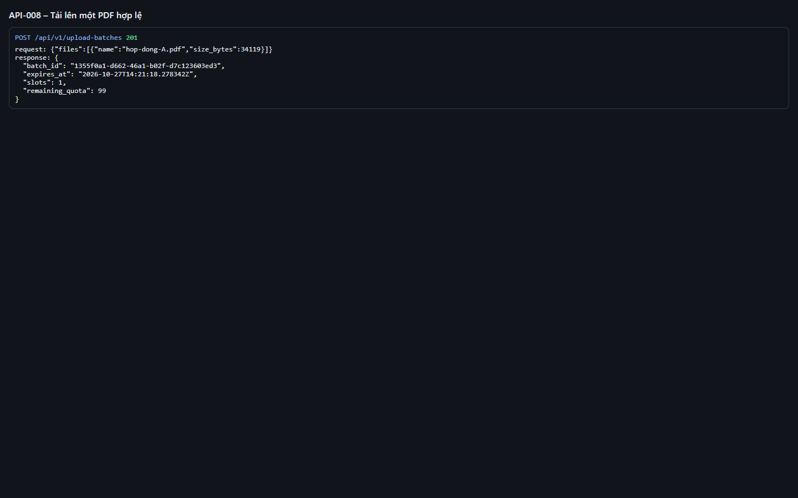
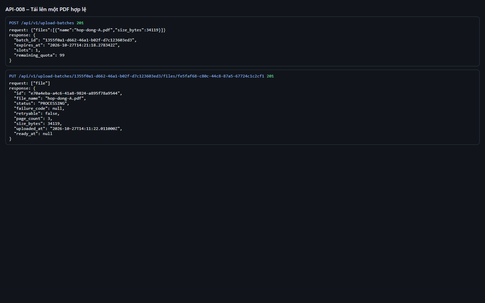
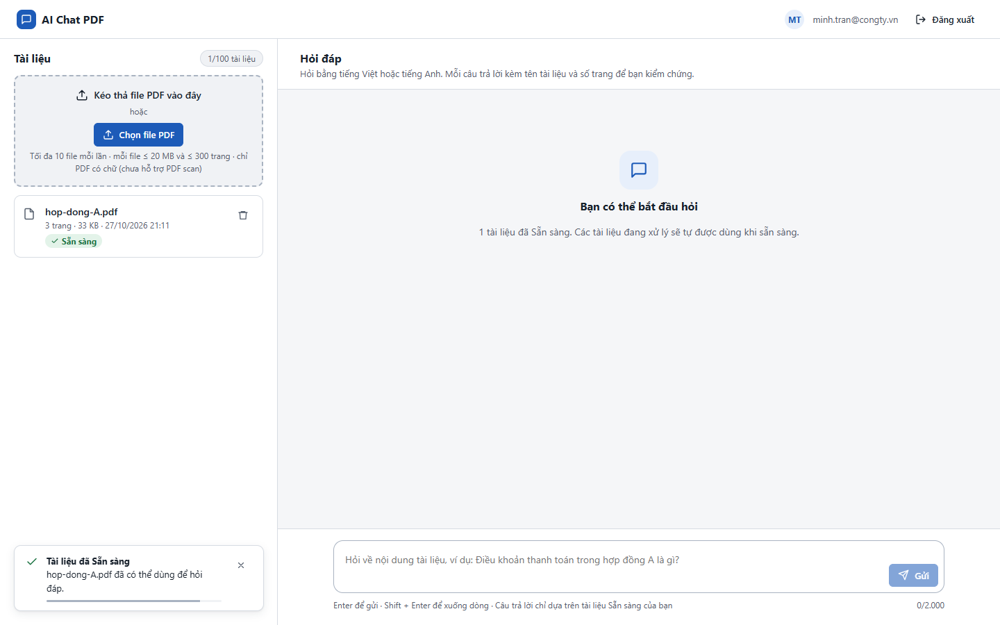

# Test report – API-008: Tải lên một PDF hợp lệ

| Trường | Giá trị |
|---|---|
| Test case | [API-008](../../doc/07-verification/test_cases/API-008_tai-len-mot-pdf-hop-le.md) |
| Kết luận | **ĐẠT** |
| Bắt đầu | 2026-10-27T14:11:12.949Z |
| Kết thúc | 2026-10-27T14:11:44.510Z (31.6 s) |
| Cách thực hiện | Tự động – Playwright (app/frontend/evidence/fixture.ts) |
| URL ứng dụng | http://localhost:8080/ |
| Bản build | 166929f + thay đổi chưa commit trong app/ |
| Trình duyệt | Microsoft Edge (Playwright, channel msedge) |
| Hệ điều hành | win32 x64 |
| Spec | app/frontend/testcases/API-008_tai-len-mot-pdf-hop-le.spec.ts |

## Kết quả từng bước

| # | Bước | Kết quả mong đợi | Kết quả thực tế | Trạng thái | Bằng chứng |
|---|---|---|---|---|---|
| 1 | Đăng nhập P2, xóa tài liệu cũ | Danh sách rỗng | Như mong đợi | Đạt | [ảnh](screenshots/01-dang-nhap-p2-xoa-tai-lieu-cu.png) |
| 2 | POST /upload-batches với 1 file | 201, có batch_id, expires_at | Như mong đợi | Đạt | [ảnh](screenshots/02-post-upload-batches-voi-1-file.png) |
| 3 | PUT /upload-batches/{batch}/files/{uuid} multipart | 201; PROCESSING, page_count=3, retryable=false, file_name=hop-dong-A.pdf | status=PROCESSING, page_count=3 | Đạt | [ảnh](screenshots/03-put-upload-batches-batch-files-uuid-multipart.png) |
| 4 | Tải lại trang, xem khu vực Tài liệu | hop-dong-A.pdf chuyển Sẵn sàng ≤ 60 s | Như mong đợi | Đạt | [ảnh](screenshots/04-tai-lai-trang-xem-khu-vuc-tai-lieu.png) |

## Video

- [API-008-app.webm](video/API-008-app.webm)
- [API-008-page2.webm](video/API-008-page2.webm)

## Ảnh chụp màn hình

## Log

- [api.log](logs/api.log)

## Ghi chú / lỗi phát hiện

- (không có)
