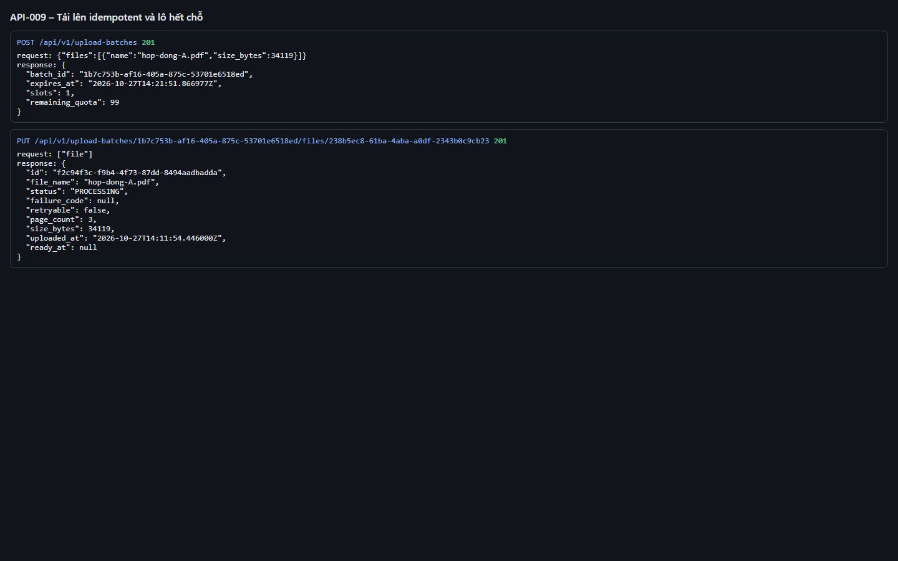
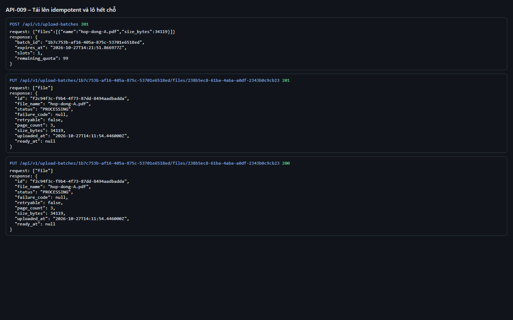
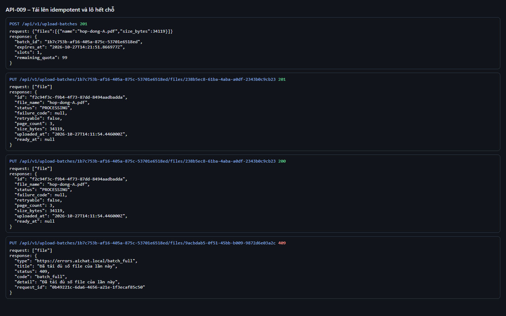
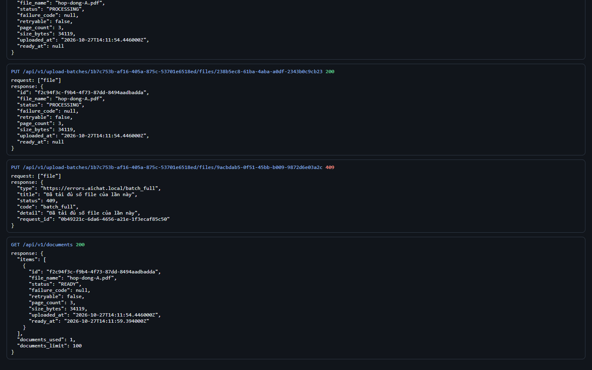

# Test report – API-009: Tải lên idempotent và lô hết chỗ

| Trường | Giá trị |
|---|---|
| Test case | [API-009](../../doc/07-verification/test_cases/API-009_tai-len-idempotent-va-lo-het-cho.md) |
| Kết luận | **ĐẠT** |
| Bắt đầu | 2026-10-27T14:11:47.928Z |
| Kết thúc | 2026-10-27T14:12:04.310Z (16.4 s) |
| Cách thực hiện | Tự động – Playwright (app/frontend/evidence/fixture.ts) |
| URL ứng dụng | http://localhost:8080/ |
| Bản build | 166929f + thay đổi chưa commit trong app/ |
| Trình duyệt | Microsoft Edge (Playwright, channel msedge) |
| Hệ điều hành | win32 x64 |
| Spec | app/frontend/testcases/API-009_tai-len-idempotent-va-lo-het-cho.spec.ts |

## Kết quả từng bước

| # | Bước | Kết quả mong đợi | Kết quả thực tế | Trạng thái | Bằng chứng |
|---|---|---|---|---|---|
| 1 | Đăng nhập P2, xóa tài liệu cũ | Danh sách rỗng | Như mong đợi | Đạt | [ảnh](screenshots/01-dang-nhap-p2-xoa-tai-lieu-cu.png) |
| 2 | Tạo lô 1 file; PUT hop-dong-A.pdf với client_file_id = X | 201, id = D | Như mong đợi | Đạt | [ảnh](screenshots/02-tao-lo-1-file-put-hop-dong-a-pdf-voi-client-file-i.png) |
| 3 | PUT lại đúng file với cùng client_file_id | 200, cùng id D | Như mong đợi | Đạt | [ảnh](screenshots/03-put-lai-dung-file-voi-cung-client-file-id.png) |
| 4 | PUT chinh-sach-ban-hang-2026.pdf với client_file_id khác vào cùng lô | 409 batch_full | Như mong đợi | Đạt | [ảnh](screenshots/04-put-chinh-sach-ban-hang-2026-pdf-voi-client-file-i.png) |
| 5 | GET /documents | Chỉ 1 tài liệu, documents_used = 1 | Như mong đợi | Đạt | [ảnh](screenshots/05-get-documents.png) |

## Video

- [API-009-app.webm](video/API-009-app.webm)
- [API-009-page2.webm](video/API-009-page2.webm)

## Ảnh chụp màn hình

## Log

- [api.log](logs/api.log)

## Ghi chú / lỗi phát hiện

- (không có)
