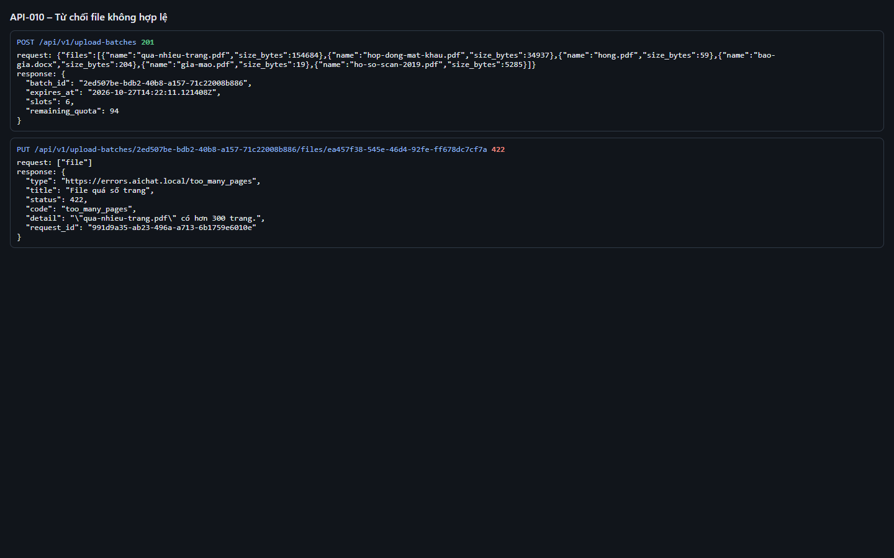
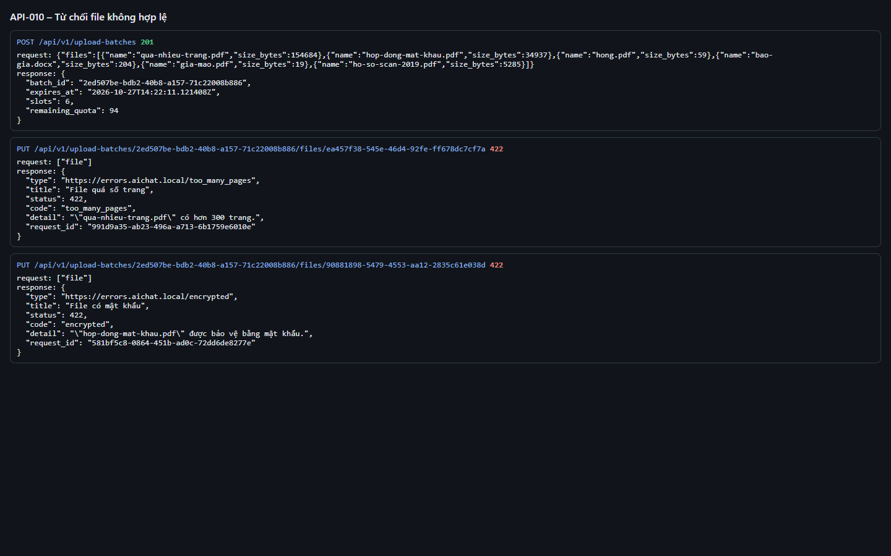
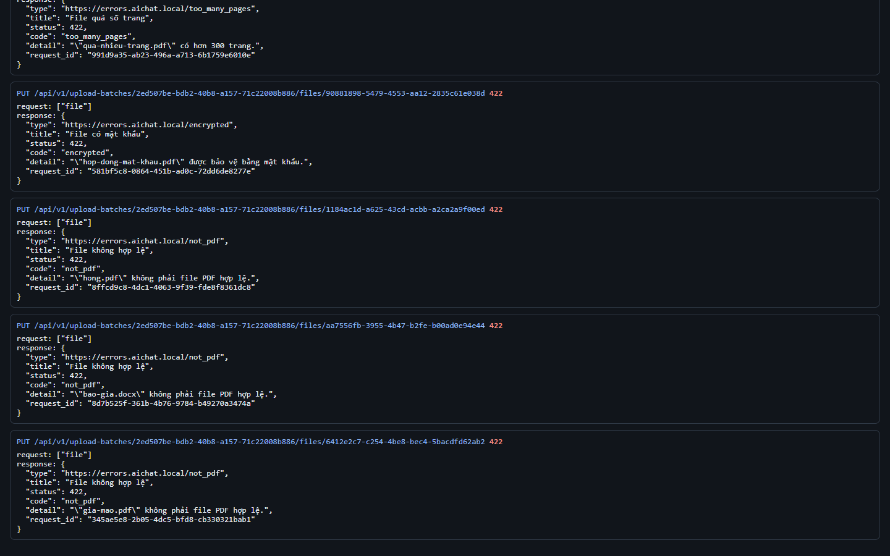
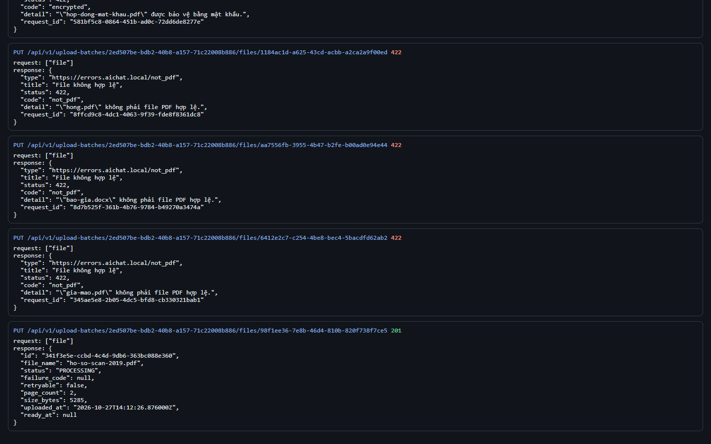
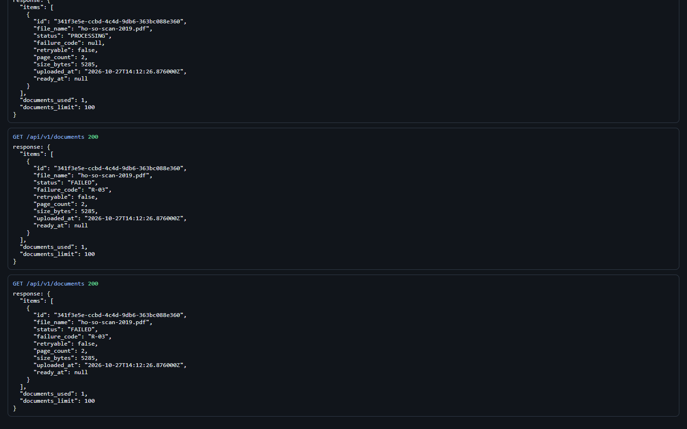

# Test report – API-010: Từ chối file không hợp lệ

| Trường | Giá trị |
|---|---|
| Test case | [API-010](../../doc/07-verification/test_cases/API-010_tu-choi-file-khong-hop-le.md) |
| Kết luận | **ĐẠT** |
| Bắt đầu | 2026-10-27T14:12:06.415Z |
| Kết thúc | 2026-10-27T14:12:50.247Z (43.8 s) |
| Cách thực hiện | Tự động – Playwright (app/frontend/evidence/fixture.ts) |
| URL ứng dụng | http://localhost:8080/ |
| Bản build | 166929f + thay đổi chưa commit trong app/ |
| Trình duyệt | Microsoft Edge (Playwright, channel msedge) |
| Hệ điều hành | win32 x64 |
| Spec | app/frontend/testcases/API-010_tu-choi-file-khong-hop-le.spec.ts |

## Kết quả từng bước

| # | Bước | Kết quả mong đợi | Kết quả thực tế | Trạng thái | Bằng chứng |
|---|---|---|---|---|---|
| 1 | Đăng nhập P2, xóa tài liệu cũ | Danh sách rỗng | Như mong đợi | Đạt | [ảnh](screenshots/01-dang-nhap-p2-xoa-tai-lieu-cu.png) |
| 2 | PUT qua-nhieu-trang.pdf (301 trang) | 422 too_many_pages; detail nêu tên file và giới hạn | Như mong đợi | Đạt | [ảnh](screenshots/02-put-qua-nhieu-trang-pdf-301-trang.png) |
| 3 | PUT hop-dong-mat-khau.pdf | 422 encrypted; "… được bảo vệ bằng mật khẩu." | Như mong đợi | Đạt | [ảnh](screenshots/03-put-hop-dong-mat-khau-pdf.png) |
| 4 | PUT hong.pdf, bao-gia.docx, gia-mao.pdf | Mỗi file 422 not_pdf, application/problem+json | Như mong đợi | Đạt | [ảnh](screenshots/04-put-hong-pdf-bao-gia-docx-gia-mao-pdf.png) |
| 5 | PUT ho-so-scan-2019.pdf | 201 PROCESSING | Như mong đợi | Đạt | [ảnh](screenshots/05-put-ho-so-scan-2019-pdf.png) |
| 6 | Chờ xử lý; GET /documents | Chỉ có ho-so-scan-2019.pdf: FAILED R-03, retryable=false; file bị từ chối không xuất hiện | Như mong đợi | Đạt | [ảnh](screenshots/06-cho-xu-ly-get-documents.png) |

## Video

- [API-010-app.webm](video/API-010-app.webm)
- [API-010-page2.webm](video/API-010-page2.webm)

## Ảnh chụp màn hình

## Log

- [api.log](logs/api.log)

## Ghi chú / lỗi phát hiện

- DEF-T-002: PDF hỏng/có mật khẩu bị từ chối 422 ngay lúc tải lên (theo thiết kế), PRD yêu cầu "Thất bại" R-01/R-02 – chờ PO quyết định.
