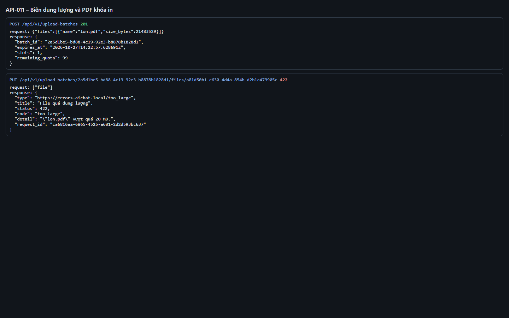
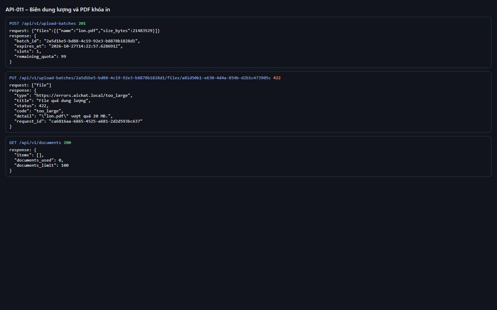
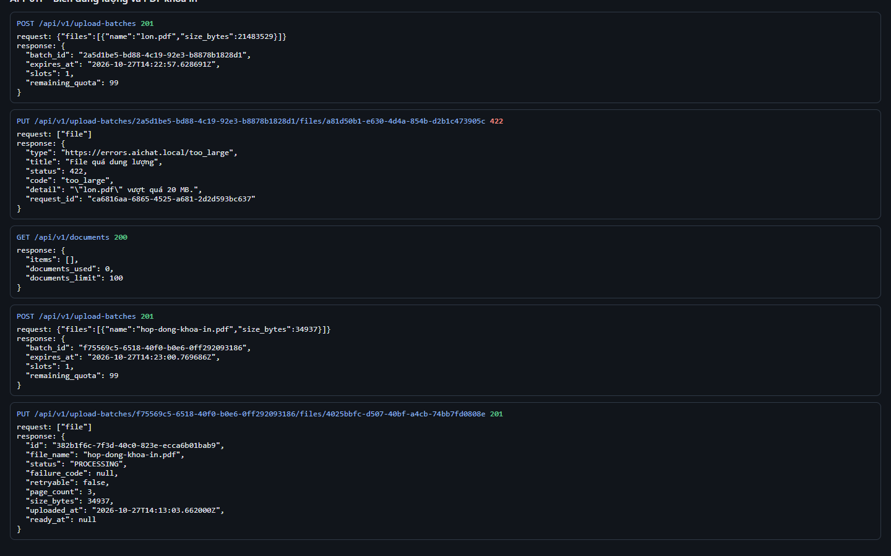

# Test report – API-011: Biên dung lượng và PDF khóa in

| Trường | Giá trị |
|---|---|
| Test case | [API-011](../../doc/07-verification/test_cases/API-011_bien-dung-luong-va-pdf-khoa-in.md) |
| Kết luận | **ĐẠT** |
| Bắt đầu | 2026-10-27T14:12:53.790Z |
| Kết thúc | 2026-10-27T14:13:26.675Z (32.9 s) |
| Cách thực hiện | Tự động – Playwright (app/frontend/evidence/fixture.ts) |
| URL ứng dụng | http://localhost:8080/ |
| Bản build | 166929f + thay đổi chưa commit trong app/ |
| Trình duyệt | Microsoft Edge (Playwright, channel msedge) |
| Hệ điều hành | win32 x64 |
| Spec | app/frontend/testcases/API-011_bien-dung-luong-va-pdf-khoa-in.spec.ts |

## Kết quả từng bước

| # | Bước | Kết quả mong đợi | Kết quả thực tế | Trạng thái | Bằng chứng |
|---|---|---|---|---|---|
| 1 | Đăng nhập P2, xóa tài liệu cũ | Danh sách rỗng | Như mong đợi | Đạt | [ảnh](screenshots/01-dang-nhap-p2-xoa-tai-lieu-cu.png) |
| 2 | PUT lon.pdf ~20,5 MB (qua API, bỏ qua kiểm tra phía giao diện) | 422 too_large; detail nêu tên file và giới hạn 20 MB | HTTP 422; detail=""lon.pdf" vượt quá 20 MB." | Đạt | [ảnh](screenshots/02-put-lon-pdf-20-5-mb-qua-api-bo-qua-kiem-tra-phia-g.png) |
| 3 | Ghi nhận: detail có nêu dung lượng thực tế của file không | Ghi nhận (DEF-T-001) | detail chỉ nêu tên file và giới hạn 20 MB, KHÔNG nêu dung lượng thực tế (~20,5 MB) → DEF-T-001 vẫn mở | Đạt | [ảnh](screenshots/03-ghi-nhan-detail-co-neu-dung-luong-thuc-te-cua-file.png) |
| 4 | PUT hop-dong-khoa-in.pdf | 201 PROCESSING → READY | Như mong đợi | Đạt | [ảnh](screenshots/04-put-hop-dong-khoa-in-pdf.png) |

## Video

- [API-011-app.webm](video/API-011-app.webm)
- [API-011-page2.webm](video/API-011-page2.webm)

## Ảnh chụp màn hình

## Log

- [api.log](logs/api.log)

## Ghi chú / lỗi phát hiện

- DEF-T-001 (Medium): thông báo từ chối quá dung lượng chưa nêu dung lượng thực tế của file như US-004 AC 1.
