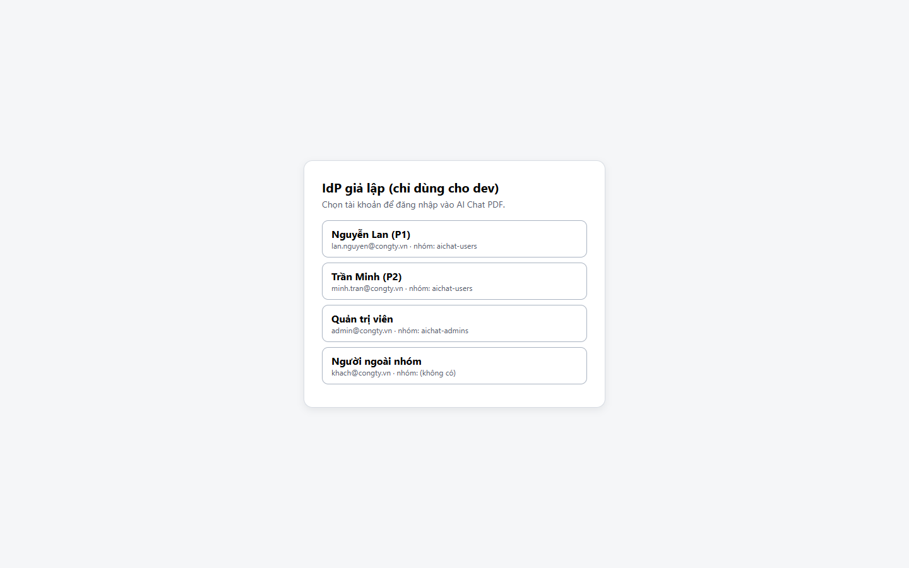
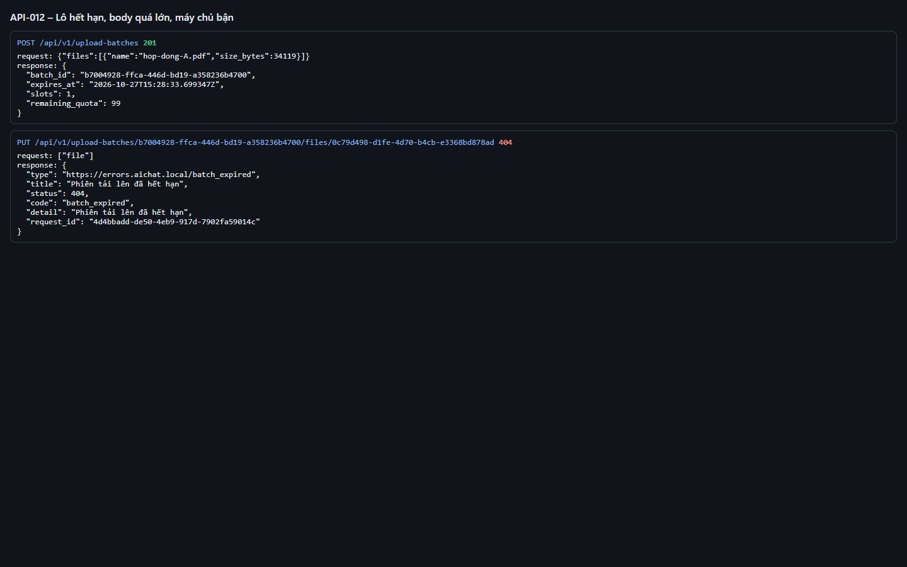
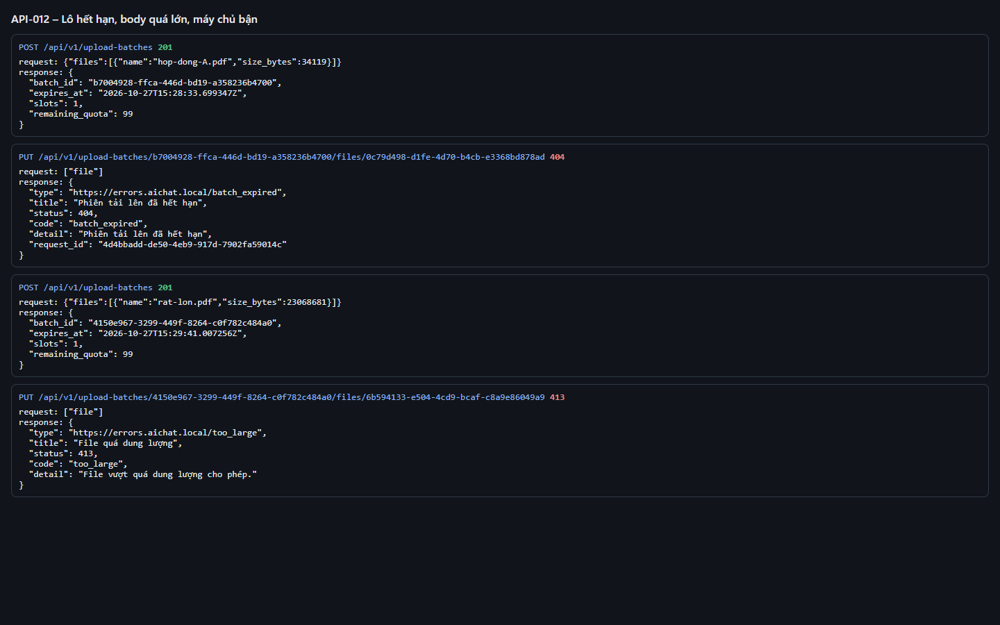

# Test report – API-012: Lô hết hạn, body quá lớn, máy chủ bận

| Trường | Giá trị |
|---|---|
| Test case | [API-012](../../doc/07-verification/test_cases/API-012_lo-het-han-body-qua-lon-may-chu-ban.md) |
| Kết luận | **ĐẠT** |
| Bắt đầu | 2026-10-27T15:26:43.058Z |
| Kết thúc | 2026-10-27T15:29:52.610Z (189.6 s) |
| Cách thực hiện | Tự động – Playwright (app/frontend/evidence/fixture.ts) |
| URL ứng dụng | http://localhost:8080/ |
| Bản build | 166929f + thay đổi chưa commit trong app/ |
| Trình duyệt | Microsoft Edge (Playwright, channel msedge) |
| Hệ điều hành | win32 x64 |
| Spec | app/frontend/testcases/API-012_lo-het-han-body-qua-lon-may-chu-ban.spec.ts |

## Kết quả từng bước

| # | Bước | Kết quả mong đợi | Kết quả thực tế | Trạng thái | Bằng chứng |
|---|---|---|---|---|---|
| 1 | Khởi động lại ứng dụng với BATCH_TTL_S=60 | Ứng dụng sẵn sàng | Như mong đợi | Đạt | [ảnh](screenshots/01-khoi-dong-lai-ung-dung-voi-batch-ttl-s-60.png) |
| 2 | Đăng nhập P2, xóa tài liệu cũ | Danh sách rỗng | Như mong đợi | Đạt | [ảnh](screenshots/02-dang-nhap-p2-xoa-tai-lieu-cu.png) |
| 3 | Tạo lô, chờ 65 s rồi PUT hop-dong-A.pdf | 404 batch_expired | Như mong đợi | Đạt | [ảnh](screenshots/03-tao-lo-cho-65-s-roi-put-hop-dong-a-pdf.png) |
| 4 | PUT body 22 MB (vượt MAX_FILE_MB + 1 MB) | 413; application/problem+json | Như mong đợi | Đạt | [ảnh](screenshots/04-put-body-22-mb-vuot-max-file-mb-1-mb.png) |

## Video

- [API-012-app.webm](video/API-012-app.webm)
- [API-012-page2.webm](video/API-012-page2.webm)

## Ảnh chụp màn hình

## Log

- [api.log](logs/api.log)

## Ghi chú / lỗi phát hiện

- Khởi động lại ứng dụng với {"BATCH_TTL_S":"60"}: [app] restart xong – http://localhost:8080/ sẵn sàng
- Bước tùy chọn "máy chủ bận 503 server_busy" (SANDBOX_CONCURRENCY=1) không thực hiện trong lần chạy này.
- Khởi động lại ứng dụng với {}: [app] restart xong – http://localhost:8080/ sẵn sàng
