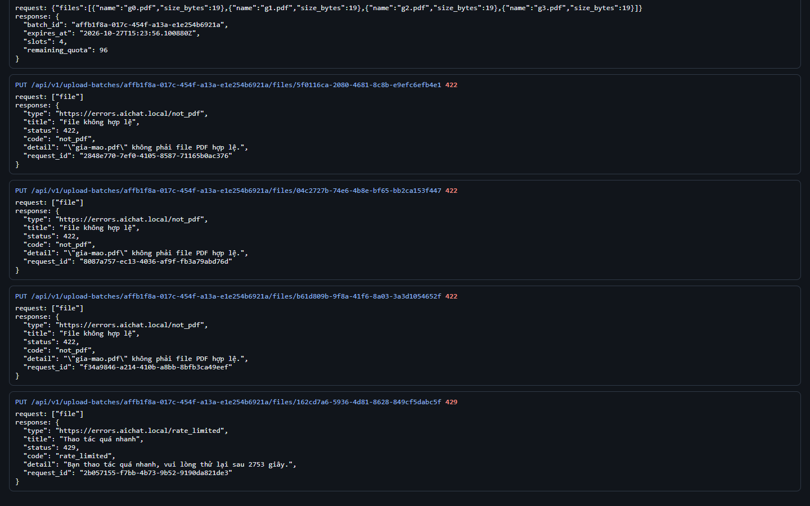
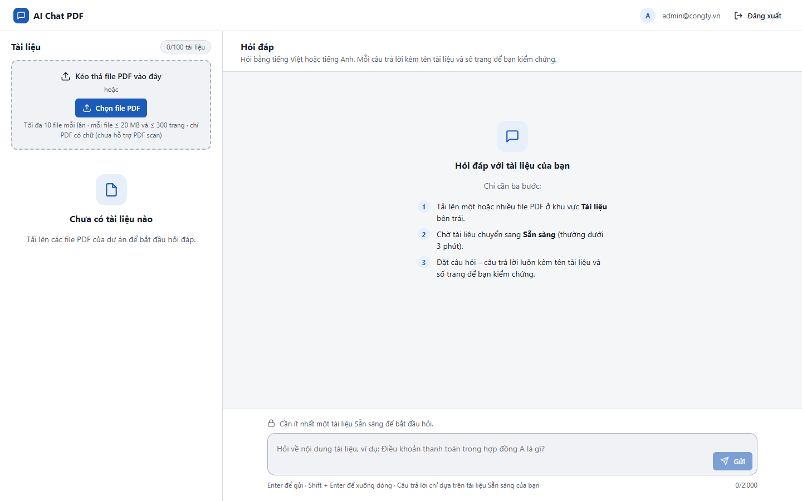

# Test report – API-013: Rate limit tải file

| Trường | Giá trị |
|---|---|
| Test case | [API-013](../../doc/07-verification/test_cases/API-013_rate-limit-tai-file.md) |
| Kết luận | **ĐẠT** |
| Bắt đầu | 2026-10-27T15:13:05.118Z |
| Kết thúc | 2026-10-27T15:15:18.398Z (133.3 s) |
| Cách thực hiện | Tự động – Playwright (app/frontend/evidence/fixture.ts) |
| URL ứng dụng | http://localhost:8080/ |
| Bản build | 166929f + thay đổi chưa commit trong app/ |
| Trình duyệt | Microsoft Edge (Playwright, channel msedge) |
| Hệ điều hành | win32 x64 |
| Spec | app/frontend/testcases/API-013_rate-limit-tai-file.spec.ts |

## Kết quả từng bước

| # | Bước | Kết quả mong đợi | Kết quả thực tế | Trạng thái | Bằng chứng |
|---|---|---|---|---|---|
| 1 | Khởi động lại ứng dụng với RATE_FILES_PER_HOUR=3 | Ứng dụng sẵn sàng | Như mong đợi | Đạt | [ảnh](screenshots/01-khoi-dong-lai-ung-dung-voi-rate-files-per-hour-3.png) |
| 2 | Đăng nhập tài khoản Quản trị viên (bộ đếm giờ còn sạch), xóa tài liệu cũ | Danh sách rỗng | Như mong đợi | Đạt | [ảnh](screenshots/02-dang-nhap-tai-khoan-quan-tri-vien-bo-dem-gio-con-s.png) |
| 3 | Tạo lô 4 file; PUT lần lượt 4 file gia-mao.pdf | 3 lần đầu 422 not_pdf; lần 4 → 429 rate_limited | Như mong đợi | Đạt | [ảnh](screenshots/03-tao-lo-4-file-put-lan-luot-4-file-gia-mao-pdf.png) |
| 4 | Kiểm tra header của phản hồi 429 | Retry-After > 0; RateLimit-Limit: 3; RateLimit-Remaining: 0 | Retry-After=2753, RateLimit-Limit=3, Remaining=0 | Đạt | [ảnh](screenshots/04-kiem-tra-header-cua-phan-hoi-429.png) |

## Video

- [API-013-app.webm](video/API-013-app.webm)
- [API-013-page2.webm](video/API-013-page2.webm)

## Ảnh chụp màn hình

## Log

- [api.log](logs/api.log)

## Ghi chú / lỗi phát hiện

- Khởi động lại ứng dụng với {"RATE_FILES_PER_HOUR":"3"}: [app] restart xong – http://localhost:8080/ sẵn sàng
- Khởi động lại ứng dụng với {}: [app] restart xong – http://localhost:8080/ sẵn sàng
