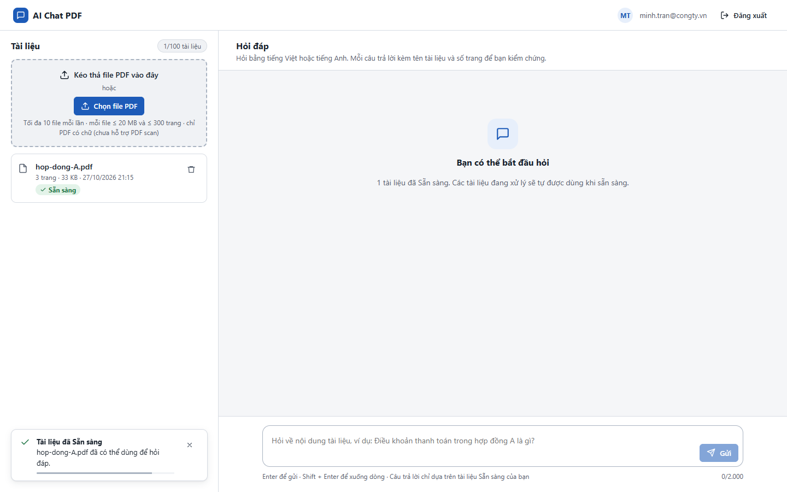
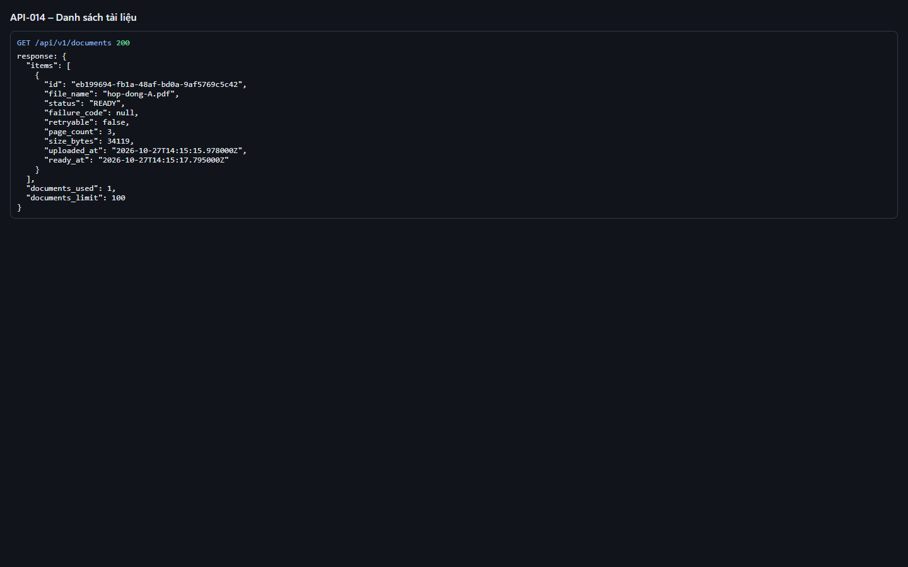

# Test report – API-014: Danh sách tài liệu

| Trường | Giá trị |
|---|---|
| Test case | [API-014](../../doc/07-verification/test_cases/API-014_danh-sach-tai-lieu.md) |
| Kết luận | **ĐẠT** |
| Bắt đầu | 2026-10-27T14:15:10.278Z |
| Kết thúc | 2026-10-27T14:15:21.275Z (11.0 s) |
| Cách thực hiện | Tự động – Playwright (app/frontend/evidence/fixture.ts) |
| URL ứng dụng | http://localhost:8080/ |
| Bản build | 166929f + thay đổi chưa commit trong app/ |
| Trình duyệt | Microsoft Edge (Playwright, channel msedge) |
| Hệ điều hành | win32 x64 |
| Spec | app/frontend/testcases/API-014_danh-sach-tai-lieu.spec.ts |

## Kết quả từng bước

| # | Bước | Kết quả mong đợi | Kết quả thực tế | Trạng thái | Bằng chứng |
|---|---|---|---|---|---|
| 1 | Đăng nhập P2, tải hop-dong-A.pdf và chờ Sẵn sàng | Dòng Sẵn sàng | Như mong đợi | Đạt | [ảnh](screenshots/01-dang-nhap-p2-tai-hop-dong-a-pdf-va-cho-san-sang.png) |
| 2 | GET /api/v1/documents | 200; items[0] đủ trường, status=READY; documents_used=1, documents_limit=100 | Như mong đợi | Đạt | [ảnh](screenshots/02-get-api-v1-documents.png) |

## Video

- [API-014-app.webm](video/API-014-app.webm)
- [API-014-page2.webm](video/API-014-page2.webm)

## Ảnh chụp màn hình

## Log

- [api.log](logs/api.log)

## Ghi chú / lỗi phát hiện

- (không có)
