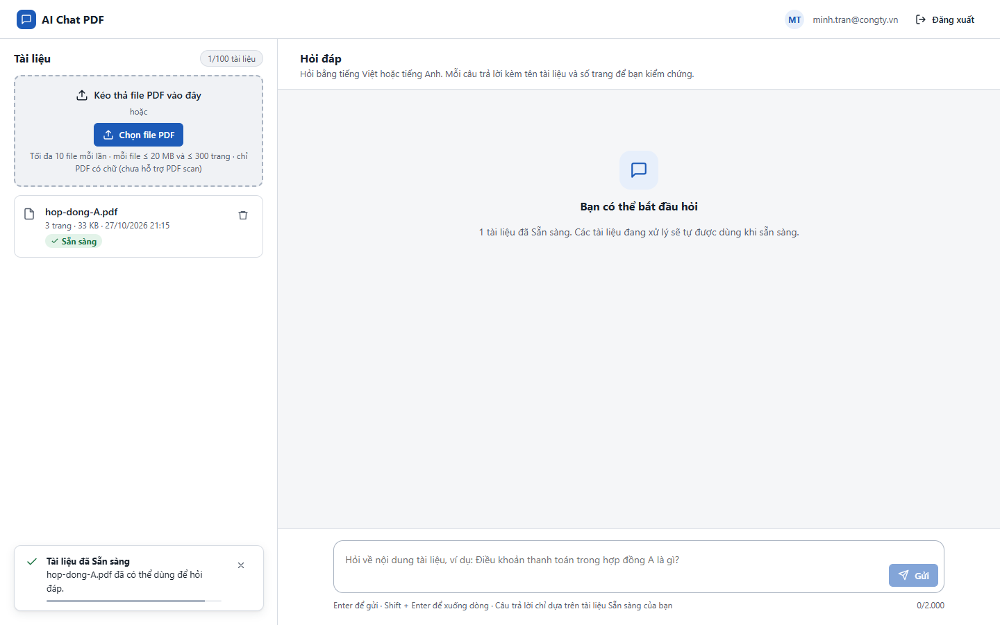
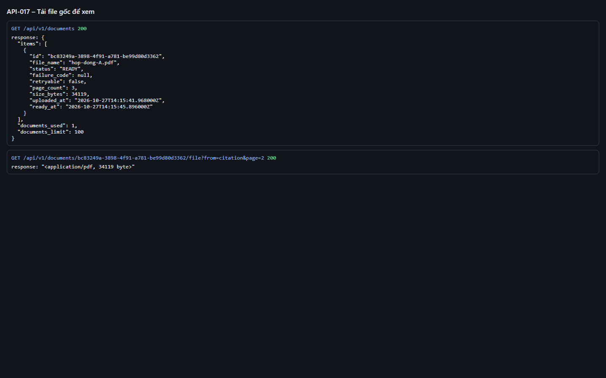
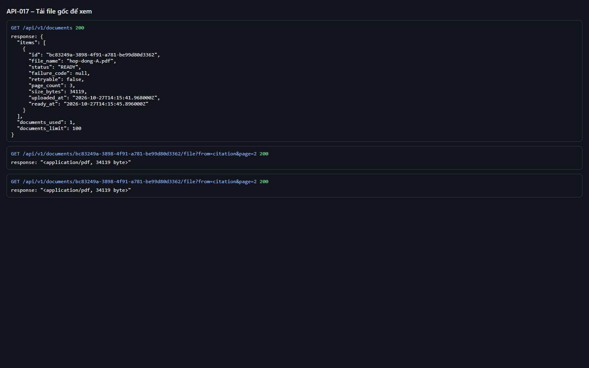
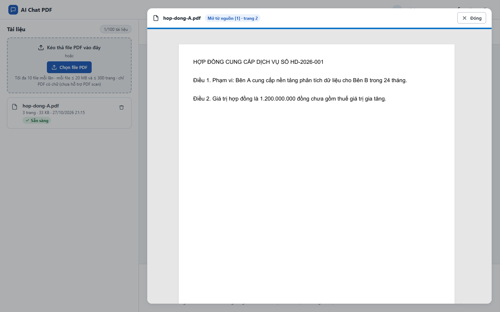

# Test report – API-017: Tải file gốc để xem

| Trường | Giá trị |
|---|---|
| Test case | [API-017](../../doc/07-verification/test_cases/API-017_tai-file-goc-de-xem.md) |
| Kết luận | **ĐẠT** |
| Bắt đầu | 2026-10-27T14:15:36.758Z |
| Kết thúc | 2026-10-27T14:15:58.704Z (21.9 s) |
| Cách thực hiện | Tự động – Playwright (app/frontend/evidence/fixture.ts) |
| URL ứng dụng | http://localhost:8080/ |
| Bản build | 166929f + thay đổi chưa commit trong app/ |
| Trình duyệt | Microsoft Edge (Playwright, channel msedge) |
| Hệ điều hành | win32 x64 |
| Spec | app/frontend/testcases/API-017_tai-file-goc-de-xem.spec.ts |

## Kết quả từng bước

| # | Bước | Kết quả mong đợi | Kết quả thực tế | Trạng thái | Bằng chứng |
|---|---|---|---|---|---|
| 1 | Đăng nhập P2, tải hop-dong-A.pdf và chờ Sẵn sàng | Dòng Sẵn sàng | Như mong đợi | Đạt | [ảnh](screenshots/01-dang-nhap-p2-tai-hop-dong-a-pdf-va-cho-san-sang.png) |
| 2 | GET /documents/{id}/file?from=citation&page=2 | 200; content-type application/pdf; body bắt đầu %PDF- | Như mong đợi | Đạt | [ảnh](screenshots/02-get-documents-id-file-from-citation-page-2.png) |
| 3 | Kiểm tra header | Content-Disposition chứa hop-dong-A.pdf; X-Frame-Options: SAMEORIGIN; Cache-Control: private, no-store | CD=inline; filename*=UTF-8''hop-dong-A.pdf; XFO=SAMEORIGIN; CC=private, no-store | Đạt | [ảnh](screenshots/03-kiem-tra-header.png) |
| 4 | Mở file qua nguồn trích dẫn trên giao diện | Trình xem PDF của Edge hiển thị tài liệu | Như mong đợi | Đạt | [ảnh](screenshots/04-mo-file-qua-nguon-trich-dan-tren-giao-dien.png) |

## Video

- [API-017-app.webm](video/API-017-app.webm)
- [API-017-page2.webm](video/API-017-page2.webm)

## Ảnh chụp màn hình

## Log

- [api.log](logs/api.log)

## Ghi chú / lỗi phát hiện

- (không có)
