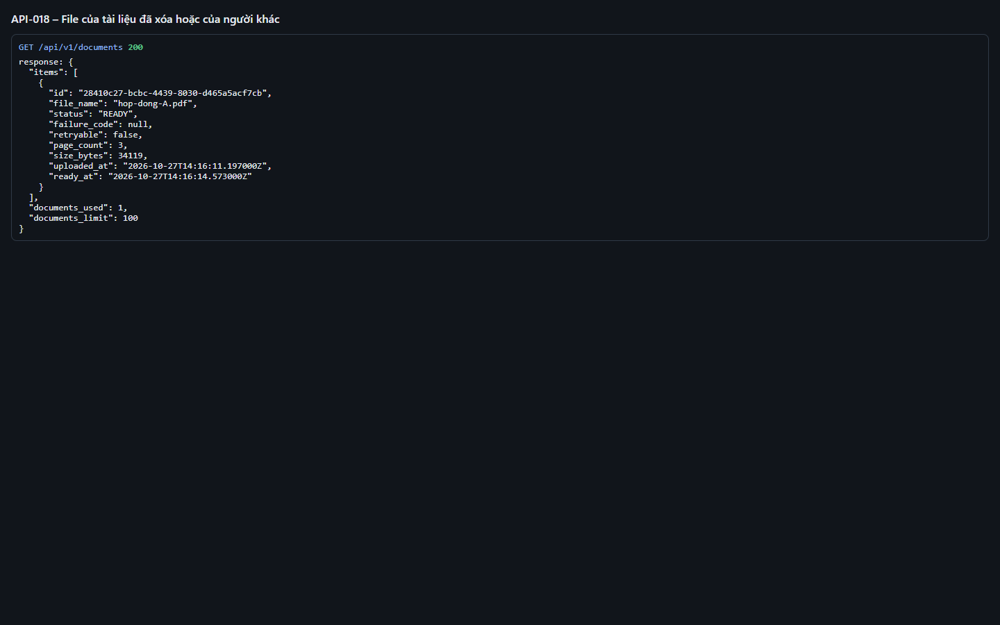
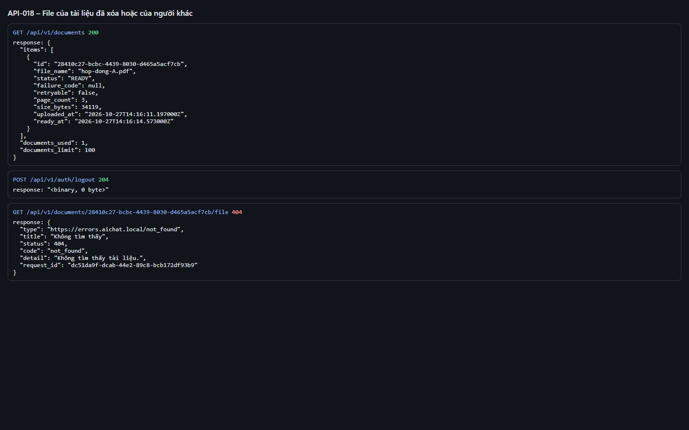
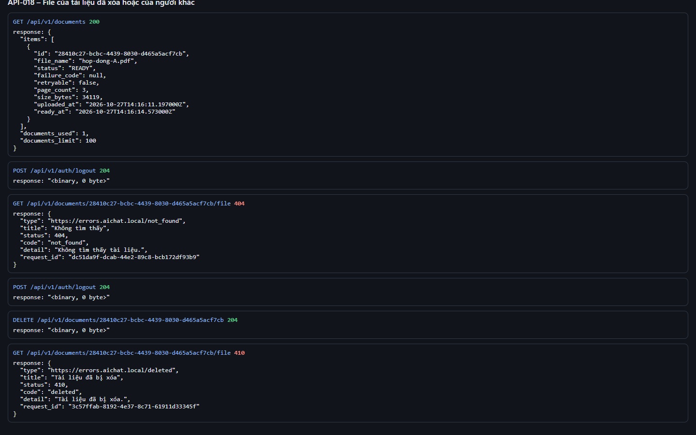

# Test report – API-018: File của tài liệu đã xóa hoặc của người khác

| Trường | Giá trị |
|---|---|
| Test case | [API-018](../../doc/07-verification/test_cases/API-018_file-cua-tai-lieu-da-xoa-hoac-cua-nguoi-khac.md) |
| Kết luận | **ĐẠT** |
| Bắt đầu | 2026-10-27T14:16:02.062Z |
| Kết thúc | 2026-10-27T14:16:25.452Z (23.4 s) |
| Cách thực hiện | Tự động – Playwright (app/frontend/evidence/fixture.ts) |
| URL ứng dụng | http://localhost:8080/ |
| Bản build | 166929f + thay đổi chưa commit trong app/ |
| Trình duyệt | Microsoft Edge (Playwright, channel msedge) |
| Hệ điều hành | win32 x64 |
| Spec | app/frontend/testcases/API-018_file-cua-tai-lieu-da-xoa-hoac-cua-nguoi-khac.spec.ts |

## Kết quả từng bước

| # | Bước | Kết quả mong đợi | Kết quả thực tế | Trạng thái | Bằng chứng |
|---|---|---|---|---|---|
| 1 | Đăng nhập P2, tải hop-dong-A.pdf, ghi lại id | Có id tài liệu của P2 | Như mong đợi | Đạt | [ảnh](screenshots/01-dang-nhap-p2-tai-hop-dong-a-pdf-ghi-lai-id.png) |
| 2 | Đăng xuất; đăng nhập P1; GET file của tài liệu P2 | 404 not_found (không lộ sự tồn tại) | Như mong đợi | Đạt | [ảnh](screenshots/02-dang-xuat-dang-nhap-p1-get-file-cua-tai-lieu-p2.png) |
| 3 | Đăng nhập lại P2; xóa tài liệu; GET file | 410 deleted | Như mong đợi | Đạt | [ảnh](screenshots/03-dang-nhap-lai-p2-xoa-tai-lieu-get-file.png) |

## Video

- [API-018-app.webm](video/API-018-app.webm)
- [API-018-page2.webm](video/API-018-page2.webm)

## Ảnh chụp màn hình

## Log

- [api.log](logs/api.log)

## Ghi chú / lỗi phát hiện

- (không có)
