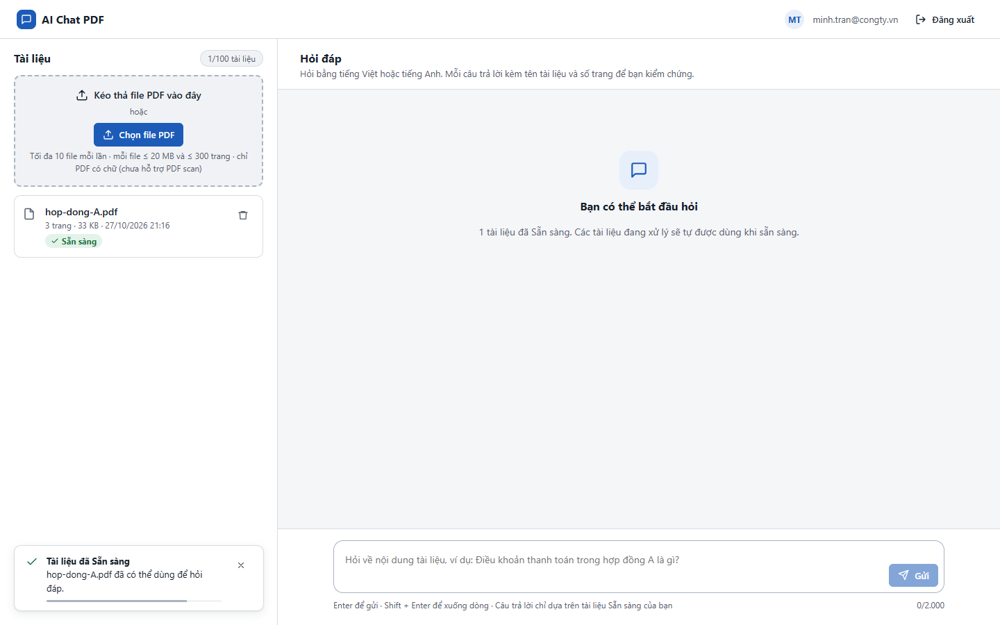
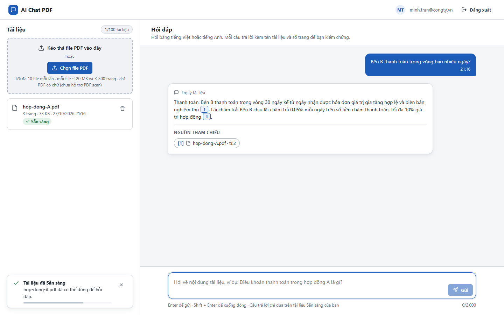
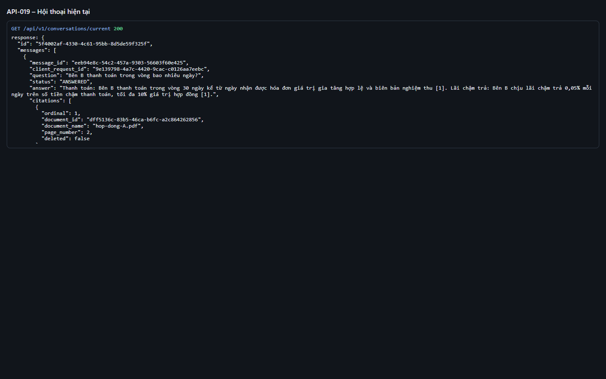
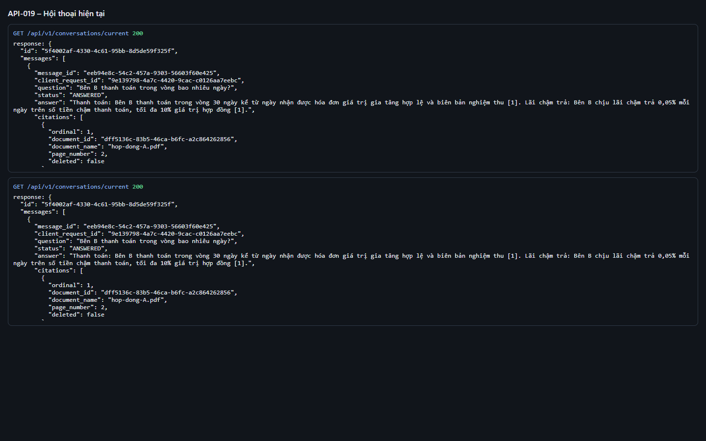

# Test report – API-019: Hội thoại hiện tại

| Trường | Giá trị |
|---|---|
| Test case | [API-019](../../doc/07-verification/test_cases/API-019_hoi-thoai-hien-tai.md) |
| Kết luận | **ĐẠT** |
| Bắt đầu | 2026-10-27T14:16:27.796Z |
| Kết thúc | 2026-10-27T14:16:39.406Z (11.6 s) |
| Cách thực hiện | Tự động – Playwright (app/frontend/evidence/fixture.ts) |
| URL ứng dụng | http://localhost:8080/ |
| Bản build | 166929f + thay đổi chưa commit trong app/ |
| Trình duyệt | Microsoft Edge (Playwright, channel msedge) |
| Hệ điều hành | win32 x64 |
| Spec | app/frontend/testcases/API-019_hoi-thoai-hien-tai.spec.ts |

## Kết quả từng bước

| # | Bước | Kết quả mong đợi | Kết quả thực tế | Trạng thái | Bằng chứng |
|---|---|---|---|---|---|
| 1 | Đăng nhập P2, tải hop-dong-A.pdf và chờ Sẵn sàng | Dòng Sẵn sàng | Như mong đợi | Đạt | [ảnh](screenshots/01-dang-nhap-p2-tai-hop-dong-a-pdf-va-cho-san-sang.png) |
| 2 | Hỏi trên giao diện | Có câu trả lời | Như mong đợi | Đạt | [ảnh](screenshots/02-hoi-tren-giao-dien.png) |
| 3 | GET /conversations/current | 200; 1 lượt: question, status=ANSWERED, citations[0]=hop-dong-A.pdf | Như mong đợi | Đạt | [ảnh](screenshots/03-get-conversations-current.png) |
| 4 | Tải lại trang rồi gọi lại | Cùng id hội thoại; vẫn 1 lượt | Như mong đợi | Đạt | [ảnh](screenshots/04-tai-lai-trang-roi-goi-lai.png) |

## Video

- [API-019-app.webm](video/API-019-app.webm)
- [API-019-page2.webm](video/API-019-page2.webm)

## Ảnh chụp màn hình

## Log

- [api.log](logs/api.log)

## Ghi chú / lỗi phát hiện

- (không có)
