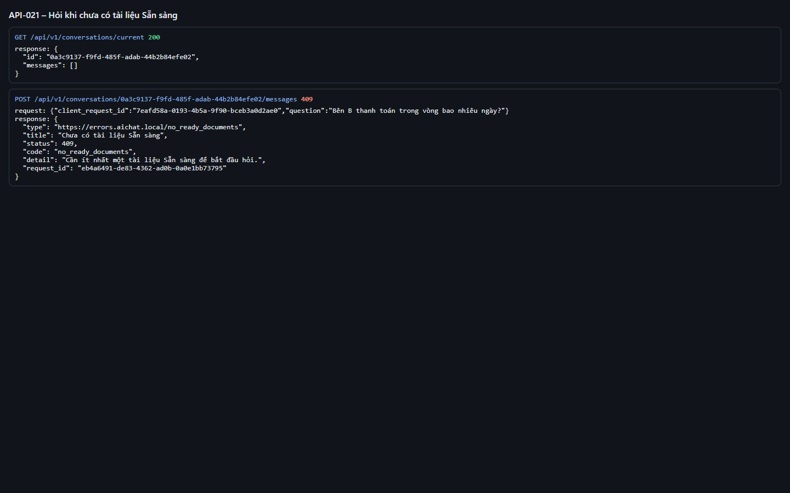
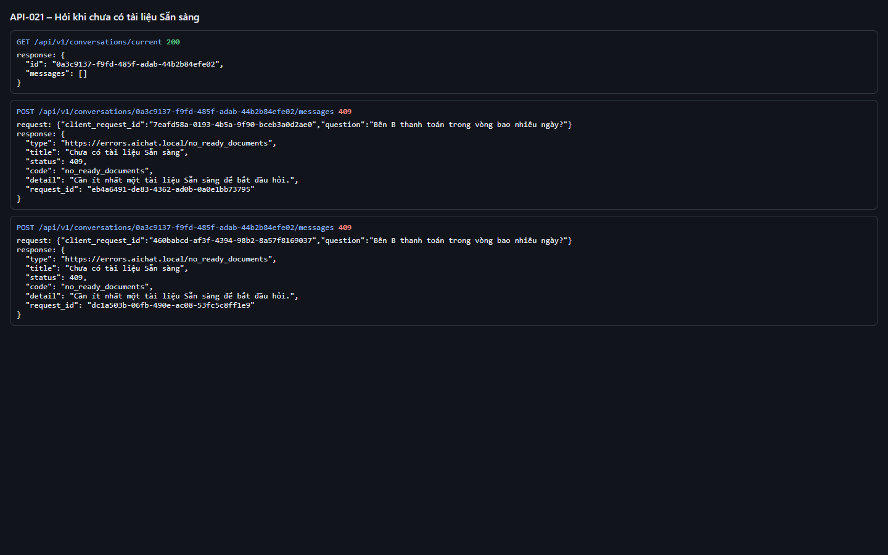

# Test report – API-021: Hỏi khi chưa có tài liệu Sẵn sàng

| Trường | Giá trị |
|---|---|
| Test case | [API-021](../../doc/07-verification/test_cases/API-021_hoi-khi-chua-co-tai-lieu-san-sang.md) |
| Kết luận | **ĐẠT** |
| Bắt đầu | 2026-10-27T14:16:53.819Z |
| Kết thúc | 2026-10-27T14:17:06.203Z (12.4 s) |
| Cách thực hiện | Tự động – Playwright (app/frontend/evidence/fixture.ts) |
| URL ứng dụng | http://localhost:8080/ |
| Bản build | 166929f + thay đổi chưa commit trong app/ |
| Trình duyệt | Microsoft Edge (Playwright, channel msedge) |
| Hệ điều hành | win32 x64 |
| Spec | app/frontend/testcases/API-021_hoi-khi-chua-co-tai-lieu-san-sang.spec.ts |

## Kết quả từng bước

| # | Bước | Kết quả mong đợi | Kết quả thực tế | Trạng thái | Bằng chứng |
|---|---|---|---|---|---|
| 1 | Đăng nhập P2 (không có tài liệu); POST /messages | 409 no_ready_documents; "Cần ít nhất một tài liệu Sẵn sàng…" | Như mong đợi | Đạt | [ảnh](screenshots/01-dang-nhap-p2-khong-co-tai-lieu-post-messages.png) |
| 2 | Tải ho-so-scan-2019.pdf (sẽ Thất bại) rồi hỏi lại | 409 no_ready_documents (E-03) | Như mong đợi | Đạt | [ảnh](screenshots/02-tai-ho-so-scan-2019-pdf-se-that-bai-roi-hoi-lai.png) |

## Video

- [API-021-app.webm](video/API-021-app.webm)
- [API-021-page2.webm](video/API-021-page2.webm)

## Ảnh chụp màn hình

## Log

- [api.log](logs/api.log)

## Ghi chú / lỗi phát hiện

- (không có)
