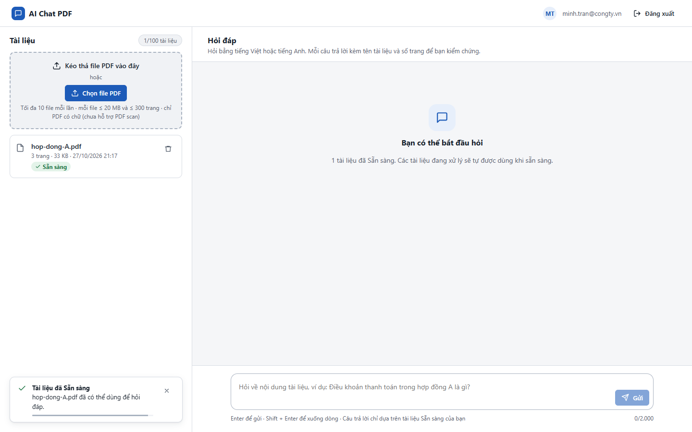
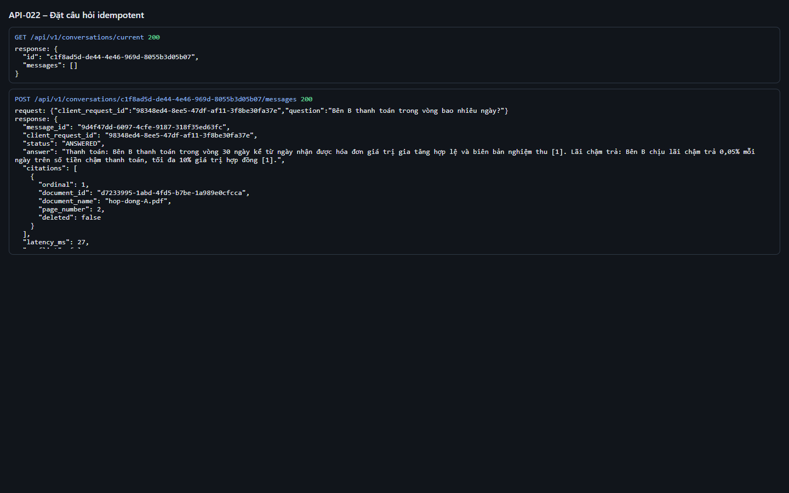
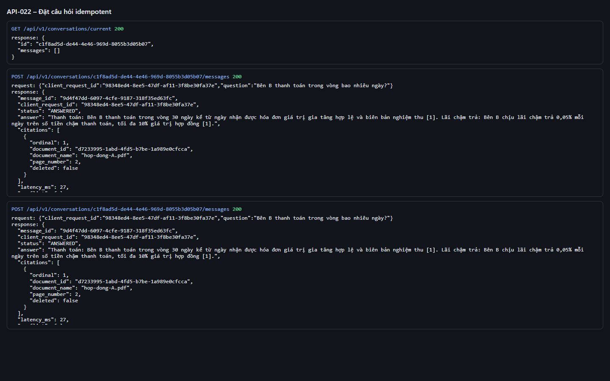
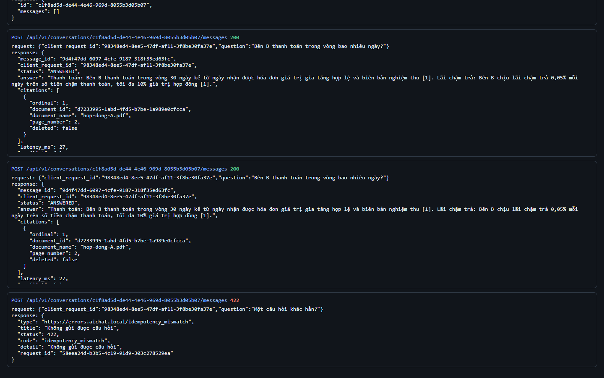
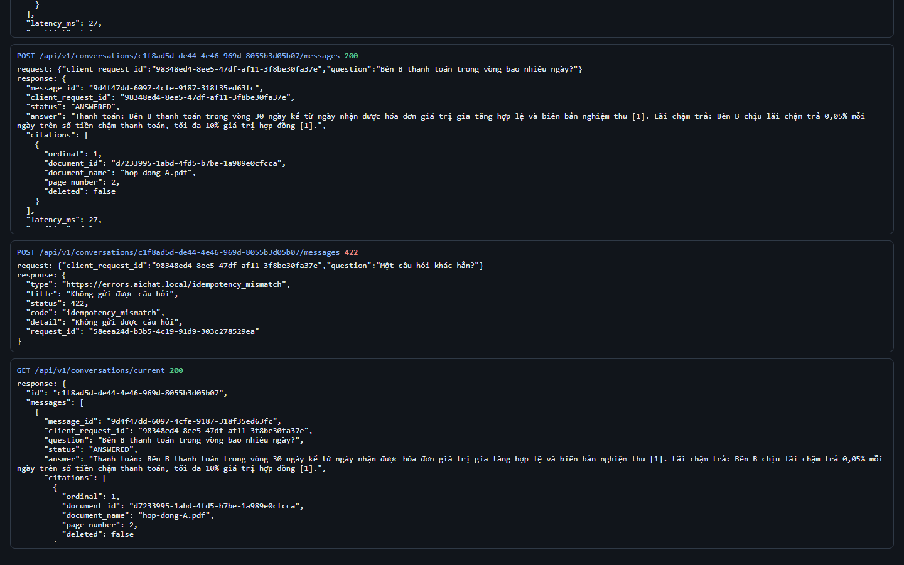

# Test report – API-022: Đặt câu hỏi idempotent

| Trường | Giá trị |
|---|---|
| Test case | [API-022](../../doc/07-verification/test_cases/API-022_dat-cau-hoi-idempotent.md) |
| Kết luận | **ĐẠT** |
| Bắt đầu | 2026-10-27T14:17:07.715Z |
| Kết thúc | 2026-10-27T14:17:20.988Z (13.3 s) |
| Cách thực hiện | Tự động – Playwright (app/frontend/evidence/fixture.ts) |
| URL ứng dụng | http://localhost:8080/ |
| Bản build | 166929f + thay đổi chưa commit trong app/ |
| Trình duyệt | Microsoft Edge (Playwright, channel msedge) |
| Hệ điều hành | win32 x64 |
| Spec | app/frontend/testcases/API-022_dat-cau-hoi-idempotent.spec.ts |

## Kết quả từng bước

| # | Bước | Kết quả mong đợi | Kết quả thực tế | Trạng thái | Bằng chứng |
|---|---|---|---|---|---|
| 1 | Đăng nhập P2, tải hop-dong-A.pdf và chờ Sẵn sàng | Dòng Sẵn sàng | Như mong đợi | Đạt | [ảnh](screenshots/01-dang-nhap-p2-tai-hop-dong-a-pdf-va-cho-san-sang.png) |
| 2 | POST câu hỏi với client_request_id = R | 200, có message_id M | Như mong đợi | Đạt | [ảnh](screenshots/02-post-cau-hoi-voi-client-request-id-r.png) |
| 3 | POST lại cùng R và cùng câu hỏi | 200, cùng message_id, cùng answer | Như mong đợi | Đạt | [ảnh](screenshots/03-post-lai-cung-r-va-cung-cau-hoi.png) |
| 4 | POST R với câu hỏi khác | 422 idempotency_mismatch | Như mong đợi | Đạt | [ảnh](screenshots/04-post-r-voi-cau-hoi-khac.png) |
| 5 | GET /conversations/current | Chỉ có 1 lượt cho R | Như mong đợi | Đạt | [ảnh](screenshots/05-get-conversations-current.png) |

## Video

- [API-022-app.webm](video/API-022-app.webm)
- [API-022-page2.webm](video/API-022-page2.webm)

## Ảnh chụp màn hình

## Log

- [api.log](logs/api.log)

## Ghi chú / lỗi phát hiện

- (không có)
