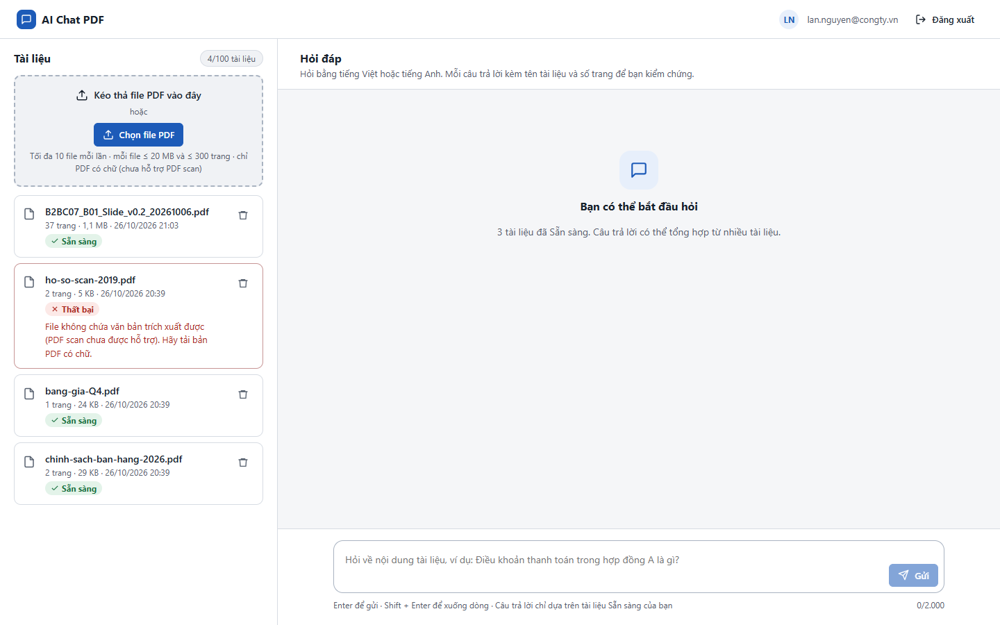
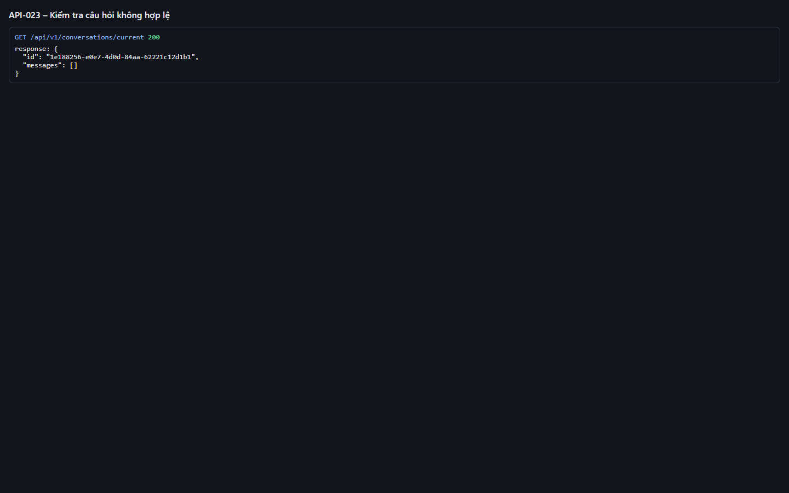
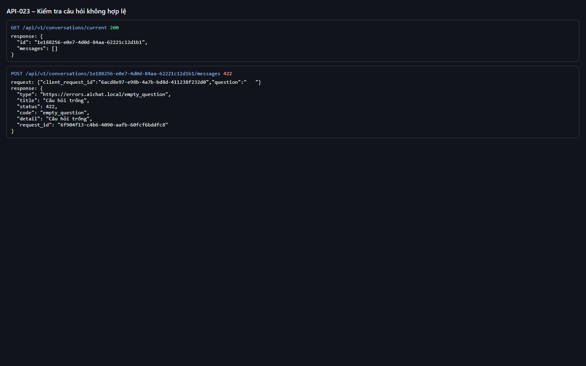
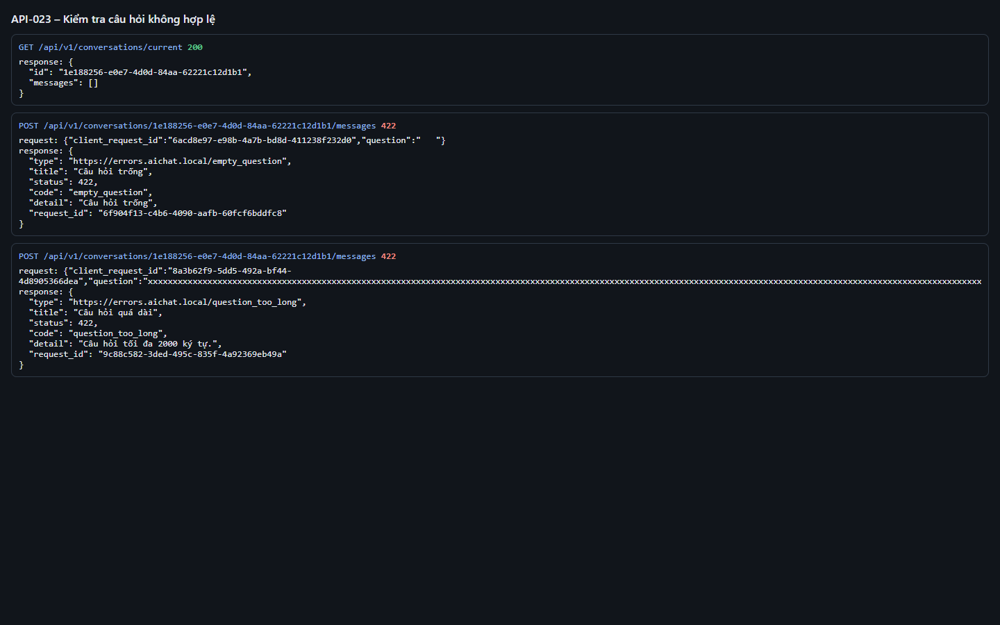
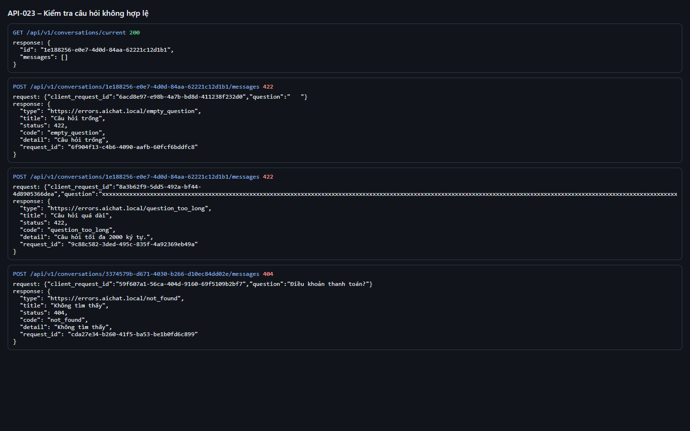
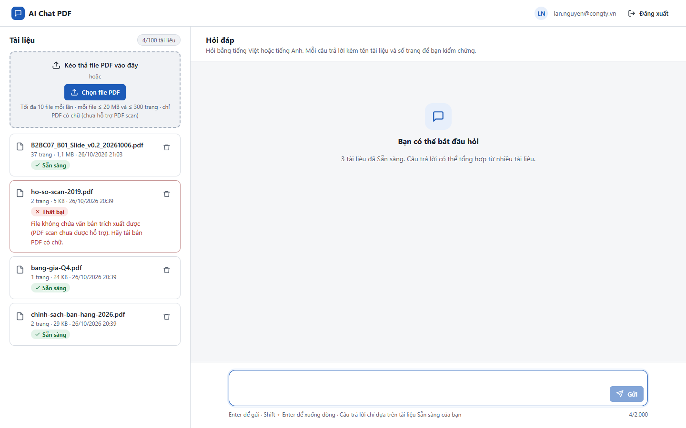

# Test report – API-023: Kiểm tra câu hỏi không hợp lệ

| Trường | Giá trị |
|---|---|
| Test case | [API-023](../../doc/07-verification/test_cases/API-023_kiem-tra-cau-hoi-khong-hop-le.md) |
| Kết luận | **ĐẠT** |
| Bắt đầu | 2026-10-26T16:22:07.324Z |
| Kết thúc | 2026-10-26T16:22:19.214Z (11.9 s) |
| Cách thực hiện | Tự động – Playwright (app/frontend/evidence/fixture.ts) |
| URL ứng dụng | http://localhost:8080/ |
| Bản build | 166929f + thay đổi chưa commit trong app/ |
| Trình duyệt | Microsoft Edge (Playwright, channel msedge) |
| Hệ điều hành | win32 x64 |
| Spec | app/frontend/testcases/API-023_kiem-tra-cau-hoi-khong-hop-le.spec.ts |

## Kết quả từng bước

| # | Bước | Kết quả mong đợi | Kết quả thực tế | Trạng thái | Bằng chứng |
|---|---|---|---|---|---|
| 1 | Đăng nhập P1 và đảm bảo có ít nhất 1 tài liệu Sẵn sàng | Danh sách có tài liệu trạng thái Sẵn sàng | Như mong đợi | Đạt | [ảnh](screenshots/01-dang-nhap-p1-va-dam-bao-co-it-nhat-1-tai-lieu-san-.png) |
| 2 | Lấy hội thoại hiện tại | 200, có id hội thoại | conversation_id=1e188256-e0e7-4d0d-84aa-62221c12d1b1 | Đạt | [ảnh](screenshots/02-lay-hoi-thoai-hien-tai.png) |
| 3 | Gửi câu hỏi chỉ có khoảng trắng | 422, code = empty_question, application/problem+json | HTTP 422 empty_question | Đạt | [ảnh](screenshots/03-gui-cau-hoi-chi-co-khoang-trang.png) |
| 4 | Gửi câu hỏi 2.001 ký tự | 422, code = question_too_long | HTTP 422 question_too_long | Đạt | [ảnh](screenshots/04-gui-cau-hoi-2-001-ky-tu.png) |
| 5 | Gửi câu hỏi vào hội thoại không tồn tại | 404 | HTTP 404 | Đạt | [ảnh](screenshots/05-gui-cau-hoi-vao-hoi-thoai-khong-ton-tai.png) |
| 6 | Kiểm tra giao diện: không gửi được câu trống | Nút Gửi bị vô hiệu khi ô hỏi chỉ có khoảng trắng | Như mong đợi | Đạt | [ảnh](screenshots/06-kiem-tra-giao-dien-khong-gui-duoc-cau-trong.png) |

## Video

- [API-023-app.webm](video/API-023-app.webm)
- [API-023-page2.webm](video/API-023-page2.webm)

## Ảnh chụp màn hình

## Log

- [api.log](logs/api.log)

## Ghi chú / lỗi phát hiện

- (không có)
