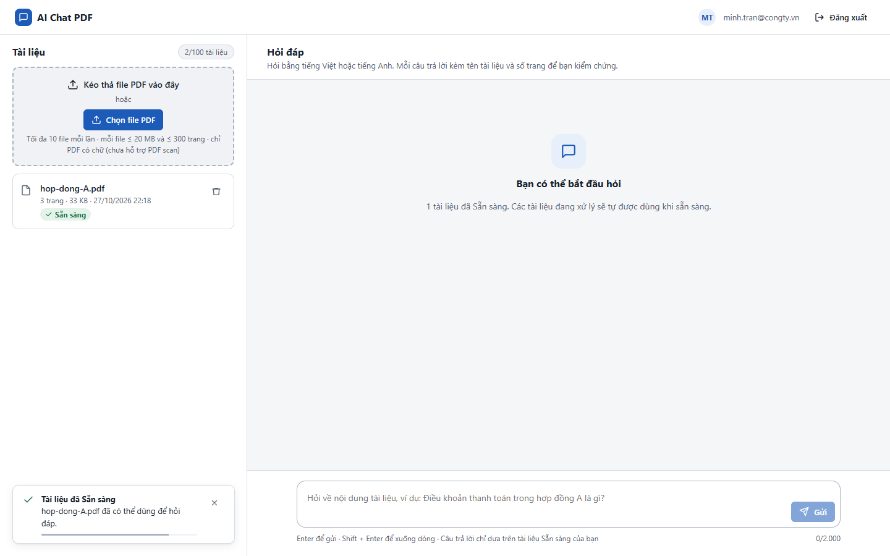
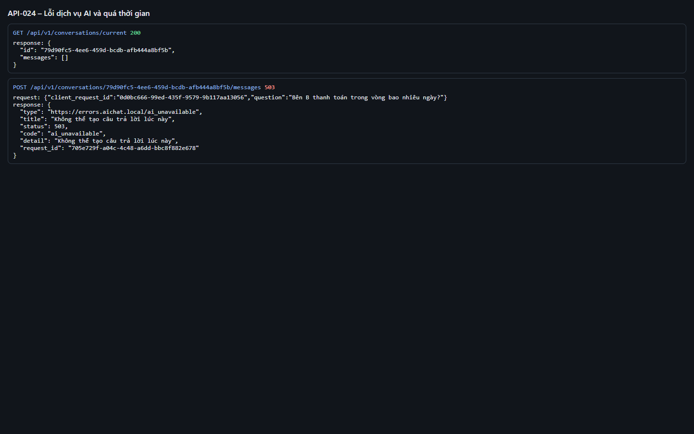
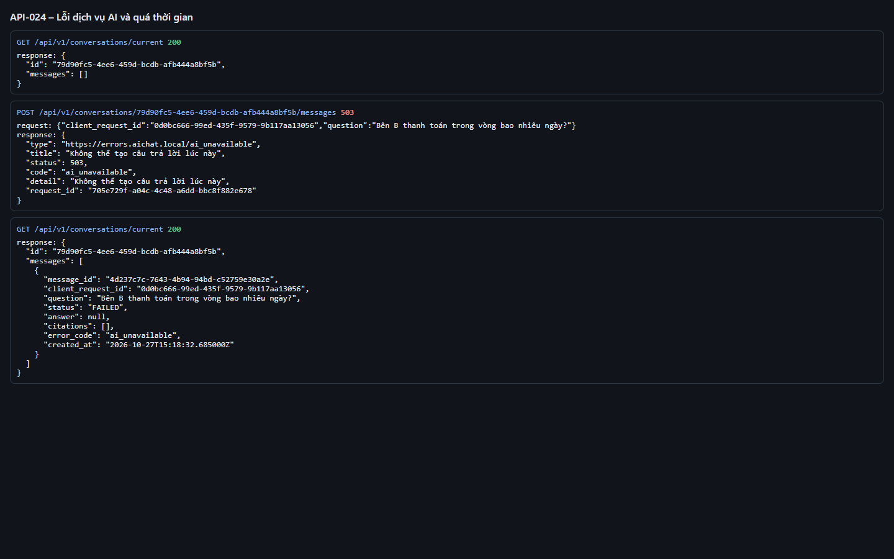
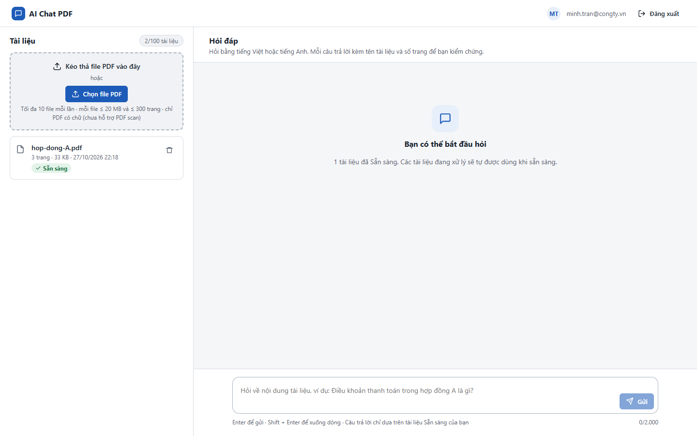

# Test report – API-024: Lỗi dịch vụ AI và quá thời gian

| Trường | Giá trị |
|---|---|
| Test case | [API-024](../../doc/07-verification/test_cases/API-024_loi-dich-vu-ai-va-qua-thoi-gian.md) |
| Kết luận | **ĐẠT** |
| Bắt đầu | 2026-10-27T15:17:26.181Z |
| Kết thúc | 2026-10-27T15:19:48.509Z (142.3 s) |
| Cách thực hiện | Tự động – Playwright (app/frontend/evidence/fixture.ts) |
| URL ứng dụng | http://localhost:8080/ |
| Bản build | 166929f + thay đổi chưa commit trong app/ |
| Trình duyệt | Microsoft Edge (Playwright, channel msedge) |
| Hệ điều hành | win32 x64 |
| Spec | app/frontend/testcases/API-024_loi-dich-vu-ai-va-qua-thoi-gian.spec.ts |

## Kết quả từng bước

| # | Bước | Kết quả mong đợi | Kết quả thực tế | Trạng thái | Bằng chứng |
|---|---|---|---|---|---|
| 1 | Khởi động lại với LLM_PROVIDER=anthropic và LLM_API_KEY không hợp lệ | Ứng dụng sẵn sàng | Như mong đợi | Đạt | [ảnh](screenshots/01-khoi-dong-lai-voi-llm-provider-anthropic-va-llm-ap.png) |
| 2 | Đăng nhập P2, tải hop-dong-A.pdf và chờ Sẵn sàng | Dòng Sẵn sàng | Như mong đợi | Đạt | [ảnh](screenshots/02-dang-nhap-p2-tai-hop-dong-a-pdf-va-cho-san-sang.png) |
| 3 | POST câu hỏi | 503 ai_unavailable kèm header Retry-After | HTTP 503 ai_unavailable, Retry-After=5 | Đạt | [ảnh](screenshots/03-post-cau-hoi.png) |
| 4 | GET /conversations/current | Lượt hỏi có status=FAILED, error_code=ai_unavailable | Như mong đợi | Đạt | [ảnh](screenshots/04-get-conversations-current.png) |
| 5 | (504) Chạy test tự động test_ai_timeout (LLM chậm hơn ngân sách thời gian) | pytest: 1 passed → API trả 504 ai_timeout | 1 passed in 8.22s | Đạt | [ảnh](screenshots/05-504-chay-test-tu-dong-test-ai-timeout-llm-cham-hon.png) |

## Video

- [API-024-app.webm](video/API-024-app.webm)
- [API-024-page2.webm](video/API-024-page2.webm)

## Ảnh chụp màn hình

## Log

- [api.log](logs/api.log)

## Ghi chú / lỗi phát hiện

- Khởi động lại ứng dụng với {"LLM_PROVIDER":"anthropic","LLM_API_KEY":"sk-ant-invalid"}: [app] restart xong – http://localhost:8080/ sẵn sàng
- 504 ai_timeout kiểm bằng pytest: 1 passed in 8.22s
- Khởi động lại ứng dụng với {}: [app] restart xong – http://localhost:8080/ sẵn sàng
