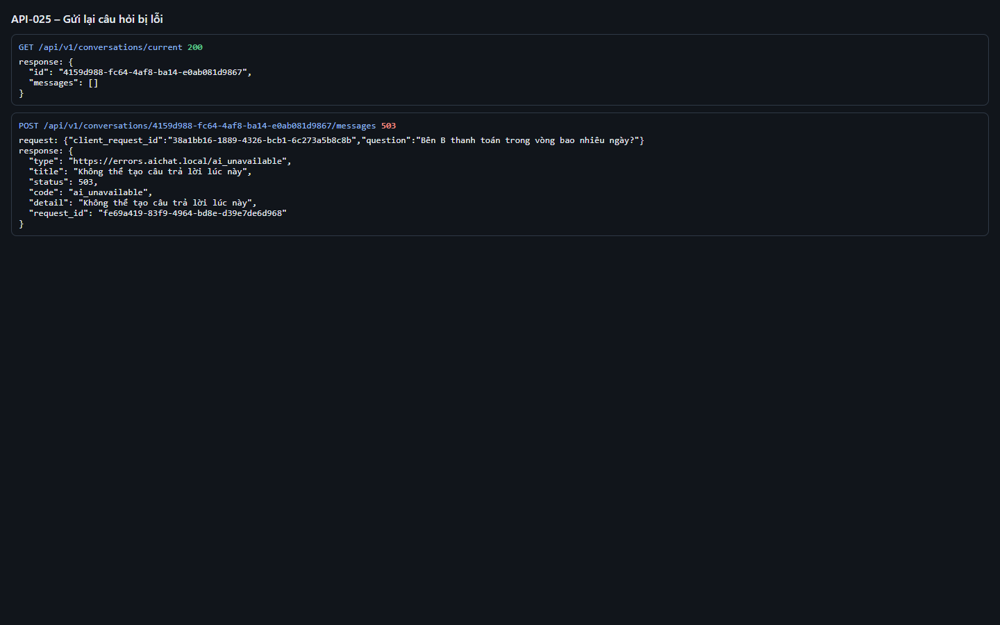
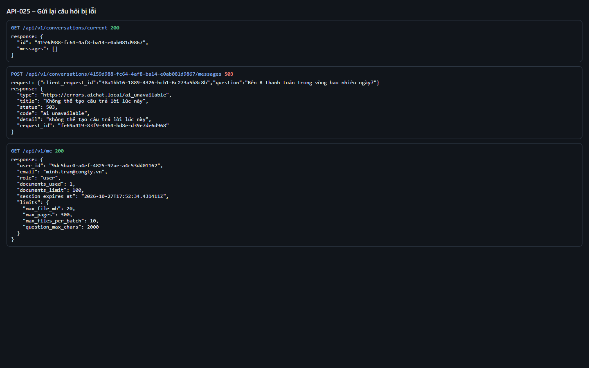
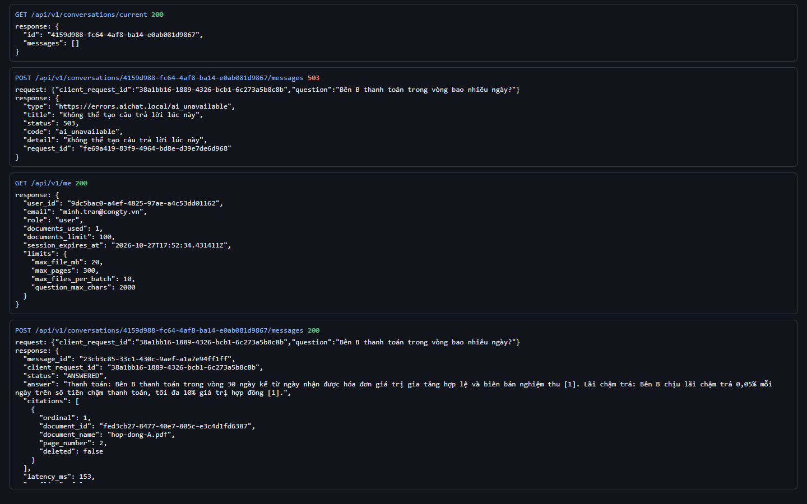
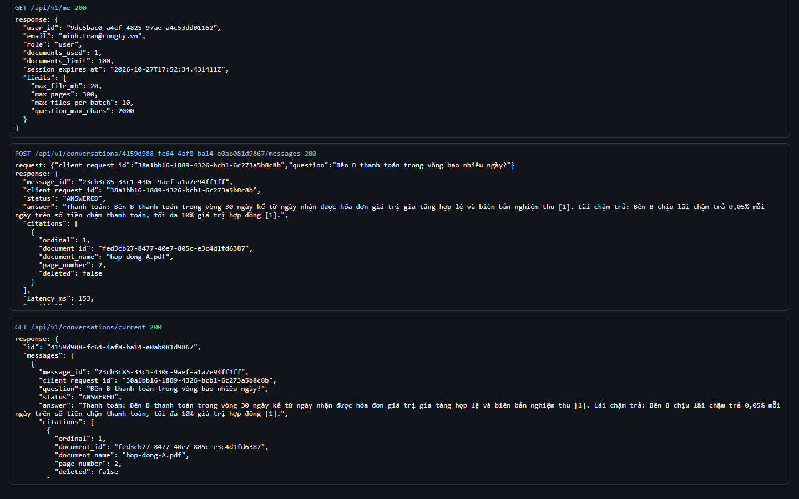

# Test report – API-025: Gửi lại câu hỏi bị lỗi

| Trường | Giá trị |
|---|---|
| Test case | [API-025](../../doc/07-verification/test_cases/API-025_gui-lai-cau-hoi-bi-loi.md) |
| Kết luận | **ĐẠT** |
| Bắt đầu | 2026-10-27T15:51:39.399Z |
| Kết thúc | 2026-10-27T15:53:23.986Z (104.6 s) |
| Cách thực hiện | Tự động – Playwright (app/frontend/evidence/fixture.ts) |
| URL ứng dụng | http://localhost:8080/ |
| Bản build | 166929f + thay đổi chưa commit trong app/ |
| Trình duyệt | Microsoft Edge (Playwright, channel msedge) |
| Hệ điều hành | win32 x64 |
| Spec | app/frontend/testcases/API-025_gui-lai-cau-hoi-bi-loi.spec.ts |

## Kết quả từng bước

| # | Bước | Kết quả mong đợi | Kết quả thực tế | Trạng thái | Bằng chứng |
|---|---|---|---|---|---|
| 1 | Tạo lượt FAILED: khởi động với LLM lỗi, tải tài liệu, hỏi (client_request_id = R) | Lượt hỏi FAILED (503) | Như mong đợi | Đạt | [ảnh](screenshots/01-tao-luot-failed-khoi-dong-voi-llm-loi-tai-tai-lieu.png) |
| 2 | Khởi động lại với LLM_PROVIDER=extractive; kiểm tra phiên còn hiệu lực | Ứng dụng sẵn sàng, /me = 200 | Như mong đợi | Đạt | [ảnh](screenshots/02-khoi-dong-lai-voi-llm-provider-extractive-kiem-tra.png) |
| 3 | POST lại cùng R và cùng câu hỏi | 200 ANSWERED | Như mong đợi | Đạt | [ảnh](screenshots/03-post-lai-cung-r-va-cung-cau-hoi.png) |
| 4 | GET /conversations/current | Chỉ 1 lượt cho R, status=ANSWERED (không tạo lượt mới) | Như mong đợi | Đạt | [ảnh](screenshots/04-get-conversations-current.png) |

## Video

- [API-025-app.webm](video/API-025-app.webm)
- [API-025-page2.webm](video/API-025-page2.webm)

## Ảnh chụp màn hình

## Log

- [api.log](logs/api.log)

## Ghi chú / lỗi phát hiện

- Khởi động lại ứng dụng với {"LLM_PROVIDER":"anthropic","LLM_API_KEY":"sk-ant-invalid"}: [app] restart xong – http://localhost:8080/ sẵn sàng
- Khởi động lại ứng dụng với {}: [app] restart xong – http://localhost:8080/ sẵn sàng
