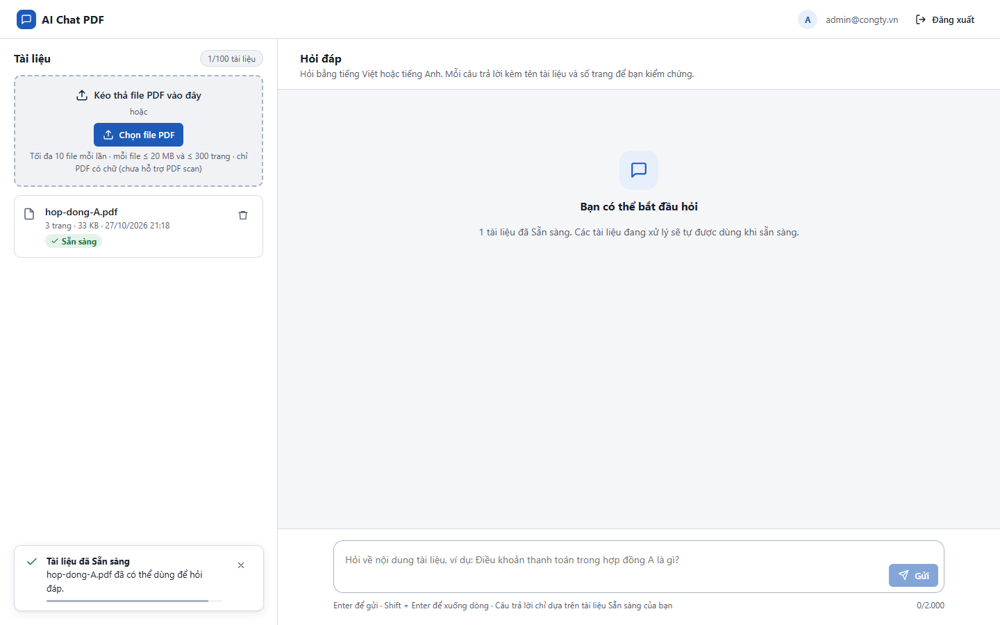
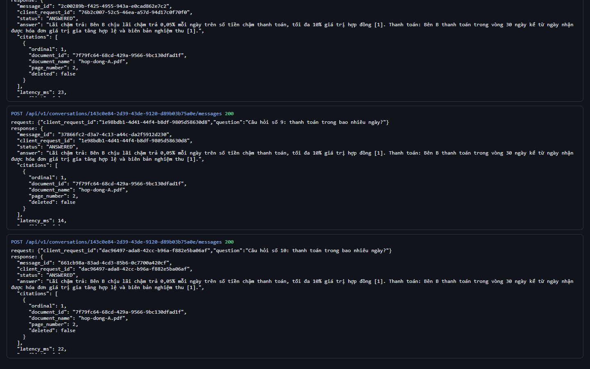
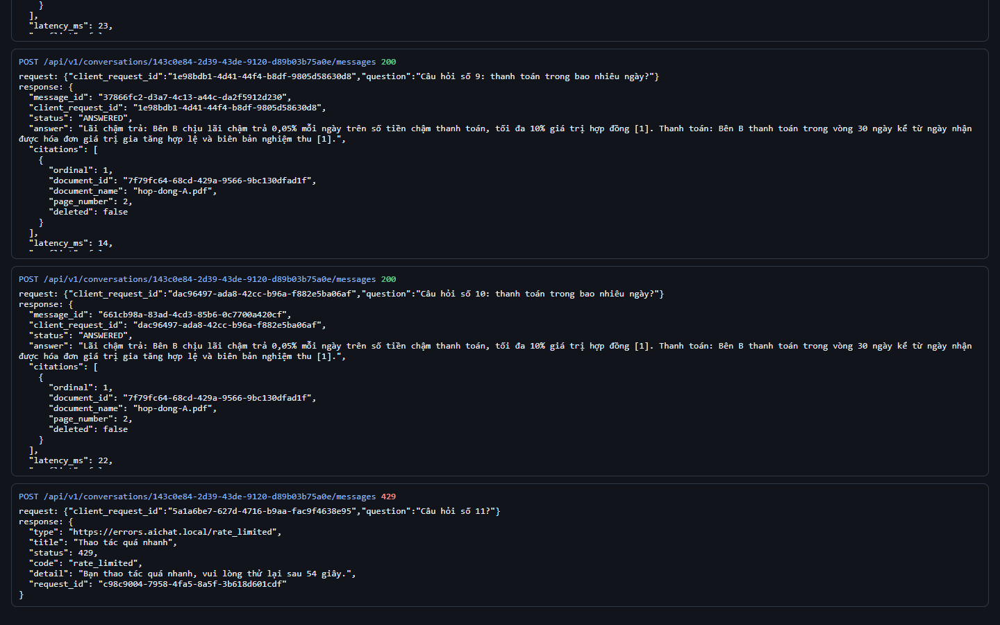
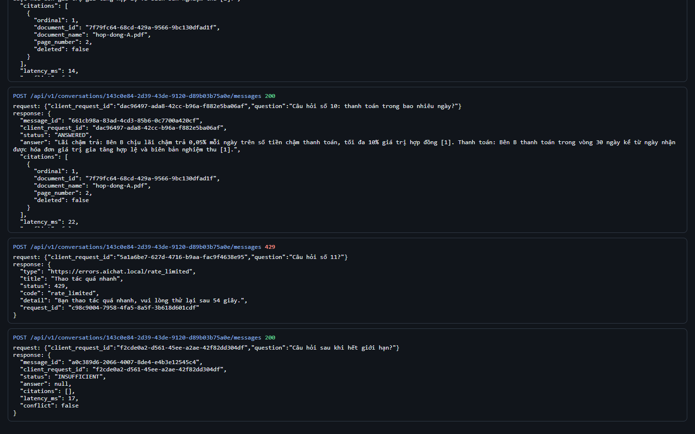

# Test report – API-026: Rate limit câu hỏi

| Trường | Giá trị |
|---|---|
| Test case | [API-026](../../doc/07-verification/test_cases/API-026_rate-limit-cau-hoi.md) |
| Kết luận | **ĐẠT** |
| Bắt đầu | 2026-10-27T14:18:33.810Z |
| Kết thúc | 2026-10-27T14:20:57.421Z (143.6 s) |
| Cách thực hiện | Tự động – Playwright (app/frontend/evidence/fixture.ts) |
| URL ứng dụng | http://localhost:8080/ |
| Bản build | 166929f + thay đổi chưa commit trong app/ |
| Trình duyệt | Microsoft Edge (Playwright, channel msedge) |
| Hệ điều hành | win32 x64 |
| Spec | app/frontend/testcases/API-026_rate-limit-cau-hoi.spec.ts |

## Kết quả từng bước

| # | Bước | Kết quả mong đợi | Kết quả thực tế | Trạng thái | Bằng chứng |
|---|---|---|---|---|---|
| 1 | Đăng nhập Quản trị viên, tải hop-dong-A.pdf và chờ Sẵn sàng | Dòng Sẵn sàng | Như mong đợi | Đạt | [ảnh](screenshots/01-dang-nhap-quan-tri-vien-tai-hop-dong-a-pdf-va-cho-.png) |
| 2 | Gửi 10 câu hỏi khác nhau liên tiếp trong cùng một phút | 10 phản hồi 200 | Như mong đợi | Đạt | [ảnh](screenshots/02-gui-10-cau-hoi-khac-nhau-lien-tiep-trong-cung-mot-.png) |
| 3 | Gửi câu thứ 11 | 429 rate_limited; Retry-After > 0; RateLimit-Remaining: 0 | Retry-After=54, RateLimit-Limit=10 | Đạt | [ảnh](screenshots/03-gui-cau-thu-11.png) |
| 4 | Chờ hết Retry-After rồi gửi lại | 200 | Như mong đợi | Đạt | [ảnh](screenshots/04-cho-het-retry-after-roi-gui-lai.png) |

## Video

- [API-026-app.webm](video/API-026-app.webm)
- [API-026-page2.webm](video/API-026-page2.webm)

## Ảnh chụp màn hình

## Log

- [api.log](logs/api.log)

## Ghi chú / lỗi phát hiện

- (không có)
