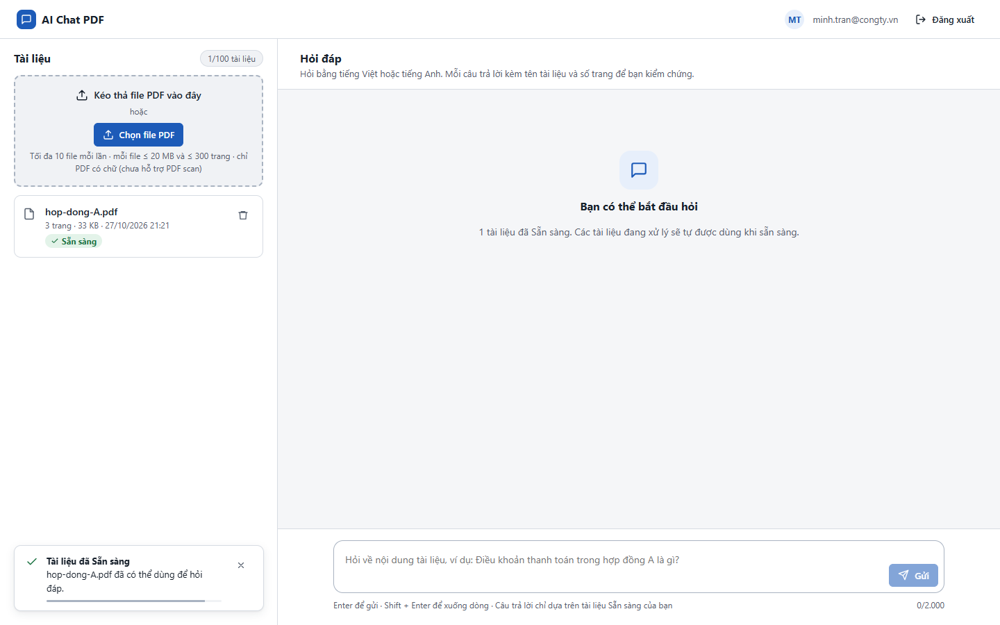
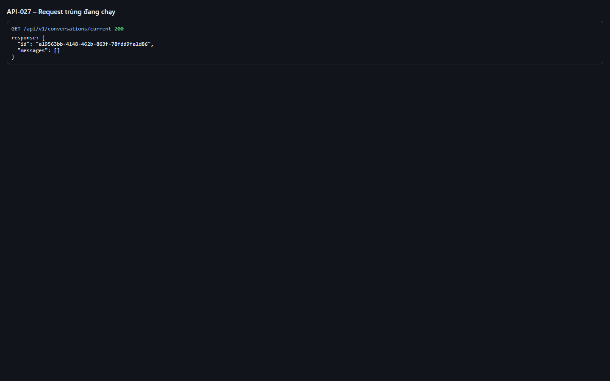

# Test report – API-027: Request trùng đang chạy

| Trường | Giá trị |
|---|---|
| Test case | [API-027](../../doc/07-verification/test_cases/API-027_request-trung-dang-chay.md) |
| Kết luận | **ĐẠT** |
| Bắt đầu | 2026-10-27T14:20:59.512Z |
| Kết thúc | 2026-10-27T14:21:13.424Z (13.9 s) |
| Cách thực hiện | Tự động – Playwright (app/frontend/evidence/fixture.ts) |
| URL ứng dụng | http://localhost:8080/ |
| Bản build | 166929f + thay đổi chưa commit trong app/ |
| Trình duyệt | Microsoft Edge (Playwright, channel msedge) |
| Hệ điều hành | win32 x64 |
| Spec | app/frontend/testcases/API-027_request-trung-dang-chay.spec.ts |

## Kết quả từng bước

| # | Bước | Kết quả mong đợi | Kết quả thực tế | Trạng thái | Bằng chứng |
|---|---|---|---|---|---|
| 1 | Đăng nhập P2, tải hop-dong-A.pdf và chờ Sẵn sàng | Dòng Sẵn sàng | Như mong đợi | Đạt | [ảnh](screenshots/01-dang-nhap-p2-tai-hop-dong-a-pdf-va-cho-san-sang.png) |
| 2 | Gửi đồng thời 6 POST cùng client_request_id R và cùng câu hỏi | Các phản hồi là 200 (cùng kết quả) hoặc 409 request_in_progress; không có lỗi khác | Mã trả về: 200, 409, 409, 409, 409, 409 (ANSWERED, request_in_progress, request_in_progress, request_in_progress, request_in_progress, request_in_progress); chỉ 1 lượt cho R | Đạt | [ảnh](screenshots/02-gui-dong-thoi-6-post-cung-client-request-id-r-va-c.png) |

## Video

- [API-027-app.webm](video/API-027-app.webm)
- [API-027-page2.webm](video/API-027-page2.webm)

## Ảnh chụp màn hình

## Log

- [api.log](logs/api.log)

## Ghi chú / lỗi phát hiện

- Quan sát được 409 request_in_progress.
