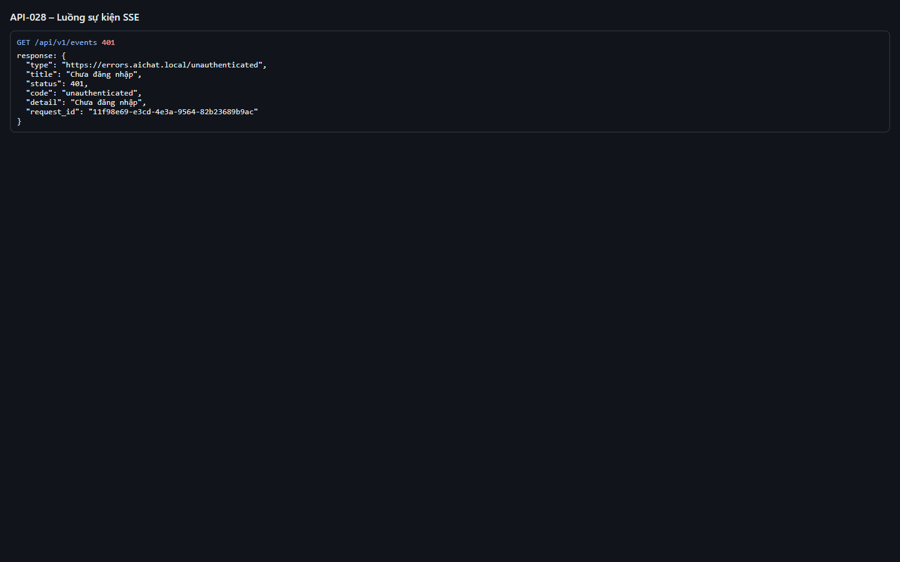
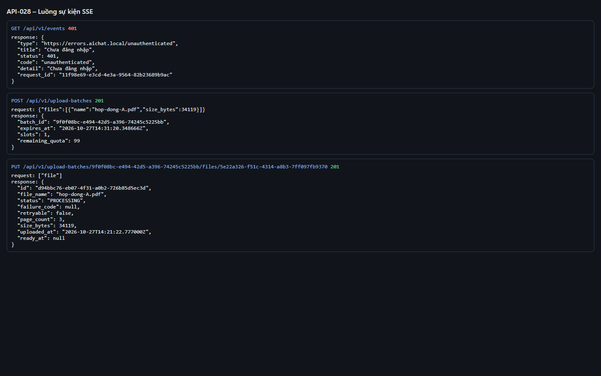
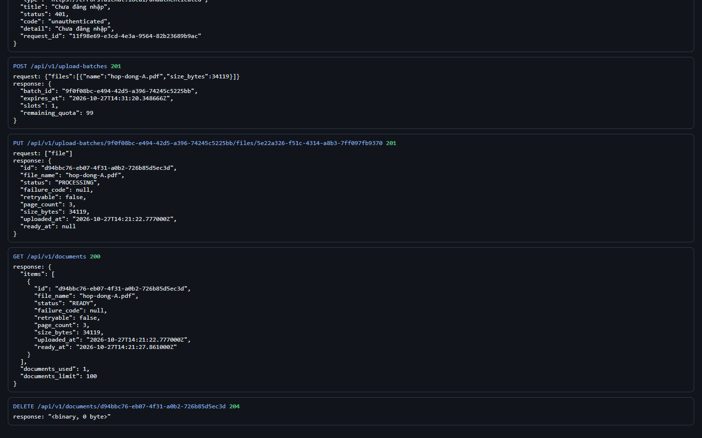

# Test report – API-028: Luồng sự kiện SSE

| Trường | Giá trị |
|---|---|
| Test case | [API-028](../../doc/07-verification/test_cases/API-028_luong-su-kien-sse.md) |
| Kết luận | **ĐẠT** |
| Bắt đầu | 2026-10-27T14:21:15.154Z |
| Kết thúc | 2026-10-27T14:22:29.101Z (73.9 s) |
| Cách thực hiện | Tự động – Playwright (app/frontend/evidence/fixture.ts) |
| URL ứng dụng | http://localhost:8080/ |
| Bản build | 166929f + thay đổi chưa commit trong app/ |
| Trình duyệt | Microsoft Edge (Playwright, channel msedge) |
| Hệ điều hành | win32 x64 |
| Spec | app/frontend/testcases/API-028_luong-su-kien-sse.spec.ts |

## Kết quả từng bước

| # | Bước | Kết quả mong đợi | Kết quả thực tế | Trạng thái | Bằng chứng |
|---|---|---|---|---|---|
| 1 | GET /api/v1/events khi chưa đăng nhập | 401 | Như mong đợi | Đạt | [ảnh](screenshots/01-get-api-v1-events-khi-chua-dang-nhap.png) |
| 2 | Đăng nhập P2, xóa tài liệu; mở EventSource trong trang | Kết nối mở (readyState = OPEN) | Như mong đợi | Đạt | [ảnh](screenshots/02-dang-nhap-p2-xoa-tai-lieu-mo-eventsource-trong-tra.png) |
| 3 | Tải hop-dong-A.pdf qua API | Nhận document.status_changed (PROCESSING rồi READY) và quota.changed | Sự kiện nhận được: document.status_changed, quota.changed, document.status_changed | Đạt | [ảnh](screenshots/03-tai-hop-dong-a-pdf-qua-api.png) |
| 4 | Xóa tài liệu | Nhận thêm quota.changed | Như mong đợi | Đạt | [ảnh](screenshots/04-xoa-tai-lieu.png) |
| 5 | Giữ kết nối 30 s | Kết nối vẫn mở (ping 25 s giữ kết nối; EventSource không hiển thị dòng comment) | Như mong đợi | Đạt | [ảnh](screenshots/05-giu-ket-noi-30-s.png) |

## Video

- [API-028-app.webm](video/API-028-app.webm)
- [API-028-page2.webm](video/API-028-page2.webm)

## Ảnh chụp màn hình

## Log

- [api.log](logs/api.log)

## Ghi chú / lỗi phát hiện

- Dòng ": ping" là comment SSE nên EventSource không phát ra sự kiện; kiểm chứng gián tiếp bằng việc kết nối giữ mở > 25 s.
