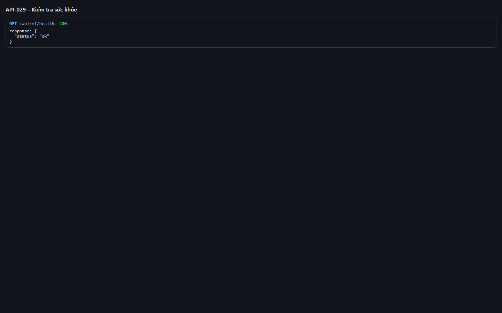
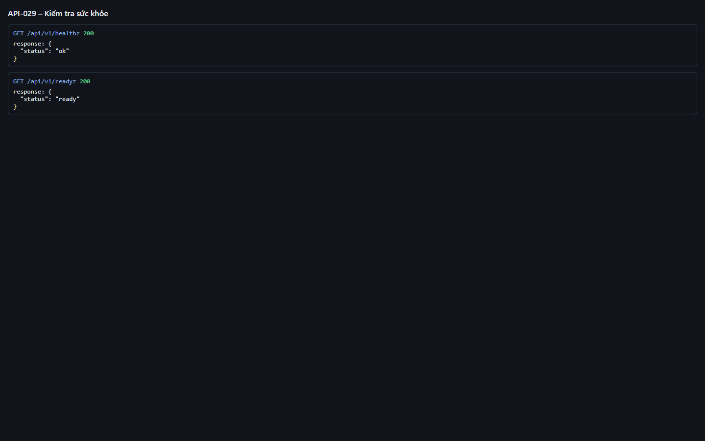
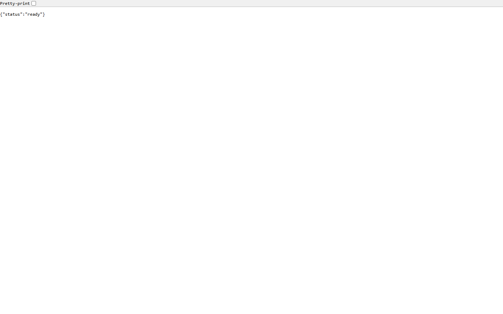

# Test report – API-029: Kiểm tra sức khỏe

| Trường | Giá trị |
|---|---|
| Test case | [API-029](../../doc/07-verification/test_cases/API-029_kiem-tra-suc-khoe.md) |
| Kết luận | **ĐẠT** |
| Bắt đầu | 2026-10-27T14:22:31.421Z |
| Kết thúc | 2026-10-27T14:22:35.343Z (3.9 s) |
| Cách thực hiện | Tự động – Playwright (app/frontend/evidence/fixture.ts) |
| URL ứng dụng | http://localhost:8080/ |
| Bản build | 166929f + thay đổi chưa commit trong app/ |
| Trình duyệt | Microsoft Edge (Playwright, channel msedge) |
| Hệ điều hành | win32 x64 |
| Spec | app/frontend/testcases/API-029_kiem-tra-suc-khoe.spec.ts |

## Kết quả từng bước

| # | Bước | Kết quả mong đợi | Kết quả thực tế | Trạng thái | Bằng chứng |
|---|---|---|---|---|---|
| 1 | GET /api/v1/healthz | 200 {"status":"ok"} | Như mong đợi | Đạt | [ảnh](screenshots/01-get-api-v1-healthz.png) |
| 2 | GET /api/v1/readyz | 200 {"status":"ready"} | Như mong đợi | Đạt | [ảnh](screenshots/02-get-api-v1-readyz.png) |
| 3 | Mở /api/v1/readyz trên trình duyệt | Hiển thị {"status":"ready"} | Như mong đợi | Đạt | [ảnh](screenshots/03-mo-api-v1-readyz-tren-trinh-duyet.png) |

## Video

- [API-029-app.webm](video/API-029-app.webm)
- [API-029-page2.webm](video/API-029-page2.webm)

## Ảnh chụp màn hình

## Log

- [api.log](logs/api.log)

## Ghi chú / lỗi phát hiện

- Bước tùy chọn "dừng devdb rồi gọi readyz → 503" không thực hiện (sẽ làm gián đoạn ứng dụng đang dùng chung).
