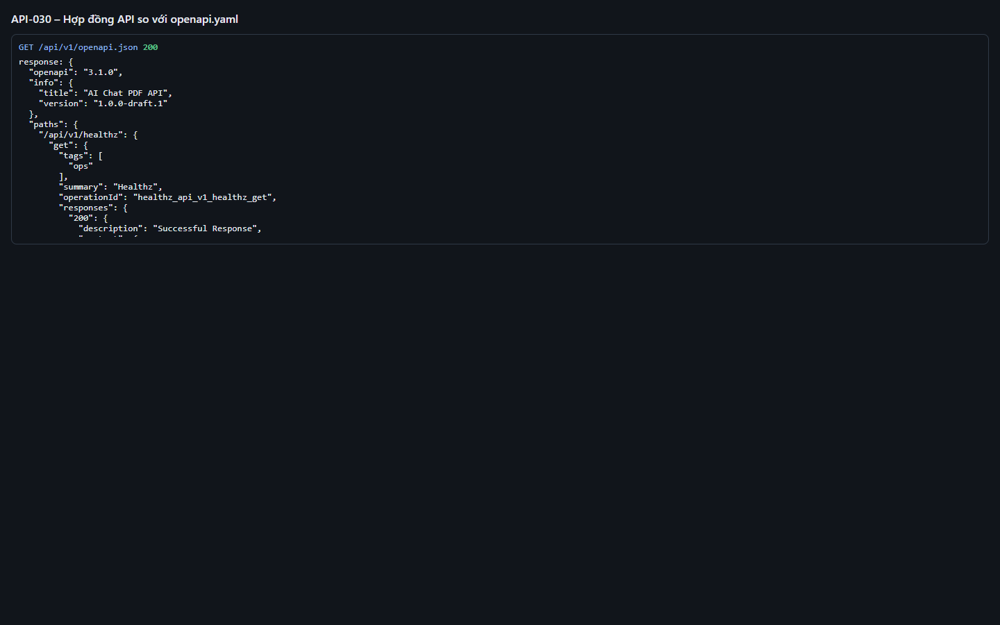

# Test report – API-030: Hợp đồng API so với openapi.yaml

| Trường | Giá trị |
|---|---|
| Test case | [API-030](../../doc/07-verification/test_cases/API-030_hop-dong-api-so-voi-openapi-yaml.md) |
| Kết luận | **ĐẠT** |
| Bắt đầu | 2026-10-27T14:22:36.785Z |
| Kết thúc | 2026-10-27T14:22:44.886Z (8.1 s) |
| Cách thực hiện | Tự động – Playwright (app/frontend/evidence/fixture.ts) |
| URL ứng dụng | http://localhost:8080/ |
| Bản build | 166929f + thay đổi chưa commit trong app/ |
| Trình duyệt | Microsoft Edge (Playwright, channel msedge) |
| Hệ điều hành | win32 x64 |
| Spec | app/frontend/testcases/API-030_hop-dong-api-so-voi-openapi-yaml.spec.ts |

## Kết quả từng bước

| # | Bước | Kết quả mong đợi | Kết quả thực tế | Trạng thái | Bằng chứng |
|---|---|---|---|---|---|
| 1 | Mở http://localhost:8080/api/v1/docs (chế độ dev) và chụp | Trang tài liệu API tải được (HTTP 200) | HTTP 200 (giao diện Swagger tải thư viện từ CDN; có thể trống nếu chính sách CSP chặn – không ảnh hưởng hợp đồng API) | Đạt | [ảnh](screenshots/01-mo-http-localhost-8080-api-v1-docs-che-do-dev-va-c.png) |
| 2 | GET /api/v1/openapi.json và so sánh path/method với app/contracts/openapi.yaml | Không thiếu thao tác nào (15/15) | Hợp đồng: 15 thao tác; ứng dụng: 15 thao tác; thiếu: 0 | Đạt | [ảnh](screenshots/02-get-api-v1-openapi-json-va-so-sanh-path-method-voi.png) |

## Video

- [API-030-app.webm](video/API-030-app.webm)
- [API-030-page2.webm](video/API-030-page2.webm)

## Ảnh chụp màn hình

## Log

- [api.log](logs/api.log)

## Ghi chú / lỗi phát hiện

- (không có)
