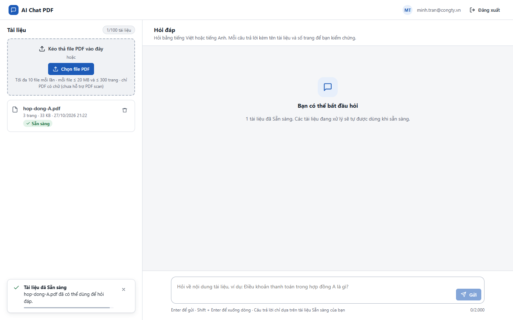
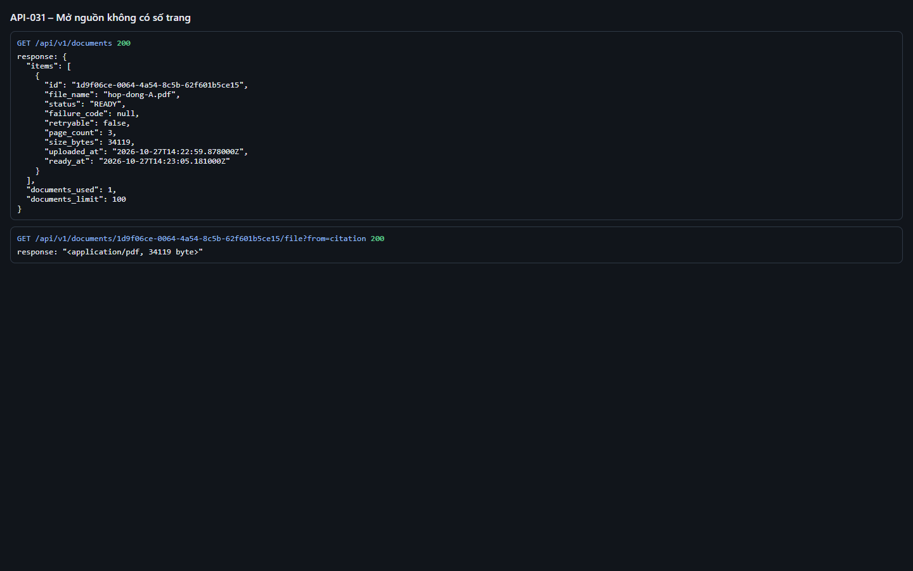
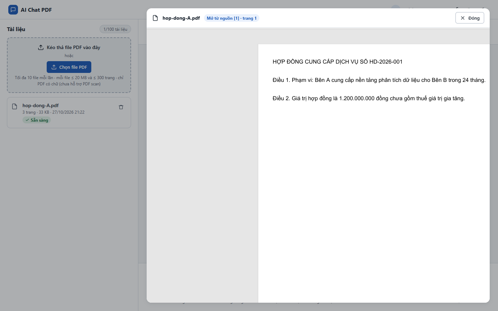

# Test report – API-031: Mở nguồn không có số trang

| Trường | Giá trị |
|---|---|
| Test case | [API-031](../../doc/07-verification/test_cases/API-031_mo-nguon-khong-co-so-trang.md) |
| Kết luận | **ĐẠT** |
| Bắt đầu | 2026-10-27T14:22:46.462Z |
| Kết thúc | 2026-10-27T14:23:17.922Z (31.5 s) |
| Cách thực hiện | Tự động – Playwright (app/frontend/evidence/fixture.ts) |
| URL ứng dụng | http://localhost:8080/ |
| Bản build | 166929f + thay đổi chưa commit trong app/ |
| Trình duyệt | Microsoft Edge (Playwright, channel msedge) |
| Hệ điều hành | win32 x64 |
| Spec | app/frontend/testcases/API-031_mo-nguon-khong-co-so-trang.spec.ts |

## Kết quả từng bước

| # | Bước | Kết quả mong đợi | Kết quả thực tế | Trạng thái | Bằng chứng |
|---|---|---|---|---|---|
| 1 | Đăng nhập P2, tải hop-dong-A.pdf và chờ Sẵn sàng | Dòng Sẵn sàng | Như mong đợi | Đạt | [ảnh](screenshots/01-dang-nhap-p2-tai-hop-dong-a-pdf-va-cho-san-sang.png) |
| 2 | GET /documents/{id}/file?from=citation (không có page) | 200 PDF | Như mong đợi | Đạt | [ảnh](screenshots/02-get-documents-id-file-from-citation-khong-co-page.png) |
| 3 | Hỏi, giả lập page_number = null (page.route), tải lại trang, bấm chip nguồn | Chip không có "tr."; trình xem mở trang 1, iframe có #page=1 | Như mong đợi | Đạt | [ảnh](screenshots/03-hoi-gia-lap-page-number-null-page-route-tai-lai-tr.png) |

## Video

- [API-031-app.webm](video/API-031-app.webm)
- [API-031-page2.webm](video/API-031-page2.webm)

## Ảnh chụp màn hình

## Log

- [api.log](logs/api.log)

## Ghi chú / lỗi phát hiện

- (không có)
