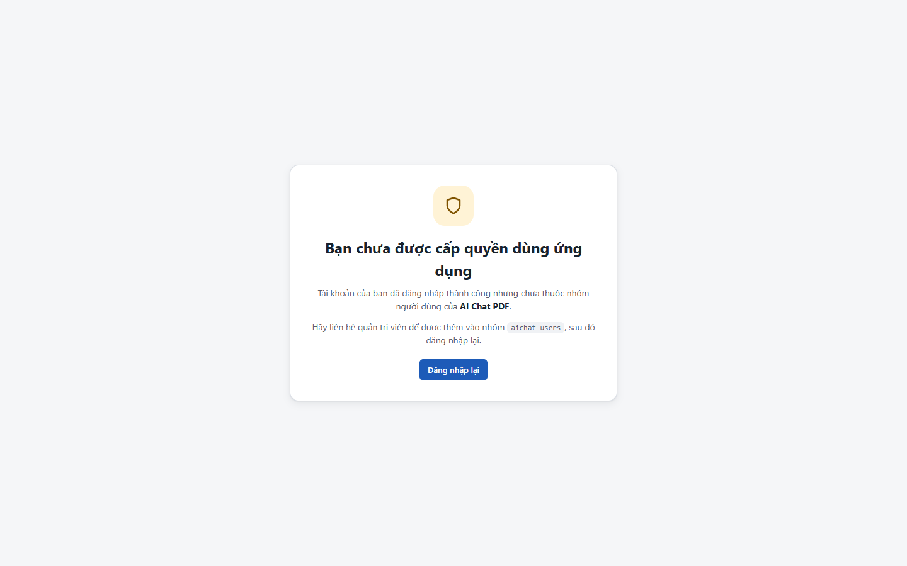
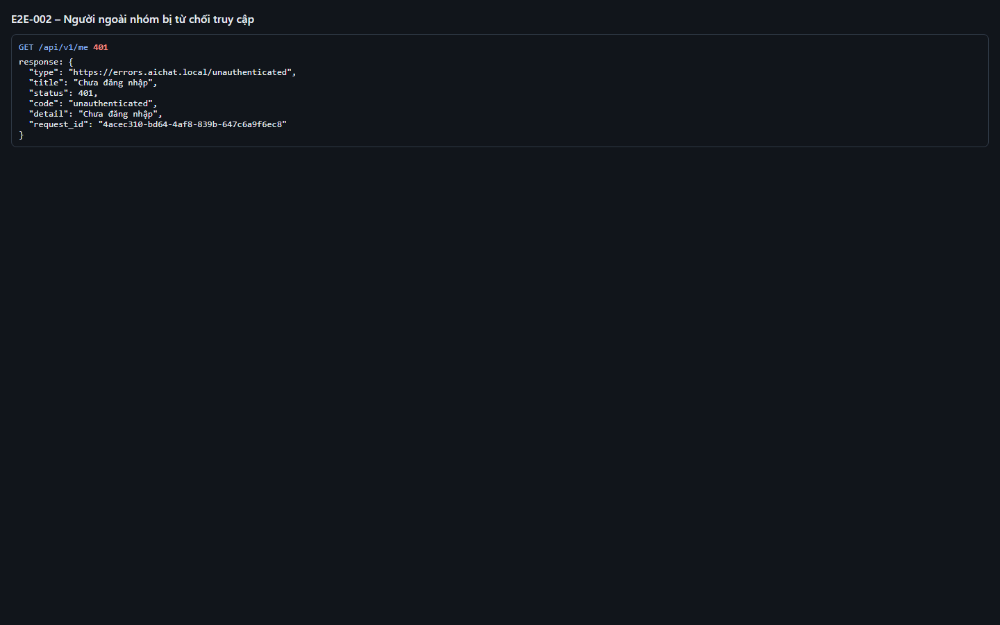

# Test report – E2E-002: Người ngoài nhóm bị từ chối truy cập

| Trường | Giá trị |
|---|---|
| Test case | [E2E-002](../../doc/07-verification/test_cases/E2E-002_nguoi-ngoai-nhom-bi-tu-choi.md) |
| Kết luận | **ĐẠT** |
| Bắt đầu | 2026-10-26T16:22:20.758Z |
| Kết thúc | 2026-10-26T16:22:25.020Z (4.3 s) |
| Cách thực hiện | Tự động – Playwright (app/frontend/evidence/fixture.ts) |
| URL ứng dụng | http://localhost:8080/ |
| Bản build | 166929f + thay đổi chưa commit trong app/ |
| Trình duyệt | Microsoft Edge (Playwright, channel msedge) |
| Hệ điều hành | win32 x64 |
| Spec | app/frontend/testcases/E2E-002_nguoi-ngoai-nhom-bi-tu-choi.spec.ts |

## Kết quả từng bước

| # | Bước | Kết quả mong đợi | Kết quả thực tế | Trạng thái | Bằng chứng |
|---|---|---|---|---|---|
| 1 | Mở ứng dụng khi chưa đăng nhập | Chuyển tới trang chọn tài khoản của IdP | Như mong đợi | Đạt | [ảnh](screenshots/01-mo-ung-dung-khi-chua-dang-nhap.png) |
| 2 | Chọn tài khoản "Người ngoài nhóm" (khach@congty.vn) | Trang "Bạn chưa được cấp quyền dùng ứng dụng" | URL: /access-denied | Đạt | [ảnh](screenshots/02-chon-tai-khoan-nguoi-ngoai-nhom-khach-congty-vn.png) |
| 3 | Kiểm tra không lộ dữ liệu ứng dụng | Không có khu vực Tài liệu, ô hỏi; có nút "Đăng nhập lại" | Như mong đợi | Đạt | [ảnh](screenshots/03-kiem-tra-khong-lo-du-lieu-ung-dung.png) |
| 4 | Gọi API /me trực tiếp | 401 – không có phiên | HTTP 401, code=unauthenticated | Đạt | [ảnh](screenshots/04-goi-api-me-truc-tiep.png) |

## Video

- [E2E-002-app.webm](video/E2E-002-app.webm)
- [E2E-002-page2.webm](video/E2E-002-page2.webm)

## Ảnh chụp màn hình

## Log

- [api.log](logs/api.log)

## Ghi chú / lỗi phát hiện

- (không có)
