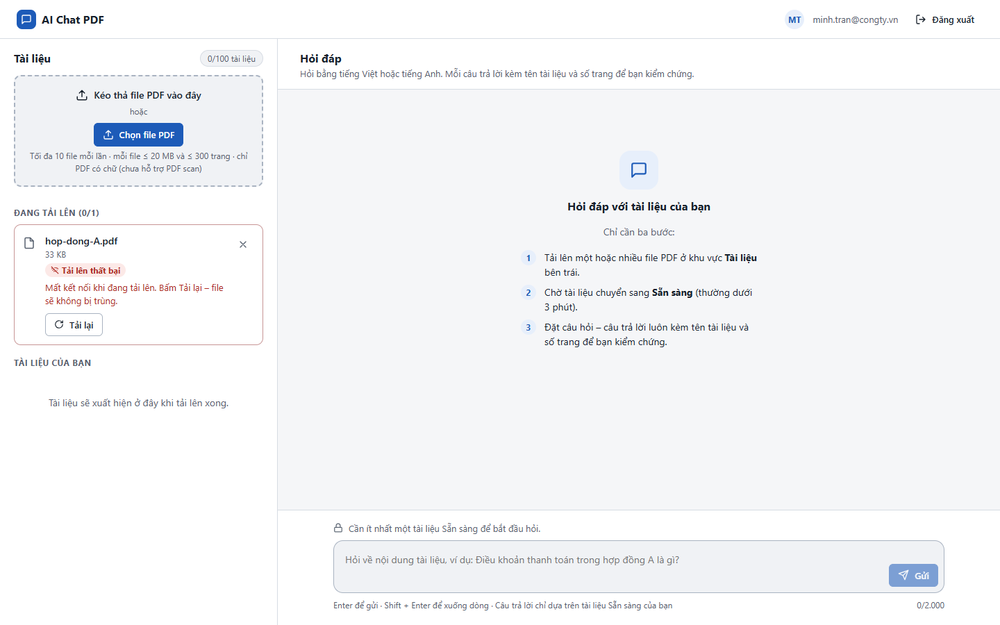
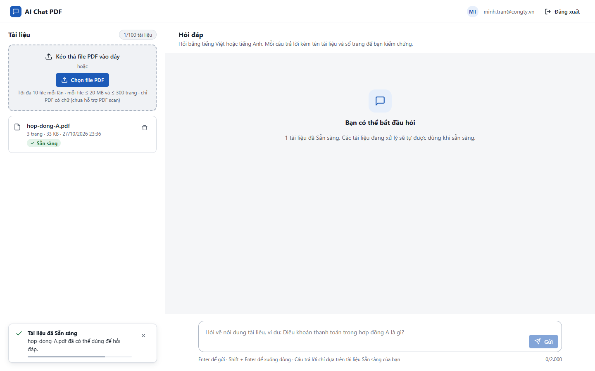

# Test report – E2E-005: Mất mạng khi tải lên và tải lại

| Trường | Giá trị |
|---|---|
| Test case | [E2E-005](../../doc/07-verification/test_cases/E2E-005_mat-mang-khi-tai-len-va-tai-lai.md) |
| Kết luận | **ĐẠT** |
| Bắt đầu | 2026-10-27T16:36:26.530Z |
| Kết thúc | 2026-10-27T16:36:36.492Z (10.0 s) |
| Cách thực hiện | Tự động – Playwright (app/frontend/evidence/fixture.ts) |
| URL ứng dụng | http://localhost:8080/ |
| Bản build | 166929f + thay đổi chưa commit trong app/ |
| Trình duyệt | Microsoft Edge (Playwright, channel msedge) |
| Hệ điều hành | win32 x64 |
| Spec | app/frontend/testcases/E2E-005_mat-mang-khi-tai-len-va-tai-lai.spec.ts |

## Kết quả từng bước

| # | Bước | Kết quả mong đợi | Kết quả thực tế | Trạng thái | Bằng chứng |
|---|---|---|---|---|---|
| 1 | Đăng nhập P2, xóa tài liệu cũ | Danh sách rỗng | Như mong đợi | Đạt | [ảnh](screenshots/01-dang-nhap-p2-xoa-tai-lieu-cu.png) |
| 2 | Chặn request PUT tải file (abort internetdisconnected) | Đã bật chặn | Như mong đợi | Đạt | [ảnh](screenshots/02-chan-request-put-tai-file-abort-internetdisconnect.png) |
| 3 | Chọn hop-dong-A.pdf | Dòng Tải lên thất bại – "Mất kết nối…", có nút Tải lại; không ở mục Tài liệu của bạn | Như mong đợi | Đạt | [ảnh](screenshots/03-chon-hop-dong-a-pdf.png) |
| 4 | Bỏ chặn, bấm Tải lại | File tải lên thành công → Đang xử lý → Sẵn sàng | Như mong đợi | Đạt | [ảnh](screenshots/04-bo-chan-bam-tai-lai.png) |
| 5 | Kiểm tra danh sách và hạn mức | Đúng 1 tài liệu hop-dong-A.pdf; 1/100 tài liệu | Như mong đợi | Đạt | [ảnh](screenshots/05-kiem-tra-danh-sach-va-han-muc.png) |

## Video

- [E2E-005-app.webm](video/E2E-005-app.webm)

## Ảnh chụp màn hình

## Log

- (không có)

## Ghi chú / lỗi phát hiện

- (không có)
